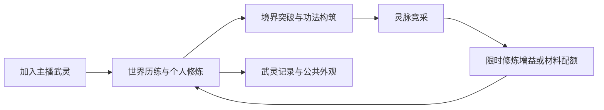

# 武灵修仙直播互动整合策划案 v1.1

日期：2026-10-21，Asia/Hong_Kong。用途：产品评审、数值试算和开发 AI 交接。状态：完整设计初案，尚未进入运行逻辑实施或平台发布。

本方案将独立游戏 GDD 的功法构筑、世界历练、资源供给和势力目标，整合到现有“主播修士＋观众剑灵＋主播创建武灵”的直播互动项目。核心新增内容是主播带队争取灵脉开采权，获取限时在线修炼增益或资源配额；世界历练始终提供不依赖争夺胜负的基础供给。

交给其他AI时，可直接上传[单文件完整版](完整策划案.md)，其中附有全部配置表；需要分工实施或运行验证时使用[完整压缩包](../武灵修仙策划包_v1.1.zip)。

## 1 阅读与使用

| 文档 | 负责的问题 |
|---|---|
| [01 游戏功能策划案](01-游戏功能策划案.md) | 身份、武灵、界面、系统状态和异常 |
| [02 商业化策划案](02-商业化策划案.md) | 礼物价值、重复赠送、指标与主播经营 |
| [03 数值策划案](03-数值策划案.md) | 境界、修为、争夺评分、经济收支、属性公式 |
| [04 物品策划案](04-物品策划案.md) | 物品、归属、来源、消耗、绑定及有效期 |
| [05 活动策划案](05-活动策划案.md) | 日常、周活动、月度、限定活动与运营 |
| [06 商店策划案](06-商店策划案.md) | 原型商店、价格、限购与资源回收 |
| [07 交易策划案](07-交易策划案.md) | 原型寄售、税费、托管、竞态与失败恢复 |
| [08 游戏玩法策划案](08-游戏玩法策划案.md) | 世界、功法、资源争夺、心流和差异化 |
| [09 AI 开发交接](09-AI开发交接.md) | 可直接复制的任务说明、阶段和验收 |
| [10 平台适配与来源](10-平台适配与来源.md) | 抖音规则、待确认能力、原 GDD 映射 |
| [配置与验证说明](tables/README.md) | CSV、JSON 字段和数值检查命令 |

配置表是本版新增数值的单一来源。文档中的算例用于解释配置；遇到冲突先报告，不自行选择更有利于收入的数值。所有内部 ID 仅供开发，观众界面使用中文名称。

## 2 用户已确认与本版建议

已确认：主播为修士，初始一把本命剑；观众是剑灵；观众境界自动突破且不消耗突破材料；主播突破需要材料；存在已配置的礼物及特殊剑灵；主播创建并命名武灵，观众发送“加入”成为成员；希望主播争夺资源以改善修炼收益，货币与材料也可以通过世界历练获取。

本版建议值：一个正式武灵归属、跨武灵临时助战、退会24小时再入会、10分钟事件、2至4主播竞采、30分钟单份资源租期、普通资源可交易白名单、NPC 商店价格、34境界成长曲线。它们是可实现的设计选择，不冒充用户逐项确认或已经上线的规则。

本次只增加文档和独立数值验证脚本；不调整已配置的礼物，不覆盖人工资产，不把历史“无武灵”文档原地改写。该旧范围在本方案涉及的组织系统上由本次用户要求取代。

## 3 两种环境与发布状态

`prototype_full` 是封闭开发环境，用模拟身份与模拟经济验证完整设计，支持原型商店、原型寄售、离线成长和多实例竞采；不能接真实付费或公开发布。

`douyin_release_candidate` 是发布候选配置，跨主播竞采、跨日数值继承、商店、交易、离线成长、跨房间数值权益默认关闭。单房间基础玩法也必须完成提案、能力、正式履约及发布审核。现有礼物仅作为待审计基线，不因为保留映射就自动具备发布资格。

这两个环境属于开发与平台适配配置，不是让独立游戏借用直播 SDK 获取数据，也不通过更名规避平台限制。原型功能不能仅切换一个客户端按钮进入正式环境。

## 4 关键设计决定

1. 灵脉优势是限时在线收益：单武灵同一时间只能激活一份开采权，不提高下一次竞采的标准化属性。
2. 无资源点仍可完整获得世界历练的基础材料；占点不解锁付费关卡，不拦截其他武灵的基础资源。
3. 武灵公共资财、主播个人财产、观众个人修为与礼物权益分别记账。主播不能取走成员特殊剑权益。
4. 竞采以同目标完成、主播操作和成员协作为主，不设计两队剑阵互相伤害，也不按礼物金额竞价。
5. 商店、交易有完整原型规格；抖音候选版本关闭入口及接口，不能把商城改叫补给站就启用。
6. 不照搬独立 GDD 的永久杀人、婚恋亲属、势力兼并和每次大境界2.5至5倍复利；它们与当前直播身份和长期平衡冲突。
7. 平台有效期、礼物权益与多主播能力按具体提案确认。未确认不对用户承诺永久，不以本月积分兑换下一场战斗优势。

## 5 本版验算边界

随包脚本校验境界单阶差值、物品引用、资源奖励、商店余额、寄售货币守恒、灵脉收益上限和开关；另输出无礼物及明确假设的成长情景。它证明配置内部一致性，不证明 UE 实现、真实服务、安全性、支付履约或商业转化。检查结果见 [数值检查报告](validation-report.json)。
