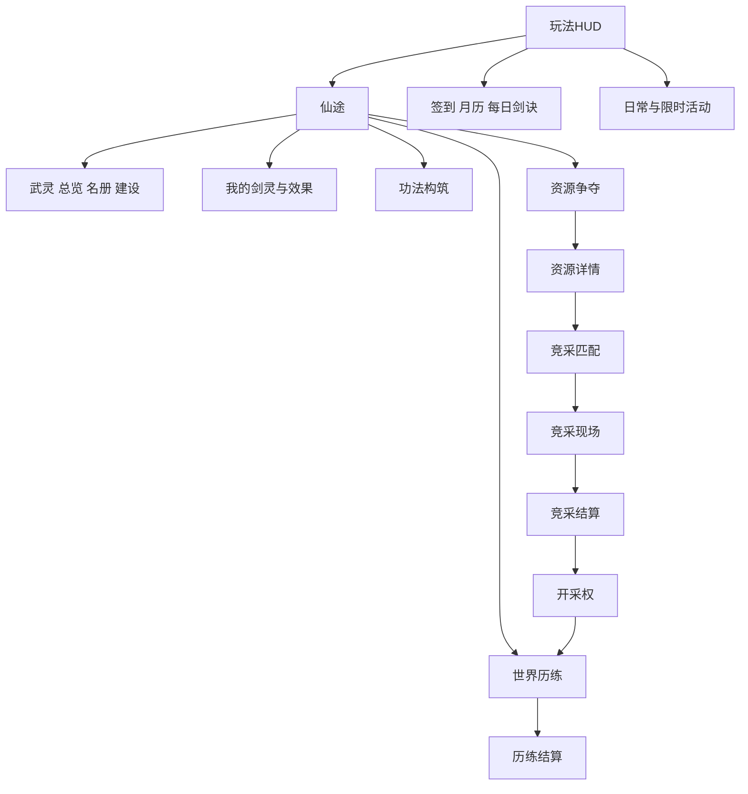

# 武灵修仙 UI专项交接完整版

文档版本v1.2，日期2026-10-21。供开发AI制作当前项目UI系统；本次仅生成策划和清单，不生成运行WBP。先阅读第13份文档的任务说明。


# UI 系统策划案

文档版本v1.2，日期2026-10-21。经济和玩法规则沿用v1.1，本次增加UI系统、文件交付和资产复用规范。这里列出的新页面和新文件是未来开发交付物，本次没有创建它们的运行代码或uasset。

## 1 产品边界和当前事实

主程序为UE5.8，主播操作修士和武灵，观众通过平台互动成为剑灵。主播UI、推流给观众看的HUD、观众互动面板是三种界面，不能把主播鼠标可点的按钮当成观众可以在视频上点击的按钮。

本次实地检查：项目保留7个WBP、18张T_纹理和现有材质，C++已有主菜单、HUD、背包、排行、角色、签到、活动、区域、资源等面板。UInkWulingPanel已经调用UWulingPrototypeSubsystem的创建、名册、历练与突破接口。资源争夺、日月签到、部分活动仍有明确的占位/预览文案。源码存在不能证明服务和界面完整运行，本次没有PIE截图或UAsset控件树加载验证。

当前项目未见旧docs、SourceAssets和大部分Tools目录；本次从本聊天生成记录恢复策划资料，不恢复删除的游戏工具或服务实现。UI实施AI应先核对缺失后端依赖，不能因面板已有HTTP调用就宣称业务已完成。

## 2 三种展示面

| 展示面 | 操作者 | 应包含 | 不应假设 |
|---|---|---|---|
| 主播UE管理界面 | 主播鼠标键盘 | 创建武灵、名册、路线、功法、报名、突破、原型经济 | 观众能操作主播管理按钮 |
| 推流HUD与播报 | 所有观众观看 | 主播境界、当前事件、个人突破、资源倍率、真实贡献 | 点击视频里的角色/背包即可弹出个人页 |
| 平台观众互动面板 | 观众 | 支持能力内的加入、响应、规则、礼物效果 | 已有UE WBP可以直接导出为平台H5 |

首阶段先做UE和评论指令；观众侧独立面板只有确认平台技术栈、接口及权限后另行实施。未确认时提供“发送剑灵查看”的简洁反馈，不编造可点击个人仓库。平台面板的独立交付范围见12。

## 3 导航和窗口层级

主菜单保留开始、继续、存档、设置、退出五项。玩法底部保留角色、物品入口、排行、菜单；活动、签到、仙途沿用右上入口。武灵通过仙途→武灵进入，不新增一排遮挡主角的主导航。资源争夺、功法、我的剑灵在仙途与相应详情互相链接。

层级建议：场景0；常驻HUD10；短播报20；完整页面100；确认与详情200；连接/处理中提示300。连接提示不得拦住取消/返回。普通页面只保留一个顶层，详情使用导航栈；Esc先关弹窗，再退详情，再回HUD，不能一次退到主菜单。

跨页保留列表筛选、页码和滚动位置；退出物品详情清除悬浮提示但不清空库存；横竖切换保留选中项、请求ID和当前状态。页面打开不默认暂停在线服务器事件。



## 4 必须交付的页面

完整逐屏矩阵见tables/ui-screens.csv；每个页面标注当前实现状态、复用类、目标蓝图、数据源、主操作和开放条件。

### 4.1 主菜单和常驻HUD

复用现有WBP_InkFrontend、MainMenu和UInkAnchorStatusWidget；保持相机、角色和本命剑构图。HUD左上显示主播身份、境界、实际生命、修为、修炼状态；当前事件目标放侧边或顶部，右下保留修炼/收功。资源增益使用小徽标显示“灵泉+20%／剩余时间”，点开或主播操作展开来源明细。

HUD新增最多三种短条：事件进度、当前资源效果、最近个人高光。连续突破合并同一人，屏幕内最多3条，每条3至5秒；队列只决定展示，不改变到账。头像缺失用明确占位，不用虚构真人头像。

### 4.2 武灵总览 名册 管理 建设

复用UInkWulingPanel，扩展为总览、成员、建设、记录四个子页。总览显示审核后的武灵名、主播、成员总数、参与成员、临时助战、公共资材、声望、当前开采权；总数与参与人数不能混用。

未创建状态显示创建条件、名称输入、免费创建；输入长度2至12汉字等效、审核中、驳回及7日改名限制都要有状态。成员分页20，行字段为头像、显示名、境界、成员身份、当前参与、当日贡献。详情只暴露适合公开的显示ID，隐藏平台原始身份键。

主播可改名、查看记录、移除成员、解散；移除/解散必须确认，说明个人权益保留。观众通过允许的输入加入/退出，不能从推流画面借用主播管理权限。建设列出三个外观项目、100公共资材成本、当前状态及记录；不伪造未规划的永久倍率或职位售卖。

现有面板中的“世界历练”卡片保留捷径，数据与世界页使用同一ViewModel，不把同一事件在两页各启动一轮。

### 4.3 我的剑灵和礼物效果说明

显示当前查看身份、归属武灵、境界、修为、当前称号、已解锁特殊剑、有效增益和来源。主播与观众视角必须区分，观众剑灵没有生命、防御和死亡栏。特殊剑以一把个人剑灵的形态/能力呈现，不把解锁数量当作额外观众人数。

选择称号只改变表现；旧基线中其他已解锁被动不因换称号关闭。详情显示来源、幅度、对象、持续/到期、叠加规则和当前模式效果。正式礼物价格来自真实配置，不从AI写死。旧权益与候选数值版本分别显示，不把测试效果描述成已购买效果。

缺失权益、到期、暂不适用、测试数据、正式数据、断线未确认均有标签；点击说明不触发购买。购买必须经平台官方送礼路径。推流上展示个人信息应遵循已获准范围，不向其他人暴露全量库存和原始账号。

### 4.4 角色 功法 物品 排行

角色页复用已有资产和属性卡，不新增总战力。主播有生命和防御，观众不显示这两项。突破弹窗显示修为、灵石、破境石当前/需求、可选质量及结果；材料不足给出世界历练入口，不把礼物设为唯一补齐入口。

功法页显示1主修、当前开放辅修槽、境界锁定说明、七路线列表和详情。点击功法→查看主辅差异→选择位置→预览变化→服务端确认；事件运行中禁换，原因可见。第3/6级强化按规则表，不在UI自行计算另一种倍率。

物品页保留现有模型：当前源码200总槽、默认20解锁、每页40。不要按旧记忆退回100槽，也不新增付费开格。保留分类、搜索、筛选、整理、数量、未读、新物品、锁定、说明、使用/装备/出售/分解及禁用理由。新的经济物品补充归属、绑定、到期、来源和托管状态；无相应业务能力时动作隐藏或明确禁用，不假扣币。悬停蓝、选中金的既定反馈要求要在实施时结合当前材质核对。

排行保留真实主播剑灵数、修炼速度和有效伤害，新增武灵/竞采视图时注明周期与规则。现有窄版榜单与每屏8行布局优先复用，不用本地榜冒充全服。没有好友能力就不提供可点击的假好友榜。

### 4.5 世界历练 区域详情 结算

复用WorldCultivation和RegionDetail，列表显示前三个首发区域与后续区域的真实开放状态。详情显示主题、固定难度、基础奖励、路线、10分钟时间结构和参与说明。开始前选择独行/小/中/大预设；运行中冻结选择。

页面状态：可开始→准备→进行→恢复→结算中→已完成/已中断。进行中显示本轮时间、当前阶段、主播生命、共同目标、已确认阶段奖励；30秒恢复明确保留已完成阶段。结算区分基础阶段产出、个人修为、个人贡献、公共资材与额外核心，各写收据状态；领取仅确认展示，不再发一次奖励。

### 4.6 资源列表 详情 匹配 竞采 结算 开采权

资源页覆盖灵泉、灵石矿、灵草园、玄铁脉、残卷遗址五类。每张卡显示作用对象、单位产出、间隔、最长租期、是否已有开采权和报名条件。旧页面“占领”文案按本案配额规则更新，不误导为已经控制其他主播领地。

资源详情→匹配大厅：显示2至4真实武灵、人数档、目标资源、统一规则、是否满足至少1名正式成员、等待时间、取消。60秒无对手可转世界历练；没有真实对手不画假头像。

竞采现场：120秒准备/360秒挑战/120秒结算三个阶段，显示共同任务600、主播操作200、成员协作200。代表名单冻结，最多10人；分母、正确响应、未响应明确。把礼物即时表现与统一计分规则分别说明；不显示送礼金额充当得分。

结算显示分数来源、并列分组、600分资格和30/20/10分钟租期，未达标写清原因。开采权页显示服务器start/end、剩余时间、实际受益身份、有效在线积累、已入账物品和下一档进度。第600秒结算自动生效，“领取”按钮只确认展示，不延后租期。

原型获胜是高档配额，不是唯一矿点，因此允许多个并列获胜；画面不能假装只有一个占领者。服务断线只显示最后确认快照与“更新暂停”，不在客户端继续计资源。

### 4.7 签到 月签 每日剑诀 日常 限时活动

复用现有组页和日历。日签到显示可签、请求中、已签、跨日刷新；月历以服务器日期呈现，累计节点统一改为3/7/14/21，不能继续沿用旧页7/14/21/28。每日一签改为固定轮换剑诀与行动提示，不做随机吉凶/付费改签。

日常卡显示实际目标、进度、预算、已领取状态；限时卡显示准确起止、时区和有效期，无起止不生成假的倒计时。活动详情显示免费参与方式、固定奖励和是否替换基础预算。

旧Draw、随机单抽/十连和出诊页可保留开发预览资产，但不进入本案正式业务导航。不要因素材中有召唤、抽奖按钮就新增抽取业务。原参考图的宠物武灵内容不适用于当前“武灵是组织”的定义。

### 4.8 离线收益和原型经济页

离线页只在该profile获准时出现：上次结算、本次有效时长、8小时上限、基础10%、修为结果、原收据。显示不受灵脉和礼物放大。到账后点击只是确认，不让跨设备重复领取。

商店展示SKU、真实成本、绑定材料、产物、日限购、窗口唯一与期限；寄售页展示白名单原料、单价区间、数量、税、挂牌费、总价、物品到期与托管；订单页列我的挂牌、已成交、取消、到期和应收记录。它们仅供prototype_full；发布候选隐藏入口且接口拒绝，错误也不得返回可购买目录。

## 5 公共交互系统

每屏都有Loading、Ready、Empty、Pending、Disconnected、Error、Expired、FeatureDisabled状态。空状态给出下一步；请求中锁提交、不锁返回；成功使用服务端快照；失败保留输入并说明原因；关闭页不中断已提交事务，回到页面根据request_id对账。

复用组件：带理由禁用按钮、状态条、确认弹窗、成员行、物品详情、奖励格、贡献行、租约徽标、礼物效果卡、短提示。红点只来自真实未读/可领取状态，进入页面不产生奖励，不做永久假红点。

## 6 版式与视觉

白宣纸、墨线、山水、少量金边；蓝用于交互/选项，朱砂用于提醒；不能把所有内容都涂金。按钮、纸卡、进度条先用现有材质，不先生成另一套风格。动态中文、人数、期限、货币、境界使用TextBlock，不烘焙在新图里。

竖屏设计基准720×1280，SafeZone内四边至少24逻辑单位。正文建议24至28、说明20至22、标题32至40；在540×960验证正文最终可读像素，不能把大面板等比缩成小字。按钮高度至少56、触控热点优先64，间距8至16。

横屏1280×720采用列表＋详情双栏；竖屏列表与详情分层，避免左右挤压。物品竖屏4列、横屏8列，每页仍40槽，竖屏通过滚动呈现，不改变物理格索引。成员20行分页，界面同时显示多少由可视区域决定；不把所有名单生成场景剑实体。

排行保留每屏8行的当前组织方式，不强行把所有新列表也做8行。长武灵名、昵称、长金额、未知头像、200物品格、高数量都必须验证；重要数值有完整详情，缩写不能丢失到账依据。

## 7 实施顺序

UI-P0盘点和路由/数据隔离；UI-P1武灵、世界历练、个人剑灵与结算；UI-P2功法、资源详情、匹配、竞采、开采权；UI-P3签到活动真实接线与原型经济；平台观众独立面板作为确认能力后的单独任务。详细文件和验收见12、13。


# UI 素材与文件清单

本案说明复用什么、补画什么、开发AI应生成哪些文件。清单里的“planned”是将来交付物，本次只生成策划文档、清单和素材检查证据，未生成新的游戏UI纹理或Widget Blueprint。

## 1 已检查的素材与限制

本次逐张查看桌面UI资源目录的11张PNG：主菜单按钮、排行榜、称号、标题海报、背包、两张境界图、四张功能参考图。项目内18张T_纹理完成文件盘点，其中7张提取出可解码的256像素JPEG缩略图并查看。缩略图不代表源纹理尺寸、Alpha质量或实际运行效果。

源文件路径、大小和SHA256见ui-audit/reference-images.json；项目资产见tables/ui-existing-assets.csv；纹理缩略图证据见ui-audit/texture-inspection.json。缩略图总览：[已有图集预览](ui-audit/existing-atlases-contact-sheet.jpg)。本次不把历史截图当成当前PIE截图，不把文件存在当成材质正确加载。

## 2 复用决定

| 资产组 | 可复用内容 | 处理方式 |
|---|---|---|
| Widgets现有7个WBP | Frontend、MainMenu、Character、Inventory、Leaderboard、Saves、Settings | 保留路径和人工配置，增量接入 |
| Cohesion20261021 | 控件皮肤、16格图标、山水场景、现有称号光效 | 当前InkPresentationStyle主要使用此组，优先复用 |
| Portrait20261021 | 纸卡、条轨和填充等 | 当前进度条优先来自此组，不无理由替换 |
| Polish | 装饰和旧控件皮肤 | 用作兼容和缺省，不整套覆盖当前主题 |
| Provided | 背包、排行、按钮、称号原图集 | 复用已有UV和材质实例，避免把整图当一张界面 |
| Cultivation | 境界图、境界横幅、功能场景 | 复用境界与装饰，动态名称另行排版 |
| Materials/Atlas | 通用图集和背包图集材质、Fit/Slice实例 | 复用九宫格与等比显示，不能任意拉长图案 |
| Materials/Leaderboard | 行底、奖章、称号、滚动条和标题 | 保留既有窄榜布局与图集切片 |

代码证据：InkPresentationStyle::Surface当前为纸卡/按钮选择MI_Cohesion_，条轨/填充选择MI_Portrait_；CohesionIcon用4×4UV；旧排行榜/背包使用专用图集和切片材质。新AI应沿这个调用链核对，不按文件日期猜哪套正在使用。

## 3 参考图逐项覆盖

| 参考图 | 本案吸收 | 不直接实施的内容 |
|---|---|---|
| 14_34_12-1 签到活动 | 日签、月历、每日剑诀、日常/限时卡片、奖励展示 | 补签付费、单抽/十连、随机奖池 |
| 14_34_15-2 出诊修行 | 区域选择、产出、进度、资源卡、名次与结算 | 出诊派遣留旧预览，不成为本次新增主循环 |
| 14_34_17-3 门派武灵 | 门派部分改为武灵总览、成员、公共外观、旗帜 | 底部宠物召唤/培养/图鉴不进入当前武灵组织 |
| 14_34_18-4 角色属性 | 属性卡、身份、头像框、条轨、境界表现 | 总战力、虚构装备/法宝数值、观众独立生命 |
| 背包原图 | 分类、格态、数量、新标记、说明、搜索、滚动、动作 | 不能因为图上有出售/分解就忽略来源与profile约束 |
| 排行原图 | 奖章、标题、头像、行底、范围与周期 | 不创建没有好友/全服后端支撑的假数据 |
| 按钮原图 | 普通、悬停、按下、禁用、返回、确认、开关 | 烘焙文字不作为动态新按钮的唯一文字来源 |
| 称号原图 | 既有特殊剑横幅与空白底板 | 保留用户现有名称，AI不擅改“无机态那”等命名 |
| 境界两图 | 34境界的视觉语义、徽记与横幅 | 不把整张境界表缩进一条姓名栏 |

## 4 新文件结构

精确到每个文件的列表见tables/ui-files.csv，含add/modify/reuse、阶段、目标类和用途。所有新路径是计划，不是已存在证明。

```text
Source/BoundlessImmortality/Frontend/UI/
  InkUiScreenRegistry.h/.cpp
  InkUiViewModels.h/.cpp
  InkUiCommonWidgets.h/.cpp
  InkUiRacePanels.h/.cpp
  InkUiSwordPanels.h/.cpp
  InkUiMethodPanel.h/.cpp
  InkUiEconomyPanels.h/.cpp
  InkUiRewardPanels.h/.cpp

Content/UI/Ink/Wuling/
  Widgets/       13个页面级WBP
  Components/     9个共用WBP
  Data/           路由与主题两个DataAsset
  Textures/       4张按需补充的图集

SourceAssets/UI/Wuling/
  Generated/      4张图集源PNG
  atlas-regions.json
  art-manifest.md

Tools/InkFrontend/
  inspect_wuling_ui_assets.py
  verify_wuling_ui_pie.py
  wuling-ui-acceptance.json
```

这些目录有一部分当前已经被删除，计划中的Tools文件将来由UI实施者新建；本次不把检查文档恢复误报为已恢复游戏工具。先核对同名文件再添加，不覆盖用户后来新增的资产。

## 5 页面蓝图和原生类

13个页面WBP：WulingOverview、SwordSpirit、GiftRules、Methods、RaceLobby、RaceLive、RaceSettlement、ResourceLease、EventSettlement、OfflineRewards、Shop、Market、TradeOrders，统一前缀WBP_Ink，完整路径见CSV。

WulingOverview继承现有UInkWulingPanel；新页面继承对应的UInkFeaturePanel派生类。既有签到、活动、资源列表/详情继续用当前原生页面，不另造第二个功能相同的顶层WBP。

当前原生面板创建并拥有WidgetTree。新WBP首版作为可配置的类/样式入口，原生层仍独占控件树构建，不能同时在Designer加一棵根树又被RebuildPanel重建。若后续改为Designer拥有控件树，应单独迁移并验证，不混用两种所有权。

新增UInkUiScreenRegistry保存Route→WidgetClass→FeatureGate→ParentRoute映射，通过DA_InkWulingScreens注册新WBP；现有ClassForRoute只作为兼容入口。一个Route只注册一次，缺失资产在开发模式明确告警，正式模式按能力失败关闭，不静默打开错误页面。

9个组件WBP：RequestState、ConfirmModal、MemberRow、RewardItem、ItemTooltip、ContributionRow、LeaseBadge、GiftEffectCard、Toast。其原生类由InkUiCommonWidgets实现，组件不直接访问HTTP或扣币。

## 6 新增美术需求

先完成复用核对，只补缺失语义。下面4张是本案的生成任务，不要求AI重新生成全部现有按钮与面板。具体单元索引、源路径和导入路径见tables/ui-art-requests.csv。

| 源图和目标纹理 | 规格 | 单元内容 |
|---|---|---|
| WulingItemIcons.png → T_WulingItemIcons | 2048×2048，4×4，每格512 | 破境石、核心、草、铁、残页、丹、护符、研习简、精华、灵石、公共资材、贡献、武灵、租约、锁、提醒 |
| WulingResourceIcons.png → T_WulingResourceIcons | 1536×1024，3×2 | 灵泉、矿、药园、铁脉、遗址、共修 |
| WulingMethodIcons.png → T_WulingMethodIcons | 2048×1024，4×2 | 七路线功法，第8格空态 |
| WulingEmblems.png → T_WulingEmblems | 1536×1024，3×2 | 六种预设武灵徽记，无写死名称 |

统一要求：水墨修仙、少量青金、轮廓在64像素仍清楚、真实RGBA透明底、不烘焙文字、格内留至少32像素安全边；图集单元不能跨格装饰。格坐标用左上原点，JSON记录像素矩形和归一化UV，切片不能凭肉眼猜。

绑定/交易、稀有度、剩余时间用独立图层和文本，不为同一种草额外生成绑定草与交易草两张图片。武灵自定义名称使用字体，首版仅预设徽记，不引入任意用户上传图案。

导入要求：UI纹理组、明确Alpha、保持长宽比；是否关闭MipMap及过滤由实际目标设备采样决定并记录，不能盲目改变全部旧纹理。可复用M_InkAtlasUI以UV绘制，无需为16个图标各复制一套材质。九宫格只用于可伸缩纸卡，徽章、人物与场景使用等比裁切。

生成前如果发现现有图集已经能清楚表达该语义，复用并在art-manifest标明替代，取消对应新任务；文件清单要同步更新，不能留下无引用资产。

## 7 观众平台面板的条件交付

UE Widget不能直接打包成平台互动面板。只有确认平台支持且产品决定提供独立观众面板后，才在独立目录PlatformUI/WulingAudience实现：manifest、Home、MySword、JoinWuling、Respond、GiftRules五个页面、shared主题/请求状态/官方身份适配、README与测试配置。

源码扩展名、平台CLI及构建产物必须根据当时应用支持的框架决定，本案不凭空指定Vue/React或小程序API。它是待能力确认的独立工作包，不阻塞当前评论指令路径，也不能用普通网页登录冒充官方身份。


# UI 数据交互与验收

本案让UI开发AI按真实数据完成交互。界面展示、业务权威、礼物履约各自负责，不把动画播完当成材料已入账。

## 1 ViewModel契约

所有快照包含profile、app、room、session_generation、rule_version、server_utc、snapshot_version、is_authoritative。开发模拟数据要有可见标签，正式模式禁止本地伪造名次或余额。

| ViewModel | 主要字段 | 业务来源 |
|---|---|---|
| AnchorVm | 姓名、头像、境界、生命、修为、行为、突破成本 | 当前Cultivation与武灵原型适配器，按当前规则选唯一权威 |
| GuildVm | 名称审核、主播、三类人数、公共资材、声望、权限、名册游标 | 武灵服务快照 |
| SwordVm | 查看身份、个人境界、修为、归属、已解锁剑、显示称号 | 当前个人成长/权益，未经许可不跨房间显示数值 |
| GiftEffectVm | 来源、对象、倍率、原始时间、到期、版本、当前模式说明 | 实际礼物收据与权益计算 |
| MethodVm | 主辅槽、等级、研习需求、当前配置、锁定原因 | 功法规则与权威配置 |
| WorldVm | round_id、预设、路线、阶段、恢复、目标、已完成奖励 | 唯一事件快照 |
| RaceVm | race_id、真实房间、名单、代表、阶段、三类分数、规则hash | 竞采服务，不使用客户端自报分数 |
| LeaseVm | lease_id、类型、start/end、在线累计、发放游标、受益范围 | 资源租约服务 |
| RewardVm | receipt_id、各归属奖励、处理中/确认/已展示 | 唯一奖励收据 |
| InventoryVm | 实例ID、数量、归属、绑定、期限、来源、托管、动作权限 | 原型经济服务，既有UInkInventoryModel只是本地展示适配 |
| ActivityVm | 开放时间、周期、计数、领取状态、预算版本 | 活动和签到服务 |
| EconomyVm | SKU、余额、限购、价格版本、订单、税费、应收 | 仅原型经济接口 |

UI不得在NativeTick内重新执行加修为、领奖、生成物品、清零CD等业务。刷新使用版本变化或事件驱动，倒计时只做插值。服务器时间失联后明确暂停同步，不通过本地倒计时生成下一份奖励。

## 2 共用请求流程

Ready→Submitting→PendingReconcile→Confirmed/Rejected；Loading/Disconnected/FeatureDisabled作为页面能力状态。按钮提交时只创建一个request_id，同一次重试使用原ID；超时不自行判成功或再生成新交易。

Confirmed后展示服务端结果和receipt；用户点“知道了/收下展示”只标记已读。Rejected后恢复可操作状态，保留输入，展示具体原因。退页不取消已提交服务事务；回页查询原ID。新的用户/房间代次必须丢弃旧回调。

仅受影响的按钮禁用：创建处理中仍可返回；买入处理中仍可看别页；匹配等待可取消。不可在服务断线时保留“可购买/可领取”假状态。

## 3 特定交互

- 创建武灵：校验名称→提交→审核/成功→进入总览。双击不能创建两份。
- 加入/退出：指令与平台面板共用业务命令；重复加入返回已有关系，退出展示24小时再入会限制。
- 突破：查看成本→确认→服务扣料与突破→播放仪式→刷新。仪式中断不会回滚已确认境界，也不会再次扣料。
- 配置功法：草稿预览不影响战斗，确认后由服务端校验准备期并应用；失败保留原配置。
- 资源报名：前置profile/成员/无活跃租约→匹配→准备→统一规则→结算；取消与匹配成功竞态由服务结果决定。
- 资源领取：服务器结算已自动开始租期，按钮仅确认，界面显示原start/end。
- 物品绑定：显示不可逆及原到期→确认→同事务1比1转换，绑定后卖出按钮禁用并有理由。
- 制作/寄售：使用价格/订单版本，旧价确认过期重新展示，不按新价格暗扣；无后端时不做本地假成功。
- 高光播报：收据已确认后排队；合并只影响展示，不丢入账。满队列保留可回看记录。

## 4 公开信息与权限

推流展示经过审核的武灵名、允许展示的昵称、个人突破和贡献。平台原始ID、鉴权信息、订单私密数据不进入文本、截图、错误提示。主播点开成员详情也只看到必要信息；观众不能通过改viewed_user_id访问他人私有资产。

隐藏按钮不等于权限控制。主播/观众、profile、房间、资产所有者必须由服务端再次校验。发布候选对商店、交易、抽取及未核准多主播UI拒绝直达路由、控制台命令和HTTP请求。

## 5 验收矩阵

每个screen_id至少覆盖Ready、Empty、Loading、Pending、Disconnected、Error、FeatureDisabled，具有有效期者再覆盖Expired；不是每屏都显示所有状态控件，而是有明确定义的表现和返回路径。屏幕ID和具体用例见tables/ui-acceptance.csv。

### 布局

540×960、720×1280、1280×720必须分别渲染截图。增加长昵称、12字武灵名、超大数值、空头像、满物品格、服务断线。竖屏不能左右挤成小字，滚动到底仍能看到操作，确认弹窗不越出SafeZone。记录截图实际分辨率、字体和热点尺寸，不只断言控件存在。

### 导航

逐条验证HUD→仙途→武灵→成员详情→返回；资源列表→详情→匹配→取消→返回；完整竞采→结算→开采权→世界；物品搜索→详情→返回保留筛选；活动分组内部切页不能多压一层导航栈。横竖切换不清空输入或重复请求，Esc恢复输入焦点和角色控制。

### 业务

创建/签到/领奖双击；超时后重试；提交后关页；旧代次回包；跨日月签到；满生命治疗与护持预算；被移除武灵后开采加成停止；租期关播到期；多页展示同一事件；制作/购买余额不足；市场双买家；重复“领取”只展示一次。实际实现后用真实开发服务事务验证，本次策划检查不代替。

### 保护与回归

主菜单五按钮、既有背包、8行榜单、角色、存档、设置、原地图和相机回归。旧七WBP、素材和手工配置修改前后校验，差异需有明确原因。既有200格模型保持，新的绑定/期限/来源字段不能被本地默认bSellable=true覆盖。

当前Tools中旧验收脚本不在；实施者需按清单新建，不能引用不存在的工具或把历史Windows报告当本轮通过。Windows PIE只证明本机渲染和交互，平台面板、手机设备、正式履约、跨机器竞采分别验收。

## 6 可直接交给UI开发AI的任务

```text
请读取本包11、12、13以及tables/ui-screens.csv、ui-files.csv、ui-art-requests.csv、ui-acceptance.csv，按UI-P0至P3实施。

先核对当前工程：7个基础WBP、InkFeaturePanel路由、InkPresentationStyle、InkWulingPanel和UWulingPrototypeSubsystem。复用现有纸卡按钮进度条与背包排行材质，先核对SourceAssets和Tools缺失情况。

本次产品的武灵是主播创建、观众剑灵加入的组织，不能实现成宠物召唤系统。保留主菜单五入口和现有HUD导航。现有200格、默认20解锁和每页40格不回退为旧100格。

先完成UI-P0数据/路由/请求状态与UI-P1武灵、世界、个人剑灵、结算；先给出具体实现计划和复用差异，再按已授权范围开发。已有原型页面增量完善，不重复造另一套顶层UI框架。

新增文件按ui-files.csv；新图仅按ui-art-requests.csv补缺，先复用，不能为每个页面重新生成一套按钮。动态文字使用UMG，不烘焙进新图。新WBP采用原生构建树和薄样式类入口，不与Designer重复拥有WidgetTree。

UI只绑定权威快照，不本地发材料/扣币。无后端保持未接入或预览状态，不伪造成功。商店交易只在prototype_full展示，发布候选关闭路由和接口；旧抽取演示不进入正式导航。观众平台面板在技术能力确认后另行实施，UE WBP不能直接当平台页面。

交付源码、实际uasset、源PNG、UV清单和导入记录、三分辨率截图、交互/服务测试报告以及待完成项。不要只给一张UI效果图或一份蓝图文件名清单。若有缺失依赖，明确指出并先完成不依赖它的复用组件与静态布局。
```


# UI计划配置表

## ui-screens.csv

```csv
screen_id,route,title,current_status,native_class,widget_asset,parent,phase,feature_gate,view_model,primary_action,surface
UI_MAIN,Main,主菜单,existing_wbp_and_source_not_runtime_tested,UInkFrontendWidget,Content/UI/Ink/Widgets/WBP_InkMainMenu.uasset,,UI-P1,base,FrontendVm,开始或继续,anchor_ue
UI_HUD,HUD,常驻HUD,existing_wbp_and_source_not_runtime_tested,UInkFrontendWidget,Content/UI/Ink/Widgets/WBP_InkFrontend.uasset,,UI-P1,base,AnchorVm|WorldVm|LeaseVm,修炼收功及导航,anchor_ue
UI_CHARACTER,Character,角色,existing_wbp_and_source_not_runtime_tested,UInkFrontendWidget,Content/UI/Ink/Widgets/WBP_InkCharacter.uasset,UI_HUD,UI-P1,base,AnchorVm,主播突破,anchor_ue
UI_INVENTORY,Inventory,物品,existing_wbp_and_source_not_runtime_tested,UInkFrontendWidget,Content/UI/Ink/Widgets/WBP_InkInventory.uasset,UI_HUD,UI-P1,economic_inventory,InventoryVm,选中详情及允许动作,anchor_ue
UI_RANK,Leaderboard,排行,existing_wbp_and_source_not_runtime_tested,UInkFrontendWidget,Content/UI/Ink/Widgets/WBP_InkLeaderboard.uasset,UI_HUD,UI-P1,base,LeaderboardVm,切换真实榜单,anchor_ue
UI_SAVES,Saves,存档,existing_wbp_and_source_not_runtime_tested,UInkFrontendWidget,Content/UI/Ink/Widgets/WBP_InkSaves.uasset,UI_HUD,UI-P1,base,SaveVm,明确本地存档范围,anchor_ue
UI_SETTINGS,Settings,设置,existing_wbp_and_source_not_runtime_tested,UInkFrontendWidget,Content/UI/Ink/Widgets/WBP_InkSettings.uasset,UI_HUD,UI-P1,base,SettingsVm,保存允许设置,anchor_ue
UI_WULING,Wuling,武灵总览成员建设记录,existing_native_prototype_calls,UInkWulingPanel,Content/UI/Ink/Wuling/Widgets/WBP_InkWulingOverview.uasset,UI_HUD,UI-P1,base,GuildVm|WorldVm,创建与成员管理,anchor_ue
UI_SWORD,SwordSpirit,我的剑灵,new_planned,UInkSwordSpiritPanel,Content/UI/Ink/Wuling/Widgets/WBP_InkSwordSpirit.uasset,UI_WULING,UI-P1,base,SwordVm|GiftEffectVm,查看权益及选择称号,anchor_ue
UI_GIFT_RULES,GiftRules,礼物效果说明,new_planned,UInkGiftRulesPanel,Content/UI/Ink/Wuling/Widgets/WBP_InkGiftRules.uasset,UI_SWORD,UI-P1,base,GiftEffectVm,查看当前模式和期限,anchor_ue
UI_METHODS,CultivationMethods,功法构筑,new_planned,UInkMethodsPanel,Content/UI/Ink/Wuling/Widgets/WBP_InkMethods.uasset,UI_CHARACTER,UI-P2,base,MethodVm,准备期确认配置,anchor_ue
UI_RACE_LOBBY,RaceLobby,竞采匹配,new_planned,UInkRaceLobbyPanel,Content/UI/Ink/Wuling/Widgets/WBP_InkRaceLobby.uasset,UI_RESOURCE_DETAIL,UI-P2,cross_host_race,RaceVm|GuildVm,报名或取消,anchor_ue
UI_RACE_LIVE,RaceLive,竞采现场,new_planned,UInkRaceLivePanel,Content/UI/Ink/Wuling/Widgets/WBP_InkRaceLive.uasset,UI_RACE_LOBBY,UI-P2,cross_host_race,RaceVm,响应当前阶段,anchor_ue
UI_RACE_RESULT,RaceSettlement,竞采结算,new_planned,UInkRaceSettlementPanel,Content/UI/Ink/Wuling/Widgets/WBP_InkRaceSettlement.uasset,UI_RACE_LIVE,UI-P2,cross_host_race,RaceVm|RewardVm,确认展示及查看开采权,anchor_ue
UI_LEASE,ResourceLease,当前开采权,new_planned,UInkResourceLeasePanel,Content/UI/Ink/Wuling/Widgets/WBP_InkResourceLease.uasset,UI_RACE_RESULT,UI-P2,cross_host_race,LeaseVm,回历练或共修,anchor_ue
UI_ROUND_RESULT,EventSettlement,历练结算,new_planned,UInkEventSettlementPanel,Content/UI/Ink/Wuling/Widgets/WBP_InkEventSettlement.uasset,UI_WORLD,UI-P1,base,RewardVm,确认展示,anchor_ue
UI_OFFLINE,OfflineRewards,离线收益,new_planned,UInkOfflineRewardsPanel,Content/UI/Ink/Wuling/Widgets/WBP_InkOfflineRewards.uasset,UI_HUD,UI-P3,offline_cultivation,RewardVm,确认已入账展示,anchor_ue
UI_SHOP,Shop,原型商店,new_planned,UInkShopPanel,Content/UI/Ink/Wuling/Widgets/WBP_InkShop.uasset,UI_HUD,UI-P3,npc_shop,EconomyVm|InventoryVm,确认制作或购买,anchor_ue
UI_MARKET,Market,原型寄售,new_planned,UInkMarketPanel,Content/UI/Ink/Wuling/Widgets/WBP_InkMarket.uasset,UI_HUD,UI-P3,player_trade,EconomyVm|InventoryVm,整单买入或挂牌,anchor_ue
UI_ORDERS,TradeOrders,我的订单,new_planned,UInkTradeOrdersPanel,Content/UI/Ink/Wuling/Widgets/WBP_InkTradeOrders.uasset,UI_MARKET,UI-P3,player_trade,EconomyVm,撤单与查看应收,anchor_ue
UI_WORLD,WorldCultivation,世界历练,existing_live_qi_plus_preview_regions,UInkWorldCultivationPanel,,UI_HUD,UI-P1,base,WorldVm|AnchorVm,选路线难度并开始,anchor_ue
UI_REGION,RegionDetail,区域详情,existing_preview,UInkRegionDetailPanel,,UI_WORLD,UI-P1,base,WorldVm,查看固定供给,anchor_ue
UI_RESOURCES,ResourceContest,资源争夺,existing_preview,UInkResourceContestPanel,,UI_HUD,UI-P2,cross_host_race,LeaseVm|RaceVm,选择五类资源,anchor_ue
UI_RESOURCE_DETAIL,ResourceDetail,资源详情,existing_preview,UInkResourceDetailPanel,,UI_RESOURCES,UI-P2,cross_host_race,LeaseVm|RaceVm,查看条件及进入匹配,anchor_ue
UI_SIGN,SignIn,签到组及日签到,existing_preview,UInkSignInGroupPanel,,UI_HUD,UI-P3,cross_session_numeric,ActivityVm,每日一次签到,anchor_ue
UI_MONTH,MonthlySignIn,月签到,existing_preview_old_7_14_21_28,UInkMonthlySignInPanel,,UI_SIGN,UI-P3,cross_session_numeric,ActivityVm,累计3_7_14_21节点,anchor_ue
UI_VERSE,DailyFortune,每日剑诀,existing_demo_text,UInkDailyFortunePanel,,UI_SIGN,UI-P3,base,ActivityVm,查看固定轮换剑诀,anchor_ue
UI_ACTIVITIES,Activities,活动组,existing_preview,UInkActivitiesGroupPanel,,UI_HUD,UI-P3,base,ActivityVm,切换日常与限时,anchor_ue
UI_DAILY,DailyActivities,日常活动,existing_preview,UInkDailyActivitiesPanel,,UI_ACTIVITIES,UI-P3,base,ActivityVm,查看真实目标,anchor_ue
UI_LIMITED,TimedActivities,限时活动,existing_preview,UInkTimedActivitiesPanel,,UI_ACTIVITIES,UI-P3,base,ActivityVm,查看已定时间活动,anchor_ue
UI_ACTIVITY_DETAIL,DailyActivityDetail,日常详情,existing_preview,UInkDailyActivityDetailPanel,,UI_DAILY,UI-P3,base,ActivityVm,参与允许活动,anchor_ue
UI_TIMED_DETAIL,TimedActivityDetail,限时详情,existing_preview,UInkTimedActivityDetailPanel,,UI_LIMITED,UI-P3,base,ActivityVm,查看期限及参与,anchor_ue
```

## ui-files.csv

```csv
path,action,phase,native_class,screen_ids,purpose,existed_at_audit
Source/BoundlessImmortality/Frontend/UI/InkUiScreenRegistry.h,add_planned,UI-P0,UInkUiScreenRegistry|UInkUiThemeData,,路由和主题DataAsset及现有路由兼容,false
Source/BoundlessImmortality/Frontend/UI/InkUiScreenRegistry.cpp,add_planned,UI-P0,UInkUiScreenRegistry|UInkUiThemeData,,路由和主题DataAsset及现有路由兼容,false
Source/BoundlessImmortality/Frontend/UI/InkUiViewModels.h,add_planned,UI-P0,UInkUiViewModelSubsystem,,唯一权威快照与请求状态映射,false
Source/BoundlessImmortality/Frontend/UI/InkUiViewModels.cpp,add_planned,UI-P0,UInkUiViewModelSubsystem,,唯一权威快照与请求状态映射,false
Source/BoundlessImmortality/Frontend/UI/InkUiCommonWidgets.h,add_planned,UI-P0,UInkUiRequestStateWidget及共用组件,,共用控件不持有交易业务,false
Source/BoundlessImmortality/Frontend/UI/InkUiCommonWidgets.cpp,add_planned,UI-P0,UInkUiRequestStateWidget及共用组件,,共用控件不持有交易业务,false
Source/BoundlessImmortality/Frontend/UI/InkUiRacePanels.h,add_planned,UI-P2,UInkRaceLobbyPanel|UInkRaceLivePanel|UInkRaceSettlementPanel|UInkResourceLeasePanel,,竞采匹配现场结算与租约,false
Source/BoundlessImmortality/Frontend/UI/InkUiRacePanels.cpp,add_planned,UI-P2,UInkRaceLobbyPanel|UInkRaceLivePanel|UInkRaceSettlementPanel|UInkResourceLeasePanel,,竞采匹配现场结算与租约,false
Source/BoundlessImmortality/Frontend/UI/InkUiSwordPanels.h,add_planned,UI-P1,UInkSwordSpiritPanel|UInkGiftRulesPanel,,个人剑灵与礼物版本说明,false
Source/BoundlessImmortality/Frontend/UI/InkUiSwordPanels.cpp,add_planned,UI-P1,UInkSwordSpiritPanel|UInkGiftRulesPanel,,个人剑灵与礼物版本说明,false
Source/BoundlessImmortality/Frontend/UI/InkUiMethodPanel.h,add_planned,UI-P2,UInkMethodsPanel,,主辅功法与准备期配置,false
Source/BoundlessImmortality/Frontend/UI/InkUiMethodPanel.cpp,add_planned,UI-P2,UInkMethodsPanel,,主辅功法与准备期配置,false
Source/BoundlessImmortality/Frontend/UI/InkUiEconomyPanels.h,add_planned,UI-P3,UInkShopPanel|UInkMarketPanel|UInkTradeOrdersPanel,,原型经济且发布候选关闭,false
Source/BoundlessImmortality/Frontend/UI/InkUiEconomyPanels.cpp,add_planned,UI-P3,UInkShopPanel|UInkMarketPanel|UInkTradeOrdersPanel,,原型经济且发布候选关闭,false
Source/BoundlessImmortality/Frontend/UI/InkUiRewardPanels.h,add_planned,UI-P1,UInkEventSettlementPanel|UInkOfflineRewardsPanel,,分归属奖励收据及离线开关,false
Source/BoundlessImmortality/Frontend/UI/InkUiRewardPanels.cpp,add_planned,UI-P1,UInkEventSettlementPanel|UInkOfflineRewardsPanel,,分归属奖励收据及离线开关,false
Source/BoundlessImmortality/Frontend/InkFrontendWidget.h,modify_planned,UI-P0_to_P3,,,新增注册表与视图缓存引用,true
Source/BoundlessImmortality/Frontend/InkFrontendWidget.cpp,modify_planned,UI-P0_to_P3,,,沿用主菜单与HUD接入状态,true
Source/BoundlessImmortality/Frontend/InkFrontendExtensions.cpp,modify_planned,UI-P0_to_P3,,,新路由及返回栈和能力校验,true
Source/BoundlessImmortality/Frontend/InkFeaturePanel.cpp,modify_planned,UI-P0_to_P3,,,优先注册表且保留旧路由,true
Source/BoundlessImmortality/Frontend/InkWulingPanel.cpp,modify_planned,UI-P0_to_P3,,,已有武灵面板增量接线与子页,true
Source/BoundlessImmortality/Frontend/InkFeaturePanels.cpp,modify_planned,UI-P0_to_P3,,,世界与五资源页面接线,true
Source/BoundlessImmortality/Frontend/InkRewardsPanels.cpp,modify_planned,UI-P0_to_P3,,,签到月签与活动去占位,true
Source/BoundlessImmortality/Frontend/InkInventoryWidget.cpp,modify_planned,UI-P0_to_P3,,,实例来源绑定期限与权限提示,true
Source/BoundlessImmortality/Frontend/InkInventoryModel.h,modify_planned,UI-P0_to_P3,,,展示模型增加权威实例属性并保留200格,true
Source/BoundlessImmortality/Frontend/InkInventoryModel.cpp,modify_planned,UI-P0_to_P3,,,不可出售及栈合并约束,true
Source/BoundlessImmortality/Frontend/InkFrontendTypes.h,modify_planned,UI-P0_to_P3,,,显示数据字段与业务ID分离,true
Content/UI/Ink/Widgets/WBP_InkMainMenu.uasset,reuse,UI-P1,UInkFrontendWidget,UI_MAIN,主菜单,true
Content/UI/Ink/Widgets/WBP_InkFrontend.uasset,reuse,UI-P1,UInkFrontendWidget,UI_HUD,常驻HUD,true
Content/UI/Ink/Widgets/WBP_InkCharacter.uasset,reuse,UI-P1,UInkFrontendWidget,UI_CHARACTER,角色,true
Content/UI/Ink/Widgets/WBP_InkInventory.uasset,reuse,UI-P1,UInkFrontendWidget,UI_INVENTORY,物品,true
Content/UI/Ink/Widgets/WBP_InkLeaderboard.uasset,reuse,UI-P1,UInkFrontendWidget,UI_RANK,排行,true
Content/UI/Ink/Widgets/WBP_InkSaves.uasset,reuse,UI-P1,UInkFrontendWidget,UI_SAVES,存档,true
Content/UI/Ink/Widgets/WBP_InkSettings.uasset,reuse,UI-P1,UInkFrontendWidget,UI_SETTINGS,设置,true
Content/UI/Ink/Wuling/Widgets/WBP_InkWulingOverview.uasset,add_planned,UI-P1,UInkWulingPanel,UI_WULING,武灵总览成员建设记录,false
Content/UI/Ink/Wuling/Widgets/WBP_InkSwordSpirit.uasset,add_planned,UI-P1,UInkSwordSpiritPanel,UI_SWORD,我的剑灵,false
Content/UI/Ink/Wuling/Widgets/WBP_InkGiftRules.uasset,add_planned,UI-P1,UInkGiftRulesPanel,UI_GIFT_RULES,礼物效果说明,false
Content/UI/Ink/Wuling/Widgets/WBP_InkMethods.uasset,add_planned,UI-P2,UInkMethodsPanel,UI_METHODS,功法构筑,false
Content/UI/Ink/Wuling/Widgets/WBP_InkRaceLobby.uasset,add_planned,UI-P2,UInkRaceLobbyPanel,UI_RACE_LOBBY,竞采匹配,false
Content/UI/Ink/Wuling/Widgets/WBP_InkRaceLive.uasset,add_planned,UI-P2,UInkRaceLivePanel,UI_RACE_LIVE,竞采现场,false
Content/UI/Ink/Wuling/Widgets/WBP_InkRaceSettlement.uasset,add_planned,UI-P2,UInkRaceSettlementPanel,UI_RACE_RESULT,竞采结算,false
Content/UI/Ink/Wuling/Widgets/WBP_InkResourceLease.uasset,add_planned,UI-P2,UInkResourceLeasePanel,UI_LEASE,当前开采权,false
Content/UI/Ink/Wuling/Widgets/WBP_InkEventSettlement.uasset,add_planned,UI-P1,UInkEventSettlementPanel,UI_ROUND_RESULT,历练结算,false
Content/UI/Ink/Wuling/Widgets/WBP_InkOfflineRewards.uasset,add_planned,UI-P3,UInkOfflineRewardsPanel,UI_OFFLINE,离线收益,false
Content/UI/Ink/Wuling/Widgets/WBP_InkShop.uasset,add_planned,UI-P3,UInkShopPanel,UI_SHOP,原型商店,false
Content/UI/Ink/Wuling/Widgets/WBP_InkMarket.uasset,add_planned,UI-P3,UInkMarketPanel,UI_MARKET,原型寄售,false
Content/UI/Ink/Wuling/Widgets/WBP_InkTradeOrders.uasset,add_planned,UI-P3,UInkTradeOrdersPanel,UI_ORDERS,我的订单,false
Content/UI/Ink/Wuling/Components/WBP_InkRequestState.uasset,add_planned,UI-P0,UInkUiRequestStateWidget,,共用RequestState,false
Content/UI/Ink/Wuling/Components/WBP_InkConfirmModal.uasset,add_planned,UI-P0,UInkUiConfirmModalWidget,,共用ConfirmModal,false
Content/UI/Ink/Wuling/Components/WBP_InkMemberRow.uasset,add_planned,UI-P0,UInkUiMemberRowWidget,,共用MemberRow,false
Content/UI/Ink/Wuling/Components/WBP_InkRewardItem.uasset,add_planned,UI-P0,UInkUiRewardItemWidget,,共用RewardItem,false
Content/UI/Ink/Wuling/Components/WBP_InkItemTooltip.uasset,add_planned,UI-P0,UInkUiItemTooltipWidget,,共用ItemTooltip,false
Content/UI/Ink/Wuling/Components/WBP_InkContributionRow.uasset,add_planned,UI-P0,UInkUiContributionRowWidget,,共用ContributionRow,false
Content/UI/Ink/Wuling/Components/WBP_InkLeaseBadge.uasset,add_planned,UI-P0,UInkUiLeaseBadgeWidget,,共用LeaseBadge,false
Content/UI/Ink/Wuling/Components/WBP_InkGiftEffectCard.uasset,add_planned,UI-P0,UInkUiGiftEffectCardWidget,,共用GiftEffectCard,false
Content/UI/Ink/Wuling/Components/WBP_InkToast.uasset,add_planned,UI-P0,UInkUiToastWidget,,共用Toast,false
Content/UI/Ink/Wuling/Data/DA_InkWulingScreens.uasset,add_planned,UI-P0,UInkUiScreenRegistry,,Route与WidgetClass唯一映射,false
Content/UI/Ink/Wuling/Data/DA_InkWulingTheme.uasset,add_planned,UI-P0,UInkUiThemeData,,引用现有皮肤与文字样式,false
SourceAssets/UI/Wuling/Generated/WulingItemIcons.png,add_if_not_reusable,UI-P1_to_P3,,,图集源图,false
Content/UI/Ink/Wuling/Textures/T_WulingItemIcons.uasset,add_if_not_reusable,UI-P1_to_P3,,,导入的UI图集,false
SourceAssets/UI/Wuling/Generated/WulingResourceIcons.png,add_if_not_reusable,UI-P1_to_P3,,,图集源图,false
Content/UI/Ink/Wuling/Textures/T_WulingResourceIcons.uasset,add_if_not_reusable,UI-P1_to_P3,,,导入的UI图集,false
SourceAssets/UI/Wuling/Generated/WulingMethodIcons.png,add_if_not_reusable,UI-P1_to_P3,,,图集源图,false
Content/UI/Ink/Wuling/Textures/T_WulingMethodIcons.uasset,add_if_not_reusable,UI-P1_to_P3,,,导入的UI图集,false
SourceAssets/UI/Wuling/Generated/WulingEmblems.png,add_if_not_reusable,UI-P1_to_P3,,,图集源图,false
Content/UI/Ink/Wuling/Textures/T_WulingEmblems.uasset,add_if_not_reusable,UI-P1_to_P3,,,导入的UI图集,false
SourceAssets/UI/Wuling/atlas-regions.json,add_planned,UI-P0_to_P3,,,实际像素切片与UV,false
SourceAssets/UI/Wuling/art-manifest.md,add_planned,UI-P0_to_P3,,,来源复用生成与导入记录,false
Tools/InkFrontend/inspect_wuling_ui_assets.py,add_planned,UI-P0_to_P3,,,只读资产引用审计,false
Tools/InkFrontend/verify_wuling_ui_pie.py,add_planned,UI-P0_to_P3,,,真实渲染与交互验证,false
Tools/InkFrontend/wuling-ui-acceptance.json,add_planned,UI-P0_to_P3,,,UI验收场景配置,false
```

## ui-art-requests.csv

```csv
art_id,source_path,texture_path,width,height,columns,rows,alpha,safe_inset,cell_order,units,status,style
ART_ITEMICONS,SourceAssets/UI/Wuling/Generated/WulingItemIcons.png,Content/UI/Ink/Wuling/Textures/T_WulingItemIcons.uasset,2048,2048,4,4,true_rgba,32,row_major_top_left,破境石|精炼核心|灵草|玄铁|残页|回复丹|护阵符|研习简|凝元精华|灵石|公共资材|个人贡献|武灵|开采权|绑定锁|提醒,planned_generate_only_if_missing,water_ink_small_gold_no_baked_text
ART_RESOURCEICONS,SourceAssets/UI/Wuling/Generated/WulingResourceIcons.png,Content/UI/Ink/Wuling/Textures/T_WulingResourceIcons.uasset,1536,1024,3,2,true_rgba,32,row_major_top_left,灵泉|灵石矿|灵草园|玄铁脉|残卷遗址|共修,planned_generate_only_if_missing,water_ink_small_gold_no_baked_text
ART_METHODICONS,SourceAssets/UI/Wuling/Generated/WulingMethodIcons.png,Content/UI/Ink/Wuling/Textures/T_WulingMethodIcons.uasset,2048,1024,4,2,true_rgba,32,row_major_top_left,疾锋|星罗|玄罡|回响|合契|燃脉|百蚀|空态,planned_generate_only_if_missing,water_ink_small_gold_no_baked_text
ART_EMBLEMS,SourceAssets/UI/Wuling/Generated/WulingEmblems.png,Content/UI/Ink/Wuling/Textures/T_WulingEmblems.uasset,1536,1024,3,2,true_rgba,32,row_major_top_left,青云|星河|玄铁|丹霞|松鹤|问道,planned_generate_only_if_missing,water_ink_small_gold_no_baked_text
```

## ui-acceptance.csv

```csv
case_id,screen_id,case,resolutions,expected,scope,current_result
UI_MAIN_Ready,UI_MAIN,Ready,540x960|720x1280|1280x720,按13状态规范处理且可返回,planned_runtime_verification,not_run
UI_MAIN_Empty,UI_MAIN,Empty,540x960|720x1280|1280x720,按13状态规范处理且可返回,planned_runtime_verification,not_run
UI_MAIN_Loading,UI_MAIN,Loading,540x960|720x1280|1280x720,按13状态规范处理且可返回,planned_runtime_verification,not_run
UI_MAIN_Pending,UI_MAIN,Pending,540x960|720x1280|1280x720,按13状态规范处理且可返回,planned_runtime_verification,not_run
UI_MAIN_Disconnected,UI_MAIN,Disconnected,540x960|720x1280|1280x720,按13状态规范处理且可返回,planned_runtime_verification,not_run
UI_MAIN_Error,UI_MAIN,Error,540x960|720x1280|1280x720,按13状态规范处理且可返回,planned_runtime_verification,not_run
UI_MAIN_FeatureDisabled,UI_MAIN,FeatureDisabled,540x960|720x1280|1280x720,按13状态规范处理且可返回,planned_runtime_verification,not_run
UI_HUD_Ready,UI_HUD,Ready,540x960|720x1280|1280x720,按13状态规范处理且可返回,planned_runtime_verification,not_run
UI_HUD_Empty,UI_HUD,Empty,540x960|720x1280|1280x720,按13状态规范处理且可返回,planned_runtime_verification,not_run
UI_HUD_Loading,UI_HUD,Loading,540x960|720x1280|1280x720,按13状态规范处理且可返回,planned_runtime_verification,not_run
UI_HUD_Pending,UI_HUD,Pending,540x960|720x1280|1280x720,按13状态规范处理且可返回,planned_runtime_verification,not_run
UI_HUD_Disconnected,UI_HUD,Disconnected,540x960|720x1280|1280x720,按13状态规范处理且可返回,planned_runtime_verification,not_run
UI_HUD_Error,UI_HUD,Error,540x960|720x1280|1280x720,按13状态规范处理且可返回,planned_runtime_verification,not_run
UI_HUD_FeatureDisabled,UI_HUD,FeatureDisabled,540x960|720x1280|1280x720,按13状态规范处理且可返回,planned_runtime_verification,not_run
UI_CHARACTER_Ready,UI_CHARACTER,Ready,540x960|720x1280|1280x720,按13状态规范处理且可返回,planned_runtime_verification,not_run
UI_CHARACTER_Empty,UI_CHARACTER,Empty,540x960|720x1280|1280x720,按13状态规范处理且可返回,planned_runtime_verification,not_run
UI_CHARACTER_Loading,UI_CHARACTER,Loading,540x960|720x1280|1280x720,按13状态规范处理且可返回,planned_runtime_verification,not_run
UI_CHARACTER_Pending,UI_CHARACTER,Pending,540x960|720x1280|1280x720,按13状态规范处理且可返回,planned_runtime_verification,not_run
UI_CHARACTER_Disconnected,UI_CHARACTER,Disconnected,540x960|720x1280|1280x720,按13状态规范处理且可返回,planned_runtime_verification,not_run
UI_CHARACTER_Error,UI_CHARACTER,Error,540x960|720x1280|1280x720,按13状态规范处理且可返回,planned_runtime_verification,not_run
UI_CHARACTER_FeatureDisabled,UI_CHARACTER,FeatureDisabled,540x960|720x1280|1280x720,按13状态规范处理且可返回,planned_runtime_verification,not_run
UI_INVENTORY_Ready,UI_INVENTORY,Ready,540x960|720x1280|1280x720,按13状态规范处理且可返回,planned_runtime_verification,not_run
UI_INVENTORY_Empty,UI_INVENTORY,Empty,540x960|720x1280|1280x720,按13状态规范处理且可返回,planned_runtime_verification,not_run
UI_INVENTORY_Loading,UI_INVENTORY,Loading,540x960|720x1280|1280x720,按13状态规范处理且可返回,planned_runtime_verification,not_run
UI_INVENTORY_Pending,UI_INVENTORY,Pending,540x960|720x1280|1280x720,按13状态规范处理且可返回,planned_runtime_verification,not_run
UI_INVENTORY_Disconnected,UI_INVENTORY,Disconnected,540x960|720x1280|1280x720,按13状态规范处理且可返回,planned_runtime_verification,not_run
UI_INVENTORY_Error,UI_INVENTORY,Error,540x960|720x1280|1280x720,按13状态规范处理且可返回,planned_runtime_verification,not_run
UI_INVENTORY_FeatureDisabled,UI_INVENTORY,FeatureDisabled,540x960|720x1280|1280x720,按13状态规范处理且可返回,planned_runtime_verification,not_run
UI_RANK_Ready,UI_RANK,Ready,540x960|720x1280|1280x720,按13状态规范处理且可返回,planned_runtime_verification,not_run
UI_RANK_Empty,UI_RANK,Empty,540x960|720x1280|1280x720,按13状态规范处理且可返回,planned_runtime_verification,not_run
UI_RANK_Loading,UI_RANK,Loading,540x960|720x1280|1280x720,按13状态规范处理且可返回,planned_runtime_verification,not_run
UI_RANK_Pending,UI_RANK,Pending,540x960|720x1280|1280x720,按13状态规范处理且可返回,planned_runtime_verification,not_run
UI_RANK_Disconnected,UI_RANK,Disconnected,540x960|720x1280|1280x720,按13状态规范处理且可返回,planned_runtime_verification,not_run
UI_RANK_Error,UI_RANK,Error,540x960|720x1280|1280x720,按13状态规范处理且可返回,planned_runtime_verification,not_run
UI_RANK_FeatureDisabled,UI_RANK,FeatureDisabled,540x960|720x1280|1280x720,按13状态规范处理且可返回,planned_runtime_verification,not_run
UI_SAVES_Ready,UI_SAVES,Ready,540x960|720x1280|1280x720,按13状态规范处理且可返回,planned_runtime_verification,not_run
UI_SAVES_Empty,UI_SAVES,Empty,540x960|720x1280|1280x720,按13状态规范处理且可返回,planned_runtime_verification,not_run
UI_SAVES_Loading,UI_SAVES,Loading,540x960|720x1280|1280x720,按13状态规范处理且可返回,planned_runtime_verification,not_run
UI_SAVES_Pending,UI_SAVES,Pending,540x960|720x1280|1280x720,按13状态规范处理且可返回,planned_runtime_verification,not_run
UI_SAVES_Disconnected,UI_SAVES,Disconnected,540x960|720x1280|1280x720,按13状态规范处理且可返回,planned_runtime_verification,not_run
UI_SAVES_Error,UI_SAVES,Error,540x960|720x1280|1280x720,按13状态规范处理且可返回,planned_runtime_verification,not_run
UI_SAVES_FeatureDisabled,UI_SAVES,FeatureDisabled,540x960|720x1280|1280x720,按13状态规范处理且可返回,planned_runtime_verification,not_run
UI_SETTINGS_Ready,UI_SETTINGS,Ready,540x960|720x1280|1280x720,按13状态规范处理且可返回,planned_runtime_verification,not_run
UI_SETTINGS_Empty,UI_SETTINGS,Empty,540x960|720x1280|1280x720,按13状态规范处理且可返回,planned_runtime_verification,not_run
UI_SETTINGS_Loading,UI_SETTINGS,Loading,540x960|720x1280|1280x720,按13状态规范处理且可返回,planned_runtime_verification,not_run
UI_SETTINGS_Pending,UI_SETTINGS,Pending,540x960|720x1280|1280x720,按13状态规范处理且可返回,planned_runtime_verification,not_run
UI_SETTINGS_Disconnected,UI_SETTINGS,Disconnected,540x960|720x1280|1280x720,按13状态规范处理且可返回,planned_runtime_verification,not_run
UI_SETTINGS_Error,UI_SETTINGS,Error,540x960|720x1280|1280x720,按13状态规范处理且可返回,planned_runtime_verification,not_run
UI_SETTINGS_FeatureDisabled,UI_SETTINGS,FeatureDisabled,540x960|720x1280|1280x720,按13状态规范处理且可返回,planned_runtime_verification,not_run
UI_WULING_Ready,UI_WULING,Ready,540x960|720x1280|1280x720,按13状态规范处理且可返回,planned_runtime_verification,not_run
UI_WULING_Empty,UI_WULING,Empty,540x960|720x1280|1280x720,按13状态规范处理且可返回,planned_runtime_verification,not_run
UI_WULING_Loading,UI_WULING,Loading,540x960|720x1280|1280x720,按13状态规范处理且可返回,planned_runtime_verification,not_run
UI_WULING_Pending,UI_WULING,Pending,540x960|720x1280|1280x720,按13状态规范处理且可返回,planned_runtime_verification,not_run
UI_WULING_Disconnected,UI_WULING,Disconnected,540x960|720x1280|1280x720,按13状态规范处理且可返回,planned_runtime_verification,not_run
UI_WULING_Error,UI_WULING,Error,540x960|720x1280|1280x720,按13状态规范处理且可返回,planned_runtime_verification,not_run
UI_WULING_FeatureDisabled,UI_WULING,FeatureDisabled,540x960|720x1280|1280x720,按13状态规范处理且可返回,planned_runtime_verification,not_run
UI_SWORD_Ready,UI_SWORD,Ready,540x960|720x1280|1280x720,按13状态规范处理且可返回,planned_runtime_verification,not_run
UI_SWORD_Empty,UI_SWORD,Empty,540x960|720x1280|1280x720,按13状态规范处理且可返回,planned_runtime_verification,not_run
UI_SWORD_Loading,UI_SWORD,Loading,540x960|720x1280|1280x720,按13状态规范处理且可返回,planned_runtime_verification,not_run
UI_SWORD_Pending,UI_SWORD,Pending,540x960|720x1280|1280x720,按13状态规范处理且可返回,planned_runtime_verification,not_run
UI_SWORD_Disconnected,UI_SWORD,Disconnected,540x960|720x1280|1280x720,按13状态规范处理且可返回,planned_runtime_verification,not_run
UI_SWORD_Error,UI_SWORD,Error,540x960|720x1280|1280x720,按13状态规范处理且可返回,planned_runtime_verification,not_run
UI_SWORD_FeatureDisabled,UI_SWORD,FeatureDisabled,540x960|720x1280|1280x720,按13状态规范处理且可返回,planned_runtime_verification,not_run
UI_GIFT_RULES_Ready,UI_GIFT_RULES,Ready,540x960|720x1280|1280x720,按13状态规范处理且可返回,planned_runtime_verification,not_run
UI_GIFT_RULES_Empty,UI_GIFT_RULES,Empty,540x960|720x1280|1280x720,按13状态规范处理且可返回,planned_runtime_verification,not_run
UI_GIFT_RULES_Loading,UI_GIFT_RULES,Loading,540x960|720x1280|1280x720,按13状态规范处理且可返回,planned_runtime_verification,not_run
UI_GIFT_RULES_Pending,UI_GIFT_RULES,Pending,540x960|720x1280|1280x720,按13状态规范处理且可返回,planned_runtime_verification,not_run
UI_GIFT_RULES_Disconnected,UI_GIFT_RULES,Disconnected,540x960|720x1280|1280x720,按13状态规范处理且可返回,planned_runtime_verification,not_run
UI_GIFT_RULES_Error,UI_GIFT_RULES,Error,540x960|720x1280|1280x720,按13状态规范处理且可返回,planned_runtime_verification,not_run
UI_GIFT_RULES_FeatureDisabled,UI_GIFT_RULES,FeatureDisabled,540x960|720x1280|1280x720,按13状态规范处理且可返回,planned_runtime_verification,not_run
UI_METHODS_Ready,UI_METHODS,Ready,540x960|720x1280|1280x720,按13状态规范处理且可返回,planned_runtime_verification,not_run
UI_METHODS_Empty,UI_METHODS,Empty,540x960|720x1280|1280x720,按13状态规范处理且可返回,planned_runtime_verification,not_run
UI_METHODS_Loading,UI_METHODS,Loading,540x960|720x1280|1280x720,按13状态规范处理且可返回,planned_runtime_verification,not_run
UI_METHODS_Pending,UI_METHODS,Pending,540x960|720x1280|1280x720,按13状态规范处理且可返回,planned_runtime_verification,not_run
UI_METHODS_Disconnected,UI_METHODS,Disconnected,540x960|720x1280|1280x720,按13状态规范处理且可返回,planned_runtime_verification,not_run
UI_METHODS_Error,UI_METHODS,Error,540x960|720x1280|1280x720,按13状态规范处理且可返回,planned_runtime_verification,not_run
UI_METHODS_FeatureDisabled,UI_METHODS,FeatureDisabled,540x960|720x1280|1280x720,按13状态规范处理且可返回,planned_runtime_verification,not_run
UI_RACE_LOBBY_Ready,UI_RACE_LOBBY,Ready,540x960|720x1280|1280x720,按13状态规范处理且可返回,planned_runtime_verification,not_run
UI_RACE_LOBBY_Empty,UI_RACE_LOBBY,Empty,540x960|720x1280|1280x720,按13状态规范处理且可返回,planned_runtime_verification,not_run
UI_RACE_LOBBY_Loading,UI_RACE_LOBBY,Loading,540x960|720x1280|1280x720,按13状态规范处理且可返回,planned_runtime_verification,not_run
UI_RACE_LOBBY_Pending,UI_RACE_LOBBY,Pending,540x960|720x1280|1280x720,按13状态规范处理且可返回,planned_runtime_verification,not_run
UI_RACE_LOBBY_Disconnected,UI_RACE_LOBBY,Disconnected,540x960|720x1280|1280x720,按13状态规范处理且可返回,planned_runtime_verification,not_run
UI_RACE_LOBBY_Error,UI_RACE_LOBBY,Error,540x960|720x1280|1280x720,按13状态规范处理且可返回,planned_runtime_verification,not_run
UI_RACE_LOBBY_FeatureDisabled,UI_RACE_LOBBY,FeatureDisabled,540x960|720x1280|1280x720,按13状态规范处理且可返回,planned_runtime_verification,not_run
UI_RACE_LIVE_Ready,UI_RACE_LIVE,Ready,540x960|720x1280|1280x720,按13状态规范处理且可返回,planned_runtime_verification,not_run
UI_RACE_LIVE_Empty,UI_RACE_LIVE,Empty,540x960|720x1280|1280x720,按13状态规范处理且可返回,planned_runtime_verification,not_run
UI_RACE_LIVE_Loading,UI_RACE_LIVE,Loading,540x960|720x1280|1280x720,按13状态规范处理且可返回,planned_runtime_verification,not_run
UI_RACE_LIVE_Pending,UI_RACE_LIVE,Pending,540x960|720x1280|1280x720,按13状态规范处理且可返回,planned_runtime_verification,not_run
UI_RACE_LIVE_Disconnected,UI_RACE_LIVE,Disconnected,540x960|720x1280|1280x720,按13状态规范处理且可返回,planned_runtime_verification,not_run
UI_RACE_LIVE_Error,UI_RACE_LIVE,Error,540x960|720x1280|1280x720,按13状态规范处理且可返回,planned_runtime_verification,not_run
UI_RACE_LIVE_FeatureDisabled,UI_RACE_LIVE,FeatureDisabled,540x960|720x1280|1280x720,按13状态规范处理且可返回,planned_runtime_verification,not_run
UI_RACE_RESULT_Ready,UI_RACE_RESULT,Ready,540x960|720x1280|1280x720,按13状态规范处理且可返回,planned_runtime_verification,not_run
UI_RACE_RESULT_Empty,UI_RACE_RESULT,Empty,540x960|720x1280|1280x720,按13状态规范处理且可返回,planned_runtime_verification,not_run
UI_RACE_RESULT_Loading,UI_RACE_RESULT,Loading,540x960|720x1280|1280x720,按13状态规范处理且可返回,planned_runtime_verification,not_run
UI_RACE_RESULT_Pending,UI_RACE_RESULT,Pending,540x960|720x1280|1280x720,按13状态规范处理且可返回,planned_runtime_verification,not_run
UI_RACE_RESULT_Disconnected,UI_RACE_RESULT,Disconnected,540x960|720x1280|1280x720,按13状态规范处理且可返回,planned_runtime_verification,not_run
UI_RACE_RESULT_Error,UI_RACE_RESULT,Error,540x960|720x1280|1280x720,按13状态规范处理且可返回,planned_runtime_verification,not_run
UI_RACE_RESULT_FeatureDisabled,UI_RACE_RESULT,FeatureDisabled,540x960|720x1280|1280x720,按13状态规范处理且可返回,planned_runtime_verification,not_run
UI_LEASE_Ready,UI_LEASE,Ready,540x960|720x1280|1280x720,按13状态规范处理且可返回,planned_runtime_verification,not_run
UI_LEASE_Empty,UI_LEASE,Empty,540x960|720x1280|1280x720,按13状态规范处理且可返回,planned_runtime_verification,not_run
UI_LEASE_Loading,UI_LEASE,Loading,540x960|720x1280|1280x720,按13状态规范处理且可返回,planned_runtime_verification,not_run
UI_LEASE_Pending,UI_LEASE,Pending,540x960|720x1280|1280x720,按13状态规范处理且可返回,planned_runtime_verification,not_run
UI_LEASE_Disconnected,UI_LEASE,Disconnected,540x960|720x1280|1280x720,按13状态规范处理且可返回,planned_runtime_verification,not_run
UI_LEASE_Error,UI_LEASE,Error,540x960|720x1280|1280x720,按13状态规范处理且可返回,planned_runtime_verification,not_run
UI_LEASE_FeatureDisabled,UI_LEASE,FeatureDisabled,540x960|720x1280|1280x720,按13状态规范处理且可返回,planned_runtime_verification,not_run
UI_ROUND_RESULT_Ready,UI_ROUND_RESULT,Ready,540x960|720x1280|1280x720,按13状态规范处理且可返回,planned_runtime_verification,not_run
UI_ROUND_RESULT_Empty,UI_ROUND_RESULT,Empty,540x960|720x1280|1280x720,按13状态规范处理且可返回,planned_runtime_verification,not_run
UI_ROUND_RESULT_Loading,UI_ROUND_RESULT,Loading,540x960|720x1280|1280x720,按13状态规范处理且可返回,planned_runtime_verification,not_run
UI_ROUND_RESULT_Pending,UI_ROUND_RESULT,Pending,540x960|720x1280|1280x720,按13状态规范处理且可返回,planned_runtime_verification,not_run
UI_ROUND_RESULT_Disconnected,UI_ROUND_RESULT,Disconnected,540x960|720x1280|1280x720,按13状态规范处理且可返回,planned_runtime_verification,not_run
UI_ROUND_RESULT_Error,UI_ROUND_RESULT,Error,540x960|720x1280|1280x720,按13状态规范处理且可返回,planned_runtime_verification,not_run
UI_ROUND_RESULT_FeatureDisabled,UI_ROUND_RESULT,FeatureDisabled,540x960|720x1280|1280x720,按13状态规范处理且可返回,planned_runtime_verification,not_run
UI_OFFLINE_Ready,UI_OFFLINE,Ready,540x960|720x1280|1280x720,按13状态规范处理且可返回,planned_runtime_verification,not_run
UI_OFFLINE_Empty,UI_OFFLINE,Empty,540x960|720x1280|1280x720,按13状态规范处理且可返回,planned_runtime_verification,not_run
UI_OFFLINE_Loading,UI_OFFLINE,Loading,540x960|720x1280|1280x720,按13状态规范处理且可返回,planned_runtime_verification,not_run
UI_OFFLINE_Pending,UI_OFFLINE,Pending,540x960|720x1280|1280x720,按13状态规范处理且可返回,planned_runtime_verification,not_run
UI_OFFLINE_Disconnected,UI_OFFLINE,Disconnected,540x960|720x1280|1280x720,按13状态规范处理且可返回,planned_runtime_verification,not_run
UI_OFFLINE_Error,UI_OFFLINE,Error,540x960|720x1280|1280x720,按13状态规范处理且可返回,planned_runtime_verification,not_run
UI_OFFLINE_FeatureDisabled,UI_OFFLINE,FeatureDisabled,540x960|720x1280|1280x720,按13状态规范处理且可返回,planned_runtime_verification,not_run
UI_SHOP_Ready,UI_SHOP,Ready,540x960|720x1280|1280x720,按13状态规范处理且可返回,planned_runtime_verification,not_run
UI_SHOP_Empty,UI_SHOP,Empty,540x960|720x1280|1280x720,按13状态规范处理且可返回,planned_runtime_verification,not_run
UI_SHOP_Loading,UI_SHOP,Loading,540x960|720x1280|1280x720,按13状态规范处理且可返回,planned_runtime_verification,not_run
UI_SHOP_Pending,UI_SHOP,Pending,540x960|720x1280|1280x720,按13状态规范处理且可返回,planned_runtime_verification,not_run
UI_SHOP_Disconnected,UI_SHOP,Disconnected,540x960|720x1280|1280x720,按13状态规范处理且可返回,planned_runtime_verification,not_run
UI_SHOP_Error,UI_SHOP,Error,540x960|720x1280|1280x720,按13状态规范处理且可返回,planned_runtime_verification,not_run
UI_SHOP_FeatureDisabled,UI_SHOP,FeatureDisabled,540x960|720x1280|1280x720,按13状态规范处理且可返回,planned_runtime_verification,not_run
UI_MARKET_Ready,UI_MARKET,Ready,540x960|720x1280|1280x720,按13状态规范处理且可返回,planned_runtime_verification,not_run
UI_MARKET_Empty,UI_MARKET,Empty,540x960|720x1280|1280x720,按13状态规范处理且可返回,planned_runtime_verification,not_run
UI_MARKET_Loading,UI_MARKET,Loading,540x960|720x1280|1280x720,按13状态规范处理且可返回,planned_runtime_verification,not_run
UI_MARKET_Pending,UI_MARKET,Pending,540x960|720x1280|1280x720,按13状态规范处理且可返回,planned_runtime_verification,not_run
UI_MARKET_Disconnected,UI_MARKET,Disconnected,540x960|720x1280|1280x720,按13状态规范处理且可返回,planned_runtime_verification,not_run
UI_MARKET_Error,UI_MARKET,Error,540x960|720x1280|1280x720,按13状态规范处理且可返回,planned_runtime_verification,not_run
UI_MARKET_FeatureDisabled,UI_MARKET,FeatureDisabled,540x960|720x1280|1280x720,按13状态规范处理且可返回,planned_runtime_verification,not_run
UI_ORDERS_Ready,UI_ORDERS,Ready,540x960|720x1280|1280x720,按13状态规范处理且可返回,planned_runtime_verification,not_run
UI_ORDERS_Empty,UI_ORDERS,Empty,540x960|720x1280|1280x720,按13状态规范处理且可返回,planned_runtime_verification,not_run
UI_ORDERS_Loading,UI_ORDERS,Loading,540x960|720x1280|1280x720,按13状态规范处理且可返回,planned_runtime_verification,not_run
UI_ORDERS_Pending,UI_ORDERS,Pending,540x960|720x1280|1280x720,按13状态规范处理且可返回,planned_runtime_verification,not_run
UI_ORDERS_Disconnected,UI_ORDERS,Disconnected,540x960|720x1280|1280x720,按13状态规范处理且可返回,planned_runtime_verification,not_run
UI_ORDERS_Error,UI_ORDERS,Error,540x960|720x1280|1280x720,按13状态规范处理且可返回,planned_runtime_verification,not_run
UI_ORDERS_FeatureDisabled,UI_ORDERS,FeatureDisabled,540x960|720x1280|1280x720,按13状态规范处理且可返回,planned_runtime_verification,not_run
UI_WORLD_Ready,UI_WORLD,Ready,540x960|720x1280|1280x720,按13状态规范处理且可返回,planned_runtime_verification,not_run
UI_WORLD_Empty,UI_WORLD,Empty,540x960|720x1280|1280x720,按13状态规范处理且可返回,planned_runtime_verification,not_run
UI_WORLD_Loading,UI_WORLD,Loading,540x960|720x1280|1280x720,按13状态规范处理且可返回,planned_runtime_verification,not_run
UI_WORLD_Pending,UI_WORLD,Pending,540x960|720x1280|1280x720,按13状态规范处理且可返回,planned_runtime_verification,not_run
UI_WORLD_Disconnected,UI_WORLD,Disconnected,540x960|720x1280|1280x720,按13状态规范处理且可返回,planned_runtime_verification,not_run
UI_WORLD_Error,UI_WORLD,Error,540x960|720x1280|1280x720,按13状态规范处理且可返回,planned_runtime_verification,not_run
UI_WORLD_FeatureDisabled,UI_WORLD,FeatureDisabled,540x960|720x1280|1280x720,按13状态规范处理且可返回,planned_runtime_verification,not_run
UI_REGION_Ready,UI_REGION,Ready,540x960|720x1280|1280x720,按13状态规范处理且可返回,planned_runtime_verification,not_run
UI_REGION_Empty,UI_REGION,Empty,540x960|720x1280|1280x720,按13状态规范处理且可返回,planned_runtime_verification,not_run
UI_REGION_Loading,UI_REGION,Loading,540x960|720x1280|1280x720,按13状态规范处理且可返回,planned_runtime_verification,not_run
UI_REGION_Pending,UI_REGION,Pending,540x960|720x1280|1280x720,按13状态规范处理且可返回,planned_runtime_verification,not_run
UI_REGION_Disconnected,UI_REGION,Disconnected,540x960|720x1280|1280x720,按13状态规范处理且可返回,planned_runtime_verification,not_run
UI_REGION_Error,UI_REGION,Error,540x960|720x1280|1280x720,按13状态规范处理且可返回,planned_runtime_verification,not_run
UI_REGION_FeatureDisabled,UI_REGION,FeatureDisabled,540x960|720x1280|1280x720,按13状态规范处理且可返回,planned_runtime_verification,not_run
UI_RESOURCES_Ready,UI_RESOURCES,Ready,540x960|720x1280|1280x720,按13状态规范处理且可返回,planned_runtime_verification,not_run
UI_RESOURCES_Empty,UI_RESOURCES,Empty,540x960|720x1280|1280x720,按13状态规范处理且可返回,planned_runtime_verification,not_run
UI_RESOURCES_Loading,UI_RESOURCES,Loading,540x960|720x1280|1280x720,按13状态规范处理且可返回,planned_runtime_verification,not_run
UI_RESOURCES_Pending,UI_RESOURCES,Pending,540x960|720x1280|1280x720,按13状态规范处理且可返回,planned_runtime_verification,not_run
UI_RESOURCES_Disconnected,UI_RESOURCES,Disconnected,540x960|720x1280|1280x720,按13状态规范处理且可返回,planned_runtime_verification,not_run
UI_RESOURCES_Error,UI_RESOURCES,Error,540x960|720x1280|1280x720,按13状态规范处理且可返回,planned_runtime_verification,not_run
UI_RESOURCES_FeatureDisabled,UI_RESOURCES,FeatureDisabled,540x960|720x1280|1280x720,按13状态规范处理且可返回,planned_runtime_verification,not_run
UI_RESOURCE_DETAIL_Ready,UI_RESOURCE_DETAIL,Ready,540x960|720x1280|1280x720,按13状态规范处理且可返回,planned_runtime_verification,not_run
UI_RESOURCE_DETAIL_Empty,UI_RESOURCE_DETAIL,Empty,540x960|720x1280|1280x720,按13状态规范处理且可返回,planned_runtime_verification,not_run
UI_RESOURCE_DETAIL_Loading,UI_RESOURCE_DETAIL,Loading,540x960|720x1280|1280x720,按13状态规范处理且可返回,planned_runtime_verification,not_run
UI_RESOURCE_DETAIL_Pending,UI_RESOURCE_DETAIL,Pending,540x960|720x1280|1280x720,按13状态规范处理且可返回,planned_runtime_verification,not_run
UI_RESOURCE_DETAIL_Disconnected,UI_RESOURCE_DETAIL,Disconnected,540x960|720x1280|1280x720,按13状态规范处理且可返回,planned_runtime_verification,not_run
UI_RESOURCE_DETAIL_Error,UI_RESOURCE_DETAIL,Error,540x960|720x1280|1280x720,按13状态规范处理且可返回,planned_runtime_verification,not_run
UI_RESOURCE_DETAIL_FeatureDisabled,UI_RESOURCE_DETAIL,FeatureDisabled,540x960|720x1280|1280x720,按13状态规范处理且可返回,planned_runtime_verification,not_run
UI_SIGN_Ready,UI_SIGN,Ready,540x960|720x1280|1280x720,按13状态规范处理且可返回,planned_runtime_verification,not_run
UI_SIGN_Empty,UI_SIGN,Empty,540x960|720x1280|1280x720,按13状态规范处理且可返回,planned_runtime_verification,not_run
UI_SIGN_Loading,UI_SIGN,Loading,540x960|720x1280|1280x720,按13状态规范处理且可返回,planned_runtime_verification,not_run
UI_SIGN_Pending,UI_SIGN,Pending,540x960|720x1280|1280x720,按13状态规范处理且可返回,planned_runtime_verification,not_run
UI_SIGN_Disconnected,UI_SIGN,Disconnected,540x960|720x1280|1280x720,按13状态规范处理且可返回,planned_runtime_verification,not_run
UI_SIGN_Error,UI_SIGN,Error,540x960|720x1280|1280x720,按13状态规范处理且可返回,planned_runtime_verification,not_run
UI_SIGN_FeatureDisabled,UI_SIGN,FeatureDisabled,540x960|720x1280|1280x720,按13状态规范处理且可返回,planned_runtime_verification,not_run
UI_MONTH_Ready,UI_MONTH,Ready,540x960|720x1280|1280x720,按13状态规范处理且可返回,planned_runtime_verification,not_run
UI_MONTH_Empty,UI_MONTH,Empty,540x960|720x1280|1280x720,按13状态规范处理且可返回,planned_runtime_verification,not_run
UI_MONTH_Loading,UI_MONTH,Loading,540x960|720x1280|1280x720,按13状态规范处理且可返回,planned_runtime_verification,not_run
UI_MONTH_Pending,UI_MONTH,Pending,540x960|720x1280|1280x720,按13状态规范处理且可返回,planned_runtime_verification,not_run
UI_MONTH_Disconnected,UI_MONTH,Disconnected,540x960|720x1280|1280x720,按13状态规范处理且可返回,planned_runtime_verification,not_run
UI_MONTH_Error,UI_MONTH,Error,540x960|720x1280|1280x720,按13状态规范处理且可返回,planned_runtime_verification,not_run
UI_MONTH_FeatureDisabled,UI_MONTH,FeatureDisabled,540x960|720x1280|1280x720,按13状态规范处理且可返回,planned_runtime_verification,not_run
UI_VERSE_Ready,UI_VERSE,Ready,540x960|720x1280|1280x720,按13状态规范处理且可返回,planned_runtime_verification,not_run
UI_VERSE_Empty,UI_VERSE,Empty,540x960|720x1280|1280x720,按13状态规范处理且可返回,planned_runtime_verification,not_run
UI_VERSE_Loading,UI_VERSE,Loading,540x960|720x1280|1280x720,按13状态规范处理且可返回,planned_runtime_verification,not_run
UI_VERSE_Pending,UI_VERSE,Pending,540x960|720x1280|1280x720,按13状态规范处理且可返回,planned_runtime_verification,not_run
UI_VERSE_Disconnected,UI_VERSE,Disconnected,540x960|720x1280|1280x720,按13状态规范处理且可返回,planned_runtime_verification,not_run
UI_VERSE_Error,UI_VERSE,Error,540x960|720x1280|1280x720,按13状态规范处理且可返回,planned_runtime_verification,not_run
UI_VERSE_FeatureDisabled,UI_VERSE,FeatureDisabled,540x960|720x1280|1280x720,按13状态规范处理且可返回,planned_runtime_verification,not_run
UI_ACTIVITIES_Ready,UI_ACTIVITIES,Ready,540x960|720x1280|1280x720,按13状态规范处理且可返回,planned_runtime_verification,not_run
UI_ACTIVITIES_Empty,UI_ACTIVITIES,Empty,540x960|720x1280|1280x720,按13状态规范处理且可返回,planned_runtime_verification,not_run
UI_ACTIVITIES_Loading,UI_ACTIVITIES,Loading,540x960|720x1280|1280x720,按13状态规范处理且可返回,planned_runtime_verification,not_run
UI_ACTIVITIES_Pending,UI_ACTIVITIES,Pending,540x960|720x1280|1280x720,按13状态规范处理且可返回,planned_runtime_verification,not_run
UI_ACTIVITIES_Disconnected,UI_ACTIVITIES,Disconnected,540x960|720x1280|1280x720,按13状态规范处理且可返回,planned_runtime_verification,not_run
UI_ACTIVITIES_Error,UI_ACTIVITIES,Error,540x960|720x1280|1280x720,按13状态规范处理且可返回,planned_runtime_verification,not_run
UI_ACTIVITIES_FeatureDisabled,UI_ACTIVITIES,FeatureDisabled,540x960|720x1280|1280x720,按13状态规范处理且可返回,planned_runtime_verification,not_run
UI_DAILY_Ready,UI_DAILY,Ready,540x960|720x1280|1280x720,按13状态规范处理且可返回,planned_runtime_verification,not_run
UI_DAILY_Empty,UI_DAILY,Empty,540x960|720x1280|1280x720,按13状态规范处理且可返回,planned_runtime_verification,not_run
UI_DAILY_Loading,UI_DAILY,Loading,540x960|720x1280|1280x720,按13状态规范处理且可返回,planned_runtime_verification,not_run
UI_DAILY_Pending,UI_DAILY,Pending,540x960|720x1280|1280x720,按13状态规范处理且可返回,planned_runtime_verification,not_run
UI_DAILY_Disconnected,UI_DAILY,Disconnected,540x960|720x1280|1280x720,按13状态规范处理且可返回,planned_runtime_verification,not_run
UI_DAILY_Error,UI_DAILY,Error,540x960|720x1280|1280x720,按13状态规范处理且可返回,planned_runtime_verification,not_run
UI_DAILY_FeatureDisabled,UI_DAILY,FeatureDisabled,540x960|720x1280|1280x720,按13状态规范处理且可返回,planned_runtime_verification,not_run
UI_LIMITED_Ready,UI_LIMITED,Ready,540x960|720x1280|1280x720,按13状态规范处理且可返回,planned_runtime_verification,not_run
UI_LIMITED_Empty,UI_LIMITED,Empty,540x960|720x1280|1280x720,按13状态规范处理且可返回,planned_runtime_verification,not_run
UI_LIMITED_Loading,UI_LIMITED,Loading,540x960|720x1280|1280x720,按13状态规范处理且可返回,planned_runtime_verification,not_run
UI_LIMITED_Pending,UI_LIMITED,Pending,540x960|720x1280|1280x720,按13状态规范处理且可返回,planned_runtime_verification,not_run
UI_LIMITED_Disconnected,UI_LIMITED,Disconnected,540x960|720x1280|1280x720,按13状态规范处理且可返回,planned_runtime_verification,not_run
UI_LIMITED_Error,UI_LIMITED,Error,540x960|720x1280|1280x720,按13状态规范处理且可返回,planned_runtime_verification,not_run
UI_LIMITED_FeatureDisabled,UI_LIMITED,FeatureDisabled,540x960|720x1280|1280x720,按13状态规范处理且可返回,planned_runtime_verification,not_run
UI_ACTIVITY_DETAIL_Ready,UI_ACTIVITY_DETAIL,Ready,540x960|720x1280|1280x720,按13状态规范处理且可返回,planned_runtime_verification,not_run
UI_ACTIVITY_DETAIL_Empty,UI_ACTIVITY_DETAIL,Empty,540x960|720x1280|1280x720,按13状态规范处理且可返回,planned_runtime_verification,not_run
UI_ACTIVITY_DETAIL_Loading,UI_ACTIVITY_DETAIL,Loading,540x960|720x1280|1280x720,按13状态规范处理且可返回,planned_runtime_verification,not_run
UI_ACTIVITY_DETAIL_Pending,UI_ACTIVITY_DETAIL,Pending,540x960|720x1280|1280x720,按13状态规范处理且可返回,planned_runtime_verification,not_run
UI_ACTIVITY_DETAIL_Disconnected,UI_ACTIVITY_DETAIL,Disconnected,540x960|720x1280|1280x720,按13状态规范处理且可返回,planned_runtime_verification,not_run
UI_ACTIVITY_DETAIL_Error,UI_ACTIVITY_DETAIL,Error,540x960|720x1280|1280x720,按13状态规范处理且可返回,planned_runtime_verification,not_run
UI_ACTIVITY_DETAIL_FeatureDisabled,UI_ACTIVITY_DETAIL,FeatureDisabled,540x960|720x1280|1280x720,按13状态规范处理且可返回,planned_runtime_verification,not_run
UI_TIMED_DETAIL_Ready,UI_TIMED_DETAIL,Ready,540x960|720x1280|1280x720,按13状态规范处理且可返回,planned_runtime_verification,not_run
UI_TIMED_DETAIL_Empty,UI_TIMED_DETAIL,Empty,540x960|720x1280|1280x720,按13状态规范处理且可返回,planned_runtime_verification,not_run
UI_TIMED_DETAIL_Loading,UI_TIMED_DETAIL,Loading,540x960|720x1280|1280x720,按13状态规范处理且可返回,planned_runtime_verification,not_run
UI_TIMED_DETAIL_Pending,UI_TIMED_DETAIL,Pending,540x960|720x1280|1280x720,按13状态规范处理且可返回,planned_runtime_verification,not_run
UI_TIMED_DETAIL_Disconnected,UI_TIMED_DETAIL,Disconnected,540x960|720x1280|1280x720,按13状态规范处理且可返回,planned_runtime_verification,not_run
UI_TIMED_DETAIL_Error,UI_TIMED_DETAIL,Error,540x960|720x1280|1280x720,按13状态规范处理且可返回,planned_runtime_verification,not_run
UI_TIMED_DETAIL_FeatureDisabled,UI_TIMED_DETAIL,FeatureDisabled,540x960|720x1280|1280x720,按13状态规范处理且可返回,planned_runtime_verification,not_run
UI_INVENTORY_Capacity,UI_INVENTORY,Capacity,540x960|720x1280|1280x720,200总槽默认20解锁每页40保持物理索引,planned_runtime_verification,not_run
UI_INVENTORY_Binding,UI_INVENTORY,Binding,540x960|720x1280|1280x720,绑定物禁售且不可合并不同期限栈,planned_runtime_verification,not_run
UI_WULING_Names,UI_WULING,Names,540x960|720x1280|1280x720,12字名称三种人数与20行分页,planned_runtime_verification,not_run
UI_MONTH_Milestones,UI_MONTH,Milestones,540x960|720x1280|1280x720,累计3_7_14_21而非旧节点,planned_runtime_verification,not_run
UI_RACE_RESULT_Tie,UI_RACE_RESULT,Tie,540x960|720x1280|1280x720,并列同档且领取不重开租期,planned_runtime_verification,not_run
UI_LEASE_Expired,UI_LEASE,Expired,540x960|720x1280|1280x720,关播仍到期且不客户端发物,planned_runtime_verification,not_run
UI_SHOP_DoubleSubmit,UI_SHOP,DoubleSubmit,540x960|720x1280|1280x720,唯一请求与服务端收据,planned_runtime_verification,not_run
UI_ORDERS_PendingReconcile,UI_ORDERS,PendingReconcile,540x960|720x1280|1280x720,关页重回不重复入账,planned_runtime_verification,not_run
UI_GIFT_RULES_Legacy,UI_GIFT_RULES,Legacy,540x960|720x1280|1280x720,旧权益与候选描述分开,planned_runtime_verification,not_run
UI_ROUND_RESULT_DoubleClaim,UI_ROUND_RESULT,DoubleClaim,540x960|720x1280|1280x720,只确认展示不重复发奖,planned_runtime_verification,not_run
UI_HUD_ViewerControl,UI_HUD,ViewerControl,540x960|720x1280|1280x720,不把视频按钮当作观众可点控件,planned_runtime_verification,not_run
```
