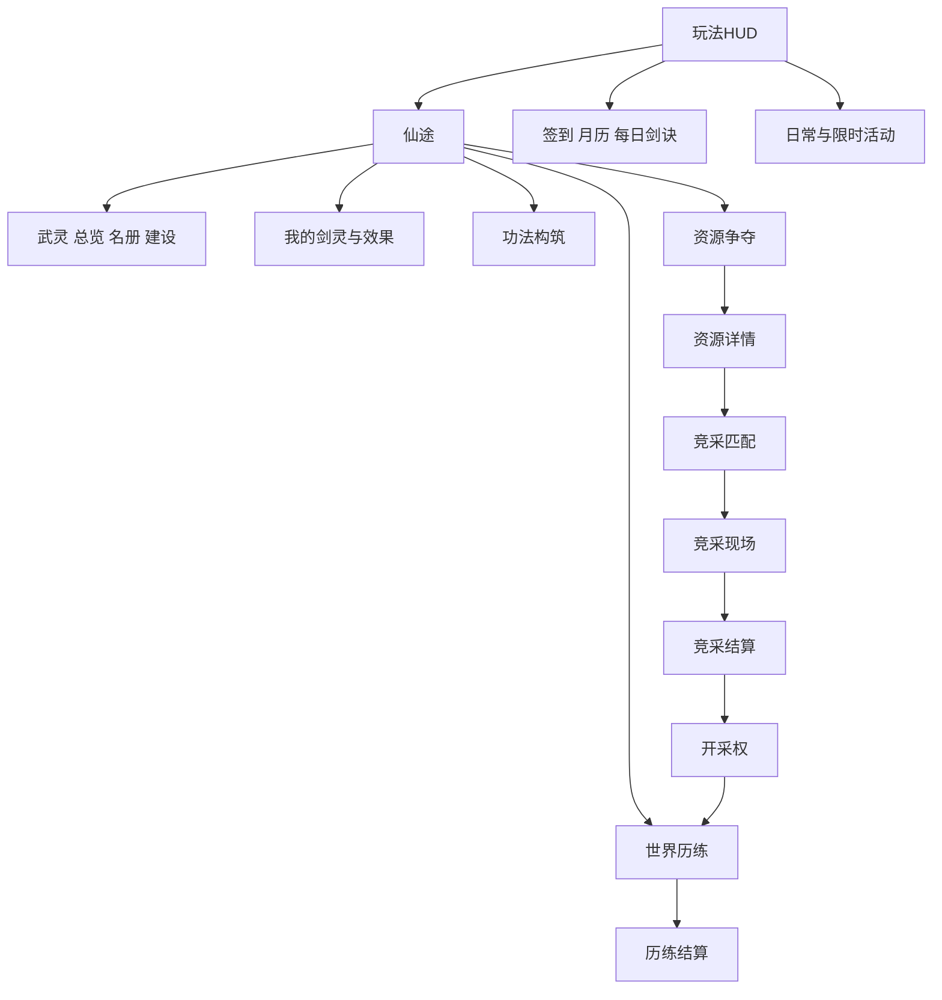

# 武灵修仙直播互动整合策划案 完整版

文档版本 v1.2，日期2026-10-21。完整经济和玩法规则为v1.1。此文件可直接上传给开发AI；运行代码、正式平台与真机验证须由后续实施完成。

本版新增11至13的UI系统、素材文件和交互验收策划。UI的screen/file清单为未来交付规格，现有素材盘点为当前文件证据。新WBP和新图集尚未制作。


# 游戏功能策划案

本案规定“谁可以做什么、数据归谁、何时结算、失败怎么办”。新增组织为武灵：一名主播修士和多名观众剑灵组成。观众不会因为加入组织获得第二个可操纵人物。

## 1 身份与数据

| 实体 | 主键和必需字段 | 规则 |
|---|---|---|
| 观众剑灵 | 平台、应用、官方用户ID、成长窗口、境界、修为、称号、礼物权益引用 | 不用昵称作主键；没有独立生命、防御、死亡或抢装备流程 |
| 主播修士 | 官方主播ID、境界、修为、个人灵石、材料、功法配置 | 本命剑继承主播属性；主播不额外获得一套直接攻击伤害 |
| 武灵 | 武灵ID、创建者ID、名称、名称审核状态、成员版本、公共资材、声望 | 一名主播最多创建一个；名称2至12个汉字等效长度；名称审核后展示 |
| 成员关系 | 武灵ID、用户ID、加入时间、退出时间、角色 | 每个观众一个正式归属；进房和成员归属分开 |
| 参与会话 | 应用、房间、用户、代次、开始/结束时间、状态来源 | 同一用户同一时段只有一个收益会话 |
| 资源开采权 | lease_id、武灵ID、资源种类、等级、开始/结束UTC、结算游标、来源竞采 | 不可转赠、不自动续期，不是可交易资产 |

权限：主播管理名称、功法、路线和公共建设；成员可加入/退出、选择个人响应和查看个人记录；成员没有任意取库权限。新任命权限、踢人、公共支出均写审计。首版不开发副会长、职位拍卖、附庸、成员强制捐赠。

创建武灵免费、练气即可；改名每7天一次免费，审核通过前保留旧名。成员列表每页20条，采用服务端游标，不把全部成员同时创建为场景实体。解散组织必须在没有Running赛事时由主播明确确认，个人财产不随组织解散删除。

## 2 加入与离开

流程：有效进房→临时助战→发送“加入”→显示目标武灵和规则→服务端检查身份、重复关系及限制→原子建立成员关系→剑灵显示归属。

已在当前武灵时返回“已加入”且不重复奖励；已在其他武灵时仅临时助战，提示需主动退出原武灵后申请。主动退出或被移除后24小时内不能加入新武灵，仍能免费临时助战，个人境界和个人剑权益不被删除。主播不能用移除成员没收个人物品。

武灵名册显示总成员、当前参与成员、临时助战三个独立数值。无法获得可靠离场信号时显示“当前参与会话”，不假称真实在线人数；参与资格及收益停止规则必须与平台能力相符。

## 3 公共成长

公共资材仅由正式成员完成事件产生，完整事件每名成员1份，每日每人前6次；单武灵每日最多100份。临时助战得到个人事件反馈，不计入公共资材。公共资材不可换灵石、修为或个人装备。

声望每完成一轮至少两名真实参与者完成的集体事件增加10，每日最多60；重复重连不生成。声望只展示历程，不能兑换出兵或竞采优势。

公共建设先支持：剑阵旗台、历练碑、共修庭三种外观。各消耗100公共资材，解锁公开美术层级；不永久叠加全体修炼倍率。成员数量本身不提供数值加成。

## 4 世界与资源功能

世界历练、静修、灵脉竞采是互斥的主播活动状态。同一主播不能后台挂世界历练、前台再争夺领取两份产出。

世界历练使用事件状态机 `Idle→Preparing→Running→Settling→Completed`，可进入 `Interrupted`。每10分钟一轮，三个阶段完成权重和固定产出见数值案。服务器持有阶段进度和结算ID；掉落不能再从每次死亡处分发同一份预算。

竞采使用 `Queue→Matched→Ready→Running→Frozen→Settled`；取消、断线和作弊审计进入独立终态。开采权只有 `Pending→Active→Expired/Revoked`，终态不能重复激活。详细计分见08，精确参数见03。

## 5 UI 与观众输入

保留角色、现有物品入口、排行、菜单的主要导航。原型物品入口可显示背包；抖音候选入口名称、存储能力按提案范围适配，不改名绕过限制。武灵入口放现有扩展区域，资源页明确显示倍率、剩余时间、获取方式及当前供给。

主播可在面板执行创建武灵、选路线、报名竞采、配置功法；观众只需一项当前行动。建议指令不超过10个：加入、退出武灵、剑灵、签到、选、护阵、破障、共修、武灵、帮助。其中“选1/选2”共用“选”前缀。具体评论订阅能力由平台适配器确认。

命名、头像和评论展示使用审核与隐私流程；规则页不回显未审核原始评论。UI 水墨风格沿用现有资产，兼顾540×960、720×1280、1280×720；不重建人工配置的 WBP 树。

## 6 异常与恢复

| 情况 | 行为 |
|---|---|
| 服务不可用 | 禁止竞采报名、公共支出、交易和权威到账；展示未连接，不生成假全服榜 |
| 主播断开 | 停止新增收益；竞采给予60秒重连宽限，赛事时钟不暂停 |
| 主播60秒未回归 | 放弃竞采额外名次权，已确认的基础阶段奖励保留 |
| 服务端赛事故障 | 不按客户端自报评奖；整局标记无效，恢复基础已确认奖励，不消耗报名费，因为报名免费 |
| 成员中途进房 | 可体验即时互动；本轮协作计分名单已冻结，不影响本轮评分分母 |
| 主播战败 | 世界历练进入30秒恢复，已完成阶段保留；不掉境界、不剥夺礼物；付费表现不能被恢复界面吞掉 |
| 礼物迟到或重复 | 原消息ID入账一次；按有效权益范围履约，不重新开始原始到期时钟 |
| 跨房间移动 | 成员关系不变；新会话撤销旧收益资格；不自动迁移跨房间数值权益 |

## 7 功能验收

F01 同身份重复加入不会重复成员；F02 不同应用身份隔离；F03 退出后临时助战可用；F04 只有主播能支出公共资材；F05 断线不双倍收益；F06 同主播不能同时参加两个活动；F07 开采权只激活一份；F08 已过期租期重连不重置；F09 竞采名单与结算一致；F10 关闭商店/交易时深链接和接口均拒绝；F11 武灵名称审核失败可重新提交；F12 原有剑灵轨迹、相机和既有礼物配置保持基线，改动须另有迁移记录。


# 商业化策划案

商业目标是让观众愿意为“自己的剑灵身份、可理解的强力效果、帮助武灵的高光”送礼，让主播愿意反复组织历练。不能用资源垄断和强制补缺把免费基础成长切断。本案不新增现金商城、付费灵石、累充奖励或付费买开采权。

## 1 用户价值与购买场景

| 用户 | 需要得到什么 | 产品安排 |
|---|---|---|
| 初次参与者 | 看见自己的剑，明白一次互动 | 免费加入、短成长、一个当前目标 |
| 经常回访者 | 剑灵成长与武灵归属 | 个人历程、名册、共修与成员表现 |
| 首次送礼者 | 固定、即时、足够明显的变化 | 面板说明和立即可见的剑灵行为 |
| 重复送礼者 | 每份有新增且可核验的价值 | 固定倍率线性延时或再次固定触发 |
| 高投入者 | 独特身份和能被讲述的帮助 | 强力剑形、协作作用、克制遮挡的高光 |
| 主播 | 可讲解、有节奏、操作不繁琐 | 两小时内容脚本、效果提示、事件仪式 |

共修场景适合修炼类，护阵适合七星/弑神，破障适合驱煞，普通遭遇适合输出与爆发；竞采仍履约即时效果，但统一规则不让送礼购买1000分。礼物面板在报名及开局前说明该模式差异，不在观众送出后才说明不计分。

## 2 现有礼物基线与迁移

以下旧规则来自项目文档和CultivationTypes/CultivationRules，仅用于审计。真实可选礼物及价格必须读取本应用控制台，禁止沿用其他项目礼物ID或凭记忆填写价格。

| 礼物和剑灵 | 旧配置 | 风险 |
|---|---|---|
| 仙女棒 | 1.15倍，后续同时提高倍率与增加30秒 | 收益近二次增长 |
| 爱的爆炸 | 每份19999修为 | 约333标准分钟，可能跨越大量前期内容 |
| 稀有宝箱/噬魂剑 | 永久2.8倍，90秒共享效果，180秒间隔 | 永久权益、光环递归及模式失衡 |
| 超能喷射/无机态那 | 多项属性+200000，300秒 | 量纲不同、早期压倒性效果 |
| 神秘空投/驱煞神刃 | 敌方属性降低20% | 全属性降低比仅破防强得多 |
| 草莓甜点/七星光芒剑 | 7层20%治疗，各180秒间隔 | 需验证致死、满生命和重复赠送 |
| 超级空投/弑神剑 | 每次伤害20%概率免疫 | 价值随机，需审核并保证基础反馈 |
| 生命药水 | 个人3.25倍并递增，每份6小时，房间加成 | 倍率时长同时叠加，跨场/房间权益 |

旧权益profile为`legacy_preserve`，本次不改。新案单独命名`candidate_linear_v1`，只能在隔离模拟存档试算；在同一正式存档里不得静默切换或缩短已经承诺的权益。新案不等于用户已经批准改礼物。

## 3 可供比较的新数值候选

| 礼物 | 单份候选效果 | 重复方式 |
|---|---|---|
| 仙女棒 | 个人修炼1.15倍30秒 | 每份追加30秒，不提高倍率 |
| 爱的爆炸 | 增加1200修为 | 每份固定增加，单独标记付费来源 |
| 噬魂剑 | 个人剑伤2.8倍180秒；全场剑伤+15%90秒 | 两个持续时间各线性追加，不递归分享个人属性 |
| 无机态那 | 主播生命/防御/全场剑伤各+50%，30秒 | 每份追加30秒，同源不叠幅度；不增加修为速度 |
| 驱煞神刃 | 敌方防御-20%120秒 | 追加120秒，同源不叠幅度 |
| 七星光芒剑 | 60秒护持，获得当次主播最大生命20%的治疗预算 | 每份追加预算和60秒；受伤且存活时按缺失生命消耗，治疗预算不能复活，剩余可见 |
| 弑神剑 | 主播确定性减伤20%持续60秒 | 追加60秒；与其他减伤共同受60%总上限约束 |
| 生命药水 | 个人3.25倍300秒，其他观众1.28倍、主播2倍 | 每份追加300秒，同类房间效果取最高值，不叠幅度 |

候选的期限、固定属性、概率与共享基数均不同于旧基线，需并行比较后由产品方决定。若应用实际没有某种礼物，保留旧ID映射记录但不创建假的可购买入口。候选不会把名为“稀有宝箱”的外部礼物设计成随机抽奖；对外包装按平台审核另行确定。

候选修为乘区：仙女棒与药水个人倍率取最高；本人是药水来源时不再享该药水房间倍率；同类房间效果只取最高；不同人生命药水不相互递归。噬魂与喷射候选不再加修为。最高个人修为乘区3.25，总免费加成最高1.55，理论在线上界为基础的5.0375倍。该上界仅适用于新候选配置，不能用它描述旧配置。

七星候选预算按每次送礼瞬间最大生命快照确定；主播生命上限之后变化不增加已记预算。护持到期仍有未用预算时有清晰到期展示；首次送出立即形成可见护持剑阵。无敌/满生命场景仍有护持而不是无反馈。是否采用该候选需先测试可理解性及实际使用率。

## 4 价格与主推

主推先选低门槛体验、个人输出、团队防护、全场高光各一项；剩余礼物保留已配置能力，不让新人一次读八套公式。价格不在本版编造；开发AI第一步从安全的本应用配置确认真实礼物名、官方ID引用、价格及允许效果，并输出价格价值表供评审。未取得价格时只能测体验和相对时间价值，不能声称已完成客单价优化。

每个面板列出：立即效果、对象、时长、重复规则、当前模式、有效期。剧情中没有目标时仍保证已承诺的召剑/护持/修炼表现；异常状态先持久化收据，再在允许范围恢复履约，不让加载、断线或战败吞掉效果。对过期补偿及退款不能自行承诺，依平台处理流程。

## 5 主播两小时运营

0至10分钟接新人和首次历练；10至30分钟两轮目标与第一次材料突破；30至40分钟竞采（获准且有对手时）或主题历练；40至70分钟使用开采权、共修与功法讲解；70至100分钟第二组历练；100至120分钟大目标、结算和下次预告。竞采不可用时内容仍完整。

话术示例：“今天先拿够破境石，普通剑也能护阵。我们选灵泉配额，拿到后共修半小时。”礼物讲解示例：“七星会形成护持，预算和剩余时间在这里，这轮会用于主播受伤后的恢复。”不使用“只有送礼才算成员”“不补礼就清空修为”等施压设计。

## 6 经营指标与实验

记录可归因参与率、首次互动耗时、首次突破耗时、单轮完成率、次场回访、七日主播留存、主播每小时可结算收益、开发者每主播小时净收入、履约延迟、漏发、免费/送礼用户分别的留存。进房UV使用平台真实统计，与有身份事件覆盖人数分列。

起始观察目标：参与率20%、参与后3分钟留存50%、首轮完成60%、次场回访20%、七日主播留存50%。这些是试播假设，不是行业标准。至少覆盖小中大三类直播间，收入同时报告中位数、头部占比和去掉最高单用户后的结果。

收入模型：流水=可归因参与人数×送礼人数占比×送礼者平均流水；开发净收入=实际可结算流水×实际合同结算比例－服务/运营/渠道成本。示例200参与者×5%×30元等值=300元流水；若假设开发有效比例8%，收入24元，再扣成本。比例与价格均为算例，不承诺平台分成。

一次只试一个变量：先首次体验，再重复赠送价值，再离线比例，再灵脉收益。不得对已经购买的用户做隐藏降效AB；实验只对明确版本的新权益、隔离测试流量或自愿测试发生。

## 7 不采用的变现

资源竞价、付费参赛、累计送礼解锁材料、输方付费赎回、占点征税、成员贡献换现金、付费抽功法、随机付费突破品质、交易税返利现金、付费复活维持基本进度均不立项。商店和交易即使在独立原型开启，也不成为直播默认营收通道。


# 数值策划案

本案是待试播的新数值方案，现有礼物与境界配置不被自动替换。配置真源为 tables 下文件，单位、累计和单阶消耗必须保持一致。货币与物品使用整数；倍率使用有上限的浮点或定点值；所有时间以服务器UTC保存，日界线按Asia/Hong_Kong 00:00。

## 1 修为与成长

标准修炼分钟=60修为；基础有效在线速度=1修为/秒。在线包括实际参与的静修、历练、竞采，不包括主菜单和未认证等待。不再让攻速、击杀和光环互相无限反哺修为；首版新增成长预算不另加逐命中奖励，旧逐命中/击杀修为属于迁移审计范围。

`Q_online = base_rate × (1 + min(node,0.30) + min(method,0.15) + min(event,0.10)) × gift_personal × gift_room_role`

node只有灵泉产生0.20；method首版没有修为效果，保留最高0.15的扩展预算；event首版数值为0。礼物两因子见02新数值候选与旧配置的区别，不得拿旧叠加值套本案后声称倍率已封顶。灵石、声望、贡献、公共资材不直接加入公式。

离线原型：`Q_offline = 1 × 0.10 × min(有效离线秒数,28800)`。离线不受灵脉、礼物、功法、主播境界、活动影响。服务端存储结算游标；在线与离线区间互斥，达到封顶后的时间不能留到下次分批领取。仅观众有离线修为，主播首版没有离线成长。抖音候选默认关闭，不能据此承诺已准入。

事件额外修为：每完整10分钟事件60，每日个人前6轮；签到300，每日一次。离线不生产任何货币、材料或贡献。活动只能提供外显或从本额外预算分配，不额外再造一个无限修为源。

## 2 境界表与阈值

34档名称沿用现有项目；完整字段见 realm_targets.csv 和脚本生成的 realm_costs.csv。

| 境界 | 到达所需累计标准分钟 |
|---|---|
| 练气一至九 | 0、2、5、9、14、21、30、42、58 |
| 筑基初中后圆满 | 80、120、170、230 |
| 结晶一至三 | 300、380、470 |
| 金丹一至六 | 580、700、830、970、1120、1280 |
| 元婴、化神 | 1460、1660 |
| 元神一至二 | 1880、2120 |
| 炼虚一至五 | 2380、2660、2960、3280、3620 |
| 大乘、飞升、混元无极 | 3980、4360、4760 |

观众第i档升下一档消耗 `(T[i+1]-T[i])×60`，扣除后剩余修为可继续自动突破。主播对应修为成本为该值50%，向上取整，并消耗当前档材料和灵石。主播小阶同样需要手动确认，可合并表现，不跳过资源扣除。顶层下一档成本0，不再循环扣费。

主播每次材料成本按当前境界组：练气20、筑基40、结晶60、金丹80、元婴/化神/元神120、炼虚160、大乘/飞升200。灵石成本=材料成本×3。观众材料与灵石成本始终0。

本表决定进度而不承诺每月全员满级。30分钟在线、3次事件、签到、8小时离线的无礼物日收益为 `1800+180+300+2880=5160`修为，即86标准分钟；28日2408标准分钟。得到灵泉并完整有效使用30分钟，额外360修为，即6标准分钟，日收益提高约6.98%。资源优势有感但不决定成长能否继续。

90分钟在线、6次有额外奖励事件、签到、8小时离线，无礼物收益为 `5400+360+300+2880=8940`，即149标准分钟，28日4172分钟。错过当日离线或签到应按实际值计算，不补成满额。

上述28日为每天都能领取满额离线的稳态情景；新账号第一天无离线收益，应减48标准分钟。新账号30分钟组28日约2360标准分钟、元神二阶；每天完整使用灵泉则约2528分钟、炼虚一阶。90分钟组约4124分钟、大乘。脚本同时输出稳态和新账号结果。

成长窗口仅是原型试算30天；正式周期与权益继承按平台确认。临近窗口结束加入者只展示剩余有效期，不承诺完成全34档；另测滚动入门体验，不以付费补完作为解法。

## 3 属性和战斗

主播基础生命1000、攻击10、防御20；观众基础剑灵攻击10，没有生命、防御或死亡。境界序号r从0开始：

`攻击 = 10 × (1+0.12r) × 当前突破质量系数 × 功法属性系数`

`主播生命 = 1000 × (1+0.15r) × 当前突破质量系数`

`主播防御 = 20 × (1+0.10r)`

质量系数普通1.00、精炼1.05、圆满1.10，针对当前最高大境界取一份快照，不对每次突破累计相乘。特殊剑原有额外属性单独审计；本案不把加200000等现有值默默带入新敌人配置。

借用原GDD伤害结构：`伤害 = A²/(A+D_eff) × 招式系数 × 增伤 × 境界系数`。`D_eff=max(0,D×(1-min(破甲,0.60)))`。世界历练同大境界低打高：`max(0.70,1-0.03×小阶差)`；跨大境界低打高：`max(0.25,0.8^大境界差)`；高打低不另给境界乘区。竞采计分任务统一属性，不套此压制。

该压制是直播适配新案，替代独立GDD的跨境界0.5与最低1%组合，目的是让低阶剑灵仍能参与。总减伤最高60%，闪避/免疫属于独立机制不直接相加至100%；概率必须在权益描述中明确，特殊剑的概率效果需要单独审核，不当作本案新增长点。

伤害统计仅计真实扣血；溢出、延迟伤害重复命中、同一死亡重复结算均排除。攻速至少0.2秒一击，状态每秒一次，不互相触发同标签。第一次实现只选疾锋、玄罡、回响三部功法。

世界历练初始遭遇表见encounters.csv：普通剑基础攻击间隔1秒、目标防御10，模型有效命中率80%。0/5/20/80参考观众的固定难度中，最终目标生命分别360/2160/7560/29160，基础队伍理论约90秒完成，第三阶段预留120秒。第一阶段3波、每波4个普通目标；第二阶段2个障碍；这都是预设模板，不随局中真实人数或礼物变化。

该命中率只是试算输入，实际飞行时间、追踪和目标切换须由渲染PIE采样重算。选择难度只改变固定公开配置，基础产出不翻倍。主播本命剑和观众剑在无功法/礼物/境界时，均按攻击10计算。

## 4 世界基础供给

所有完整10分钟世界历练的主播基础收益：80灵石、12突破材料、6灵草、4玄铁、2功法残页。灵草拆5绑定+1可交易，玄铁拆3绑定+1可交易；残页和突破材料全绑定。竞采的基础奖励与其完成的3个基础阶段对应，不能额外领一轮世界奖励。

| 阶段 | 灵石 | 突破材料 | 绑定草 | 可交易草 | 绑定铁 | 可交易铁 | 残页 |
|---|---:|---:|---:|---:|---:|---:|---:|
| 1 | 16 | 3 | 1 | 0 | 1 | 0 | 0 |
| 2 | 24 | 3 | 2 | 0 | 1 | 0 | 1 |
| 3 | 40 | 6 | 2 | 1 | 1 | 1 | 1 |

竞采360秒挑战对应三个120秒基础阶段，只有完成该阶段对应的两个共同任务才获得该阶段基础奖励。额外60修为仍需整轮有效参与并完成；同一时间预算不能同时领世界历练与竞采两份。

每名观众个人贡献：已完成阶段分别2/3/5，正确响应每次5、每轮最多2次，完整每轮最高20。贡献每日最多120，仅用于记录与非数值外显原型，不兑换攻击或下一场自动出兵。六轮完整历练的主播每日可额外获得1枚精炼核心，每日仅一次；无付费购买来源。

## 5 开采收益

每武灵仅一份Active；类型/产出见 nodes.csv。基础倍率与租期互不叠加。30/20/10分钟是服务端实际时间，收集类按有效在线时间整档发放。

| 开采权 | 每有效10分钟额外产出 | 完整30分钟上限 |
|---|---|---|
| 灵泉 | 在线基础修为速度+20% | 每人基础额外360修为，不计礼物放大 |
| 灵石矿 | 主播20灵石 | 60灵石 |
| 灵草园 | 主播2绑定灵草 | 6绑定灵草 |
| 玄铁脉 | 主播2绑定玄铁 | 6绑定玄铁 |
| 残卷遗址 | 每20分钟1绑定残页 | 1残页 |

灵泉受礼物乘区时个人实际额外修为可高于360；上表360指无其他加成的基础算例。首次实现需同时记录基础资源贡献和最终修为贡献，不能把基础上限误当成付费承诺的截断。

灵脉产出全部绑定、不可进入寄售。没有占点，30分钟世界历练仍可得240灵石、36突破材料、18灵草、12玄铁、6残页。最强矿权相对同时间灵石供给增加25%，不能累积成全大陆垄断。

## 6 灵石消耗预算

补给原型：回复丹50灵石+2绑定草，护阵符40灵石+2绑定铁，研习简50灵石+2绑定残页。每日各最多2、2、1；它们均不是基础通关必需品。

30分钟基础灵石240。只做两枚回复丹、两枚护阵符、一枚研习简消耗230，剩10，但尚未计算主播突破，不能据此声称经济已平衡。

更可行的早期样例：一轮练气突破60灵石＋一枚回复丹50＋一枚护阵符40＋一枚研习简50＝200，余额40；另消耗20突破材料、2绑定草、2绑定铁、2残页。正常天数不要求每个品类买满。高阶突破一次需几天积累，这是明确的时间目标，不把缺口改成必须送礼。

NPC回收每日最多铸出50灵石，来源独立记账。市场买卖不铸币，仅扣挂牌费和税。灵石存量、每类材料余量及中位突破等待时间需按境界分组观察。

## 7 防止数值失控

- 不让灵脉再提高争夺统一属性，不让贡献购买竞争分，不按武灵人数永久加倍率。
- 基础供给、节点增益、活动奖励三个账本分开；开启新活动前计算总增量。
- 停用配置只影响未来新赛事与新权益，不能取消已经承诺的付费时长。
- 不把旧档与新档直接混榜。迁移前导出旧权益，按版本确定策略并单独审批，不自动降低已解锁剑灵。
- 日/周统计按服务端日界线唯一入账；跨00:00的一轮按结算日入账，完整阶段不能拆成两次奖励。


# 物品策划案

观众剑灵权益、主播物品、武灵公共资材分属不同所有者。原型允许完整经济验证，正式直播存储类设计以平台许可为前提。物品明细见 tables/items.csv。

## 1 分类和归属

| 类别 | 主要内容 | 所有者 | 流通 |
|---|---|---|---|
| 数值 | 修为、声望、个人贡献 | 各自主体 | 不可转账，不是可卖物品 |
| 通货 | 灵石 | 主播个人 | 只在原型白名单市场支付，不能兑换抖币/现金 |
| 公共资材 | 武灵资材 | 武灵 | 公共外观建设，不分红、不提款 |
| 突破材料 | 破境石、精炼核心 | 主播 | 绑定 |
| 普通原料 | 灵草、玄铁 | 主播 | 绑定和可交易物分不同ID |
| 功法资源 | 功法残页、研习简 | 主播 | 绑定 |
| 制作物 | 回复丹、护阵符、凝元精华 | 主播 | 绑定 |
| 剑灵权益 | 五把特殊剑、定时礼物效果 | 送礼观众 | 独立权益表，绝不成为寄售物 |
| 纪念表现 | 青云徽记、问道纹饰 | 获得者 | 不交易，不加战斗数值 |
| 资源权利 | 一份开采租约 | 武灵 | 独立租约表，不进物品格 |

## 2 实例字段

物品实例至少包含 `instance_id,item_id,owner_type,owner_id,count,source_type,source_event_id,created_at,expires_at,binding,tradeable,paid_origin,version`。绑定原料与可交易原料不能合并；相同物品但到期时间不同也不合并。扣料优先最早到期且符合配方绑定要求的栈。

货币独立整数账本，使用交易流水，不用可丢弃的一格物品模拟灵石。数值修为独立成长账本，不能通过卖出修为获得货币。礼物权益另存官方事件收据、来源房间、期限和规则版本。

可交易灵草/玄铁允许主动1比1转为对应绑定原料，免费且不可逆，保留来源和原到期时间。交易买入的普通原料因此能用于制作，具有实际需求；绑定物不能反向解绑定。转换必须原子扣除原物发新物，不能复制栈。

## 3 有效期

原型的新经济资产在同一30天测试窗口结束时失效；活动纪念外显随窗口结束失效；消耗品不能跨窗口积累。市场成交、合成、拆分不延长最早来源的expires_at；材料合成结果取所有输入中最早到期时间。临近到期1小时不允许新挂牌。

这只是封闭试算规则，现有永久礼物权益仍保留旧基线，不能被经济窗口清理器误删。抖音权益有效期另依提案：候选默认只在当前场次使用新增数值资产，跨场默认关闭。审计收据留存与用户能使用的资产期限分别管理。

## 4 来源与消耗

破境石用于主播手动突破；精炼核心每日完成六轮完整事件获得1枚，参与可验证，不能重连刷取。功法残页来自阶段奖励与遗址开采；研习简由原型配方获得。功法等级1到6，升级依次消耗研习简1/2/3/4/6枚，每枚代表固定研习进度，不随机成功。

回复丹恢复主播最大生命25%，两次使用至少60秒，不溢出储存。护阵符给予主播最大生命10%的屏障，持续60秒，同源刷新剩余时间而不叠层，屏障实际吸收必须实现后才展示防护值。凝元精华只用于下一次大境界突破质量1.05，2份可用1.10；不能在每个小阶无限重复放大，使用后消耗。

制作全部确定成功、明示成本、明示产物。首版没有随机词条洗炼、失败碎装、付费保底和付费概率升品。

## 5 物品生命周期与保护

世界阶段确认→原子写入奖励账本→产生物品实例→UI收到确认显示到账。制作：检查版本/配方/限次→锁定材料→同事务扣料发物→记录收据。未确认只显示处理中，不提前扣币造成功假象。

武灵移除、改名、退会只改变组织关系，不销毁个人物品；加入新武灵不复制个人库存。主播解散组织先结算正在进行的事件，清理公共租约，个人剑灵权益不受牵连。

所有新装备仅作为后续扩展字段，本版不创建观众可交易武器装备。法宝词条、炼器品质等原独立GDD内容延至P4，避免首版同时铺开成长、交易与随机属性。


# 活动策划案

活动目标是给主播稳定栏目、给剑灵不同参与角色、给回访提供明确内容。首版用固定机制与固定奖励，活动奖励优先使用外显或替换基础预算，不在原有经济上无限相加。

## 1 日常安排

| 活动ID | 内容 | 周期 | 奖励和限制 |
|---|---|---|---|
| ACT_SIGN | 每日签到 | 每日 | 300修为，每身份一次；跨日权益须获准 |
| ACT_VERSE | 每日剑诀 | 每日固定轮换 | 当日文本与行动提示，无稀有签/改签/运势承诺 |
| ACT_WORLD | 世界历练 | 每10分钟一轮 | 三阶段基础供给；个人额外修为前6次 |
| ACT_RACE | 灵脉竞采 | 主播自主报名 | 2至4主播，基础阶段供给＋限时开采权 |
| ACT_SHARED | 武灵共修 | 主播自主安排 | 只领有效修为，不再领世界材料 |
| ACT_MONTH | 月度签到历程 | 每月 | 累计3/7/14/21次，各解锁一个有效期内外显里程碑 |

同一活动reward_key包含profile、应用、窗口、用户/武灵、event_instance、reward_type；每种奖励只有一个入口入账。签到页、活动页和指令不能各发一次。

## 2 一周栏目

周一青云入阵：新人、免费剑灵和基础路线；周二玄铁破障：集中目标；周三七星护阵：保护和响应；周四共修问道：主播材料目标和功法；周五灵脉竞采：可用时开展多主播模式，不可用时改同主题世界事件；周六世界历练：章节展示；周日剑灵成长回顾：真实贡献、个人突破和下周预告。

基础奖励仍为80灵石/12破境石等固定预算，不因换活动名字重复发放。主题专属奖励为当周纪念表现，不能永久堆倍率。声望、贡献和公共资材按照各自上限，不发一套活动积分再兑换战斗属性。

## 3 两个完整周活动模板

### 七星护阵

10分钟：准备60秒，三段目标480秒，结算60秒。第一段识别干扰目标，第二段两次提示后的护阵响应，第三段主播规避攻击并维持阵心。阶段供给沿用世界表；每轮个人贡献最高20。七星/弑神礼物在实际受伤保护上有表现，不直接购买正确响应分数。失败保留已完成阶段。

验收：观众不操作生命条；低人数仍可完成；满生命时护持可见；致死不触发隐式复活；同一伤害只结算一次；暂停和退出会清理临时敌人及状态。

### 玄铁破障

主播从两条公开路线选择：集中破障或分段采集。三阶段的完成时点、敌方行为和演出不同，基础总产出相同。疾锋与驱煞的优势是处理障碍更直接，免费基础剑也能完成。每一障碍只授一次阶段奖励，不因多次击杀拆成无限材料。

验收：路线选择发生在开始前；礼物不提高障碍强度；掉落与结算账本一致；技能过量伤害不多发物。

## 4 月度和新成员

月签到采用累计，不因漏一天清零，不售卖补签。月度界面显示有效期和已完成记录。月末加入者仍有完整的新手十分钟事件和至少一个短期个人目标，不用30天签到奖励作为唯一回访理由。

月度成长窗口是配置与平台确认事项；新增物品、名次、外显的过期规则统一显示。跨月不把旧贡献转换成新月攻击，不以清空付费权益促销重新购买。

## 5 限定主题范例

中秋问月：使用护阵模板，将阵心替换为月华阵，剑轨与场景使用授权水墨素材。第一阶段收拢月华，第二阶段稳定阵势，第三阶段完成问月。活动持续7天，原型奖励在首次完整完成时发纪念纹饰，日常供给不额外翻倍。

活动不新增礼物种类，不概率出稀有剑，不以礼物金额解锁结局。礼物固定效果与当前模式描述一致。活动素材与配置通过发布审核后使用，不通过热更新注入未审内容。

## 6 时间配置与运营

活动表必须给start_at、end_at、timezone、规则版本、奖励窗口、profile、入口条件、每人次数、是否替换基础预算。无明确起止时间的限定活动保持disabled，不能把占位日期自动解释为当天上线。

所有跨日计数按香港时间日界线；活动UTC边界由服务端计算。跨边界进行中的一轮使用开局冻结规则；补发依原收据窗口，不发新版本更大奖励。关闭活动停止新报名，已开局按原规则结算或按故障协议处理。

## 7 验收与观测

检查日界线双签到、同页多入口重复领取、活动结束前开局、跨月到账、断线重进、奖励替换预算、无对手降级、未审核名称和素材。观察活动参与率、完成率、免费/付费分组回访、主播准备时间、内容重复感与每小时运营成本。商业结果由试播取得，不以脚本通过代替。


# 商店策划案

本案定义完整的封闭原型商店和制作消耗，便于验证经济循环。抖音公开准入规则禁止商城与交易，`douyin_release_candidate` 的商店入口、SKU查询、购买及兑换接口全部关闭。不能更名“补给”“宝阁”后上线，也不能将付费商城伪装成免费兑换。[平台规则](https://partner.open-douyin.com/docs/resource/zh-CN/interaction/introduction/live-play/creation)

## 1 原型目录

| SKU | 产物 | 灵石成本 | 额外绑定材料 | 日限购 | 用途 |
|---|---|---:|---|---:|---|
| SKU_HEAL | 回复丹1 | 50 | 灵草2 | 2 | 恢复25%主播生命 |
| SKU_SHIELD | 护阵符1 | 40 | 玄铁2 | 2 | 10%主播生命屏障60秒 |
| SKU_STUDY | 研习简1 | 50 | 功法残页2 | 1 | 固定功法进度 |
| SKU_BREAK | 破境石1 | 10 | 无 | 3 | 少量补齐，不能替代历练 |
| SKU_QUALITY | 凝元精华1 | 200 | 破境石10、精炼核心2 | 1 | 可选突破质量 |
| SKU_BADGE | 青云徽记1 | 0 | 个人贡献60 | 1 | 非数值外显 |
| SKU_PATTERN | 问道纹饰1 | 0 | 个人贡献180 | 1 | 非数值外显 |

购买者：前5项主播本人；后2项观众剑灵本人。贡献不可转灵石、不可交易、不可兑换数值物品。徽记/纹饰同窗口只能各解锁一次，重复点击不重复收费；日限购不是次日可以重新付费购买同一外显的意思。

## 2 库存和动态供给

固定库存按本人日限购，服务端原子计数。动态库存从已审核的周轮换表中按日确定，不基于个人送礼额、个人消费次数或主播收入抬价。首版没有随机稀有商人，没有必须抢到的顶级功法，没有付费刷库存。

资源争夺不直接垄断商店货架。占领灵草园只产绑定草，不让获胜武灵控制全服丹药售价。基础突破材料始终通过世界历练稳定取得。

## 3 购买状态机

`Requested→Validated→Committed→Presented`；失败为 `Rejected`，状态未知为 `PendingReconcile`。请求带user、窗口、SKU、数量、价格版本和幂等键。事务内核验库存、绑定材料、有效期、余额、限购和profile，再一次性扣除、发放和写回执。重复同键返回同收据；同键不同payload拒绝。

价格变化只作用于新的确认界面；旧确认过期后重新展示，不按更高价格暗扣。数量为正整数，超限、负数、数值溢出全部拒绝。服务中断时按钮显示未连接，不本地先记账。

## 4 原型回收

NPC只收可交易草和铁：每份分别4/6灵石，个人每天通过回收最多新增50灵石，收购前显示剩余额度。绑定材料、礼物、租约、残页、精炼核心不回收。输入换出的灵石写NPC铸币来源；不能通过回购再卖获得利润。

## 5 抖音候选替代

只有平台明确认可的单场固定制作或收集流程，才可单独立项；不能把此商店直接换文案复用。未确认时使用世界阶段直接发放固定材料与允许的即时效果，原型SKU不开启。该替代会改变经济消耗，需另出数值版本，不声称关掉商店后本案经济仍平衡。

## 6 验收

并发购买不超限；材料不足不扣部分币；断线恢复只得一份；徽记已解锁不再扣贡献；关闭profile时接口拒绝；买入绑定物不能卖回市场；午夜仅由服务器时间刷新；制作不会延长材料有效期；UI完整展示成本、产物和有效期。


# 交易策划案

交易只作为封闭完整原型的可选后续模块，不属于抖音默认发布范围。公开规则禁止交易系统；本案不得以赠送、拍卖、寄售、贡献转让或私聊转账等名称在直播候选配置开放。[平台规则](https://partner.open-douyin.com/docs/resource/zh-CN/interaction/introduction/live-play/creation)

## 1 边界

首版原型仅主播之间以灵石寄售世界历练免费产出的普通可交易灵草/玄铁；观众没有市场操作权限，武灵没有公共分红。不可提现、充值灵石、兑换抖币、现金结算、平台间互通或出售账号。没有玩家间直接赠送、定向低价交易、竞价拍卖和以物易物。

白名单：MAT_HERB_T、MAT_IRON_T。所有绑定物、节点产物、贡献、修为、声望、功法、突破材料、礼物权益、开采权、公共资材均不能交易。付费行为不产可交易币或可交易物，任何衍生产物继承付费来源禁售标记。

买入可交易原料后可1比1主动绑定成MAT_HERB_B/MAT_IRON_B用于配方，不改变原期限；使用价值由确定配方提供，避免市场只有转卖没有消耗。

## 2 挂牌规则

| 项目 | 数值 |
|---|---:|
| 同时挂牌订单 | 每主播5笔 |
| 单笔数量 | 1至100份 |
| 草单价 | 4至12灵石整数 |
| 铁单价 | 6至18灵石整数 |
| 挂牌期限 | 最长24小时，且不得越过资产到期 |
| 挂牌费 | 1灵石，成功挂牌时扣除，不退 |
| 成交税 | ceil(总价×5%)，从卖方收入扣 |
| 成交方式 | 整单买入，不支持部分成交 |

剩余有效期小于1小时不能新挂牌。买家看到物品数量、原到期时间、总价与到手内容；卖方看到总价、费用、税后收入。市场UI不显示可联系的卖方ID，服务端禁止自己购买自己的订单。

## 3 托管状态

`Draft→Escrowed→Listed→Sold/Cancelled/Expired`。必须先锁定完整商品并扣挂牌费，再发布订单。原物品从可用库存移到托管账本，不能同时制作、回收或重复挂牌；托管不消失来源链。

买入事务：校验订单版本/状态/profile→校验买方余额→从买方扣总价→从托管转物→记卖方税后应收→记税费销毁→标记Sold并写唯一回执。服务端事务提交后才显示成交。

卖方离线不影响应收入账；领取仅是展示和状态确认，不再铸币。取消或超时将原商品退回原拥有者，已经到期的商品销毁并保留到期记录，不能按退货时间续期。市场停机通过到期UTC恢复，不按客户端保存重开24小时。

## 4 守恒例子

买家初始100灵石，卖家初始10。卖家上架10份草、每份8，总价80。挂牌后卖家9；成交税4；卖家再得76成为85；买家剩20。总余额从110降到105，销毁挂牌费1＋税4，没有额外制造灵石。

商品数量：卖方可用减少10，托管先增加10后减少10，买方增加10；全系统商品总量不变。任何失败路径必须满足“钱与物都保持原状”或明确的单一已提交终态。

## 5 故障与滥用

同一订单两个买方并发只成功一个；成交与撤单互斥；消息重放不重复扣款或发货；越价、负数、溢出、跨窗口ID拒绝。身份来自当前授权，不接受body伪造owner。

连续关联账号成交、异常成交价、短期高频倒手先冻结新增交易并人工审核，不自动没收未定责个人权益。审计保留来源、订单、版本和金额，不记录平台密钥。争议按原始事务重放核对，不能让AI客服直接修改资产余额。

## 6 开发优先级与验收

P3以后才做完整寄售；P0仅建立绑定、来源链、托管和profile拒绝接口。没有经过多人并发、断线恢复、时钟边界、资产过期与幂等验证，不进入公开测试。

验收覆盖：双买家抢单、撤单竞态、提交后失去回包、卖方离线、过期退货、跨窗口、付费原料衍生禁售、绑定混栈、暂停后恢复、税向上取整与低总价交易。原型验证不能充当平台交易准入证明。


# 游戏玩法策划案

主播创建武灵，观众以剑灵加入。个人成长提供回访，世界历练提供稳定供给，灵脉竞采提供阶段竞争，功法提供路线选择。整体保留修仙独立 GDD 的成长与构筑深度，将操作压力集中在主播侧，将观众输入压缩为易懂的一步响应。

## 1 三个循环

个人：有效参与→修为→自动突破→个人剑灵表现与能力→新的历练体验。

主播：世界历练→修为与材料→配置功法→主动突破→推进历练章节。主播本命剑负责攻击，主播负责移动、蓄力、护阵与路线。

武灵：共同事件→公共资材与集体记录→报名竞采→短期开采优势→回到修炼或世界历练。开采优势不能带回竞采标准属性，切断资源胜者持续碾压的循环。

## 2 世界结构与路线

保留八区域的世界框架，首版实现前三个；它们是历练入口与场景，不是可供主播互相攻城的沙盘。

| 区域 | 主题 | 正式上线阶段 | 选择价值 |
|---|---|---|---|
| 青云山 | 入门、护阵、灵泉 | P1 | 熟悉基础循环 |
| 落霞谷 | 路线、采药 | P2 | 炼丹与护阵主题 |
| 玄铁岭 | 破障、锻材 | P2 | 强调破甲与集中目标 |
| 玄冰原 | 环境、稳阵 | P4 | 高阶持续控制 |
| 妖兽林 | 标记、协击 | P4 | 御剑协作 |
| 赤炎地 | 爆发、时机 | P4 | 强调蓄力窗口 |
| 星陨海 | 法域、回响 | P4 | 兼修联动 |
| 太虚境 | 多阶段、问道 | P4 | 完整构筑验证 |

区域不要求付费解锁。首版地图物品产出总量相同，以机制和表现区分；后续改变产出必须更新经济表，不先提高掉落再临时添加消耗。

## 3 十分钟历练

0至60秒准备与接新人；60至240秒阶段一；240至420秒阶段二；420至540秒阶段三；540至600秒结算。阶段目标分别为护阵、破障、处理最终目标。主播选择先护阵或先采集，改变敌方行为与演出，不改变未公示的付费需求。

阶段奖励固定，不受击杀速度无限增殖。低人数同样可完整完成：主播在开始前选择固定的小、中、大难度，难度配置不在局中随送礼自动抬高。难度对应的公开NPC配置在各房间一致，不伪装观众单位。

静修不能同时领取历练材料；历练与竞采期间仍按有效参与时间获得基础修为。静修可使用已获得的灵泉开采权，体现“争夺→回房修炼”的选择。

## 4 灵脉竞采

竞采为单独模式。2至4个真实主播武灵参与一轮相同目标的采集试炼，争取各自限时开采配额。原型可完整测试；抖音版需明确通过多主播模式提案，不能把本设计视为已准入的竞争形态。

报名免费，目标资源在匹配前确定：灵泉、灵石矿、灵草园、玄铁脉、残卷遗址。每武灵只可申请没有活跃开采权的下一轮，不预订、转卖、提前领取下一份收益。没有对手等待60秒后可退出或转世界历练，不创建假主播。

匹配依据：最近三轮真实事件参与人数的中位数，1至9、10至49、50以上三个档；当前活跃人数不得直接由礼物或历史成员数代替。前三轮取本次准备期有效人数，并标记新队伍。90秒无法匹配保持可取消，不偷偷混入远高档对手。跨档仅双方在准备前明示同意的开发测试允许，发布模式关闭。

每轮10分钟：120秒准备，360秒挑战，120秒结算。准备期结束冻结房间、任务模板、规则版本和最多10名正式成员协作代表。代表按本日被选次数少优先，再按服务端稳定用户键排序；不售卖代表席位。只有1人时按1人计算，不补机器人。至少一名正式成员方可报名，临时助战不进入协作计分名单。

### 计分

总分1000：共同任务600、主播操作200、成员协作200。

- 六个共同任务，每个100分，每60秒一个；完成/未完成为100/0，标准目标设计为免费队伍可完成。
- 主播两次清晰预告的时机操作，每次100分；不是模拟礼物购买按钮。
- 代表各有两次响应机会，每次有效记1。成员分为 `floor(200×有效响应次数/(2×代表数))`。名单冻结，离场未响应记0。
- 礼物金额、份数、武灵等级、已有资源倍率不直接计分。特殊剑的即时表现照常履约；计分目标采用统一属性及明确的目标进度上限，不能让氪金输出替代操作或直接购买任务完成。
- 多次正确口令只有一次分值，但每个有效互动仍提供允许范围内的即时反馈。任务过程中需要真实参与触发，不自动播放一场冒充观众的剑阵战斗。

前一轮资源、主辅功法、装备和历史付费成长不改变计分目标的标准强度。观众个人养成在世界历练有效，竞采前明确提示“本轮采用统一试炼规则”。

### 名次与资源

至少600分有开采资格。按不同分数的降序组排名：第1组30分钟、第2组20分钟、第3及之后10分钟。并列得同档，不以最后送礼、付费额或隐蔽随机数破同分；下一不同分数组取下一档。所有人均达1000分则同获30分钟，按每武灵上限发放，不争抢一个必须剥夺对方的全局唯一坑位。

因此“争夺”的对象是高档开采配额，不是夺走其他主播财产；直播内容仍有路线与名次的竞争。武灵旗帜展示分配结果，地图上不发生沙盘攻城。最终产品分类仍由平台提案决定。

### 开采过程

第600秒服务端完成结算时自动激活，起止时间写入唯一收据；客户端“领取”只确认展示，不推迟激活或重新起算。UTC到期，不因关播暂停。只有主播当前认证会话实际在线且处于有效玩法状态的时间产生收益，离线期间无资源产出、无灵泉倍率。收集类按累计有效600秒一档，残卷遗址1200秒一档；不足整档的尾数不发物品。灵泉逐秒计算。

主播使用开采权回到历练可以产材料，回到静修可以享修为；不能在到期前反复进入重置计时。武灵正式成员在相同直播间享灵泉加成，临时助战只有基础成长，界面明确显示条件；主播本人也享灵泉加成。名册中的离线成员不领取。

## 5 功法构筑

继承 GDD 的1主修＋2至6辅修槽位；分阶段开发，首版只实现练气1＋2。后续依境界开启：筑基/结晶3，金丹/元婴4，化神/元神/炼虚5，大乘以上6。每部功法可主辅切换，共用等级，同一部不能占两槽，换装只在准备期。

观众不需要操作这7套功法。主播配置武灵的历练构筑，观众继续以剑灵参与；个人特殊剑能力按权益生效。辅修总增伤上限50%，修为类上限15%，减伤总上限60%，不能相互无限触发。

| 路线与功法ID | 主修机制 | 辅修机制 | 直播适配 |
|---|---|---|---|
| 剑修 METHOD_EDGE 疾锋剑诀 | 每第5次有效命中强化为1.8倍该次基础伤害 | 一次完整蓄力后下一击增伤10% | 剑意计数可见 |
| 法修 METHOD_STAR 星罗法诀 | 每20秒开6秒法域，域内伤害提高20% | 有效范围目标额外5%伤害 | 主播移动影响站位 |
| 护体 METHOD_GUARD 玄罡体经 | 每30秒主动护体6秒，减伤20% | 主播生命低于50%时防御提高10% | 作用于主播，不给剑灵造生命值 |
| 魂修 METHOD_ECHO 回响诀 | 每第4次有效命中追加0.5倍延迟伤害 | 每20秒下一击追加0.1倍延迟伤害 | 延迟伤害不再次触发回响 |
| 协契 METHOD_PACT 合契经 | 主播标记20秒，正式成员命中标记目标增伤15% | 第一次命中标记目标增伤5%，每20秒一次 | 用剑灵协击适配御兽思路，不新增宠物 |
| 燃息 METHOD_SURGE 燃脉诀 | 主播消耗当前生命10%，伤害提高25%持续6秒，间隔30秒 | 主播生命低于50%时本命剑增伤10% | 生命不足时拒绝消耗，防止自杀与血腥表现 |
| 蚀灵 METHOD_ETHER 百蚀经 | 命中加蚀灵，每秒0.05倍基础伤害，最多5层，持续5秒 | 每20秒首次命中附加1层 | 每秒至多结算一次，不再触发命中循环 |

等级1至6，沿用黄玄地天仙神的外观标签，首版只做前3级。升级只改变明确配置的系数，不再给每级额外基础属性复利；主修第1级启用核心机制，第3级强化主系数10%，第6级再强化10%，辅修不获得主修机制。

第3/6级强化按一级主系数分别乘1.10/1.20，不复利；对应主系数为疾锋1.8、星罗0.20、玄罡0.20、回响0.5、合契0.15、燃脉0.25、百蚀0.05。次数、持续时间、消耗比例不同时放大。辅修系数首版不随功法等级放大。

## 6 心流与失败

新人10秒内找到自己，2至5分钟有小成长；每3分钟有一次目标变化，每10分钟有结算，每30至60分钟有主播阶段目标。免费观众的正确响应和护阵被单独展示，不与礼物金额混排。

普通历练失败保留阶段产出，主播30秒恢复，不消耗付费复活道具；首版不继承 GDD 的财物罚没、修为掉落和永久杀人。竞采失败无惩罚、无报名费用，可立即回到世界历练。没有获得资源不是成长断路。

## 7 首版明确不做

开放世界NPC婚恋亲属、随机出生刷命格、永久杀人、门派兼并/附庸、八区实时沙盘攻城、独立观众角色装备操控、随机付费抽取、跨平台资产互通。它们保留在原独立游戏 GDD 中，本直播整合版不据此自动立项。


# AI 开发交接

本文件是整个策划包的实施入口。它提供开发任务与验收，不授权部署生产服务、发布玩法、启用商店交易或改写用户已配置的礼物。

v1.2恢复说明：本文件保留v1.1功能交接。实施前优先阅读11至13和当前审计清单：现有武灵面板/原型子系统已有源码，部分旧Tools与SourceAssets缺失，应增量核对，不按旧阶段表推断当前一切均未实现。UI任务的直接提示词见13。

## 1 可直接复制的开发任务

```text
请在 D:/demo/BoundlessImmortality 内，根据 docs/design/2026-10-21-wuling-resource-v1.2 实现武灵修仙互动设计。

先完整阅读README、01至13及tables配置，核对现有Cultivation、LiveWeapons、LiveInteraction、DouyinLiveProvider、Wuling源码及实际存在的开发服务。当前目标是封闭开发原型，首轮只实施P0与P1，对已存在功能增量完善，不自动扩大到全部阶段。

主播是修士，初始一把本命剑；观众是剑灵，主播创建并命名武灵，观众发送“加入”成为成员。保留个人剑灵境界自动突破、主播消耗材料主动突破和既有礼物映射。

按文档实现身份、武灵成员、权威账本、固定阶段世界历练。P2再做2至4主播灵脉竞采和限时开采权。P3才做原型商店与白名单寄售。商店和交易在douyin_release_candidate的UI和服务接口均关闭；它们不因更名而获得发布资格。跨主播和继承功能没有核准记录时不得在正式模式开启。

旧礼物使用legacy_preserve，保留原规则与原存档。candidate_linear_v1只能在独立模拟身份与新存档进行比较，不静默切换。不要把累计境界分钟直接填入每阶ExperienceThresholds；使用realm_costs.csv的单阶值，新曲线只针对新规则档。

先盘点当前代码、配置和资产，生成具体变更清单与分阶段实施计划。按项目及会话流程完成必要评审，再实施已授权阶段。不要以本策划为由擅自部署、购买服务或申请外部账号。

每阶段交付：源码/配置变更、必要自动化、实际渲染PIE截图、规则版本与回滚办法、未完成项。报告分别说明规则验证、服务验证、UE编译、渲染PIE、正式平台及设备验证，不能以一种测试推导另一种通过。

现有相机、地图、手工WBP资产和剑灵飞行数学应保持。修改前备份，必要变更列明原因。旧文档的“无武灵”已由本次用户要求更新，但旧礼物和其他人工资产仍须保护。发现冲突或不完整数据先报告并继续不依赖该项的工作，不自行填入真实礼物价格、ID或假平台回执。
```

## 2 当前工程接入位置

- `Source/BoundlessImmortality/Cultivation/`：现有修为、境界、礼物规则。新增规则版本与经济类型，旧档只读盘点，不直接替换默认值。
- `Source/BoundlessImmortality/LiveWeapons/`：观众剑灵表现，复用已有轨迹；按事件驱动显示归属与功法表现。
- `Source/BoundlessImmortality/Frontend/`：复用扩展页、活动页与资源争夺入口，新增武灵名册与真实状态。
- `Plugins/LiveInteraction/`：平台中立事件；不加入猜测的平台协议。
- `Plugins/DouyinLiveProvider/`：正式身份、礼物和会话适配；AppSecret不进入UE或文档。
- `Tools/CultivationService/`：现有本机SQLite开发服务。可扩展封闭原型，不直接监听公网冒充生产服务。

正式后端建议独立服务与事务数据库；具体技术栈在实施计划中按部署条件选择，不为本策划先安装依赖。客户端仅发操作，服务端核算奖励、道具、租约、评分和市场，不能接受客户端自报余额、伤害快照或最终名次作为事实。

## 3 核心数据契约

| 表/聚合 | 唯一键或约束 | 关键字段 |
|---|---|---|
| Identity | platform/app/official_user_id | 身份验证状态、用途范围 |
| Guild | app/anchor_id唯一 | guild_id、已审核名称、version |
| Membership | 活跃user在app内唯一 | guild_id、join/leave、rejoin_after |
| Participation | 用户同一时段单写会话 | room、generation、资格时间段 |
| Growth | user/window/rule_version | realm、remaining_qi、settled_until |
| WalletLedger | transaction_id/line_no | owner、currency、signed_amount、reason |
| ItemInstance | instance_id | 04全部来源/绑定/过期字段 |
| EventRound | round_id | 模板、profile、开局规则hash、阶段、状态 |
| RewardReceipt | profile/app/window/round/owner/reward_type唯一 | 物品及修为明细、applied_at |
| RaceParticipant | race_id/guild_id | 冻结成员和模板、评分来源、状态 |
| ResourceLease | lease_id；单武灵Active唯一 | 类型、start/end、在线游标、已发档位 |
| GiftReceipt | official_scope/message_id唯一 | 原始时间、份数、测试标记、持久状态、展示状态 |
| Listing | listing_id/version | 07托管、价格、税、买卖双方、终态 |
| FeatureManifest | profile/version | 生效/到期、允许范围、审批引用 |

后台审计数据保留策略与可消费资产到期分别设置，不能为了防重删掉唯一收据；也不能用审计存储绕过资产时效。

建议命令契约：`CreateGuild`、`JoinGuild`、`LeaveGuild`、`StartWorldRound`、`SubmitAction`、`QueueRace`、`ClaimSettlement`、`Craft`、`CreateListing`、`BuyListing`。所有写命令携带request_id、expected_version、profile、rule_version；用户身份来自认证上下文，不信任body中的owner。

响应固定包含request_id、status、error_code、authoritative_version、receipt_id及当前权威结果。错误码至少有UNAUTHENTICATED、FEATURE_DISABLED、STALE_VERSION、ALREADY_MEMBER、REJOIN_WAIT、ROUND_CLOSED、INSUFFICIENT_FUNDS、ITEM_BOUND、ASSET_EXPIRED、ALREADY_SETTLED、PENDING_RECONCILE。未提交不返回success。

## 4 分阶段任务和完成标准

| 阶段 | 任务 | 完成标准 |
|---|---|---|
| P0 | 基线盘点与备份、读取配置、隔离profile、身份与事务收据、绑定/到期模型 | 新目录新存档可运行；旧档与人工资产校验不变；发布开关拒绝测试通过 |
| P1 | 创建武灵、成员状态、一个世界历练、真实阶段奖励、主播突破 | 重复入会/结算安全；低人数免费可完成；真实UI与PIE验证 |
| P2 | 匹配、统一试炼、三类评分、租约、断线恢复 | 两个独立进程完整竞采；并列、掉线、错时结算、过期不续期 |
| P3 | 七功法分期扩展、原型制作、原型寄售、日周活动 | 所有币物守恒和来源链测试；仍不能公开启用受限模块 |
| P4 | 八区主题、更多内容、生产服务和平台适配 | 按具体提案与生产安全验证另行验收，不自动承接 |

P2的2进程同机验证证明开发同步，不证明跨机器、真实平台或云服务。P3中的商店/交易可在评审后跳过，把开发资源优先投入事件与剑灵反馈。

## 5 必须覆盖的测试

规则：34档升阶、主播扣料、观众自动连升、累计/单阶换算、旧新版本分离、离线与在线不重叠、离线封顶时间不分批领取、灵泉受益身份、倍率取最高/加法分组。

组织：重复加入、双武灵并发申请、退出限制、踢人不没收物、官方身份换昵称、不同app同用户ID、临时助战不冒充正式成员。

竞采：无对手、两个真实实例、名单冻结、1名代表分母、共1000分、低于600、全员并列、迟到行动、改模板、重复结算、主播重连、服务全局故障。统一目标不受旧+200000和个人境界影响，但礼物仍按公开表现履约。

收益：60秒/599秒/600秒/1200秒/到期边界、租期中断、资源切换、关播到期、重启UTC恢复、零在线资源零产出、同一个人跨房间不能双领。租约统计游标只由服务端推进。

经济：制作扣料原子性、到期传递、绑定不混栈、市场双买家、撤单竞态、应收不铸币、税费守恒、关闭profile深链接拒绝。未来实现需要真实数据库事务测试，随包数值脚本不代替。

平台：官方礼物测试与真实来源分离、有效身份、官方ACK依据实际处理和展示路径、中断恢复、榜单真实指标。SDK调用提交与远端确认分别报告，不伪造成功。

渲染：三分辨率武灵名册/资源收益/阶段结算/礼物倒计时；键鼠输入恢复；原有相机轨迹与地图资产回归；对人工配置资产做哈希或明确结构差异复核。

## 6 仍需产品评审的决定

单武灵归属与退会24小时；竞采争高档配额而非互相掠夺；离线10%/8小时；34档时间表；新礼物候选；经济窗口30天；商店与交易是否值得投入原型；真实礼物价目与已获准范围。它们不妨碍先做P0数据盘点和隔离验证，但依赖它们的最终行为不得擅自宣称用户已确认。


# 平台适配与来源

核对日期2026-10-21。目标产品是抖音直播互动玩法；用户提供的独立游戏GDD是设计参考，不是已经获准的直播产品，也不是自动授权AI实现其全部内容。

v1.2恢复记录：01至10由本聊天此前的生成记录重建，未修改原有数值选择；11至13来自本轮现存素材与源码检查。本次再次读取源GDD并校验SHA256，与下列历史哈希一致。当前UI检查不能替代原型服务与PIE验证。

## 1 官方公开资料与产品处理

公开准入规则禁止商城与交易；多主播相关设计对品类、独立模式和竞争形态有条件；资产期限在准入规则与FAQ中分别出现三个月、31天及场次限制。该差异需要具体提案澄清，不能由开发AI选择更宽口径。[直播玩法准入规则](https://partner.open-douyin.com/docs/resource/zh-CN/interaction/introduction/live-play/creation) [常见问题](https://partner.open-douyin.com/docs/resource/zh-CN/interaction/introduction/zn/FAQ)

同局主播连线文档说明的是语音连线能力，当前文档限定创新类且最多9主播，并要求玩法自建匹配。它不替代共享战局、赛事结算和资源服务，更不表示资源争夺设计自动获准。[同局主播连线能力](https://developer.open-douyin.com/docs/resource/zh-CN/interaction/jierushuoming/advanced-interaction/host-connection-ability)

礼物描述、实际表现和履约需一致；具体礼物选择与价格以应用后台能力为准。[直播间礼物互动能力](https://partner.open-douyin.com/docs/resource/zh-CN/interaction/jierushuoming/hudongshuju/liwushuju)

以上只摘取影响本案的边界，实施前仍应阅读完整官方文档及应用提案反馈。公开FAQ中的部分能力描述与新能力文档也不同步，不据此自行推断已开放。

## 2 功能矩阵

| 功能 | prototype_full | douyin_release_candidate | 开启依据 |
|---|---|---|---|
| 武灵组织和免费单房间历练 | 本地可测 | 基础设计候选，仍需提案 | 审核范围及正式身份能力 |
| 多主播灵脉竞采 | 模拟环境启用 | 默认关闭 | 独立模式及类别确认、真实多主播联调 |
| 开采收益跨场保留 | 仅窗口内原型 | 默认关闭 | 权益范围书面确认 |
| 新增跨日数值/离线成长 | 原型可测 | 默认关闭 | 有效期、数值继承规则确认 |
| 新增经济存储/制作/商店 | 原型可测 | 默认关闭 | 商店为公开禁止项，不预期直接开启 |
| 玩家间寄售 | 原型可测 | 默认关闭 | 交易为公开禁止项，不预期直接开启 |
| 跨房间付费数值权益 | 原型不新增自动迁移 | 默认关闭 | 按现有原型另行审计和具体权限 |
| 旧礼物配置 | 留作隔离基线 | 不自动视为获准 | 本应用真实礼物、权益与履约审计 |

发布配置由服务端受控manifest授权，含profile、feature、effective_from、expiry、approval_reference、规则hash。客户端开关不能授予权限；manifest缺失/过期/签名错误按关闭处理。该设计是建议架构，不声称当前项目已有生产签名服务。

## 3 原 GDD 的逐章整合

| 原章节 | 整合决定 | 对应文档 |
|---|---|---|
| 1 概述 | 保留修仙成长，将角色分为主播与剑灵 | 01、08 |
| 2 战斗境界 | 保留34档和伤害结构，调整压制及复利 | 03 |
| 3 死亡处置 | 改为阶段保留与恢复，不做永久杀人/亲友援助 | 01、08 |
| 4 功法 | 保留主辅和共享等级，分期实现槽位 | 04、08 |
| 5 七路线 | 转为剑阵功法，观众不承担七套主动操作 | 08 |
| 6 世界 | 保留八区世界框架，首版三张主题入口 | 08 |
| 7 门派势力 | 宗门转为主播创建的武灵，暂不兼并附庸 | 01 |
| 8 一统目标 | 改个人境界与武灵月度历程，不做永久霸权 | 05、08 |
| 9 宗门大战 | 转为独立竞采提案，无直接互杀攻城 | 03、08 |
| 10 世界推进 | 保留世界历练与路线，限制首版范围 | 08 |
| 11 经济 | 区分个人/公共所有权及来源 | 03、04 |
| 12 商店 | 原型确定价目与供给，直播候选关闭 | 06 |
| 13 探索 | 固定事件模板＋主题变化，后续扩区域 | 05、08 |
| 14 炼丹炼器 | 确定配方，首版不做随机失败 | 04、06 |
| 15 装备 | 后续扩展，首版不新增观众装备交易 | 04 |
| 16 新周目 | 原独立版保留，直播不直接继承永久优势 | README、05 |
| 17 循环 | 重组成个人、主播、武灵三个循环 | 08 |
| 18 原则 | 保留构筑和成长，资源优势限定时间与上限 | 03、08 |

这是一份针对直播产品的适配方案，未改写或否定独立版GDD；原独立版仍可采用其原有的死亡、长期周目与开放世界规则，不能用直播SDK给未准入的独立版导入互动数据。

## 4 本地来源

- 用户源文件：`C:/Users/zxxuh/Downloads/_______GDD_v1.0.md`，读取完整17710字节。
- SHA256：`12D93705259FB2ACA0ED78D4BABDABB276726ED444B6AC09C3BAB85C7860D4DA`。原文件只读，未修改。
- 项目基线：`docs/live-cultivation-prototype.md`、`Source/BoundlessImmortality/Cultivation/CultivationTypes.h`、`CultivationRules.cpp`、`Tools/CultivationService/README.md`。
- 本机服务仍是开发原型，不能视为已部署的生产共享世界或反作弊后端。
- 本次用户明确允许武灵组织，优先于此前旧设计中的“无宗门/武灵”范围。单归属、退会24小时、竞采规则和完整经济仍为本案建议，需产品评审。


# UI 系统策划案

文档版本v1.2，日期2026-10-21。经济和玩法规则沿用v1.1，本次增加UI系统、文件交付和资产复用规范。这里列出的新页面和新文件是未来开发交付物，本次没有创建它们的运行代码或uasset。

## 1 产品边界和当前事实

主程序为UE5.8，主播操作修士和武灵，观众通过平台互动成为剑灵。主播UI、推流给观众看的HUD、观众互动面板是三种界面，不能把主播鼠标可点的按钮当成观众可以在视频上点击的按钮。

本次实地检查：项目保留7个WBP、18张T_纹理和现有材质，C++已有主菜单、HUD、背包、排行、角色、签到、活动、区域、资源等面板。UInkWulingPanel已经调用UWulingPrototypeSubsystem的创建、名册、历练与突破接口。资源争夺、日月签到、部分活动仍有明确的占位/预览文案。源码存在不能证明服务和界面完整运行，本次没有PIE截图或UAsset控件树加载验证。

当前项目未见旧docs、SourceAssets和大部分Tools目录；本次从本聊天生成记录恢复策划资料，不恢复删除的游戏工具或服务实现。UI实施AI应先核对缺失后端依赖，不能因面板已有HTTP调用就宣称业务已完成。

## 2 三种展示面

| 展示面 | 操作者 | 应包含 | 不应假设 |
|---|---|---|---|
| 主播UE管理界面 | 主播鼠标键盘 | 创建武灵、名册、路线、功法、报名、突破、原型经济 | 观众能操作主播管理按钮 |
| 推流HUD与播报 | 所有观众观看 | 主播境界、当前事件、个人突破、资源倍率、真实贡献 | 点击视频里的角色/背包即可弹出个人页 |
| 平台观众互动面板 | 观众 | 支持能力内的加入、响应、规则、礼物效果 | 已有UE WBP可以直接导出为平台H5 |

首阶段先做UE和评论指令；观众侧独立面板只有确认平台技术栈、接口及权限后另行实施。未确认时提供“发送剑灵查看”的简洁反馈，不编造可点击个人仓库。平台面板的独立交付范围见12。

## 3 导航和窗口层级

主菜单保留开始、继续、存档、设置、退出五项。玩法底部保留角色、物品入口、排行、菜单；活动、签到、仙途沿用右上入口。武灵通过仙途→武灵进入，不新增一排遮挡主角的主导航。资源争夺、功法、我的剑灵在仙途与相应详情互相链接。

层级建议：场景0；常驻HUD10；短播报20；完整页面100；确认与详情200；连接/处理中提示300。连接提示不得拦住取消/返回。普通页面只保留一个顶层，详情使用导航栈；Esc先关弹窗，再退详情，再回HUD，不能一次退到主菜单。

跨页保留列表筛选、页码和滚动位置；退出物品详情清除悬浮提示但不清空库存；横竖切换保留选中项、请求ID和当前状态。页面打开不默认暂停在线服务器事件。



## 4 必须交付的页面

完整逐屏矩阵见tables/ui-screens.csv；每个页面标注当前实现状态、复用类、目标蓝图、数据源、主操作和开放条件。

### 4.1 主菜单和常驻HUD

复用现有WBP_InkFrontend、MainMenu和UInkAnchorStatusWidget；保持相机、角色和本命剑构图。HUD左上显示主播身份、境界、实际生命、修为、修炼状态；当前事件目标放侧边或顶部，右下保留修炼/收功。资源增益使用小徽标显示“灵泉+20%／剩余时间”，点开或主播操作展开来源明细。

HUD新增最多三种短条：事件进度、当前资源效果、最近个人高光。连续突破合并同一人，屏幕内最多3条，每条3至5秒；队列只决定展示，不改变到账。头像缺失用明确占位，不用虚构真人头像。

### 4.2 武灵总览 名册 管理 建设

复用UInkWulingPanel，扩展为总览、成员、建设、记录四个子页。总览显示审核后的武灵名、主播、成员总数、参与成员、临时助战、公共资材、声望、当前开采权；总数与参与人数不能混用。

未创建状态显示创建条件、名称输入、免费创建；输入长度2至12汉字等效、审核中、驳回及7日改名限制都要有状态。成员分页20，行字段为头像、显示名、境界、成员身份、当前参与、当日贡献。详情只暴露适合公开的显示ID，隐藏平台原始身份键。

主播可改名、查看记录、移除成员、解散；移除/解散必须确认，说明个人权益保留。观众通过允许的输入加入/退出，不能从推流画面借用主播管理权限。建设列出三个外观项目、100公共资材成本、当前状态及记录；不伪造未规划的永久倍率或职位售卖。

现有面板中的“世界历练”卡片保留捷径，数据与世界页使用同一ViewModel，不把同一事件在两页各启动一轮。

### 4.3 我的剑灵和礼物效果说明

显示当前查看身份、归属武灵、境界、修为、当前称号、已解锁特殊剑、有效增益和来源。主播与观众视角必须区分，观众剑灵没有生命、防御和死亡栏。特殊剑以一把个人剑灵的形态/能力呈现，不把解锁数量当作额外观众人数。

选择称号只改变表现；旧基线中其他已解锁被动不因换称号关闭。详情显示来源、幅度、对象、持续/到期、叠加规则和当前模式效果。正式礼物价格来自真实配置，不从AI写死。旧权益与候选数值版本分别显示，不把测试效果描述成已购买效果。

缺失权益、到期、暂不适用、测试数据、正式数据、断线未确认均有标签；点击说明不触发购买。购买必须经平台官方送礼路径。推流上展示个人信息应遵循已获准范围，不向其他人暴露全量库存和原始账号。

### 4.4 角色 功法 物品 排行

角色页复用已有资产和属性卡，不新增总战力。主播有生命和防御，观众不显示这两项。突破弹窗显示修为、灵石、破境石当前/需求、可选质量及结果；材料不足给出世界历练入口，不把礼物设为唯一补齐入口。

功法页显示1主修、当前开放辅修槽、境界锁定说明、七路线列表和详情。点击功法→查看主辅差异→选择位置→预览变化→服务端确认；事件运行中禁换，原因可见。第3/6级强化按规则表，不在UI自行计算另一种倍率。

物品页保留现有模型：当前源码200总槽、默认20解锁、每页40。不要按旧记忆退回100槽，也不新增付费开格。保留分类、搜索、筛选、整理、数量、未读、新物品、锁定、说明、使用/装备/出售/分解及禁用理由。新的经济物品补充归属、绑定、到期、来源和托管状态；无相应业务能力时动作隐藏或明确禁用，不假扣币。悬停蓝、选中金的既定反馈要求要在实施时结合当前材质核对。

排行保留真实主播剑灵数、修炼速度和有效伤害，新增武灵/竞采视图时注明周期与规则。现有窄版榜单与每屏8行布局优先复用，不用本地榜冒充全服。没有好友能力就不提供可点击的假好友榜。

### 4.5 世界历练 区域详情 结算

复用WorldCultivation和RegionDetail，列表显示前三个首发区域与后续区域的真实开放状态。详情显示主题、固定难度、基础奖励、路线、10分钟时间结构和参与说明。开始前选择独行/小/中/大预设；运行中冻结选择。

页面状态：可开始→准备→进行→恢复→结算中→已完成/已中断。进行中显示本轮时间、当前阶段、主播生命、共同目标、已确认阶段奖励；30秒恢复明确保留已完成阶段。结算区分基础阶段产出、个人修为、个人贡献、公共资材与额外核心，各写收据状态；领取仅确认展示，不再发一次奖励。

### 4.6 资源列表 详情 匹配 竞采 结算 开采权

资源页覆盖灵泉、灵石矿、灵草园、玄铁脉、残卷遗址五类。每张卡显示作用对象、单位产出、间隔、最长租期、是否已有开采权和报名条件。旧页面“占领”文案按本案配额规则更新，不误导为已经控制其他主播领地。

资源详情→匹配大厅：显示2至4真实武灵、人数档、目标资源、统一规则、是否满足至少1名正式成员、等待时间、取消。60秒无对手可转世界历练；没有真实对手不画假头像。

竞采现场：120秒准备/360秒挑战/120秒结算三个阶段，显示共同任务600、主播操作200、成员协作200。代表名单冻结，最多10人；分母、正确响应、未响应明确。把礼物即时表现与统一计分规则分别说明；不显示送礼金额充当得分。

结算显示分数来源、并列分组、600分资格和30/20/10分钟租期，未达标写清原因。开采权页显示服务器start/end、剩余时间、实际受益身份、有效在线积累、已入账物品和下一档进度。第600秒结算自动生效，“领取”按钮只确认展示，不延后租期。

原型获胜是高档配额，不是唯一矿点，因此允许多个并列获胜；画面不能假装只有一个占领者。服务断线只显示最后确认快照与“更新暂停”，不在客户端继续计资源。

### 4.7 签到 月签 每日剑诀 日常 限时活动

复用现有组页和日历。日签到显示可签、请求中、已签、跨日刷新；月历以服务器日期呈现，累计节点统一改为3/7/14/21，不能继续沿用旧页7/14/21/28。每日一签改为固定轮换剑诀与行动提示，不做随机吉凶/付费改签。

日常卡显示实际目标、进度、预算、已领取状态；限时卡显示准确起止、时区和有效期，无起止不生成假的倒计时。活动详情显示免费参与方式、固定奖励和是否替换基础预算。

旧Draw、随机单抽/十连和出诊页可保留开发预览资产，但不进入本案正式业务导航。不要因素材中有召唤、抽奖按钮就新增抽取业务。原参考图的宠物武灵内容不适用于当前“武灵是组织”的定义。

### 4.8 离线收益和原型经济页

离线页只在该profile获准时出现：上次结算、本次有效时长、8小时上限、基础10%、修为结果、原收据。显示不受灵脉和礼物放大。到账后点击只是确认，不让跨设备重复领取。

商店展示SKU、真实成本、绑定材料、产物、日限购、窗口唯一与期限；寄售页展示白名单原料、单价区间、数量、税、挂牌费、总价、物品到期与托管；订单页列我的挂牌、已成交、取消、到期和应收记录。它们仅供prototype_full；发布候选隐藏入口且接口拒绝，错误也不得返回可购买目录。

## 5 公共交互系统

每屏都有Loading、Ready、Empty、Pending、Disconnected、Error、Expired、FeatureDisabled状态。空状态给出下一步；请求中锁提交、不锁返回；成功使用服务端快照；失败保留输入并说明原因；关闭页不中断已提交事务，回到页面根据request_id对账。

复用组件：带理由禁用按钮、状态条、确认弹窗、成员行、物品详情、奖励格、贡献行、租约徽标、礼物效果卡、短提示。红点只来自真实未读/可领取状态，进入页面不产生奖励，不做永久假红点。

## 6 版式与视觉

白宣纸、墨线、山水、少量金边；蓝用于交互/选项，朱砂用于提醒；不能把所有内容都涂金。按钮、纸卡、进度条先用现有材质，不先生成另一套风格。动态中文、人数、期限、货币、境界使用TextBlock，不烘焙在新图里。

竖屏设计基准720×1280，SafeZone内四边至少24逻辑单位。正文建议24至28、说明20至22、标题32至40；在540×960验证正文最终可读像素，不能把大面板等比缩成小字。按钮高度至少56、触控热点优先64，间距8至16。

横屏1280×720采用列表＋详情双栏；竖屏列表与详情分层，避免左右挤压。物品竖屏4列、横屏8列，每页仍40槽，竖屏通过滚动呈现，不改变物理格索引。成员20行分页，界面同时显示多少由可视区域决定；不把所有名单生成场景剑实体。

排行保留每屏8行的当前组织方式，不强行把所有新列表也做8行。长武灵名、昵称、长金额、未知头像、200物品格、高数量都必须验证；重要数值有完整详情，缩写不能丢失到账依据。

## 7 实施顺序

UI-P0盘点和路由/数据隔离；UI-P1武灵、世界历练、个人剑灵与结算；UI-P2功法、资源详情、匹配、竞采、开采权；UI-P3签到活动真实接线与原型经济；平台观众独立面板作为确认能力后的单独任务。详细文件和验收见12、13。


# UI 素材与文件清单

本案说明复用什么、补画什么、开发AI应生成哪些文件。清单里的“planned”是将来交付物，本次只生成策划文档、清单和素材检查证据，未生成新的游戏UI纹理或Widget Blueprint。

## 1 已检查的素材与限制

本次逐张查看桌面UI资源目录的11张PNG：主菜单按钮、排行榜、称号、标题海报、背包、两张境界图、四张功能参考图。项目内18张T_纹理完成文件盘点，其中7张提取出可解码的256像素JPEG缩略图并查看。缩略图不代表源纹理尺寸、Alpha质量或实际运行效果。

源文件路径、大小和SHA256见ui-audit/reference-images.json；项目资产见tables/ui-existing-assets.csv；纹理缩略图证据见ui-audit/texture-inspection.json。缩略图总览：[已有图集预览](ui-audit/existing-atlases-contact-sheet.jpg)。本次不把历史截图当成当前PIE截图，不把文件存在当成材质正确加载。

## 2 复用决定

| 资产组 | 可复用内容 | 处理方式 |
|---|---|---|
| Widgets现有7个WBP | Frontend、MainMenu、Character、Inventory、Leaderboard、Saves、Settings | 保留路径和人工配置，增量接入 |
| Cohesion20261021 | 控件皮肤、16格图标、山水场景、现有称号光效 | 当前InkPresentationStyle主要使用此组，优先复用 |
| Portrait20261021 | 纸卡、条轨和填充等 | 当前进度条优先来自此组，不无理由替换 |
| Polish | 装饰和旧控件皮肤 | 用作兼容和缺省，不整套覆盖当前主题 |
| Provided | 背包、排行、按钮、称号原图集 | 复用已有UV和材质实例，避免把整图当一张界面 |
| Cultivation | 境界图、境界横幅、功能场景 | 复用境界与装饰，动态名称另行排版 |
| Materials/Atlas | 通用图集和背包图集材质、Fit/Slice实例 | 复用九宫格与等比显示，不能任意拉长图案 |
| Materials/Leaderboard | 行底、奖章、称号、滚动条和标题 | 保留既有窄榜布局与图集切片 |

代码证据：InkPresentationStyle::Surface当前为纸卡/按钮选择MI_Cohesion_，条轨/填充选择MI_Portrait_；CohesionIcon用4×4UV；旧排行榜/背包使用专用图集和切片材质。新AI应沿这个调用链核对，不按文件日期猜哪套正在使用。

## 3 参考图逐项覆盖

| 参考图 | 本案吸收 | 不直接实施的内容 |
|---|---|---|
| 14_34_12-1 签到活动 | 日签、月历、每日剑诀、日常/限时卡片、奖励展示 | 补签付费、单抽/十连、随机奖池 |
| 14_34_15-2 出诊修行 | 区域选择、产出、进度、资源卡、名次与结算 | 出诊派遣留旧预览，不成为本次新增主循环 |
| 14_34_17-3 门派武灵 | 门派部分改为武灵总览、成员、公共外观、旗帜 | 底部宠物召唤/培养/图鉴不进入当前武灵组织 |
| 14_34_18-4 角色属性 | 属性卡、身份、头像框、条轨、境界表现 | 总战力、虚构装备/法宝数值、观众独立生命 |
| 背包原图 | 分类、格态、数量、新标记、说明、搜索、滚动、动作 | 不能因为图上有出售/分解就忽略来源与profile约束 |
| 排行原图 | 奖章、标题、头像、行底、范围与周期 | 不创建没有好友/全服后端支撑的假数据 |
| 按钮原图 | 普通、悬停、按下、禁用、返回、确认、开关 | 烘焙文字不作为动态新按钮的唯一文字来源 |
| 称号原图 | 既有特殊剑横幅与空白底板 | 保留用户现有名称，AI不擅改“无机态那”等命名 |
| 境界两图 | 34境界的视觉语义、徽记与横幅 | 不把整张境界表缩进一条姓名栏 |

## 4 新文件结构

精确到每个文件的列表见tables/ui-files.csv，含add/modify/reuse、阶段、目标类和用途。所有新路径是计划，不是已存在证明。

```text
Source/BoundlessImmortality/Frontend/UI/
  InkUiScreenRegistry.h/.cpp
  InkUiViewModels.h/.cpp
  InkUiCommonWidgets.h/.cpp
  InkUiRacePanels.h/.cpp
  InkUiSwordPanels.h/.cpp
  InkUiMethodPanel.h/.cpp
  InkUiEconomyPanels.h/.cpp
  InkUiRewardPanels.h/.cpp

Content/UI/Ink/Wuling/
  Widgets/       13个页面级WBP
  Components/     9个共用WBP
  Data/           路由与主题两个DataAsset
  Textures/       4张按需补充的图集

SourceAssets/UI/Wuling/
  Generated/      4张图集源PNG
  atlas-regions.json
  art-manifest.md

Tools/InkFrontend/
  inspect_wuling_ui_assets.py
  verify_wuling_ui_pie.py
  wuling-ui-acceptance.json
```

这些目录有一部分当前已经被删除，计划中的Tools文件将来由UI实施者新建；本次不把检查文档恢复误报为已恢复游戏工具。先核对同名文件再添加，不覆盖用户后来新增的资产。

## 5 页面蓝图和原生类

13个页面WBP：WulingOverview、SwordSpirit、GiftRules、Methods、RaceLobby、RaceLive、RaceSettlement、ResourceLease、EventSettlement、OfflineRewards、Shop、Market、TradeOrders，统一前缀WBP_Ink，完整路径见CSV。

WulingOverview继承现有UInkWulingPanel；新页面继承对应的UInkFeaturePanel派生类。既有签到、活动、资源列表/详情继续用当前原生页面，不另造第二个功能相同的顶层WBP。

当前原生面板创建并拥有WidgetTree。新WBP首版作为可配置的类/样式入口，原生层仍独占控件树构建，不能同时在Designer加一棵根树又被RebuildPanel重建。若后续改为Designer拥有控件树，应单独迁移并验证，不混用两种所有权。

新增UInkUiScreenRegistry保存Route→WidgetClass→FeatureGate→ParentRoute映射，通过DA_InkWulingScreens注册新WBP；现有ClassForRoute只作为兼容入口。一个Route只注册一次，缺失资产在开发模式明确告警，正式模式按能力失败关闭，不静默打开错误页面。

9个组件WBP：RequestState、ConfirmModal、MemberRow、RewardItem、ItemTooltip、ContributionRow、LeaseBadge、GiftEffectCard、Toast。其原生类由InkUiCommonWidgets实现，组件不直接访问HTTP或扣币。

## 6 新增美术需求

先完成复用核对，只补缺失语义。下面4张是本案的生成任务，不要求AI重新生成全部现有按钮与面板。具体单元索引、源路径和导入路径见tables/ui-art-requests.csv。

| 源图和目标纹理 | 规格 | 单元内容 |
|---|---|---|
| WulingItemIcons.png → T_WulingItemIcons | 2048×2048，4×4，每格512 | 破境石、核心、草、铁、残页、丹、护符、研习简、精华、灵石、公共资材、贡献、武灵、租约、锁、提醒 |
| WulingResourceIcons.png → T_WulingResourceIcons | 1536×1024，3×2 | 灵泉、矿、药园、铁脉、遗址、共修 |
| WulingMethodIcons.png → T_WulingMethodIcons | 2048×1024，4×2 | 七路线功法，第8格空态 |
| WulingEmblems.png → T_WulingEmblems | 1536×1024，3×2 | 六种预设武灵徽记，无写死名称 |

统一要求：水墨修仙、少量青金、轮廓在64像素仍清楚、真实RGBA透明底、不烘焙文字、格内留至少32像素安全边；图集单元不能跨格装饰。格坐标用左上原点，JSON记录像素矩形和归一化UV，切片不能凭肉眼猜。

绑定/交易、稀有度、剩余时间用独立图层和文本，不为同一种草额外生成绑定草与交易草两张图片。武灵自定义名称使用字体，首版仅预设徽记，不引入任意用户上传图案。

导入要求：UI纹理组、明确Alpha、保持长宽比；是否关闭MipMap及过滤由实际目标设备采样决定并记录，不能盲目改变全部旧纹理。可复用M_InkAtlasUI以UV绘制，无需为16个图标各复制一套材质。九宫格只用于可伸缩纸卡，徽章、人物与场景使用等比裁切。

生成前如果发现现有图集已经能清楚表达该语义，复用并在art-manifest标明替代，取消对应新任务；文件清单要同步更新，不能留下无引用资产。

## 7 观众平台面板的条件交付

UE Widget不能直接打包成平台互动面板。只有确认平台支持且产品决定提供独立观众面板后，才在独立目录PlatformUI/WulingAudience实现：manifest、Home、MySword、JoinWuling、Respond、GiftRules五个页面、shared主题/请求状态/官方身份适配、README与测试配置。

源码扩展名、平台CLI及构建产物必须根据当时应用支持的框架决定，本案不凭空指定Vue/React或小程序API。它是待能力确认的独立工作包，不阻塞当前评论指令路径，也不能用普通网页登录冒充官方身份。


# UI 数据交互与验收

本案让UI开发AI按真实数据完成交互。界面展示、业务权威、礼物履约各自负责，不把动画播完当成材料已入账。

## 1 ViewModel契约

所有快照包含profile、app、room、session_generation、rule_version、server_utc、snapshot_version、is_authoritative。开发模拟数据要有可见标签，正式模式禁止本地伪造名次或余额。

| ViewModel | 主要字段 | 业务来源 |
|---|---|---|
| AnchorVm | 姓名、头像、境界、生命、修为、行为、突破成本 | 当前Cultivation与武灵原型适配器，按当前规则选唯一权威 |
| GuildVm | 名称审核、主播、三类人数、公共资材、声望、权限、名册游标 | 武灵服务快照 |
| SwordVm | 查看身份、个人境界、修为、归属、已解锁剑、显示称号 | 当前个人成长/权益，未经许可不跨房间显示数值 |
| GiftEffectVm | 来源、对象、倍率、原始时间、到期、版本、当前模式说明 | 实际礼物收据与权益计算 |
| MethodVm | 主辅槽、等级、研习需求、当前配置、锁定原因 | 功法规则与权威配置 |
| WorldVm | round_id、预设、路线、阶段、恢复、目标、已完成奖励 | 唯一事件快照 |
| RaceVm | race_id、真实房间、名单、代表、阶段、三类分数、规则hash | 竞采服务，不使用客户端自报分数 |
| LeaseVm | lease_id、类型、start/end、在线累计、发放游标、受益范围 | 资源租约服务 |
| RewardVm | receipt_id、各归属奖励、处理中/确认/已展示 | 唯一奖励收据 |
| InventoryVm | 实例ID、数量、归属、绑定、期限、来源、托管、动作权限 | 原型经济服务，既有UInkInventoryModel只是本地展示适配 |
| ActivityVm | 开放时间、周期、计数、领取状态、预算版本 | 活动和签到服务 |
| EconomyVm | SKU、余额、限购、价格版本、订单、税费、应收 | 仅原型经济接口 |

UI不得在NativeTick内重新执行加修为、领奖、生成物品、清零CD等业务。刷新使用版本变化或事件驱动，倒计时只做插值。服务器时间失联后明确暂停同步，不通过本地倒计时生成下一份奖励。

## 2 共用请求流程

Ready→Submitting→PendingReconcile→Confirmed/Rejected；Loading/Disconnected/FeatureDisabled作为页面能力状态。按钮提交时只创建一个request_id，同一次重试使用原ID；超时不自行判成功或再生成新交易。

Confirmed后展示服务端结果和receipt；用户点“知道了/收下展示”只标记已读。Rejected后恢复可操作状态，保留输入，展示具体原因。退页不取消已提交服务事务；回页查询原ID。新的用户/房间代次必须丢弃旧回调。

仅受影响的按钮禁用：创建处理中仍可返回；买入处理中仍可看别页；匹配等待可取消。不可在服务断线时保留“可购买/可领取”假状态。

## 3 特定交互

- 创建武灵：校验名称→提交→审核/成功→进入总览。双击不能创建两份。
- 加入/退出：指令与平台面板共用业务命令；重复加入返回已有关系，退出展示24小时再入会限制。
- 突破：查看成本→确认→服务扣料与突破→播放仪式→刷新。仪式中断不会回滚已确认境界，也不会再次扣料。
- 配置功法：草稿预览不影响战斗，确认后由服务端校验准备期并应用；失败保留原配置。
- 资源报名：前置profile/成员/无活跃租约→匹配→准备→统一规则→结算；取消与匹配成功竞态由服务结果决定。
- 资源领取：服务器结算已自动开始租期，按钮仅确认，界面显示原start/end。
- 物品绑定：显示不可逆及原到期→确认→同事务1比1转换，绑定后卖出按钮禁用并有理由。
- 制作/寄售：使用价格/订单版本，旧价确认过期重新展示，不按新价格暗扣；无后端时不做本地假成功。
- 高光播报：收据已确认后排队；合并只影响展示，不丢入账。满队列保留可回看记录。

## 4 公开信息与权限

推流展示经过审核的武灵名、允许展示的昵称、个人突破和贡献。平台原始ID、鉴权信息、订单私密数据不进入文本、截图、错误提示。主播点开成员详情也只看到必要信息；观众不能通过改viewed_user_id访问他人私有资产。

隐藏按钮不等于权限控制。主播/观众、profile、房间、资产所有者必须由服务端再次校验。发布候选对商店、交易、抽取及未核准多主播UI拒绝直达路由、控制台命令和HTTP请求。

## 5 验收矩阵

每个screen_id至少覆盖Ready、Empty、Loading、Pending、Disconnected、Error、FeatureDisabled，具有有效期者再覆盖Expired；不是每屏都显示所有状态控件，而是有明确定义的表现和返回路径。屏幕ID和具体用例见tables/ui-acceptance.csv。

### 布局

540×960、720×1280、1280×720必须分别渲染截图。增加长昵称、12字武灵名、超大数值、空头像、满物品格、服务断线。竖屏不能左右挤成小字，滚动到底仍能看到操作，确认弹窗不越出SafeZone。记录截图实际分辨率、字体和热点尺寸，不只断言控件存在。

### 导航

逐条验证HUD→仙途→武灵→成员详情→返回；资源列表→详情→匹配→取消→返回；完整竞采→结算→开采权→世界；物品搜索→详情→返回保留筛选；活动分组内部切页不能多压一层导航栈。横竖切换不清空输入或重复请求，Esc恢复输入焦点和角色控制。

### 业务

创建/签到/领奖双击；超时后重试；提交后关页；旧代次回包；跨日月签到；满生命治疗与护持预算；被移除武灵后开采加成停止；租期关播到期；多页展示同一事件；制作/购买余额不足；市场双买家；重复“领取”只展示一次。实际实现后用真实开发服务事务验证，本次策划检查不代替。

### 保护与回归

主菜单五按钮、既有背包、8行榜单、角色、存档、设置、原地图和相机回归。旧七WBP、素材和手工配置修改前后校验，差异需有明确原因。既有200格模型保持，新的绑定/期限/来源字段不能被本地默认bSellable=true覆盖。

当前Tools中旧验收脚本不在；实施者需按清单新建，不能引用不存在的工具或把历史Windows报告当本轮通过。Windows PIE只证明本机渲染和交互，平台面板、手机设备、正式履约、跨机器竞采分别验收。

## 6 可直接交给UI开发AI的任务

```text
请读取本包11、12、13以及tables/ui-screens.csv、ui-files.csv、ui-art-requests.csv、ui-acceptance.csv，按UI-P0至P3实施。

先核对当前工程：7个基础WBP、InkFeaturePanel路由、InkPresentationStyle、InkWulingPanel和UWulingPrototypeSubsystem。复用现有纸卡按钮进度条与背包排行材质，先核对SourceAssets和Tools缺失情况。

本次产品的武灵是主播创建、观众剑灵加入的组织，不能实现成宠物召唤系统。保留主菜单五入口和现有HUD导航。现有200格、默认20解锁和每页40格不回退为旧100格。

先完成UI-P0数据/路由/请求状态与UI-P1武灵、世界、个人剑灵、结算；先给出具体实现计划和复用差异，再按已授权范围开发。已有原型页面增量完善，不重复造另一套顶层UI框架。

新增文件按ui-files.csv；新图仅按ui-art-requests.csv补缺，先复用，不能为每个页面重新生成一套按钮。动态文字使用UMG，不烘焙进新图。新WBP采用原生构建树和薄样式类入口，不与Designer重复拥有WidgetTree。

UI只绑定权威快照，不本地发材料/扣币。无后端保持未接入或预览状态，不伪造成功。商店交易只在prototype_full展示，发布候选关闭路由和接口；旧抽取演示不进入正式导航。观众平台面板在技术能力确认后另行实施，UE WBP不能直接当平台页面。

交付源码、实际uasset、源PNG、UV清单和导入记录、三分辨率截图、交互/服务测试报告以及待完成项。不要只给一张UI效果图或一份蓝图文件名清单。若有缺失依赖，明确指出并先完成不依赖它的复用组件与静态布局。
```


# 配置表

累计境界目标与每阶成本分别使用；UI文件action标识未来处理动作。

## activities.csv

```csv
activity_id,name,cycle,start_at,end_at,enabled,profile_requirement,reward_budget
ACT_SIGN,每日签到,daily,,,true,approved_persistence_or_prototype,sign_once_300qi
ACT_VERSE,每日剑诀,daily,,,true,base,text_only
ACT_WORLD,世界历练,event,,,true,base,world_stage_budget
ACT_RACE,灵脉竞采,event,,,true,cross_host_race,stage_budget_plus_lease
ACT_SHARED,武灵共修,event,,,true,base,online_qi_only
ACT_MONTH,月度签到历程,monthly,,,true,approved_persistence_or_prototype,cosmetic_only
ACT_MOON,中秋问月,limited,,,false,approved_materials,replace_world_plus_cosmetic_once
```

## balance.json

```json
{
  "schema_version": 1,
  "design_version": "wuling-resource-v1.1",
  "timezone": "Asia/Hong_Kong",
  "prototype_window_days": 30,
  "base_qi_per_second": 1,
  "standard_minute_qi": 60,
  "offline_rate": 0.1,
  "offline_cap_seconds": 28800,
  "sign_qi": 300,
  "event_extra_qi": 60,
  "event_extra_daily_limit": 6,
  "world_event_seconds": 600,
  "race_prepare_seconds": 120,
  "race_running_seconds": 360,
  "race_settle_seconds": 120,
  "race_min_hosts": 2,
  "race_max_hosts": 4,
  "race_representative_cap": 10,
  "race_score_common": 600,
  "race_score_anchor": 200,
  "race_score_audience": 200,
  "race_qualifying_score": 600,
  "lease_rank_minutes": [30, 20, 10],
  "active_lease_limit": 1,
  "node_qi_bonus_cap": 0.3,
  "method_qi_bonus_cap": 0.15,
  "event_qi_bonus_cap": 0.1,
  "method_qi_bonus_initial": 0,
  "event_qi_bonus_initial": 0,
  "new_gift_personal_multiplier_cap": 3.25,
  "anchor_threshold_ratio": 0.5,
  "anchor_stone_per_break_material": 3,
  "member_rejoin_wait_seconds": 86400,
  "reconnect_grace_seconds": 60,
  "personal_contribution_daily_cap": 120,
  "guild_supply_per_member_event": 1,
  "guild_supply_member_daily_cap": 6,
  "guild_supply_daily_cap": 100,
  "guild_building_supply_cost": 100,
  "guild_reputation_per_event": 10,
  "guild_reputation_daily_cap": 60,
  "npc_recycle_daily_stone_cap": 50,
  "market_listing_fee": 1,
  "market_tax_rate": 0.05,
  "market_max_orders": 5,
  "market_max_quantity": 100,
  "market_max_listing_seconds": 86400,
  "market_min_expiry_seconds": 3600,
  "method_level_study_costs": [1, 2, 3, 4, 6],
  "material_binding_conversions": {"MAT_HERB_T": "MAT_HERB_B", "MAT_IRON_T": "MAT_IRON_B"},
  "baseline_sword_attack": 10,
  "baseline_sword_interval_seconds": 1,
  "modeled_effective_hit_rate": 0.8,
  "gift_profile_default": "legacy_preserve",
  "profiles": {
    "prototype_full": {
      "production_allowed": false,
      "real_payment_allowed": false,
      "cross_host_race": true,
      "offline_cultivation": true,
      "cross_session_numeric": true,
      "economic_inventory": true,
      "npc_shop": true,
      "player_trade": true,
      "cross_room_paid_numeric": false
    },
    "douyin_release_candidate": {
      "production_allowed": false,
      "real_payment_allowed": false,
      "cross_host_race": false,
      "offline_cultivation": false,
      "cross_session_numeric": false,
      "economic_inventory": false,
      "npc_shop": false,
      "player_trade": false,
      "cross_room_paid_numeric": false
    }
  }
}
```

## encounters.csv

```csv
preset_id,name,reference_viewers,stage1_waves,stage1_targets_per_wave,normal_health,obstacle_count,obstacle_health,target_defense,enemy_attack,enemy_attack_interval_seconds,enemy_speed,max_normal_targets,boss_health,boss_attack,boss_attack_interval_seconds
ENC_SOLO,独行历练,0,3,4,20,2,40,10,10,4,55,4,360,20,3
ENC_SMALL,小型历练,5,3,4,120,2,240,10,10,4,55,4,2160,20,3
ENC_MEDIUM,中型历练,20,3,4,420,2,840,10,10,4,55,4,7560,20,3
ENC_LARGE,大型历练,80,3,4,1620,2,3240,10,10,4,55,4,29160,20,3
```

## items.csv

```csv
item_id,name,owner_type,kind,binding,tradeable,paid_origin,max_stack,expiry_policy,source,use
STAT_QI,修为,individual,stat,bound,false,false,0,profile,有效修炼,个人境界
CUR_STONE,灵石,anchor,wallet,account,false,false,0,window,世界及矿权及原型市场,突破与原型制作
STAT_CONTRIB,个人贡献,viewer,stat,bound,false,false,0,window,有效事件,记录及非数值外显
STAT_REPUTATION,武灵声望,guild,stat,bound,false,false,0,window,集体事件,集体记录
CUR_SUPPLY,武灵资材,guild,wallet,guild,false,false,0,window,正式成员有效事件,公共外观建设
MAT_BREAK,破境石,anchor,material,bound,false,false,9999,window,世界历练,主播突破
MAT_CORE,精炼核心,anchor,material,bound,false,false,9999,window,每日六轮完整事件,可选突破质量
MAT_HERB_B,绑定灵草,anchor,material,bound,false,false,9999,window,世界及药园,回复丹制作
MAT_HERB_T,可交易灵草,anchor,material,unbound,true,false,9999,window,世界免费固定份额,原型寄售或回收或主动绑定制作
MAT_IRON_B,绑定玄铁,anchor,material,bound,false,false,9999,window,世界及铁脉,护阵符制作
MAT_IRON_T,可交易玄铁,anchor,material,unbound,true,false,9999,window,世界免费固定份额,原型寄售或回收或主动绑定制作
MAT_PAGE,功法残页,anchor,material,bound,false,false,9999,window,世界及遗址,研习简制作
ITEM_HEAL,回复丹,anchor,consumable,bound,false,false,99,earliest_input,原型配方,恢复生命25%
ITEM_SHIELD,护阵符,anchor,consumable,bound,false,false,99,earliest_input,原型配方,10%生命屏障60秒
ITEM_STUDY,研习简,anchor,consumable,bound,false,false,99,earliest_input,原型配方,功法固定进度
ITEM_QUALITY,凝元精华,anchor,consumable,bound,false,false,99,earliest_input,原型配方,当前大境界质量
COS_BADGE,青云徽记,viewer,cosmetic,bound,false,false,1,window,原型贡献解锁,非数值展示
COS_PATTERN,问道纹饰,viewer,cosmetic,bound,false,false,1,window,原型贡献解锁,非数值展示
ENT_SOUL,噬魂剑权益,viewer,entitlement,bound,false,true,0,legacy_or_approved,官方礼物收据,按权益版本生效
ENT_JET,无机态那权益,viewer,entitlement,bound,false,true,0,legacy_or_approved,官方礼物收据,按权益版本生效
ENT_DIVINE,驱煞神刃权益,viewer,entitlement,bound,false,true,0,legacy_or_approved,官方礼物收据,按权益版本生效
ENT_STAR,七星光芒剑权益,viewer,entitlement,bound,false,true,0,legacy_or_approved,官方礼物收据,按权益版本生效
ENT_GOD,弑神剑权益,viewer,entitlement,bound,false,true,0,legacy_or_approved,官方礼物收据,按权益版本生效
```

## market.csv

```csv
item_id,min_unit_price,max_unit_price,npc_recycle_unit_price
MAT_HERB_T,4,12,4
MAT_IRON_T,6,18,6
```

## methods.csv

```csv
method_id,name,route,initial_implementation,max_level,main_mechanic,support_mechanic
METHOD_EDGE,疾锋剑诀,剑修,true,6,每5次命中强化至1.8倍,完整蓄力后下一击增伤10%
METHOD_STAR,星罗法诀,法修,false,6,每20秒法域6秒增伤20%,范围目标额外伤害5%
METHOD_GUARD,玄罡体经,护体,true,6,每30秒护体6秒减伤20%,低生命防御提高10%
METHOD_ECHO,回响诀,魂修,true,6,每4次命中追加0.5倍延迟伤害,每20秒下一击追加0.1倍延迟伤害
METHOD_PACT,合契经,协契,false,6,20秒标记成员增伤15%,每20秒标记首击增伤5%
METHOD_SURGE,燃脉诀,燃息,false,6,10%当前生命换25%伤害6秒间隔30秒,低生命本命剑增伤10%
METHOD_ETHER,百蚀经,蚀灵,false,6,每秒0.05倍最多5层持续5秒,每20秒首次命中加1层
```

## nodes.csv

```csv
node_id,name,qi_additive,item_id,item_count,interval_seconds,lease_max_seconds,owner
NODE_QI,灵泉,0.20,,0,1,1800,guild_present_members_and_anchor
NODE_STONE,灵石矿,0,CUR_STONE,20,600,1800,anchor
NODE_HERB,灵草园,0,MAT_HERB_B,2,600,1800,anchor
NODE_IRON,玄铁脉,0,MAT_IRON_B,2,600,1800,anchor
NODE_PAGE,残卷遗址,0,MAT_PAGE,1,1200,1800,anchor
```

## realm_costs.csv

```csv
realm_index,name,cumulative_qi,viewer_qi_to_next,anchor_qi_to_next,anchor_material_to_next,anchor_stone_to_next,support_slots
0,练气一阶,0,120,60,20,60,2
1,练气二阶,120,180,90,20,60,2
2,练气三阶,300,240,120,20,60,2
3,练气四阶,540,300,150,20,60,2
4,练气五阶,840,420,210,20,60,2
5,练气六阶,1260,540,270,20,60,2
6,练气七阶,1800,720,360,20,60,2
7,练气八阶,2520,960,480,20,60,2
8,练气九阶,3480,1320,660,20,60,2
9,筑基初期,4800,2400,1200,40,120,3
10,筑基中期,7200,3000,1500,40,120,3
11,筑基后期,10200,3600,1800,40,120,3
12,筑基大圆满,13800,4200,2100,40,120,3
13,结晶一阶,18000,4800,2400,60,180,3
14,结晶二阶,22800,5400,2700,60,180,3
15,结晶三阶,28200,6600,3300,60,180,3
16,金丹一阶,34800,7200,3600,80,240,4
17,金丹二阶,42000,7800,3900,80,240,4
18,金丹三阶,49800,8400,4200,80,240,4
19,金丹四阶,58200,9000,4500,80,240,4
20,金丹五阶,67200,9600,4800,80,240,4
21,金丹六阶,76800,10800,5400,80,240,4
22,元婴,87600,12000,6000,120,360,4
23,化神,99600,13200,6600,120,360,5
24,元神一阶,112800,14400,7200,120,360,5
25,元神二阶,127200,15600,7800,120,360,5
26,炼虚一阶,142800,16800,8400,160,480,5
27,炼虚二阶,159600,18000,9000,160,480,5
28,炼虚三阶,177600,19200,9600,160,480,5
29,炼虚四阶,196800,20400,10200,160,480,5
30,炼虚五阶,217200,21600,10800,160,480,5
31,大乘,238800,22800,11400,200,600,6
32,飞升,261600,24000,12000,200,600,6
33,混元无极,285600,0,0,0,0,6
```

## realm_targets.csv

```csv
realm_index,name,major_index,minor_index,cumulative_standard_minutes,anchor_material_next,support_slots
0,练气一阶,0,0,0,20,2
1,练气二阶,0,1,2,20,2
2,练气三阶,0,2,5,20,2
3,练气四阶,0,3,9,20,2
4,练气五阶,0,4,14,20,2
5,练气六阶,0,5,21,20,2
6,练气七阶,0,6,30,20,2
7,练气八阶,0,7,42,20,2
8,练气九阶,0,8,58,20,2
9,筑基初期,1,0,80,40,3
10,筑基中期,1,1,120,40,3
11,筑基后期,1,2,170,40,3
12,筑基大圆满,1,3,230,40,3
13,结晶一阶,2,0,300,60,3
14,结晶二阶,2,1,380,60,3
15,结晶三阶,2,2,470,60,3
16,金丹一阶,3,0,580,80,4
17,金丹二阶,3,1,700,80,4
18,金丹三阶,3,2,830,80,4
19,金丹四阶,3,3,970,80,4
20,金丹五阶,3,4,1120,80,4
21,金丹六阶,3,5,1280,80,4
22,元婴,4,0,1460,120,4
23,化神,5,0,1660,120,5
24,元神一阶,6,0,1880,120,5
25,元神二阶,6,1,2120,120,5
26,炼虚一阶,7,0,2380,160,5
27,炼虚二阶,7,1,2660,160,5
28,炼虚三阶,7,2,2960,160,5
29,炼虚四阶,7,3,3280,160,5
30,炼虚五阶,7,4,3620,160,5
31,大乘,8,0,3980,200,6
32,飞升,9,0,4360,200,6
33,混元无极,10,0,4760,0,6
```

## shop.csv

```csv
sku,owner_type,output_item,output_count,stone_cost,extra_item_1,extra_count_1,extra_item_2,extra_count_2,daily_limit,unique_window
SKU_HEAL,anchor,ITEM_HEAL,1,50,MAT_HERB_B,2,,0,2,false
SKU_SHIELD,anchor,ITEM_SHIELD,1,40,MAT_IRON_B,2,,0,2,false
SKU_STUDY,anchor,ITEM_STUDY,1,50,MAT_PAGE,2,,0,1,false
SKU_BREAK,anchor,MAT_BREAK,1,10,,0,,0,3,false
SKU_QUALITY,anchor,ITEM_QUALITY,1,200,MAT_BREAK,10,MAT_CORE,2,1,false
SKU_BADGE,viewer,COS_BADGE,1,0,STAT_CONTRIB,60,,0,1,true
SKU_PATTERN,viewer,COS_PATTERN,1,0,STAT_CONTRIB,180,,0,1,true
```

## ui-acceptance.csv

```csv
case_id,screen_id,case,resolutions,expected,scope,current_result
UI_MAIN_Ready,UI_MAIN,Ready,540x960|720x1280|1280x720,按13状态规范处理且可返回,planned_runtime_verification,not_run
UI_MAIN_Empty,UI_MAIN,Empty,540x960|720x1280|1280x720,按13状态规范处理且可返回,planned_runtime_verification,not_run
UI_MAIN_Loading,UI_MAIN,Loading,540x960|720x1280|1280x720,按13状态规范处理且可返回,planned_runtime_verification,not_run
UI_MAIN_Pending,UI_MAIN,Pending,540x960|720x1280|1280x720,按13状态规范处理且可返回,planned_runtime_verification,not_run
UI_MAIN_Disconnected,UI_MAIN,Disconnected,540x960|720x1280|1280x720,按13状态规范处理且可返回,planned_runtime_verification,not_run
UI_MAIN_Error,UI_MAIN,Error,540x960|720x1280|1280x720,按13状态规范处理且可返回,planned_runtime_verification,not_run
UI_MAIN_FeatureDisabled,UI_MAIN,FeatureDisabled,540x960|720x1280|1280x720,按13状态规范处理且可返回,planned_runtime_verification,not_run
UI_HUD_Ready,UI_HUD,Ready,540x960|720x1280|1280x720,按13状态规范处理且可返回,planned_runtime_verification,not_run
UI_HUD_Empty,UI_HUD,Empty,540x960|720x1280|1280x720,按13状态规范处理且可返回,planned_runtime_verification,not_run
UI_HUD_Loading,UI_HUD,Loading,540x960|720x1280|1280x720,按13状态规范处理且可返回,planned_runtime_verification,not_run
UI_HUD_Pending,UI_HUD,Pending,540x960|720x1280|1280x720,按13状态规范处理且可返回,planned_runtime_verification,not_run
UI_HUD_Disconnected,UI_HUD,Disconnected,540x960|720x1280|1280x720,按13状态规范处理且可返回,planned_runtime_verification,not_run
UI_HUD_Error,UI_HUD,Error,540x960|720x1280|1280x720,按13状态规范处理且可返回,planned_runtime_verification,not_run
UI_HUD_FeatureDisabled,UI_HUD,FeatureDisabled,540x960|720x1280|1280x720,按13状态规范处理且可返回,planned_runtime_verification,not_run
UI_CHARACTER_Ready,UI_CHARACTER,Ready,540x960|720x1280|1280x720,按13状态规范处理且可返回,planned_runtime_verification,not_run
UI_CHARACTER_Empty,UI_CHARACTER,Empty,540x960|720x1280|1280x720,按13状态规范处理且可返回,planned_runtime_verification,not_run
UI_CHARACTER_Loading,UI_CHARACTER,Loading,540x960|720x1280|1280x720,按13状态规范处理且可返回,planned_runtime_verification,not_run
UI_CHARACTER_Pending,UI_CHARACTER,Pending,540x960|720x1280|1280x720,按13状态规范处理且可返回,planned_runtime_verification,not_run
UI_CHARACTER_Disconnected,UI_CHARACTER,Disconnected,540x960|720x1280|1280x720,按13状态规范处理且可返回,planned_runtime_verification,not_run
UI_CHARACTER_Error,UI_CHARACTER,Error,540x960|720x1280|1280x720,按13状态规范处理且可返回,planned_runtime_verification,not_run
UI_CHARACTER_FeatureDisabled,UI_CHARACTER,FeatureDisabled,540x960|720x1280|1280x720,按13状态规范处理且可返回,planned_runtime_verification,not_run
UI_INVENTORY_Ready,UI_INVENTORY,Ready,540x960|720x1280|1280x720,按13状态规范处理且可返回,planned_runtime_verification,not_run
UI_INVENTORY_Empty,UI_INVENTORY,Empty,540x960|720x1280|1280x720,按13状态规范处理且可返回,planned_runtime_verification,not_run
UI_INVENTORY_Loading,UI_INVENTORY,Loading,540x960|720x1280|1280x720,按13状态规范处理且可返回,planned_runtime_verification,not_run
UI_INVENTORY_Pending,UI_INVENTORY,Pending,540x960|720x1280|1280x720,按13状态规范处理且可返回,planned_runtime_verification,not_run
UI_INVENTORY_Disconnected,UI_INVENTORY,Disconnected,540x960|720x1280|1280x720,按13状态规范处理且可返回,planned_runtime_verification,not_run
UI_INVENTORY_Error,UI_INVENTORY,Error,540x960|720x1280|1280x720,按13状态规范处理且可返回,planned_runtime_verification,not_run
UI_INVENTORY_FeatureDisabled,UI_INVENTORY,FeatureDisabled,540x960|720x1280|1280x720,按13状态规范处理且可返回,planned_runtime_verification,not_run
UI_RANK_Ready,UI_RANK,Ready,540x960|720x1280|1280x720,按13状态规范处理且可返回,planned_runtime_verification,not_run
UI_RANK_Empty,UI_RANK,Empty,540x960|720x1280|1280x720,按13状态规范处理且可返回,planned_runtime_verification,not_run
UI_RANK_Loading,UI_RANK,Loading,540x960|720x1280|1280x720,按13状态规范处理且可返回,planned_runtime_verification,not_run
UI_RANK_Pending,UI_RANK,Pending,540x960|720x1280|1280x720,按13状态规范处理且可返回,planned_runtime_verification,not_run
UI_RANK_Disconnected,UI_RANK,Disconnected,540x960|720x1280|1280x720,按13状态规范处理且可返回,planned_runtime_verification,not_run
UI_RANK_Error,UI_RANK,Error,540x960|720x1280|1280x720,按13状态规范处理且可返回,planned_runtime_verification,not_run
UI_RANK_FeatureDisabled,UI_RANK,FeatureDisabled,540x960|720x1280|1280x720,按13状态规范处理且可返回,planned_runtime_verification,not_run
UI_SAVES_Ready,UI_SAVES,Ready,540x960|720x1280|1280x720,按13状态规范处理且可返回,planned_runtime_verification,not_run
UI_SAVES_Empty,UI_SAVES,Empty,540x960|720x1280|1280x720,按13状态规范处理且可返回,planned_runtime_verification,not_run
UI_SAVES_Loading,UI_SAVES,Loading,540x960|720x1280|1280x720,按13状态规范处理且可返回,planned_runtime_verification,not_run
UI_SAVES_Pending,UI_SAVES,Pending,540x960|720x1280|1280x720,按13状态规范处理且可返回,planned_runtime_verification,not_run
UI_SAVES_Disconnected,UI_SAVES,Disconnected,540x960|720x1280|1280x720,按13状态规范处理且可返回,planned_runtime_verification,not_run
UI_SAVES_Error,UI_SAVES,Error,540x960|720x1280|1280x720,按13状态规范处理且可返回,planned_runtime_verification,not_run
UI_SAVES_FeatureDisabled,UI_SAVES,FeatureDisabled,540x960|720x1280|1280x720,按13状态规范处理且可返回,planned_runtime_verification,not_run
UI_SETTINGS_Ready,UI_SETTINGS,Ready,540x960|720x1280|1280x720,按13状态规范处理且可返回,planned_runtime_verification,not_run
UI_SETTINGS_Empty,UI_SETTINGS,Empty,540x960|720x1280|1280x720,按13状态规范处理且可返回,planned_runtime_verification,not_run
UI_SETTINGS_Loading,UI_SETTINGS,Loading,540x960|720x1280|1280x720,按13状态规范处理且可返回,planned_runtime_verification,not_run
UI_SETTINGS_Pending,UI_SETTINGS,Pending,540x960|720x1280|1280x720,按13状态规范处理且可返回,planned_runtime_verification,not_run
UI_SETTINGS_Disconnected,UI_SETTINGS,Disconnected,540x960|720x1280|1280x720,按13状态规范处理且可返回,planned_runtime_verification,not_run
UI_SETTINGS_Error,UI_SETTINGS,Error,540x960|720x1280|1280x720,按13状态规范处理且可返回,planned_runtime_verification,not_run
UI_SETTINGS_FeatureDisabled,UI_SETTINGS,FeatureDisabled,540x960|720x1280|1280x720,按13状态规范处理且可返回,planned_runtime_verification,not_run
UI_WULING_Ready,UI_WULING,Ready,540x960|720x1280|1280x720,按13状态规范处理且可返回,planned_runtime_verification,not_run
UI_WULING_Empty,UI_WULING,Empty,540x960|720x1280|1280x720,按13状态规范处理且可返回,planned_runtime_verification,not_run
UI_WULING_Loading,UI_WULING,Loading,540x960|720x1280|1280x720,按13状态规范处理且可返回,planned_runtime_verification,not_run
UI_WULING_Pending,UI_WULING,Pending,540x960|720x1280|1280x720,按13状态规范处理且可返回,planned_runtime_verification,not_run
UI_WULING_Disconnected,UI_WULING,Disconnected,540x960|720x1280|1280x720,按13状态规范处理且可返回,planned_runtime_verification,not_run
UI_WULING_Error,UI_WULING,Error,540x960|720x1280|1280x720,按13状态规范处理且可返回,planned_runtime_verification,not_run
UI_WULING_FeatureDisabled,UI_WULING,FeatureDisabled,540x960|720x1280|1280x720,按13状态规范处理且可返回,planned_runtime_verification,not_run
UI_SWORD_Ready,UI_SWORD,Ready,540x960|720x1280|1280x720,按13状态规范处理且可返回,planned_runtime_verification,not_run
UI_SWORD_Empty,UI_SWORD,Empty,540x960|720x1280|1280x720,按13状态规范处理且可返回,planned_runtime_verification,not_run
UI_SWORD_Loading,UI_SWORD,Loading,540x960|720x1280|1280x720,按13状态规范处理且可返回,planned_runtime_verification,not_run
UI_SWORD_Pending,UI_SWORD,Pending,540x960|720x1280|1280x720,按13状态规范处理且可返回,planned_runtime_verification,not_run
UI_SWORD_Disconnected,UI_SWORD,Disconnected,540x960|720x1280|1280x720,按13状态规范处理且可返回,planned_runtime_verification,not_run
UI_SWORD_Error,UI_SWORD,Error,540x960|720x1280|1280x720,按13状态规范处理且可返回,planned_runtime_verification,not_run
UI_SWORD_FeatureDisabled,UI_SWORD,FeatureDisabled,540x960|720x1280|1280x720,按13状态规范处理且可返回,planned_runtime_verification,not_run
UI_GIFT_RULES_Ready,UI_GIFT_RULES,Ready,540x960|720x1280|1280x720,按13状态规范处理且可返回,planned_runtime_verification,not_run
UI_GIFT_RULES_Empty,UI_GIFT_RULES,Empty,540x960|720x1280|1280x720,按13状态规范处理且可返回,planned_runtime_verification,not_run
UI_GIFT_RULES_Loading,UI_GIFT_RULES,Loading,540x960|720x1280|1280x720,按13状态规范处理且可返回,planned_runtime_verification,not_run
UI_GIFT_RULES_Pending,UI_GIFT_RULES,Pending,540x960|720x1280|1280x720,按13状态规范处理且可返回,planned_runtime_verification,not_run
UI_GIFT_RULES_Disconnected,UI_GIFT_RULES,Disconnected,540x960|720x1280|1280x720,按13状态规范处理且可返回,planned_runtime_verification,not_run
UI_GIFT_RULES_Error,UI_GIFT_RULES,Error,540x960|720x1280|1280x720,按13状态规范处理且可返回,planned_runtime_verification,not_run
UI_GIFT_RULES_FeatureDisabled,UI_GIFT_RULES,FeatureDisabled,540x960|720x1280|1280x720,按13状态规范处理且可返回,planned_runtime_verification,not_run
UI_METHODS_Ready,UI_METHODS,Ready,540x960|720x1280|1280x720,按13状态规范处理且可返回,planned_runtime_verification,not_run
UI_METHODS_Empty,UI_METHODS,Empty,540x960|720x1280|1280x720,按13状态规范处理且可返回,planned_runtime_verification,not_run
UI_METHODS_Loading,UI_METHODS,Loading,540x960|720x1280|1280x720,按13状态规范处理且可返回,planned_runtime_verification,not_run
UI_METHODS_Pending,UI_METHODS,Pending,540x960|720x1280|1280x720,按13状态规范处理且可返回,planned_runtime_verification,not_run
UI_METHODS_Disconnected,UI_METHODS,Disconnected,540x960|720x1280|1280x720,按13状态规范处理且可返回,planned_runtime_verification,not_run
UI_METHODS_Error,UI_METHODS,Error,540x960|720x1280|1280x720,按13状态规范处理且可返回,planned_runtime_verification,not_run
UI_METHODS_FeatureDisabled,UI_METHODS,FeatureDisabled,540x960|720x1280|1280x720,按13状态规范处理且可返回,planned_runtime_verification,not_run
UI_RACE_LOBBY_Ready,UI_RACE_LOBBY,Ready,540x960|720x1280|1280x720,按13状态规范处理且可返回,planned_runtime_verification,not_run
UI_RACE_LOBBY_Empty,UI_RACE_LOBBY,Empty,540x960|720x1280|1280x720,按13状态规范处理且可返回,planned_runtime_verification,not_run
UI_RACE_LOBBY_Loading,UI_RACE_LOBBY,Loading,540x960|720x1280|1280x720,按13状态规范处理且可返回,planned_runtime_verification,not_run
UI_RACE_LOBBY_Pending,UI_RACE_LOBBY,Pending,540x960|720x1280|1280x720,按13状态规范处理且可返回,planned_runtime_verification,not_run
UI_RACE_LOBBY_Disconnected,UI_RACE_LOBBY,Disconnected,540x960|720x1280|1280x720,按13状态规范处理且可返回,planned_runtime_verification,not_run
UI_RACE_LOBBY_Error,UI_RACE_LOBBY,Error,540x960|720x1280|1280x720,按13状态规范处理且可返回,planned_runtime_verification,not_run
UI_RACE_LOBBY_FeatureDisabled,UI_RACE_LOBBY,FeatureDisabled,540x960|720x1280|1280x720,按13状态规范处理且可返回,planned_runtime_verification,not_run
UI_RACE_LIVE_Ready,UI_RACE_LIVE,Ready,540x960|720x1280|1280x720,按13状态规范处理且可返回,planned_runtime_verification,not_run
UI_RACE_LIVE_Empty,UI_RACE_LIVE,Empty,540x960|720x1280|1280x720,按13状态规范处理且可返回,planned_runtime_verification,not_run
UI_RACE_LIVE_Loading,UI_RACE_LIVE,Loading,540x960|720x1280|1280x720,按13状态规范处理且可返回,planned_runtime_verification,not_run
UI_RACE_LIVE_Pending,UI_RACE_LIVE,Pending,540x960|720x1280|1280x720,按13状态规范处理且可返回,planned_runtime_verification,not_run
UI_RACE_LIVE_Disconnected,UI_RACE_LIVE,Disconnected,540x960|720x1280|1280x720,按13状态规范处理且可返回,planned_runtime_verification,not_run
UI_RACE_LIVE_Error,UI_RACE_LIVE,Error,540x960|720x1280|1280x720,按13状态规范处理且可返回,planned_runtime_verification,not_run
UI_RACE_LIVE_FeatureDisabled,UI_RACE_LIVE,FeatureDisabled,540x960|720x1280|1280x720,按13状态规范处理且可返回,planned_runtime_verification,not_run
UI_RACE_RESULT_Ready,UI_RACE_RESULT,Ready,540x960|720x1280|1280x720,按13状态规范处理且可返回,planned_runtime_verification,not_run
UI_RACE_RESULT_Empty,UI_RACE_RESULT,Empty,540x960|720x1280|1280x720,按13状态规范处理且可返回,planned_runtime_verification,not_run
UI_RACE_RESULT_Loading,UI_RACE_RESULT,Loading,540x960|720x1280|1280x720,按13状态规范处理且可返回,planned_runtime_verification,not_run
UI_RACE_RESULT_Pending,UI_RACE_RESULT,Pending,540x960|720x1280|1280x720,按13状态规范处理且可返回,planned_runtime_verification,not_run
UI_RACE_RESULT_Disconnected,UI_RACE_RESULT,Disconnected,540x960|720x1280|1280x720,按13状态规范处理且可返回,planned_runtime_verification,not_run
UI_RACE_RESULT_Error,UI_RACE_RESULT,Error,540x960|720x1280|1280x720,按13状态规范处理且可返回,planned_runtime_verification,not_run
UI_RACE_RESULT_FeatureDisabled,UI_RACE_RESULT,FeatureDisabled,540x960|720x1280|1280x720,按13状态规范处理且可返回,planned_runtime_verification,not_run
UI_LEASE_Ready,UI_LEASE,Ready,540x960|720x1280|1280x720,按13状态规范处理且可返回,planned_runtime_verification,not_run
UI_LEASE_Empty,UI_LEASE,Empty,540x960|720x1280|1280x720,按13状态规范处理且可返回,planned_runtime_verification,not_run
UI_LEASE_Loading,UI_LEASE,Loading,540x960|720x1280|1280x720,按13状态规范处理且可返回,planned_runtime_verification,not_run
UI_LEASE_Pending,UI_LEASE,Pending,540x960|720x1280|1280x720,按13状态规范处理且可返回,planned_runtime_verification,not_run
UI_LEASE_Disconnected,UI_LEASE,Disconnected,540x960|720x1280|1280x720,按13状态规范处理且可返回,planned_runtime_verification,not_run
UI_LEASE_Error,UI_LEASE,Error,540x960|720x1280|1280x720,按13状态规范处理且可返回,planned_runtime_verification,not_run
UI_LEASE_FeatureDisabled,UI_LEASE,FeatureDisabled,540x960|720x1280|1280x720,按13状态规范处理且可返回,planned_runtime_verification,not_run
UI_ROUND_RESULT_Ready,UI_ROUND_RESULT,Ready,540x960|720x1280|1280x720,按13状态规范处理且可返回,planned_runtime_verification,not_run
UI_ROUND_RESULT_Empty,UI_ROUND_RESULT,Empty,540x960|720x1280|1280x720,按13状态规范处理且可返回,planned_runtime_verification,not_run
UI_ROUND_RESULT_Loading,UI_ROUND_RESULT,Loading,540x960|720x1280|1280x720,按13状态规范处理且可返回,planned_runtime_verification,not_run
UI_ROUND_RESULT_Pending,UI_ROUND_RESULT,Pending,540x960|720x1280|1280x720,按13状态规范处理且可返回,planned_runtime_verification,not_run
UI_ROUND_RESULT_Disconnected,UI_ROUND_RESULT,Disconnected,540x960|720x1280|1280x720,按13状态规范处理且可返回,planned_runtime_verification,not_run
UI_ROUND_RESULT_Error,UI_ROUND_RESULT,Error,540x960|720x1280|1280x720,按13状态规范处理且可返回,planned_runtime_verification,not_run
UI_ROUND_RESULT_FeatureDisabled,UI_ROUND_RESULT,FeatureDisabled,540x960|720x1280|1280x720,按13状态规范处理且可返回,planned_runtime_verification,not_run
UI_OFFLINE_Ready,UI_OFFLINE,Ready,540x960|720x1280|1280x720,按13状态规范处理且可返回,planned_runtime_verification,not_run
UI_OFFLINE_Empty,UI_OFFLINE,Empty,540x960|720x1280|1280x720,按13状态规范处理且可返回,planned_runtime_verification,not_run
UI_OFFLINE_Loading,UI_OFFLINE,Loading,540x960|720x1280|1280x720,按13状态规范处理且可返回,planned_runtime_verification,not_run
UI_OFFLINE_Pending,UI_OFFLINE,Pending,540x960|720x1280|1280x720,按13状态规范处理且可返回,planned_runtime_verification,not_run
UI_OFFLINE_Disconnected,UI_OFFLINE,Disconnected,540x960|720x1280|1280x720,按13状态规范处理且可返回,planned_runtime_verification,not_run
UI_OFFLINE_Error,UI_OFFLINE,Error,540x960|720x1280|1280x720,按13状态规范处理且可返回,planned_runtime_verification,not_run
UI_OFFLINE_FeatureDisabled,UI_OFFLINE,FeatureDisabled,540x960|720x1280|1280x720,按13状态规范处理且可返回,planned_runtime_verification,not_run
UI_SHOP_Ready,UI_SHOP,Ready,540x960|720x1280|1280x720,按13状态规范处理且可返回,planned_runtime_verification,not_run
UI_SHOP_Empty,UI_SHOP,Empty,540x960|720x1280|1280x720,按13状态规范处理且可返回,planned_runtime_verification,not_run
UI_SHOP_Loading,UI_SHOP,Loading,540x960|720x1280|1280x720,按13状态规范处理且可返回,planned_runtime_verification,not_run
UI_SHOP_Pending,UI_SHOP,Pending,540x960|720x1280|1280x720,按13状态规范处理且可返回,planned_runtime_verification,not_run
UI_SHOP_Disconnected,UI_SHOP,Disconnected,540x960|720x1280|1280x720,按13状态规范处理且可返回,planned_runtime_verification,not_run
UI_SHOP_Error,UI_SHOP,Error,540x960|720x1280|1280x720,按13状态规范处理且可返回,planned_runtime_verification,not_run
UI_SHOP_FeatureDisabled,UI_SHOP,FeatureDisabled,540x960|720x1280|1280x720,按13状态规范处理且可返回,planned_runtime_verification,not_run
UI_MARKET_Ready,UI_MARKET,Ready,540x960|720x1280|1280x720,按13状态规范处理且可返回,planned_runtime_verification,not_run
UI_MARKET_Empty,UI_MARKET,Empty,540x960|720x1280|1280x720,按13状态规范处理且可返回,planned_runtime_verification,not_run
UI_MARKET_Loading,UI_MARKET,Loading,540x960|720x1280|1280x720,按13状态规范处理且可返回,planned_runtime_verification,not_run
UI_MARKET_Pending,UI_MARKET,Pending,540x960|720x1280|1280x720,按13状态规范处理且可返回,planned_runtime_verification,not_run
UI_MARKET_Disconnected,UI_MARKET,Disconnected,540x960|720x1280|1280x720,按13状态规范处理且可返回,planned_runtime_verification,not_run
UI_MARKET_Error,UI_MARKET,Error,540x960|720x1280|1280x720,按13状态规范处理且可返回,planned_runtime_verification,not_run
UI_MARKET_FeatureDisabled,UI_MARKET,FeatureDisabled,540x960|720x1280|1280x720,按13状态规范处理且可返回,planned_runtime_verification,not_run
UI_ORDERS_Ready,UI_ORDERS,Ready,540x960|720x1280|1280x720,按13状态规范处理且可返回,planned_runtime_verification,not_run
UI_ORDERS_Empty,UI_ORDERS,Empty,540x960|720x1280|1280x720,按13状态规范处理且可返回,planned_runtime_verification,not_run
UI_ORDERS_Loading,UI_ORDERS,Loading,540x960|720x1280|1280x720,按13状态规范处理且可返回,planned_runtime_verification,not_run
UI_ORDERS_Pending,UI_ORDERS,Pending,540x960|720x1280|1280x720,按13状态规范处理且可返回,planned_runtime_verification,not_run
UI_ORDERS_Disconnected,UI_ORDERS,Disconnected,540x960|720x1280|1280x720,按13状态规范处理且可返回,planned_runtime_verification,not_run
UI_ORDERS_Error,UI_ORDERS,Error,540x960|720x1280|1280x720,按13状态规范处理且可返回,planned_runtime_verification,not_run
UI_ORDERS_FeatureDisabled,UI_ORDERS,FeatureDisabled,540x960|720x1280|1280x720,按13状态规范处理且可返回,planned_runtime_verification,not_run
UI_WORLD_Ready,UI_WORLD,Ready,540x960|720x1280|1280x720,按13状态规范处理且可返回,planned_runtime_verification,not_run
UI_WORLD_Empty,UI_WORLD,Empty,540x960|720x1280|1280x720,按13状态规范处理且可返回,planned_runtime_verification,not_run
UI_WORLD_Loading,UI_WORLD,Loading,540x960|720x1280|1280x720,按13状态规范处理且可返回,planned_runtime_verification,not_run
UI_WORLD_Pending,UI_WORLD,Pending,540x960|720x1280|1280x720,按13状态规范处理且可返回,planned_runtime_verification,not_run
UI_WORLD_Disconnected,UI_WORLD,Disconnected,540x960|720x1280|1280x720,按13状态规范处理且可返回,planned_runtime_verification,not_run
UI_WORLD_Error,UI_WORLD,Error,540x960|720x1280|1280x720,按13状态规范处理且可返回,planned_runtime_verification,not_run
UI_WORLD_FeatureDisabled,UI_WORLD,FeatureDisabled,540x960|720x1280|1280x720,按13状态规范处理且可返回,planned_runtime_verification,not_run
UI_REGION_Ready,UI_REGION,Ready,540x960|720x1280|1280x720,按13状态规范处理且可返回,planned_runtime_verification,not_run
UI_REGION_Empty,UI_REGION,Empty,540x960|720x1280|1280x720,按13状态规范处理且可返回,planned_runtime_verification,not_run
UI_REGION_Loading,UI_REGION,Loading,540x960|720x1280|1280x720,按13状态规范处理且可返回,planned_runtime_verification,not_run
UI_REGION_Pending,UI_REGION,Pending,540x960|720x1280|1280x720,按13状态规范处理且可返回,planned_runtime_verification,not_run
UI_REGION_Disconnected,UI_REGION,Disconnected,540x960|720x1280|1280x720,按13状态规范处理且可返回,planned_runtime_verification,not_run
UI_REGION_Error,UI_REGION,Error,540x960|720x1280|1280x720,按13状态规范处理且可返回,planned_runtime_verification,not_run
UI_REGION_FeatureDisabled,UI_REGION,FeatureDisabled,540x960|720x1280|1280x720,按13状态规范处理且可返回,planned_runtime_verification,not_run
UI_RESOURCES_Ready,UI_RESOURCES,Ready,540x960|720x1280|1280x720,按13状态规范处理且可返回,planned_runtime_verification,not_run
UI_RESOURCES_Empty,UI_RESOURCES,Empty,540x960|720x1280|1280x720,按13状态规范处理且可返回,planned_runtime_verification,not_run
UI_RESOURCES_Loading,UI_RESOURCES,Loading,540x960|720x1280|1280x720,按13状态规范处理且可返回,planned_runtime_verification,not_run
UI_RESOURCES_Pending,UI_RESOURCES,Pending,540x960|720x1280|1280x720,按13状态规范处理且可返回,planned_runtime_verification,not_run
UI_RESOURCES_Disconnected,UI_RESOURCES,Disconnected,540x960|720x1280|1280x720,按13状态规范处理且可返回,planned_runtime_verification,not_run
UI_RESOURCES_Error,UI_RESOURCES,Error,540x960|720x1280|1280x720,按13状态规范处理且可返回,planned_runtime_verification,not_run
UI_RESOURCES_FeatureDisabled,UI_RESOURCES,FeatureDisabled,540x960|720x1280|1280x720,按13状态规范处理且可返回,planned_runtime_verification,not_run
UI_RESOURCE_DETAIL_Ready,UI_RESOURCE_DETAIL,Ready,540x960|720x1280|1280x720,按13状态规范处理且可返回,planned_runtime_verification,not_run
UI_RESOURCE_DETAIL_Empty,UI_RESOURCE_DETAIL,Empty,540x960|720x1280|1280x720,按13状态规范处理且可返回,planned_runtime_verification,not_run
UI_RESOURCE_DETAIL_Loading,UI_RESOURCE_DETAIL,Loading,540x960|720x1280|1280x720,按13状态规范处理且可返回,planned_runtime_verification,not_run
UI_RESOURCE_DETAIL_Pending,UI_RESOURCE_DETAIL,Pending,540x960|720x1280|1280x720,按13状态规范处理且可返回,planned_runtime_verification,not_run
UI_RESOURCE_DETAIL_Disconnected,UI_RESOURCE_DETAIL,Disconnected,540x960|720x1280|1280x720,按13状态规范处理且可返回,planned_runtime_verification,not_run
UI_RESOURCE_DETAIL_Error,UI_RESOURCE_DETAIL,Error,540x960|720x1280|1280x720,按13状态规范处理且可返回,planned_runtime_verification,not_run
UI_RESOURCE_DETAIL_FeatureDisabled,UI_RESOURCE_DETAIL,FeatureDisabled,540x960|720x1280|1280x720,按13状态规范处理且可返回,planned_runtime_verification,not_run
UI_SIGN_Ready,UI_SIGN,Ready,540x960|720x1280|1280x720,按13状态规范处理且可返回,planned_runtime_verification,not_run
UI_SIGN_Empty,UI_SIGN,Empty,540x960|720x1280|1280x720,按13状态规范处理且可返回,planned_runtime_verification,not_run
UI_SIGN_Loading,UI_SIGN,Loading,540x960|720x1280|1280x720,按13状态规范处理且可返回,planned_runtime_verification,not_run
UI_SIGN_Pending,UI_SIGN,Pending,540x960|720x1280|1280x720,按13状态规范处理且可返回,planned_runtime_verification,not_run
UI_SIGN_Disconnected,UI_SIGN,Disconnected,540x960|720x1280|1280x720,按13状态规范处理且可返回,planned_runtime_verification,not_run
UI_SIGN_Error,UI_SIGN,Error,540x960|720x1280|1280x720,按13状态规范处理且可返回,planned_runtime_verification,not_run
UI_SIGN_FeatureDisabled,UI_SIGN,FeatureDisabled,540x960|720x1280|1280x720,按13状态规范处理且可返回,planned_runtime_verification,not_run
UI_MONTH_Ready,UI_MONTH,Ready,540x960|720x1280|1280x720,按13状态规范处理且可返回,planned_runtime_verification,not_run
UI_MONTH_Empty,UI_MONTH,Empty,540x960|720x1280|1280x720,按13状态规范处理且可返回,planned_runtime_verification,not_run
UI_MONTH_Loading,UI_MONTH,Loading,540x960|720x1280|1280x720,按13状态规范处理且可返回,planned_runtime_verification,not_run
UI_MONTH_Pending,UI_MONTH,Pending,540x960|720x1280|1280x720,按13状态规范处理且可返回,planned_runtime_verification,not_run
UI_MONTH_Disconnected,UI_MONTH,Disconnected,540x960|720x1280|1280x720,按13状态规范处理且可返回,planned_runtime_verification,not_run
UI_MONTH_Error,UI_MONTH,Error,540x960|720x1280|1280x720,按13状态规范处理且可返回,planned_runtime_verification,not_run
UI_MONTH_FeatureDisabled,UI_MONTH,FeatureDisabled,540x960|720x1280|1280x720,按13状态规范处理且可返回,planned_runtime_verification,not_run
UI_VERSE_Ready,UI_VERSE,Ready,540x960|720x1280|1280x720,按13状态规范处理且可返回,planned_runtime_verification,not_run
UI_VERSE_Empty,UI_VERSE,Empty,540x960|720x1280|1280x720,按13状态规范处理且可返回,planned_runtime_verification,not_run
UI_VERSE_Loading,UI_VERSE,Loading,540x960|720x1280|1280x720,按13状态规范处理且可返回,planned_runtime_verification,not_run
UI_VERSE_Pending,UI_VERSE,Pending,540x960|720x1280|1280x720,按13状态规范处理且可返回,planned_runtime_verification,not_run
UI_VERSE_Disconnected,UI_VERSE,Disconnected,540x960|720x1280|1280x720,按13状态规范处理且可返回,planned_runtime_verification,not_run
UI_VERSE_Error,UI_VERSE,Error,540x960|720x1280|1280x720,按13状态规范处理且可返回,planned_runtime_verification,not_run
UI_VERSE_FeatureDisabled,UI_VERSE,FeatureDisabled,540x960|720x1280|1280x720,按13状态规范处理且可返回,planned_runtime_verification,not_run
UI_ACTIVITIES_Ready,UI_ACTIVITIES,Ready,540x960|720x1280|1280x720,按13状态规范处理且可返回,planned_runtime_verification,not_run
UI_ACTIVITIES_Empty,UI_ACTIVITIES,Empty,540x960|720x1280|1280x720,按13状态规范处理且可返回,planned_runtime_verification,not_run
UI_ACTIVITIES_Loading,UI_ACTIVITIES,Loading,540x960|720x1280|1280x720,按13状态规范处理且可返回,planned_runtime_verification,not_run
UI_ACTIVITIES_Pending,UI_ACTIVITIES,Pending,540x960|720x1280|1280x720,按13状态规范处理且可返回,planned_runtime_verification,not_run
UI_ACTIVITIES_Disconnected,UI_ACTIVITIES,Disconnected,540x960|720x1280|1280x720,按13状态规范处理且可返回,planned_runtime_verification,not_run
UI_ACTIVITIES_Error,UI_ACTIVITIES,Error,540x960|720x1280|1280x720,按13状态规范处理且可返回,planned_runtime_verification,not_run
UI_ACTIVITIES_FeatureDisabled,UI_ACTIVITIES,FeatureDisabled,540x960|720x1280|1280x720,按13状态规范处理且可返回,planned_runtime_verification,not_run
UI_DAILY_Ready,UI_DAILY,Ready,540x960|720x1280|1280x720,按13状态规范处理且可返回,planned_runtime_verification,not_run
UI_DAILY_Empty,UI_DAILY,Empty,540x960|720x1280|1280x720,按13状态规范处理且可返回,planned_runtime_verification,not_run
UI_DAILY_Loading,UI_DAILY,Loading,540x960|720x1280|1280x720,按13状态规范处理且可返回,planned_runtime_verification,not_run
UI_DAILY_Pending,UI_DAILY,Pending,540x960|720x1280|1280x720,按13状态规范处理且可返回,planned_runtime_verification,not_run
UI_DAILY_Disconnected,UI_DAILY,Disconnected,540x960|720x1280|1280x720,按13状态规范处理且可返回,planned_runtime_verification,not_run
UI_DAILY_Error,UI_DAILY,Error,540x960|720x1280|1280x720,按13状态规范处理且可返回,planned_runtime_verification,not_run
UI_DAILY_FeatureDisabled,UI_DAILY,FeatureDisabled,540x960|720x1280|1280x720,按13状态规范处理且可返回,planned_runtime_verification,not_run
UI_LIMITED_Ready,UI_LIMITED,Ready,540x960|720x1280|1280x720,按13状态规范处理且可返回,planned_runtime_verification,not_run
UI_LIMITED_Empty,UI_LIMITED,Empty,540x960|720x1280|1280x720,按13状态规范处理且可返回,planned_runtime_verification,not_run
UI_LIMITED_Loading,UI_LIMITED,Loading,540x960|720x1280|1280x720,按13状态规范处理且可返回,planned_runtime_verification,not_run
UI_LIMITED_Pending,UI_LIMITED,Pending,540x960|720x1280|1280x720,按13状态规范处理且可返回,planned_runtime_verification,not_run
UI_LIMITED_Disconnected,UI_LIMITED,Disconnected,540x960|720x1280|1280x720,按13状态规范处理且可返回,planned_runtime_verification,not_run
UI_LIMITED_Error,UI_LIMITED,Error,540x960|720x1280|1280x720,按13状态规范处理且可返回,planned_runtime_verification,not_run
UI_LIMITED_FeatureDisabled,UI_LIMITED,FeatureDisabled,540x960|720x1280|1280x720,按13状态规范处理且可返回,planned_runtime_verification,not_run
UI_ACTIVITY_DETAIL_Ready,UI_ACTIVITY_DETAIL,Ready,540x960|720x1280|1280x720,按13状态规范处理且可返回,planned_runtime_verification,not_run
UI_ACTIVITY_DETAIL_Empty,UI_ACTIVITY_DETAIL,Empty,540x960|720x1280|1280x720,按13状态规范处理且可返回,planned_runtime_verification,not_run
UI_ACTIVITY_DETAIL_Loading,UI_ACTIVITY_DETAIL,Loading,540x960|720x1280|1280x720,按13状态规范处理且可返回,planned_runtime_verification,not_run
UI_ACTIVITY_DETAIL_Pending,UI_ACTIVITY_DETAIL,Pending,540x960|720x1280|1280x720,按13状态规范处理且可返回,planned_runtime_verification,not_run
UI_ACTIVITY_DETAIL_Disconnected,UI_ACTIVITY_DETAIL,Disconnected,540x960|720x1280|1280x720,按13状态规范处理且可返回,planned_runtime_verification,not_run
UI_ACTIVITY_DETAIL_Error,UI_ACTIVITY_DETAIL,Error,540x960|720x1280|1280x720,按13状态规范处理且可返回,planned_runtime_verification,not_run
UI_ACTIVITY_DETAIL_FeatureDisabled,UI_ACTIVITY_DETAIL,FeatureDisabled,540x960|720x1280|1280x720,按13状态规范处理且可返回,planned_runtime_verification,not_run
UI_TIMED_DETAIL_Ready,UI_TIMED_DETAIL,Ready,540x960|720x1280|1280x720,按13状态规范处理且可返回,planned_runtime_verification,not_run
UI_TIMED_DETAIL_Empty,UI_TIMED_DETAIL,Empty,540x960|720x1280|1280x720,按13状态规范处理且可返回,planned_runtime_verification,not_run
UI_TIMED_DETAIL_Loading,UI_TIMED_DETAIL,Loading,540x960|720x1280|1280x720,按13状态规范处理且可返回,planned_runtime_verification,not_run
UI_TIMED_DETAIL_Pending,UI_TIMED_DETAIL,Pending,540x960|720x1280|1280x720,按13状态规范处理且可返回,planned_runtime_verification,not_run
UI_TIMED_DETAIL_Disconnected,UI_TIMED_DETAIL,Disconnected,540x960|720x1280|1280x720,按13状态规范处理且可返回,planned_runtime_verification,not_run
UI_TIMED_DETAIL_Error,UI_TIMED_DETAIL,Error,540x960|720x1280|1280x720,按13状态规范处理且可返回,planned_runtime_verification,not_run
UI_TIMED_DETAIL_FeatureDisabled,UI_TIMED_DETAIL,FeatureDisabled,540x960|720x1280|1280x720,按13状态规范处理且可返回,planned_runtime_verification,not_run
UI_INVENTORY_Capacity,UI_INVENTORY,Capacity,540x960|720x1280|1280x720,200总槽默认20解锁每页40保持物理索引,planned_runtime_verification,not_run
UI_INVENTORY_Binding,UI_INVENTORY,Binding,540x960|720x1280|1280x720,绑定物禁售且不可合并不同期限栈,planned_runtime_verification,not_run
UI_WULING_Names,UI_WULING,Names,540x960|720x1280|1280x720,12字名称三种人数与20行分页,planned_runtime_verification,not_run
UI_MONTH_Milestones,UI_MONTH,Milestones,540x960|720x1280|1280x720,累计3_7_14_21而非旧节点,planned_runtime_verification,not_run
UI_RACE_RESULT_Tie,UI_RACE_RESULT,Tie,540x960|720x1280|1280x720,并列同档且领取不重开租期,planned_runtime_verification,not_run
UI_LEASE_Expired,UI_LEASE,Expired,540x960|720x1280|1280x720,关播仍到期且不客户端发物,planned_runtime_verification,not_run
UI_SHOP_DoubleSubmit,UI_SHOP,DoubleSubmit,540x960|720x1280|1280x720,唯一请求与服务端收据,planned_runtime_verification,not_run
UI_ORDERS_PendingReconcile,UI_ORDERS,PendingReconcile,540x960|720x1280|1280x720,关页重回不重复入账,planned_runtime_verification,not_run
UI_GIFT_RULES_Legacy,UI_GIFT_RULES,Legacy,540x960|720x1280|1280x720,旧权益与候选描述分开,planned_runtime_verification,not_run
UI_ROUND_RESULT_DoubleClaim,UI_ROUND_RESULT,DoubleClaim,540x960|720x1280|1280x720,只确认展示不重复发奖,planned_runtime_verification,not_run
UI_HUD_ViewerControl,UI_HUD,ViewerControl,540x960|720x1280|1280x720,不把视频按钮当作观众可点控件,planned_runtime_verification,not_run
```

## ui-art-requests.csv

```csv
art_id,source_path,texture_path,width,height,columns,rows,alpha,safe_inset,cell_order,units,status,style
ART_ITEMICONS,SourceAssets/UI/Wuling/Generated/WulingItemIcons.png,Content/UI/Ink/Wuling/Textures/T_WulingItemIcons.uasset,2048,2048,4,4,true_rgba,32,row_major_top_left,破境石|精炼核心|灵草|玄铁|残页|回复丹|护阵符|研习简|凝元精华|灵石|公共资材|个人贡献|武灵|开采权|绑定锁|提醒,planned_generate_only_if_missing,water_ink_small_gold_no_baked_text
ART_RESOURCEICONS,SourceAssets/UI/Wuling/Generated/WulingResourceIcons.png,Content/UI/Ink/Wuling/Textures/T_WulingResourceIcons.uasset,1536,1024,3,2,true_rgba,32,row_major_top_left,灵泉|灵石矿|灵草园|玄铁脉|残卷遗址|共修,planned_generate_only_if_missing,water_ink_small_gold_no_baked_text
ART_METHODICONS,SourceAssets/UI/Wuling/Generated/WulingMethodIcons.png,Content/UI/Ink/Wuling/Textures/T_WulingMethodIcons.uasset,2048,1024,4,2,true_rgba,32,row_major_top_left,疾锋|星罗|玄罡|回响|合契|燃脉|百蚀|空态,planned_generate_only_if_missing,water_ink_small_gold_no_baked_text
ART_EMBLEMS,SourceAssets/UI/Wuling/Generated/WulingEmblems.png,Content/UI/Ink/Wuling/Textures/T_WulingEmblems.uasset,1536,1024,3,2,true_rgba,32,row_major_top_left,青云|星河|玄铁|丹霞|松鹤|问道,planned_generate_only_if_missing,water_ink_small_gold_no_baked_text
```

## ui-files.csv

```csv
path,action,phase,native_class,screen_ids,purpose,existed_at_audit
Source/BoundlessImmortality/Frontend/UI/InkUiScreenRegistry.h,add_planned,UI-P0,UInkUiScreenRegistry|UInkUiThemeData,,路由和主题DataAsset及现有路由兼容,false
Source/BoundlessImmortality/Frontend/UI/InkUiScreenRegistry.cpp,add_planned,UI-P0,UInkUiScreenRegistry|UInkUiThemeData,,路由和主题DataAsset及现有路由兼容,false
Source/BoundlessImmortality/Frontend/UI/InkUiViewModels.h,add_planned,UI-P0,UInkUiViewModelSubsystem,,唯一权威快照与请求状态映射,false
Source/BoundlessImmortality/Frontend/UI/InkUiViewModels.cpp,add_planned,UI-P0,UInkUiViewModelSubsystem,,唯一权威快照与请求状态映射,false
Source/BoundlessImmortality/Frontend/UI/InkUiCommonWidgets.h,add_planned,UI-P0,UInkUiRequestStateWidget及共用组件,,共用控件不持有交易业务,false
Source/BoundlessImmortality/Frontend/UI/InkUiCommonWidgets.cpp,add_planned,UI-P0,UInkUiRequestStateWidget及共用组件,,共用控件不持有交易业务,false
Source/BoundlessImmortality/Frontend/UI/InkUiRacePanels.h,add_planned,UI-P2,UInkRaceLobbyPanel|UInkRaceLivePanel|UInkRaceSettlementPanel|UInkResourceLeasePanel,,竞采匹配现场结算与租约,false
Source/BoundlessImmortality/Frontend/UI/InkUiRacePanels.cpp,add_planned,UI-P2,UInkRaceLobbyPanel|UInkRaceLivePanel|UInkRaceSettlementPanel|UInkResourceLeasePanel,,竞采匹配现场结算与租约,false
Source/BoundlessImmortality/Frontend/UI/InkUiSwordPanels.h,add_planned,UI-P1,UInkSwordSpiritPanel|UInkGiftRulesPanel,,个人剑灵与礼物版本说明,false
Source/BoundlessImmortality/Frontend/UI/InkUiSwordPanels.cpp,add_planned,UI-P1,UInkSwordSpiritPanel|UInkGiftRulesPanel,,个人剑灵与礼物版本说明,false
Source/BoundlessImmortality/Frontend/UI/InkUiMethodPanel.h,add_planned,UI-P2,UInkMethodsPanel,,主辅功法与准备期配置,false
Source/BoundlessImmortality/Frontend/UI/InkUiMethodPanel.cpp,add_planned,UI-P2,UInkMethodsPanel,,主辅功法与准备期配置,false
Source/BoundlessImmortality/Frontend/UI/InkUiEconomyPanels.h,add_planned,UI-P3,UInkShopPanel|UInkMarketPanel|UInkTradeOrdersPanel,,原型经济且发布候选关闭,false
Source/BoundlessImmortality/Frontend/UI/InkUiEconomyPanels.cpp,add_planned,UI-P3,UInkShopPanel|UInkMarketPanel|UInkTradeOrdersPanel,,原型经济且发布候选关闭,false
Source/BoundlessImmortality/Frontend/UI/InkUiRewardPanels.h,add_planned,UI-P1,UInkEventSettlementPanel|UInkOfflineRewardsPanel,,分归属奖励收据及离线开关,false
Source/BoundlessImmortality/Frontend/UI/InkUiRewardPanels.cpp,add_planned,UI-P1,UInkEventSettlementPanel|UInkOfflineRewardsPanel,,分归属奖励收据及离线开关,false
Source/BoundlessImmortality/Frontend/InkFrontendWidget.h,modify_planned,UI-P0_to_P3,,,新增注册表与视图缓存引用,true
Source/BoundlessImmortality/Frontend/InkFrontendWidget.cpp,modify_planned,UI-P0_to_P3,,,沿用主菜单与HUD接入状态,true
Source/BoundlessImmortality/Frontend/InkFrontendExtensions.cpp,modify_planned,UI-P0_to_P3,,,新路由及返回栈和能力校验,true
Source/BoundlessImmortality/Frontend/InkFeaturePanel.cpp,modify_planned,UI-P0_to_P3,,,优先注册表且保留旧路由,true
Source/BoundlessImmortality/Frontend/InkWulingPanel.cpp,modify_planned,UI-P0_to_P3,,,已有武灵面板增量接线与子页,true
Source/BoundlessImmortality/Frontend/InkFeaturePanels.cpp,modify_planned,UI-P0_to_P3,,,世界与五资源页面接线,true
Source/BoundlessImmortality/Frontend/InkRewardsPanels.cpp,modify_planned,UI-P0_to_P3,,,签到月签与活动去占位,true
Source/BoundlessImmortality/Frontend/InkInventoryWidget.cpp,modify_planned,UI-P0_to_P3,,,实例来源绑定期限与权限提示,true
Source/BoundlessImmortality/Frontend/InkInventoryModel.h,modify_planned,UI-P0_to_P3,,,展示模型增加权威实例属性并保留200格,true
Source/BoundlessImmortality/Frontend/InkInventoryModel.cpp,modify_planned,UI-P0_to_P3,,,不可出售及栈合并约束,true
Source/BoundlessImmortality/Frontend/InkFrontendTypes.h,modify_planned,UI-P0_to_P3,,,显示数据字段与业务ID分离,true
Content/UI/Ink/Widgets/WBP_InkMainMenu.uasset,reuse,UI-P1,UInkFrontendWidget,UI_MAIN,主菜单,true
Content/UI/Ink/Widgets/WBP_InkFrontend.uasset,reuse,UI-P1,UInkFrontendWidget,UI_HUD,常驻HUD,true
Content/UI/Ink/Widgets/WBP_InkCharacter.uasset,reuse,UI-P1,UInkFrontendWidget,UI_CHARACTER,角色,true
Content/UI/Ink/Widgets/WBP_InkInventory.uasset,reuse,UI-P1,UInkFrontendWidget,UI_INVENTORY,物品,true
Content/UI/Ink/Widgets/WBP_InkLeaderboard.uasset,reuse,UI-P1,UInkFrontendWidget,UI_RANK,排行,true
Content/UI/Ink/Widgets/WBP_InkSaves.uasset,reuse,UI-P1,UInkFrontendWidget,UI_SAVES,存档,true
Content/UI/Ink/Widgets/WBP_InkSettings.uasset,reuse,UI-P1,UInkFrontendWidget,UI_SETTINGS,设置,true
Content/UI/Ink/Wuling/Widgets/WBP_InkWulingOverview.uasset,add_planned,UI-P1,UInkWulingPanel,UI_WULING,武灵总览成员建设记录,false
Content/UI/Ink/Wuling/Widgets/WBP_InkSwordSpirit.uasset,add_planned,UI-P1,UInkSwordSpiritPanel,UI_SWORD,我的剑灵,false
Content/UI/Ink/Wuling/Widgets/WBP_InkGiftRules.uasset,add_planned,UI-P1,UInkGiftRulesPanel,UI_GIFT_RULES,礼物效果说明,false
Content/UI/Ink/Wuling/Widgets/WBP_InkMethods.uasset,add_planned,UI-P2,UInkMethodsPanel,UI_METHODS,功法构筑,false
Content/UI/Ink/Wuling/Widgets/WBP_InkRaceLobby.uasset,add_planned,UI-P2,UInkRaceLobbyPanel,UI_RACE_LOBBY,竞采匹配,false
Content/UI/Ink/Wuling/Widgets/WBP_InkRaceLive.uasset,add_planned,UI-P2,UInkRaceLivePanel,UI_RACE_LIVE,竞采现场,false
Content/UI/Ink/Wuling/Widgets/WBP_InkRaceSettlement.uasset,add_planned,UI-P2,UInkRaceSettlementPanel,UI_RACE_RESULT,竞采结算,false
Content/UI/Ink/Wuling/Widgets/WBP_InkResourceLease.uasset,add_planned,UI-P2,UInkResourceLeasePanel,UI_LEASE,当前开采权,false
Content/UI/Ink/Wuling/Widgets/WBP_InkEventSettlement.uasset,add_planned,UI-P1,UInkEventSettlementPanel,UI_ROUND_RESULT,历练结算,false
Content/UI/Ink/Wuling/Widgets/WBP_InkOfflineRewards.uasset,add_planned,UI-P3,UInkOfflineRewardsPanel,UI_OFFLINE,离线收益,false
Content/UI/Ink/Wuling/Widgets/WBP_InkShop.uasset,add_planned,UI-P3,UInkShopPanel,UI_SHOP,原型商店,false
Content/UI/Ink/Wuling/Widgets/WBP_InkMarket.uasset,add_planned,UI-P3,UInkMarketPanel,UI_MARKET,原型寄售,false
Content/UI/Ink/Wuling/Widgets/WBP_InkTradeOrders.uasset,add_planned,UI-P3,UInkTradeOrdersPanel,UI_ORDERS,我的订单,false
Content/UI/Ink/Wuling/Components/WBP_InkRequestState.uasset,add_planned,UI-P0,UInkUiRequestStateWidget,,共用RequestState,false
Content/UI/Ink/Wuling/Components/WBP_InkConfirmModal.uasset,add_planned,UI-P0,UInkUiConfirmModalWidget,,共用ConfirmModal,false
Content/UI/Ink/Wuling/Components/WBP_InkMemberRow.uasset,add_planned,UI-P0,UInkUiMemberRowWidget,,共用MemberRow,false
Content/UI/Ink/Wuling/Components/WBP_InkRewardItem.uasset,add_planned,UI-P0,UInkUiRewardItemWidget,,共用RewardItem,false
Content/UI/Ink/Wuling/Components/WBP_InkItemTooltip.uasset,add_planned,UI-P0,UInkUiItemTooltipWidget,,共用ItemTooltip,false
Content/UI/Ink/Wuling/Components/WBP_InkContributionRow.uasset,add_planned,UI-P0,UInkUiContributionRowWidget,,共用ContributionRow,false
Content/UI/Ink/Wuling/Components/WBP_InkLeaseBadge.uasset,add_planned,UI-P0,UInkUiLeaseBadgeWidget,,共用LeaseBadge,false
Content/UI/Ink/Wuling/Components/WBP_InkGiftEffectCard.uasset,add_planned,UI-P0,UInkUiGiftEffectCardWidget,,共用GiftEffectCard,false
Content/UI/Ink/Wuling/Components/WBP_InkToast.uasset,add_planned,UI-P0,UInkUiToastWidget,,共用Toast,false
Content/UI/Ink/Wuling/Data/DA_InkWulingScreens.uasset,add_planned,UI-P0,UInkUiScreenRegistry,,Route与WidgetClass唯一映射,false
Content/UI/Ink/Wuling/Data/DA_InkWulingTheme.uasset,add_planned,UI-P0,UInkUiThemeData,,引用现有皮肤与文字样式,false
SourceAssets/UI/Wuling/Generated/WulingItemIcons.png,add_if_not_reusable,UI-P1_to_P3,,,图集源图,false
Content/UI/Ink/Wuling/Textures/T_WulingItemIcons.uasset,add_if_not_reusable,UI-P1_to_P3,,,导入的UI图集,false
SourceAssets/UI/Wuling/Generated/WulingResourceIcons.png,add_if_not_reusable,UI-P1_to_P3,,,图集源图,false
Content/UI/Ink/Wuling/Textures/T_WulingResourceIcons.uasset,add_if_not_reusable,UI-P1_to_P3,,,导入的UI图集,false
SourceAssets/UI/Wuling/Generated/WulingMethodIcons.png,add_if_not_reusable,UI-P1_to_P3,,,图集源图,false
Content/UI/Ink/Wuling/Textures/T_WulingMethodIcons.uasset,add_if_not_reusable,UI-P1_to_P3,,,导入的UI图集,false
SourceAssets/UI/Wuling/Generated/WulingEmblems.png,add_if_not_reusable,UI-P1_to_P3,,,图集源图,false
Content/UI/Ink/Wuling/Textures/T_WulingEmblems.uasset,add_if_not_reusable,UI-P1_to_P3,,,导入的UI图集,false
SourceAssets/UI/Wuling/atlas-regions.json,add_planned,UI-P0_to_P3,,,实际像素切片与UV,false
SourceAssets/UI/Wuling/art-manifest.md,add_planned,UI-P0_to_P3,,,来源复用生成与导入记录,false
Tools/InkFrontend/inspect_wuling_ui_assets.py,add_planned,UI-P0_to_P3,,,只读资产引用审计,false
Tools/InkFrontend/verify_wuling_ui_pie.py,add_planned,UI-P0_to_P3,,,真实渲染与交互验证,false
Tools/InkFrontend/wuling-ui-acceptance.json,add_planned,UI-P0_to_P3,,,UI验收场景配置,false
```

## ui-screens.csv

```csv
screen_id,route,title,current_status,native_class,widget_asset,parent,phase,feature_gate,view_model,primary_action,surface
UI_MAIN,Main,主菜单,existing_wbp_and_source_not_runtime_tested,UInkFrontendWidget,Content/UI/Ink/Widgets/WBP_InkMainMenu.uasset,,UI-P1,base,FrontendVm,开始或继续,anchor_ue
UI_HUD,HUD,常驻HUD,existing_wbp_and_source_not_runtime_tested,UInkFrontendWidget,Content/UI/Ink/Widgets/WBP_InkFrontend.uasset,,UI-P1,base,AnchorVm|WorldVm|LeaseVm,修炼收功及导航,anchor_ue
UI_CHARACTER,Character,角色,existing_wbp_and_source_not_runtime_tested,UInkFrontendWidget,Content/UI/Ink/Widgets/WBP_InkCharacter.uasset,UI_HUD,UI-P1,base,AnchorVm,主播突破,anchor_ue
UI_INVENTORY,Inventory,物品,existing_wbp_and_source_not_runtime_tested,UInkFrontendWidget,Content/UI/Ink/Widgets/WBP_InkInventory.uasset,UI_HUD,UI-P1,economic_inventory,InventoryVm,选中详情及允许动作,anchor_ue
UI_RANK,Leaderboard,排行,existing_wbp_and_source_not_runtime_tested,UInkFrontendWidget,Content/UI/Ink/Widgets/WBP_InkLeaderboard.uasset,UI_HUD,UI-P1,base,LeaderboardVm,切换真实榜单,anchor_ue
UI_SAVES,Saves,存档,existing_wbp_and_source_not_runtime_tested,UInkFrontendWidget,Content/UI/Ink/Widgets/WBP_InkSaves.uasset,UI_HUD,UI-P1,base,SaveVm,明确本地存档范围,anchor_ue
UI_SETTINGS,Settings,设置,existing_wbp_and_source_not_runtime_tested,UInkFrontendWidget,Content/UI/Ink/Widgets/WBP_InkSettings.uasset,UI_HUD,UI-P1,base,SettingsVm,保存允许设置,anchor_ue
UI_WULING,Wuling,武灵总览成员建设记录,existing_native_prototype_calls,UInkWulingPanel,Content/UI/Ink/Wuling/Widgets/WBP_InkWulingOverview.uasset,UI_HUD,UI-P1,base,GuildVm|WorldVm,创建与成员管理,anchor_ue
UI_SWORD,SwordSpirit,我的剑灵,new_planned,UInkSwordSpiritPanel,Content/UI/Ink/Wuling/Widgets/WBP_InkSwordSpirit.uasset,UI_WULING,UI-P1,base,SwordVm|GiftEffectVm,查看权益及选择称号,anchor_ue
UI_GIFT_RULES,GiftRules,礼物效果说明,new_planned,UInkGiftRulesPanel,Content/UI/Ink/Wuling/Widgets/WBP_InkGiftRules.uasset,UI_SWORD,UI-P1,base,GiftEffectVm,查看当前模式和期限,anchor_ue
UI_METHODS,CultivationMethods,功法构筑,new_planned,UInkMethodsPanel,Content/UI/Ink/Wuling/Widgets/WBP_InkMethods.uasset,UI_CHARACTER,UI-P2,base,MethodVm,准备期确认配置,anchor_ue
UI_RACE_LOBBY,RaceLobby,竞采匹配,new_planned,UInkRaceLobbyPanel,Content/UI/Ink/Wuling/Widgets/WBP_InkRaceLobby.uasset,UI_RESOURCE_DETAIL,UI-P2,cross_host_race,RaceVm|GuildVm,报名或取消,anchor_ue
UI_RACE_LIVE,RaceLive,竞采现场,new_planned,UInkRaceLivePanel,Content/UI/Ink/Wuling/Widgets/WBP_InkRaceLive.uasset,UI_RACE_LOBBY,UI-P2,cross_host_race,RaceVm,响应当前阶段,anchor_ue
UI_RACE_RESULT,RaceSettlement,竞采结算,new_planned,UInkRaceSettlementPanel,Content/UI/Ink/Wuling/Widgets/WBP_InkRaceSettlement.uasset,UI_RACE_LIVE,UI-P2,cross_host_race,RaceVm|RewardVm,确认展示及查看开采权,anchor_ue
UI_LEASE,ResourceLease,当前开采权,new_planned,UInkResourceLeasePanel,Content/UI/Ink/Wuling/Widgets/WBP_InkResourceLease.uasset,UI_RACE_RESULT,UI-P2,cross_host_race,LeaseVm,回历练或共修,anchor_ue
UI_ROUND_RESULT,EventSettlement,历练结算,new_planned,UInkEventSettlementPanel,Content/UI/Ink/Wuling/Widgets/WBP_InkEventSettlement.uasset,UI_WORLD,UI-P1,base,RewardVm,确认展示,anchor_ue
UI_OFFLINE,OfflineRewards,离线收益,new_planned,UInkOfflineRewardsPanel,Content/UI/Ink/Wuling/Widgets/WBP_InkOfflineRewards.uasset,UI_HUD,UI-P3,offline_cultivation,RewardVm,确认已入账展示,anchor_ue
UI_SHOP,Shop,原型商店,new_planned,UInkShopPanel,Content/UI/Ink/Wuling/Widgets/WBP_InkShop.uasset,UI_HUD,UI-P3,npc_shop,EconomyVm|InventoryVm,确认制作或购买,anchor_ue
UI_MARKET,Market,原型寄售,new_planned,UInkMarketPanel,Content/UI/Ink/Wuling/Widgets/WBP_InkMarket.uasset,UI_HUD,UI-P3,player_trade,EconomyVm|InventoryVm,整单买入或挂牌,anchor_ue
UI_ORDERS,TradeOrders,我的订单,new_planned,UInkTradeOrdersPanel,Content/UI/Ink/Wuling/Widgets/WBP_InkTradeOrders.uasset,UI_MARKET,UI-P3,player_trade,EconomyVm,撤单与查看应收,anchor_ue
UI_WORLD,WorldCultivation,世界历练,existing_live_qi_plus_preview_regions,UInkWorldCultivationPanel,,UI_HUD,UI-P1,base,WorldVm|AnchorVm,选路线难度并开始,anchor_ue
UI_REGION,RegionDetail,区域详情,existing_preview,UInkRegionDetailPanel,,UI_WORLD,UI-P1,base,WorldVm,查看固定供给,anchor_ue
UI_RESOURCES,ResourceContest,资源争夺,existing_preview,UInkResourceContestPanel,,UI_HUD,UI-P2,cross_host_race,LeaseVm|RaceVm,选择五类资源,anchor_ue
UI_RESOURCE_DETAIL,ResourceDetail,资源详情,existing_preview,UInkResourceDetailPanel,,UI_RESOURCES,UI-P2,cross_host_race,LeaseVm|RaceVm,查看条件及进入匹配,anchor_ue
UI_SIGN,SignIn,签到组及日签到,existing_preview,UInkSignInGroupPanel,,UI_HUD,UI-P3,cross_session_numeric,ActivityVm,每日一次签到,anchor_ue
UI_MONTH,MonthlySignIn,月签到,existing_preview_old_7_14_21_28,UInkMonthlySignInPanel,,UI_SIGN,UI-P3,cross_session_numeric,ActivityVm,累计3_7_14_21节点,anchor_ue
UI_VERSE,DailyFortune,每日剑诀,existing_demo_text,UInkDailyFortunePanel,,UI_SIGN,UI-P3,base,ActivityVm,查看固定轮换剑诀,anchor_ue
UI_ACTIVITIES,Activities,活动组,existing_preview,UInkActivitiesGroupPanel,,UI_HUD,UI-P3,base,ActivityVm,切换日常与限时,anchor_ue
UI_DAILY,DailyActivities,日常活动,existing_preview,UInkDailyActivitiesPanel,,UI_ACTIVITIES,UI-P3,base,ActivityVm,查看真实目标,anchor_ue
UI_LIMITED,TimedActivities,限时活动,existing_preview,UInkTimedActivitiesPanel,,UI_ACTIVITIES,UI-P3,base,ActivityVm,查看已定时间活动,anchor_ue
UI_ACTIVITY_DETAIL,DailyActivityDetail,日常详情,existing_preview,UInkDailyActivityDetailPanel,,UI_DAILY,UI-P3,base,ActivityVm,参与允许活动,anchor_ue
UI_TIMED_DETAIL,TimedActivityDetail,限时详情,existing_preview,UInkTimedActivityDetailPanel,,UI_LIMITED,UI-P3,base,ActivityVm,查看期限及参与,anchor_ue
```

## world_rewards.csv

```csv
stage,item_id,count
1,CUR_STONE,16
1,MAT_BREAK,3
1,MAT_HERB_B,1
1,MAT_IRON_B,1
2,CUR_STONE,24
2,MAT_BREAK,3
2,MAT_HERB_B,2
2,MAT_IRON_B,1
2,MAT_PAGE,1
3,CUR_STONE,40
3,MAT_BREAK,6
3,MAT_HERB_B,2
3,MAT_HERB_T,1
3,MAT_IRON_B,1
3,MAT_IRON_T,1
3,MAT_PAGE,1
```

# 当前资产文件索引

376个既有uasset文件的路径与哈希另见压缩包tables/ui-existing-assets.csv。它们没有被复制或修改；查看证据见ui-audit，缩略图不代表原始纹理分辨率。
