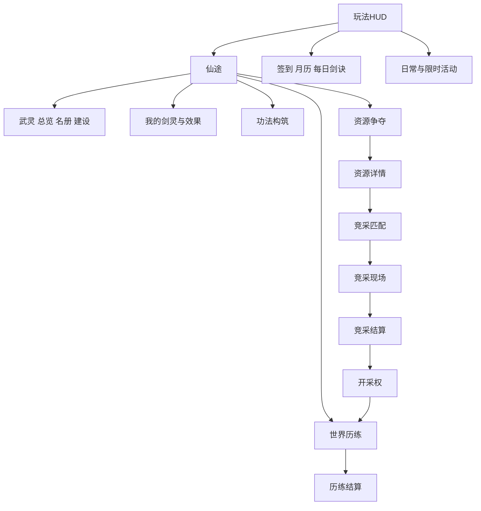

# UI 系统策划案

文档版本v1.3，日期2026-10-21。经济和玩法规则沿用v1.1，本次增加UI系统、文件交付和资产复用规范。这里列出的新页面和新文件是未来开发交付物，本次没有创建它们的运行代码或uasset。

## 1 产品边界和当前事实

主程序为UE5.8，主播操作修士和武灵，观众通过平台互动成为剑灵。主播UI、推流给观众看的HUD、观众互动面板是三种界面，不能把主播鼠标可点的按钮当成观众可以在视频上点击的按钮。

本次实地检查：项目保留7个WBP、26张T_纹理（原18张另有缩略图检查记录，新增8张礼物纹理仅文件盘点）和现有材质，C++已有主菜单、HUD、背包、排行、角色、签到、活动、区域、资源等面板。UInkWulingPanel已经调用UWulingPrototypeSubsystem的创建、名册、历练与突破接口。资源争夺、日月签到、部分活动仍有明确的占位/预览文案。源码存在不能证明服务和界面完整运行，本次没有PIE截图或UAsset控件树加载验证。

当前项目未见旧docs、SourceAssets和大部分Tools目录；本次从本聊天生成记录恢复策划资料，不恢复删除的游戏工具或服务实现。UI实施AI应先核对缺失后端依赖，不能因面板已有HTTP调用就宣称业务已完成。

## 2 三种展示面

| 展示面 | 操作者 | 应包含 | 不应假设 |
|---|---|---|---|
| 主播UE管理界面 | 主播鼠标键盘 | 创建武灵、名册、路线、功法、报名、突破、原型经济 | 观众能操作主播管理按钮 |
| 推流HUD与播报 | 所有观众观看 | 主播境界、当前事件、个人突破、资源倍率、真实贡献 | 点击视频里的角色/背包即可弹出个人页 |
| 平台观众互动面板 | 观众 | 支持能力内的加入、响应、规则、礼物效果 | 已有UE WBP可以直接导出为平台H5 |

首阶段先做UE和评论指令；观众侧独立面板只有确认平台技术栈、接口及权限后另行实施。未确认时提供“发送剑灵查看”的简洁反馈，不编造可点击个人仓库。平台面板的独立交付范围见12。

## 3 导航和窗口层级

主菜单保留开始、继续、存档、设置、退出五项。玩法底部保留角色、物品入口、排行、菜单；活动、签到、仙途沿用右上入口。武灵通过仙途→武灵进入，不新增一排遮挡主角的主导航。资源争夺、功法、我的剑灵在仙途与相应详情互相链接。

层级建议：场景0；常驻HUD10；短播报20；完整页面100；确认与详情200；连接/处理中提示300。连接提示不得拦住取消/返回。普通页面只保留一个顶层，详情使用导航栈；Esc先关弹窗，再退详情，再回HUD，不能一次退到主菜单。

跨页保留列表筛选、页码和滚动位置；退出物品详情清除悬浮提示但不清空库存；横竖切换保留选中项、请求ID和当前状态。页面打开不默认暂停在线服务器事件。

## 4 必须交付的页面

完整逐屏矩阵见tables/ui-screens.csv；每个页面标注当前实现状态、复用类、目标蓝图、数据源、主操作和开放条件。

### 4.1 主菜单和常驻HUD

复用现有WBP_InkFrontend、MainMenu和UInkAnchorStatusWidget；保持相机、角色和本命剑构图。HUD左上显示主播身份、境界、实际生命、修为、修炼状态；当前事件目标放侧边或顶部，右下保留修炼/收功。资源增益使用小徽标显示“灵泉+20%／剩余时间”，点开或主播操作展开来源明细。

HUD新增最多三种短条：事件进度、当前资源效果、最近个人高光。连续突破合并同一人，屏幕内最多3条，每条3至5秒；队列只决定展示，不改变到账。头像缺失用明确占位，不用虚构真人头像。

### 4.2 武灵总览 名册 管理 建设

复用UInkWulingPanel，扩展为总览、成员、建设、记录四个子页。总览显示审核后的武灵名、主播、成员总数、参与成员、临时助战、公共资材、声望、当前开采权；总数与参与人数不能混用。

未创建状态显示创建条件、名称输入、免费创建；输入长度2至12汉字等效、审核中、驳回及7日改名限制都要有状态。成员分页20，行字段为头像、显示名、境界、成员身份、当前参与、当日贡献。详情只暴露适合公开的显示ID，隐藏平台原始身份键。

主播可改名、查看记录、移除成员、解散；移除/解散必须确认，说明个人权益保留。观众通过允许的输入加入/退出，不能从推流画面借用主播管理权限。建设列出三个外观项目、100公共资材成本、当前状态及记录；不伪造未规划的永久倍率或职位售卖。

现有面板中的“世界历练”卡片保留捷径，数据与世界页使用同一ViewModel，不把同一事件在两页各启动一轮。

### 4.3 我的剑灵和礼物效果说明

显示当前查看身份、归属武灵、境界、修为、当前称号、已解锁特殊剑、有效增益和来源。主播与观众视角必须区分，观众剑灵没有生命、防御和死亡栏。特殊剑以一把个人剑灵的形态/能力呈现，不把解锁数量当作额外观众人数。

选择称号只改变表现；旧基线中其他已解锁被动不因换称号关闭。详情显示来源、幅度、对象、持续/到期、叠加规则和当前模式效果。正式礼物价格来自真实配置，不从AI写死。旧权益与候选数值版本分别显示，不把测试效果描述成已购买效果。

缺失权益、到期、暂不适用、测试数据、正式数据、断线未确认均有标签；点击说明不触发购买。购买必须经平台官方送礼路径。推流上展示个人信息应遵循已获准范围，不向其他人暴露全量库存和原始账号。

### 4.4 角色 功法 物品 排行

角色页复用已有资产和属性卡，不新增总战力。主播有生命和防御，观众不显示这两项。突破弹窗显示修为、灵石、破境石当前/需求、可选质量及结果；材料不足给出世界历练入口，不把礼物设为唯一补齐入口。

功法页显示1主修、当前开放辅修槽、境界锁定说明、七路线列表和详情。点击功法→查看主辅差异→选择位置→预览变化→服务端确认；事件运行中禁换，原因可见。第3/6级强化按规则表，不在UI自行计算另一种倍率。

物品页保留现有模型：当前源码200总槽、默认20解锁、每页40。不要按旧记忆退回100槽，也不新增付费开格。保留分类、搜索、筛选、整理、数量、未读、新物品、锁定、说明、使用/装备/出售/分解及禁用理由。新的经济物品补充归属、绑定、到期、来源和托管状态；无相应业务能力时动作隐藏或明确禁用，不假扣币。悬停蓝、选中金的既定反馈要求要在实施时结合当前材质核对。

排行保留真实主播剑灵数、修炼速度和有效伤害，新增武灵/竞采视图时注明周期与规则。现有窄版榜单与每屏8行布局优先复用，不用本地榜冒充全服。没有好友能力就不提供可点击的假好友榜。

### 4.5 世界历练 区域详情 结算

复用WorldCultivation和RegionDetail，列表显示前三个首发区域与后续区域的真实开放状态。详情显示主题、固定难度、基础奖励、路线、10分钟时间结构和参与说明。开始前选择独行/小/中/大预设；运行中冻结选择。

页面状态：可开始→准备→进行→恢复→结算中→已完成/已中断。进行中显示本轮时间、当前阶段、主播生命、共同目标、已确认阶段奖励；30秒恢复明确保留已完成阶段。结算区分基础阶段产出、个人修为、个人贡献、公共资材与额外核心，各写收据状态；领取仅确认展示，不再发一次奖励。

### 4.6 资源列表 详情 匹配 竞采 结算 开采权

资源页覆盖灵泉、灵石矿、灵草园、玄铁脉、残卷遗址五类。每张卡显示作用对象、单位产出、间隔、最长租期、是否已有开采权和报名条件。旧页面“占领”文案按本案配额规则更新，不误导为已经控制其他主播领地。

资源详情→匹配大厅：显示2至4真实武灵、人数档、目标资源、统一规则、是否满足至少1名正式成员、等待时间、取消。60秒无对手可转世界历练；没有真实对手不画假头像。

竞采现场：120秒准备/360秒挑战/120秒结算三个阶段，显示共同任务600、主播操作200、成员协作200。代表名单冻结，最多10人；分母、正确响应、未响应明确。把礼物即时表现与统一计分规则分别说明；不显示送礼金额充当得分。

结算显示分数来源、并列分组、600分资格和30/20/10分钟租期，未达标写清原因。开采权页显示服务器start/end、剩余时间、实际受益身份、有效在线积累、已入账物品和下一档进度。第600秒结算自动生效，“领取”按钮只确认展示，不延后租期。

原型获胜是高档配额，不是唯一矿点，因此允许多个并列获胜；画面不能假装只有一个占领者。服务断线只显示最后确认快照与“更新暂停”，不在客户端继续计资源。

### 4.7 签到 月签 每日剑诀 日常 限时活动

复用现有组页和日历。日签到显示可签、请求中、已签、跨日刷新；月历以服务器日期呈现，累计节点统一改为3/7/14/21，不能继续沿用旧页7/14/21/28。每日一签改为固定轮换剑诀与行动提示，不做随机吉凶/付费改签。

日常卡显示实际目标、进度、预算、已领取状态；限时卡显示准确起止、时区和有效期，无起止不生成假的倒计时。活动详情显示免费参与方式、固定奖励和是否替换基础预算。

旧Draw、随机单抽/十连和出诊页可保留开发预览资产，但不进入本案正式业务导航。不要因素材中有召唤、抽奖按钮就新增抽取业务。原参考图的宠物武灵内容不适用于当前“武灵是组织”的定义。

### 4.8 离线收益和原型经济页

离线页只在该profile获准时出现：上次结算、本次有效时长、8小时上限、基础10%、修为结果、原收据。显示不受灵脉和礼物放大。到账后点击只是确认，不让跨设备重复领取。

商店展示SKU、真实成本、绑定材料、产物、日限购、窗口唯一与期限；寄售页展示白名单原料、单价区间、数量、税、挂牌费、总价、物品到期与托管；订单页列我的挂牌、已成交、取消、到期和应收记录。它们仅供prototype_full；发布候选隐藏入口且接口拒绝，错误也不得返回可购买目录。

## 5 公共交互系统

每屏都有Loading、Ready、Empty、Pending、Disconnected、Error、Expired、FeatureDisabled状态。空状态给出下一步；请求中锁提交、不锁返回；成功使用服务端快照；失败保留输入并说明原因；关闭页不中断已提交事务，回到页面根据request_id对账。

复用组件：带理由禁用按钮、状态条、确认弹窗、成员行、物品详情、奖励格、贡献行、租约徽标、礼物效果卡、短提示。红点只来自真实未读/可领取状态，进入页面不产生奖励，不做永久假红点。

## 6 版式与视觉

白宣纸、墨线、山水、少量金边；蓝用于交互/选项，朱砂用于提醒；不能把所有内容都涂金。按钮、纸卡、进度条先用现有材质，不先生成另一套风格。动态中文、人数、期限、货币、境界使用TextBlock，不烘焙在新图里。

竖屏设计基准720×1280，SafeZone内四边至少24逻辑单位。正文建议24至28、说明20至22、标题32至40；在540×960验证正文最终可读像素，不能把大面板等比缩成小字。按钮高度至少56、触控热点优先64，间距8至16。

横屏1280×720采用列表＋详情双栏；竖屏列表与详情分层，避免左右挤压。物品竖屏4列、横屏8列，每页仍40槽，竖屏通过滚动呈现，不改变物理格索引。成员20行分页，界面同时显示多少由可视区域决定；不把所有名单生成场景剑实体。

排行保留每屏8行的当前组织方式，不强行把所有新列表也做8行。长武灵名、昵称、长金额、未知头像、200物品格、高数量都必须验证；重要数值有完整详情，缩写不能丢失到账依据。

## 7 实施顺序

UI-P0盘点和路由/数据隔离；UI-P1武灵、世界历练、个人剑灵与结算；UI-P2功法、资源详情、匹配、竞采、开采权；UI-P3签到活动真实接线与原型经济；平台观众独立面板作为确认能力后的单独任务。详细文件和验收见12、13。

## 7 青云初启开服活动增量

新增两页：LaunchEvent（UInkLaunchEventPanel）与LaunchRank（UInkLaunchRankPanel）。入口复用活动组，武灵总览增加下一目标小卡。LaunchEvent采用总览/个人任务/武灵目标/规则四个内部子栏；只有两条新顶层路由，不为四栏重复压导航栈。

展示实际活动期限、本人报名时间、七任务计数、1/3/6/12共同轮次、自动到账收据、称号预览和到期。LaunchRank展示免费贡献四类来源、参与轮数、资格和并列名次，不显示消费排名及关闭的修为奖。称号使用UMG文字和现有空白底板，只按需补飞雁徽记。对应文件纳入ui-files.csv，规则以14为准。发布候选关闭入口和直达请求。
