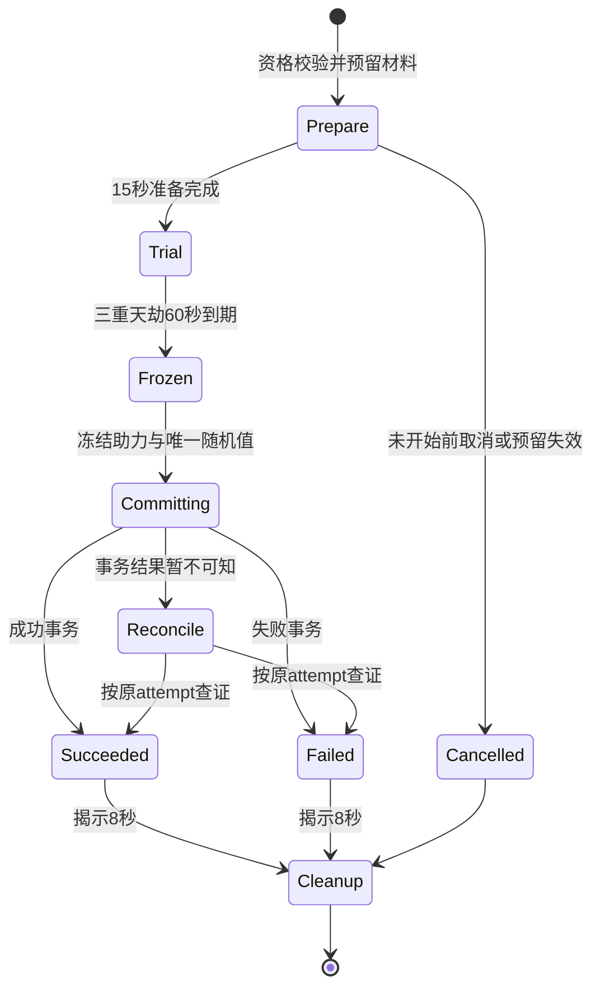

# 天劫与观众助力 v1.4

日期2026-10-21。承接本轮用户追加想法：元婴往上突破出现天劫，基础失败概率50%，失败损失1500修为，观众发送助力使对应剑灵进入预警并增加成功概率1%。本案默认从“金丹六阶冲击元婴”开始，覆盖BR04至BR10共七次；触发边界可按first_transition配置调整。观众自己的自动突破不触发材料或天劫。

## 1 明确概率口径

成功率P=min(100%,50%+min(不同有效助力数,50)×1个百分点+min(此前连续失败数×10个百分点,50个百分点))。

| 本次不同助力数 | 无失败保底时成功率 |
|---:|---:|
| 0 | 50% |
| 1 | 51% |
| 10 | 60% |
| 25 | 75% |
| 49 | 99% |
| 50及以上 | 100% |

1%按增加1个百分点处理，不是把50%乘1.01变成50.5%。同一观众同次渡劫只贡献一次；“助力×100”不算100人，刷屏不叠加。第51人仍可进入助力表现、收到“助力已收到，概率已满”，不再提高封顶值。主播不能助力自己。

基础50%是首次尝试；为避免小房间长期随机卡住，本版增加公开失败保底：失败一次，下次+10个百分点，同一次大境界连续失败最多五次后，第六次即使无人助力也100%。成功后清零该转换的失败计数；改名、断线、换界面不清零，其他境界不继承。该保底为本版补充建议，界面必须提前展示，不暗中操纵随机。

礼物金额/次数、材料品质、法宝、道具、武灵等级都不进入成功率公式。护道材料仅缩短成功后稳定期；天地精华与奇珍提高确定Q。没有付费加概率、重抽或复活道具。

## 2 有效助力与截止

来源是当前房间官方身份对应的剑灵，可为正式成员或合法临时助战；无需送礼或入榜。首次在助力窗口发送“助力”成功后，记app/attempt_id/platform_user_id唯一事实，回执显示当前概率与本人状态。身份未就绪时明确未接入，不能在UE本地生成假用户。

助力窗口为三重天劫共60秒，使用服务端开始/截止UTC。准备15秒只说明规则，未开始的命令提示稍后，不积攒为下一次；截止后提示已结束。平台重试消息沿event_id去重，一位观众多个平台事件仍只记一次。资格在命令发生时校验；已计入后正常离开房间不扣回概率，不能制造最后一秒人数抖动。

服务端按收到的已验证事件时间判断，不接受客户端自填occurred_at。临时网络延迟没有客户端回填窗口；正式平台若有可信事件发生时间与迟到约束，需单独验证后版本化启用，不能让前端在看到结果后补助力。

## 3 全状态流程

启动校验：达到当前小阶修为要求、至少50%生命、脱离普通战斗15秒、安全区、当前只有一个突破事件、核心与所选材料未到期未托管、规则和模式许可。已有世界历练/竞采进行中不能同时开始天劫。校验通过后预留材料和成功所需修为，不立即消耗，后台仍显示可用与预留两栏。

天劫含肉身/神魂/心魔三段各20秒，用雷云、聚灵与剑阵表现；不是每一段再掷一次50%。免费助力全60秒可用，阶段切换不清空。它们是一个成功率事件，不擅自加入主播操作失误额外扣概率或隐藏死亡判定。

天劫期间算有效在线参与，基础修为照常按原速度和已获准权益结算，不增加一份天劫专属修为；不领取完整世界奖励、不推进材料专注、不与离线时间重叠。它不是83秒算成一个完整十分钟世界事件。

Trial开始后离开界面/掉线不能取消已经开始的风险。服务继续计时并按同attempt结算；回房查询原结果。Prepare阶段才允许无损取消；预留物到期或发生服务故障导致无法合法开始，取消预留并保持原到期，不凭空补造材料。进入Trial后材料预留有效性检查通过并冻结使用资格，到期边界不能让服务既扣修又没收未消费材料；具体规则见到期处理。

## 4 一次随机与成功事务

服务端冻结唯一助力集合和失败保底，生成且持久化一次均匀整数roll∈[0,9999]；P使用基点，基础5000、每人100、每次失败保底1000。roll<P为成功，50%对应恰5000个成功值，100%覆盖所有值。随机值不能由客户端提交，也不能在事务重试时重新抽。日志保留配置hash、助力事实摘要、概率、结果和唯一事务ID，不暴露平台身份给直播画面。

成功事务原子执行：扣本次成功修为成本、消耗核心与所选辅材、提升境界、写入确定品质快照、清除该突破失败计数、记唯一收据。大境界灵石/破境石不再收一次；核心配方的投入已经在取得核心时完成。随后再播成功演出，动画中断不会回滚已确认境界。

品质与成功独立：开始前显示Q和“成功时确定获得的品质”。例如Q87始终极品，本次成功概率仍由助力和保底决定；绝不因失败前投入奇珍而暗减成功率。

## 5 失败扣修与材料保留

失败损失=min(1500,本次结算前未花费修为)。预留不算已花费；失败先释放整笔成功修为预留，再只扣该损失，不扣整笔突破修为后再额外减1500。现有境界不变，已拥有品质、旧礼物和已解锁剑灵不丢失，不扣成负数、不降境界。

核心、护道、精华、奇珍都不消耗，原实例解除预留，不另外铸一份退款。若其原到期时间已过，只解除预留并按原期限归档失效，不生成新期限补件；启动前若剩余有效期不足准备+天劫+揭示共83秒，拒绝使用该材料并说明原因，避免正常试图结束时过期。服务异常超时跨原到期需要留待对账，不自动延长。

计数增加1，下一次公开保底+10个百分点；没有额外材料、灵石或道具罚款。再次突破要先把修为补回原阈值，并距离上次结算至少60秒。基准1修为/秒下，一次1500约25分钟；实际按有效成长速度计算，不保证实际25分钟。失败后仍能参与普通世界和修炼，不弹出购买补修按钮。

零助力且每次有足够1500可扣时，考虑保底的期望失败数0.7732、期望额外损失1159.8修为；最坏五次失败7500，然后第六次保证成功。没有保底时50%独立随机的连续失败没有有限上界，因此本版选择公开保底。这是概率算术，不是直播试播数据。

## 6 对应剑灵进入预警的生命周期

有效助力事实确认后，向对应剑灵发出带attempt_id的HelpAlertRequested，并取得本次预警租约。视觉目标是面向主播/劫云，进入现有ALERT预警悬停与护阵表现；计概率以服务端事实为准，不等待客户端动画播完。

不得直接改Transform让正在STRIKE/RETURNING的剑瞬移，也不能粗暴覆盖全局旧预警状态。若有在途动作，走现有安全结束/返回路径后进入本次预警，HUD仍立即显示助力已计入；事件切换前已禁止新普通战斗。既有礼物剑形、权益与UTC到期照常运行，不以“助力剑被占用”为由吞掉已确认礼物履约。

结束时按来源释放本次预警租约，然后重新评估现时状态：有其他有效警戒则维持ALERT，有有效目标按现有状态机处理，否则回IDLE。不能恢复一份已过期的开场旧状态，也不能为清理天劫把其他系统的预警全部清掉。

必须处理的释放路径：成功、失败、准备取消、服务拒绝、超时对账完成、切房、角色卸载、断线、本次剑灵实例销毁。离场玩家的助力事实仍保留，但客户端表现对象不悬挂；重连若Trial尚在可恢复剩余租约，已结束则不再补播一整段预警。旧场次回调按session_generation丢弃。

## 7 UI、提示与功能文件

准备页显示：“预计突破品质极品Q87；首次成功率50%；失败扣1500修为，材料保留，不掉境界；每名不同剑灵发送助力+1个百分点；连续失败保底见规则。”展示实际失败次数、保底增加和本次完整概率，不只写“有机会成功”。

现场显示三段剩余时间、已收到不同助力数、50%基础/助力/保底三项与最终概率、本人已助力状态。场上只保留轻量计数与短回执，50次剑灵反馈可合并动画但事实不能丢。结果页展示唯一收据、扣修或境界变化、材料保留状态和下一次保底；未确认时显示对账中，不提前播失败。

共享计划文件：Source/BoundlessImmortality/Frontend/UI/InkUiBreakthroughPanels.h/.cpp；Content/UI/Ink/Wuling/Widgets/WBP_InkBreakthroughPrepare.uasset及WBP_InkTribulation.uasset。业务需接现有成长/世界互斥/武灵成员/官方互动路由；具体Subsystem路径由实施者现查，不能按本文新增第二套境界存档。预警沿既有LiveWeaponSwarm路径增量接入，不重写飞行系统。

## 8 发布与验收

数据至少包括BreakthroughAttempt（主播/转换/规则hash/phase/start/deadline/reserved_qi/material_instance_ids/frozen_probability/roll/receipt）、TribulationAssist（attempt/user/event_id/verified_time，attempt+user唯一）、FailurePity（主播/转换/profile/window/count）、SwordAlertLease（attempt/actor/session_generation/expiry）。助力事务先写唯一事实，再增加计数；结果事务锁定attempt与成长快照，统一写扣修/消耗或退还/保底，不能由两套客户端分别处理。

本事件有随机数值结果和跨场成长，prototype_full隔离验证；正式物品扩展与天劫开关为false。仅因助力免费不意味着随机与存储自然获准；以提案能力为准，见15的来源。若提案不允许随机数值，保留三重演出和免费助力表现的确定性版本需另立配置，不暗改本50%规则。

验收见tables/items-v1.4/acceptance.csv：重复助力、助力截止、不同身份、51人封顶、50%/100%整数边界、连续失败保底、扣修不重复、失败材料不复制、断线不重抽、旧回调、全部预警释放路径、原礼物时长、主播/观众归属。配置脚本与Excel公式通过不代表这些UE/服务流程已验证。
