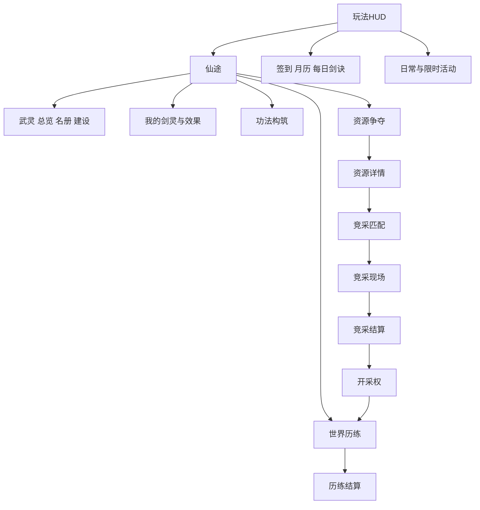
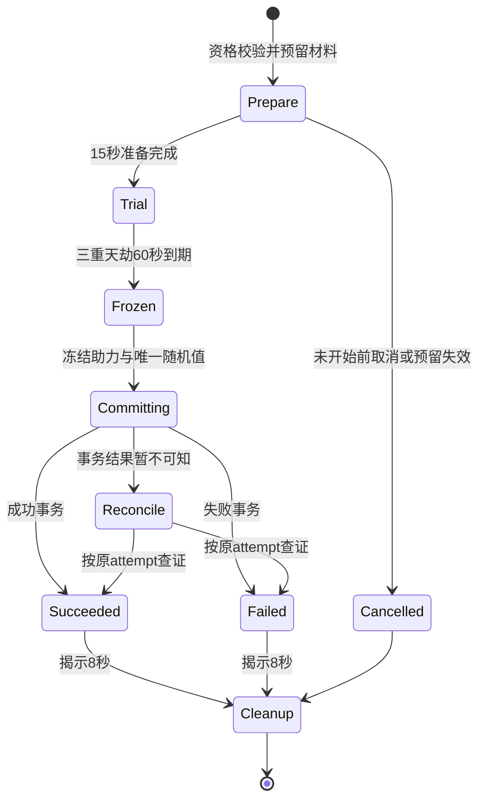

# UI专项交接完整版 v1.4

39页面/子页、90文件任务均为计划。物品与天劫参数按15/16，新增39页不代表已实现39页。


---

# UI 系统策划案

文档版本v1.4，日期2026-10-21。经济和玩法规则沿用v1.1，本次增加UI系统、文件交付和资产复用规范。这里列出的新页面和新文件是未来开发交付物，本次没有创建它们的运行代码或uasset。

## 1 产品边界和当前事实

主程序为UE5.8，主播操作修士和武灵，观众通过平台互动成为剑灵。主播UI、推流给观众看的HUD、观众互动面板是三种界面，不能把主播鼠标可点的按钮当成观众可以在视频上点击的按钮。

本次实地检查：项目保留7个WBP、26张T_纹理（原18张另有缩略图检查记录，新增8张礼物纹理仅文件盘点）和现有材质，C++已有主菜单、HUD、背包、排行、角色、签到、活动、区域、资源等面板。UInkWulingPanel已经调用UWulingPrototypeSubsystem的创建、名册、历练与突破接口。资源争夺、日月签到、部分活动仍有明确的占位/预览文案。源码存在不能证明服务和界面完整运行，本次没有PIE截图或UAsset控件树加载验证。

当前项目未见旧docs、SourceAssets和大部分Tools目录；本次从本聊天生成记录恢复策划资料，不恢复删除的游戏工具或服务实现。UI实施AI应先核对缺失后端依赖，不能因面板已有HTTP调用就宣称业务已完成。

## 2 三种展示面

| 展示面 | 操作者 | 应包含 | 不应假设 |
|---|---|---|---|
| 主播UE管理界面 | 主播鼠标键盘 | 创建武灵、名册、路线、功法、报名、突破、原型经济 | 观众能操作主播管理按钮 |
| 推流HUD与播报 | 所有观众观看 | 主播境界、当前事件、个人突破、资源倍率、真实贡献 | 点击视频里的角色/背包即可弹出个人页 |
| 平台观众互动面板 | 观众 | 支持能力内的加入、响应、规则、礼物效果 | 已有UE WBP可以直接导出为平台H5 |

首阶段先做UE和评论指令；观众侧独立面板只有确认平台技术栈、接口及权限后另行实施。未确认时提供“发送剑灵查看”的简洁反馈，不编造可点击个人仓库。平台面板的独立交付范围见12。

## 3 导航和窗口层级

主菜单保留开始、继续、存档、设置、退出五项。玩法底部保留角色、物品入口、排行、菜单；活动、签到、仙途沿用右上入口。武灵通过仙途→武灵进入，不新增一排遮挡主角的主导航。资源争夺、功法、我的剑灵在仙途与相应详情互相链接。

层级建议：场景0；常驻HUD10；短播报20；完整页面100；确认与详情200；连接/处理中提示300。连接提示不得拦住取消/返回。普通页面只保留一个顶层，详情使用导航栈；Esc先关弹窗，再退详情，再回HUD，不能一次退到主菜单。

跨页保留列表筛选、页码和滚动位置；退出物品详情清除悬浮提示但不清空库存；横竖切换保留选中项、请求ID和当前状态。页面打开不默认暂停在线服务器事件。



## 4 必须交付的页面

完整逐屏矩阵见tables/ui-screens.csv；每个页面标注当前实现状态、复用类、目标蓝图、数据源、主操作和开放条件。

### 4.1 主菜单和常驻HUD

复用现有WBP_InkFrontend、MainMenu和UInkAnchorStatusWidget；保持相机、角色和本命剑构图。HUD左上显示主播身份、境界、实际生命、修为、修炼状态；当前事件目标放侧边或顶部，右下保留修炼/收功。资源增益使用小徽标显示“灵泉+20%／剩余时间”，点开或主播操作展开来源明细。

HUD新增最多三种短条：事件进度、当前资源效果、最近个人高光。连续突破合并同一人，屏幕内最多3条，每条3至5秒；队列只决定展示，不改变到账。头像缺失用明确占位，不用虚构真人头像。

### 4.2 武灵总览 名册 管理 建设

复用UInkWulingPanel，扩展为总览、成员、建设、记录四个子页。总览显示审核后的武灵名、主播、成员总数、参与成员、临时助战、公共资材、声望、当前开采权；总数与参与人数不能混用。

未创建状态显示创建条件、名称输入、免费创建；输入长度2至12汉字等效、审核中、驳回及7日改名限制都要有状态。成员分页20，行字段为头像、显示名、境界、成员身份、当前参与、当日贡献。详情只暴露适合公开的显示ID，隐藏平台原始身份键。

主播可改名、查看记录、移除成员、解散；移除/解散必须确认，说明个人权益保留。观众通过允许的输入加入/退出，不能从推流画面借用主播管理权限。建设列出三个外观项目、100公共资材成本、当前状态及记录；不伪造未规划的永久倍率或职位售卖。

现有面板中的“世界历练”卡片保留捷径，数据与世界页使用同一ViewModel，不把同一事件在两页各启动一轮。

### 4.3 我的剑灵和礼物效果说明

显示当前查看身份、归属武灵、境界、修为、当前称号、已解锁特殊剑、有效增益和来源。主播与观众视角必须区分，观众剑灵没有生命、防御和死亡栏。特殊剑以一把个人剑灵的形态/能力呈现，不把解锁数量当作额外观众人数。

选择称号只改变表现；旧基线中其他已解锁被动不因换称号关闭。详情显示来源、幅度、对象、持续/到期、叠加规则和当前模式效果。正式礼物价格来自真实配置，不从AI写死。旧权益与候选数值版本分别显示，不把测试效果描述成已购买效果。

缺失权益、到期、暂不适用、测试数据、正式数据、断线未确认均有标签；点击说明不触发购买。购买必须经平台官方送礼路径。推流上展示个人信息应遵循已获准范围，不向其他人暴露全量库存和原始账号。

### 4.4 角色 功法 物品 排行

角色页复用已有资产和属性卡，不新增总战力。主播有生命和防御，观众不显示这两项。突破弹窗显示修为、灵石、破境石当前/需求、可选质量及结果；材料不足给出世界历练入口，不把礼物设为唯一补齐入口。

功法页显示1主修、当前开放辅修槽、境界锁定说明、七路线列表和详情。点击功法→查看主辅差异→选择位置→预览变化→服务端确认；事件运行中禁换，原因可见。第3/6级强化按规则表，不在UI自行计算另一种倍率。

物品页保留现有模型：当前源码200总槽、默认20解锁、每页40。不要按旧记忆退回100槽，也不新增付费开格。保留分类、搜索、筛选、整理、数量、未读、新物品、锁定、说明、使用/装备/出售/分解及禁用理由。新的经济物品补充归属、绑定、到期、来源和托管状态；无相应业务能力时动作隐藏或明确禁用，不假扣币。悬停蓝、选中金的既定反馈要求要在实施时结合当前材质核对。

排行保留真实主播剑灵数、修炼速度和有效伤害，新增武灵/竞采视图时注明周期与规则。现有窄版榜单与每屏8行布局优先复用，不用本地榜冒充全服。没有好友能力就不提供可点击的假好友榜。

### 4.5 世界历练 区域详情 结算

复用WorldCultivation和RegionDetail，列表显示前三个首发区域与后续区域的真实开放状态。详情显示主题、固定难度、基础奖励、路线、10分钟时间结构和参与说明。开始前选择独行/小/中/大预设；运行中冻结选择。

页面状态：可开始→准备→进行→恢复→结算中→已完成/已中断。进行中显示本轮时间、当前阶段、主播生命、共同目标、已确认阶段奖励；30秒恢复明确保留已完成阶段。结算区分基础阶段产出、个人修为、个人贡献、公共资材与额外核心，各写收据状态；领取仅确认展示，不再发一次奖励。

### 4.6 资源列表 详情 匹配 竞采 结算 开采权

资源页覆盖灵泉、灵石矿、灵草园、玄铁脉、残卷遗址五类。每张卡显示作用对象、单位产出、间隔、最长租期、是否已有开采权和报名条件。旧页面“占领”文案按本案配额规则更新，不误导为已经控制其他主播领地。

资源详情→匹配大厅：显示2至4真实武灵、人数档、目标资源、统一规则、是否满足至少1名正式成员、等待时间、取消。60秒无对手可转世界历练；没有真实对手不画假头像。

竞采现场：120秒准备/360秒挑战/120秒结算三个阶段，显示共同任务600、主播操作200、成员协作200。代表名单冻结，最多10人；分母、正确响应、未响应明确。把礼物即时表现与统一计分规则分别说明；不显示送礼金额充当得分。

结算显示分数来源、并列分组、600分资格和30/20/10分钟租期，未达标写清原因。开采权页显示服务器start/end、剩余时间、实际受益身份、有效在线积累、已入账物品和下一档进度。第600秒结算自动生效，“领取”按钮只确认展示，不延后租期。

原型获胜是高档配额，不是唯一矿点，因此允许多个并列获胜；画面不能假装只有一个占领者。服务断线只显示最后确认快照与“更新暂停”，不在客户端继续计资源。

### 4.7 签到 月签 每日剑诀 日常 限时活动

复用现有组页和日历。日签到显示可签、请求中、已签、跨日刷新；月历以服务器日期呈现，累计节点统一改为3/7/14/21，不能继续沿用旧页7/14/21/28。每日一签改为固定轮换剑诀与行动提示，不做随机吉凶/付费改签。

日常卡显示实际目标、进度、预算、已领取状态；限时卡显示准确起止、时区和有效期，无起止不生成假的倒计时。活动详情显示免费参与方式、固定奖励和是否替换基础预算。

旧Draw、随机单抽/十连和出诊页可保留开发预览资产，但不进入本案正式业务导航。不要因素材中有召唤、抽奖按钮就新增抽取业务。原参考图的宠物武灵内容不适用于当前“武灵是组织”的定义。

### 4.8 离线收益和原型经济页

离线页只在该profile获准时出现：上次结算、本次有效时长、8小时上限、基础10%、修为结果、原收据。显示不受灵脉和礼物放大。到账后点击只是确认，不让跨设备重复领取。

商店展示SKU、真实成本、绑定材料、产物、日限购、窗口唯一与期限；寄售页展示白名单原料、单价区间、数量、税、挂牌费、总价、物品到期与托管；订单页列我的挂牌、已成交、取消、到期和应收记录。它们仅供prototype_full；发布候选隐藏入口且接口拒绝，错误也不得返回可购买目录。

## 5 公共交互系统

每屏都有Loading、Ready、Empty、Pending、Disconnected、Error、Expired、FeatureDisabled状态。空状态给出下一步；请求中锁提交、不锁返回；成功使用服务端快照；失败保留输入并说明原因；关闭页不中断已提交事务，回到页面根据request_id对账。

复用组件：带理由禁用按钮、状态条、确认弹窗、成员行、物品详情、奖励格、贡献行、租约徽标、礼物效果卡、短提示。红点只来自真实未读/可领取状态，进入页面不产生奖励，不做永久假红点。

## 6 版式与视觉

白宣纸、墨线、山水、少量金边；蓝用于交互/选项，朱砂用于提醒；不能把所有内容都涂金。按钮、纸卡、进度条先用现有材质，不先生成另一套风格。动态中文、人数、期限、货币、境界使用TextBlock，不烘焙在新图里。

竖屏设计基准720×1280，SafeZone内四边至少24逻辑单位。正文建议24至28、说明20至22、标题32至40；在540×960验证正文最终可读像素，不能把大面板等比缩成小字。按钮高度至少56、触控热点优先64，间距8至16。

横屏1280×720采用列表＋详情双栏；竖屏列表与详情分层，避免左右挤压。物品竖屏4列、横屏8列，每页仍40槽，竖屏通过滚动呈现，不改变物理格索引。成员20行分页，界面同时显示多少由可视区域决定；不把所有名单生成场景剑实体。

排行保留每屏8行的当前组织方式，不强行把所有新列表也做8行。长武灵名、昵称、长金额、未知头像、200物品格、高数量都必须验证；重要数值有完整详情，缩写不能丢失到账依据。

## 7 实施顺序

UI-P0盘点和路由/数据隔离；UI-P1武灵、世界历练、个人剑灵与结算；UI-P2功法、资源详情、匹配、竞采、开采权；UI-P3签到活动真实接线与原型经济；平台观众独立面板作为确认能力后的单独任务。详细文件和验收见12、13。

## 7 青云初启开服活动增量

新增两页：LaunchEvent（UInkLaunchEventPanel）与LaunchRank（UInkLaunchRankPanel）。入口复用活动组，武灵总览增加下一目标小卡。LaunchEvent采用总览/个人任务/武灵目标/规则四个内部子栏；只有两条新顶层路由，不为四栏重复压导航栈。

展示实际活动期限、本人报名时间、七任务计数、1/3/6/12共同轮次、自动到账收据、称号预览和到期。LaunchRank展示免费贡献四类来源、参与轮数、资格和并列名次，不显示消费排名及关闭的修为奖。称号使用UMG文字和现有空白底板，只按需补飞雁徽记。对应文件纳入ui-files.csv，规则以14为准。发布候选关闭入口和直达请求。


## v1.4物品与天劫UI增量

新增突破准备、天劫现场、来源、公库建设、装备法宝五页和4组原生文件，已合入ui-screens/ui-files/ui-acceptance总表；单列规格见tables/items-v1.4/ui-extension.csv。规则与ViewModel字段见15、16。新增真值包括四类材料实例、明确Q与确定品质、助力基点/截止/保底、attempt与收据、预警租约、个人/公库余额和建设版本。发布候选item_extension与tribulation关闭；旧路由不能绕过。新文件均待实施，不因策划表存在宣称已生成。


---

# UI 素材与文件清单

本案说明复用什么、补画什么、开发AI应生成哪些文件。清单里的“planned”是将来交付物，本次只生成策划文档、清单和素材检查证据，未生成新的游戏UI纹理或Widget Blueprint。

## 1 已检查的素材与限制

本次逐张查看桌面UI资源目录的11张PNG：主菜单按钮、排行榜、称号、标题海报、背包、两张境界图、四张功能参考图。此前18张T_纹理完成文件盘点，其中7张提取出可解码的256像素JPEG缩略图并查看。缩略图不代表源纹理尺寸、Alpha质量或实际运行效果。

源文件路径、大小和SHA256见ui-audit/reference-images.json；项目资产见tables/ui-existing-assets.csv；纹理缩略图证据见ui-audit/texture-inspection.json。缩略图总览：[已有图集预览](ui-audit/existing-atlases-contact-sheet.jpg)。本次不把历史截图当成当前PIE截图，不把文件存在当成材质正确加载。

## 2 复用决定

| 资产组 | 可复用内容 | 处理方式 |
|---|---|---|
| Widgets现有7个WBP | Frontend、MainMenu、Character、Inventory、Leaderboard、Saves、Settings | 保留路径和人工配置，增量接入 |
| Cohesion20261021 | 控件皮肤、16格图标、山水场景、现有称号光效 | 当前InkPresentationStyle主要使用此组，优先复用 |
| Portrait20261021 | 纸卡、条轨和填充等 | 当前进度条优先来自此组，不无理由替换 |
| Polish | 装饰和旧控件皮肤 | 用作兼容和缺省，不整套覆盖当前主题 |
| Provided | 背包、排行、按钮、称号原图集 | 复用已有UV和材质实例，避免把整图当一张界面 |
| Cultivation | 境界图、境界横幅、功能场景 | 复用境界与装饰，动态名称另行排版 |
| Materials/Atlas | 通用图集和背包图集材质、Fit/Slice实例 | 复用九宫格与等比显示，不能任意拉长图案 |
| Materials/Leaderboard | 行底、奖章、称号、滚动条和标题 | 保留既有窄榜布局与图集切片 |

代码证据：InkPresentationStyle::Surface当前为纸卡/按钮选择MI_Cohesion_，条轨/填充选择MI_Portrait_；CohesionIcon用4×4UV；旧排行榜/背包使用专用图集和切片材质。新AI应沿这个调用链核对，不按文件日期猜哪套正在使用。

## 3 参考图逐项覆盖

| 参考图 | 本案吸收 | 不直接实施的内容 |
|---|---|---|
| 14_34_12-1 签到活动 | 日签、月历、每日剑诀、日常/限时卡片、奖励展示 | 补签付费、单抽/十连、随机奖池 |
| 14_34_15-2 出诊修行 | 区域选择、产出、进度、资源卡、名次与结算 | 出诊派遣留旧预览，不成为本次新增主循环 |
| 14_34_17-3 门派武灵 | 门派部分改为武灵总览、成员、公共外观、旗帜 | 底部宠物召唤/培养/图鉴不进入当前武灵组织 |
| 14_34_18-4 角色属性 | 属性卡、身份、头像框、条轨、境界表现 | 总战力、虚构装备/法宝数值、观众独立生命 |
| 背包原图 | 分类、格态、数量、新标记、说明、搜索、滚动、动作 | 不能因为图上有出售/分解就忽略来源与profile约束 |
| 排行原图 | 奖章、标题、头像、行底、范围与周期 | 不创建没有好友/全服后端支撑的假数据 |
| 按钮原图 | 普通、悬停、按下、禁用、返回、确认、开关 | 烘焙文字不作为动态新按钮的唯一文字来源 |
| 称号原图 | 既有特殊剑横幅与空白底板 | 保留用户现有名称，AI不擅改“无机态那”等命名 |
| 境界两图 | 34境界的视觉语义、徽记与横幅 | 不把整张境界表缩进一条姓名栏 |

## 4 新文件结构

精确到每个文件的列表见tables/ui-files.csv，含add/modify/reuse、阶段、目标类和用途。所有新路径是计划，不是已存在证明。

```text
Source/BoundlessImmortality/Frontend/UI/
  InkUiScreenRegistry.h/.cpp
  InkUiViewModels.h/.cpp
  InkUiCommonWidgets.h/.cpp
  InkUiRacePanels.h/.cpp
  InkUiSwordPanels.h/.cpp
  InkUiMethodPanel.h/.cpp
  InkUiEconomyPanels.h/.cpp
  InkUiRewardPanels.h/.cpp
  InkUiLaunchPanels.h/.cpp
  InkUiBreakthroughPanels.h/.cpp
  InkUiItemSourcePanel.h/.cpp
  InkUiGuildBuildPanel.h/.cpp
  InkUiEquipmentPanel.h/.cpp

Content/UI/Ink/Wuling/
  Widgets/       20个页面级WBP
  Components/     9个共用WBP
  Data/           路由与主题两个DataAsset
  Textures/       4张按需补充的图集＋1枚飞雁徽记

SourceAssets/UI/Wuling/
  Generated/      4张图集源PNG＋1张徽记PNG
  atlas-regions.json
  art-manifest.md

Tools/InkFrontend/
  inspect_wuling_ui_assets.py
  verify_wuling_ui_pie.py
  wuling-ui-acceptance.json
```

这些目录有一部分当前已经被删除，计划中的Tools文件将来由UI实施者新建；本次不把检查文档恢复误报为已恢复游戏工具。先核对同名文件再添加，不覆盖用户后来新增的资产。

## 5 页面蓝图和原生类

20个页面WBP：WulingOverview、SwordSpirit、GiftRules、Methods、RaceLobby、RaceLive、RaceSettlement、ResourceLease、EventSettlement、OfflineRewards、Shop、Market、TradeOrders、LaunchEvent、LaunchRank、BreakthroughPrepare、Tribulation、ItemSources、GuildConstruction、EquipmentFabao，统一前缀WBP_Ink，完整路径见CSV。

WulingOverview继承现有UInkWulingPanel；新页面继承对应的UInkFeaturePanel派生类。既有签到、活动、资源列表/详情继续用当前原生页面，不另造第二个功能相同的顶层WBP。

当前原生面板创建并拥有WidgetTree。新WBP首版作为可配置的类/样式入口，原生层仍独占控件树构建，不能同时在Designer加一棵根树又被RebuildPanel重建。若后续改为Designer拥有控件树，应单独迁移并验证，不混用两种所有权。

新增UInkUiScreenRegistry保存Route→WidgetClass→FeatureGate→ParentRoute映射，通过DA_InkWulingScreens注册新WBP；现有ClassForRoute只作为兼容入口。一个Route只注册一次，缺失资产在开发模式明确告警，正式模式按能力失败关闭，不静默打开错误页面。

9个组件WBP：RequestState、ConfirmModal、MemberRow、RewardItem、ItemTooltip、ContributionRow、LeaseBadge、GiftEffectCard、Toast。其原生类由InkUiCommonWidgets实现，组件不直接访问HTTP或扣币。

## 6 新增美术需求

先完成复用核对，只补缺失语义。下面4张图集及1张徽记是本案的生成任务，不要求AI重新生成全部现有按钮与面板。具体单元索引、源路径和导入路径见tables/ui-art-requests.csv。

| 源图和目标纹理 | 规格 | 单元内容 |
|---|---|---|
| WulingItemIcons.png → T_WulingItemIcons | 2048×2048，4×4，每格512 | 破境石、核心、草、铁、残页、丹、护符、研习简、精华、灵石、公共资材、贡献、武灵、租约、锁、提醒 |
| WulingResourceIcons.png → T_WulingResourceIcons | 1536×1024，3×2 | 灵泉、矿、药园、铁脉、遗址、共修 |
| WulingMethodIcons.png → T_WulingMethodIcons | 2048×1024，4×2 | 七路线功法，第8格空态 |
| WulingEmblems.png → T_WulingEmblems | 1536×1024，3×2 | 六种预设武灵徽记，无写死名称 |
| WulingLaunchTitleEmblem.png → T_WulingLaunchTitleEmblem | 512×512，单枚透明徽记 | 青云踏飞雁图形，文字用UMG |

统一要求：水墨修仙、少量青金、轮廓在64像素仍清楚、真实RGBA透明底、不烘焙文字、格内留至少32像素安全边；图集单元不能跨格装饰。格坐标用左上原点，JSON记录像素矩形和归一化UV，切片不能凭肉眼猜。

绑定/交易、稀有度、剩余时间用独立图层和文本，不为同一种草额外生成绑定草与交易草两张图片。武灵自定义名称使用字体，首版仅预设徽记，不引入任意用户上传图案。

导入要求：UI纹理组、明确Alpha、保持长宽比；是否关闭MipMap及过滤由实际目标设备采样决定并记录，不能盲目改变全部旧纹理。可复用M_InkAtlasUI以UV绘制，无需为16个图标各复制一套材质。九宫格只用于可伸缩纸卡，徽章、人物与场景使用等比裁切。

生成前如果发现现有图集已经能清楚表达该语义，复用并在art-manifest标明替代，取消对应新任务；文件清单要同步更新，不能留下无引用资产。

## 7 观众平台面板的条件交付

UE Widget不能直接打包成平台互动面板。只有确认平台支持且产品决定提供独立观众面板后，才在独立目录PlatformUI/WulingAudience实现：manifest、Home、MySword、JoinWuling、Respond、GiftRules五个页面、shared主题/请求状态/官方身份适配、README与测试配置。

源码扩展名、平台CLI及构建产物必须根据当时应用支持的框架决定，本案不凭空指定Vue/React或小程序API。它是待能力确认的独立工作包，不阻塞当前评论指令路径，也不能用普通网页登录冒充官方身份。

## 8 v1.4素材盘点差异

当前清单384个资产文件，含26张T_纹理，7个既有WBP。相较v1.2盘点增加8张Content/UI/Ink/Gifts/T_Gift_*纹理，均保留；新增礼物纹理只做文件存在性与哈希记录，未做像素、Alpha或运行采样验证。原18张缩略图审阅证据继续保留。开服活动不重做礼物图标，不覆盖任何现有人工配置。

本版共有90条UI文件任务、39个页面/子页、5项按需美术资产任务（4图集＋1徽记）。开服增量六个文件单列在tables/ui-launch-delta.csv，并已合入总表。


## v1.4物品与天劫UI增量

新增突破准备、天劫现场、来源、公库建设、装备法宝五页和4组原生文件，已合入ui-screens/ui-files/ui-acceptance总表；单列规格见tables/items-v1.4/ui-extension.csv。规则与ViewModel字段见15、16。新增真值包括四类材料实例、明确Q与确定品质、助力基点/截止/保底、attempt与收据、预警租约、个人/公库余额和建设版本。发布候选item_extension与tribulation关闭；旧路由不能绕过。新文件均待实施，不因策划表存在宣称已生成。


---

# UI 数据交互与验收

本案让UI开发AI按真实数据完成交互。界面展示、业务权威、礼物履约各自负责，不把动画播完当成材料已入账。

## 1 ViewModel契约

所有快照包含profile、app、room、session_generation、rule_version、server_utc、snapshot_version、is_authoritative。开发模拟数据要有可见标签，正式模式禁止本地伪造名次或余额。

| ViewModel | 主要字段 | 业务来源 |
|---|---|---|
| AnchorVm | 姓名、头像、境界、生命、修为、行为、突破成本 | 当前Cultivation与武灵原型适配器，按当前规则选唯一权威 |
| GuildVm | 名称审核、主播、三类人数、公共资材、声望、权限、名册游标 | 武灵服务快照 |
| SwordVm | 查看身份、个人境界、修为、归属、已解锁剑、显示称号 | 当前个人成长/权益，未经许可不跨房间显示数值 |
| GiftEffectVm | 来源、对象、倍率、原始时间、到期、版本、当前模式说明 | 实际礼物收据与权益计算 |
| MethodVm | 主辅槽、等级、研习需求、当前配置、锁定原因 | 功法规则与权威配置 |
| WorldVm | round_id、预设、路线、阶段、恢复、目标、已完成奖励 | 唯一事件快照 |
| RaceVm | race_id、真实房间、名单、代表、阶段、三类分数、规则hash | 竞采服务，不使用客户端自报分数 |
| LeaseVm | lease_id、类型、start/end、在线累计、发放游标、受益范围 | 资源租约服务 |
| RewardVm | receipt_id、各归属奖励、处理中/确认/已展示 | 唯一奖励收据 |
| InventoryVm | 实例ID、数量、归属、绑定、期限、来源、托管、动作权限 | 原型经济服务，既有UInkInventoryModel只是本地展示适配 |
| ActivityVm | 开放时间、周期、计数、领取状态、预算版本 | 活动和签到服务 |
| LaunchVm | 实例/报名归属、start/end、活动日、任务/轮次/收据、实际奖励权限、贡献明细、同分名次、称号expiry | 开服活动服务，规则见14 |
| EconomyVm | SKU、余额、限购、价格版本、订单、税费、应收 | 仅原型经济接口 |

UI不得在NativeTick内重新执行加修为、领奖、生成物品、清零CD等业务。刷新使用版本变化或事件驱动，倒计时只做插值。服务器时间失联后明确暂停同步，不通过本地倒计时生成下一份奖励。

## 2 共用请求流程

Ready→Submitting→PendingReconcile→Confirmed/Rejected；Loading/Disconnected/FeatureDisabled作为页面能力状态。按钮提交时只创建一个request_id，同一次重试使用原ID；超时不自行判成功或再生成新交易。

Confirmed后展示服务端结果和receipt；用户点“知道了/收下展示”只标记已读。Rejected后恢复可操作状态，保留输入，展示具体原因。退页不取消已提交服务事务；回页查询原ID。新的用户/房间代次必须丢弃旧回调。

仅受影响的按钮禁用：创建处理中仍可返回；买入处理中仍可看别页；匹配等待可取消。不可在服务断线时保留“可购买/可领取”假状态。

## 3 特定交互

- 创建武灵：校验名称→提交→审核/成功→进入总览。双击不能创建两份。
- 加入/退出：指令与平台面板共用业务命令；重复加入返回已有关系，退出展示24小时再入会限制。
- 突破：查看成本→确认→服务扣料与突破→播放仪式→刷新。仪式中断不会回滚已确认境界，也不会再次扣料。
- 配置功法：草稿预览不影响战斗，确认后由服务端校验准备期并应用；失败保留原配置。
- 资源报名：前置profile/成员/无活跃租约→匹配→准备→统一规则→结算；取消与匹配成功竞态由服务结果决定。
- 资源领取：服务器结算已自动开始租期，按钮仅确认，界面显示原start/end。
- 物品绑定：显示不可逆及原到期→确认→同事务1比1转换，绑定后卖出按钮禁用并有理由。
- 制作/寄售：使用价格/订单版本，旧价确认过期重新展示，不按新价格暗扣；无后端时不做本地假成功。
- 高光播报：收据已确认后排队；合并只影响展示，不丢入账。满队列保留可回看记录。

## 4 公开信息与权限

推流展示经过审核的武灵名、允许展示的昵称、个人突破和贡献。平台原始ID、鉴权信息、订单私密数据不进入文本、截图、错误提示。主播点开成员详情也只看到必要信息；观众不能通过改viewed_user_id访问他人私有资产。

隐藏按钮不等于权限控制。主播/观众、profile、房间、资产所有者必须由服务端再次校验。发布候选对商店、交易、抽取及未核准多主播UI拒绝直达路由、控制台命令和HTTP请求。

## 5 验收矩阵

每个screen_id至少覆盖Ready、Empty、Loading、Pending、Disconnected、Error、FeatureDisabled，具有有效期者再覆盖Expired；不是每屏都显示所有状态控件，而是有明确定义的表现和返回路径。屏幕ID和具体用例见tables/ui-acceptance.csv。

### 布局

540×960、720×1280、1280×720必须分别渲染截图。增加长昵称、12字武灵名、超大数值、空头像、满物品格、服务断线。竖屏不能左右挤成小字，滚动到底仍能看到操作，确认弹窗不越出SafeZone。记录截图实际分辨率、字体和热点尺寸，不只断言控件存在。

### 导航

逐条验证HUD→仙途→武灵→成员详情→返回；资源列表→详情→匹配→取消→返回；完整竞采→结算→开采权→世界；物品搜索→详情→返回保留筛选；活动分组内部切页不能多压一层导航栈。横竖切换不清空输入或重复请求，Esc恢复输入焦点和角色控制。

### 业务

创建/签到/领奖双击；超时后重试；提交后关页；旧代次回包；跨日月签到；满生命治疗与护持预算；被移除武灵后开采加成停止；租期关播到期；多页展示同一事件；制作/购买余额不足；市场双买家；重复“领取”只展示一次。实际实现后用真实开发服务事务验证，本次策划检查不代替。

### 保护与回归

主菜单五按钮、既有背包、8行榜单、角色、存档、设置、原地图和相机回归。旧七WBP、素材和手工配置修改前后校验，差异需有明确原因。既有200格模型保持，新的绑定/期限/来源字段不能被本地默认bSellable=true覆盖。

当前Tools中旧验收脚本不在；实施者需按清单新建，不能引用不存在的工具或把历史Windows报告当本轮通过。Windows PIE只证明本机渲染和交互，平台面板、手机设备、正式履约、跨机器竞采分别验收。

## 6 可直接交给UI开发AI的任务

```text
请读取本包11、12、13、14以及tables/ui-screens.csv、ui-files.csv、ui-art-requests.csv、ui-acceptance.csv，按UI-P0至P3实施。

先核对当前工程：7个基础WBP、InkFeaturePanel路由、InkPresentationStyle、InkWulingPanel和UWulingPrototypeSubsystem。复用现有纸卡按钮进度条与背包排行材质，先核对SourceAssets和Tools缺失情况。

本次产品的武灵是主播创建、观众剑灵加入的组织，不能实现成宠物召唤系统。保留主菜单五入口和现有HUD导航。现有200格、默认20解锁和每页40格不回退为旧100格。

先完成UI-P0数据/路由/请求状态与UI-P1武灵、世界、个人剑灵、结算；先给出具体实现计划和复用差异，再按已授权范围开发。已有原型页面增量完善，不重复造另一套顶层UI框架。

新增文件按ui-files.csv；新图仅按ui-art-requests.csv补缺，先复用，不能为每个页面重新生成一套按钮。动态文字使用UMG，不烘焙进新图。新WBP采用原生构建树和薄样式类入口，不与Designer重复拥有WidgetTree。

UI只绑定权威快照，不本地发材料/扣币。无后端保持未接入或预览状态，不伪造成功。商店交易只在prototype_full展示，发布候选关闭路由和接口；旧抽取演示不进入正式导航。观众平台面板在技术能力确认后另行实施，UE WBP不能直接当平台页面。

交付源码、实际uasset、源PNG、UV清单和导入记录、三分辨率截图、交互/服务测试报告以及待完成项。不要只给一张UI效果图或一份蓝图文件名清单。若有缺失依赖，明确指出并先完成不依赖它的复用组件与静态布局。
```

## 7 开服活动验收增量

总清单284条待运行用例，全部初始标记not_run。新增页面除通用七态外，需检查关闭权限不展示假奖励、改名重建不重开活动、断线恢复相同实例、称号四态、任务到账与收下展示分离、既有称号被动保持、空榜与并列名次、主播不领观众称号、本人报名前事实不追溯、结束不足十分钟与跨活动日处理。14的业务边界是运行验收依据，本包参数脚本不能替代这些服务和UI测试。


## v1.4物品与天劫UI增量

新增突破准备、天劫现场、来源、公库建设、装备法宝五页和4组原生文件，已合入ui-screens/ui-files/ui-acceptance总表；单列规格见tables/items-v1.4/ui-extension.csv。规则与ViewModel字段见15、16。新增真值包括四类材料实例、明确Q与确定品质、助力基点/截止/保底、attempt与收据、预警租约、个人/公库余额和建设版本。发布候选item_extension与tribulation关闭；旧路由不能绕过。新文件均待实施，不因策划表存在宣称已生成。


---

# 青云初启 开服限定活动策划案

版本v1.3，日期2026-10-21。活动ID为ACT_QINGYUN_LAUNCH，适配主播修士与观众剑灵组成的武灵。策划包含玩法、奖励、商业化、UI和实施验收；本次只交付设计，不改游戏运行代码、已配置礼物或素材。

## 1 活动定位

主播建立武灵，邀请剑灵入阵，通过首次共修和世界历练形成共同经历。个人任务确保每位参与者能完成目标，武灵目标提供栏目内容，贡献榜展示真实协作。免费行为可完成全部任务，送礼金额和次数不影响入榜资格、分数、奖励档位、称号资格或共同目标。

本案采用的称号为“青云踏飞雁”，只给完成条件的观众剑灵，主播不可领取。称号为非数值外显。这里明确采用用户同意后的替代方案：从送礼者专属改为活动任务成就，不再用累计送礼作为门槛。

## 2 发布边界

官方准入规则限制纯付费累计任务及纯礼物价值排名；FAQ还限制积分关联数值权益。因此贡献分只排名，不作为货币，不兑换修为、材料或技能。原来提出的名次修为包保留为明确关闭的原型比较表，不能直接上线。[准入规则](https://partner.open-douyin.com/docs/resource/zh-CN/interaction/introduction/live-play/creation) [官方FAQ](https://partner.open-douyin.com/docs/resource/zh-CN/interaction/introduction/zn/FAQ)

本案存在三种受控权限：固定任务数值奖励、全场临时增益、活动跨日记录。prototype_full允许隔离验证前两类任务与增益；rank_numeric_rewards默认在所有环境关闭，只有独立产品决策和后续核准才能开启。douyin_release_candidate中本活动默认关闭，权益期限和玩法范围须按实际提案核定。改成玩法任务不等于所有数值继承自动合规。

## 3 开启时间和首播引导

每个武灵开服窗口最长7×24小时，按UTC计时，以香港时间展示。新武灵的起点为首次成功创建并进入活动的服务端时间；已存在武灵可在功能正式启用后首次主动开启，起点由服务端记一次。创建、开启都免费。

活动实例保存具体start/end；模板是相对时间，不把2026-10-21自动当真实开服日期。实例end=min(start+7天，所属成长窗口end)，若剩余不足7天，开场明确显示实际期限。没有授权manifest时不生成正式实例。删武灵重建、换名字、重连不会获得第二次开服活动；唯一键为app、主播官方ID、launch_version。

首次进入流程：检查已有武灵→未创建则创建/命名→待审名称使用明确临时名→展示“观众发送加入”→完成一个免费响应→开始首轮历练→显示已确认阶段产出。已有武灵恢复原组织，不强制重建。未加入的观众仍可临时助战，但正式成员才参与本武灵活动任务与榜单。

开服只是活动包装，首版不新增全服分区、付费开服或新账号体系。

## 4 个人入阵任务

以下数值为prototype_full固定任务奖励，默认每身份每launch_version仅一套；正式数值权限未获准时关闭相应奖励，并在参与前展示当前可得内容。任务不消耗贡献分、不出售跳过或补做，不要求连续七天登录。

| 任务ID | 免费完成条件 | 一次性候选奖励 |
|---|---|---:|
| L01 | 正式加入并完成一次有效免费响应 | 60修为 |
| L02 | 完整完成1轮世界历练 | 120修为 |
| L03 | 累计完整完成3轮世界历练 | 180修为 |
| L04 | 累计完整完成6轮世界历练 | 240修为 |
| L05 | 4次正确护阵响应，单轮最多2次计入 | 60修为 |
| L06 | 4次正确破障响应，单轮最多2次计入 | 60修为 |
| L07 | 在2个不同历练中完成免费路线选择 | 60修为 |

七项总奖励780修为，即13标准分钟。不替代正常基础修炼、签到和既有事件奖励；它是开服一次性新增预算，不是每日再领。正常完整事件、正确响应和任务完成分开去重，允许同一事实满足不同已公示任务，但同一任务只发一次。

个人“完整一轮”要求三阶段都具有本人有效参与事实且本轮三阶段完成，不能只看房间总胜利。事实必须发生在本人报名后；加入之前的他人成果不追溯给新成员。任务L05/L06每轮各最多2次，同时用于贡献分的正确响应合计最多2次，避免任务计数与排行榜上限混淆。

晚加入者无需等到某个日历日解锁，可在窗口内追赶全部任务；通常6轮约60分钟，可分多次完成。活动剩余不足完成时间时如实提示，不用付费补进度。正式权限不支持跨日时保持活动关闭，不能把跨日任务偷偷改成本地存档。

## 5 称号青云踏飞雁

条件为L01至L07全部完成。无送礼、排名、货币或大额消费门槛；任务数值奖励未开启时也可以完成任务判定，称号是否发放仍受对应外显权限控制。

归属：观众个人。效果：称号与可选飞雁徽记，不增加修为速度、攻击、防御或竞采分。样式：复用现有空白水墨金边称号底板，UMG显示“青云踏飞雁”，飞雁图形使用独立透明徽记。新称号进入已有称号选择，不关闭其他已解锁剑灵的被动。

候选有效期30天，实际expires_at=min(取得UTC+30天，所属权益窗口end)，界面显示确切日期。不得承诺永久；交易、转赠、重复解锁、退出武灵续期均禁止。用户中途离开武灵保留已取得的个人称号至原到期；组织不能没收。

## 6 武灵共同目标

按正式成员真实参与、完整完成的世界历练轮次累计，不按人数、礼物次数、伤害高低或付费额累计。一轮要求主播和至少1名正式成员有合法免费响应并完成三阶段。主播带1名观众剑灵的小武灵也可推进；无真实成员则普通独行历练仍可玩，但不伪造活动共同进度。

| 累计完整轮次 | 主播候选固定奖励 | 武灵表现 |
|---:|---|---|
| 1 | 灵石20、破境石6 | 完成开宗入阵记录 |
| 3 | 灵石40、破境石12 | 共修碑第一层外显 |
| 6 | 灵石60、破境石18 | 开服旗帜外显 |
| 12 | 灵石80、破境石24 | 问道外显及20分钟共修仪式 |

主播合计灵石200、破境石60。它是每武灵一次性奖励，不按成员数重复发放；不向观众发送无用途的主播突破材料。首版不增加观众法宝、随机道具和另一套装备成长。

第12轮仪式的原型候选效果：当前房间主播及正式成员剑伤+10%、在线修为速度加法项+10%，主播防御+10%，持续1200秒。同类活动增益只取最高，修为项计入既有event_qi_bonus_cap=0.10，不另开乘区。不能提高离线修为或改变竞采统一属性；临时助战享基础参与，不享本武灵仪式增益。

start在服务端确认第12轮时自动写入，不由客户端领奖延后；end=min(start+1200秒，所属权益窗口end)。关播继续计时；正式成员在有效期间进入当前武灵房间可享剩余时间，不重新起算。全部已公示有效期在触发前显示；若窗口临近结束，显示实际剩余时长。

作为纯基础算例，1修为/秒的成员完整在线20分钟多得120修为。活动人数为n时总修为增量可随n增加，必须按每个身份计预算，不能误称全武灵只增加120。原型预计6名参与者时额外720修为；并非用其他观众付费额换全场属性。

## 7 玩法贡献榜

范围为本武灵本活动，主播不参加个人榜。观众首次正式参与时锁定activity_home_guild，活动期间不能在多武灵同时拿榜奖。退出后保留旧记录但停止新增；允许回原武灵继续，仍遵守原退会限制。未满资格可看榜，不能被付费门槛挡住基础玩法。

每轮满分20，所有记分行为免费可完成：

- 三阶段完成分别2/3/5分，共10；个人需在各阶段有至少一次有效参与，不能只最后进房领取全段分。
- 两次正确机制响应，每次3分，共6。
- 本轮一次有效路线投票2分，不因评论刷屏叠加。
- 本轮至少一次合法免费响应得参与2分，错误但合法的响应也可满足这一项。

每日只取前6个符合条件的完整或部分事件分数，最高120；7天理论最高840。周期内只按真实有效事件累计，普通击杀、礼物增伤、礼物金额、礼物次数、个人境界不直接加分。事件中的自然表现仍可履约，得分不取决于伤害榜。

入榜展示条件：贡献分≥30且完整参与至少2轮。该条件是本案的新玩法门槛，不是把31次送礼换名。礼物价值只保留内部经营分析，不显示为这张榜的排序或破同分条件。

按总分降序排名，相同分数同名次；相同名次内稳定展示顺序用服务端匿名排序键，不影响奖励。同分使用竞赛名次，例如1、1、3；并列第30名全部展示并获得同档荣誉，不按付费额决胜。榜上至少并列展示前三名，空缺不补假用户。

默认榜奖励只有对应期限内的荣誉标记，第一至三并列高亮，称号另由任务取得。贡献分本身不可消费，也不转换数值。

### 关闭的名次数值比较表

保留用户提出的梯度作为rank_numeric_rewards关闭时不显示的候选，禁止因为文件有表就上线。若未来确认为可用，奖励为额外固定修为包，不直接设置境界：第1名4800、第2名3480、第3名2520、第4名1800、第5名1260；第6至30名按round_half_up(500-(rank-6)×350/24)递减到150。已高于筑基仍正常加修为，不降阶。

并列获得各自实际名次奖励，不去分摊一份；无并列且恰有30名时总额见验证报告。无参赛用户、无人达标、名额不足都不补发给主播。该候选未来需要单独核定总预算、并列规模与积分数值边界，不列入默认开服收益。

## 8 礼物与持续赠送

礼物继续使用已配置且获准的固定即时效果，不产生开服分、任务次数或开服货币。大额礼物重复价值由每份即时剑阵、护持预算或已说明的线性延时承担，不能靠累计送礼活动补偿一个本来重复赠送无效的礼物。

活动中可给礼物更贴合主题的剑轨、音画表现，但不得缩短原有权益、改变说明、制造付费后无反馈。免费目标不会在有人送礼后自动提高难度。不得通过称号改色、专属名次、活动材料兑换等方式重新放入累送门槛。

## 9 时间 日界线与结算

状态机为Unavailable→Available→Active→Closing→Settled→Archived。实例创建时写死start/end和规则hash；活动到期后不再开始可计分轮次。只有满足round.start≥activity.start且round.end≤activity.end的轮次计入活动，避免最后一秒启动十分钟事件额外延长窗口；UI剩余不足一轮时禁用“计入活动”提示，普通历练不受影响。

活动日从start起每86400秒一个分桶，最多7桶，避免跨午夜开启7天活动却获得8次日上限。香港自然日仍用于原有签到等，活动分桶单独显示“活动第几日”，不与自然日混算。

Closing预留60秒接收活动end之前已经发生的权威事件，事件必须具备不可伪造的发生时间及原始ID；不是客户端可以回填时间。随后冻结榜单，按当时规则结算。未确认事件保留对账状态，不提前发榜奖。

自动发放与“收下”分开。任务/里程碑由事实自动入账，按钮确认展示；断线重回不增加一份。待补偿收据不被活动归档删除，领取也不延长原期限。若延期由平台故障导致，应出单独运营记录，不能按主播要求任意更改竞榜结束时间。

## 10 数据与去重

LaunchInstance：id、app、anchor_id、guild_id、launch_version、start/end、rules_hash、status。LaunchEnrollment：app/user/launch_version唯一、home_guild、enrolled_at、title_expiry。LaunchFact：来源round/actor/action_type/event_id、发生时间、服务端版本。LaunchTaskState：enrollment/task_id、计数、完成事实、reward_receipt。LaunchGuildMilestone：instance/tier唯一。LaunchScore：enrollment/activity_day、每日轮数、维度分与冻结状态。

共同目标不得接受客户端传入count=12。每个合格round只追加一次；个人同一事实重放不增次数。礼物事件绝不写入LaunchFact的任务或排名维度。所有奖励来源标记ACT_QINGYUN_LAUNCH，并沿用既有绑定、到期、所有者与正式/测试隔离。

## 11 UI与素材

活动入口位于现有活动组，并在武灵总览显示小进度卡；HUD仅显示活动剩余和下一目标，不增加遮挡主角的大横幅。两条新路由：LaunchEvent和LaunchRank。

LaunchEvent含四栏：总览、个人任务、武灵目标、规则。总览显示实际期限、我的任务、下一共同目标；任务显示条件、实际计数、奖励权限和到账状态；共同目标显示轮数及原型奖励，不用礼物头像堆进进度条。

LaunchRank显示活动贡献、四类得分来源、参与轮次、资格、我的名次与冻结状态；不展示消费价值。未获数值权限时不显示候选修为包诱导用户，规则面板只展示真实可得奖励。

称号预览用现有空白底板和UMG文字，仅补一枚透明飞雁徽记。UI新文件见tables/ui-launch-delta.csv，30条活动专项待运行验收见tables/launch-acceptance.csv，既有UI清单增量更新。已取得称号、未取得、即将到期、已过期四态须可识别。

## 12 开发验收

创建后恢复同一实例；旧武灵只开启一次；改名/重建不重置；同身份跨房间不能多次领奖；主播不能拿观众称号；任务重放去重；无正式成员不涨共同轮次；6轮与正确响应门槛；贡献分每日120/全期840；并列名次；未达标不入榜；最后不足10分钟不可再计入；Closing迟到事实校验；0分/无人/不足30名；领取不重发；称号到期不续；共同增益不作用离线/竞采；每份礼物仍独立履约。

本包脚本验证参数、奖励金额、门槛、封顶、排名和关闭开关；真实UE、服务并发、平台、手机和商业结果仍由后续实施验证。

## 13 可直接交给AI的任务

```text
请按本包14及tables/launch_event.json、launch_tasks.csv、launch_guild_milestones.csv、launch_rank_candidates.csv实现青云初启开服活动。
先核对现有武灵创建/成员/世界事件/奖励收据和UI路由，增量接入，不新造重复的成长系统。
活动最长7天；个人免费任务、武灵完整历练目标、贡献荣誉榜分开。礼物金额与次数不进入开服进度或排名。贡献分不兑换数值，rank_numeric_rewards默认所有环境关闭，候选数值表不得自动开放。
主播首次没有武灵才创建，已有武灵恢复。称号青云踏飞雁只给完成全部任务的观众，非送礼者也能取得，不加属性。主播材料发主播，观众不领取无用途突破材料。
先做隔离prototype_full和数据/奖励幂等，再完成LaunchEvent/LaunchRank以及武灵入口卡；复用现有素材，只按需补飞雁徽记。发布候选必须按受控权限保持关闭，不能自行保证活动已获准。
交付增量代码、配置、真实UI资产、三分辨率截图和任务/结算/边界测试，明确哪些仍未验证。保持已配置礼物与旧存档不变。
```

## 14 首场直播与七天运营脚本

### 首轮十分钟

复用世界历练机制，增加确定的开服预设，不另做抽奖或付费副本。准备60秒：展示真实期限、加入方式和免费路线投票；第一阶段160秒巡脉护阵，提供至少2次有明确提示的护阵响应；第二阶段160秒破障采灵，提供至少2次破障响应；第三阶段160秒协同问道，主播操作与剑灵免费响应完成目标；结算60秒，展示本轮阶段奖励、任务增量和武灵下一目标。总长600秒。每阶段必须给基础剑灵可完成的参与通道；选错可在下一次提示重试，不通过礼物购买答案。

第一轮让观众确认“我的剑灵已加入、有真实进度”；第三轮展示个人三轮任务与武灵目标；第六轮集中展示符合条件的称号取得；第十二轮触发仪式。全部节点按实际完成触发，不承诺开播第几分钟必定拿到。礼物效果继续独立即时履约，不暂停事件等人送礼。

个人得分归入round.start所在活动日，整轮结束后一次结算；跨日不把同轮拆成两天。前6轮按有本人合法参与的轮次开局时间、再按round_id确定顺序，每轮至多占一个日额度；无本人事实的轮次不占额。完成第7轮后照常玩世界，UI说明今日榜分已封顶，不能靠送礼解除。

### 七天栏目节奏

| 活动日 | 主播主题 | 用户可见目标 |
|---|---|---|
| 1 | 创立武灵、认领剑灵、认识三阶段 | 首轮与1/3轮目标，解释免费路径 |
| 2 | 护阵与破障协作 | 补正确响应，推进6轮任务 |
| 3 | 第一次武灵问道 | 朝12轮目标推进，公开仪式实际剩余时间 |
| 4 | 新剑灵追赶场 | 展示尚未完成的免费任务，可从零追赶 |
| 5 | 路线展示与协作轮换 | 同奖励的不同演出路线，无付费胜率任务 |
| 6 | 成长回顾与最后完整场安排 | 提醒准确结束时间和未完成项 |
| 7 | 武灵合影、贡献回顾与结算 | 公布真实荣誉；最后不足一轮不计活动 |

以上是主播可选栏目，不是按日锁任务；主播三天完成全部共同目标也可以，第4天加入的观众仍可完成七任务。不得为了拉长时长强行把可完成任务锁到最后一天。播报同时显示称号与活动各自到期时间，不把限期外显写成永久。

建议开场文案：“发送加入成为本武灵剑灵，免费参与历练；完成个人任务可以获得青云踏飞雁。活动榜按协作贡献记录，实际期限和奖励请看规则。”具体命令以现有指令路由为准，规则查询复用已有帮助入口；没有观众侧可点击面板时，用评论查询反馈，不能要求观众点击推流画面。

## 15 指标 商业化验证与投放节奏

活动的经营价值来自把首次观看变成可理解的加入和协作。当前不新增活动付费SKU，不出售补签、买分、排行榜加速或称号资格；礼物解锁和重复使用说明沿02处理。发布端只能展示实际已批准的礼物与权益，不把原型数值当广告承诺。

按活动版本、主播开播时长、房间规模和新老观众分组观测，先小样本试播后评估：

| 指标 | 计算口径 | 要解决的问题 |
|---|---|---|
| 加入转化 | 成功加入人数/具备可统计观看条件的独立人数 | 入口是否被理解；平台无观看分母时仅报人数 |
| 首轮参与率 | 有本人完整首轮事实人数/报名人数 | 是否只加入却没参与 |
| 任务完成率 | 完成七任务人数/报名人数，注明观察时长 | 条件是否过重；不要混用尚未满观察期样本 |
| 可观测次场回访 | 次场再次有效参与人数/已具备观察窗口的参与人数 | 是否愿意继续养剑；只用获准数据和期限 |
| 武灵目标达成 | 达到1/3/6/12轮的活动实例数及分布 | 小房间是否能完成共同目标 |
| 赠送履约质量 | 已确认赠送中有正确反馈/权益收据的比例 | 每份礼物是否真实有效；无金额排名 |
| 自然赠送表现 | 每有效直播小时的赠送人数/次数/价值，各自单列 | 在相近样本下观察变化，不把相关性当因果 |

没有获准的数据能力就标记不可观测，不虚构平台曝光或用户观看记录。试播的最先判断是加入与首轮是否顺畅、能否稳定结算、是否产生明确回访理由，不承诺收入提升百分比。先用合成身份验证事件和幂等，再用获准小范围试播验证可用性；若完成率低，优先改善提示、追赶和主播组织，不增加免费难度推动付费。

## 16 开关与异常预案

按活动/任务数值/共同数值/共同增益/称号分别配置受控开关。开关在参与前冻结并展示；紧急关闭只能停止新增实例/新事实或暂停待核验收据，已确认奖励不静默消失，不临时调高任务门槛。每次调整留rule_version与运营原因。开服首版不增加活动货币、兑换商店或交易入口。

没有观众时主播可正常世界历练，提示共同目标需要1名正式剑灵，不用虚假机器人填榜。只有一名观众时可完成全部任务与共同目标。单阶段失败保留原世界已确认阶段奖励，但本轮不算完整轮；已有个人合法响应仍按公开条件计算任务和部分贡献。服务断线暂停未确认奖励，恢复后按原事件ID对账；不在客户端临时补发。活动结束后入口转回顾页，保留本人取得内容和已确认收据，到期外显按原期限失效。


---

# 分类物品、突破材料与武灵经济 v1.4

日期2026-10-21。用途：供策划审阅和开发AI接入。交付独立Excel与CSV配置，不修改游戏运行代码、uasset、既有礼物或存档。用户本轮要求丰富材料、功法、装备、武灵货币与建设、道具、法宝及具体来源；后续追加的渡劫与观众助力见16。

## 1 本版范围与规则优先级

主播是修士，观众是剑灵，武灵是主播创建的组织。突破材料、功法书、四类装备、法宝及新道具都归主播；观众继续修为满足后自动突破，不被这批材料门槛拦住。公库材料归武灵，主播只能按公示建设用途支出，不可提回个人。

本版在v1.3上新增tables/items-v1.4，不原地覆盖旧表。启用扩展时以item_system.json、分类表和16的tribulation.json为准；旧tables/items.csv仅作兼容基线，不与新item_master.csv重复导入。旧07交易白名单继续只有免费草和铁，新增物品全部绑定禁售。尚未启用扩展的原型仍按v1.3运行，不能半套使用新核心又额外扣旧突破石。

变化清单：大境界新增核心及可选品质材料；旧小阶修为/材料/灵石成本不变；旧大境界材料费用移到核心炼制配方，最终突破不重复收取；新增专注定向产出预算；公共设施成本改为20/60/120三级；品质改为十份加法预算，替换旧当前境界1.00/1.05/1.10的原型候选。它们都是待试算的新配置，不自动迁移旧档。

## 2 分表与数据数量

| 独立表 | 内容与数量 |
|---|---|
| breakthrough_species.csv | 160种材料：十大突破各核心1、护道5、精华5、奇珍5 |
| breakthrough_material_items.csv | 640条物品：每种下/中/上/极品四个独立ID |
| breakthrough_stages.csv | 10次大境界的前后序号、材料上限、渡劫标记 |
| quality_grades.csv / quality_bands.csv | 四级材料权重、六档突破品质及直播适配预算 |
| method_items.csv | 14件功法原典与专属研习卷，对应现有七部功法 |
| equipment_items.csv | 主播16件装备，四个非武器槽、四档 |
| fabao_items.csv | 12件法宝，主播同时装备1件 |
| prop_items.csv | 20种新道具；既有回复丹等仍保留原ID与限额 |
| guild_currency.csv | 灵石、公共资材两种货币；个人贡献、武灵声望两项非货币记录 |
| guild_build_materials.csv / guild_buildings.csv | 4种公库材料、8设施×3级共24条建设配置 |
| acquisition_sources.csv / item_sources.csv | 51个渠道、747条物品与渠道关联 |
| recipes.csv / recipe_inputs.csv | 556条确定性配方、608条投入明细 |
| transaction_types.csv | 10类货币、材料、突破、建设与原型交易事务 |
| item_master.csv | 730项总索引，含24项既有兼容资产，不另发一份旧物品 |

CSV为UTF-8 BOM，程序字段为英文，Excel使用中文列名。Excel用于筛选审阅与示例计算，CSV/JSON作为AI实施的参数来源；修改后需同步导出并重新检查，不能让Excel和CSV各自成为不同真源。

730是类型目录数量，不是新手同时持有数量。保留现有200总槽、默认20解锁、每页40，不自动扩包或出售付费开格；货币与已登记权益不占普通物品槽，已装备物品按独立装备容器管理。满包奖励进入带原到期时间的待交付收据，不丢失、不强行突破槽位、不通过延期重新发货；材料页默认只列当前与下一突破，其他种类折叠。

## 3 突破材料与核心稳定供给

每次最多四类材料：核心必需1份，护道/精华/奇珍都可选。每类只能使用该stage允许的材料，类内可混合种类与品质，总量不得超过阶段上限；不因一种有五个名字就变成五个额外槽位。

| 突破 | 核心 | 护道上限 | 精华上限 | 奇珍上限 | 准备地点 |
|---|---|---:|---:|---:|---|
| 练气九→筑基 | 筑基丹 | 3 | 3 | 1 | 青云山·凝脉谷 |
| 筑基圆满→结晶 | 凝晶丹 | 2 | 4 | 1 | 玄铁岭·凝晶地窟 |
| 结晶三→金丹 | 结丹灵液 | 2 | 5 | 1 | 赤炎地·五行丹窟 |
| 金丹六→元婴 | 化婴丹 | 3 | 4 | 1 | 妖兽林·古修育婴府 |
| 元婴→化神 | 化神灵引 | 1 | 5 | 1 | 星陨海·观神古台 |
| 化神→元神 | 元神灵髓 | 2 | 6 | 1 | 星陨海·沉魂古战场 |
| 元神二→炼虚 | 虚空晶核 | 2 | 5 | 1 | 太虚境·定界裂隙 |
| 炼虚五→大乘 | 大乘道果 | 3 | 8 | 1 | 太虚境·问道天阙 |
| 大乘→飞升 | 飞升道印 | 3 | 10 | 1 | 太虚境·九天劫台 |
| 飞升→混元无极 | 混元道种 | 3 | 10 | 1 | 太虚境·混沌归一坛 |

进入对应突破前一大境界即可预备，不要求先突破后才能拿到本次核心。安全区提供公开炼丹配方，无需先建武灵炼丹阁；另一稳定途径是对应副本专注核心1完整轮得所选下品1份。终局鸿蒙本源也不采用全世界只有1至3份的硬垄断，改成身份绑定的长周期定向探索。高阶地点是原八区域内的章节预设，未实现章节不得在首版伪装开放。

核心炼制：该境界旧破境石成本×1，加原灵石成本，产下品核心1。例如下品筑基丹=20破境石+60灵石；下品化婴丹=80破境石+240灵石。核心经专注取得时无需再补交同等成本，属于明确新增的免费定向奖励。正式突破只消耗核心和所选辅材，原有修为阈值仍需满足；不得核心丹、破境石、灵石三次重复收同一费用。

## 4 四级材料与确定性评分

| 材料品质 | 核心评分 | 护道单件权重 | 精华单件权重 | 奇珍评分 |
|---|---:|---:|---:|---:|
| 下品 | 10 | 3 | 6 | 4 |
| 中品 | 18 | 6 | 14 | 9 |
| 上品 | 26 | 10 | 22 | 15 |
| 极品 | 35 | 15 | 30 | 20 |

Q=核心评分＋floor(护道投入总权重/该境界护道数量上限)＋floor(精华投入总权重/该境界精华数量上限)＋奇珍评分。分别先加总后取整，四类上限35/15/30/20，总上限100。数量上限属于公开规则，不是用当前投入数归一后让放1个等同放满。

例如极品化婴丹35，极品镇魂香3份45/3=15，极品千年魂髓4份120/4=30，极品先天元胎20，总Q100。只有任一合格核心时Q10/18/26/35，都可普通突破；不靠随机极品门槛卡住境界。

Q档沿用户参考：0–39凡、40–59良、60–74上、75–89极、90–97天、98–100完美。品质确定，不做3.9至4.1的二次随机。用户原参考示例“上品核心32分”“Q87可能4.1倍”与给定表冲突，本版统一上品核心26、Q87为极品。

独立游戏参考倍率2.5/3/3.5/4/4.5/5保留在表中，但不作为直播当前属性反复相乘；十次全5倍是9,765,625倍，会破坏既有内容与礼物量纲。本版直播品质预算为每个大境界0/0.2%/0.4%/0.6%/0.8%/1.0%，十个境界取各自最高Q快照后加法合计，最高10%。攻击/生命/防御按原境界基值乘这份品质因子；不影响修为速度、礼物原权益或标准化竞采。

公式为1+min(0.10,Σ((该境界band.live_snapshot_factor−1)/10))。band中1.00至1.10是归一前预算系数，不能直接把1.10给每个境界乘一遍。后来普通突破也不清空之前的品质积累，因此不会出现升境界后反而降属性。

当前大境界允许重炼品质：默认保留已消耗核心的评分，只提交新的完整可选材料组合；如要提高核心评分，可明确选择消耗1份更高品质同阶段核心。新Q必须高于本境界旧Q才提交，旧辅材不退款，新快照替换旧快照，不累计乘。重炼不再支付整笔修为、不再抽一次天劫、不产生新境界；后续境界也不受第一次普通突破锁死。

## 5 获取渠道、共享额度与新增预算

来源不是一句“Boss掉落”：source表包含区域、具体地点、解锁大境界、触发条件、共享额度、产出方式；item_sources关联到具体物品，配方再列每项耗材。所有新物品都有可达来源链，不依赖新增玩家市场。

每个完整十分钟世界历练只能选择一个专注：核心、护道、精华、奇珍或功法原典。每天前6个本人完整轮次可推进专注，按app/主播/profile/窗口统一计，不按副本和材料另送6份。途中切目标保留原已确认进度，一轮只推进开局冻结的一个目标；跨午夜轮次按结算自然日占一次额度，与开服活动相对日榜分区分。

核心每1轮、护道每1轮、精华每2轮、奇珍每6轮取得定向所选下品1份，功法原典每2轮1份；同池5种只能选一种，余数按渠道保留。首版无概率掉落，奇珍稀有来自时间成本与境界条件。完整6轮的额外预算上界是6份低阶核心或护道、3份精华、1份奇珍或3份原典，互斥选择，不能相加成每天全部获得。原80灵石/12石等基础奖励照旧，不将本额度再套竞采奖励发一遍。

材料品质提升固定2同种同品质→1下一品，最高极品；只消耗配方额外灵石，不存在炼制失败。1极品等价8下品：核心极限专注8轮80分钟，护道同理，精华16轮160分钟，奇珍48轮480分钟；每天6轮上限使单一极品奇珍至少8个活动日。它们是投入时间上界，不保证临近窗口加入者完成终局完美材料。奇珍从不作为突破必需品。

不同材料种类的权重相同，先用名称、区域和效果演出体现差异，避免五种护道其实只有一种正确答案。五行灵精保留五行标签，首版不额外引入属性倾向乘区；以后若增加倾向需用现有新增属性总预算，不另叠15%。

## 6 功法、装备、法宝与道具

功法原典解锁原有七路线：疾锋、星罗、玄罡、回响、合契、燃脉、百蚀；不增加第八套成长线。专属研习卷由2绑定残页+50灵石制作，每卷1定向进度，六级升级仍按1/2/3/4/6需求。原典重复可转2绑定残页。旧通用研习简仍兼容，但同一投入不能同时生成通用和专属两份。

装备仅主播法衣、道冠、云履、灵佩四槽，每槽一件；本命剑仍是唯一武器，没有新武器栏和观众防具。四档青云/玄罡/太清/无极按大境界0/3/6/9解锁；确定性制作，不随机词条、不强化爆装。法衣偏生命，道冠偏防御，云履偏移动，灵佩偏攻击。新装备与道具加法预算上限攻击20%、防御25%、生命25%、移速10%；旧付费权益不被这个新预算截断。

12法宝为引灵葫芦、镇山印、玄罡镜、听风铃、锁云绫、归元鼎、星河盘、离火幡、定界珠、镇魂钟、太虚尺、乾坤图。主播同时装备1件，表中有明确效果ID、数值、持续、冷却、具体限制。法宝不替代观众特殊剑，不作用渡劫成功率，不给统一竞采数值。满生命治疗等无有效目标不消耗技能冷却。

装备与法宝只在安全准备状态替换，事件开局冻结配置，战斗中不靠换装刷新效果。法宝冷却保存在主播/effect_key维度，卸下再装不能重置，同效果换另一法宝也共享原冷却。主动技能不在天劫中制造额外成功判定；天劫自身只用16的概率与三段演出。

20新道具包括清心散、温脉汤、凝神香、护心符、避寒珠、清瘴丸、定息丸、赤阳符、灵光灯、安魂露、破障钉、御风符、镇界香、涤魂茶、归真露、太清符、问道灯、飞仙笺、无极香、回影玉简。每物每日最多制作2，全新道具合计6；既有回复丹/护阵符保留旧限额。负面状态需后端有对应tag才允许使用，无对应状态明确无目标，不伪装已实现；治疗、屏障同类取最高/共享冷却，不无限叠护盾。没有加概率丹、购买助力人数或重抽渡劫道具。

## 7 武灵货币、建设与交易账本

灵石是主播个人货币，沿既有世界和回收供给，投入小阶突破、核心炼制、配方、装备法宝与原型交易；不会自动成为武灵公款。武灵资材是公共建设钱包，每正式成员完整轮1、成员每日6、武灵每日100，退出不可提现，不按送礼倍增。个人贡献和武灵声望都是记录，不能改名后兑换个人数值。

四种公库材料：灵纹木、青罡砖、云纹绢、阵纹砂。主播使用绑定草铁与灵石制作，结果直接进入所属武灵公库；总计每日最多5份。界面事先写清“个人投入→公共产物，不返还”，扣除与公库入账同事务。不得调用原本个人制作接口后再让客户端把owner_id改成武灵。

八设施为武灵大殿、炼丹阁、炼器坊、藏经阁、演武场、护山阵、灵圃、万灵碑，各3级。大殿基础0级创建时免费；三级资材20/60/120，每级再消耗两种公库材料各2/6/12。总升级成本按增量累计，不把第3级120误当包含前两级。作用是公共外观、组织记录或已有功能入口，所有基础炼制在安全区可用。护山阵不加属性，灵圃不额外离线产货，人数多不会永久滚倍率。

一个活跃成员每日6资材，4个有效日可到24，足够第一设施20资材；4个活跃成员一日可达24。小武灵能体验第一建设，不要求30天做满全部8×3级。配置替换旧“每次建设100”候选时必须整套启用，不能两边同时扣费。

货币与交易用transaction_types独立记账，记录来源、所有者、方向、数额、窗口、价格/规则版本、幂等键。新突破材料、书、装备、法宝、公库资源全部禁售，付费来源与衍生产物不能进入原草铁白名单。公库不分红，不建立抖币/现金/灵石兑换，不把贡献当交易币。

商店、交易、跨场经济和随机数值事件在抖音有明确限制，发布候选继续关闭，不能改叫门派兑换就开启；按具体提案判断，见[官方准入](https://partner.open-douyin.com/docs/resource/zh-CN/interaction/introduction/live-play/creation)和[FAQ](https://partner.open-douyin.com/docs/resource/zh-CN/interaction/introduction/zn/FAQ)，2026-10-21核对。本文是封闭原型扩展，不声称已获平台许可。

## 8 UI与AI实施交接

五项页面增量见ui-extension.csv：突破准备、渡劫现场、物品来源、武灵建设、装备法宝。先核对现有角色页、武灵面板和路由，能作为内部子页时沿用，不重复造顶层框架。预计新增4组原生.h/.cpp和5个WBP，全部是计划文件。素材先用现有物品图标与纸卡，按category/stage共用图标语义加动态文字/品质边框，不为640条材料画640张图；未完成美术使用明确占位，不更换现有礼物图标。

突破准备页显示各类数量、品质权重、实际Q、确定品质、直播本次品质加成、核心取得渠道、材料到期、渡劫概率构成、失败1500上限与退还规则。物品来源页按主来源/制作/升品展示具体地点与共享额度，点击来源只是导航，不自动购买或改选。

```text
请读取15、16与tables/items-v1.4。先从item_master导入总索引，分类表提供行为，sources与recipes是获取真源；不要把旧items.csv重复导入再发一份奖励。
保留主播/观众/武灵归属、唯一武器、观众零材料自动突破与既有礼物。新增640材料条目共享160种材料和4个品质，不需要640张独立图。
新增专注奖励每天全渠道共6轮，一轮只推进一种选择。核心可稳定取得，所有辅材可选。先实现原型后端与去重，再接UI；正式开关保持关闭。
新大境界只消费核心及辅材，不再次收核心配方已支付的破境石和灵石；小阶按旧规则。品质确定，按十境界加法预算最高10%，不照搬2.5至5倍连续相乘。
天劫按16独立状态机实现，每名不同有效观众助力+1个百分点，失败扣修与材料返还事务不能由UI执行。提交后的断线不重新抽取。
交付数据加载/引用验证、来源与配方事务、突破与预警清理全流程、增量UI资产和真实截图，覆盖acceptance.csv；本包参数校验不代表运行验证。
```

## 9 本轮验证边界

verify_item_system.py验证唯一ID、每阶段5种覆盖、品质边界、来源递归可达、配方引用、归属、货币与建设成本、概率和失败扣修算例。Excel另验证公式并导出预览。30条服务/UE/平台验收仍标记not_run；不把CSV和Excel成功生成当作游戏功能已上线。


## 10 十大突破全部材料名册

下表均是种类名称，每种另有四个品质。原始参考与新增名称共同构成本版候选，名称与数量真源仍为CSV。

| 阶段 | 核心 | 护道五种 | 精华五种 | 奇珍五种 |
|---|---|---|---|---|
| BR01 | 筑基丹 | 凝脉草、玉露芝、温经藤、青络参、守心兰 | 百年灵髓、晨曦露珠、青岚玉液、云泉石乳、霞光灵砂 | 天道筑基石、无尘道芽、紫府灵胚、太一凝露、九纹灵珀 |
| BR02 | 凝晶丹 | 固脉玉液、玉骨花、地心温髓、碧络石脂、归息灵膏 | 地脉晶髓、玄岩灵乳、碧晶砂髓、丹霞晶露、寒玉地精 | 无垢灵晶、太玄晶心、七窍地珀、玲珑灵胆、星纹晶胎 |
| BR03 | 结丹灵液 | 护脉丹、五蕴灵脂、金络叶、玄霜护心莲、太和真露 | 金灵精、木灵精、水灵精、火灵精、土灵精 | 天罡丹髓、九转丹心、混元金莲、五气朝元露、紫霄丹魄 |
| BR04 | 化婴丹 | 镇魂香、养婴芝、玄牝护灵液、凝神魂莲、太素安魂玉 | 千年魂髓、月魄灵乳、太阴魂露、紫府灵烟、婴华玉髓 | 先天元胎、九窍灵胎、太初婴魄、玄黄胎玉、造化婴莲 |
| BR05 | 化神灵引 | 定魂珠、澄心玉髓、玄明养神草、无相护魂香、青冥定识莲 | 神识结晶、星辉识露、太清神砂、月华神乳、玄光灵识髓 | 天魂玉、九霄神胎、观天灵瞳、万象神珀、太清道镜心 |
| BR06 | 元神灵髓 | 固神丹、不动魂玉、三花凝神露、玄极镇魄香、太乙守神芝 | 神魂精华、星魂晶髓、纯阳神露、归一魂乳、万念清光砂 | 太初魂晶、不灭神胎、三生魂莲、元始神珀、玄黄神心 |
| BR07 | 虚空晶核 | 定界石、镇空灵玉、固界神砂、太虚护体液、不动界藤 | 空间灵髓、虚潮凝露、界隙星砂、空明晶乳、太虚灵烟 | 虚空本源、无量界心、太初空莲、乾坤道胎、两仪界珀 |
| BR08 | 大乘道果 | 护道丹、太清镇身露、九华守道莲、玄黄定心石、无漏护神香 | 天地精粹、山海道髓、日月灵华、四象真露、八荒清气 | 道源之心、九霄道莲、太一大道芽、万法归元玉、天地玄黄胎 |
| BR09 | 飞升道印 | 渡劫丹、避劫雷玉、九霄护体露、无相镇心莲、太清涤魂香 | 九天仙髓、天河仙露、紫霄雷精、玄清仙气、太素天乳 | 天劫本源、九天仙胎、造化雷莲、太初仙珀、飞仙道心 |
| BR10 | 混元道种 | 无极灵液、太初护道莲、混元定神玉、鸿蒙守心香、玄黄归一露 | 混沌精粹、太初道髓、无量玄气、两仪源露、元始灵光 | 鸿蒙本源、无极道胎、混沌祖莲、太初源心、万道归一珀 |


---

# 天劫与观众助力 v1.4

日期2026-10-21。承接本轮用户追加想法：元婴往上突破出现天劫，基础失败概率50%，失败损失1500修为，观众发送助力使对应剑灵进入预警并增加成功概率1%。本案默认从“金丹六阶冲击元婴”开始，覆盖BR04至BR10共七次；触发边界可按first_transition配置调整。观众自己的自动突破不触发材料或天劫。

## 1 明确概率口径

成功率P=min(100%,50%+min(不同有效助力数,50)×1个百分点+min(此前连续失败数×10个百分点,50个百分点))。

| 本次不同助力数 | 无失败保底时成功率 |
|---:|---:|
| 0 | 50% |
| 1 | 51% |
| 10 | 60% |
| 25 | 75% |
| 49 | 99% |
| 50及以上 | 100% |

1%按增加1个百分点处理，不是把50%乘1.01变成50.5%。同一观众同次渡劫只贡献一次；“助力×100”不算100人，刷屏不叠加。第51人仍可进入助力表现、收到“助力已收到，概率已满”，不再提高封顶值。主播不能助力自己。

基础50%是首次尝试；为避免小房间长期随机卡住，本版增加公开失败保底：失败一次，下次+10个百分点，同一次大境界连续失败最多五次后，第六次即使无人助力也100%。成功后清零该转换的失败计数；改名、断线、换界面不清零，其他境界不继承。该保底为本版补充建议，界面必须提前展示，不暗中操纵随机。

礼物金额/次数、材料品质、法宝、道具、武灵等级都不进入成功率公式。护道材料仅缩短成功后稳定期；天地精华与奇珍提高确定Q。没有付费加概率、重抽或复活道具。

## 2 有效助力与截止

来源是当前房间官方身份对应的剑灵，可为正式成员或合法临时助战；无需送礼或入榜。首次在助力窗口发送“助力”成功后，记app/attempt_id/platform_user_id唯一事实，回执显示当前概率与本人状态。身份未就绪时明确未接入，不能在UE本地生成假用户。

助力窗口为三重天劫共60秒，使用服务端开始/截止UTC。准备15秒只说明规则，未开始的命令提示稍后，不积攒为下一次；截止后提示已结束。平台重试消息沿event_id去重，一位观众多个平台事件仍只记一次。资格在命令发生时校验；已计入后正常离开房间不扣回概率，不能制造最后一秒人数抖动。

服务端按收到的已验证事件时间判断，不接受客户端自填occurred_at。临时网络延迟没有客户端回填窗口；正式平台若有可信事件发生时间与迟到约束，需单独验证后版本化启用，不能让前端在看到结果后补助力。

## 3 全状态流程



启动校验：达到当前小阶修为要求、至少50%生命、脱离普通战斗15秒、安全区、当前只有一个突破事件、核心与所选材料未到期未托管、规则和模式许可。已有世界历练/竞采进行中不能同时开始天劫。校验通过后预留材料和成功所需修为，不立即消耗，后台仍显示可用与预留两栏。

天劫含肉身/神魂/心魔三段各20秒，用雷云、聚灵与剑阵表现；不是每一段再掷一次50%。免费助力全60秒可用，阶段切换不清空。它们是一个成功率事件，不擅自加入主播操作失误额外扣概率或隐藏死亡判定。

天劫期间算有效在线参与，基础修为照常按原速度和已获准权益结算，不增加一份天劫专属修为；不领取完整世界奖励、不推进材料专注、不与离线时间重叠。它不是83秒算成一个完整十分钟世界事件。

Trial开始后离开界面/掉线不能取消已经开始的风险。服务继续计时并按同attempt结算；回房查询原结果。Prepare阶段才允许无损取消；预留物到期或发生服务故障导致无法合法开始，取消预留并保持原到期，不凭空补造材料。进入Trial后材料预留有效性检查通过并冻结使用资格，到期边界不能让服务既扣修又没收未消费材料；具体规则见到期处理。

## 4 一次随机与成功事务

服务端冻结唯一助力集合和失败保底，生成且持久化一次均匀整数roll∈[0,9999]；P使用基点，基础5000、每人100、每次失败保底1000。roll<P为成功，50%对应恰5000个成功值，100%覆盖所有值。随机值不能由客户端提交，也不能在事务重试时重新抽。日志保留配置hash、助力事实摘要、概率、结果和唯一事务ID，不暴露平台身份给直播画面。

成功事务原子执行：扣本次成功修为成本、消耗核心与所选辅材、提升境界、写入确定品质快照、清除该突破失败计数、记唯一收据。大境界灵石/破境石不再收一次；核心配方的投入已经在取得核心时完成。随后再播成功演出，动画中断不会回滚已确认境界。

品质与成功独立：开始前显示Q和“成功时确定获得的品质”。例如Q87始终极品，本次成功概率仍由助力和保底决定；绝不因失败前投入奇珍而暗减成功率。

## 5 失败扣修与材料保留

失败损失=min(1500,本次结算前未花费修为)。预留不算已花费；失败先释放整笔成功修为预留，再只扣该损失，不扣整笔突破修为后再额外减1500。现有境界不变，已拥有品质、旧礼物和已解锁剑灵不丢失，不扣成负数、不降境界。

核心、护道、精华、奇珍都不消耗，原实例解除预留，不另外铸一份退款。若其原到期时间已过，只解除预留并按原期限归档失效，不生成新期限补件；启动前若剩余有效期不足准备+天劫+揭示共83秒，拒绝使用该材料并说明原因，避免正常试图结束时过期。服务异常超时跨原到期需要留待对账，不自动延长。

计数增加1，下一次公开保底+10个百分点；没有额外材料、灵石或道具罚款。再次突破要先把修为补回原阈值，并距离上次结算至少60秒。基准1修为/秒下，一次1500约25分钟；实际按有效成长速度计算，不保证实际25分钟。失败后仍能参与普通世界和修炼，不弹出购买补修按钮。

零助力且每次有足够1500可扣时，考虑保底的期望失败数0.7732、期望额外损失1159.8修为；最坏五次失败7500，然后第六次保证成功。没有保底时50%独立随机的连续失败没有有限上界，因此本版选择公开保底。这是概率算术，不是直播试播数据。

## 6 对应剑灵进入预警的生命周期

有效助力事实确认后，向对应剑灵发出带attempt_id的HelpAlertRequested，并取得本次预警租约。视觉目标是面向主播/劫云，进入现有ALERT预警悬停与护阵表现；计概率以服务端事实为准，不等待客户端动画播完。

不得直接改Transform让正在STRIKE/RETURNING的剑瞬移，也不能粗暴覆盖全局旧预警状态。若有在途动作，走现有安全结束/返回路径后进入本次预警，HUD仍立即显示助力已计入；事件切换前已禁止新普通战斗。既有礼物剑形、权益与UTC到期照常运行，不以“助力剑被占用”为由吞掉已确认礼物履约。

结束时按来源释放本次预警租约，然后重新评估现时状态：有其他有效警戒则维持ALERT，有有效目标按现有状态机处理，否则回IDLE。不能恢复一份已过期的开场旧状态，也不能为清理天劫把其他系统的预警全部清掉。

必须处理的释放路径：成功、失败、准备取消、服务拒绝、超时对账完成、切房、角色卸载、断线、本次剑灵实例销毁。离场玩家的助力事实仍保留，但客户端表现对象不悬挂；重连若Trial尚在可恢复剩余租约，已结束则不再补播一整段预警。旧场次回调按session_generation丢弃。

## 7 UI、提示与功能文件

准备页显示：“预计突破品质极品Q87；首次成功率50%；失败扣1500修为，材料保留，不掉境界；每名不同剑灵发送助力+1个百分点；连续失败保底见规则。”展示实际失败次数、保底增加和本次完整概率，不只写“有机会成功”。

现场显示三段剩余时间、已收到不同助力数、50%基础/助力/保底三项与最终概率、本人已助力状态。场上只保留轻量计数与短回执，50次剑灵反馈可合并动画但事实不能丢。结果页展示唯一收据、扣修或境界变化、材料保留状态和下一次保底；未确认时显示对账中，不提前播失败。

共享计划文件：Source/BoundlessImmortality/Frontend/UI/InkUiBreakthroughPanels.h/.cpp；Content/UI/Ink/Wuling/Widgets/WBP_InkBreakthroughPrepare.uasset及WBP_InkTribulation.uasset。业务需接现有成长/世界互斥/武灵成员/官方互动路由；具体Subsystem路径由实施者现查，不能按本文新增第二套境界存档。预警沿既有LiveWeaponSwarm路径增量接入，不重写飞行系统。

## 8 发布与验收

数据至少包括BreakthroughAttempt（主播/转换/规则hash/phase/start/deadline/reserved_qi/material_instance_ids/frozen_probability/roll/receipt）、TribulationAssist（attempt/user/event_id/verified_time，attempt+user唯一）、FailurePity（主播/转换/profile/window/count）、SwordAlertLease（attempt/actor/session_generation/expiry）。助力事务先写唯一事实，再增加计数；结果事务锁定attempt与成长快照，统一写扣修/消耗或退还/保底，不能由两套客户端分别处理。

本事件有随机数值结果和跨场成长，prototype_full隔离验证；正式物品扩展与天劫开关为false。仅因助力免费不意味着随机与存储自然获准；以提案能力为准，见15的来源。若提案不允许随机数值，保留三重演出和免费助力表现的确定性版本需另立配置，不暗改本50%规则。

验收见tables/items-v1.4/acceptance.csv：重复助力、助力截止、不同身份、51人封顶、50%/100%整数边界、连续失败保底、扣修不重复、失败材料不复制、断线不重抽、旧回调、全部预警释放路径、原礼物时长、主播/观众归属。配置脚本与Excel公式通过不代表这些UE/服务流程已验证。


### tables/ui-screens.csv

```csv
screen_id,route,title,current_status,native_class,widget_asset,parent,phase,feature_gate,view_model,primary_action,surface
UI_MAIN,Main,主菜单,existing_wbp_and_source_not_runtime_tested,UInkFrontendWidget,Content/UI/Ink/Widgets/WBP_InkMainMenu.uasset,,UI-P1,base,FrontendVm,开始或继续,anchor_ue
UI_HUD,HUD,常驻HUD,existing_wbp_and_source_not_runtime_tested,UInkFrontendWidget,Content/UI/Ink/Widgets/WBP_InkFrontend.uasset,,UI-P1,base,AnchorVm|WorldVm|LeaseVm,修炼收功及导航,anchor_ue
UI_CHARACTER,Character,角色,existing_wbp_and_source_not_runtime_tested,UInkFrontendWidget,Content/UI/Ink/Widgets/WBP_InkCharacter.uasset,UI_HUD,UI-P1,base,AnchorVm,主播突破,anchor_ue
UI_INVENTORY,Inventory,物品,existing_wbp_and_source_not_runtime_tested,UInkFrontendWidget,Content/UI/Ink/Widgets/WBP_InkInventory.uasset,UI_HUD,UI-P1,economic_inventory,InventoryVm,选中详情及允许动作,anchor_ue
UI_RANK,Leaderboard,排行,existing_wbp_and_source_not_runtime_tested,UInkFrontendWidget,Content/UI/Ink/Widgets/WBP_InkLeaderboard.uasset,UI_HUD,UI-P1,base,LeaderboardVm,切换真实榜单,anchor_ue
UI_SAVES,Saves,存档,existing_wbp_and_source_not_runtime_tested,UInkFrontendWidget,Content/UI/Ink/Widgets/WBP_InkSaves.uasset,UI_HUD,UI-P1,base,SaveVm,明确本地存档范围,anchor_ue
UI_SETTINGS,Settings,设置,existing_wbp_and_source_not_runtime_tested,UInkFrontendWidget,Content/UI/Ink/Widgets/WBP_InkSettings.uasset,UI_HUD,UI-P1,base,SettingsVm,保存允许设置,anchor_ue
UI_WULING,Wuling,武灵总览成员建设记录,existing_native_prototype_calls,UInkWulingPanel,Content/UI/Ink/Wuling/Widgets/WBP_InkWulingOverview.uasset,UI_HUD,UI-P1,base,GuildVm|WorldVm,创建与成员管理,anchor_ue
UI_SWORD,SwordSpirit,我的剑灵,new_planned,UInkSwordSpiritPanel,Content/UI/Ink/Wuling/Widgets/WBP_InkSwordSpirit.uasset,UI_WULING,UI-P1,base,SwordVm|GiftEffectVm,查看权益及选择称号,anchor_ue
UI_GIFT_RULES,GiftRules,礼物效果说明,new_planned,UInkGiftRulesPanel,Content/UI/Ink/Wuling/Widgets/WBP_InkGiftRules.uasset,UI_SWORD,UI-P1,base,GiftEffectVm,查看当前模式和期限,anchor_ue
UI_METHODS,CultivationMethods,功法构筑,new_planned,UInkMethodsPanel,Content/UI/Ink/Wuling/Widgets/WBP_InkMethods.uasset,UI_CHARACTER,UI-P2,base,MethodVm,准备期确认配置,anchor_ue
UI_RACE_LOBBY,RaceLobby,竞采匹配,new_planned,UInkRaceLobbyPanel,Content/UI/Ink/Wuling/Widgets/WBP_InkRaceLobby.uasset,UI_RESOURCE_DETAIL,UI-P2,cross_host_race,RaceVm|GuildVm,报名或取消,anchor_ue
UI_RACE_LIVE,RaceLive,竞采现场,new_planned,UInkRaceLivePanel,Content/UI/Ink/Wuling/Widgets/WBP_InkRaceLive.uasset,UI_RACE_LOBBY,UI-P2,cross_host_race,RaceVm,响应当前阶段,anchor_ue
UI_RACE_RESULT,RaceSettlement,竞采结算,new_planned,UInkRaceSettlementPanel,Content/UI/Ink/Wuling/Widgets/WBP_InkRaceSettlement.uasset,UI_RACE_LIVE,UI-P2,cross_host_race,RaceVm|RewardVm,确认展示及查看开采权,anchor_ue
UI_LEASE,ResourceLease,当前开采权,new_planned,UInkResourceLeasePanel,Content/UI/Ink/Wuling/Widgets/WBP_InkResourceLease.uasset,UI_RACE_RESULT,UI-P2,cross_host_race,LeaseVm,回历练或共修,anchor_ue
UI_ROUND_RESULT,EventSettlement,历练结算,new_planned,UInkEventSettlementPanel,Content/UI/Ink/Wuling/Widgets/WBP_InkEventSettlement.uasset,UI_WORLD,UI-P1,base,RewardVm,确认展示,anchor_ue
UI_OFFLINE,OfflineRewards,离线收益,new_planned,UInkOfflineRewardsPanel,Content/UI/Ink/Wuling/Widgets/WBP_InkOfflineRewards.uasset,UI_HUD,UI-P3,offline_cultivation,RewardVm,确认已入账展示,anchor_ue
UI_SHOP,Shop,原型商店,new_planned,UInkShopPanel,Content/UI/Ink/Wuling/Widgets/WBP_InkShop.uasset,UI_HUD,UI-P3,npc_shop,EconomyVm|InventoryVm,确认制作或购买,anchor_ue
UI_MARKET,Market,原型寄售,new_planned,UInkMarketPanel,Content/UI/Ink/Wuling/Widgets/WBP_InkMarket.uasset,UI_HUD,UI-P3,player_trade,EconomyVm|InventoryVm,整单买入或挂牌,anchor_ue
UI_ORDERS,TradeOrders,我的订单,new_planned,UInkTradeOrdersPanel,Content/UI/Ink/Wuling/Widgets/WBP_InkTradeOrders.uasset,UI_MARKET,UI-P3,player_trade,EconomyVm,撤单与查看应收,anchor_ue
UI_WORLD,WorldCultivation,世界历练,existing_live_qi_plus_preview_regions,UInkWorldCultivationPanel,,UI_HUD,UI-P1,base,WorldVm|AnchorVm,选路线难度并开始,anchor_ue
UI_REGION,RegionDetail,区域详情,existing_preview,UInkRegionDetailPanel,,UI_WORLD,UI-P1,base,WorldVm,查看固定供给,anchor_ue
UI_RESOURCES,ResourceContest,资源争夺,existing_preview,UInkResourceContestPanel,,UI_HUD,UI-P2,cross_host_race,LeaseVm|RaceVm,选择五类资源,anchor_ue
UI_RESOURCE_DETAIL,ResourceDetail,资源详情,existing_preview,UInkResourceDetailPanel,,UI_RESOURCES,UI-P2,cross_host_race,LeaseVm|RaceVm,查看条件及进入匹配,anchor_ue
UI_SIGN,SignIn,签到组及日签到,existing_preview,UInkSignInGroupPanel,,UI_HUD,UI-P3,cross_session_numeric,ActivityVm,每日一次签到,anchor_ue
UI_MONTH,MonthlySignIn,月签到,existing_preview_old_7_14_21_28,UInkMonthlySignInPanel,,UI_SIGN,UI-P3,cross_session_numeric,ActivityVm,累计3_7_14_21节点,anchor_ue
UI_VERSE,DailyFortune,每日剑诀,existing_demo_text,UInkDailyFortunePanel,,UI_SIGN,UI-P3,base,ActivityVm,查看固定轮换剑诀,anchor_ue
UI_ACTIVITIES,Activities,活动组,existing_preview,UInkActivitiesGroupPanel,,UI_HUD,UI-P3,base,ActivityVm,切换日常与限时,anchor_ue
UI_DAILY,DailyActivities,日常活动,existing_preview,UInkDailyActivitiesPanel,,UI_ACTIVITIES,UI-P3,base,ActivityVm,查看真实目标,anchor_ue
UI_LIMITED,TimedActivities,限时活动,existing_preview,UInkTimedActivitiesPanel,,UI_ACTIVITIES,UI-P3,base,ActivityVm,查看已定时间活动,anchor_ue
UI_ACTIVITY_DETAIL,DailyActivityDetail,日常详情,existing_preview,UInkDailyActivityDetailPanel,,UI_DAILY,UI-P3,base,ActivityVm,参与允许活动,anchor_ue
UI_TIMED_DETAIL,TimedActivityDetail,限时详情,existing_preview,UInkTimedActivityDetailPanel,,UI_LIMITED,UI-P3,base,ActivityVm,查看期限及参与,anchor_ue
UI_LAUNCH,LaunchEvent,青云初启开服活动,new_planned,UInkLaunchEventPanel,Content/UI/Ink/Wuling/Widgets/WBP_InkLaunchEvent.uasset,UI_ACTIVITIES,UI-P1,launch_activity,LaunchVm|RewardVm,查看任务共同目标与确认展示,anchor_ue
UI_LAUNCH_RANK,LaunchRank,开服玩法贡献榜,new_planned,UInkLaunchRankPanel,Content/UI/Ink/Wuling/Widgets/WBP_InkLaunchRank.uasset,UI_LAUNCH,UI-P1,launch_activity,LaunchVm,查看实际贡献与荣誉名次,anchor_ue
UI_BREAK_PREPARE,BreakthroughPrepare,突破准备,new_planned,UInkBreakthroughPreparePanel,Content/UI/Ink/Wuling/Widgets/WBP_InkBreakthroughPrepare.uasset,UI_CHARACTER,UI-P2,item_extension,BreakthroughVm|InventoryVm,按15与16使用权威事务并确认展示,anchor_ue
UI_TRIBULATION,Tribulation,天劫助力,new_planned,UInkTribulationPanel,Content/UI/Ink/Wuling/Widgets/WBP_InkTribulation.uasset,UI_BREAK_PREPARE,UI-P2,item_extension,TribulationVm,按15与16使用权威事务并确认展示,anchor_ue
UI_ITEM_SOURCES,ItemSources,物品来源,new_planned,UInkItemSourcePanel,Content/UI/Ink/Wuling/Widgets/WBP_InkItemSources.uasset,UI_INVENTORY,UI-P2,item_extension,ItemSourceVm,按15与16使用权威事务并确认展示,anchor_ue
UI_GUILD_BUILD,GuildConstruction,武灵建设,new_planned,UInkGuildBuildPanel,Content/UI/Ink/Wuling/Widgets/WBP_InkGuildConstruction.uasset,UI_WULING,UI-P2,item_extension,GuildBuildVm,按15与16使用权威事务并确认展示,anchor_ue
UI_EQUIPMENT,EquipmentFabao,装备与法宝,new_planned,UInkEquipmentPanel,Content/UI/Ink/Wuling/Widgets/WBP_InkEquipmentFabao.uasset,UI_CHARACTER,UI-P2,item_extension,EquipmentVm,按15与16使用权威事务并确认展示,anchor_ue
```


### tables/ui-files.csv

```csv
path,action,phase,native_class,screen_ids,purpose,existed_at_audit
Source/BoundlessImmortality/Frontend/UI/InkUiScreenRegistry.h,add_planned,UI-P0,UInkUiScreenRegistry|UInkUiThemeData,,路由和主题DataAsset及现有路由兼容,false
Source/BoundlessImmortality/Frontend/UI/InkUiScreenRegistry.cpp,add_planned,UI-P0,UInkUiScreenRegistry|UInkUiThemeData,,路由和主题DataAsset及现有路由兼容,false
Source/BoundlessImmortality/Frontend/UI/InkUiViewModels.h,add_planned,UI-P0,UInkUiViewModelSubsystem,,唯一权威快照与请求状态映射,false
Source/BoundlessImmortality/Frontend/UI/InkUiViewModels.cpp,add_planned,UI-P0,UInkUiViewModelSubsystem,,唯一权威快照与请求状态映射,false
Source/BoundlessImmortality/Frontend/UI/InkUiCommonWidgets.h,add_planned,UI-P0,UInkUiRequestStateWidget及共用组件,,共用控件不持有交易业务,false
Source/BoundlessImmortality/Frontend/UI/InkUiCommonWidgets.cpp,add_planned,UI-P0,UInkUiRequestStateWidget及共用组件,,共用控件不持有交易业务,false
Source/BoundlessImmortality/Frontend/UI/InkUiRacePanels.h,add_planned,UI-P2,UInkRaceLobbyPanel|UInkRaceLivePanel|UInkRaceSettlementPanel|UInkResourceLeasePanel,,竞采匹配现场结算与租约,false
Source/BoundlessImmortality/Frontend/UI/InkUiRacePanels.cpp,add_planned,UI-P2,UInkRaceLobbyPanel|UInkRaceLivePanel|UInkRaceSettlementPanel|UInkResourceLeasePanel,,竞采匹配现场结算与租约,false
Source/BoundlessImmortality/Frontend/UI/InkUiSwordPanels.h,add_planned,UI-P1,UInkSwordSpiritPanel|UInkGiftRulesPanel,,个人剑灵与礼物版本说明,false
Source/BoundlessImmortality/Frontend/UI/InkUiSwordPanels.cpp,add_planned,UI-P1,UInkSwordSpiritPanel|UInkGiftRulesPanel,,个人剑灵与礼物版本说明,false
Source/BoundlessImmortality/Frontend/UI/InkUiMethodPanel.h,add_planned,UI-P2,UInkMethodsPanel,,主辅功法与准备期配置,false
Source/BoundlessImmortality/Frontend/UI/InkUiMethodPanel.cpp,add_planned,UI-P2,UInkMethodsPanel,,主辅功法与准备期配置,false
Source/BoundlessImmortality/Frontend/UI/InkUiEconomyPanels.h,add_planned,UI-P3,UInkShopPanel|UInkMarketPanel|UInkTradeOrdersPanel,,原型经济且发布候选关闭,false
Source/BoundlessImmortality/Frontend/UI/InkUiEconomyPanels.cpp,add_planned,UI-P3,UInkShopPanel|UInkMarketPanel|UInkTradeOrdersPanel,,原型经济且发布候选关闭,false
Source/BoundlessImmortality/Frontend/UI/InkUiRewardPanels.h,add_planned,UI-P1,UInkEventSettlementPanel|UInkOfflineRewardsPanel,,分归属奖励收据及离线开关,false
Source/BoundlessImmortality/Frontend/UI/InkUiRewardPanels.cpp,add_planned,UI-P1,UInkEventSettlementPanel|UInkOfflineRewardsPanel,,分归属奖励收据及离线开关,false
Source/BoundlessImmortality/Frontend/UI/InkUiLaunchPanels.h,add_planned,UI-P1,UInkLaunchEventPanel|UInkLaunchRankPanel,,开服任务共同目标与荣誉榜,false
Source/BoundlessImmortality/Frontend/UI/InkUiLaunchPanels.cpp,add_planned,UI-P1,UInkLaunchEventPanel|UInkLaunchRankPanel,,开服任务共同目标与荣誉榜,false
Source/BoundlessImmortality/Frontend/UI/InkUiBreakthroughPanels.h,add_planned,UI-P2,UInkBreakthroughPreparePanel|UInkTribulationPanel,,确定品质与渡劫预警助力,false
Source/BoundlessImmortality/Frontend/UI/InkUiBreakthroughPanels.cpp,add_planned,UI-P2,UInkBreakthroughPreparePanel|UInkTribulationPanel,,确定品质与渡劫预警助力,false
Source/BoundlessImmortality/Frontend/UI/InkUiItemSourcePanel.h,add_planned,UI-P2,UInkItemSourcePanel,,物品定向来源配方与共享额度,false
Source/BoundlessImmortality/Frontend/UI/InkUiItemSourcePanel.cpp,add_planned,UI-P2,UInkItemSourcePanel,,物品定向来源配方与共享额度,false
Source/BoundlessImmortality/Frontend/UI/InkUiGuildBuildPanel.h,add_planned,UI-P2,UInkGuildBuildPanel,,公库与建设原子事务,false
Source/BoundlessImmortality/Frontend/UI/InkUiGuildBuildPanel.cpp,add_planned,UI-P2,UInkGuildBuildPanel,,公库与建设原子事务,false
Source/BoundlessImmortality/Frontend/UI/InkUiEquipmentPanel.h,add_planned,UI-P2,UInkEquipmentPanel,,主播四装备槽与单法宝,false
Source/BoundlessImmortality/Frontend/UI/InkUiEquipmentPanel.cpp,add_planned,UI-P2,UInkEquipmentPanel,,主播四装备槽与单法宝,false
Source/BoundlessImmortality/Frontend/InkFrontendWidget.h,modify_planned,UI-P0_to_P3,,,新增注册表与视图缓存引用,true
Source/BoundlessImmortality/Frontend/InkFrontendWidget.cpp,modify_planned,UI-P0_to_P3,,,沿用主菜单与HUD接入状态,true
Source/BoundlessImmortality/Frontend/InkFrontendExtensions.cpp,modify_planned,UI-P0_to_P3,,,新路由及返回栈和能力校验,true
Source/BoundlessImmortality/Frontend/InkFeaturePanel.cpp,modify_planned,UI-P0_to_P3,,,优先注册表且保留旧路由,true
Source/BoundlessImmortality/Frontend/InkWulingPanel.cpp,modify_planned,UI-P0_to_P3,,,已有武灵面板增量接线与子页,true
Source/BoundlessImmortality/Frontend/InkFeaturePanels.cpp,modify_planned,UI-P0_to_P3,,,世界与五资源页面接线,true
Source/BoundlessImmortality/Frontend/InkRewardsPanels.cpp,modify_planned,UI-P0_to_P3,,,签到月签与活动去占位,true
Source/BoundlessImmortality/Frontend/InkInventoryWidget.cpp,modify_planned,UI-P0_to_P3,,,实例来源绑定期限与权限提示,true
Source/BoundlessImmortality/Frontend/InkInventoryModel.h,modify_planned,UI-P0_to_P3,,,展示模型增加权威实例属性并保留200格,true
Source/BoundlessImmortality/Frontend/InkInventoryModel.cpp,modify_planned,UI-P0_to_P3,,,不可出售及栈合并约束,true
Source/BoundlessImmortality/Frontend/InkFrontendTypes.h,modify_planned,UI-P0_to_P3,,,显示数据字段与业务ID分离,true
Content/UI/Ink/Widgets/WBP_InkMainMenu.uasset,reuse,UI-P1,UInkFrontendWidget,UI_MAIN,主菜单,true
Content/UI/Ink/Widgets/WBP_InkFrontend.uasset,reuse,UI-P1,UInkFrontendWidget,UI_HUD,常驻HUD,true
Content/UI/Ink/Widgets/WBP_InkCharacter.uasset,reuse,UI-P1,UInkFrontendWidget,UI_CHARACTER,角色,true
Content/UI/Ink/Widgets/WBP_InkInventory.uasset,reuse,UI-P1,UInkFrontendWidget,UI_INVENTORY,物品,true
Content/UI/Ink/Widgets/WBP_InkLeaderboard.uasset,reuse,UI-P1,UInkFrontendWidget,UI_RANK,排行,true
Content/UI/Ink/Widgets/WBP_InkSaves.uasset,reuse,UI-P1,UInkFrontendWidget,UI_SAVES,存档,true
Content/UI/Ink/Widgets/WBP_InkSettings.uasset,reuse,UI-P1,UInkFrontendWidget,UI_SETTINGS,设置,true
Content/UI/Ink/Wuling/Widgets/WBP_InkWulingOverview.uasset,add_planned,UI-P1,UInkWulingPanel,UI_WULING,武灵总览成员建设记录,false
Content/UI/Ink/Wuling/Widgets/WBP_InkSwordSpirit.uasset,add_planned,UI-P1,UInkSwordSpiritPanel,UI_SWORD,我的剑灵,false
Content/UI/Ink/Wuling/Widgets/WBP_InkGiftRules.uasset,add_planned,UI-P1,UInkGiftRulesPanel,UI_GIFT_RULES,礼物效果说明,false
Content/UI/Ink/Wuling/Widgets/WBP_InkMethods.uasset,add_planned,UI-P2,UInkMethodsPanel,UI_METHODS,功法构筑,false
Content/UI/Ink/Wuling/Widgets/WBP_InkRaceLobby.uasset,add_planned,UI-P2,UInkRaceLobbyPanel,UI_RACE_LOBBY,竞采匹配,false
Content/UI/Ink/Wuling/Widgets/WBP_InkRaceLive.uasset,add_planned,UI-P2,UInkRaceLivePanel,UI_RACE_LIVE,竞采现场,false
Content/UI/Ink/Wuling/Widgets/WBP_InkRaceSettlement.uasset,add_planned,UI-P2,UInkRaceSettlementPanel,UI_RACE_RESULT,竞采结算,false
Content/UI/Ink/Wuling/Widgets/WBP_InkResourceLease.uasset,add_planned,UI-P2,UInkResourceLeasePanel,UI_LEASE,当前开采权,false
Content/UI/Ink/Wuling/Widgets/WBP_InkEventSettlement.uasset,add_planned,UI-P1,UInkEventSettlementPanel,UI_ROUND_RESULT,历练结算,false
Content/UI/Ink/Wuling/Widgets/WBP_InkOfflineRewards.uasset,add_planned,UI-P3,UInkOfflineRewardsPanel,UI_OFFLINE,离线收益,false
Content/UI/Ink/Wuling/Widgets/WBP_InkShop.uasset,add_planned,UI-P3,UInkShopPanel,UI_SHOP,原型商店,false
Content/UI/Ink/Wuling/Widgets/WBP_InkMarket.uasset,add_planned,UI-P3,UInkMarketPanel,UI_MARKET,原型寄售,false
Content/UI/Ink/Wuling/Widgets/WBP_InkTradeOrders.uasset,add_planned,UI-P3,UInkTradeOrdersPanel,UI_ORDERS,我的订单,false
Content/UI/Ink/Wuling/Widgets/WBP_InkLaunchEvent.uasset,add_planned,UI-P1,UInkLaunchEventPanel,UI_LAUNCH,青云初启开服活动,false
Content/UI/Ink/Wuling/Widgets/WBP_InkLaunchRank.uasset,add_planned,UI-P1,UInkLaunchRankPanel,UI_LAUNCH_RANK,开服玩法贡献榜,false
Content/UI/Ink/Wuling/Widgets/WBP_InkBreakthroughPrepare.uasset,add_planned,UI-P2,UInkBreakthroughPreparePanel,UI_BREAK_PREPARE,突破准备,false
Content/UI/Ink/Wuling/Widgets/WBP_InkTribulation.uasset,add_planned,UI-P2,UInkTribulationPanel,UI_TRIBULATION,天劫助力,false
Content/UI/Ink/Wuling/Widgets/WBP_InkItemSources.uasset,add_planned,UI-P2,UInkItemSourcePanel,UI_ITEM_SOURCES,物品来源,false
Content/UI/Ink/Wuling/Widgets/WBP_InkGuildConstruction.uasset,add_planned,UI-P2,UInkGuildBuildPanel,UI_GUILD_BUILD,武灵建设,false
Content/UI/Ink/Wuling/Widgets/WBP_InkEquipmentFabao.uasset,add_planned,UI-P2,UInkEquipmentPanel,UI_EQUIPMENT,装备与法宝,false
Content/UI/Ink/Wuling/Components/WBP_InkRequestState.uasset,add_planned,UI-P0,UInkUiRequestStateWidget,,共用RequestState,false
Content/UI/Ink/Wuling/Components/WBP_InkConfirmModal.uasset,add_planned,UI-P0,UInkUiConfirmModalWidget,,共用ConfirmModal,false
Content/UI/Ink/Wuling/Components/WBP_InkMemberRow.uasset,add_planned,UI-P0,UInkUiMemberRowWidget,,共用MemberRow,false
Content/UI/Ink/Wuling/Components/WBP_InkRewardItem.uasset,add_planned,UI-P0,UInkUiRewardItemWidget,,共用RewardItem,false
Content/UI/Ink/Wuling/Components/WBP_InkItemTooltip.uasset,add_planned,UI-P0,UInkUiItemTooltipWidget,,共用ItemTooltip,false
Content/UI/Ink/Wuling/Components/WBP_InkContributionRow.uasset,add_planned,UI-P0,UInkUiContributionRowWidget,,共用ContributionRow,false
Content/UI/Ink/Wuling/Components/WBP_InkLeaseBadge.uasset,add_planned,UI-P0,UInkUiLeaseBadgeWidget,,共用LeaseBadge,false
Content/UI/Ink/Wuling/Components/WBP_InkGiftEffectCard.uasset,add_planned,UI-P0,UInkUiGiftEffectCardWidget,,共用GiftEffectCard,false
Content/UI/Ink/Wuling/Components/WBP_InkToast.uasset,add_planned,UI-P0,UInkUiToastWidget,,共用Toast,false
Content/UI/Ink/Wuling/Data/DA_InkWulingScreens.uasset,add_planned,UI-P0,UInkUiScreenRegistry,,Route与WidgetClass唯一映射,false
Content/UI/Ink/Wuling/Data/DA_InkWulingTheme.uasset,add_planned,UI-P0,UInkUiThemeData,,引用现有皮肤与文字样式,false
SourceAssets/UI/Wuling/Generated/WulingItemIcons.png,add_if_not_reusable,UI-P1_to_P3,,,图集源图,false
Content/UI/Ink/Wuling/Textures/T_WulingItemIcons.uasset,add_if_not_reusable,UI-P1_to_P3,,,导入的UI图集,false
SourceAssets/UI/Wuling/Generated/WulingResourceIcons.png,add_if_not_reusable,UI-P1_to_P3,,,图集源图,false
Content/UI/Ink/Wuling/Textures/T_WulingResourceIcons.uasset,add_if_not_reusable,UI-P1_to_P3,,,导入的UI图集,false
SourceAssets/UI/Wuling/Generated/WulingMethodIcons.png,add_if_not_reusable,UI-P1_to_P3,,,图集源图,false
Content/UI/Ink/Wuling/Textures/T_WulingMethodIcons.uasset,add_if_not_reusable,UI-P1_to_P3,,,导入的UI图集,false
SourceAssets/UI/Wuling/Generated/WulingEmblems.png,add_if_not_reusable,UI-P1_to_P3,,,图集源图,false
Content/UI/Ink/Wuling/Textures/T_WulingEmblems.uasset,add_if_not_reusable,UI-P1_to_P3,,,导入的UI图集,false
SourceAssets/UI/Wuling/Generated/WulingLaunchTitleEmblem.png,add_if_not_reusable,UI-P1_to_P3,,,图集源图,false
Content/UI/Ink/Wuling/Textures/T_WulingLaunchTitleEmblem.uasset,add_if_not_reusable,UI-P1_to_P3,,,导入的UI图集,false
SourceAssets/UI/Wuling/atlas-regions.json,add_planned,UI-P0_to_P3,,,实际像素切片与UV,false
SourceAssets/UI/Wuling/art-manifest.md,add_planned,UI-P0_to_P3,,,来源复用生成与导入记录,false
Tools/InkFrontend/inspect_wuling_ui_assets.py,add_planned,UI-P0_to_P3,,,只读资产引用审计,false
Tools/InkFrontend/verify_wuling_ui_pie.py,add_planned,UI-P0_to_P3,,,真实渲染与交互验证,false
Tools/InkFrontend/wuling-ui-acceptance.json,add_planned,UI-P0_to_P3,,,UI验收场景配置,false
```


### tables/ui-art-requests.csv

```csv
art_id,source_path,texture_path,width,height,columns,rows,alpha,safe_inset,cell_order,units,status,style
ART_ITEMICONS,SourceAssets/UI/Wuling/Generated/WulingItemIcons.png,Content/UI/Ink/Wuling/Textures/T_WulingItemIcons.uasset,2048,2048,4,4,true_rgba,32,row_major_top_left,破境石|精炼核心|灵草|玄铁|残页|回复丹|护阵符|研习简|凝元精华|灵石|公共资材|个人贡献|武灵|开采权|绑定锁|提醒,planned_generate_only_if_missing,water_ink_small_gold_no_baked_text
ART_RESOURCEICONS,SourceAssets/UI/Wuling/Generated/WulingResourceIcons.png,Content/UI/Ink/Wuling/Textures/T_WulingResourceIcons.uasset,1536,1024,3,2,true_rgba,32,row_major_top_left,灵泉|灵石矿|灵草园|玄铁脉|残卷遗址|共修,planned_generate_only_if_missing,water_ink_small_gold_no_baked_text
ART_METHODICONS,SourceAssets/UI/Wuling/Generated/WulingMethodIcons.png,Content/UI/Ink/Wuling/Textures/T_WulingMethodIcons.uasset,2048,1024,4,2,true_rgba,32,row_major_top_left,疾锋|星罗|玄罡|回响|合契|燃脉|百蚀|空态,planned_generate_only_if_missing,water_ink_small_gold_no_baked_text
ART_EMBLEMS,SourceAssets/UI/Wuling/Generated/WulingEmblems.png,Content/UI/Ink/Wuling/Textures/T_WulingEmblems.uasset,1536,1024,3,2,true_rgba,32,row_major_top_left,青云|星河|玄铁|丹霞|松鹤|问道,planned_generate_only_if_missing,water_ink_small_gold_no_baked_text
ART_LAUNCHTITLEEMBLEM,SourceAssets/UI/Wuling/Generated/WulingLaunchTitleEmblem.png,Content/UI/Ink/Wuling/Textures/T_WulingLaunchTitleEmblem.uasset,512,512,1,1,true_rgba,32,row_major_top_left,飞雁徽记,planned_generate_only_if_missing,water_ink_small_gold_no_baked_text
```


### tables/ui-acceptance.csv

```csv
case_id,screen_id,case,resolutions,expected,scope,current_result
UI_MAIN_Ready,UI_MAIN,Ready,540x960|720x1280|1280x720,按13状态规范处理且可返回,planned_runtime_verification,not_run
UI_MAIN_Empty,UI_MAIN,Empty,540x960|720x1280|1280x720,按13状态规范处理且可返回,planned_runtime_verification,not_run
UI_MAIN_Loading,UI_MAIN,Loading,540x960|720x1280|1280x720,按13状态规范处理且可返回,planned_runtime_verification,not_run
UI_MAIN_Pending,UI_MAIN,Pending,540x960|720x1280|1280x720,按13状态规范处理且可返回,planned_runtime_verification,not_run
UI_MAIN_Disconnected,UI_MAIN,Disconnected,540x960|720x1280|1280x720,按13状态规范处理且可返回,planned_runtime_verification,not_run
UI_MAIN_Error,UI_MAIN,Error,540x960|720x1280|1280x720,按13状态规范处理且可返回,planned_runtime_verification,not_run
UI_MAIN_FeatureDisabled,UI_MAIN,FeatureDisabled,540x960|720x1280|1280x720,按13状态规范处理且可返回,planned_runtime_verification,not_run
UI_HUD_Ready,UI_HUD,Ready,540x960|720x1280|1280x720,按13状态规范处理且可返回,planned_runtime_verification,not_run
UI_HUD_Empty,UI_HUD,Empty,540x960|720x1280|1280x720,按13状态规范处理且可返回,planned_runtime_verification,not_run
UI_HUD_Loading,UI_HUD,Loading,540x960|720x1280|1280x720,按13状态规范处理且可返回,planned_runtime_verification,not_run
UI_HUD_Pending,UI_HUD,Pending,540x960|720x1280|1280x720,按13状态规范处理且可返回,planned_runtime_verification,not_run
UI_HUD_Disconnected,UI_HUD,Disconnected,540x960|720x1280|1280x720,按13状态规范处理且可返回,planned_runtime_verification,not_run
UI_HUD_Error,UI_HUD,Error,540x960|720x1280|1280x720,按13状态规范处理且可返回,planned_runtime_verification,not_run
UI_HUD_FeatureDisabled,UI_HUD,FeatureDisabled,540x960|720x1280|1280x720,按13状态规范处理且可返回,planned_runtime_verification,not_run
UI_CHARACTER_Ready,UI_CHARACTER,Ready,540x960|720x1280|1280x720,按13状态规范处理且可返回,planned_runtime_verification,not_run
UI_CHARACTER_Empty,UI_CHARACTER,Empty,540x960|720x1280|1280x720,按13状态规范处理且可返回,planned_runtime_verification,not_run
UI_CHARACTER_Loading,UI_CHARACTER,Loading,540x960|720x1280|1280x720,按13状态规范处理且可返回,planned_runtime_verification,not_run
UI_CHARACTER_Pending,UI_CHARACTER,Pending,540x960|720x1280|1280x720,按13状态规范处理且可返回,planned_runtime_verification,not_run
UI_CHARACTER_Disconnected,UI_CHARACTER,Disconnected,540x960|720x1280|1280x720,按13状态规范处理且可返回,planned_runtime_verification,not_run
UI_CHARACTER_Error,UI_CHARACTER,Error,540x960|720x1280|1280x720,按13状态规范处理且可返回,planned_runtime_verification,not_run
UI_CHARACTER_FeatureDisabled,UI_CHARACTER,FeatureDisabled,540x960|720x1280|1280x720,按13状态规范处理且可返回,planned_runtime_verification,not_run
UI_INVENTORY_Ready,UI_INVENTORY,Ready,540x960|720x1280|1280x720,按13状态规范处理且可返回,planned_runtime_verification,not_run
UI_INVENTORY_Empty,UI_INVENTORY,Empty,540x960|720x1280|1280x720,按13状态规范处理且可返回,planned_runtime_verification,not_run
UI_INVENTORY_Loading,UI_INVENTORY,Loading,540x960|720x1280|1280x720,按13状态规范处理且可返回,planned_runtime_verification,not_run
UI_INVENTORY_Pending,UI_INVENTORY,Pending,540x960|720x1280|1280x720,按13状态规范处理且可返回,planned_runtime_verification,not_run
UI_INVENTORY_Disconnected,UI_INVENTORY,Disconnected,540x960|720x1280|1280x720,按13状态规范处理且可返回,planned_runtime_verification,not_run
UI_INVENTORY_Error,UI_INVENTORY,Error,540x960|720x1280|1280x720,按13状态规范处理且可返回,planned_runtime_verification,not_run
UI_INVENTORY_FeatureDisabled,UI_INVENTORY,FeatureDisabled,540x960|720x1280|1280x720,按13状态规范处理且可返回,planned_runtime_verification,not_run
UI_RANK_Ready,UI_RANK,Ready,540x960|720x1280|1280x720,按13状态规范处理且可返回,planned_runtime_verification,not_run
UI_RANK_Empty,UI_RANK,Empty,540x960|720x1280|1280x720,按13状态规范处理且可返回,planned_runtime_verification,not_run
UI_RANK_Loading,UI_RANK,Loading,540x960|720x1280|1280x720,按13状态规范处理且可返回,planned_runtime_verification,not_run
UI_RANK_Pending,UI_RANK,Pending,540x960|720x1280|1280x720,按13状态规范处理且可返回,planned_runtime_verification,not_run
UI_RANK_Disconnected,UI_RANK,Disconnected,540x960|720x1280|1280x720,按13状态规范处理且可返回,planned_runtime_verification,not_run
UI_RANK_Error,UI_RANK,Error,540x960|720x1280|1280x720,按13状态规范处理且可返回,planned_runtime_verification,not_run
UI_RANK_FeatureDisabled,UI_RANK,FeatureDisabled,540x960|720x1280|1280x720,按13状态规范处理且可返回,planned_runtime_verification,not_run
UI_SAVES_Ready,UI_SAVES,Ready,540x960|720x1280|1280x720,按13状态规范处理且可返回,planned_runtime_verification,not_run
UI_SAVES_Empty,UI_SAVES,Empty,540x960|720x1280|1280x720,按13状态规范处理且可返回,planned_runtime_verification,not_run
UI_SAVES_Loading,UI_SAVES,Loading,540x960|720x1280|1280x720,按13状态规范处理且可返回,planned_runtime_verification,not_run
UI_SAVES_Pending,UI_SAVES,Pending,540x960|720x1280|1280x720,按13状态规范处理且可返回,planned_runtime_verification,not_run
UI_SAVES_Disconnected,UI_SAVES,Disconnected,540x960|720x1280|1280x720,按13状态规范处理且可返回,planned_runtime_verification,not_run
UI_SAVES_Error,UI_SAVES,Error,540x960|720x1280|1280x720,按13状态规范处理且可返回,planned_runtime_verification,not_run
UI_SAVES_FeatureDisabled,UI_SAVES,FeatureDisabled,540x960|720x1280|1280x720,按13状态规范处理且可返回,planned_runtime_verification,not_run
UI_SETTINGS_Ready,UI_SETTINGS,Ready,540x960|720x1280|1280x720,按13状态规范处理且可返回,planned_runtime_verification,not_run
UI_SETTINGS_Empty,UI_SETTINGS,Empty,540x960|720x1280|1280x720,按13状态规范处理且可返回,planned_runtime_verification,not_run
UI_SETTINGS_Loading,UI_SETTINGS,Loading,540x960|720x1280|1280x720,按13状态规范处理且可返回,planned_runtime_verification,not_run
UI_SETTINGS_Pending,UI_SETTINGS,Pending,540x960|720x1280|1280x720,按13状态规范处理且可返回,planned_runtime_verification,not_run
UI_SETTINGS_Disconnected,UI_SETTINGS,Disconnected,540x960|720x1280|1280x720,按13状态规范处理且可返回,planned_runtime_verification,not_run
UI_SETTINGS_Error,UI_SETTINGS,Error,540x960|720x1280|1280x720,按13状态规范处理且可返回,planned_runtime_verification,not_run
UI_SETTINGS_FeatureDisabled,UI_SETTINGS,FeatureDisabled,540x960|720x1280|1280x720,按13状态规范处理且可返回,planned_runtime_verification,not_run
UI_WULING_Ready,UI_WULING,Ready,540x960|720x1280|1280x720,按13状态规范处理且可返回,planned_runtime_verification,not_run
UI_WULING_Empty,UI_WULING,Empty,540x960|720x1280|1280x720,按13状态规范处理且可返回,planned_runtime_verification,not_run
UI_WULING_Loading,UI_WULING,Loading,540x960|720x1280|1280x720,按13状态规范处理且可返回,planned_runtime_verification,not_run
UI_WULING_Pending,UI_WULING,Pending,540x960|720x1280|1280x720,按13状态规范处理且可返回,planned_runtime_verification,not_run
UI_WULING_Disconnected,UI_WULING,Disconnected,540x960|720x1280|1280x720,按13状态规范处理且可返回,planned_runtime_verification,not_run
UI_WULING_Error,UI_WULING,Error,540x960|720x1280|1280x720,按13状态规范处理且可返回,planned_runtime_verification,not_run
UI_WULING_FeatureDisabled,UI_WULING,FeatureDisabled,540x960|720x1280|1280x720,按13状态规范处理且可返回,planned_runtime_verification,not_run
UI_SWORD_Ready,UI_SWORD,Ready,540x960|720x1280|1280x720,按13状态规范处理且可返回,planned_runtime_verification,not_run
UI_SWORD_Empty,UI_SWORD,Empty,540x960|720x1280|1280x720,按13状态规范处理且可返回,planned_runtime_verification,not_run
UI_SWORD_Loading,UI_SWORD,Loading,540x960|720x1280|1280x720,按13状态规范处理且可返回,planned_runtime_verification,not_run
UI_SWORD_Pending,UI_SWORD,Pending,540x960|720x1280|1280x720,按13状态规范处理且可返回,planned_runtime_verification,not_run
UI_SWORD_Disconnected,UI_SWORD,Disconnected,540x960|720x1280|1280x720,按13状态规范处理且可返回,planned_runtime_verification,not_run
UI_SWORD_Error,UI_SWORD,Error,540x960|720x1280|1280x720,按13状态规范处理且可返回,planned_runtime_verification,not_run
UI_SWORD_FeatureDisabled,UI_SWORD,FeatureDisabled,540x960|720x1280|1280x720,按13状态规范处理且可返回,planned_runtime_verification,not_run
UI_GIFT_RULES_Ready,UI_GIFT_RULES,Ready,540x960|720x1280|1280x720,按13状态规范处理且可返回,planned_runtime_verification,not_run
UI_GIFT_RULES_Empty,UI_GIFT_RULES,Empty,540x960|720x1280|1280x720,按13状态规范处理且可返回,planned_runtime_verification,not_run
UI_GIFT_RULES_Loading,UI_GIFT_RULES,Loading,540x960|720x1280|1280x720,按13状态规范处理且可返回,planned_runtime_verification,not_run
UI_GIFT_RULES_Pending,UI_GIFT_RULES,Pending,540x960|720x1280|1280x720,按13状态规范处理且可返回,planned_runtime_verification,not_run
UI_GIFT_RULES_Disconnected,UI_GIFT_RULES,Disconnected,540x960|720x1280|1280x720,按13状态规范处理且可返回,planned_runtime_verification,not_run
UI_GIFT_RULES_Error,UI_GIFT_RULES,Error,540x960|720x1280|1280x720,按13状态规范处理且可返回,planned_runtime_verification,not_run
UI_GIFT_RULES_FeatureDisabled,UI_GIFT_RULES,FeatureDisabled,540x960|720x1280|1280x720,按13状态规范处理且可返回,planned_runtime_verification,not_run
UI_METHODS_Ready,UI_METHODS,Ready,540x960|720x1280|1280x720,按13状态规范处理且可返回,planned_runtime_verification,not_run
UI_METHODS_Empty,UI_METHODS,Empty,540x960|720x1280|1280x720,按13状态规范处理且可返回,planned_runtime_verification,not_run
UI_METHODS_Loading,UI_METHODS,Loading,540x960|720x1280|1280x720,按13状态规范处理且可返回,planned_runtime_verification,not_run
UI_METHODS_Pending,UI_METHODS,Pending,540x960|720x1280|1280x720,按13状态规范处理且可返回,planned_runtime_verification,not_run
UI_METHODS_Disconnected,UI_METHODS,Disconnected,540x960|720x1280|1280x720,按13状态规范处理且可返回,planned_runtime_verification,not_run
UI_METHODS_Error,UI_METHODS,Error,540x960|720x1280|1280x720,按13状态规范处理且可返回,planned_runtime_verification,not_run
UI_METHODS_FeatureDisabled,UI_METHODS,FeatureDisabled,540x960|720x1280|1280x720,按13状态规范处理且可返回,planned_runtime_verification,not_run
UI_RACE_LOBBY_Ready,UI_RACE_LOBBY,Ready,540x960|720x1280|1280x720,按13状态规范处理且可返回,planned_runtime_verification,not_run
UI_RACE_LOBBY_Empty,UI_RACE_LOBBY,Empty,540x960|720x1280|1280x720,按13状态规范处理且可返回,planned_runtime_verification,not_run
UI_RACE_LOBBY_Loading,UI_RACE_LOBBY,Loading,540x960|720x1280|1280x720,按13状态规范处理且可返回,planned_runtime_verification,not_run
UI_RACE_LOBBY_Pending,UI_RACE_LOBBY,Pending,540x960|720x1280|1280x720,按13状态规范处理且可返回,planned_runtime_verification,not_run
UI_RACE_LOBBY_Disconnected,UI_RACE_LOBBY,Disconnected,540x960|720x1280|1280x720,按13状态规范处理且可返回,planned_runtime_verification,not_run
UI_RACE_LOBBY_Error,UI_RACE_LOBBY,Error,540x960|720x1280|1280x720,按13状态规范处理且可返回,planned_runtime_verification,not_run
UI_RACE_LOBBY_FeatureDisabled,UI_RACE_LOBBY,FeatureDisabled,540x960|720x1280|1280x720,按13状态规范处理且可返回,planned_runtime_verification,not_run
UI_RACE_LIVE_Ready,UI_RACE_LIVE,Ready,540x960|720x1280|1280x720,按13状态规范处理且可返回,planned_runtime_verification,not_run
UI_RACE_LIVE_Empty,UI_RACE_LIVE,Empty,540x960|720x1280|1280x720,按13状态规范处理且可返回,planned_runtime_verification,not_run
UI_RACE_LIVE_Loading,UI_RACE_LIVE,Loading,540x960|720x1280|1280x720,按13状态规范处理且可返回,planned_runtime_verification,not_run
UI_RACE_LIVE_Pending,UI_RACE_LIVE,Pending,540x960|720x1280|1280x720,按13状态规范处理且可返回,planned_runtime_verification,not_run
UI_RACE_LIVE_Disconnected,UI_RACE_LIVE,Disconnected,540x960|720x1280|1280x720,按13状态规范处理且可返回,planned_runtime_verification,not_run
UI_RACE_LIVE_Error,UI_RACE_LIVE,Error,540x960|720x1280|1280x720,按13状态规范处理且可返回,planned_runtime_verification,not_run
UI_RACE_LIVE_FeatureDisabled,UI_RACE_LIVE,FeatureDisabled,540x960|720x1280|1280x720,按13状态规范处理且可返回,planned_runtime_verification,not_run
UI_RACE_RESULT_Ready,UI_RACE_RESULT,Ready,540x960|720x1280|1280x720,按13状态规范处理且可返回,planned_runtime_verification,not_run
UI_RACE_RESULT_Empty,UI_RACE_RESULT,Empty,540x960|720x1280|1280x720,按13状态规范处理且可返回,planned_runtime_verification,not_run
UI_RACE_RESULT_Loading,UI_RACE_RESULT,Loading,540x960|720x1280|1280x720,按13状态规范处理且可返回,planned_runtime_verification,not_run
UI_RACE_RESULT_Pending,UI_RACE_RESULT,Pending,540x960|720x1280|1280x720,按13状态规范处理且可返回,planned_runtime_verification,not_run
UI_RACE_RESULT_Disconnected,UI_RACE_RESULT,Disconnected,540x960|720x1280|1280x720,按13状态规范处理且可返回,planned_runtime_verification,not_run
UI_RACE_RESULT_Error,UI_RACE_RESULT,Error,540x960|720x1280|1280x720,按13状态规范处理且可返回,planned_runtime_verification,not_run
UI_RACE_RESULT_FeatureDisabled,UI_RACE_RESULT,FeatureDisabled,540x960|720x1280|1280x720,按13状态规范处理且可返回,planned_runtime_verification,not_run
UI_LEASE_Ready,UI_LEASE,Ready,540x960|720x1280|1280x720,按13状态规范处理且可返回,planned_runtime_verification,not_run
UI_LEASE_Empty,UI_LEASE,Empty,540x960|720x1280|1280x720,按13状态规范处理且可返回,planned_runtime_verification,not_run
UI_LEASE_Loading,UI_LEASE,Loading,540x960|720x1280|1280x720,按13状态规范处理且可返回,planned_runtime_verification,not_run
UI_LEASE_Pending,UI_LEASE,Pending,540x960|720x1280|1280x720,按13状态规范处理且可返回,planned_runtime_verification,not_run
UI_LEASE_Disconnected,UI_LEASE,Disconnected,540x960|720x1280|1280x720,按13状态规范处理且可返回,planned_runtime_verification,not_run
UI_LEASE_Error,UI_LEASE,Error,540x960|720x1280|1280x720,按13状态规范处理且可返回,planned_runtime_verification,not_run
UI_LEASE_FeatureDisabled,UI_LEASE,FeatureDisabled,540x960|720x1280|1280x720,按13状态规范处理且可返回,planned_runtime_verification,not_run
UI_ROUND_RESULT_Ready,UI_ROUND_RESULT,Ready,540x960|720x1280|1280x720,按13状态规范处理且可返回,planned_runtime_verification,not_run
UI_ROUND_RESULT_Empty,UI_ROUND_RESULT,Empty,540x960|720x1280|1280x720,按13状态规范处理且可返回,planned_runtime_verification,not_run
UI_ROUND_RESULT_Loading,UI_ROUND_RESULT,Loading,540x960|720x1280|1280x720,按13状态规范处理且可返回,planned_runtime_verification,not_run
UI_ROUND_RESULT_Pending,UI_ROUND_RESULT,Pending,540x960|720x1280|1280x720,按13状态规范处理且可返回,planned_runtime_verification,not_run
UI_ROUND_RESULT_Disconnected,UI_ROUND_RESULT,Disconnected,540x960|720x1280|1280x720,按13状态规范处理且可返回,planned_runtime_verification,not_run
UI_ROUND_RESULT_Error,UI_ROUND_RESULT,Error,540x960|720x1280|1280x720,按13状态规范处理且可返回,planned_runtime_verification,not_run
UI_ROUND_RESULT_FeatureDisabled,UI_ROUND_RESULT,FeatureDisabled,540x960|720x1280|1280x720,按13状态规范处理且可返回,planned_runtime_verification,not_run
UI_OFFLINE_Ready,UI_OFFLINE,Ready,540x960|720x1280|1280x720,按13状态规范处理且可返回,planned_runtime_verification,not_run
UI_OFFLINE_Empty,UI_OFFLINE,Empty,540x960|720x1280|1280x720,按13状态规范处理且可返回,planned_runtime_verification,not_run
UI_OFFLINE_Loading,UI_OFFLINE,Loading,540x960|720x1280|1280x720,按13状态规范处理且可返回,planned_runtime_verification,not_run
UI_OFFLINE_Pending,UI_OFFLINE,Pending,540x960|720x1280|1280x720,按13状态规范处理且可返回,planned_runtime_verification,not_run
UI_OFFLINE_Disconnected,UI_OFFLINE,Disconnected,540x960|720x1280|1280x720,按13状态规范处理且可返回,planned_runtime_verification,not_run
UI_OFFLINE_Error,UI_OFFLINE,Error,540x960|720x1280|1280x720,按13状态规范处理且可返回,planned_runtime_verification,not_run
UI_OFFLINE_FeatureDisabled,UI_OFFLINE,FeatureDisabled,540x960|720x1280|1280x720,按13状态规范处理且可返回,planned_runtime_verification,not_run
UI_SHOP_Ready,UI_SHOP,Ready,540x960|720x1280|1280x720,按13状态规范处理且可返回,planned_runtime_verification,not_run
UI_SHOP_Empty,UI_SHOP,Empty,540x960|720x1280|1280x720,按13状态规范处理且可返回,planned_runtime_verification,not_run
UI_SHOP_Loading,UI_SHOP,Loading,540x960|720x1280|1280x720,按13状态规范处理且可返回,planned_runtime_verification,not_run
UI_SHOP_Pending,UI_SHOP,Pending,540x960|720x1280|1280x720,按13状态规范处理且可返回,planned_runtime_verification,not_run
UI_SHOP_Disconnected,UI_SHOP,Disconnected,540x960|720x1280|1280x720,按13状态规范处理且可返回,planned_runtime_verification,not_run
UI_SHOP_Error,UI_SHOP,Error,540x960|720x1280|1280x720,按13状态规范处理且可返回,planned_runtime_verification,not_run
UI_SHOP_FeatureDisabled,UI_SHOP,FeatureDisabled,540x960|720x1280|1280x720,按13状态规范处理且可返回,planned_runtime_verification,not_run
UI_MARKET_Ready,UI_MARKET,Ready,540x960|720x1280|1280x720,按13状态规范处理且可返回,planned_runtime_verification,not_run
UI_MARKET_Empty,UI_MARKET,Empty,540x960|720x1280|1280x720,按13状态规范处理且可返回,planned_runtime_verification,not_run
UI_MARKET_Loading,UI_MARKET,Loading,540x960|720x1280|1280x720,按13状态规范处理且可返回,planned_runtime_verification,not_run
UI_MARKET_Pending,UI_MARKET,Pending,540x960|720x1280|1280x720,按13状态规范处理且可返回,planned_runtime_verification,not_run
UI_MARKET_Disconnected,UI_MARKET,Disconnected,540x960|720x1280|1280x720,按13状态规范处理且可返回,planned_runtime_verification,not_run
UI_MARKET_Error,UI_MARKET,Error,540x960|720x1280|1280x720,按13状态规范处理且可返回,planned_runtime_verification,not_run
UI_MARKET_FeatureDisabled,UI_MARKET,FeatureDisabled,540x960|720x1280|1280x720,按13状态规范处理且可返回,planned_runtime_verification,not_run
UI_ORDERS_Ready,UI_ORDERS,Ready,540x960|720x1280|1280x720,按13状态规范处理且可返回,planned_runtime_verification,not_run
UI_ORDERS_Empty,UI_ORDERS,Empty,540x960|720x1280|1280x720,按13状态规范处理且可返回,planned_runtime_verification,not_run
UI_ORDERS_Loading,UI_ORDERS,Loading,540x960|720x1280|1280x720,按13状态规范处理且可返回,planned_runtime_verification,not_run
UI_ORDERS_Pending,UI_ORDERS,Pending,540x960|720x1280|1280x720,按13状态规范处理且可返回,planned_runtime_verification,not_run
UI_ORDERS_Disconnected,UI_ORDERS,Disconnected,540x960|720x1280|1280x720,按13状态规范处理且可返回,planned_runtime_verification,not_run
UI_ORDERS_Error,UI_ORDERS,Error,540x960|720x1280|1280x720,按13状态规范处理且可返回,planned_runtime_verification,not_run
UI_ORDERS_FeatureDisabled,UI_ORDERS,FeatureDisabled,540x960|720x1280|1280x720,按13状态规范处理且可返回,planned_runtime_verification,not_run
UI_WORLD_Ready,UI_WORLD,Ready,540x960|720x1280|1280x720,按13状态规范处理且可返回,planned_runtime_verification,not_run
UI_WORLD_Empty,UI_WORLD,Empty,540x960|720x1280|1280x720,按13状态规范处理且可返回,planned_runtime_verification,not_run
UI_WORLD_Loading,UI_WORLD,Loading,540x960|720x1280|1280x720,按13状态规范处理且可返回,planned_runtime_verification,not_run
UI_WORLD_Pending,UI_WORLD,Pending,540x960|720x1280|1280x720,按13状态规范处理且可返回,planned_runtime_verification,not_run
UI_WORLD_Disconnected,UI_WORLD,Disconnected,540x960|720x1280|1280x720,按13状态规范处理且可返回,planned_runtime_verification,not_run
UI_WORLD_Error,UI_WORLD,Error,540x960|720x1280|1280x720,按13状态规范处理且可返回,planned_runtime_verification,not_run
UI_WORLD_FeatureDisabled,UI_WORLD,FeatureDisabled,540x960|720x1280|1280x720,按13状态规范处理且可返回,planned_runtime_verification,not_run
UI_REGION_Ready,UI_REGION,Ready,540x960|720x1280|1280x720,按13状态规范处理且可返回,planned_runtime_verification,not_run
UI_REGION_Empty,UI_REGION,Empty,540x960|720x1280|1280x720,按13状态规范处理且可返回,planned_runtime_verification,not_run
UI_REGION_Loading,UI_REGION,Loading,540x960|720x1280|1280x720,按13状态规范处理且可返回,planned_runtime_verification,not_run
UI_REGION_Pending,UI_REGION,Pending,540x960|720x1280|1280x720,按13状态规范处理且可返回,planned_runtime_verification,not_run
UI_REGION_Disconnected,UI_REGION,Disconnected,540x960|720x1280|1280x720,按13状态规范处理且可返回,planned_runtime_verification,not_run
UI_REGION_Error,UI_REGION,Error,540x960|720x1280|1280x720,按13状态规范处理且可返回,planned_runtime_verification,not_run
UI_REGION_FeatureDisabled,UI_REGION,FeatureDisabled,540x960|720x1280|1280x720,按13状态规范处理且可返回,planned_runtime_verification,not_run
UI_RESOURCES_Ready,UI_RESOURCES,Ready,540x960|720x1280|1280x720,按13状态规范处理且可返回,planned_runtime_verification,not_run
UI_RESOURCES_Empty,UI_RESOURCES,Empty,540x960|720x1280|1280x720,按13状态规范处理且可返回,planned_runtime_verification,not_run
UI_RESOURCES_Loading,UI_RESOURCES,Loading,540x960|720x1280|1280x720,按13状态规范处理且可返回,planned_runtime_verification,not_run
UI_RESOURCES_Pending,UI_RESOURCES,Pending,540x960|720x1280|1280x720,按13状态规范处理且可返回,planned_runtime_verification,not_run
UI_RESOURCES_Disconnected,UI_RESOURCES,Disconnected,540x960|720x1280|1280x720,按13状态规范处理且可返回,planned_runtime_verification,not_run
UI_RESOURCES_Error,UI_RESOURCES,Error,540x960|720x1280|1280x720,按13状态规范处理且可返回,planned_runtime_verification,not_run
UI_RESOURCES_FeatureDisabled,UI_RESOURCES,FeatureDisabled,540x960|720x1280|1280x720,按13状态规范处理且可返回,planned_runtime_verification,not_run
UI_RESOURCE_DETAIL_Ready,UI_RESOURCE_DETAIL,Ready,540x960|720x1280|1280x720,按13状态规范处理且可返回,planned_runtime_verification,not_run
UI_RESOURCE_DETAIL_Empty,UI_RESOURCE_DETAIL,Empty,540x960|720x1280|1280x720,按13状态规范处理且可返回,planned_runtime_verification,not_run
UI_RESOURCE_DETAIL_Loading,UI_RESOURCE_DETAIL,Loading,540x960|720x1280|1280x720,按13状态规范处理且可返回,planned_runtime_verification,not_run
UI_RESOURCE_DETAIL_Pending,UI_RESOURCE_DETAIL,Pending,540x960|720x1280|1280x720,按13状态规范处理且可返回,planned_runtime_verification,not_run
UI_RESOURCE_DETAIL_Disconnected,UI_RESOURCE_DETAIL,Disconnected,540x960|720x1280|1280x720,按13状态规范处理且可返回,planned_runtime_verification,not_run
UI_RESOURCE_DETAIL_Error,UI_RESOURCE_DETAIL,Error,540x960|720x1280|1280x720,按13状态规范处理且可返回,planned_runtime_verification,not_run
UI_RESOURCE_DETAIL_FeatureDisabled,UI_RESOURCE_DETAIL,FeatureDisabled,540x960|720x1280|1280x720,按13状态规范处理且可返回,planned_runtime_verification,not_run
UI_SIGN_Ready,UI_SIGN,Ready,540x960|720x1280|1280x720,按13状态规范处理且可返回,planned_runtime_verification,not_run
UI_SIGN_Empty,UI_SIGN,Empty,540x960|720x1280|1280x720,按13状态规范处理且可返回,planned_runtime_verification,not_run
UI_SIGN_Loading,UI_SIGN,Loading,540x960|720x1280|1280x720,按13状态规范处理且可返回,planned_runtime_verification,not_run
UI_SIGN_Pending,UI_SIGN,Pending,540x960|720x1280|1280x720,按13状态规范处理且可返回,planned_runtime_verification,not_run
UI_SIGN_Disconnected,UI_SIGN,Disconnected,540x960|720x1280|1280x720,按13状态规范处理且可返回,planned_runtime_verification,not_run
UI_SIGN_Error,UI_SIGN,Error,540x960|720x1280|1280x720,按13状态规范处理且可返回,planned_runtime_verification,not_run
UI_SIGN_FeatureDisabled,UI_SIGN,FeatureDisabled,540x960|720x1280|1280x720,按13状态规范处理且可返回,planned_runtime_verification,not_run
UI_MONTH_Ready,UI_MONTH,Ready,540x960|720x1280|1280x720,按13状态规范处理且可返回,planned_runtime_verification,not_run
UI_MONTH_Empty,UI_MONTH,Empty,540x960|720x1280|1280x720,按13状态规范处理且可返回,planned_runtime_verification,not_run
UI_MONTH_Loading,UI_MONTH,Loading,540x960|720x1280|1280x720,按13状态规范处理且可返回,planned_runtime_verification,not_run
UI_MONTH_Pending,UI_MONTH,Pending,540x960|720x1280|1280x720,按13状态规范处理且可返回,planned_runtime_verification,not_run
UI_MONTH_Disconnected,UI_MONTH,Disconnected,540x960|720x1280|1280x720,按13状态规范处理且可返回,planned_runtime_verification,not_run
UI_MONTH_Error,UI_MONTH,Error,540x960|720x1280|1280x720,按13状态规范处理且可返回,planned_runtime_verification,not_run
UI_MONTH_FeatureDisabled,UI_MONTH,FeatureDisabled,540x960|720x1280|1280x720,按13状态规范处理且可返回,planned_runtime_verification,not_run
UI_VERSE_Ready,UI_VERSE,Ready,540x960|720x1280|1280x720,按13状态规范处理且可返回,planned_runtime_verification,not_run
UI_VERSE_Empty,UI_VERSE,Empty,540x960|720x1280|1280x720,按13状态规范处理且可返回,planned_runtime_verification,not_run
UI_VERSE_Loading,UI_VERSE,Loading,540x960|720x1280|1280x720,按13状态规范处理且可返回,planned_runtime_verification,not_run
UI_VERSE_Pending,UI_VERSE,Pending,540x960|720x1280|1280x720,按13状态规范处理且可返回,planned_runtime_verification,not_run
UI_VERSE_Disconnected,UI_VERSE,Disconnected,540x960|720x1280|1280x720,按13状态规范处理且可返回,planned_runtime_verification,not_run
UI_VERSE_Error,UI_VERSE,Error,540x960|720x1280|1280x720,按13状态规范处理且可返回,planned_runtime_verification,not_run
UI_VERSE_FeatureDisabled,UI_VERSE,FeatureDisabled,540x960|720x1280|1280x720,按13状态规范处理且可返回,planned_runtime_verification,not_run
UI_ACTIVITIES_Ready,UI_ACTIVITIES,Ready,540x960|720x1280|1280x720,按13状态规范处理且可返回,planned_runtime_verification,not_run
UI_ACTIVITIES_Empty,UI_ACTIVITIES,Empty,540x960|720x1280|1280x720,按13状态规范处理且可返回,planned_runtime_verification,not_run
UI_ACTIVITIES_Loading,UI_ACTIVITIES,Loading,540x960|720x1280|1280x720,按13状态规范处理且可返回,planned_runtime_verification,not_run
UI_ACTIVITIES_Pending,UI_ACTIVITIES,Pending,540x960|720x1280|1280x720,按13状态规范处理且可返回,planned_runtime_verification,not_run
UI_ACTIVITIES_Disconnected,UI_ACTIVITIES,Disconnected,540x960|720x1280|1280x720,按13状态规范处理且可返回,planned_runtime_verification,not_run
UI_ACTIVITIES_Error,UI_ACTIVITIES,Error,540x960|720x1280|1280x720,按13状态规范处理且可返回,planned_runtime_verification,not_run
UI_ACTIVITIES_FeatureDisabled,UI_ACTIVITIES,FeatureDisabled,540x960|720x1280|1280x720,按13状态规范处理且可返回,planned_runtime_verification,not_run
UI_DAILY_Ready,UI_DAILY,Ready,540x960|720x1280|1280x720,按13状态规范处理且可返回,planned_runtime_verification,not_run
UI_DAILY_Empty,UI_DAILY,Empty,540x960|720x1280|1280x720,按13状态规范处理且可返回,planned_runtime_verification,not_run
UI_DAILY_Loading,UI_DAILY,Loading,540x960|720x1280|1280x720,按13状态规范处理且可返回,planned_runtime_verification,not_run
UI_DAILY_Pending,UI_DAILY,Pending,540x960|720x1280|1280x720,按13状态规范处理且可返回,planned_runtime_verification,not_run
UI_DAILY_Disconnected,UI_DAILY,Disconnected,540x960|720x1280|1280x720,按13状态规范处理且可返回,planned_runtime_verification,not_run
UI_DAILY_Error,UI_DAILY,Error,540x960|720x1280|1280x720,按13状态规范处理且可返回,planned_runtime_verification,not_run
UI_DAILY_FeatureDisabled,UI_DAILY,FeatureDisabled,540x960|720x1280|1280x720,按13状态规范处理且可返回,planned_runtime_verification,not_run
UI_LIMITED_Ready,UI_LIMITED,Ready,540x960|720x1280|1280x720,按13状态规范处理且可返回,planned_runtime_verification,not_run
UI_LIMITED_Empty,UI_LIMITED,Empty,540x960|720x1280|1280x720,按13状态规范处理且可返回,planned_runtime_verification,not_run
UI_LIMITED_Loading,UI_LIMITED,Loading,540x960|720x1280|1280x720,按13状态规范处理且可返回,planned_runtime_verification,not_run
UI_LIMITED_Pending,UI_LIMITED,Pending,540x960|720x1280|1280x720,按13状态规范处理且可返回,planned_runtime_verification,not_run
UI_LIMITED_Disconnected,UI_LIMITED,Disconnected,540x960|720x1280|1280x720,按13状态规范处理且可返回,planned_runtime_verification,not_run
UI_LIMITED_Error,UI_LIMITED,Error,540x960|720x1280|1280x720,按13状态规范处理且可返回,planned_runtime_verification,not_run
UI_LIMITED_FeatureDisabled,UI_LIMITED,FeatureDisabled,540x960|720x1280|1280x720,按13状态规范处理且可返回,planned_runtime_verification,not_run
UI_ACTIVITY_DETAIL_Ready,UI_ACTIVITY_DETAIL,Ready,540x960|720x1280|1280x720,按13状态规范处理且可返回,planned_runtime_verification,not_run
UI_ACTIVITY_DETAIL_Empty,UI_ACTIVITY_DETAIL,Empty,540x960|720x1280|1280x720,按13状态规范处理且可返回,planned_runtime_verification,not_run
UI_ACTIVITY_DETAIL_Loading,UI_ACTIVITY_DETAIL,Loading,540x960|720x1280|1280x720,按13状态规范处理且可返回,planned_runtime_verification,not_run
UI_ACTIVITY_DETAIL_Pending,UI_ACTIVITY_DETAIL,Pending,540x960|720x1280|1280x720,按13状态规范处理且可返回,planned_runtime_verification,not_run
UI_ACTIVITY_DETAIL_Disconnected,UI_ACTIVITY_DETAIL,Disconnected,540x960|720x1280|1280x720,按13状态规范处理且可返回,planned_runtime_verification,not_run
UI_ACTIVITY_DETAIL_Error,UI_ACTIVITY_DETAIL,Error,540x960|720x1280|1280x720,按13状态规范处理且可返回,planned_runtime_verification,not_run
UI_ACTIVITY_DETAIL_FeatureDisabled,UI_ACTIVITY_DETAIL,FeatureDisabled,540x960|720x1280|1280x720,按13状态规范处理且可返回,planned_runtime_verification,not_run
UI_TIMED_DETAIL_Ready,UI_TIMED_DETAIL,Ready,540x960|720x1280|1280x720,按13状态规范处理且可返回,planned_runtime_verification,not_run
UI_TIMED_DETAIL_Empty,UI_TIMED_DETAIL,Empty,540x960|720x1280|1280x720,按13状态规范处理且可返回,planned_runtime_verification,not_run
UI_TIMED_DETAIL_Loading,UI_TIMED_DETAIL,Loading,540x960|720x1280|1280x720,按13状态规范处理且可返回,planned_runtime_verification,not_run
UI_TIMED_DETAIL_Pending,UI_TIMED_DETAIL,Pending,540x960|720x1280|1280x720,按13状态规范处理且可返回,planned_runtime_verification,not_run
UI_TIMED_DETAIL_Disconnected,UI_TIMED_DETAIL,Disconnected,540x960|720x1280|1280x720,按13状态规范处理且可返回,planned_runtime_verification,not_run
UI_TIMED_DETAIL_Error,UI_TIMED_DETAIL,Error,540x960|720x1280|1280x720,按13状态规范处理且可返回,planned_runtime_verification,not_run
UI_TIMED_DETAIL_FeatureDisabled,UI_TIMED_DETAIL,FeatureDisabled,540x960|720x1280|1280x720,按13状态规范处理且可返回,planned_runtime_verification,not_run
UI_LAUNCH_Ready,UI_LAUNCH,Ready,540x960|720x1280|1280x720,按13状态规范处理且可返回,planned_runtime_verification,not_run
UI_LAUNCH_Empty,UI_LAUNCH,Empty,540x960|720x1280|1280x720,按13状态规范处理且可返回,planned_runtime_verification,not_run
UI_LAUNCH_Loading,UI_LAUNCH,Loading,540x960|720x1280|1280x720,按13状态规范处理且可返回,planned_runtime_verification,not_run
UI_LAUNCH_Pending,UI_LAUNCH,Pending,540x960|720x1280|1280x720,按13状态规范处理且可返回,planned_runtime_verification,not_run
UI_LAUNCH_Disconnected,UI_LAUNCH,Disconnected,540x960|720x1280|1280x720,按13状态规范处理且可返回,planned_runtime_verification,not_run
UI_LAUNCH_Error,UI_LAUNCH,Error,540x960|720x1280|1280x720,按13状态规范处理且可返回,planned_runtime_verification,not_run
UI_LAUNCH_FeatureDisabled,UI_LAUNCH,FeatureDisabled,540x960|720x1280|1280x720,按13状态规范处理且可返回,planned_runtime_verification,not_run
UI_LAUNCH_RANK_Ready,UI_LAUNCH_RANK,Ready,540x960|720x1280|1280x720,按13状态规范处理且可返回,planned_runtime_verification,not_run
UI_LAUNCH_RANK_Empty,UI_LAUNCH_RANK,Empty,540x960|720x1280|1280x720,按13状态规范处理且可返回,planned_runtime_verification,not_run
UI_LAUNCH_RANK_Loading,UI_LAUNCH_RANK,Loading,540x960|720x1280|1280x720,按13状态规范处理且可返回,planned_runtime_verification,not_run
UI_LAUNCH_RANK_Pending,UI_LAUNCH_RANK,Pending,540x960|720x1280|1280x720,按13状态规范处理且可返回,planned_runtime_verification,not_run
UI_LAUNCH_RANK_Disconnected,UI_LAUNCH_RANK,Disconnected,540x960|720x1280|1280x720,按13状态规范处理且可返回,planned_runtime_verification,not_run
UI_LAUNCH_RANK_Error,UI_LAUNCH_RANK,Error,540x960|720x1280|1280x720,按13状态规范处理且可返回,planned_runtime_verification,not_run
UI_LAUNCH_RANK_FeatureDisabled,UI_LAUNCH_RANK,FeatureDisabled,540x960|720x1280|1280x720,按13状态规范处理且可返回,planned_runtime_verification,not_run
UI_BREAK_PREPARE_Ready,UI_BREAK_PREPARE,Ready,540x960|720x1280|1280x720,按13状态规范处理且可返回,planned_runtime_verification,not_run
UI_BREAK_PREPARE_Empty,UI_BREAK_PREPARE,Empty,540x960|720x1280|1280x720,按13状态规范处理且可返回,planned_runtime_verification,not_run
UI_BREAK_PREPARE_Loading,UI_BREAK_PREPARE,Loading,540x960|720x1280|1280x720,按13状态规范处理且可返回,planned_runtime_verification,not_run
UI_BREAK_PREPARE_Pending,UI_BREAK_PREPARE,Pending,540x960|720x1280|1280x720,按13状态规范处理且可返回,planned_runtime_verification,not_run
UI_BREAK_PREPARE_Disconnected,UI_BREAK_PREPARE,Disconnected,540x960|720x1280|1280x720,按13状态规范处理且可返回,planned_runtime_verification,not_run
UI_BREAK_PREPARE_Error,UI_BREAK_PREPARE,Error,540x960|720x1280|1280x720,按13状态规范处理且可返回,planned_runtime_verification,not_run
UI_BREAK_PREPARE_FeatureDisabled,UI_BREAK_PREPARE,FeatureDisabled,540x960|720x1280|1280x720,按13状态规范处理且可返回,planned_runtime_verification,not_run
UI_TRIBULATION_Ready,UI_TRIBULATION,Ready,540x960|720x1280|1280x720,按13状态规范处理且可返回,planned_runtime_verification,not_run
UI_TRIBULATION_Empty,UI_TRIBULATION,Empty,540x960|720x1280|1280x720,按13状态规范处理且可返回,planned_runtime_verification,not_run
UI_TRIBULATION_Loading,UI_TRIBULATION,Loading,540x960|720x1280|1280x720,按13状态规范处理且可返回,planned_runtime_verification,not_run
UI_TRIBULATION_Pending,UI_TRIBULATION,Pending,540x960|720x1280|1280x720,按13状态规范处理且可返回,planned_runtime_verification,not_run
UI_TRIBULATION_Disconnected,UI_TRIBULATION,Disconnected,540x960|720x1280|1280x720,按13状态规范处理且可返回,planned_runtime_verification,not_run
UI_TRIBULATION_Error,UI_TRIBULATION,Error,540x960|720x1280|1280x720,按13状态规范处理且可返回,planned_runtime_verification,not_run
UI_TRIBULATION_FeatureDisabled,UI_TRIBULATION,FeatureDisabled,540x960|720x1280|1280x720,按13状态规范处理且可返回,planned_runtime_verification,not_run
UI_ITEM_SOURCES_Ready,UI_ITEM_SOURCES,Ready,540x960|720x1280|1280x720,按13状态规范处理且可返回,planned_runtime_verification,not_run
UI_ITEM_SOURCES_Empty,UI_ITEM_SOURCES,Empty,540x960|720x1280|1280x720,按13状态规范处理且可返回,planned_runtime_verification,not_run
UI_ITEM_SOURCES_Loading,UI_ITEM_SOURCES,Loading,540x960|720x1280|1280x720,按13状态规范处理且可返回,planned_runtime_verification,not_run
UI_ITEM_SOURCES_Pending,UI_ITEM_SOURCES,Pending,540x960|720x1280|1280x720,按13状态规范处理且可返回,planned_runtime_verification,not_run
UI_ITEM_SOURCES_Disconnected,UI_ITEM_SOURCES,Disconnected,540x960|720x1280|1280x720,按13状态规范处理且可返回,planned_runtime_verification,not_run
UI_ITEM_SOURCES_Error,UI_ITEM_SOURCES,Error,540x960|720x1280|1280x720,按13状态规范处理且可返回,planned_runtime_verification,not_run
UI_ITEM_SOURCES_FeatureDisabled,UI_ITEM_SOURCES,FeatureDisabled,540x960|720x1280|1280x720,按13状态规范处理且可返回,planned_runtime_verification,not_run
UI_GUILD_BUILD_Ready,UI_GUILD_BUILD,Ready,540x960|720x1280|1280x720,按13状态规范处理且可返回,planned_runtime_verification,not_run
UI_GUILD_BUILD_Empty,UI_GUILD_BUILD,Empty,540x960|720x1280|1280x720,按13状态规范处理且可返回,planned_runtime_verification,not_run
UI_GUILD_BUILD_Loading,UI_GUILD_BUILD,Loading,540x960|720x1280|1280x720,按13状态规范处理且可返回,planned_runtime_verification,not_run
UI_GUILD_BUILD_Pending,UI_GUILD_BUILD,Pending,540x960|720x1280|1280x720,按13状态规范处理且可返回,planned_runtime_verification,not_run
UI_GUILD_BUILD_Disconnected,UI_GUILD_BUILD,Disconnected,540x960|720x1280|1280x720,按13状态规范处理且可返回,planned_runtime_verification,not_run
UI_GUILD_BUILD_Error,UI_GUILD_BUILD,Error,540x960|720x1280|1280x720,按13状态规范处理且可返回,planned_runtime_verification,not_run
UI_GUILD_BUILD_FeatureDisabled,UI_GUILD_BUILD,FeatureDisabled,540x960|720x1280|1280x720,按13状态规范处理且可返回,planned_runtime_verification,not_run
UI_EQUIPMENT_Ready,UI_EQUIPMENT,Ready,540x960|720x1280|1280x720,按13状态规范处理且可返回,planned_runtime_verification,not_run
UI_EQUIPMENT_Empty,UI_EQUIPMENT,Empty,540x960|720x1280|1280x720,按13状态规范处理且可返回,planned_runtime_verification,not_run
UI_EQUIPMENT_Loading,UI_EQUIPMENT,Loading,540x960|720x1280|1280x720,按13状态规范处理且可返回,planned_runtime_verification,not_run
UI_EQUIPMENT_Pending,UI_EQUIPMENT,Pending,540x960|720x1280|1280x720,按13状态规范处理且可返回,planned_runtime_verification,not_run
UI_EQUIPMENT_Disconnected,UI_EQUIPMENT,Disconnected,540x960|720x1280|1280x720,按13状态规范处理且可返回,planned_runtime_verification,not_run
UI_EQUIPMENT_Error,UI_EQUIPMENT,Error,540x960|720x1280|1280x720,按13状态规范处理且可返回,planned_runtime_verification,not_run
UI_EQUIPMENT_FeatureDisabled,UI_EQUIPMENT,FeatureDisabled,540x960|720x1280|1280x720,按13状态规范处理且可返回,planned_runtime_verification,not_run
UI_INVENTORY_Capacity,UI_INVENTORY,Capacity,540x960|720x1280|1280x720,200总槽默认20解锁每页40保持物理索引,planned_runtime_verification,not_run
UI_INVENTORY_Binding,UI_INVENTORY,Binding,540x960|720x1280|1280x720,绑定物禁售且不可合并不同期限栈,planned_runtime_verification,not_run
UI_WULING_Names,UI_WULING,Names,540x960|720x1280|1280x720,12字名称三种人数与20行分页,planned_runtime_verification,not_run
UI_MONTH_Milestones,UI_MONTH,Milestones,540x960|720x1280|1280x720,累计3_7_14_21而非旧节点,planned_runtime_verification,not_run
UI_RACE_RESULT_Tie,UI_RACE_RESULT,Tie,540x960|720x1280|1280x720,并列同档且领取不重开租期,planned_runtime_verification,not_run
UI_LEASE_Expired,UI_LEASE,Expired,540x960|720x1280|1280x720,关播仍到期且不客户端发物,planned_runtime_verification,not_run
UI_SHOP_DoubleSubmit,UI_SHOP,DoubleSubmit,540x960|720x1280|1280x720,唯一请求与服务端收据,planned_runtime_verification,not_run
UI_ORDERS_PendingReconcile,UI_ORDERS,PendingReconcile,540x960|720x1280|1280x720,关页重回不重复入账,planned_runtime_verification,not_run
UI_GIFT_RULES_Legacy,UI_GIFT_RULES,Legacy,540x960|720x1280|1280x720,旧权益与候选描述分开,planned_runtime_verification,not_run
UI_ROUND_RESULT_DoubleClaim,UI_ROUND_RESULT,DoubleClaim,540x960|720x1280|1280x720,只确认展示不重复发奖,planned_runtime_verification,not_run
UI_HUD_ViewerControl,UI_HUD,ViewerControl,540x960|720x1280|1280x720,不把视频按钮当作观众可点控件,planned_runtime_verification,not_run
```


### tables/ui-launch-delta.csv

```csv
path,action,phase,purpose
Source/BoundlessImmortality/Frontend/UI/InkUiLaunchPanels.h,add_planned,UI-P1,开服页面与榜单类声明
Source/BoundlessImmortality/Frontend/UI/InkUiLaunchPanels.cpp,add_planned,UI-P1,开服页面与榜单只读数据绑定
Content/UI/Ink/Wuling/Widgets/WBP_InkLaunchEvent.uasset,add_planned,UI-P1,开服总览个人任务武灵目标规则
Content/UI/Ink/Wuling/Widgets/WBP_InkLaunchRank.uasset,add_planned,UI-P1,玩法贡献荣誉榜
SourceAssets/UI/Wuling/Generated/WulingLaunchTitleEmblem.png,add_if_not_reusable,UI-P1,无文字512透明飞雁徽记
Content/UI/Ink/Wuling/Textures/T_WulingLaunchTitleEmblem.uasset,add_if_not_reusable,UI-P1,青云踏飞雁称号徽记
```


### tables/launch-acceptance.csv

```csv
case_id,area,scenario,expected,current_result
LAUNCH-001,首次创建,无武灵进入,免费创建并进入一次活动,not_run
LAUNCH-002,已有组织,重连/改名/重建,同主播同launch_version不生成第二实例,not_run
LAUNCH-003,无人房间,主播独行,普通历练可玩，共同进度不伪造,not_run
LAUNCH-004,小武灵,主播+1正式剑灵,可完成全部任务与共同目标,not_run
LAUNCH-005,免费全流程,零礼物完成七任务,称号可取得且不依赖消费,not_run
LAUNCH-006,数值权限,关闭task_numeric_rewards,仍可记录任务；不发修为,not_run
LAUNCH-007,任务去重,重放同round/actor/action,不增计数或再次发奖,not_run
LAUNCH-008,报名边界,回放报名前事实,不计个人任务/榜分,not_run
LAUNCH-009,护阵门槛,每轮重复护阵,单轮任务最多2次,not_run
LAUNCH-010,破障门槛,每轮重复破障,单轮任务最多2次,not_run
LAUNCH-011,完整一轮,仅末阶段进房,不计个人完整轮数,not_run
LAUNCH-012,任务同源,一个事实满足已公示多任务,各任务一次，收据不重发,not_run
LAUNCH-013,称号身份,主播尝试领取,拒绝，观众条件独立,not_run
LAUNCH-014,称号到期,退会重进/重复领取,原expires_at不延长,not_run
LAUNCH-015,旧礼物,更换称号与反复送礼,不关闭旧剑灵被动，每份仍履约,not_run
LAUNCH-016,共同进度,临时助战/客户端自报12,不直接增加共同目标,not_run
LAUNCH-017,共同奖励,跨页点收下/重连,200灵石60破境石预算不重复发,not_run
LAUNCH-018,共同增益,领取延迟/关播再开,原UTC计时不重置,not_run
LAUNCH-019,增益边界,离线/统一竞采,不受活动增益影响,not_run
LAUNCH-020,日榜上限,第7轮与付费,分数封顶不解锁，正常世界可继续,not_run
LAUNCH-021,跨活动日,同轮跨86400秒,只归round.start活动日，不占两个日额度,not_run
LAUNCH-022,并列,1名和另一名相同分,同名次，按1/1/3展示,not_run
LAUNCH-023,资格,29分或只完成1轮,不入榜，仍可查看,not_run
LAUNCH-024,贡献隔离,礼物/伤害/高境界,不直接加分或破同分,not_run
LAUNCH-025,排名奖关闭,构造领取名次修为请求,所有默认profile拒绝,not_run
LAUNCH-026,尾轮,距离结束不足600秒,不开始计入活动的新轮，普通世界不受影响,not_run
LAUNCH-027,迟到事实,Closing接收补报,仅接受真实服务权威pre-end事实，客户端时间无效,not_run
LAUNCH-028,跨武灵,同用户多房活动,首归属锁定，不跨房重复领奖,not_run
LAUNCH-029,关闭活动,发布配置/深链接,入口与后端请求同样关闭,not_run
LAUNCH-030,异常恢复,服务重启/重复结算,原ID对账，不多发，清楚显示未确认,not_run
```


### tables/items-v1.4/ui-extension.csv

```csv
route,title,data,source_header,source_cpp,native_class,widget_asset,status
BreakthroughPrepare,突破准备,四类材料槽/数量/替换/评分来源/确定品质/材料获取跳转,Source/BoundlessImmortality/Frontend/UI/InkUiBreakthroughPanels.h,Source/BoundlessImmortality/Frontend/UI/InkUiBreakthroughPanels.cpp,UInkBreakthroughPreparePanel,Content/UI/Ink/Wuling/Widgets/WBP_InkBreakthroughPrepare.uasset,planned_only
Tribulation,渡劫现场,三重天劫/唯一助力数/50%基础+助力+保底/倒计时/结果,Source/BoundlessImmortality/Frontend/UI/InkUiBreakthroughPanels.h,Source/BoundlessImmortality/Frontend/UI/InkUiBreakthroughPanels.cpp,UInkTribulationPanel,Content/UI/Ink/Wuling/Widgets/WBP_InkTribulation.uasset,planned_only
ItemSources,物品来源,材料分型与品质/具体区域副本/专注进度/配方与共享额度,Source/BoundlessImmortality/Frontend/UI/InkUiItemSourcePanel.h,Source/BoundlessImmortality/Frontend/UI/InkUiItemSourcePanel.cpp,UInkItemSourcePanel,Content/UI/Ink/Wuling/Widgets/WBP_InkItemSources.uasset,planned_only
GuildConstruction,武灵建设,公库余额/材料/级别/成本/原子提交/外显预览,Source/BoundlessImmortality/Frontend/UI/InkUiGuildBuildPanel.h,Source/BoundlessImmortality/Frontend/UI/InkUiGuildBuildPanel.cpp,UInkGuildBuildPanel,Content/UI/Ink/Wuling/Widgets/WBP_InkGuildConstruction.uasset,planned_only
EquipmentFabao,装备法宝,主播四个非武器槽/一个法宝槽/属性上限/归属,Source/BoundlessImmortality/Frontend/UI/InkUiEquipmentPanel.h,Source/BoundlessImmortality/Frontend/UI/InkUiEquipmentPanel.cpp,UInkEquipmentPanel,Content/UI/Ink/Wuling/Widgets/WBP_InkEquipmentFabao.uasset,planned_only
```
