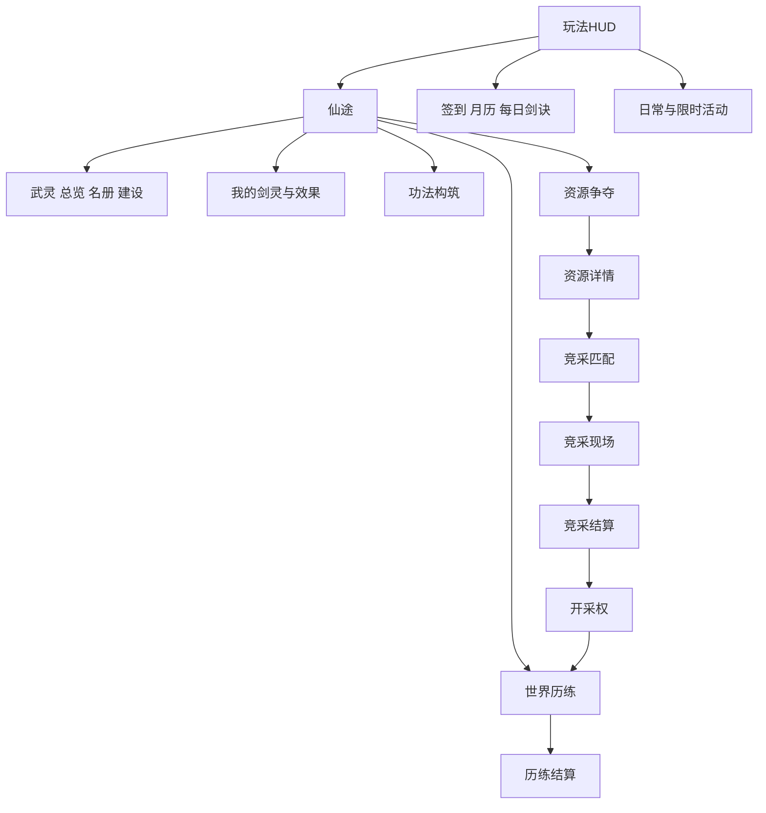
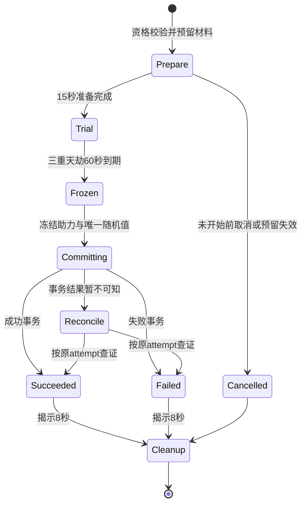

# 武灵修仙完整策划案 v1.4

2026-10-21。含开服活动、分类物品与天劫助力。本文含规格和行级配置，全部新增游戏文件仍待实施。启用物品扩展时以15/16及items-v1.4参数为准，旧表仅作兼容，不重复导入旧物品或重复扣费。


---

# 游戏功能策划案

v1.4增量优先：新增物品与突破按[15](15-分类物品与武灵经济扩展策划案.md)，天劫助力按[16](16-天劫与观众助力策划案.md)。以下旧基础规则用于兼容对照；启用扩展时，大境界扣费、品质预算和建设成本按15覆盖，小阶与旧礼物不自动迁移。

本案规定“谁可以做什么、数据归谁、何时结算、失败怎么办”。新增组织为武灵：一名主播修士和多名观众剑灵组成。观众不会因为加入组织获得第二个可操纵人物。

## 1 身份与数据

| 实体 | 主键和必需字段 | 规则 |
|---|---|---|
| 观众剑灵 | 平台、应用、官方用户ID、成长窗口、境界、修为、称号、礼物权益引用 | 不用昵称作主键；没有独立生命、防御、死亡或抢装备流程 |
| 主播修士 | 官方主播ID、境界、修为、个人灵石、材料、功法配置 | 本命剑继承主播属性；主播不额外获得一套直接攻击伤害 |
| 武灵 | 武灵ID、创建者ID、名称、名称审核状态、成员版本、公共资材、声望 | 一名主播最多创建一个；名称2至12个汉字等效长度；名称审核后展示 |
| 成员关系 | 武灵ID、用户ID、加入时间、退出时间、角色 | 每个观众一个正式归属；进房和成员归属分开 |
| 参与会话 | 应用、房间、用户、代次、开始/结束时间、状态来源 | 同一用户同一时段只有一个收益会话 |
| 资源开采权 | lease_id、武灵ID、资源种类、等级、开始/结束UTC、结算游标、来源竞采 | 不可转赠、不自动续期，不是可交易资产 |

权限：主播管理名称、功法、路线和公共建设；成员可加入/退出、选择个人响应和查看个人记录；成员没有任意取库权限。新任命权限、踢人、公共支出均写审计。首版不开发副会长、职位拍卖、附庸、成员强制捐赠。

创建武灵免费、练气即可；改名每7天一次免费，审核通过前保留旧名。成员列表每页20条，采用服务端游标，不把全部成员同时创建为场景实体。解散组织必须在没有Running赛事时由主播明确确认，个人财产不随组织解散删除。

## 2 加入与离开

流程：有效进房→临时助战→发送“加入”→显示目标武灵和规则→服务端检查身份、重复关系及限制→原子建立成员关系→剑灵显示归属。

已在当前武灵时返回“已加入”且不重复奖励；已在其他武灵时仅临时助战，提示需主动退出原武灵后申请。主动退出或被移除后24小时内不能加入新武灵，仍能免费临时助战，个人境界和个人剑权益不被删除。主播不能用移除成员没收个人物品。

武灵名册显示总成员、当前参与成员、临时助战三个独立数值。无法获得可靠离场信号时显示“当前参与会话”，不假称真实在线人数；参与资格及收益停止规则必须与平台能力相符。

## 3 公共成长

公共资材仅由正式成员完成事件产生，完整事件每名成员1份，每日每人前6次；单武灵每日最多100份。临时助战得到个人事件反馈，不计入公共资材。公共资材不可换灵石、修为或个人装备。

声望每完成一轮至少两名真实参与者完成的集体事件增加10，每日最多60；重复重连不生成。声望只展示历程，不能兑换出兵或竞采优势。

公共建设先支持：剑阵旗台、历练碑、共修庭三种外观。各消耗100公共资材，解锁公开美术层级；不永久叠加全体修炼倍率。成员数量本身不提供数值加成。

## 4 世界与资源功能

世界历练、静修、灵脉竞采是互斥的主播活动状态。同一主播不能后台挂世界历练、前台再争夺领取两份产出。

世界历练使用事件状态机 `Idle→Preparing→Running→Settling→Completed`，可进入 `Interrupted`。每10分钟一轮，三个阶段完成权重和固定产出见数值案。服务器持有阶段进度和结算ID；掉落不能再从每次死亡处分发同一份预算。

竞采使用 `Queue→Matched→Ready→Running→Frozen→Settled`；取消、断线和作弊审计进入独立终态。开采权只有 `Pending→Active→Expired/Revoked`，终态不能重复激活。详细计分见08，精确参数见03。

## 5 UI 与观众输入

保留角色、现有物品入口、排行、菜单的主要导航。原型物品入口可显示背包；抖音候选入口名称、存储能力按提案范围适配，不改名绕过限制。武灵入口放现有扩展区域，资源页明确显示倍率、剩余时间、获取方式及当前供给。

主播可在面板执行创建武灵、选路线、报名竞采、配置功法；观众只需一项当前行动。建议指令不超过10个：加入、退出武灵、剑灵、签到、选、护阵、破障、共修、武灵、帮助。其中“选1/选2”共用“选”前缀。具体评论订阅能力由平台适配器确认。

命名、头像和评论展示使用审核与隐私流程；规则页不回显未审核原始评论。UI 水墨风格沿用现有资产，兼顾540×960、720×1280、1280×720；不重建人工配置的 WBP 树。

## 6 异常与恢复

| 情况 | 行为 |
|---|---|
| 服务不可用 | 禁止竞采报名、公共支出、交易和权威到账；展示未连接，不生成假全服榜 |
| 主播断开 | 停止新增收益；竞采给予60秒重连宽限，赛事时钟不暂停 |
| 主播60秒未回归 | 放弃竞采额外名次权，已确认的基础阶段奖励保留 |
| 服务端赛事故障 | 不按客户端自报评奖；整局标记无效，恢复基础已确认奖励，不消耗报名费，因为报名免费 |
| 成员中途进房 | 可体验即时互动；本轮协作计分名单已冻结，不影响本轮评分分母 |
| 主播战败 | 世界历练进入30秒恢复，已完成阶段保留；不掉境界、不剥夺礼物；付费表现不能被恢复界面吞掉 |
| 礼物迟到或重复 | 原消息ID入账一次；按有效权益范围履约，不重新开始原始到期时钟 |
| 跨房间移动 | 成员关系不变；新会话撤销旧收益资格；不自动迁移跨房间数值权益 |

## 7 功能验收

F01 同身份重复加入不会重复成员；F02 不同应用身份隔离；F03 退出后临时助战可用；F04 只有主播能支出公共资材；F05 断线不双倍收益；F06 同主播不能同时参加两个活动；F07 开采权只激活一份；F08 已过期租期重连不重置；F09 竞采名单与结算一致；F10 关闭商店/交易时深链接和接口均拒绝；F11 武灵名称审核失败可重新提交；F12 原有剑灵轨迹、相机和既有礼物配置保持基线，改动须另有迁移记录。

## 开服活动接入

用户本轮确认采用青云初启开服活动，规格见14。主播首次没有武灵才进入免费创建/取名步骤；已有武灵恢复原组织，不能每次开播重建。观众发送加入后绑定个人活动归属；武灵、主播材料、观众修为、称号与礼物权益分别记账，活动不改已有礼物映射。


---

# 商业化策划案

商业目标是让观众愿意为“自己的剑灵身份、可理解的强力效果、帮助武灵的高光”送礼，让主播愿意反复组织历练。不能用资源垄断和强制补缺把免费基础成长切断。本案不新增现金商城、付费灵石、累充奖励或付费买开采权。

## 1 用户价值与购买场景

| 用户 | 需要得到什么 | 产品安排 |
|---|---|---|
| 初次参与者 | 看见自己的剑，明白一次互动 | 免费加入、短成长、一个当前目标 |
| 经常回访者 | 剑灵成长与武灵归属 | 个人历程、名册、共修与成员表现 |
| 首次送礼者 | 固定、即时、足够明显的变化 | 面板说明和立即可见的剑灵行为 |
| 重复送礼者 | 每份有新增且可核验的价值 | 固定倍率线性延时或再次固定触发 |
| 高投入者 | 独特身份和能被讲述的帮助 | 强力剑形、协作作用、克制遮挡的高光 |
| 主播 | 可讲解、有节奏、操作不繁琐 | 两小时内容脚本、效果提示、事件仪式 |

共修场景适合修炼类，护阵适合七星/弑神，破障适合驱煞，普通遭遇适合输出与爆发；竞采仍履约即时效果，但统一规则不让送礼购买1000分。礼物面板在报名及开局前说明该模式差异，不在观众送出后才说明不计分。

## 2 现有礼物基线与迁移

以下旧规则来自项目文档和CultivationTypes/CultivationRules，仅用于审计。真实可选礼物及价格必须读取本应用控制台，禁止沿用其他项目礼物ID或凭记忆填写价格。

| 礼物和剑灵 | 旧配置 | 风险 |
|---|---|---|
| 仙女棒 | 1.15倍，后续同时提高倍率与增加30秒 | 收益近二次增长 |
| 爱的爆炸 | 每份19999修为 | 约333标准分钟，可能跨越大量前期内容 |
| 稀有宝箱/噬魂剑 | 永久2.8倍，90秒共享效果，180秒间隔 | 永久权益、光环递归及模式失衡 |
| 超能喷射/无机态那 | 多项属性+200000，300秒 | 量纲不同、早期压倒性效果 |
| 神秘空投/驱煞神刃 | 敌方属性降低20% | 全属性降低比仅破防强得多 |
| 草莓甜点/七星光芒剑 | 7层20%治疗，各180秒间隔 | 需验证致死、满生命和重复赠送 |
| 超级空投/弑神剑 | 每次伤害20%概率免疫 | 价值随机，需审核并保证基础反馈 |
| 生命药水 | 个人3.25倍并递增，每份6小时，房间加成 | 倍率时长同时叠加，跨场/房间权益 |

旧权益profile为`legacy_preserve`，本次不改。新案单独命名`candidate_linear_v1`，只能在隔离模拟存档试算；在同一正式存档里不得静默切换或缩短已经承诺的权益。新案不等于用户已经批准改礼物。

## 3 可供比较的新数值候选

| 礼物 | 单份候选效果 | 重复方式 |
|---|---|---|
| 仙女棒 | 个人修炼1.15倍30秒 | 每份追加30秒，不提高倍率 |
| 爱的爆炸 | 增加1200修为 | 每份固定增加，单独标记付费来源 |
| 噬魂剑 | 个人剑伤2.8倍180秒；全场剑伤+15%90秒 | 两个持续时间各线性追加，不递归分享个人属性 |
| 无机态那 | 主播生命/防御/全场剑伤各+50%，30秒 | 每份追加30秒，同源不叠幅度；不增加修为速度 |
| 驱煞神刃 | 敌方防御-20%120秒 | 追加120秒，同源不叠幅度 |
| 七星光芒剑 | 60秒护持，获得当次主播最大生命20%的治疗预算 | 每份追加预算和60秒；受伤且存活时按缺失生命消耗，治疗预算不能复活，剩余可见 |
| 弑神剑 | 主播确定性减伤20%持续60秒 | 追加60秒；与其他减伤共同受60%总上限约束 |
| 生命药水 | 个人3.25倍300秒，其他观众1.28倍、主播2倍 | 每份追加300秒，同类房间效果取最高值，不叠幅度 |

候选的期限、固定属性、概率与共享基数均不同于旧基线，需并行比较后由产品方决定。若应用实际没有某种礼物，保留旧ID映射记录但不创建假的可购买入口。候选不会把名为“稀有宝箱”的外部礼物设计成随机抽奖；对外包装按平台审核另行确定。

候选修为乘区：仙女棒与药水个人倍率取最高；本人是药水来源时不再享该药水房间倍率；同类房间效果只取最高；不同人生命药水不相互递归。噬魂与喷射候选不再加修为。最高个人修为乘区3.25，总免费加成最高1.55，理论在线上界为基础的5.0375倍。该上界仅适用于新候选配置，不能用它描述旧配置。

七星候选预算按每次送礼瞬间最大生命快照确定；主播生命上限之后变化不增加已记预算。护持到期仍有未用预算时有清晰到期展示；首次送出立即形成可见护持剑阵。无敌/满生命场景仍有护持而不是无反馈。是否采用该候选需先测试可理解性及实际使用率。

## 4 价格与主推

主推先选低门槛体验、个人输出、团队防护、全场高光各一项；剩余礼物保留已配置能力，不让新人一次读八套公式。价格不在本版编造；开发AI第一步从安全的本应用配置确认真实礼物名、官方ID引用、价格及允许效果，并输出价格价值表供评审。未取得价格时只能测体验和相对时间价值，不能声称已完成客单价优化。

每个面板列出：立即效果、对象、时长、重复规则、当前模式、有效期。剧情中没有目标时仍保证已承诺的召剑/护持/修炼表现；异常状态先持久化收据，再在允许范围恢复履约，不让加载、断线或战败吞掉效果。对过期补偿及退款不能自行承诺，依平台处理流程。

## 5 主播两小时运营

0至10分钟接新人和首次历练；10至30分钟两轮目标与第一次材料突破；30至40分钟竞采（获准且有对手时）或主题历练；40至70分钟使用开采权、共修与功法讲解；70至100分钟第二组历练；100至120分钟大目标、结算和下次预告。竞采不可用时内容仍完整。

话术示例：“今天先拿够破境石，普通剑也能护阵。我们选灵泉配额，拿到后共修半小时。”礼物讲解示例：“七星会形成护持，预算和剩余时间在这里，这轮会用于主播受伤后的恢复。”不使用“只有送礼才算成员”“不补礼就清空修为”等施压设计。

## 6 经营指标与实验

记录可归因参与率、首次互动耗时、首次突破耗时、单轮完成率、次场回访、七日主播留存、主播每小时可结算收益、开发者每主播小时净收入、履约延迟、漏发、免费/送礼用户分别的留存。进房UV使用平台真实统计，与有身份事件覆盖人数分列。

起始观察目标：参与率20%、参与后3分钟留存50%、首轮完成60%、次场回访20%、七日主播留存50%。这些是试播假设，不是行业标准。至少覆盖小中大三类直播间，收入同时报告中位数、头部占比和去掉最高单用户后的结果。

收入模型：流水=可归因参与人数×送礼人数占比×送礼者平均流水；开发净收入=实际可结算流水×实际合同结算比例－服务/运营/渠道成本。示例200参与者×5%×30元等值=300元流水；若假设开发有效比例8%，收入24元，再扣成本。比例与价格均为算例，不承诺平台分成。

一次只试一个变量：先首次体验，再重复赠送价值，再离线比例，再灵脉收益。不得对已经购买的用户做隐藏降效AB；实验只对明确版本的新权益、隔离测试流量或自愿测试发生。

## 7 不采用的变现

资源竞价、付费参赛、累计送礼解锁材料、输方付费赎回、占点征税、成员贡献换现金、付费抽功法、随机付费突破品质、交易税返利现金、付费复活维持基本进度均不立项。商店和交易即使在独立原型开启，也不成为直播默认营收通道。

## 开服限定的经营定位

青云初启承担新人理解、武灵归属与重复开播的内容，详见14。免费任务与协作荣誉不挂累送；重复赠送的价值依旧由每份已公示的固定即时效果和可核验收据承担，不追加付费次数门槛。观察活动参与者的有效互动、完成率、主播复播及自然赠送变化，和同等直播时长、同类主播的非活动样本比较，不用提高免费难度强行拉收入。


---

# 数值策划案

v1.4增量优先：新增物品与突破按[15](15-分类物品与武灵经济扩展策划案.md)，天劫助力按[16](16-天劫与观众助力策划案.md)。以下旧基础规则用于兼容对照；启用扩展时，大境界扣费、品质预算和建设成本按15覆盖，小阶与旧礼物不自动迁移。

本案是待试播的新数值方案，现有礼物与境界配置不被自动替换。配置真源为 tables 下文件，单位、累计和单阶消耗必须保持一致。货币与物品使用整数；倍率使用有上限的浮点或定点值；所有时间以服务器UTC保存，日界线按Asia/Hong_Kong 00:00。

## 1 修为与成长

标准修炼分钟=60修为；基础有效在线速度=1修为/秒。在线包括实际参与的静修、历练、竞采，不包括主菜单和未认证等待。不再让攻速、击杀和光环互相无限反哺修为；首版新增成长预算不另加逐命中奖励，旧逐命中/击杀修为属于迁移审计范围。

`Q_online = base_rate × (1 + min(node,0.30) + min(method,0.15) + min(event,0.10)) × gift_personal × gift_room_role`

node只有灵泉产生0.20；method首版没有修为效果，保留最高0.15的扩展预算；event首版数值为0。礼物两因子见02新数值候选与旧配置的区别，不得拿旧叠加值套本案后声称倍率已封顶。灵石、声望、贡献、公共资材不直接加入公式。

离线原型：`Q_offline = 1 × 0.10 × min(有效离线秒数,28800)`。离线不受灵脉、礼物、功法、主播境界、活动影响。服务端存储结算游标；在线与离线区间互斥，达到封顶后的时间不能留到下次分批领取。仅观众有离线修为，主播首版没有离线成长。抖音候选默认关闭，不能据此承诺已准入。

事件额外修为：每完整10分钟事件60，每日个人前6轮；签到300，每日一次。离线不生产任何货币、材料或贡献。活动只能提供外显或从本额外预算分配，不额外再造一个无限修为源。

## 2 境界表与阈值

34档名称沿用现有项目；完整字段见 realm_targets.csv 和脚本生成的 realm_costs.csv。

| 境界 | 到达所需累计标准分钟 |
|---|---|
| 练气一至九 | 0、2、5、9、14、21、30、42、58 |
| 筑基初中后圆满 | 80、120、170、230 |
| 结晶一至三 | 300、380、470 |
| 金丹一至六 | 580、700、830、970、1120、1280 |
| 元婴、化神 | 1460、1660 |
| 元神一至二 | 1880、2120 |
| 炼虚一至五 | 2380、2660、2960、3280、3620 |
| 大乘、飞升、混元无极 | 3980、4360、4760 |

观众第i档升下一档消耗 `(T[i+1]-T[i])×60`，扣除后剩余修为可继续自动突破。主播对应修为成本为该值50%，向上取整，并消耗当前档材料和灵石。主播小阶同样需要手动确认，可合并表现，不跳过资源扣除。顶层下一档成本0，不再循环扣费。

主播每次材料成本按当前境界组：练气20、筑基40、结晶60、金丹80、元婴/化神/元神120、炼虚160、大乘/飞升200。灵石成本=材料成本×3。观众材料与灵石成本始终0。

本表决定进度而不承诺每月全员满级。30分钟在线、3次事件、签到、8小时离线的无礼物日收益为 `1800+180+300+2880=5160`修为，即86标准分钟；28日2408标准分钟。得到灵泉并完整有效使用30分钟，额外360修为，即6标准分钟，日收益提高约6.98%。资源优势有感但不决定成长能否继续。

90分钟在线、6次有额外奖励事件、签到、8小时离线，无礼物收益为 `5400+360+300+2880=8940`，即149标准分钟，28日4172分钟。错过当日离线或签到应按实际值计算，不补成满额。

上述28日为每天都能领取满额离线的稳态情景；新账号第一天无离线收益，应减48标准分钟。新账号30分钟组28日约2360标准分钟、元神二阶；每天完整使用灵泉则约2528分钟、炼虚一阶。90分钟组约4124分钟、大乘。脚本同时输出稳态和新账号结果。

成长窗口仅是原型试算30天；正式周期与权益继承按平台确认。临近窗口结束加入者只展示剩余有效期，不承诺完成全34档；另测滚动入门体验，不以付费补完作为解法。

## 3 属性和战斗

主播基础生命1000、攻击10、防御20；观众基础剑灵攻击10，没有生命、防御或死亡。境界序号r从0开始：

`攻击 = 10 × (1+0.12r) × 当前突破质量系数 × 功法属性系数`

`主播生命 = 1000 × (1+0.15r) × 当前突破质量系数`

`主播防御 = 20 × (1+0.10r)`

质量系数普通1.00、精炼1.05、圆满1.10，针对当前最高大境界取一份快照，不对每次突破累计相乘。特殊剑原有额外属性单独审计；本案不把加200000等现有值默默带入新敌人配置。

借用原GDD伤害结构：`伤害 = A²/(A+D_eff) × 招式系数 × 增伤 × 境界系数`。`D_eff=max(0,D×(1-min(破甲,0.60)))`。世界历练同大境界低打高：`max(0.70,1-0.03×小阶差)`；跨大境界低打高：`max(0.25,0.8^大境界差)`；高打低不另给境界乘区。竞采计分任务统一属性，不套此压制。

该压制是直播适配新案，替代独立GDD的跨境界0.5与最低1%组合，目的是让低阶剑灵仍能参与。总减伤最高60%，闪避/免疫属于独立机制不直接相加至100%；概率必须在权益描述中明确，特殊剑的概率效果需要单独审核，不当作本案新增长点。

伤害统计仅计真实扣血；溢出、延迟伤害重复命中、同一死亡重复结算均排除。攻速至少0.2秒一击，状态每秒一次，不互相触发同标签。第一次实现只选疾锋、玄罡、回响三部功法。

世界历练初始遭遇表见encounters.csv：普通剑基础攻击间隔1秒、目标防御10，模型有效命中率80%。0/5/20/80参考观众的固定难度中，最终目标生命分别360/2160/7560/29160，基础队伍理论约90秒完成，第三阶段预留120秒。第一阶段3波、每波4个普通目标；第二阶段2个障碍；这都是预设模板，不随局中真实人数或礼物变化。

该命中率只是试算输入，实际飞行时间、追踪和目标切换须由渲染PIE采样重算。选择难度只改变固定公开配置，基础产出不翻倍。主播本命剑和观众剑在无功法/礼物/境界时，均按攻击10计算。

## 4 世界基础供给

所有完整10分钟世界历练的主播基础收益：80灵石、12突破材料、6灵草、4玄铁、2功法残页。灵草拆5绑定+1可交易，玄铁拆3绑定+1可交易；残页和突破材料全绑定。竞采的基础奖励与其完成的3个基础阶段对应，不能额外领一轮世界奖励。

| 阶段 | 灵石 | 突破材料 | 绑定草 | 可交易草 | 绑定铁 | 可交易铁 | 残页 |
|---|---:|---:|---:|---:|---:|---:|---:|
| 1 | 16 | 3 | 1 | 0 | 1 | 0 | 0 |
| 2 | 24 | 3 | 2 | 0 | 1 | 0 | 1 |
| 3 | 40 | 6 | 2 | 1 | 1 | 1 | 1 |

竞采360秒挑战对应三个120秒基础阶段，只有完成该阶段对应的两个共同任务才获得该阶段基础奖励。额外60修为仍需整轮有效参与并完成；同一时间预算不能同时领世界历练与竞采两份。

每名观众个人贡献：已完成阶段分别2/3/5，正确响应每次5、每轮最多2次，完整每轮最高20。贡献每日最多120，仅用于记录与非数值外显原型，不兑换攻击或下一场自动出兵。六轮完整历练的主播每日可额外获得1枚精炼核心，每日仅一次；无付费购买来源。

## 5 开采收益

每武灵仅一份Active；类型/产出见 nodes.csv。基础倍率与租期互不叠加。30/20/10分钟是服务端实际时间，收集类按有效在线时间整档发放。

| 开采权 | 每有效10分钟额外产出 | 完整30分钟上限 |
|---|---|---|
| 灵泉 | 在线基础修为速度+20% | 每人基础额外360修为，不计礼物放大 |
| 灵石矿 | 主播20灵石 | 60灵石 |
| 灵草园 | 主播2绑定灵草 | 6绑定灵草 |
| 玄铁脉 | 主播2绑定玄铁 | 6绑定玄铁 |
| 残卷遗址 | 每20分钟1绑定残页 | 1残页 |

灵泉受礼物乘区时个人实际额外修为可高于360；上表360指无其他加成的基础算例。首次实现需同时记录基础资源贡献和最终修为贡献，不能把基础上限误当成付费承诺的截断。

灵脉产出全部绑定、不可进入寄售。没有占点，30分钟世界历练仍可得240灵石、36突破材料、18灵草、12玄铁、6残页。最强矿权相对同时间灵石供给增加25%，不能累积成全大陆垄断。

## 6 灵石消耗预算

补给原型：回复丹50灵石+2绑定草，护阵符40灵石+2绑定铁，研习简50灵石+2绑定残页。每日各最多2、2、1；它们均不是基础通关必需品。

30分钟基础灵石240。只做两枚回复丹、两枚护阵符、一枚研习简消耗230，剩10，但尚未计算主播突破，不能据此声称经济已平衡。

更可行的早期样例：一轮练气突破60灵石＋一枚回复丹50＋一枚护阵符40＋一枚研习简50＝200，余额40；另消耗20突破材料、2绑定草、2绑定铁、2残页。正常天数不要求每个品类买满。高阶突破一次需几天积累，这是明确的时间目标，不把缺口改成必须送礼。

NPC回收每日最多铸出50灵石，来源独立记账。市场买卖不铸币，仅扣挂牌费和税。灵石存量、每类材料余量及中位突破等待时间需按境界分组观察。

## 7 防止数值失控

- 不让灵脉再提高争夺统一属性，不让贡献购买竞争分，不按武灵人数永久加倍率。
- 基础供给、节点增益、活动奖励三个账本分开；开启新活动前计算总增量。
- 停用配置只影响未来新赛事与新权益，不能取消已经承诺的付费时长。
- 不把旧档与新档直接混榜。迁移前导出旧权益，按版本确定策略并单独审批，不自动降低已解锁剑灵。
- 日/周统计按服务端日界线唯一入账；跨00:00的一轮按结算日入账，完整阶段不能拆成两次奖励。

## 开服一次性额外预算

新增活动参数以launch_*表为准：观众七任务总计780修为；主播共同1/3/6/12轮奖励总计200灵石、60破境石；最后20分钟活动修为加法项+0.10，计入原event_qi_bonus_cap，不另乘。基准1修为/秒的成员完整在线仪式20分钟额外120修为，n成员为120n，不含其他来源。

按本表基础修炼、六次完整世界额外修为和一次签到的假设，首小时无礼物、无离线收益的原型累计5040修为，含开服任务780，可超过4800筑基门槛。这是条件算例，不保证每名新观众一定一小时筑基；未完整参与或未做响应者不满足全部任务。名次修为候选全部关闭，贡献分不作为可兑换货币。


---

# 物品策划案

v1.4增量优先：新增物品与突破按[15](15-分类物品与武灵经济扩展策划案.md)，天劫助力按[16](16-天劫与观众助力策划案.md)。以下旧基础规则用于兼容对照；启用扩展时，大境界扣费、品质预算和建设成本按15覆盖，小阶与旧礼物不自动迁移。

观众剑灵权益、主播物品、武灵公共资材分属不同所有者。原型允许完整经济验证，正式直播存储类设计以平台许可为前提。物品明细见 tables/items.csv。

## 1 分类和归属

| 类别 | 主要内容 | 所有者 | 流通 |
|---|---|---|---|
| 数值 | 修为、声望、个人贡献 | 各自主体 | 不可转账，不是可卖物品 |
| 通货 | 灵石 | 主播个人 | 只在原型白名单市场支付，不能兑换抖币/现金 |
| 公共资材 | 武灵资材 | 武灵 | 公共外观建设，不分红、不提款 |
| 突破材料 | 破境石、精炼核心 | 主播 | 绑定 |
| 普通原料 | 灵草、玄铁 | 主播 | 绑定和可交易物分不同ID |
| 功法资源 | 功法残页、研习简 | 主播 | 绑定 |
| 制作物 | 回复丹、护阵符、凝元精华 | 主播 | 绑定 |
| 剑灵权益 | 五把特殊剑、定时礼物效果 | 送礼观众 | 独立权益表，绝不成为寄售物 |
| 纪念表现 | 青云徽记、问道纹饰 | 获得者 | 不交易，不加战斗数值 |
| 资源权利 | 一份开采租约 | 武灵 | 独立租约表，不进物品格 |

## 2 实例字段

物品实例至少包含 `instance_id,item_id,owner_type,owner_id,count,source_type,source_event_id,created_at,expires_at,binding,tradeable,paid_origin,version`。绑定原料与可交易原料不能合并；相同物品但到期时间不同也不合并。扣料优先最早到期且符合配方绑定要求的栈。

货币独立整数账本，使用交易流水，不用可丢弃的一格物品模拟灵石。数值修为独立成长账本，不能通过卖出修为获得货币。礼物权益另存官方事件收据、来源房间、期限和规则版本。

可交易灵草/玄铁允许主动1比1转为对应绑定原料，免费且不可逆，保留来源和原到期时间。交易买入的普通原料因此能用于制作，具有实际需求；绑定物不能反向解绑定。转换必须原子扣除原物发新物，不能复制栈。

## 3 有效期

原型的新经济资产在同一30天测试窗口结束时失效；活动纪念外显随窗口结束失效；消耗品不能跨窗口积累。市场成交、合成、拆分不延长最早来源的expires_at；材料合成结果取所有输入中最早到期时间。临近到期1小时不允许新挂牌。

这只是封闭试算规则，现有永久礼物权益仍保留旧基线，不能被经济窗口清理器误删。抖音权益有效期另依提案：候选默认只在当前场次使用新增数值资产，跨场默认关闭。审计收据留存与用户能使用的资产期限分别管理。

## 4 来源与消耗

破境石用于主播手动突破；精炼核心每日完成六轮完整事件获得1枚，参与可验证，不能重连刷取。功法残页来自阶段奖励与遗址开采；研习简由原型配方获得。功法等级1到6，升级依次消耗研习简1/2/3/4/6枚，每枚代表固定研习进度，不随机成功。

回复丹恢复主播最大生命25%，两次使用至少60秒，不溢出储存。护阵符给予主播最大生命10%的屏障，持续60秒，同源刷新剩余时间而不叠层，屏障实际吸收必须实现后才展示防护值。凝元精华只用于下一次大境界突破质量1.05，2份可用1.10；不能在每个小阶无限重复放大，使用后消耗。

制作全部确定成功、明示成本、明示产物。首版没有随机词条洗炼、失败碎装、付费保底和付费概率升品。

## 5 物品生命周期与保护

世界阶段确认→原子写入奖励账本→产生物品实例→UI收到确认显示到账。制作：检查版本/配方/限次→锁定材料→同事务扣料发物→记录收据。未确认只显示处理中，不提前扣币造成功假象。

武灵移除、改名、退会只改变组织关系，不销毁个人物品；加入新武灵不复制个人库存。主播解散组织先结算正在进行的事件，清理公共租约，个人剑灵权益不受牵连。

所有新装备仅作为后续扩展字段，本版不创建观众可交易武器装备。法宝词条、炼器品质等原独立GDD内容延至P4，避免首版同时铺开成长、交易与随机属性。

## 开服称号新增项

COS_QINGYUN_FEIYAN对应青云踏飞雁，观众个人完成七项免费任务取得，非数值外显，不可交易/转赠。最长30天且受实际权益窗口截断，具体期限见14；不会覆盖既有剑灵被动，也不清理旧礼物权益。


---

# 活动策划案

活动目标是给主播稳定栏目、给剑灵不同参与角色、给回访提供明确内容。首版用固定机制与固定奖励，活动奖励优先使用外显或替换基础预算，不在原有经济上无限相加。

## 1 日常安排

| 活动ID | 内容 | 周期 | 奖励和限制 |
|---|---|---|---|
| ACT_SIGN | 每日签到 | 每日 | 300修为，每身份一次；跨日权益须获准 |
| ACT_VERSE | 每日剑诀 | 每日固定轮换 | 当日文本与行动提示，无稀有签/改签/运势承诺 |
| ACT_WORLD | 世界历练 | 每10分钟一轮 | 三阶段基础供给；个人额外修为前6次 |
| ACT_RACE | 灵脉竞采 | 主播自主报名 | 2至4主播，基础阶段供给＋限时开采权 |
| ACT_SHARED | 武灵共修 | 主播自主安排 | 只领有效修为，不再领世界材料 |
| ACT_MONTH | 月度签到历程 | 每月 | 累计3/7/14/21次，各解锁一个有效期内外显里程碑 |

同一活动reward_key包含profile、应用、窗口、用户/武灵、event_instance、reward_type；每种奖励只有一个入口入账。签到页、活动页和指令不能各发一次。

## 2 一周栏目

周一青云入阵：新人、免费剑灵和基础路线；周二玄铁破障：集中目标；周三七星护阵：保护和响应；周四共修问道：主播材料目标和功法；周五灵脉竞采：可用时开展多主播模式，不可用时改同主题世界事件；周六世界历练：章节展示；周日剑灵成长回顾：真实贡献、个人突破和下周预告。

基础奖励仍为80灵石/12破境石等固定预算，不因换活动名字重复发放。主题专属奖励为当周纪念表现，不能永久堆倍率。声望、贡献和公共资材按照各自上限，不发一套活动积分再兑换战斗属性。

## 3 两个完整周活动模板

### 七星护阵

10分钟：准备60秒，三段目标480秒，结算60秒。第一段识别干扰目标，第二段两次提示后的护阵响应，第三段主播规避攻击并维持阵心。阶段供给沿用世界表；每轮个人贡献最高20。七星/弑神礼物在实际受伤保护上有表现，不直接购买正确响应分数。失败保留已完成阶段。

验收：观众不操作生命条；低人数仍可完成；满生命时护持可见；致死不触发隐式复活；同一伤害只结算一次；暂停和退出会清理临时敌人及状态。

### 玄铁破障

主播从两条公开路线选择：集中破障或分段采集。三阶段的完成时点、敌方行为和演出不同，基础总产出相同。疾锋与驱煞的优势是处理障碍更直接，免费基础剑也能完成。每一障碍只授一次阶段奖励，不因多次击杀拆成无限材料。

验收：路线选择发生在开始前；礼物不提高障碍强度；掉落与结算账本一致；技能过量伤害不多发物。

## 4 月度和新成员

月签到采用累计，不因漏一天清零，不售卖补签。月度界面显示有效期和已完成记录。月末加入者仍有完整的新手十分钟事件和至少一个短期个人目标，不用30天签到奖励作为唯一回访理由。

月度成长窗口是配置与平台确认事项；新增物品、名次、外显的过期规则统一显示。跨月不把旧贡献转换成新月攻击，不以清空付费权益促销重新购买。

## 5 限定主题范例

中秋问月：使用护阵模板，将阵心替换为月华阵，剑轨与场景使用授权水墨素材。第一阶段收拢月华，第二阶段稳定阵势，第三阶段完成问月。活动持续7天，原型奖励在首次完整完成时发纪念纹饰，日常供给不额外翻倍。

活动不新增礼物种类，不概率出稀有剑，不以礼物金额解锁结局。礼物固定效果与当前模式描述一致。活动素材与配置通过发布审核后使用，不通过热更新注入未审内容。

## 6 时间配置与运营

活动表必须给start_at、end_at、timezone、规则版本、奖励窗口、profile、入口条件、每人次数、是否替换基础预算。无明确起止时间的限定活动保持disabled，不能把占位日期自动解释为当天上线。

除14明确采用活动相对日的青云初启外，其他跨日计数按香港时间日界线；活动UTC边界由服务端计算。跨边界进行中的一轮使用开局冻结规则；补发依原收据窗口，不发新版本更大奖励。关闭活动停止新报名，已开局按原规则结算或按故障协议处理。

## 7 验收与观测

检查日界线双签到、同页多入口重复领取、活动结束前开局、跨月到账、断线重进、奖励替换预算、无对手降级、未审核名称和素材。观察活动参与率、完成率、免费/付费分组回访、主播准备时间、内容重复感与每小时运营成本。商业结果由试播取得，不以脚本通过代替。

## 8 开服限定青云初启

完整规格见[14](14-青云初启开服限定活动策划案.md)。每武灵最长七天，一次性个人免费任务、共同完整历练目标与玩法贡献荣誉榜。任务数值预算780修为、主播固定预算灵石200/破境石60作为开服一次性额外预算，不每天重复增加；称号青云踏飞雁给完成任务的观众。榜分不兑换数值，不按礼物排序。

本活动模板允许相对开启，但真实实例必须写入具体UTC start/end与规则hash。活动日从实例起点每86400秒计算，最后一轮须在end之前完整完成；这两项是对本文件通用自然日与开局冻结规则的活动特例，不套用到其他活动。


---

# 商店策划案

v1.4增量优先：新增物品与突破按[15](15-分类物品与武灵经济扩展策划案.md)，天劫助力按[16](16-天劫与观众助力策划案.md)。以下旧基础规则用于兼容对照；启用扩展时，大境界扣费、品质预算和建设成本按15覆盖，小阶与旧礼物不自动迁移。

本案定义完整的封闭原型商店和制作消耗，便于验证经济循环。抖音公开准入规则禁止商城与交易，`douyin_release_candidate` 的商店入口、SKU查询、购买及兑换接口全部关闭。不能更名“补给”“宝阁”后上线，也不能将付费商城伪装成免费兑换。[平台规则](https://partner.open-douyin.com/docs/resource/zh-CN/interaction/introduction/live-play/creation)

## 1 原型目录

| SKU | 产物 | 灵石成本 | 额外绑定材料 | 日限购 | 用途 |
|---|---|---:|---|---:|---|
| SKU_HEAL | 回复丹1 | 50 | 灵草2 | 2 | 恢复25%主播生命 |
| SKU_SHIELD | 护阵符1 | 40 | 玄铁2 | 2 | 10%主播生命屏障60秒 |
| SKU_STUDY | 研习简1 | 50 | 功法残页2 | 1 | 固定功法进度 |
| SKU_BREAK | 破境石1 | 10 | 无 | 3 | 少量补齐，不能替代历练 |
| SKU_QUALITY | 凝元精华1 | 200 | 破境石10、精炼核心2 | 1 | 可选突破质量 |
| SKU_BADGE | 青云徽记1 | 0 | 个人贡献60 | 1 | 非数值外显 |
| SKU_PATTERN | 问道纹饰1 | 0 | 个人贡献180 | 1 | 非数值外显 |

购买者：前5项主播本人；后2项观众剑灵本人。贡献不可转灵石、不可交易、不可兑换数值物品。徽记/纹饰同窗口只能各解锁一次，重复点击不重复收费；日限购不是次日可以重新付费购买同一外显的意思。

## 2 库存和动态供给

固定库存按本人日限购，服务端原子计数。动态库存从已审核的周轮换表中按日确定，不基于个人送礼额、个人消费次数或主播收入抬价。首版没有随机稀有商人，没有必须抢到的顶级功法，没有付费刷库存。

资源争夺不直接垄断商店货架。占领灵草园只产绑定草，不让获胜武灵控制全服丹药售价。基础突破材料始终通过世界历练稳定取得。

## 3 购买状态机

`Requested→Validated→Committed→Presented`；失败为 `Rejected`，状态未知为 `PendingReconcile`。请求带user、窗口、SKU、数量、价格版本和幂等键。事务内核验库存、绑定材料、有效期、余额、限购和profile，再一次性扣除、发放和写回执。重复同键返回同收据；同键不同payload拒绝。

价格变化只作用于新的确认界面；旧确认过期后重新展示，不按更高价格暗扣。数量为正整数，超限、负数、数值溢出全部拒绝。服务中断时按钮显示未连接，不本地先记账。

## 4 原型回收

NPC只收可交易草和铁：每份分别4/6灵石，个人每天通过回收最多新增50灵石，收购前显示剩余额度。绑定材料、礼物、租约、残页、精炼核心不回收。输入换出的灵石写NPC铸币来源；不能通过回购再卖获得利润。

## 5 抖音候选替代

只有平台明确认可的单场固定制作或收集流程，才可单独立项；不能把此商店直接换文案复用。未确认时使用世界阶段直接发放固定材料与允许的即时效果，原型SKU不开启。该替代会改变经济消耗，需另出数值版本，不声称关掉商店后本案经济仍平衡。

## 6 验收

并发购买不超限；材料不足不扣部分币；断线恢复只得一份；徽记已解锁不再扣贡献；关闭profile时接口拒绝；买入绑定物不能卖回市场；午夜仅由服务器时间刷新；制作不会延长材料有效期；UI完整展示成本、产物和有效期。


---

# 交易策划案

v1.4增量优先：新增物品与突破按[15](15-分类物品与武灵经济扩展策划案.md)，天劫助力按[16](16-天劫与观众助力策划案.md)。以下旧基础规则用于兼容对照；启用扩展时，大境界扣费、品质预算和建设成本按15覆盖，小阶与旧礼物不自动迁移。

交易只作为封闭完整原型的可选后续模块，不属于抖音默认发布范围。公开规则禁止交易系统；本案不得以赠送、拍卖、寄售、贡献转让或私聊转账等名称在直播候选配置开放。[平台规则](https://partner.open-douyin.com/docs/resource/zh-CN/interaction/introduction/live-play/creation)

## 1 边界

首版原型仅主播之间以灵石寄售世界历练免费产出的普通可交易灵草/玄铁；观众没有市场操作权限，武灵没有公共分红。不可提现、充值灵石、兑换抖币、现金结算、平台间互通或出售账号。没有玩家间直接赠送、定向低价交易、竞价拍卖和以物易物。

白名单：MAT_HERB_T、MAT_IRON_T。所有绑定物、节点产物、贡献、修为、声望、功法、突破材料、礼物权益、开采权、公共资材均不能交易。付费行为不产可交易币或可交易物，任何衍生产物继承付费来源禁售标记。

买入可交易原料后可1比1主动绑定成MAT_HERB_B/MAT_IRON_B用于配方，不改变原期限；使用价值由确定配方提供，避免市场只有转卖没有消耗。

## 2 挂牌规则

| 项目 | 数值 |
|---|---:|
| 同时挂牌订单 | 每主播5笔 |
| 单笔数量 | 1至100份 |
| 草单价 | 4至12灵石整数 |
| 铁单价 | 6至18灵石整数 |
| 挂牌期限 | 最长24小时，且不得越过资产到期 |
| 挂牌费 | 1灵石，成功挂牌时扣除，不退 |
| 成交税 | ceil(总价×5%)，从卖方收入扣 |
| 成交方式 | 整单买入，不支持部分成交 |

剩余有效期小于1小时不能新挂牌。买家看到物品数量、原到期时间、总价与到手内容；卖方看到总价、费用、税后收入。市场UI不显示可联系的卖方ID，服务端禁止自己购买自己的订单。

## 3 托管状态

`Draft→Escrowed→Listed→Sold/Cancelled/Expired`。必须先锁定完整商品并扣挂牌费，再发布订单。原物品从可用库存移到托管账本，不能同时制作、回收或重复挂牌；托管不消失来源链。

买入事务：校验订单版本/状态/profile→校验买方余额→从买方扣总价→从托管转物→记卖方税后应收→记税费销毁→标记Sold并写唯一回执。服务端事务提交后才显示成交。

卖方离线不影响应收入账；领取仅是展示和状态确认，不再铸币。取消或超时将原商品退回原拥有者，已经到期的商品销毁并保留到期记录，不能按退货时间续期。市场停机通过到期UTC恢复，不按客户端保存重开24小时。

## 4 守恒例子

买家初始100灵石，卖家初始10。卖家上架10份草、每份8，总价80。挂牌后卖家9；成交税4；卖家再得76成为85；买家剩20。总余额从110降到105，销毁挂牌费1＋税4，没有额外制造灵石。

商品数量：卖方可用减少10，托管先增加10后减少10，买方增加10；全系统商品总量不变。任何失败路径必须满足“钱与物都保持原状”或明确的单一已提交终态。

## 5 故障与滥用

同一订单两个买方并发只成功一个；成交与撤单互斥；消息重放不重复扣款或发货；越价、负数、溢出、跨窗口ID拒绝。身份来自当前授权，不接受body伪造owner。

连续关联账号成交、异常成交价、短期高频倒手先冻结新增交易并人工审核，不自动没收未定责个人权益。审计保留来源、订单、版本和金额，不记录平台密钥。争议按原始事务重放核对，不能让AI客服直接修改资产余额。

## 6 开发优先级与验收

P3以后才做完整寄售；P0仅建立绑定、来源链、托管和profile拒绝接口。没有经过多人并发、断线恢复、时钟边界、资产过期与幂等验证，不进入公开测试。

验收覆盖：双买家抢单、撤单竞态、提交后失去回包、卖方离线、过期退货、跨窗口、付费原料衍生禁售、绑定混栈、暂停后恢复、税向上取整与低总价交易。原型验证不能充当平台交易准入证明。


---

# 游戏玩法策划案

v1.4增量优先：新增物品与突破按[15](15-分类物品与武灵经济扩展策划案.md)，天劫助力按[16](16-天劫与观众助力策划案.md)。以下旧基础规则用于兼容对照；启用扩展时，大境界扣费、品质预算和建设成本按15覆盖，小阶与旧礼物不自动迁移。

主播创建武灵，观众以剑灵加入。个人成长提供回访，世界历练提供稳定供给，灵脉竞采提供阶段竞争，功法提供路线选择。整体保留修仙独立 GDD 的成长与构筑深度，将操作压力集中在主播侧，将观众输入压缩为易懂的一步响应。

## 1 三个循环

个人：有效参与→修为→自动突破→个人剑灵表现与能力→新的历练体验。

主播：世界历练→修为与材料→配置功法→主动突破→推进历练章节。主播本命剑负责攻击，主播负责移动、蓄力、护阵与路线。

武灵：共同事件→公共资材与集体记录→报名竞采→短期开采优势→回到修炼或世界历练。开采优势不能带回竞采标准属性，切断资源胜者持续碾压的循环。

## 2 世界结构与路线

保留八区域的世界框架，首版实现前三个；它们是历练入口与场景，不是可供主播互相攻城的沙盘。

| 区域 | 主题 | 正式上线阶段 | 选择价值 |
|---|---|---|---|
| 青云山 | 入门、护阵、灵泉 | P1 | 熟悉基础循环 |
| 落霞谷 | 路线、采药 | P2 | 炼丹与护阵主题 |
| 玄铁岭 | 破障、锻材 | P2 | 强调破甲与集中目标 |
| 玄冰原 | 环境、稳阵 | P4 | 高阶持续控制 |
| 妖兽林 | 标记、协击 | P4 | 御剑协作 |
| 赤炎地 | 爆发、时机 | P4 | 强调蓄力窗口 |
| 星陨海 | 法域、回响 | P4 | 兼修联动 |
| 太虚境 | 多阶段、问道 | P4 | 完整构筑验证 |

区域不要求付费解锁。首版地图物品产出总量相同，以机制和表现区分；后续改变产出必须更新经济表，不先提高掉落再临时添加消耗。

## 3 十分钟历练

0至60秒准备与接新人；60至240秒阶段一；240至420秒阶段二；420至540秒阶段三；540至600秒结算。阶段目标分别为护阵、破障、处理最终目标。主播选择先护阵或先采集，改变敌方行为与演出，不改变未公示的付费需求。

阶段奖励固定，不受击杀速度无限增殖。低人数同样可完整完成：主播在开始前选择固定的小、中、大难度，难度配置不在局中随送礼自动抬高。难度对应的公开NPC配置在各房间一致，不伪装观众单位。

静修不能同时领取历练材料；历练与竞采期间仍按有效参与时间获得基础修为。静修可使用已获得的灵泉开采权，体现“争夺→回房修炼”的选择。

## 4 灵脉竞采

竞采为单独模式。2至4个真实主播武灵参与一轮相同目标的采集试炼，争取各自限时开采配额。原型可完整测试；抖音版需明确通过多主播模式提案，不能把本设计视为已准入的竞争形态。

报名免费，目标资源在匹配前确定：灵泉、灵石矿、灵草园、玄铁脉、残卷遗址。每武灵只可申请没有活跃开采权的下一轮，不预订、转卖、提前领取下一份收益。没有对手等待60秒后可退出或转世界历练，不创建假主播。

匹配依据：最近三轮真实事件参与人数的中位数，1至9、10至49、50以上三个档；当前活跃人数不得直接由礼物或历史成员数代替。前三轮取本次准备期有效人数，并标记新队伍。90秒无法匹配保持可取消，不偷偷混入远高档对手。跨档仅双方在准备前明示同意的开发测试允许，发布模式关闭。

每轮10分钟：120秒准备，360秒挑战，120秒结算。准备期结束冻结房间、任务模板、规则版本和最多10名正式成员协作代表。代表按本日被选次数少优先，再按服务端稳定用户键排序；不售卖代表席位。只有1人时按1人计算，不补机器人。至少一名正式成员方可报名，临时助战不进入协作计分名单。

### 计分

总分1000：共同任务600、主播操作200、成员协作200。

- 六个共同任务，每个100分，每60秒一个；完成/未完成为100/0，标准目标设计为免费队伍可完成。
- 主播两次清晰预告的时机操作，每次100分；不是模拟礼物购买按钮。
- 代表各有两次响应机会，每次有效记1。成员分为 `floor(200×有效响应次数/(2×代表数))`。名单冻结，离场未响应记0。
- 礼物金额、份数、武灵等级、已有资源倍率不直接计分。特殊剑的即时表现照常履约；计分目标采用统一属性及明确的目标进度上限，不能让氪金输出替代操作或直接购买任务完成。
- 多次正确口令只有一次分值，但每个有效互动仍提供允许范围内的即时反馈。任务过程中需要真实参与触发，不自动播放一场冒充观众的剑阵战斗。

前一轮资源、主辅功法、装备和历史付费成长不改变计分目标的标准强度。观众个人养成在世界历练有效，竞采前明确提示“本轮采用统一试炼规则”。

### 名次与资源

至少600分有开采资格。按不同分数的降序组排名：第1组30分钟、第2组20分钟、第3及之后10分钟。并列得同档，不以最后送礼、付费额或隐蔽随机数破同分；下一不同分数组取下一档。所有人均达1000分则同获30分钟，按每武灵上限发放，不争抢一个必须剥夺对方的全局唯一坑位。

因此“争夺”的对象是高档开采配额，不是夺走其他主播财产；直播内容仍有路线与名次的竞争。武灵旗帜展示分配结果，地图上不发生沙盘攻城。最终产品分类仍由平台提案决定。

### 开采过程

第600秒服务端完成结算时自动激活，起止时间写入唯一收据；客户端“领取”只确认展示，不推迟激活或重新起算。UTC到期，不因关播暂停。只有主播当前认证会话实际在线且处于有效玩法状态的时间产生收益，离线期间无资源产出、无灵泉倍率。收集类按累计有效600秒一档，残卷遗址1200秒一档；不足整档的尾数不发物品。灵泉逐秒计算。

主播使用开采权回到历练可以产材料，回到静修可以享修为；不能在到期前反复进入重置计时。武灵正式成员在相同直播间享灵泉加成，临时助战只有基础成长，界面明确显示条件；主播本人也享灵泉加成。名册中的离线成员不领取。

## 5 功法构筑

继承 GDD 的1主修＋2至6辅修槽位；分阶段开发，首版只实现练气1＋2。后续依境界开启：筑基/结晶3，金丹/元婴4，化神/元神/炼虚5，大乘以上6。每部功法可主辅切换，共用等级，同一部不能占两槽，换装只在准备期。

观众不需要操作这7套功法。主播配置武灵的历练构筑，观众继续以剑灵参与；个人特殊剑能力按权益生效。辅修总增伤上限50%，修为类上限15%，减伤总上限60%，不能相互无限触发。

| 路线与功法ID | 主修机制 | 辅修机制 | 直播适配 |
|---|---|---|---|
| 剑修 METHOD_EDGE 疾锋剑诀 | 每第5次有效命中强化为1.8倍该次基础伤害 | 一次完整蓄力后下一击增伤10% | 剑意计数可见 |
| 法修 METHOD_STAR 星罗法诀 | 每20秒开6秒法域，域内伤害提高20% | 有效范围目标额外5%伤害 | 主播移动影响站位 |
| 护体 METHOD_GUARD 玄罡体经 | 每30秒主动护体6秒，减伤20% | 主播生命低于50%时防御提高10% | 作用于主播，不给剑灵造生命值 |
| 魂修 METHOD_ECHO 回响诀 | 每第4次有效命中追加0.5倍延迟伤害 | 每20秒下一击追加0.1倍延迟伤害 | 延迟伤害不再次触发回响 |
| 协契 METHOD_PACT 合契经 | 主播标记20秒，正式成员命中标记目标增伤15% | 第一次命中标记目标增伤5%，每20秒一次 | 用剑灵协击适配御兽思路，不新增宠物 |
| 燃息 METHOD_SURGE 燃脉诀 | 主播消耗当前生命10%，伤害提高25%持续6秒，间隔30秒 | 主播生命低于50%时本命剑增伤10% | 生命不足时拒绝消耗，防止自杀与血腥表现 |
| 蚀灵 METHOD_ETHER 百蚀经 | 命中加蚀灵，每秒0.05倍基础伤害，最多5层，持续5秒 | 每20秒首次命中附加1层 | 每秒至多结算一次，不再触发命中循环 |

等级1至6，沿用黄玄地天仙神的外观标签，首版只做前3级。升级只改变明确配置的系数，不再给每级额外基础属性复利；主修第1级启用核心机制，第3级强化主系数10%，第6级再强化10%，辅修不获得主修机制。

第3/6级强化按一级主系数分别乘1.10/1.20，不复利；对应主系数为疾锋1.8、星罗0.20、玄罡0.20、回响0.5、合契0.15、燃脉0.25、百蚀0.05。次数、持续时间、消耗比例不同时放大。辅修系数首版不随功法等级放大。

## 6 心流与失败

新人10秒内找到自己，2至5分钟有小成长；每3分钟有一次目标变化，每10分钟有结算，每30至60分钟有主播阶段目标。免费观众的正确响应和护阵被单独展示，不与礼物金额混排。

普通历练失败保留阶段产出，主播30秒恢复，不消耗付费复活道具；首版不继承 GDD 的财物罚没、修为掉落和永久杀人。竞采失败无惩罚、无报名费用，可立即回到世界历练。没有获得资源不是成长断路。

## 7 首版明确不做

开放世界NPC婚恋亲属、随机出生刷命格、永久杀人、门派兼并/附庸、八区实时沙盘攻城、独立观众角色装备操控、随机付费抽取、跨平台资产互通。它们保留在原独立游戏 GDD 中，本直播整合版不据此自动立项。

## 开服心流接入

青云初启沿用十分钟世界三阶段，不新造一套付费事件。首次加入与免费响应提供即时确认；第一完整轮给个人和共同目标反馈；三轮看到成长；六轮完成主要个人门槛；十二轮完成武灵仪式。可分场完成，不强制连续在线；榜分每日封顶后正常世界奖励继续按原规则，不用送礼解锁下一轮。


---

# AI 开发交接

v1.4增量优先：新增物品与突破按[15](15-分类物品与武灵经济扩展策划案.md)，天劫助力按[16](16-天劫与观众助力策划案.md)。以下旧基础规则用于兼容对照；启用扩展时，大境界扣费、品质预算和建设成本按15覆盖，小阶与旧礼物不自动迁移。

本文件是整个策划包的实施入口。它提供开发任务与验收，不授权部署生产服务、发布玩法、启用商店交易或改写用户已配置的礼物。

v1.3交接说明：本文件保留v1.1功能交接。实施前优先阅读11至14和当前审计清单：现有武灵面板/原型子系统已有源码，部分旧Tools与SourceAssets缺失，应增量核对，不按旧阶段表推断当前一切均未实现。UI任务的直接提示词见13；开服活动提示词见14末尾。

## 1 可直接复制的开发任务

```text
请在 D:/demo/BoundlessImmortality 内，根据 docs/design/2026-10-21-wuling-resource-v1.4 实现武灵修仙互动设计。

先完整阅读README、01至13及tables配置，核对现有Cultivation、LiveWeapons、LiveInteraction、DouyinLiveProvider、Wuling源码及实际存在的开发服务。当前目标是封闭开发原型，首轮只实施P0与P1，对已存在功能增量完善，不自动扩大到全部阶段。

主播是修士，初始一把本命剑；观众是剑灵，主播创建并命名武灵，观众发送“加入”成为成员。保留个人剑灵境界自动突破、主播消耗材料主动突破和既有礼物映射。

按文档实现身份、武灵成员、权威账本、固定阶段世界历练。P2再做2至4主播灵脉竞采和限时开采权。P3才做原型商店与白名单寄售。商店和交易在douyin_release_candidate的UI和服务接口均关闭；它们不因更名而获得发布资格。跨主播和继承功能没有核准记录时不得在正式模式开启。

旧礼物使用legacy_preserve，保留原规则与原存档。candidate_linear_v1只能在独立模拟身份与新存档进行比较，不静默切换。不要把累计境界分钟直接填入每阶ExperienceThresholds；使用realm_costs.csv的单阶值，新曲线只针对新规则档。

先盘点当前代码、配置和资产，生成具体变更清单与分阶段实施计划。按项目及会话流程完成必要评审，再实施已授权阶段。不要以本策划为由擅自部署、购买服务或申请外部账号。

每阶段交付：源码/配置变更、必要自动化、实际渲染PIE截图、规则版本与回滚办法、未完成项。报告分别说明规则验证、服务验证、UE编译、渲染PIE、正式平台及设备验证，不能以一种测试推导另一种通过。

现有相机、地图、手工WBP资产和剑灵飞行数学应保持。修改前备份，必要变更列明原因。旧文档的“无武灵”已由本次用户要求更新，但旧礼物和其他人工资产仍须保护。发现冲突或不完整数据先报告并继续不依赖该项的工作，不自行填入真实礼物价格、ID或假平台回执。
```

## 2 当前工程接入位置

- `Source/BoundlessImmortality/Cultivation/`：现有修为、境界、礼物规则。新增规则版本与经济类型，旧档只读盘点，不直接替换默认值。
- `Source/BoundlessImmortality/LiveWeapons/`：观众剑灵表现，复用已有轨迹；按事件驱动显示归属与功法表现。
- `Source/BoundlessImmortality/Frontend/`：复用扩展页、活动页与资源争夺入口，新增武灵名册与真实状态。
- `Plugins/LiveInteraction/`：平台中立事件；不加入猜测的平台协议。
- `Plugins/DouyinLiveProvider/`：正式身份、礼物和会话适配；AppSecret不进入UE或文档。
- `Tools/CultivationService/`：现有本机SQLite开发服务。可扩展封闭原型，不直接监听公网冒充生产服务。

正式后端建议独立服务与事务数据库；具体技术栈在实施计划中按部署条件选择，不为本策划先安装依赖。客户端仅发操作，服务端核算奖励、道具、租约、评分和市场，不能接受客户端自报余额、伤害快照或最终名次作为事实。

## 3 核心数据契约

| 表/聚合 | 唯一键或约束 | 关键字段 |
|---|---|---|
| Identity | platform/app/official_user_id | 身份验证状态、用途范围 |
| Guild | app/anchor_id唯一 | guild_id、已审核名称、version |
| Membership | 活跃user在app内唯一 | guild_id、join/leave、rejoin_after |
| Participation | 用户同一时段单写会话 | room、generation、资格时间段 |
| Growth | user/window/rule_version | realm、remaining_qi、settled_until |
| WalletLedger | transaction_id/line_no | owner、currency、signed_amount、reason |
| ItemInstance | instance_id | 04全部来源/绑定/过期字段 |
| EventRound | round_id | 模板、profile、开局规则hash、阶段、状态 |
| RewardReceipt | profile/app/window/round/owner/reward_type唯一 | 物品及修为明细、applied_at |
| RaceParticipant | race_id/guild_id | 冻结成员和模板、评分来源、状态 |
| ResourceLease | lease_id；单武灵Active唯一 | 类型、start/end、在线游标、已发档位 |
| GiftReceipt | official_scope/message_id唯一 | 原始时间、份数、测试标记、持久状态、展示状态 |
| Listing | listing_id/version | 07托管、价格、税、买卖双方、终态 |
| FeatureManifest | profile/version | 生效/到期、允许范围、审批引用 |

后台审计数据保留策略与可消费资产到期分别设置，不能为了防重删掉唯一收据；也不能用审计存储绕过资产时效。

建议命令契约：`CreateGuild`、`JoinGuild`、`LeaveGuild`、`StartWorldRound`、`SubmitAction`、`QueueRace`、`ClaimSettlement`、`Craft`、`CreateListing`、`BuyListing`。所有写命令携带request_id、expected_version、profile、rule_version；用户身份来自认证上下文，不信任body中的owner。

响应固定包含request_id、status、error_code、authoritative_version、receipt_id及当前权威结果。错误码至少有UNAUTHENTICATED、FEATURE_DISABLED、STALE_VERSION、ALREADY_MEMBER、REJOIN_WAIT、ROUND_CLOSED、INSUFFICIENT_FUNDS、ITEM_BOUND、ASSET_EXPIRED、ALREADY_SETTLED、PENDING_RECONCILE。未提交不返回success。

## 4 分阶段任务和完成标准

| 阶段 | 任务 | 完成标准 |
|---|---|---|
| P0 | 基线盘点与备份、读取配置、隔离profile、身份与事务收据、绑定/到期模型 | 新目录新存档可运行；旧档与人工资产校验不变；发布开关拒绝测试通过 |
| P1 | 创建武灵、成员状态、一个世界历练、真实阶段奖励、主播突破 | 重复入会/结算安全；低人数免费可完成；真实UI与PIE验证 |
| P2 | 匹配、统一试炼、三类评分、租约、断线恢复 | 两个独立进程完整竞采；并列、掉线、错时结算、过期不续期 |
| P3 | 七功法分期扩展、原型制作、原型寄售、日周活动 | 所有币物守恒和来源链测试；仍不能公开启用受限模块 |
| P4 | 八区主题、更多内容、生产服务和平台适配 | 按具体提案与生产安全验证另行验收，不自动承接 |

P2的2进程同机验证证明开发同步，不证明跨机器、真实平台或云服务。P3中的商店/交易可在评审后跳过，把开发资源优先投入事件与剑灵反馈。

## 5 必须覆盖的测试

规则：34档升阶、主播扣料、观众自动连升、累计/单阶换算、旧新版本分离、离线与在线不重叠、离线封顶时间不分批领取、灵泉受益身份、倍率取最高/加法分组。

组织：重复加入、双武灵并发申请、退出限制、踢人不没收物、官方身份换昵称、不同app同用户ID、临时助战不冒充正式成员。

竞采：无对手、两个真实实例、名单冻结、1名代表分母、共1000分、低于600、全员并列、迟到行动、改模板、重复结算、主播重连、服务全局故障。统一目标不受旧+200000和个人境界影响，但礼物仍按公开表现履约。

收益：60秒/599秒/600秒/1200秒/到期边界、租期中断、资源切换、关播到期、重启UTC恢复、零在线资源零产出、同一个人跨房间不能双领。租约统计游标只由服务端推进。

经济：制作扣料原子性、到期传递、绑定不混栈、市场双买家、撤单竞态、应收不铸币、税费守恒、关闭profile深链接拒绝。未来实现需要真实数据库事务测试，随包数值脚本不代替。

平台：官方礼物测试与真实来源分离、有效身份、官方ACK依据实际处理和展示路径、中断恢复、榜单真实指标。SDK调用提交与远端确认分别报告，不伪造成功。

渲染：三分辨率武灵名册/资源收益/阶段结算/礼物倒计时；键鼠输入恢复；原有相机轨迹与地图资产回归；对人工配置资产做哈希或明确结构差异复核。

## 6 仍需产品评审的决定

单武灵归属与退会24小时；竞采争高档配额而非互相掠夺；离线10%/8小时；34档时间表；新礼物候选；经济窗口30天；商店与交易是否值得投入原型；真实礼物价目与已获准范围。它们不妨碍先做P0数据盘点和隔离验证，但依赖它们的最终行为不得擅自宣称用户已确认。


---

# 平台适配与来源

核对日期2026-10-21。目标产品是抖音直播互动玩法；用户提供的独立游戏GDD是设计参考，不是已经获准的直播产品，也不是自动授权AI实现其全部内容。

v1.2恢复记录：01至10由本聊天此前的生成记录重建，未修改原有数值选择；11至13来自本轮现存素材与源码检查。本次再次读取源GDD并校验SHA256，与下列历史哈希一致。当前UI检查不能替代原型服务与PIE验证。

## 1 官方公开资料与产品处理

公开准入规则禁止商城与交易；多主播相关设计对品类、独立模式和竞争形态有条件；资产期限在准入规则与FAQ中分别出现三个月、31天及场次限制。该差异需要具体提案澄清，不能由开发AI选择更宽口径。[直播玩法准入规则](https://partner.open-douyin.com/docs/resource/zh-CN/interaction/introduction/live-play/creation) [常见问题](https://partner.open-douyin.com/docs/resource/zh-CN/interaction/introduction/zn/FAQ)

同局主播连线文档说明的是语音连线能力，当前文档限定创新类且最多9主播，并要求玩法自建匹配。它不替代共享战局、赛事结算和资源服务，更不表示资源争夺设计自动获准。[同局主播连线能力](https://developer.open-douyin.com/docs/resource/zh-CN/interaction/jierushuoming/advanced-interaction/host-connection-ability)

礼物描述、实际表现和履约需一致；具体礼物选择与价格以应用后台能力为准。[直播间礼物互动能力](https://partner.open-douyin.com/docs/resource/zh-CN/interaction/jierushuoming/hudongshuju/liwushuju)

以上只摘取影响本案的边界，实施前仍应阅读完整官方文档及应用提案反馈。公开FAQ中的部分能力描述与新能力文档也不同步，不据此自行推断已开放。

## 2 功能矩阵

| 功能 | prototype_full | douyin_release_candidate | 开启依据 |
|---|---|---|---|
| 武灵组织和免费单房间历练 | 本地可测 | 基础设计候选，仍需提案 | 审核范围及正式身份能力 |
| 多主播灵脉竞采 | 模拟环境启用 | 默认关闭 | 独立模式及类别确认、真实多主播联调 |
| 开采收益跨场保留 | 仅窗口内原型 | 默认关闭 | 权益范围书面确认 |
| 新增跨日数值/离线成长 | 原型可测 | 默认关闭 | 有效期、数值继承规则确认 |
| 新增经济存储/制作/商店 | 原型可测 | 默认关闭 | 商店为公开禁止项，不预期直接开启 |
| 玩家间寄售 | 原型可测 | 默认关闭 | 交易为公开禁止项，不预期直接开启 |
| 跨房间付费数值权益 | 原型不新增自动迁移 | 默认关闭 | 按现有原型另行审计和具体权限 |
| 旧礼物配置 | 留作隔离基线 | 不自动视为获准 | 本应用真实礼物、权益与履约审计 |

发布配置由服务端受控manifest授权，含profile、feature、effective_from、expiry、approval_reference、规则hash。客户端开关不能授予权限；manifest缺失/过期/签名错误按关闭处理。该设计是建议架构，不声称当前项目已有生产签名服务。

## 3 原 GDD 的逐章整合

| 原章节 | 整合决定 | 对应文档 |
|---|---|---|
| 1 概述 | 保留修仙成长，将角色分为主播与剑灵 | 01、08 |
| 2 战斗境界 | 保留34档和伤害结构，调整压制及复利 | 03 |
| 3 死亡处置 | 改为阶段保留与恢复，不做永久杀人/亲友援助 | 01、08 |
| 4 功法 | 保留主辅和共享等级，分期实现槽位 | 04、08 |
| 5 七路线 | 转为剑阵功法，观众不承担七套主动操作 | 08 |
| 6 世界 | 保留八区世界框架，首版三张主题入口 | 08 |
| 7 门派势力 | 宗门转为主播创建的武灵，暂不兼并附庸 | 01 |
| 8 一统目标 | 改个人境界与武灵月度历程，不做永久霸权 | 05、08 |
| 9 宗门大战 | 转为独立竞采提案，无直接互杀攻城 | 03、08 |
| 10 世界推进 | 保留世界历练与路线，限制首版范围 | 08 |
| 11 经济 | 区分个人/公共所有权及来源 | 03、04 |
| 12 商店 | 原型确定价目与供给，直播候选关闭 | 06 |
| 13 探索 | 固定事件模板＋主题变化，后续扩区域 | 05、08 |
| 14 炼丹炼器 | 确定配方，首版不做随机失败 | 04、06 |
| 15 装备 | 后续扩展，首版不新增观众装备交易 | 04 |
| 16 新周目 | 原独立版保留，直播不直接继承永久优势 | README、05 |
| 17 循环 | 重组成个人、主播、武灵三个循环 | 08 |
| 18 原则 | 保留构筑和成长，资源优势限定时间与上限 | 03、08 |

这是一份针对直播产品的适配方案，未改写或否定独立版GDD；原独立版仍可采用其原有的死亡、长期周目与开放世界规则，不能用直播SDK给未准入的独立版导入互动数据。

## 4 本地来源

- 用户源文件：`C:/Users/zxxuh/Downloads/_______GDD_v1.0.md`，读取完整17710字节。
- SHA256：`12D93705259FB2ACA0ED78D4BABDABB276726ED444B6AC09C3BAB85C7860D4DA`。原文件只读，未修改。
- 项目基线：`docs/live-cultivation-prototype.md`、`Source/BoundlessImmortality/Cultivation/CultivationTypes.h`、`CultivationRules.cpp`、`Tools/CultivationService/README.md`。
- 本机服务仍是开发原型，不能视为已部署的生产共享世界或反作弊后端。
- 本次用户明确允许武灵组织，优先于此前旧设计中的“无宗门/武灵”范围。单归属、退会24小时、竞采规则和完整经济仍为本案建议，需产品评审。

## v1.3开服活动补充

2026-10-21再次核对上述官方准入及FAQ：青云初启不使用累送条件和礼物价值榜，玩法贡献分只做荣誉，不能兑换数值权益；原名次修为包以关闭候选留档。免费任务数值、临时全场增益、跨日记录与称号有效期仍须按具体提案确认，因此发布候选整个活动默认关闭。这个判断是设计边界，不是平台已批准该活动的结论。


---

# UI 系统策划案

文档版本v1.4，日期2026-10-21。经济和玩法规则沿用v1.1，本次增加UI系统、文件交付和资产复用规范。这里列出的新页面和新文件是未来开发交付物，本次没有创建它们的运行代码或uasset。

## 1 产品边界和当前事实

主程序为UE5.8，主播操作修士和武灵，观众通过平台互动成为剑灵。主播UI、推流给观众看的HUD、观众互动面板是三种界面，不能把主播鼠标可点的按钮当成观众可以在视频上点击的按钮。

本次实地检查：项目保留7个WBP、26张T_纹理（原18张另有缩略图检查记录，新增8张礼物纹理仅文件盘点）和现有材质，C++已有主菜单、HUD、背包、排行、角色、签到、活动、区域、资源等面板。UInkWulingPanel已经调用UWulingPrototypeSubsystem的创建、名册、历练与突破接口。资源争夺、日月签到、部分活动仍有明确的占位/预览文案。源码存在不能证明服务和界面完整运行，本次没有PIE截图或UAsset控件树加载验证。

当前项目未见旧docs、SourceAssets和大部分Tools目录；本次从本聊天生成记录恢复策划资料，不恢复删除的游戏工具或服务实现。UI实施AI应先核对缺失后端依赖，不能因面板已有HTTP调用就宣称业务已完成。

## 2 三种展示面

| 展示面 | 操作者 | 应包含 | 不应假设 |
|---|---|---|---|
| 主播UE管理界面 | 主播鼠标键盘 | 创建武灵、名册、路线、功法、报名、突破、原型经济 | 观众能操作主播管理按钮 |
| 推流HUD与播报 | 所有观众观看 | 主播境界、当前事件、个人突破、资源倍率、真实贡献 | 点击视频里的角色/背包即可弹出个人页 |
| 平台观众互动面板 | 观众 | 支持能力内的加入、响应、规则、礼物效果 | 已有UE WBP可以直接导出为平台H5 |

首阶段先做UE和评论指令；观众侧独立面板只有确认平台技术栈、接口及权限后另行实施。未确认时提供“发送剑灵查看”的简洁反馈，不编造可点击个人仓库。平台面板的独立交付范围见12。

## 3 导航和窗口层级

主菜单保留开始、继续、存档、设置、退出五项。玩法底部保留角色、物品入口、排行、菜单；活动、签到、仙途沿用右上入口。武灵通过仙途→武灵进入，不新增一排遮挡主角的主导航。资源争夺、功法、我的剑灵在仙途与相应详情互相链接。

层级建议：场景0；常驻HUD10；短播报20；完整页面100；确认与详情200；连接/处理中提示300。连接提示不得拦住取消/返回。普通页面只保留一个顶层，详情使用导航栈；Esc先关弹窗，再退详情，再回HUD，不能一次退到主菜单。

跨页保留列表筛选、页码和滚动位置；退出物品详情清除悬浮提示但不清空库存；横竖切换保留选中项、请求ID和当前状态。页面打开不默认暂停在线服务器事件。



## 4 必须交付的页面

完整逐屏矩阵见tables/ui-screens.csv；每个页面标注当前实现状态、复用类、目标蓝图、数据源、主操作和开放条件。

### 4.1 主菜单和常驻HUD

复用现有WBP_InkFrontend、MainMenu和UInkAnchorStatusWidget；保持相机、角色和本命剑构图。HUD左上显示主播身份、境界、实际生命、修为、修炼状态；当前事件目标放侧边或顶部，右下保留修炼/收功。资源增益使用小徽标显示“灵泉+20%／剩余时间”，点开或主播操作展开来源明细。

HUD新增最多三种短条：事件进度、当前资源效果、最近个人高光。连续突破合并同一人，屏幕内最多3条，每条3至5秒；队列只决定展示，不改变到账。头像缺失用明确占位，不用虚构真人头像。

### 4.2 武灵总览 名册 管理 建设

复用UInkWulingPanel，扩展为总览、成员、建设、记录四个子页。总览显示审核后的武灵名、主播、成员总数、参与成员、临时助战、公共资材、声望、当前开采权；总数与参与人数不能混用。

未创建状态显示创建条件、名称输入、免费创建；输入长度2至12汉字等效、审核中、驳回及7日改名限制都要有状态。成员分页20，行字段为头像、显示名、境界、成员身份、当前参与、当日贡献。详情只暴露适合公开的显示ID，隐藏平台原始身份键。

主播可改名、查看记录、移除成员、解散；移除/解散必须确认，说明个人权益保留。观众通过允许的输入加入/退出，不能从推流画面借用主播管理权限。建设列出三个外观项目、100公共资材成本、当前状态及记录；不伪造未规划的永久倍率或职位售卖。

现有面板中的“世界历练”卡片保留捷径，数据与世界页使用同一ViewModel，不把同一事件在两页各启动一轮。

### 4.3 我的剑灵和礼物效果说明

显示当前查看身份、归属武灵、境界、修为、当前称号、已解锁特殊剑、有效增益和来源。主播与观众视角必须区分，观众剑灵没有生命、防御和死亡栏。特殊剑以一把个人剑灵的形态/能力呈现，不把解锁数量当作额外观众人数。

选择称号只改变表现；旧基线中其他已解锁被动不因换称号关闭。详情显示来源、幅度、对象、持续/到期、叠加规则和当前模式效果。正式礼物价格来自真实配置，不从AI写死。旧权益与候选数值版本分别显示，不把测试效果描述成已购买效果。

缺失权益、到期、暂不适用、测试数据、正式数据、断线未确认均有标签；点击说明不触发购买。购买必须经平台官方送礼路径。推流上展示个人信息应遵循已获准范围，不向其他人暴露全量库存和原始账号。

### 4.4 角色 功法 物品 排行

角色页复用已有资产和属性卡，不新增总战力。主播有生命和防御，观众不显示这两项。突破弹窗显示修为、灵石、破境石当前/需求、可选质量及结果；材料不足给出世界历练入口，不把礼物设为唯一补齐入口。

功法页显示1主修、当前开放辅修槽、境界锁定说明、七路线列表和详情。点击功法→查看主辅差异→选择位置→预览变化→服务端确认；事件运行中禁换，原因可见。第3/6级强化按规则表，不在UI自行计算另一种倍率。

物品页保留现有模型：当前源码200总槽、默认20解锁、每页40。不要按旧记忆退回100槽，也不新增付费开格。保留分类、搜索、筛选、整理、数量、未读、新物品、锁定、说明、使用/装备/出售/分解及禁用理由。新的经济物品补充归属、绑定、到期、来源和托管状态；无相应业务能力时动作隐藏或明确禁用，不假扣币。悬停蓝、选中金的既定反馈要求要在实施时结合当前材质核对。

排行保留真实主播剑灵数、修炼速度和有效伤害，新增武灵/竞采视图时注明周期与规则。现有窄版榜单与每屏8行布局优先复用，不用本地榜冒充全服。没有好友能力就不提供可点击的假好友榜。

### 4.5 世界历练 区域详情 结算

复用WorldCultivation和RegionDetail，列表显示前三个首发区域与后续区域的真实开放状态。详情显示主题、固定难度、基础奖励、路线、10分钟时间结构和参与说明。开始前选择独行/小/中/大预设；运行中冻结选择。

页面状态：可开始→准备→进行→恢复→结算中→已完成/已中断。进行中显示本轮时间、当前阶段、主播生命、共同目标、已确认阶段奖励；30秒恢复明确保留已完成阶段。结算区分基础阶段产出、个人修为、个人贡献、公共资材与额外核心，各写收据状态；领取仅确认展示，不再发一次奖励。

### 4.6 资源列表 详情 匹配 竞采 结算 开采权

资源页覆盖灵泉、灵石矿、灵草园、玄铁脉、残卷遗址五类。每张卡显示作用对象、单位产出、间隔、最长租期、是否已有开采权和报名条件。旧页面“占领”文案按本案配额规则更新，不误导为已经控制其他主播领地。

资源详情→匹配大厅：显示2至4真实武灵、人数档、目标资源、统一规则、是否满足至少1名正式成员、等待时间、取消。60秒无对手可转世界历练；没有真实对手不画假头像。

竞采现场：120秒准备/360秒挑战/120秒结算三个阶段，显示共同任务600、主播操作200、成员协作200。代表名单冻结，最多10人；分母、正确响应、未响应明确。把礼物即时表现与统一计分规则分别说明；不显示送礼金额充当得分。

结算显示分数来源、并列分组、600分资格和30/20/10分钟租期，未达标写清原因。开采权页显示服务器start/end、剩余时间、实际受益身份、有效在线积累、已入账物品和下一档进度。第600秒结算自动生效，“领取”按钮只确认展示，不延后租期。

原型获胜是高档配额，不是唯一矿点，因此允许多个并列获胜；画面不能假装只有一个占领者。服务断线只显示最后确认快照与“更新暂停”，不在客户端继续计资源。

### 4.7 签到 月签 每日剑诀 日常 限时活动

复用现有组页和日历。日签到显示可签、请求中、已签、跨日刷新；月历以服务器日期呈现，累计节点统一改为3/7/14/21，不能继续沿用旧页7/14/21/28。每日一签改为固定轮换剑诀与行动提示，不做随机吉凶/付费改签。

日常卡显示实际目标、进度、预算、已领取状态；限时卡显示准确起止、时区和有效期，无起止不生成假的倒计时。活动详情显示免费参与方式、固定奖励和是否替换基础预算。

旧Draw、随机单抽/十连和出诊页可保留开发预览资产，但不进入本案正式业务导航。不要因素材中有召唤、抽奖按钮就新增抽取业务。原参考图的宠物武灵内容不适用于当前“武灵是组织”的定义。

### 4.8 离线收益和原型经济页

离线页只在该profile获准时出现：上次结算、本次有效时长、8小时上限、基础10%、修为结果、原收据。显示不受灵脉和礼物放大。到账后点击只是确认，不让跨设备重复领取。

商店展示SKU、真实成本、绑定材料、产物、日限购、窗口唯一与期限；寄售页展示白名单原料、单价区间、数量、税、挂牌费、总价、物品到期与托管；订单页列我的挂牌、已成交、取消、到期和应收记录。它们仅供prototype_full；发布候选隐藏入口且接口拒绝，错误也不得返回可购买目录。

## 5 公共交互系统

每屏都有Loading、Ready、Empty、Pending、Disconnected、Error、Expired、FeatureDisabled状态。空状态给出下一步；请求中锁提交、不锁返回；成功使用服务端快照；失败保留输入并说明原因；关闭页不中断已提交事务，回到页面根据request_id对账。

复用组件：带理由禁用按钮、状态条、确认弹窗、成员行、物品详情、奖励格、贡献行、租约徽标、礼物效果卡、短提示。红点只来自真实未读/可领取状态，进入页面不产生奖励，不做永久假红点。

## 6 版式与视觉

白宣纸、墨线、山水、少量金边；蓝用于交互/选项，朱砂用于提醒；不能把所有内容都涂金。按钮、纸卡、进度条先用现有材质，不先生成另一套风格。动态中文、人数、期限、货币、境界使用TextBlock，不烘焙在新图里。

竖屏设计基准720×1280，SafeZone内四边至少24逻辑单位。正文建议24至28、说明20至22、标题32至40；在540×960验证正文最终可读像素，不能把大面板等比缩成小字。按钮高度至少56、触控热点优先64，间距8至16。

横屏1280×720采用列表＋详情双栏；竖屏列表与详情分层，避免左右挤压。物品竖屏4列、横屏8列，每页仍40槽，竖屏通过滚动呈现，不改变物理格索引。成员20行分页，界面同时显示多少由可视区域决定；不把所有名单生成场景剑实体。

排行保留每屏8行的当前组织方式，不强行把所有新列表也做8行。长武灵名、昵称、长金额、未知头像、200物品格、高数量都必须验证；重要数值有完整详情，缩写不能丢失到账依据。

## 7 实施顺序

UI-P0盘点和路由/数据隔离；UI-P1武灵、世界历练、个人剑灵与结算；UI-P2功法、资源详情、匹配、竞采、开采权；UI-P3签到活动真实接线与原型经济；平台观众独立面板作为确认能力后的单独任务。详细文件和验收见12、13。

## 7 青云初启开服活动增量

新增两页：LaunchEvent（UInkLaunchEventPanel）与LaunchRank（UInkLaunchRankPanel）。入口复用活动组，武灵总览增加下一目标小卡。LaunchEvent采用总览/个人任务/武灵目标/规则四个内部子栏；只有两条新顶层路由，不为四栏重复压导航栈。

展示实际活动期限、本人报名时间、七任务计数、1/3/6/12共同轮次、自动到账收据、称号预览和到期。LaunchRank展示免费贡献四类来源、参与轮数、资格和并列名次，不显示消费排名及关闭的修为奖。称号使用UMG文字和现有空白底板，只按需补飞雁徽记。对应文件纳入ui-files.csv，规则以14为准。发布候选关闭入口和直达请求。


## v1.4物品与天劫UI增量

新增突破准备、天劫现场、来源、公库建设、装备法宝五页和4组原生文件，已合入ui-screens/ui-files/ui-acceptance总表；单列规格见tables/items-v1.4/ui-extension.csv。规则与ViewModel字段见15、16。新增真值包括四类材料实例、明确Q与确定品质、助力基点/截止/保底、attempt与收据、预警租约、个人/公库余额和建设版本。发布候选item_extension与tribulation关闭；旧路由不能绕过。新文件均待实施，不因策划表存在宣称已生成。


---

# UI 素材与文件清单

本案说明复用什么、补画什么、开发AI应生成哪些文件。清单里的“planned”是将来交付物，本次只生成策划文档、清单和素材检查证据，未生成新的游戏UI纹理或Widget Blueprint。

## 1 已检查的素材与限制

本次逐张查看桌面UI资源目录的11张PNG：主菜单按钮、排行榜、称号、标题海报、背包、两张境界图、四张功能参考图。此前18张T_纹理完成文件盘点，其中7张提取出可解码的256像素JPEG缩略图并查看。缩略图不代表源纹理尺寸、Alpha质量或实际运行效果。

源文件路径、大小和SHA256见ui-audit/reference-images.json；项目资产见tables/ui-existing-assets.csv；纹理缩略图证据见ui-audit/texture-inspection.json。缩略图总览：[已有图集预览](ui-audit/existing-atlases-contact-sheet.jpg)。本次不把历史截图当成当前PIE截图，不把文件存在当成材质正确加载。

## 2 复用决定

| 资产组 | 可复用内容 | 处理方式 |
|---|---|---|
| Widgets现有7个WBP | Frontend、MainMenu、Character、Inventory、Leaderboard、Saves、Settings | 保留路径和人工配置，增量接入 |
| Cohesion20261021 | 控件皮肤、16格图标、山水场景、现有称号光效 | 当前InkPresentationStyle主要使用此组，优先复用 |
| Portrait20261021 | 纸卡、条轨和填充等 | 当前进度条优先来自此组，不无理由替换 |
| Polish | 装饰和旧控件皮肤 | 用作兼容和缺省，不整套覆盖当前主题 |
| Provided | 背包、排行、按钮、称号原图集 | 复用已有UV和材质实例，避免把整图当一张界面 |
| Cultivation | 境界图、境界横幅、功能场景 | 复用境界与装饰，动态名称另行排版 |
| Materials/Atlas | 通用图集和背包图集材质、Fit/Slice实例 | 复用九宫格与等比显示，不能任意拉长图案 |
| Materials/Leaderboard | 行底、奖章、称号、滚动条和标题 | 保留既有窄榜布局与图集切片 |

代码证据：InkPresentationStyle::Surface当前为纸卡/按钮选择MI_Cohesion_，条轨/填充选择MI_Portrait_；CohesionIcon用4×4UV；旧排行榜/背包使用专用图集和切片材质。新AI应沿这个调用链核对，不按文件日期猜哪套正在使用。

## 3 参考图逐项覆盖

| 参考图 | 本案吸收 | 不直接实施的内容 |
|---|---|---|
| 14_34_12-1 签到活动 | 日签、月历、每日剑诀、日常/限时卡片、奖励展示 | 补签付费、单抽/十连、随机奖池 |
| 14_34_15-2 出诊修行 | 区域选择、产出、进度、资源卡、名次与结算 | 出诊派遣留旧预览，不成为本次新增主循环 |
| 14_34_17-3 门派武灵 | 门派部分改为武灵总览、成员、公共外观、旗帜 | 底部宠物召唤/培养/图鉴不进入当前武灵组织 |
| 14_34_18-4 角色属性 | 属性卡、身份、头像框、条轨、境界表现 | 总战力、虚构装备/法宝数值、观众独立生命 |
| 背包原图 | 分类、格态、数量、新标记、说明、搜索、滚动、动作 | 不能因为图上有出售/分解就忽略来源与profile约束 |
| 排行原图 | 奖章、标题、头像、行底、范围与周期 | 不创建没有好友/全服后端支撑的假数据 |
| 按钮原图 | 普通、悬停、按下、禁用、返回、确认、开关 | 烘焙文字不作为动态新按钮的唯一文字来源 |
| 称号原图 | 既有特殊剑横幅与空白底板 | 保留用户现有名称，AI不擅改“无机态那”等命名 |
| 境界两图 | 34境界的视觉语义、徽记与横幅 | 不把整张境界表缩进一条姓名栏 |

## 4 新文件结构

精确到每个文件的列表见tables/ui-files.csv，含add/modify/reuse、阶段、目标类和用途。所有新路径是计划，不是已存在证明。

```text
Source/BoundlessImmortality/Frontend/UI/
  InkUiScreenRegistry.h/.cpp
  InkUiViewModels.h/.cpp
  InkUiCommonWidgets.h/.cpp
  InkUiRacePanels.h/.cpp
  InkUiSwordPanels.h/.cpp
  InkUiMethodPanel.h/.cpp
  InkUiEconomyPanels.h/.cpp
  InkUiRewardPanels.h/.cpp
  InkUiLaunchPanels.h/.cpp
  InkUiBreakthroughPanels.h/.cpp
  InkUiItemSourcePanel.h/.cpp
  InkUiGuildBuildPanel.h/.cpp
  InkUiEquipmentPanel.h/.cpp

Content/UI/Ink/Wuling/
  Widgets/       20个页面级WBP
  Components/     9个共用WBP
  Data/           路由与主题两个DataAsset
  Textures/       4张按需补充的图集＋1枚飞雁徽记

SourceAssets/UI/Wuling/
  Generated/      4张图集源PNG＋1张徽记PNG
  atlas-regions.json
  art-manifest.md

Tools/InkFrontend/
  inspect_wuling_ui_assets.py
  verify_wuling_ui_pie.py
  wuling-ui-acceptance.json
```

这些目录有一部分当前已经被删除，计划中的Tools文件将来由UI实施者新建；本次不把检查文档恢复误报为已恢复游戏工具。先核对同名文件再添加，不覆盖用户后来新增的资产。

## 5 页面蓝图和原生类

20个页面WBP：WulingOverview、SwordSpirit、GiftRules、Methods、RaceLobby、RaceLive、RaceSettlement、ResourceLease、EventSettlement、OfflineRewards、Shop、Market、TradeOrders、LaunchEvent、LaunchRank、BreakthroughPrepare、Tribulation、ItemSources、GuildConstruction、EquipmentFabao，统一前缀WBP_Ink，完整路径见CSV。

WulingOverview继承现有UInkWulingPanel；新页面继承对应的UInkFeaturePanel派生类。既有签到、活动、资源列表/详情继续用当前原生页面，不另造第二个功能相同的顶层WBP。

当前原生面板创建并拥有WidgetTree。新WBP首版作为可配置的类/样式入口，原生层仍独占控件树构建，不能同时在Designer加一棵根树又被RebuildPanel重建。若后续改为Designer拥有控件树，应单独迁移并验证，不混用两种所有权。

新增UInkUiScreenRegistry保存Route→WidgetClass→FeatureGate→ParentRoute映射，通过DA_InkWulingScreens注册新WBP；现有ClassForRoute只作为兼容入口。一个Route只注册一次，缺失资产在开发模式明确告警，正式模式按能力失败关闭，不静默打开错误页面。

9个组件WBP：RequestState、ConfirmModal、MemberRow、RewardItem、ItemTooltip、ContributionRow、LeaseBadge、GiftEffectCard、Toast。其原生类由InkUiCommonWidgets实现，组件不直接访问HTTP或扣币。

## 6 新增美术需求

先完成复用核对，只补缺失语义。下面4张图集及1张徽记是本案的生成任务，不要求AI重新生成全部现有按钮与面板。具体单元索引、源路径和导入路径见tables/ui-art-requests.csv。

| 源图和目标纹理 | 规格 | 单元内容 |
|---|---|---|
| WulingItemIcons.png → T_WulingItemIcons | 2048×2048，4×4，每格512 | 破境石、核心、草、铁、残页、丹、护符、研习简、精华、灵石、公共资材、贡献、武灵、租约、锁、提醒 |
| WulingResourceIcons.png → T_WulingResourceIcons | 1536×1024，3×2 | 灵泉、矿、药园、铁脉、遗址、共修 |
| WulingMethodIcons.png → T_WulingMethodIcons | 2048×1024，4×2 | 七路线功法，第8格空态 |
| WulingEmblems.png → T_WulingEmblems | 1536×1024，3×2 | 六种预设武灵徽记，无写死名称 |
| WulingLaunchTitleEmblem.png → T_WulingLaunchTitleEmblem | 512×512，单枚透明徽记 | 青云踏飞雁图形，文字用UMG |

统一要求：水墨修仙、少量青金、轮廓在64像素仍清楚、真实RGBA透明底、不烘焙文字、格内留至少32像素安全边；图集单元不能跨格装饰。格坐标用左上原点，JSON记录像素矩形和归一化UV，切片不能凭肉眼猜。

绑定/交易、稀有度、剩余时间用独立图层和文本，不为同一种草额外生成绑定草与交易草两张图片。武灵自定义名称使用字体，首版仅预设徽记，不引入任意用户上传图案。

导入要求：UI纹理组、明确Alpha、保持长宽比；是否关闭MipMap及过滤由实际目标设备采样决定并记录，不能盲目改变全部旧纹理。可复用M_InkAtlasUI以UV绘制，无需为16个图标各复制一套材质。九宫格只用于可伸缩纸卡，徽章、人物与场景使用等比裁切。

生成前如果发现现有图集已经能清楚表达该语义，复用并在art-manifest标明替代，取消对应新任务；文件清单要同步更新，不能留下无引用资产。

## 7 观众平台面板的条件交付

UE Widget不能直接打包成平台互动面板。只有确认平台支持且产品决定提供独立观众面板后，才在独立目录PlatformUI/WulingAudience实现：manifest、Home、MySword、JoinWuling、Respond、GiftRules五个页面、shared主题/请求状态/官方身份适配、README与测试配置。

源码扩展名、平台CLI及构建产物必须根据当时应用支持的框架决定，本案不凭空指定Vue/React或小程序API。它是待能力确认的独立工作包，不阻塞当前评论指令路径，也不能用普通网页登录冒充官方身份。

## 8 v1.4素材盘点差异

当前清单384个资产文件，含26张T_纹理，7个既有WBP。相较v1.2盘点增加8张Content/UI/Ink/Gifts/T_Gift_*纹理，均保留；新增礼物纹理只做文件存在性与哈希记录，未做像素、Alpha或运行采样验证。原18张缩略图审阅证据继续保留。开服活动不重做礼物图标，不覆盖任何现有人工配置。

本版共有90条UI文件任务、39个页面/子页、5项按需美术资产任务（4图集＋1徽记）。开服增量六个文件单列在tables/ui-launch-delta.csv，并已合入总表。


## v1.4物品与天劫UI增量

新增突破准备、天劫现场、来源、公库建设、装备法宝五页和4组原生文件，已合入ui-screens/ui-files/ui-acceptance总表；单列规格见tables/items-v1.4/ui-extension.csv。规则与ViewModel字段见15、16。新增真值包括四类材料实例、明确Q与确定品质、助力基点/截止/保底、attempt与收据、预警租约、个人/公库余额和建设版本。发布候选item_extension与tribulation关闭；旧路由不能绕过。新文件均待实施，不因策划表存在宣称已生成。


---

# UI 数据交互与验收

本案让UI开发AI按真实数据完成交互。界面展示、业务权威、礼物履约各自负责，不把动画播完当成材料已入账。

## 1 ViewModel契约

所有快照包含profile、app、room、session_generation、rule_version、server_utc、snapshot_version、is_authoritative。开发模拟数据要有可见标签，正式模式禁止本地伪造名次或余额。

| ViewModel | 主要字段 | 业务来源 |
|---|---|---|
| AnchorVm | 姓名、头像、境界、生命、修为、行为、突破成本 | 当前Cultivation与武灵原型适配器，按当前规则选唯一权威 |
| GuildVm | 名称审核、主播、三类人数、公共资材、声望、权限、名册游标 | 武灵服务快照 |
| SwordVm | 查看身份、个人境界、修为、归属、已解锁剑、显示称号 | 当前个人成长/权益，未经许可不跨房间显示数值 |
| GiftEffectVm | 来源、对象、倍率、原始时间、到期、版本、当前模式说明 | 实际礼物收据与权益计算 |
| MethodVm | 主辅槽、等级、研习需求、当前配置、锁定原因 | 功法规则与权威配置 |
| WorldVm | round_id、预设、路线、阶段、恢复、目标、已完成奖励 | 唯一事件快照 |
| RaceVm | race_id、真实房间、名单、代表、阶段、三类分数、规则hash | 竞采服务，不使用客户端自报分数 |
| LeaseVm | lease_id、类型、start/end、在线累计、发放游标、受益范围 | 资源租约服务 |
| RewardVm | receipt_id、各归属奖励、处理中/确认/已展示 | 唯一奖励收据 |
| InventoryVm | 实例ID、数量、归属、绑定、期限、来源、托管、动作权限 | 原型经济服务，既有UInkInventoryModel只是本地展示适配 |
| ActivityVm | 开放时间、周期、计数、领取状态、预算版本 | 活动和签到服务 |
| LaunchVm | 实例/报名归属、start/end、活动日、任务/轮次/收据、实际奖励权限、贡献明细、同分名次、称号expiry | 开服活动服务，规则见14 |
| EconomyVm | SKU、余额、限购、价格版本、订单、税费、应收 | 仅原型经济接口 |

UI不得在NativeTick内重新执行加修为、领奖、生成物品、清零CD等业务。刷新使用版本变化或事件驱动，倒计时只做插值。服务器时间失联后明确暂停同步，不通过本地倒计时生成下一份奖励。

## 2 共用请求流程

Ready→Submitting→PendingReconcile→Confirmed/Rejected；Loading/Disconnected/FeatureDisabled作为页面能力状态。按钮提交时只创建一个request_id，同一次重试使用原ID；超时不自行判成功或再生成新交易。

Confirmed后展示服务端结果和receipt；用户点“知道了/收下展示”只标记已读。Rejected后恢复可操作状态，保留输入，展示具体原因。退页不取消已提交服务事务；回页查询原ID。新的用户/房间代次必须丢弃旧回调。

仅受影响的按钮禁用：创建处理中仍可返回；买入处理中仍可看别页；匹配等待可取消。不可在服务断线时保留“可购买/可领取”假状态。

## 3 特定交互

- 创建武灵：校验名称→提交→审核/成功→进入总览。双击不能创建两份。
- 加入/退出：指令与平台面板共用业务命令；重复加入返回已有关系，退出展示24小时再入会限制。
- 突破：查看成本→确认→服务扣料与突破→播放仪式→刷新。仪式中断不会回滚已确认境界，也不会再次扣料。
- 配置功法：草稿预览不影响战斗，确认后由服务端校验准备期并应用；失败保留原配置。
- 资源报名：前置profile/成员/无活跃租约→匹配→准备→统一规则→结算；取消与匹配成功竞态由服务结果决定。
- 资源领取：服务器结算已自动开始租期，按钮仅确认，界面显示原start/end。
- 物品绑定：显示不可逆及原到期→确认→同事务1比1转换，绑定后卖出按钮禁用并有理由。
- 制作/寄售：使用价格/订单版本，旧价确认过期重新展示，不按新价格暗扣；无后端时不做本地假成功。
- 高光播报：收据已确认后排队；合并只影响展示，不丢入账。满队列保留可回看记录。

## 4 公开信息与权限

推流展示经过审核的武灵名、允许展示的昵称、个人突破和贡献。平台原始ID、鉴权信息、订单私密数据不进入文本、截图、错误提示。主播点开成员详情也只看到必要信息；观众不能通过改viewed_user_id访问他人私有资产。

隐藏按钮不等于权限控制。主播/观众、profile、房间、资产所有者必须由服务端再次校验。发布候选对商店、交易、抽取及未核准多主播UI拒绝直达路由、控制台命令和HTTP请求。

## 5 验收矩阵

每个screen_id至少覆盖Ready、Empty、Loading、Pending、Disconnected、Error、FeatureDisabled，具有有效期者再覆盖Expired；不是每屏都显示所有状态控件，而是有明确定义的表现和返回路径。屏幕ID和具体用例见tables/ui-acceptance.csv。

### 布局

540×960、720×1280、1280×720必须分别渲染截图。增加长昵称、12字武灵名、超大数值、空头像、满物品格、服务断线。竖屏不能左右挤成小字，滚动到底仍能看到操作，确认弹窗不越出SafeZone。记录截图实际分辨率、字体和热点尺寸，不只断言控件存在。

### 导航

逐条验证HUD→仙途→武灵→成员详情→返回；资源列表→详情→匹配→取消→返回；完整竞采→结算→开采权→世界；物品搜索→详情→返回保留筛选；活动分组内部切页不能多压一层导航栈。横竖切换不清空输入或重复请求，Esc恢复输入焦点和角色控制。

### 业务

创建/签到/领奖双击；超时后重试；提交后关页；旧代次回包；跨日月签到；满生命治疗与护持预算；被移除武灵后开采加成停止；租期关播到期；多页展示同一事件；制作/购买余额不足；市场双买家；重复“领取”只展示一次。实际实现后用真实开发服务事务验证，本次策划检查不代替。

### 保护与回归

主菜单五按钮、既有背包、8行榜单、角色、存档、设置、原地图和相机回归。旧七WBP、素材和手工配置修改前后校验，差异需有明确原因。既有200格模型保持，新的绑定/期限/来源字段不能被本地默认bSellable=true覆盖。

当前Tools中旧验收脚本不在；实施者需按清单新建，不能引用不存在的工具或把历史Windows报告当本轮通过。Windows PIE只证明本机渲染和交互，平台面板、手机设备、正式履约、跨机器竞采分别验收。

## 6 可直接交给UI开发AI的任务

```text
请读取本包11、12、13、14以及tables/ui-screens.csv、ui-files.csv、ui-art-requests.csv、ui-acceptance.csv，按UI-P0至P3实施。

先核对当前工程：7个基础WBP、InkFeaturePanel路由、InkPresentationStyle、InkWulingPanel和UWulingPrototypeSubsystem。复用现有纸卡按钮进度条与背包排行材质，先核对SourceAssets和Tools缺失情况。

本次产品的武灵是主播创建、观众剑灵加入的组织，不能实现成宠物召唤系统。保留主菜单五入口和现有HUD导航。现有200格、默认20解锁和每页40格不回退为旧100格。

先完成UI-P0数据/路由/请求状态与UI-P1武灵、世界、个人剑灵、结算；先给出具体实现计划和复用差异，再按已授权范围开发。已有原型页面增量完善，不重复造另一套顶层UI框架。

新增文件按ui-files.csv；新图仅按ui-art-requests.csv补缺，先复用，不能为每个页面重新生成一套按钮。动态文字使用UMG，不烘焙进新图。新WBP采用原生构建树和薄样式类入口，不与Designer重复拥有WidgetTree。

UI只绑定权威快照，不本地发材料/扣币。无后端保持未接入或预览状态，不伪造成功。商店交易只在prototype_full展示，发布候选关闭路由和接口；旧抽取演示不进入正式导航。观众平台面板在技术能力确认后另行实施，UE WBP不能直接当平台页面。

交付源码、实际uasset、源PNG、UV清单和导入记录、三分辨率截图、交互/服务测试报告以及待完成项。不要只给一张UI效果图或一份蓝图文件名清单。若有缺失依赖，明确指出并先完成不依赖它的复用组件与静态布局。
```

## 7 开服活动验收增量

总清单284条待运行用例，全部初始标记not_run。新增页面除通用七态外，需检查关闭权限不展示假奖励、改名重建不重开活动、断线恢复相同实例、称号四态、任务到账与收下展示分离、既有称号被动保持、空榜与并列名次、主播不领观众称号、本人报名前事实不追溯、结束不足十分钟与跨活动日处理。14的业务边界是运行验收依据，本包参数脚本不能替代这些服务和UI测试。


## v1.4物品与天劫UI增量

新增突破准备、天劫现场、来源、公库建设、装备法宝五页和4组原生文件，已合入ui-screens/ui-files/ui-acceptance总表；单列规格见tables/items-v1.4/ui-extension.csv。规则与ViewModel字段见15、16。新增真值包括四类材料实例、明确Q与确定品质、助力基点/截止/保底、attempt与收据、预警租约、个人/公库余额和建设版本。发布候选item_extension与tribulation关闭；旧路由不能绕过。新文件均待实施，不因策划表存在宣称已生成。


---

# 青云初启 开服限定活动策划案

版本v1.3，日期2026-10-21。活动ID为ACT_QINGYUN_LAUNCH，适配主播修士与观众剑灵组成的武灵。策划包含玩法、奖励、商业化、UI和实施验收；本次只交付设计，不改游戏运行代码、已配置礼物或素材。

## 1 活动定位

主播建立武灵，邀请剑灵入阵，通过首次共修和世界历练形成共同经历。个人任务确保每位参与者能完成目标，武灵目标提供栏目内容，贡献榜展示真实协作。免费行为可完成全部任务，送礼金额和次数不影响入榜资格、分数、奖励档位、称号资格或共同目标。

本案采用的称号为“青云踏飞雁”，只给完成条件的观众剑灵，主播不可领取。称号为非数值外显。这里明确采用用户同意后的替代方案：从送礼者专属改为活动任务成就，不再用累计送礼作为门槛。

## 2 发布边界

官方准入规则限制纯付费累计任务及纯礼物价值排名；FAQ还限制积分关联数值权益。因此贡献分只排名，不作为货币，不兑换修为、材料或技能。原来提出的名次修为包保留为明确关闭的原型比较表，不能直接上线。[准入规则](https://partner.open-douyin.com/docs/resource/zh-CN/interaction/introduction/live-play/creation) [官方FAQ](https://partner.open-douyin.com/docs/resource/zh-CN/interaction/introduction/zn/FAQ)

本案存在三种受控权限：固定任务数值奖励、全场临时增益、活动跨日记录。prototype_full允许隔离验证前两类任务与增益；rank_numeric_rewards默认在所有环境关闭，只有独立产品决策和后续核准才能开启。douyin_release_candidate中本活动默认关闭，权益期限和玩法范围须按实际提案核定。改成玩法任务不等于所有数值继承自动合规。

## 3 开启时间和首播引导

每个武灵开服窗口最长7×24小时，按UTC计时，以香港时间展示。新武灵的起点为首次成功创建并进入活动的服务端时间；已存在武灵可在功能正式启用后首次主动开启，起点由服务端记一次。创建、开启都免费。

活动实例保存具体start/end；模板是相对时间，不把2026-10-21自动当真实开服日期。实例end=min(start+7天，所属成长窗口end)，若剩余不足7天，开场明确显示实际期限。没有授权manifest时不生成正式实例。删武灵重建、换名字、重连不会获得第二次开服活动；唯一键为app、主播官方ID、launch_version。

首次进入流程：检查已有武灵→未创建则创建/命名→待审名称使用明确临时名→展示“观众发送加入”→完成一个免费响应→开始首轮历练→显示已确认阶段产出。已有武灵恢复原组织，不强制重建。未加入的观众仍可临时助战，但正式成员才参与本武灵活动任务与榜单。

开服只是活动包装，首版不新增全服分区、付费开服或新账号体系。

## 4 个人入阵任务

以下数值为prototype_full固定任务奖励，默认每身份每launch_version仅一套；正式数值权限未获准时关闭相应奖励，并在参与前展示当前可得内容。任务不消耗贡献分、不出售跳过或补做，不要求连续七天登录。

| 任务ID | 免费完成条件 | 一次性候选奖励 |
|---|---|---:|
| L01 | 正式加入并完成一次有效免费响应 | 60修为 |
| L02 | 完整完成1轮世界历练 | 120修为 |
| L03 | 累计完整完成3轮世界历练 | 180修为 |
| L04 | 累计完整完成6轮世界历练 | 240修为 |
| L05 | 4次正确护阵响应，单轮最多2次计入 | 60修为 |
| L06 | 4次正确破障响应，单轮最多2次计入 | 60修为 |
| L07 | 在2个不同历练中完成免费路线选择 | 60修为 |

七项总奖励780修为，即13标准分钟。不替代正常基础修炼、签到和既有事件奖励；它是开服一次性新增预算，不是每日再领。正常完整事件、正确响应和任务完成分开去重，允许同一事实满足不同已公示任务，但同一任务只发一次。

个人“完整一轮”要求三阶段都具有本人有效参与事实且本轮三阶段完成，不能只看房间总胜利。事实必须发生在本人报名后；加入之前的他人成果不追溯给新成员。任务L05/L06每轮各最多2次，同时用于贡献分的正确响应合计最多2次，避免任务计数与排行榜上限混淆。

晚加入者无需等到某个日历日解锁，可在窗口内追赶全部任务；通常6轮约60分钟，可分多次完成。活动剩余不足完成时间时如实提示，不用付费补进度。正式权限不支持跨日时保持活动关闭，不能把跨日任务偷偷改成本地存档。

## 5 称号青云踏飞雁

条件为L01至L07全部完成。无送礼、排名、货币或大额消费门槛；任务数值奖励未开启时也可以完成任务判定，称号是否发放仍受对应外显权限控制。

归属：观众个人。效果：称号与可选飞雁徽记，不增加修为速度、攻击、防御或竞采分。样式：复用现有空白水墨金边称号底板，UMG显示“青云踏飞雁”，飞雁图形使用独立透明徽记。新称号进入已有称号选择，不关闭其他已解锁剑灵的被动。

候选有效期30天，实际expires_at=min(取得UTC+30天，所属权益窗口end)，界面显示确切日期。不得承诺永久；交易、转赠、重复解锁、退出武灵续期均禁止。用户中途离开武灵保留已取得的个人称号至原到期；组织不能没收。

## 6 武灵共同目标

按正式成员真实参与、完整完成的世界历练轮次累计，不按人数、礼物次数、伤害高低或付费额累计。一轮要求主播和至少1名正式成员有合法免费响应并完成三阶段。主播带1名观众剑灵的小武灵也可推进；无真实成员则普通独行历练仍可玩，但不伪造活动共同进度。

| 累计完整轮次 | 主播候选固定奖励 | 武灵表现 |
|---:|---|---|
| 1 | 灵石20、破境石6 | 完成开宗入阵记录 |
| 3 | 灵石40、破境石12 | 共修碑第一层外显 |
| 6 | 灵石60、破境石18 | 开服旗帜外显 |
| 12 | 灵石80、破境石24 | 问道外显及20分钟共修仪式 |

主播合计灵石200、破境石60。它是每武灵一次性奖励，不按成员数重复发放；不向观众发送无用途的主播突破材料。首版不增加观众法宝、随机道具和另一套装备成长。

第12轮仪式的原型候选效果：当前房间主播及正式成员剑伤+10%、在线修为速度加法项+10%，主播防御+10%，持续1200秒。同类活动增益只取最高，修为项计入既有event_qi_bonus_cap=0.10，不另开乘区。不能提高离线修为或改变竞采统一属性；临时助战享基础参与，不享本武灵仪式增益。

start在服务端确认第12轮时自动写入，不由客户端领奖延后；end=min(start+1200秒，所属权益窗口end)。关播继续计时；正式成员在有效期间进入当前武灵房间可享剩余时间，不重新起算。全部已公示有效期在触发前显示；若窗口临近结束，显示实际剩余时长。

作为纯基础算例，1修为/秒的成员完整在线20分钟多得120修为。活动人数为n时总修为增量可随n增加，必须按每个身份计预算，不能误称全武灵只增加120。原型预计6名参与者时额外720修为；并非用其他观众付费额换全场属性。

## 7 玩法贡献榜

范围为本武灵本活动，主播不参加个人榜。观众首次正式参与时锁定activity_home_guild，活动期间不能在多武灵同时拿榜奖。退出后保留旧记录但停止新增；允许回原武灵继续，仍遵守原退会限制。未满资格可看榜，不能被付费门槛挡住基础玩法。

每轮满分20，所有记分行为免费可完成：

- 三阶段完成分别2/3/5分，共10；个人需在各阶段有至少一次有效参与，不能只最后进房领取全段分。
- 两次正确机制响应，每次3分，共6。
- 本轮一次有效路线投票2分，不因评论刷屏叠加。
- 本轮至少一次合法免费响应得参与2分，错误但合法的响应也可满足这一项。

每日只取前6个符合条件的完整或部分事件分数，最高120；7天理论最高840。周期内只按真实有效事件累计，普通击杀、礼物增伤、礼物金额、礼物次数、个人境界不直接加分。事件中的自然表现仍可履约，得分不取决于伤害榜。

入榜展示条件：贡献分≥30且完整参与至少2轮。该条件是本案的新玩法门槛，不是把31次送礼换名。礼物价值只保留内部经营分析，不显示为这张榜的排序或破同分条件。

按总分降序排名，相同分数同名次；相同名次内稳定展示顺序用服务端匿名排序键，不影响奖励。同分使用竞赛名次，例如1、1、3；并列第30名全部展示并获得同档荣誉，不按付费额决胜。榜上至少并列展示前三名，空缺不补假用户。

默认榜奖励只有对应期限内的荣誉标记，第一至三并列高亮，称号另由任务取得。贡献分本身不可消费，也不转换数值。

### 关闭的名次数值比较表

保留用户提出的梯度作为rank_numeric_rewards关闭时不显示的候选，禁止因为文件有表就上线。若未来确认为可用，奖励为额外固定修为包，不直接设置境界：第1名4800、第2名3480、第3名2520、第4名1800、第5名1260；第6至30名按round_half_up(500-(rank-6)×350/24)递减到150。已高于筑基仍正常加修为，不降阶。

并列获得各自实际名次奖励，不去分摊一份；无并列且恰有30名时总额见验证报告。无参赛用户、无人达标、名额不足都不补发给主播。该候选未来需要单独核定总预算、并列规模与积分数值边界，不列入默认开服收益。

## 8 礼物与持续赠送

礼物继续使用已配置且获准的固定即时效果，不产生开服分、任务次数或开服货币。大额礼物重复价值由每份即时剑阵、护持预算或已说明的线性延时承担，不能靠累计送礼活动补偿一个本来重复赠送无效的礼物。

活动中可给礼物更贴合主题的剑轨、音画表现，但不得缩短原有权益、改变说明、制造付费后无反馈。免费目标不会在有人送礼后自动提高难度。不得通过称号改色、专属名次、活动材料兑换等方式重新放入累送门槛。

## 9 时间 日界线与结算

状态机为Unavailable→Available→Active→Closing→Settled→Archived。实例创建时写死start/end和规则hash；活动到期后不再开始可计分轮次。只有满足round.start≥activity.start且round.end≤activity.end的轮次计入活动，避免最后一秒启动十分钟事件额外延长窗口；UI剩余不足一轮时禁用“计入活动”提示，普通历练不受影响。

活动日从start起每86400秒一个分桶，最多7桶，避免跨午夜开启7天活动却获得8次日上限。香港自然日仍用于原有签到等，活动分桶单独显示“活动第几日”，不与自然日混算。

Closing预留60秒接收活动end之前已经发生的权威事件，事件必须具备不可伪造的发生时间及原始ID；不是客户端可以回填时间。随后冻结榜单，按当时规则结算。未确认事件保留对账状态，不提前发榜奖。

自动发放与“收下”分开。任务/里程碑由事实自动入账，按钮确认展示；断线重回不增加一份。待补偿收据不被活动归档删除，领取也不延长原期限。若延期由平台故障导致，应出单独运营记录，不能按主播要求任意更改竞榜结束时间。

## 10 数据与去重

LaunchInstance：id、app、anchor_id、guild_id、launch_version、start/end、rules_hash、status。LaunchEnrollment：app/user/launch_version唯一、home_guild、enrolled_at、title_expiry。LaunchFact：来源round/actor/action_type/event_id、发生时间、服务端版本。LaunchTaskState：enrollment/task_id、计数、完成事实、reward_receipt。LaunchGuildMilestone：instance/tier唯一。LaunchScore：enrollment/activity_day、每日轮数、维度分与冻结状态。

共同目标不得接受客户端传入count=12。每个合格round只追加一次；个人同一事实重放不增次数。礼物事件绝不写入LaunchFact的任务或排名维度。所有奖励来源标记ACT_QINGYUN_LAUNCH，并沿用既有绑定、到期、所有者与正式/测试隔离。

## 11 UI与素材

活动入口位于现有活动组，并在武灵总览显示小进度卡；HUD仅显示活动剩余和下一目标，不增加遮挡主角的大横幅。两条新路由：LaunchEvent和LaunchRank。

LaunchEvent含四栏：总览、个人任务、武灵目标、规则。总览显示实际期限、我的任务、下一共同目标；任务显示条件、实际计数、奖励权限和到账状态；共同目标显示轮数及原型奖励，不用礼物头像堆进进度条。

LaunchRank显示活动贡献、四类得分来源、参与轮次、资格、我的名次与冻结状态；不展示消费价值。未获数值权限时不显示候选修为包诱导用户，规则面板只展示真实可得奖励。

称号预览用现有空白底板和UMG文字，仅补一枚透明飞雁徽记。UI新文件见tables/ui-launch-delta.csv，30条活动专项待运行验收见tables/launch-acceptance.csv，既有UI清单增量更新。已取得称号、未取得、即将到期、已过期四态须可识别。

## 12 开发验收

创建后恢复同一实例；旧武灵只开启一次；改名/重建不重置；同身份跨房间不能多次领奖；主播不能拿观众称号；任务重放去重；无正式成员不涨共同轮次；6轮与正确响应门槛；贡献分每日120/全期840；并列名次；未达标不入榜；最后不足10分钟不可再计入；Closing迟到事实校验；0分/无人/不足30名；领取不重发；称号到期不续；共同增益不作用离线/竞采；每份礼物仍独立履约。

本包脚本验证参数、奖励金额、门槛、封顶、排名和关闭开关；真实UE、服务并发、平台、手机和商业结果仍由后续实施验证。

## 13 可直接交给AI的任务

```text
请按本包14及tables/launch_event.json、launch_tasks.csv、launch_guild_milestones.csv、launch_rank_candidates.csv实现青云初启开服活动。
先核对现有武灵创建/成员/世界事件/奖励收据和UI路由，增量接入，不新造重复的成长系统。
活动最长7天；个人免费任务、武灵完整历练目标、贡献荣誉榜分开。礼物金额与次数不进入开服进度或排名。贡献分不兑换数值，rank_numeric_rewards默认所有环境关闭，候选数值表不得自动开放。
主播首次没有武灵才创建，已有武灵恢复。称号青云踏飞雁只给完成全部任务的观众，非送礼者也能取得，不加属性。主播材料发主播，观众不领取无用途突破材料。
先做隔离prototype_full和数据/奖励幂等，再完成LaunchEvent/LaunchRank以及武灵入口卡；复用现有素材，只按需补飞雁徽记。发布候选必须按受控权限保持关闭，不能自行保证活动已获准。
交付增量代码、配置、真实UI资产、三分辨率截图和任务/结算/边界测试，明确哪些仍未验证。保持已配置礼物与旧存档不变。
```

## 14 首场直播与七天运营脚本

### 首轮十分钟

复用世界历练机制，增加确定的开服预设，不另做抽奖或付费副本。准备60秒：展示真实期限、加入方式和免费路线投票；第一阶段160秒巡脉护阵，提供至少2次有明确提示的护阵响应；第二阶段160秒破障采灵，提供至少2次破障响应；第三阶段160秒协同问道，主播操作与剑灵免费响应完成目标；结算60秒，展示本轮阶段奖励、任务增量和武灵下一目标。总长600秒。每阶段必须给基础剑灵可完成的参与通道；选错可在下一次提示重试，不通过礼物购买答案。

第一轮让观众确认“我的剑灵已加入、有真实进度”；第三轮展示个人三轮任务与武灵目标；第六轮集中展示符合条件的称号取得；第十二轮触发仪式。全部节点按实际完成触发，不承诺开播第几分钟必定拿到。礼物效果继续独立即时履约，不暂停事件等人送礼。

个人得分归入round.start所在活动日，整轮结束后一次结算；跨日不把同轮拆成两天。前6轮按有本人合法参与的轮次开局时间、再按round_id确定顺序，每轮至多占一个日额度；无本人事实的轮次不占额。完成第7轮后照常玩世界，UI说明今日榜分已封顶，不能靠送礼解除。

### 七天栏目节奏

| 活动日 | 主播主题 | 用户可见目标 |
|---|---|---|
| 1 | 创立武灵、认领剑灵、认识三阶段 | 首轮与1/3轮目标，解释免费路径 |
| 2 | 护阵与破障协作 | 补正确响应，推进6轮任务 |
| 3 | 第一次武灵问道 | 朝12轮目标推进，公开仪式实际剩余时间 |
| 4 | 新剑灵追赶场 | 展示尚未完成的免费任务，可从零追赶 |
| 5 | 路线展示与协作轮换 | 同奖励的不同演出路线，无付费胜率任务 |
| 6 | 成长回顾与最后完整场安排 | 提醒准确结束时间和未完成项 |
| 7 | 武灵合影、贡献回顾与结算 | 公布真实荣誉；最后不足一轮不计活动 |

以上是主播可选栏目，不是按日锁任务；主播三天完成全部共同目标也可以，第4天加入的观众仍可完成七任务。不得为了拉长时长强行把可完成任务锁到最后一天。播报同时显示称号与活动各自到期时间，不把限期外显写成永久。

建议开场文案：“发送加入成为本武灵剑灵，免费参与历练；完成个人任务可以获得青云踏飞雁。活动榜按协作贡献记录，实际期限和奖励请看规则。”具体命令以现有指令路由为准，规则查询复用已有帮助入口；没有观众侧可点击面板时，用评论查询反馈，不能要求观众点击推流画面。

## 15 指标 商业化验证与投放节奏

活动的经营价值来自把首次观看变成可理解的加入和协作。当前不新增活动付费SKU，不出售补签、买分、排行榜加速或称号资格；礼物解锁和重复使用说明沿02处理。发布端只能展示实际已批准的礼物与权益，不把原型数值当广告承诺。

按活动版本、主播开播时长、房间规模和新老观众分组观测，先小样本试播后评估：

| 指标 | 计算口径 | 要解决的问题 |
|---|---|---|
| 加入转化 | 成功加入人数/具备可统计观看条件的独立人数 | 入口是否被理解；平台无观看分母时仅报人数 |
| 首轮参与率 | 有本人完整首轮事实人数/报名人数 | 是否只加入却没参与 |
| 任务完成率 | 完成七任务人数/报名人数，注明观察时长 | 条件是否过重；不要混用尚未满观察期样本 |
| 可观测次场回访 | 次场再次有效参与人数/已具备观察窗口的参与人数 | 是否愿意继续养剑；只用获准数据和期限 |
| 武灵目标达成 | 达到1/3/6/12轮的活动实例数及分布 | 小房间是否能完成共同目标 |
| 赠送履约质量 | 已确认赠送中有正确反馈/权益收据的比例 | 每份礼物是否真实有效；无金额排名 |
| 自然赠送表现 | 每有效直播小时的赠送人数/次数/价值，各自单列 | 在相近样本下观察变化，不把相关性当因果 |

没有获准的数据能力就标记不可观测，不虚构平台曝光或用户观看记录。试播的最先判断是加入与首轮是否顺畅、能否稳定结算、是否产生明确回访理由，不承诺收入提升百分比。先用合成身份验证事件和幂等，再用获准小范围试播验证可用性；若完成率低，优先改善提示、追赶和主播组织，不增加免费难度推动付费。

## 16 开关与异常预案

按活动/任务数值/共同数值/共同增益/称号分别配置受控开关。开关在参与前冻结并展示；紧急关闭只能停止新增实例/新事实或暂停待核验收据，已确认奖励不静默消失，不临时调高任务门槛。每次调整留rule_version与运营原因。开服首版不增加活动货币、兑换商店或交易入口。

没有观众时主播可正常世界历练，提示共同目标需要1名正式剑灵，不用虚假机器人填榜。只有一名观众时可完成全部任务与共同目标。单阶段失败保留原世界已确认阶段奖励，但本轮不算完整轮；已有个人合法响应仍按公开条件计算任务和部分贡献。服务断线暂停未确认奖励，恢复后按原事件ID对账；不在客户端临时补发。活动结束后入口转回顾页，保留本人取得内容和已确认收据，到期外显按原期限失效。


---

# 分类物品、突破材料与武灵经济 v1.4

日期2026-10-21。用途：供策划审阅和开发AI接入。交付独立Excel与CSV配置，不修改游戏运行代码、uasset、既有礼物或存档。用户本轮要求丰富材料、功法、装备、武灵货币与建设、道具、法宝及具体来源；后续追加的渡劫与观众助力见16。

## 1 本版范围与规则优先级

主播是修士，观众是剑灵，武灵是主播创建的组织。突破材料、功法书、四类装备、法宝及新道具都归主播；观众继续修为满足后自动突破，不被这批材料门槛拦住。公库材料归武灵，主播只能按公示建设用途支出，不可提回个人。

本版在v1.3上新增tables/items-v1.4，不原地覆盖旧表。启用扩展时以item_system.json、分类表和16的tribulation.json为准；旧tables/items.csv仅作兼容基线，不与新item_master.csv重复导入。旧07交易白名单继续只有免费草和铁，新增物品全部绑定禁售。尚未启用扩展的原型仍按v1.3运行，不能半套使用新核心又额外扣旧突破石。

变化清单：大境界新增核心及可选品质材料；旧小阶修为/材料/灵石成本不变；旧大境界材料费用移到核心炼制配方，最终突破不重复收取；新增专注定向产出预算；公共设施成本改为20/60/120三级；品质改为十份加法预算，替换旧当前境界1.00/1.05/1.10的原型候选。它们都是待试算的新配置，不自动迁移旧档。

## 2 分表与数据数量

| 独立表 | 内容与数量 |
|---|---|
| breakthrough_species.csv | 160种材料：十大突破各核心1、护道5、精华5、奇珍5 |
| breakthrough_material_items.csv | 640条物品：每种下/中/上/极品四个独立ID |
| breakthrough_stages.csv | 10次大境界的前后序号、材料上限、渡劫标记 |
| quality_grades.csv / quality_bands.csv | 四级材料权重、六档突破品质及直播适配预算 |
| method_items.csv | 14件功法原典与专属研习卷，对应现有七部功法 |
| equipment_items.csv | 主播16件装备，四个非武器槽、四档 |
| fabao_items.csv | 12件法宝，主播同时装备1件 |
| prop_items.csv | 20种新道具；既有回复丹等仍保留原ID与限额 |
| guild_currency.csv | 灵石、公共资材两种货币；个人贡献、武灵声望两项非货币记录 |
| guild_build_materials.csv / guild_buildings.csv | 4种公库材料、8设施×3级共24条建设配置 |
| acquisition_sources.csv / item_sources.csv | 51个渠道、747条物品与渠道关联 |
| recipes.csv / recipe_inputs.csv | 556条确定性配方、608条投入明细 |
| transaction_types.csv | 10类货币、材料、突破、建设与原型交易事务 |
| item_master.csv | 730项总索引，含24项既有兼容资产，不另发一份旧物品 |

CSV为UTF-8 BOM，程序字段为英文，Excel使用中文列名。Excel用于筛选审阅与示例计算，CSV/JSON作为AI实施的参数来源；修改后需同步导出并重新检查，不能让Excel和CSV各自成为不同真源。

730是类型目录数量，不是新手同时持有数量。保留现有200总槽、默认20解锁、每页40，不自动扩包或出售付费开格；货币与已登记权益不占普通物品槽，已装备物品按独立装备容器管理。满包奖励进入带原到期时间的待交付收据，不丢失、不强行突破槽位、不通过延期重新发货；材料页默认只列当前与下一突破，其他种类折叠。

## 3 突破材料与核心稳定供给

每次最多四类材料：核心必需1份，护道/精华/奇珍都可选。每类只能使用该stage允许的材料，类内可混合种类与品质，总量不得超过阶段上限；不因一种有五个名字就变成五个额外槽位。

| 突破 | 核心 | 护道上限 | 精华上限 | 奇珍上限 | 准备地点 |
|---|---|---:|---:|---:|---|
| 练气九→筑基 | 筑基丹 | 3 | 3 | 1 | 青云山·凝脉谷 |
| 筑基圆满→结晶 | 凝晶丹 | 2 | 4 | 1 | 玄铁岭·凝晶地窟 |
| 结晶三→金丹 | 结丹灵液 | 2 | 5 | 1 | 赤炎地·五行丹窟 |
| 金丹六→元婴 | 化婴丹 | 3 | 4 | 1 | 妖兽林·古修育婴府 |
| 元婴→化神 | 化神灵引 | 1 | 5 | 1 | 星陨海·观神古台 |
| 化神→元神 | 元神灵髓 | 2 | 6 | 1 | 星陨海·沉魂古战场 |
| 元神二→炼虚 | 虚空晶核 | 2 | 5 | 1 | 太虚境·定界裂隙 |
| 炼虚五→大乘 | 大乘道果 | 3 | 8 | 1 | 太虚境·问道天阙 |
| 大乘→飞升 | 飞升道印 | 3 | 10 | 1 | 太虚境·九天劫台 |
| 飞升→混元无极 | 混元道种 | 3 | 10 | 1 | 太虚境·混沌归一坛 |

进入对应突破前一大境界即可预备，不要求先突破后才能拿到本次核心。安全区提供公开炼丹配方，无需先建武灵炼丹阁；另一稳定途径是对应副本专注核心1完整轮得所选下品1份。终局鸿蒙本源也不采用全世界只有1至3份的硬垄断，改成身份绑定的长周期定向探索。高阶地点是原八区域内的章节预设，未实现章节不得在首版伪装开放。

核心炼制：该境界旧破境石成本×1，加原灵石成本，产下品核心1。例如下品筑基丹=20破境石+60灵石；下品化婴丹=80破境石+240灵石。核心经专注取得时无需再补交同等成本，属于明确新增的免费定向奖励。正式突破只消耗核心和所选辅材，原有修为阈值仍需满足；不得核心丹、破境石、灵石三次重复收同一费用。

## 4 四级材料与确定性评分

| 材料品质 | 核心评分 | 护道单件权重 | 精华单件权重 | 奇珍评分 |
|---|---:|---:|---:|---:|
| 下品 | 10 | 3 | 6 | 4 |
| 中品 | 18 | 6 | 14 | 9 |
| 上品 | 26 | 10 | 22 | 15 |
| 极品 | 35 | 15 | 30 | 20 |

Q=核心评分＋floor(护道投入总权重/该境界护道数量上限)＋floor(精华投入总权重/该境界精华数量上限)＋奇珍评分。分别先加总后取整，四类上限35/15/30/20，总上限100。数量上限属于公开规则，不是用当前投入数归一后让放1个等同放满。

例如极品化婴丹35，极品镇魂香3份45/3=15，极品千年魂髓4份120/4=30，极品先天元胎20，总Q100。只有任一合格核心时Q10/18/26/35，都可普通突破；不靠随机极品门槛卡住境界。

Q档沿用户参考：0–39凡、40–59良、60–74上、75–89极、90–97天、98–100完美。品质确定，不做3.9至4.1的二次随机。用户原参考示例“上品核心32分”“Q87可能4.1倍”与给定表冲突，本版统一上品核心26、Q87为极品。

独立游戏参考倍率2.5/3/3.5/4/4.5/5保留在表中，但不作为直播当前属性反复相乘；十次全5倍是9,765,625倍，会破坏既有内容与礼物量纲。本版直播品质预算为每个大境界0/0.2%/0.4%/0.6%/0.8%/1.0%，十个境界取各自最高Q快照后加法合计，最高10%。攻击/生命/防御按原境界基值乘这份品质因子；不影响修为速度、礼物原权益或标准化竞采。

公式为1+min(0.10,Σ((该境界band.live_snapshot_factor−1)/10))。band中1.00至1.10是归一前预算系数，不能直接把1.10给每个境界乘一遍。后来普通突破也不清空之前的品质积累，因此不会出现升境界后反而降属性。

当前大境界允许重炼品质：默认保留已消耗核心的评分，只提交新的完整可选材料组合；如要提高核心评分，可明确选择消耗1份更高品质同阶段核心。新Q必须高于本境界旧Q才提交，旧辅材不退款，新快照替换旧快照，不累计乘。重炼不再支付整笔修为、不再抽一次天劫、不产生新境界；后续境界也不受第一次普通突破锁死。

## 5 获取渠道、共享额度与新增预算

来源不是一句“Boss掉落”：source表包含区域、具体地点、解锁大境界、触发条件、共享额度、产出方式；item_sources关联到具体物品，配方再列每项耗材。所有新物品都有可达来源链，不依赖新增玩家市场。

每个完整十分钟世界历练只能选择一个专注：核心、护道、精华、奇珍或功法原典。每天前6个本人完整轮次可推进专注，按app/主播/profile/窗口统一计，不按副本和材料另送6份。途中切目标保留原已确认进度，一轮只推进开局冻结的一个目标；跨午夜轮次按结算自然日占一次额度，与开服活动相对日榜分区分。

核心每1轮、护道每1轮、精华每2轮、奇珍每6轮取得定向所选下品1份，功法原典每2轮1份；同池5种只能选一种，余数按渠道保留。首版无概率掉落，奇珍稀有来自时间成本与境界条件。完整6轮的额外预算上界是6份低阶核心或护道、3份精华、1份奇珍或3份原典，互斥选择，不能相加成每天全部获得。原80灵石/12石等基础奖励照旧，不将本额度再套竞采奖励发一遍。

材料品质提升固定2同种同品质→1下一品，最高极品；只消耗配方额外灵石，不存在炼制失败。1极品等价8下品：核心极限专注8轮80分钟，护道同理，精华16轮160分钟，奇珍48轮480分钟；每天6轮上限使单一极品奇珍至少8个活动日。它们是投入时间上界，不保证临近窗口加入者完成终局完美材料。奇珍从不作为突破必需品。

不同材料种类的权重相同，先用名称、区域和效果演出体现差异，避免五种护道其实只有一种正确答案。五行灵精保留五行标签，首版不额外引入属性倾向乘区；以后若增加倾向需用现有新增属性总预算，不另叠15%。

## 6 功法、装备、法宝与道具

功法原典解锁原有七路线：疾锋、星罗、玄罡、回响、合契、燃脉、百蚀；不增加第八套成长线。专属研习卷由2绑定残页+50灵石制作，每卷1定向进度，六级升级仍按1/2/3/4/6需求。原典重复可转2绑定残页。旧通用研习简仍兼容，但同一投入不能同时生成通用和专属两份。

装备仅主播法衣、道冠、云履、灵佩四槽，每槽一件；本命剑仍是唯一武器，没有新武器栏和观众防具。四档青云/玄罡/太清/无极按大境界0/3/6/9解锁；确定性制作，不随机词条、不强化爆装。法衣偏生命，道冠偏防御，云履偏移动，灵佩偏攻击。新装备与道具加法预算上限攻击20%、防御25%、生命25%、移速10%；旧付费权益不被这个新预算截断。

12法宝为引灵葫芦、镇山印、玄罡镜、听风铃、锁云绫、归元鼎、星河盘、离火幡、定界珠、镇魂钟、太虚尺、乾坤图。主播同时装备1件，表中有明确效果ID、数值、持续、冷却、具体限制。法宝不替代观众特殊剑，不作用渡劫成功率，不给统一竞采数值。满生命治疗等无有效目标不消耗技能冷却。

装备与法宝只在安全准备状态替换，事件开局冻结配置，战斗中不靠换装刷新效果。法宝冷却保存在主播/effect_key维度，卸下再装不能重置，同效果换另一法宝也共享原冷却。主动技能不在天劫中制造额外成功判定；天劫自身只用16的概率与三段演出。

20新道具包括清心散、温脉汤、凝神香、护心符、避寒珠、清瘴丸、定息丸、赤阳符、灵光灯、安魂露、破障钉、御风符、镇界香、涤魂茶、归真露、太清符、问道灯、飞仙笺、无极香、回影玉简。每物每日最多制作2，全新道具合计6；既有回复丹/护阵符保留旧限额。负面状态需后端有对应tag才允许使用，无对应状态明确无目标，不伪装已实现；治疗、屏障同类取最高/共享冷却，不无限叠护盾。没有加概率丹、购买助力人数或重抽渡劫道具。

## 7 武灵货币、建设与交易账本

灵石是主播个人货币，沿既有世界和回收供给，投入小阶突破、核心炼制、配方、装备法宝与原型交易；不会自动成为武灵公款。武灵资材是公共建设钱包，每正式成员完整轮1、成员每日6、武灵每日100，退出不可提现，不按送礼倍增。个人贡献和武灵声望都是记录，不能改名后兑换个人数值。

四种公库材料：灵纹木、青罡砖、云纹绢、阵纹砂。主播使用绑定草铁与灵石制作，结果直接进入所属武灵公库；总计每日最多5份。界面事先写清“个人投入→公共产物，不返还”，扣除与公库入账同事务。不得调用原本个人制作接口后再让客户端把owner_id改成武灵。

八设施为武灵大殿、炼丹阁、炼器坊、藏经阁、演武场、护山阵、灵圃、万灵碑，各3级。大殿基础0级创建时免费；三级资材20/60/120，每级再消耗两种公库材料各2/6/12。总升级成本按增量累计，不把第3级120误当包含前两级。作用是公共外观、组织记录或已有功能入口，所有基础炼制在安全区可用。护山阵不加属性，灵圃不额外离线产货，人数多不会永久滚倍率。

一个活跃成员每日6资材，4个有效日可到24，足够第一设施20资材；4个活跃成员一日可达24。小武灵能体验第一建设，不要求30天做满全部8×3级。配置替换旧“每次建设100”候选时必须整套启用，不能两边同时扣费。

货币与交易用transaction_types独立记账，记录来源、所有者、方向、数额、窗口、价格/规则版本、幂等键。新突破材料、书、装备、法宝、公库资源全部禁售，付费来源与衍生产物不能进入原草铁白名单。公库不分红，不建立抖币/现金/灵石兑换，不把贡献当交易币。

商店、交易、跨场经济和随机数值事件在抖音有明确限制，发布候选继续关闭，不能改叫门派兑换就开启；按具体提案判断，见[官方准入](https://partner.open-douyin.com/docs/resource/zh-CN/interaction/introduction/live-play/creation)和[FAQ](https://partner.open-douyin.com/docs/resource/zh-CN/interaction/introduction/zn/FAQ)，2026-10-21核对。本文是封闭原型扩展，不声称已获平台许可。

## 8 UI与AI实施交接

五项页面增量见ui-extension.csv：突破准备、渡劫现场、物品来源、武灵建设、装备法宝。先核对现有角色页、武灵面板和路由，能作为内部子页时沿用，不重复造顶层框架。预计新增4组原生.h/.cpp和5个WBP，全部是计划文件。素材先用现有物品图标与纸卡，按category/stage共用图标语义加动态文字/品质边框，不为640条材料画640张图；未完成美术使用明确占位，不更换现有礼物图标。

突破准备页显示各类数量、品质权重、实际Q、确定品质、直播本次品质加成、核心取得渠道、材料到期、渡劫概率构成、失败1500上限与退还规则。物品来源页按主来源/制作/升品展示具体地点与共享额度，点击来源只是导航，不自动购买或改选。

```text
请读取15、16与tables/items-v1.4。先从item_master导入总索引，分类表提供行为，sources与recipes是获取真源；不要把旧items.csv重复导入再发一份奖励。
保留主播/观众/武灵归属、唯一武器、观众零材料自动突破与既有礼物。新增640材料条目共享160种材料和4个品质，不需要640张独立图。
新增专注奖励每天全渠道共6轮，一轮只推进一种选择。核心可稳定取得，所有辅材可选。先实现原型后端与去重，再接UI；正式开关保持关闭。
新大境界只消费核心及辅材，不再次收核心配方已支付的破境石和灵石；小阶按旧规则。品质确定，按十境界加法预算最高10%，不照搬2.5至5倍连续相乘。
天劫按16独立状态机实现，每名不同有效观众助力+1个百分点，失败扣修与材料返还事务不能由UI执行。提交后的断线不重新抽取。
交付数据加载/引用验证、来源与配方事务、突破与预警清理全流程、增量UI资产和真实截图，覆盖acceptance.csv；本包参数校验不代表运行验证。
```

## 9 本轮验证边界

verify_item_system.py验证唯一ID、每阶段5种覆盖、品质边界、来源递归可达、配方引用、归属、货币与建设成本、概率和失败扣修算例。Excel另验证公式并导出预览。30条服务/UE/平台验收仍标记not_run；不把CSV和Excel成功生成当作游戏功能已上线。


## 10 十大突破全部材料名册

下表均是种类名称，每种另有四个品质。原始参考与新增名称共同构成本版候选，名称与数量真源仍为CSV。

| 阶段 | 核心 | 护道五种 | 精华五种 | 奇珍五种 |
|---|---|---|---|---|
| BR01 | 筑基丹 | 凝脉草、玉露芝、温经藤、青络参、守心兰 | 百年灵髓、晨曦露珠、青岚玉液、云泉石乳、霞光灵砂 | 天道筑基石、无尘道芽、紫府灵胚、太一凝露、九纹灵珀 |
| BR02 | 凝晶丹 | 固脉玉液、玉骨花、地心温髓、碧络石脂、归息灵膏 | 地脉晶髓、玄岩灵乳、碧晶砂髓、丹霞晶露、寒玉地精 | 无垢灵晶、太玄晶心、七窍地珀、玲珑灵胆、星纹晶胎 |
| BR03 | 结丹灵液 | 护脉丹、五蕴灵脂、金络叶、玄霜护心莲、太和真露 | 金灵精、木灵精、水灵精、火灵精、土灵精 | 天罡丹髓、九转丹心、混元金莲、五气朝元露、紫霄丹魄 |
| BR04 | 化婴丹 | 镇魂香、养婴芝、玄牝护灵液、凝神魂莲、太素安魂玉 | 千年魂髓、月魄灵乳、太阴魂露、紫府灵烟、婴华玉髓 | 先天元胎、九窍灵胎、太初婴魄、玄黄胎玉、造化婴莲 |
| BR05 | 化神灵引 | 定魂珠、澄心玉髓、玄明养神草、无相护魂香、青冥定识莲 | 神识结晶、星辉识露、太清神砂、月华神乳、玄光灵识髓 | 天魂玉、九霄神胎、观天灵瞳、万象神珀、太清道镜心 |
| BR06 | 元神灵髓 | 固神丹、不动魂玉、三花凝神露、玄极镇魄香、太乙守神芝 | 神魂精华、星魂晶髓、纯阳神露、归一魂乳、万念清光砂 | 太初魂晶、不灭神胎、三生魂莲、元始神珀、玄黄神心 |
| BR07 | 虚空晶核 | 定界石、镇空灵玉、固界神砂、太虚护体液、不动界藤 | 空间灵髓、虚潮凝露、界隙星砂、空明晶乳、太虚灵烟 | 虚空本源、无量界心、太初空莲、乾坤道胎、两仪界珀 |
| BR08 | 大乘道果 | 护道丹、太清镇身露、九华守道莲、玄黄定心石、无漏护神香 | 天地精粹、山海道髓、日月灵华、四象真露、八荒清气 | 道源之心、九霄道莲、太一大道芽、万法归元玉、天地玄黄胎 |
| BR09 | 飞升道印 | 渡劫丹、避劫雷玉、九霄护体露、无相镇心莲、太清涤魂香 | 九天仙髓、天河仙露、紫霄雷精、玄清仙气、太素天乳 | 天劫本源、九天仙胎、造化雷莲、太初仙珀、飞仙道心 |
| BR10 | 混元道种 | 无极灵液、太初护道莲、混元定神玉、鸿蒙守心香、玄黄归一露 | 混沌精粹、太初道髓、无量玄气、两仪源露、元始灵光 | 鸿蒙本源、无极道胎、混沌祖莲、太初源心、万道归一珀 |


---

# 天劫与观众助力 v1.4

日期2026-10-21。承接本轮用户追加想法：元婴往上突破出现天劫，基础失败概率50%，失败损失1500修为，观众发送助力使对应剑灵进入预警并增加成功概率1%。本案默认从“金丹六阶冲击元婴”开始，覆盖BR04至BR10共七次；触发边界可按first_transition配置调整。观众自己的自动突破不触发材料或天劫。

## 1 明确概率口径

成功率P=min(100%,50%+min(不同有效助力数,50)×1个百分点+min(此前连续失败数×10个百分点,50个百分点))。

| 本次不同助力数 | 无失败保底时成功率 |
|---:|---:|
| 0 | 50% |
| 1 | 51% |
| 10 | 60% |
| 25 | 75% |
| 49 | 99% |
| 50及以上 | 100% |

1%按增加1个百分点处理，不是把50%乘1.01变成50.5%。同一观众同次渡劫只贡献一次；“助力×100”不算100人，刷屏不叠加。第51人仍可进入助力表现、收到“助力已收到，概率已满”，不再提高封顶值。主播不能助力自己。

基础50%是首次尝试；为避免小房间长期随机卡住，本版增加公开失败保底：失败一次，下次+10个百分点，同一次大境界连续失败最多五次后，第六次即使无人助力也100%。成功后清零该转换的失败计数；改名、断线、换界面不清零，其他境界不继承。该保底为本版补充建议，界面必须提前展示，不暗中操纵随机。

礼物金额/次数、材料品质、法宝、道具、武灵等级都不进入成功率公式。护道材料仅缩短成功后稳定期；天地精华与奇珍提高确定Q。没有付费加概率、重抽或复活道具。

## 2 有效助力与截止

来源是当前房间官方身份对应的剑灵，可为正式成员或合法临时助战；无需送礼或入榜。首次在助力窗口发送“助力”成功后，记app/attempt_id/platform_user_id唯一事实，回执显示当前概率与本人状态。身份未就绪时明确未接入，不能在UE本地生成假用户。

助力窗口为三重天劫共60秒，使用服务端开始/截止UTC。准备15秒只说明规则，未开始的命令提示稍后，不积攒为下一次；截止后提示已结束。平台重试消息沿event_id去重，一位观众多个平台事件仍只记一次。资格在命令发生时校验；已计入后正常离开房间不扣回概率，不能制造最后一秒人数抖动。

服务端按收到的已验证事件时间判断，不接受客户端自填occurred_at。临时网络延迟没有客户端回填窗口；正式平台若有可信事件发生时间与迟到约束，需单独验证后版本化启用，不能让前端在看到结果后补助力。

## 3 全状态流程



启动校验：达到当前小阶修为要求、至少50%生命、脱离普通战斗15秒、安全区、当前只有一个突破事件、核心与所选材料未到期未托管、规则和模式许可。已有世界历练/竞采进行中不能同时开始天劫。校验通过后预留材料和成功所需修为，不立即消耗，后台仍显示可用与预留两栏。

天劫含肉身/神魂/心魔三段各20秒，用雷云、聚灵与剑阵表现；不是每一段再掷一次50%。免费助力全60秒可用，阶段切换不清空。它们是一个成功率事件，不擅自加入主播操作失误额外扣概率或隐藏死亡判定。

天劫期间算有效在线参与，基础修为照常按原速度和已获准权益结算，不增加一份天劫专属修为；不领取完整世界奖励、不推进材料专注、不与离线时间重叠。它不是83秒算成一个完整十分钟世界事件。

Trial开始后离开界面/掉线不能取消已经开始的风险。服务继续计时并按同attempt结算；回房查询原结果。Prepare阶段才允许无损取消；预留物到期或发生服务故障导致无法合法开始，取消预留并保持原到期，不凭空补造材料。进入Trial后材料预留有效性检查通过并冻结使用资格，到期边界不能让服务既扣修又没收未消费材料；具体规则见到期处理。

## 4 一次随机与成功事务

服务端冻结唯一助力集合和失败保底，生成且持久化一次均匀整数roll∈[0,9999]；P使用基点，基础5000、每人100、每次失败保底1000。roll<P为成功，50%对应恰5000个成功值，100%覆盖所有值。随机值不能由客户端提交，也不能在事务重试时重新抽。日志保留配置hash、助力事实摘要、概率、结果和唯一事务ID，不暴露平台身份给直播画面。

成功事务原子执行：扣本次成功修为成本、消耗核心与所选辅材、提升境界、写入确定品质快照、清除该突破失败计数、记唯一收据。大境界灵石/破境石不再收一次；核心配方的投入已经在取得核心时完成。随后再播成功演出，动画中断不会回滚已确认境界。

品质与成功独立：开始前显示Q和“成功时确定获得的品质”。例如Q87始终极品，本次成功概率仍由助力和保底决定；绝不因失败前投入奇珍而暗减成功率。

## 5 失败扣修与材料保留

失败损失=min(1500,本次结算前未花费修为)。预留不算已花费；失败先释放整笔成功修为预留，再只扣该损失，不扣整笔突破修为后再额外减1500。现有境界不变，已拥有品质、旧礼物和已解锁剑灵不丢失，不扣成负数、不降境界。

核心、护道、精华、奇珍都不消耗，原实例解除预留，不另外铸一份退款。若其原到期时间已过，只解除预留并按原期限归档失效，不生成新期限补件；启动前若剩余有效期不足准备+天劫+揭示共83秒，拒绝使用该材料并说明原因，避免正常试图结束时过期。服务异常超时跨原到期需要留待对账，不自动延长。

计数增加1，下一次公开保底+10个百分点；没有额外材料、灵石或道具罚款。再次突破要先把修为补回原阈值，并距离上次结算至少60秒。基准1修为/秒下，一次1500约25分钟；实际按有效成长速度计算，不保证实际25分钟。失败后仍能参与普通世界和修炼，不弹出购买补修按钮。

零助力且每次有足够1500可扣时，考虑保底的期望失败数0.7732、期望额外损失1159.8修为；最坏五次失败7500，然后第六次保证成功。没有保底时50%独立随机的连续失败没有有限上界，因此本版选择公开保底。这是概率算术，不是直播试播数据。

## 6 对应剑灵进入预警的生命周期

有效助力事实确认后，向对应剑灵发出带attempt_id的HelpAlertRequested，并取得本次预警租约。视觉目标是面向主播/劫云，进入现有ALERT预警悬停与护阵表现；计概率以服务端事实为准，不等待客户端动画播完。

不得直接改Transform让正在STRIKE/RETURNING的剑瞬移，也不能粗暴覆盖全局旧预警状态。若有在途动作，走现有安全结束/返回路径后进入本次预警，HUD仍立即显示助力已计入；事件切换前已禁止新普通战斗。既有礼物剑形、权益与UTC到期照常运行，不以“助力剑被占用”为由吞掉已确认礼物履约。

结束时按来源释放本次预警租约，然后重新评估现时状态：有其他有效警戒则维持ALERT，有有效目标按现有状态机处理，否则回IDLE。不能恢复一份已过期的开场旧状态，也不能为清理天劫把其他系统的预警全部清掉。

必须处理的释放路径：成功、失败、准备取消、服务拒绝、超时对账完成、切房、角色卸载、断线、本次剑灵实例销毁。离场玩家的助力事实仍保留，但客户端表现对象不悬挂；重连若Trial尚在可恢复剩余租约，已结束则不再补播一整段预警。旧场次回调按session_generation丢弃。

## 7 UI、提示与功能文件

准备页显示：“预计突破品质极品Q87；首次成功率50%；失败扣1500修为，材料保留，不掉境界；每名不同剑灵发送助力+1个百分点；连续失败保底见规则。”展示实际失败次数、保底增加和本次完整概率，不只写“有机会成功”。

现场显示三段剩余时间、已收到不同助力数、50%基础/助力/保底三项与最终概率、本人已助力状态。场上只保留轻量计数与短回执，50次剑灵反馈可合并动画但事实不能丢。结果页展示唯一收据、扣修或境界变化、材料保留状态和下一次保底；未确认时显示对账中，不提前播失败。

共享计划文件：Source/BoundlessImmortality/Frontend/UI/InkUiBreakthroughPanels.h/.cpp；Content/UI/Ink/Wuling/Widgets/WBP_InkBreakthroughPrepare.uasset及WBP_InkTribulation.uasset。业务需接现有成长/世界互斥/武灵成员/官方互动路由；具体Subsystem路径由实施者现查，不能按本文新增第二套境界存档。预警沿既有LiveWeaponSwarm路径增量接入，不重写飞行系统。

## 8 发布与验收

数据至少包括BreakthroughAttempt（主播/转换/规则hash/phase/start/deadline/reserved_qi/material_instance_ids/frozen_probability/roll/receipt）、TribulationAssist（attempt/user/event_id/verified_time，attempt+user唯一）、FailurePity（主播/转换/profile/window/count）、SwordAlertLease（attempt/actor/session_generation/expiry）。助力事务先写唯一事实，再增加计数；结果事务锁定attempt与成长快照，统一写扣修/消耗或退还/保底，不能由两套客户端分别处理。

本事件有随机数值结果和跨场成长，prototype_full隔离验证；正式物品扩展与天劫开关为false。仅因助力免费不意味着随机与存储自然获准；以提案能力为准，见15的来源。若提案不允许随机数值，保留三重演出和免费助力表现的确定性版本需另立配置，不暗改本50%规则。

验收见tables/items-v1.4/acceptance.csv：重复助力、助力截止、不同身份、51人封顶、50%/100%整数边界、连续失败保底、扣修不重复、失败材料不复制、断线不重抽、旧回调、全部预警释放路径、原礼物时长、主播/观众归属。配置脚本与Excel公式通过不代表这些UE/服务流程已验证。


---

# 基础配置与UI清单

基础经济沿v1.1，扩展覆盖项按15。资产文件盘点另见压缩包ui-existing-assets.csv。


### tables/activities.csv

```csv
activity_id,name,cycle,start_at,end_at,enabled,profile_requirement,reward_budget
ACT_SIGN,每日签到,daily,,,true,approved_persistence_or_prototype,sign_once_300qi
ACT_VERSE,每日剑诀,daily,,,true,base,text_only
ACT_WORLD,世界历练,event,,,true,base,world_stage_budget
ACT_RACE,灵脉竞采,event,,,true,cross_host_race,stage_budget_plus_lease
ACT_SHARED,武灵共修,event,,,true,base,online_qi_only
ACT_MONTH,月度签到历程,monthly,,,true,approved_persistence_or_prototype,cosmetic_only
ACT_MOON,中秋问月,limited,,,false,approved_materials,replace_world_plus_cosmetic_once
ACT_QINGYUN_LAUNCH,青云初启,relative_guild_creation,,,true,prototype_or_explicit_launch_manifest,launch_once_budget_rank_numeric_closed
```


### tables/balance.json

```json
{
  "schema_version": 1,
  "design_version": "wuling-resource-v1.1",
  "timezone": "Asia/Hong_Kong",
  "prototype_window_days": 30,
  "base_qi_per_second": 1,
  "standard_minute_qi": 60,
  "offline_rate": 0.1,
  "offline_cap_seconds": 28800,
  "sign_qi": 300,
  "event_extra_qi": 60,
  "event_extra_daily_limit": 6,
  "world_event_seconds": 600,
  "race_prepare_seconds": 120,
  "race_running_seconds": 360,
  "race_settle_seconds": 120,
  "race_min_hosts": 2,
  "race_max_hosts": 4,
  "race_representative_cap": 10,
  "race_score_common": 600,
  "race_score_anchor": 200,
  "race_score_audience": 200,
  "race_qualifying_score": 600,
  "lease_rank_minutes": [30, 20, 10],
  "active_lease_limit": 1,
  "node_qi_bonus_cap": 0.3,
  "method_qi_bonus_cap": 0.15,
  "event_qi_bonus_cap": 0.1,
  "method_qi_bonus_initial": 0,
  "event_qi_bonus_initial": 0,
  "new_gift_personal_multiplier_cap": 3.25,
  "anchor_threshold_ratio": 0.5,
  "anchor_stone_per_break_material": 3,
  "member_rejoin_wait_seconds": 86400,
  "reconnect_grace_seconds": 60,
  "personal_contribution_daily_cap": 120,
  "guild_supply_per_member_event": 1,
  "guild_supply_member_daily_cap": 6,
  "guild_supply_daily_cap": 100,
  "guild_building_supply_cost": 100,
  "guild_reputation_per_event": 10,
  "guild_reputation_daily_cap": 60,
  "npc_recycle_daily_stone_cap": 50,
  "market_listing_fee": 1,
  "market_tax_rate": 0.05,
  "market_max_orders": 5,
  "market_max_quantity": 100,
  "market_max_listing_seconds": 86400,
  "market_min_expiry_seconds": 3600,
  "method_level_study_costs": [1, 2, 3, 4, 6],
  "material_binding_conversions": {"MAT_HERB_T": "MAT_HERB_B", "MAT_IRON_T": "MAT_IRON_B"},
  "baseline_sword_attack": 10,
  "baseline_sword_interval_seconds": 1,
  "modeled_effective_hit_rate": 0.8,
  "gift_profile_default": "legacy_preserve",
  "profiles": {
    "prototype_full": {
      "production_allowed": false,
      "real_payment_allowed": false,
      "cross_host_race": true,
      "offline_cultivation": true,
      "cross_session_numeric": true,
      "economic_inventory": true,
      "npc_shop": true,
      "player_trade": true,
      "cross_room_paid_numeric": false
    },
    "douyin_release_candidate": {
      "production_allowed": false,
      "real_payment_allowed": false,
      "cross_host_race": false,
      "offline_cultivation": false,
      "cross_session_numeric": false,
      "economic_inventory": false,
      "npc_shop": false,
      "player_trade": false,
      "cross_room_paid_numeric": false
    }
  }
}
```


### tables/encounters.csv

```csv
preset_id,name,reference_viewers,stage1_waves,stage1_targets_per_wave,normal_health,obstacle_count,obstacle_health,target_defense,enemy_attack,enemy_attack_interval_seconds,enemy_speed,max_normal_targets,boss_health,boss_attack,boss_attack_interval_seconds
ENC_SOLO,独行历练,0,3,4,20,2,40,10,10,4,55,4,360,20,3
ENC_SMALL,小型历练,5,3,4,120,2,240,10,10,4,55,4,2160,20,3
ENC_MEDIUM,中型历练,20,3,4,420,2,840,10,10,4,55,4,7560,20,3
ENC_LARGE,大型历练,80,3,4,1620,2,3240,10,10,4,55,4,29160,20,3
```


### tables/items.csv

```csv
item_id,name,owner_type,kind,binding,tradeable,paid_origin,max_stack,expiry_policy,source,use
STAT_QI,修为,individual,stat,bound,false,false,0,profile,有效修炼,个人境界
CUR_STONE,灵石,anchor,wallet,account,false,false,0,window,世界及矿权及原型市场,突破与原型制作
STAT_CONTRIB,个人贡献,viewer,stat,bound,false,false,0,window,有效事件,记录及非数值外显
STAT_REPUTATION,武灵声望,guild,stat,bound,false,false,0,window,集体事件,集体记录
CUR_SUPPLY,武灵资材,guild,wallet,guild,false,false,0,window,正式成员有效事件,公共外观建设
MAT_BREAK,破境石,anchor,material,bound,false,false,9999,window,世界历练,主播突破
MAT_CORE,精炼核心,anchor,material,bound,false,false,9999,window,每日六轮完整事件,可选突破质量
MAT_HERB_B,绑定灵草,anchor,material,bound,false,false,9999,window,世界及药园,回复丹制作
MAT_HERB_T,可交易灵草,anchor,material,unbound,true,false,9999,window,世界免费固定份额,原型寄售或回收或主动绑定制作
MAT_IRON_B,绑定玄铁,anchor,material,bound,false,false,9999,window,世界及铁脉,护阵符制作
MAT_IRON_T,可交易玄铁,anchor,material,unbound,true,false,9999,window,世界免费固定份额,原型寄售或回收或主动绑定制作
MAT_PAGE,功法残页,anchor,material,bound,false,false,9999,window,世界及遗址,研习简制作
ITEM_HEAL,回复丹,anchor,consumable,bound,false,false,99,earliest_input,原型配方,恢复生命25%
ITEM_SHIELD,护阵符,anchor,consumable,bound,false,false,99,earliest_input,原型配方,10%生命屏障60秒
ITEM_STUDY,研习简,anchor,consumable,bound,false,false,99,earliest_input,原型配方,功法固定进度
ITEM_QUALITY,凝元精华,anchor,consumable,bound,false,false,99,earliest_input,原型配方,当前大境界质量
COS_BADGE,青云徽记,viewer,cosmetic,bound,false,false,1,window,原型贡献解锁,非数值展示
COS_PATTERN,问道纹饰,viewer,cosmetic,bound,false,false,1,window,原型贡献解锁,非数值展示
COS_QINGYUN_FEIYAN,青云踏飞雁,viewer,cosmetic,bound,false,false,1,launch_approved_window,开服免费任务全部完成,个人称号不加属性
ENT_SOUL,噬魂剑权益,viewer,entitlement,bound,false,true,0,legacy_or_approved,官方礼物收据,按权益版本生效
ENT_JET,无机态那权益,viewer,entitlement,bound,false,true,0,legacy_or_approved,官方礼物收据,按权益版本生效
ENT_DIVINE,驱煞神刃权益,viewer,entitlement,bound,false,true,0,legacy_or_approved,官方礼物收据,按权益版本生效
ENT_STAR,七星光芒剑权益,viewer,entitlement,bound,false,true,0,legacy_or_approved,官方礼物收据,按权益版本生效
ENT_GOD,弑神剑权益,viewer,entitlement,bound,false,true,0,legacy_or_approved,官方礼物收据,按权益版本生效
```


### tables/launch-acceptance.csv

```csv
case_id,area,scenario,expected,current_result
LAUNCH-001,首次创建,无武灵进入,免费创建并进入一次活动,not_run
LAUNCH-002,已有组织,重连/改名/重建,同主播同launch_version不生成第二实例,not_run
LAUNCH-003,无人房间,主播独行,普通历练可玩，共同进度不伪造,not_run
LAUNCH-004,小武灵,主播+1正式剑灵,可完成全部任务与共同目标,not_run
LAUNCH-005,免费全流程,零礼物完成七任务,称号可取得且不依赖消费,not_run
LAUNCH-006,数值权限,关闭task_numeric_rewards,仍可记录任务；不发修为,not_run
LAUNCH-007,任务去重,重放同round/actor/action,不增计数或再次发奖,not_run
LAUNCH-008,报名边界,回放报名前事实,不计个人任务/榜分,not_run
LAUNCH-009,护阵门槛,每轮重复护阵,单轮任务最多2次,not_run
LAUNCH-010,破障门槛,每轮重复破障,单轮任务最多2次,not_run
LAUNCH-011,完整一轮,仅末阶段进房,不计个人完整轮数,not_run
LAUNCH-012,任务同源,一个事实满足已公示多任务,各任务一次，收据不重发,not_run
LAUNCH-013,称号身份,主播尝试领取,拒绝，观众条件独立,not_run
LAUNCH-014,称号到期,退会重进/重复领取,原expires_at不延长,not_run
LAUNCH-015,旧礼物,更换称号与反复送礼,不关闭旧剑灵被动，每份仍履约,not_run
LAUNCH-016,共同进度,临时助战/客户端自报12,不直接增加共同目标,not_run
LAUNCH-017,共同奖励,跨页点收下/重连,200灵石60破境石预算不重复发,not_run
LAUNCH-018,共同增益,领取延迟/关播再开,原UTC计时不重置,not_run
LAUNCH-019,增益边界,离线/统一竞采,不受活动增益影响,not_run
LAUNCH-020,日榜上限,第7轮与付费,分数封顶不解锁，正常世界可继续,not_run
LAUNCH-021,跨活动日,同轮跨86400秒,只归round.start活动日，不占两个日额度,not_run
LAUNCH-022,并列,1名和另一名相同分,同名次，按1/1/3展示,not_run
LAUNCH-023,资格,29分或只完成1轮,不入榜，仍可查看,not_run
LAUNCH-024,贡献隔离,礼物/伤害/高境界,不直接加分或破同分,not_run
LAUNCH-025,排名奖关闭,构造领取名次修为请求,所有默认profile拒绝,not_run
LAUNCH-026,尾轮,距离结束不足600秒,不开始计入活动的新轮，普通世界不受影响,not_run
LAUNCH-027,迟到事实,Closing接收补报,仅接受真实服务权威pre-end事实，客户端时间无效,not_run
LAUNCH-028,跨武灵,同用户多房活动,首归属锁定，不跨房重复领奖,not_run
LAUNCH-029,关闭活动,发布配置/深链接,入口与后端请求同样关闭,not_run
LAUNCH-030,异常恢复,服务重启/重复结算,原ID对账，不多发，清楚显示未确认,not_run
```


### tables/launch_event.json

```json
{
  "schema_version": 1,
  "activity_id": "ACT_QINGYUN_LAUNCH",
  "launch_version": "qingyun_launch_v1",
  "display_name": "青云初启",
  "timezone": "Asia/Hong_Kong",
  "start_mode": "server_relative_once_per_anchor",
  "duration_seconds": 604800,
  "activity_day_seconds": 86400,
  "settlement_grace_seconds": 60,
  "complete_round_seconds": 600,
  "minimum_formal_members_for_guild_round": 1,
  "task_qi_total": 780,
  "score": {
    "stage_points": [
      2,
      3,
      5
    ],
    "correct_response_points": 3,
    "correct_responses_per_round_cap": 2,
    "route_vote_points": 2,
    "free_participation_points": 2,
    "scored_rounds_per_activity_day": 6,
    "max_per_round": 20,
    "max_per_day": 120,
    "max_seven_days": 840,
    "rank_min_points": 30,
    "rank_min_complete_rounds": 2,
    "tie_policy": "competition_rank_same_score_same_rank",
    "gift_value_weight": 0,
    "gift_count_weight": 0,
    "damage_weight": 0,
    "realm_weight": 0,
    "exchangeable": false,
    "day_bucket_basis": "round_start_utc",
    "round_selection": "first_six_with_personal_fact_ordered_by_start_then_id"
  },
  "title": {
    "title_id": "QingyunFeiyan",
    "item_id": "COS_QINGYUN_FEIYAN",
    "name": "青云踏飞雁",
    "owner_type": "viewer",
    "requires_tasks": [
      "L01",
      "L02",
      "L03",
      "L04",
      "L05",
      "L06",
      "L07"
    ],
    "requires_gift": false,
    "requires_rank": false,
    "has_numeric_bonus": false,
    "max_duration_seconds": 2592000,
    "expiry_policy": "min_grant_plus_duration_and_entitlement_window_end",
    "tradeable": false
  },
  "guild_reward_budget": {
    "CUR_STONE": 200,
    "MAT_BREAK": 60
  },
  "final_guild_buff": {
    "required_complete_rounds": 12,
    "duration_seconds": 1200,
    "cultivation_additive": 0.1,
    "spirit_damage_additive": 0.1,
    "anchor_defense_additive": 0.1,
    "stack_rule": "highest_event_source_only",
    "offline_effect": false,
    "race_scoring_effect": false,
    "claim_restarts_timer": false
  },
  "numeric_rank_candidates": {
    "enabled": false,
    "first_five": [
      4800,
      3480,
      2520,
      1800,
      1260
    ],
    "tail_rank_start": 6,
    "tail_rank_end": 30,
    "tail_start_qi": 500,
    "tail_end_qi": 150,
    "rounding": "ROUND_HALF_UP",
    "requires_separate_product_and_platform_decision": true
  },
  "profiles": {
    "prototype_full": {
      "activity_enabled": true,
      "task_numeric_rewards": true,
      "guild_numeric_rewards": true,
      "guild_numeric_buff": true,
      "title_reward": true,
      "rank_numeric_rewards": false,
      "real_payment_allowed": false
    },
    "douyin_release_candidate": {
      "activity_enabled": false,
      "task_numeric_rewards": false,
      "guild_numeric_rewards": false,
      "guild_numeric_buff": false,
      "title_reward": false,
      "rank_numeric_rewards": false,
      "real_payment_allowed": false
    }
  },
  "world_preset": {
    "id": "WORLD_QINGYUN_LAUNCH",
    "reuse_world_mechanics": true,
    "prepare_seconds": 60,
    "stage_seconds": [
      160,
      160,
      160
    ],
    "settlement_seconds": 60,
    "guard_opportunities": 2,
    "break_opportunities": 2,
    "free_route_vote": true
  }
}
```


### tables/launch_guild_milestones.csv

```csv
tier_id,complete_rounds,anchor_stone,anchor_break_material,guild_visual,grant_final_buff,paid_condition
G01,1,20,6,开宗入阵记录,false,false
G03,3,40,12,共修碑第一层,false,false
G06,6,60,18,开服旗帜,false,false
G12,12,80,24,问道外显,true,false
```


### tables/launch_rank_candidates.csv

```csv
rank,candidate_qi,enabled,purpose
1,4800,false,disabled_comparison_only
2,3480,false,disabled_comparison_only
3,2520,false,disabled_comparison_only
4,1800,false,disabled_comparison_only
5,1260,false,disabled_comparison_only
6,500,false,disabled_comparison_only
7,485,false,disabled_comparison_only
8,471,false,disabled_comparison_only
9,456,false,disabled_comparison_only
10,442,false,disabled_comparison_only
11,427,false,disabled_comparison_only
12,413,false,disabled_comparison_only
13,398,false,disabled_comparison_only
14,383,false,disabled_comparison_only
15,369,false,disabled_comparison_only
16,354,false,disabled_comparison_only
17,340,false,disabled_comparison_only
18,325,false,disabled_comparison_only
19,310,false,disabled_comparison_only
20,296,false,disabled_comparison_only
21,281,false,disabled_comparison_only
22,267,false,disabled_comparison_only
23,252,false,disabled_comparison_only
24,238,false,disabled_comparison_only
25,223,false,disabled_comparison_only
26,208,false,disabled_comparison_only
27,194,false,disabled_comparison_only
28,179,false,disabled_comparison_only
29,165,false,disabled_comparison_only
30,150,false,disabled_comparison_only
```


### tables/launch_tasks.csv

```csv
task_id,condition_type,target,per_round_cap,reward_owner,reward_item,reward_count,title_required,paid_condition
L01,join_and_free_response,1,1,viewer,STAT_QI,60,true,false
L02,complete_world_rounds,1,1,viewer,STAT_QI,120,true,false
L03,complete_world_rounds,3,1,viewer,STAT_QI,180,true,false
L04,complete_world_rounds,6,1,viewer,STAT_QI,240,true,false
L05,correct_guard_response,4,2,viewer,STAT_QI,60,true,false
L06,correct_break_response,4,2,viewer,STAT_QI,60,true,false
L07,route_vote_in_distinct_rounds,2,1,viewer,STAT_QI,60,true,false
```


### tables/market.csv

```csv
item_id,min_unit_price,max_unit_price,npc_recycle_unit_price
MAT_HERB_T,4,12,4
MAT_IRON_T,6,18,6
```


### tables/methods.csv

```csv
method_id,name,route,initial_implementation,max_level,main_mechanic,support_mechanic
METHOD_EDGE,疾锋剑诀,剑修,true,6,每5次命中强化至1.8倍,完整蓄力后下一击增伤10%
METHOD_STAR,星罗法诀,法修,false,6,每20秒法域6秒增伤20%,范围目标额外伤害5%
METHOD_GUARD,玄罡体经,护体,true,6,每30秒护体6秒减伤20%,低生命防御提高10%
METHOD_ECHO,回响诀,魂修,true,6,每4次命中追加0.5倍延迟伤害,每20秒下一击追加0.1倍延迟伤害
METHOD_PACT,合契经,协契,false,6,20秒标记成员增伤15%,每20秒标记首击增伤5%
METHOD_SURGE,燃脉诀,燃息,false,6,10%当前生命换25%伤害6秒间隔30秒,低生命本命剑增伤10%
METHOD_ETHER,百蚀经,蚀灵,false,6,每秒0.05倍最多5层持续5秒,每20秒首次命中加1层
```


### tables/nodes.csv

```csv
node_id,name,qi_additive,item_id,item_count,interval_seconds,lease_max_seconds,owner
NODE_QI,灵泉,0.20,,0,1,1800,guild_present_members_and_anchor
NODE_STONE,灵石矿,0,CUR_STONE,20,600,1800,anchor
NODE_HERB,灵草园,0,MAT_HERB_B,2,600,1800,anchor
NODE_IRON,玄铁脉,0,MAT_IRON_B,2,600,1800,anchor
NODE_PAGE,残卷遗址,0,MAT_PAGE,1,1200,1800,anchor
```


### tables/realm_costs.csv

```csv
realm_index,name,cumulative_qi,viewer_qi_to_next,anchor_qi_to_next,anchor_material_to_next,anchor_stone_to_next,support_slots
0,练气一阶,0,120,60,20,60,2
1,练气二阶,120,180,90,20,60,2
2,练气三阶,300,240,120,20,60,2
3,练气四阶,540,300,150,20,60,2
4,练气五阶,840,420,210,20,60,2
5,练气六阶,1260,540,270,20,60,2
6,练气七阶,1800,720,360,20,60,2
7,练气八阶,2520,960,480,20,60,2
8,练气九阶,3480,1320,660,20,60,2
9,筑基初期,4800,2400,1200,40,120,3
10,筑基中期,7200,3000,1500,40,120,3
11,筑基后期,10200,3600,1800,40,120,3
12,筑基大圆满,13800,4200,2100,40,120,3
13,结晶一阶,18000,4800,2400,60,180,3
14,结晶二阶,22800,5400,2700,60,180,3
15,结晶三阶,28200,6600,3300,60,180,3
16,金丹一阶,34800,7200,3600,80,240,4
17,金丹二阶,42000,7800,3900,80,240,4
18,金丹三阶,49800,8400,4200,80,240,4
19,金丹四阶,58200,9000,4500,80,240,4
20,金丹五阶,67200,9600,4800,80,240,4
21,金丹六阶,76800,10800,5400,80,240,4
22,元婴,87600,12000,6000,120,360,4
23,化神,99600,13200,6600,120,360,5
24,元神一阶,112800,14400,7200,120,360,5
25,元神二阶,127200,15600,7800,120,360,5
26,炼虚一阶,142800,16800,8400,160,480,5
27,炼虚二阶,159600,18000,9000,160,480,5
28,炼虚三阶,177600,19200,9600,160,480,5
29,炼虚四阶,196800,20400,10200,160,480,5
30,炼虚五阶,217200,21600,10800,160,480,5
31,大乘,238800,22800,11400,200,600,6
32,飞升,261600,24000,12000,200,600,6
33,混元无极,285600,0,0,0,0,6
```


### tables/realm_targets.csv

```csv
realm_index,name,major_index,minor_index,cumulative_standard_minutes,anchor_material_next,support_slots
0,练气一阶,0,0,0,20,2
1,练气二阶,0,1,2,20,2
2,练气三阶,0,2,5,20,2
3,练气四阶,0,3,9,20,2
4,练气五阶,0,4,14,20,2
5,练气六阶,0,5,21,20,2
6,练气七阶,0,6,30,20,2
7,练气八阶,0,7,42,20,2
8,练气九阶,0,8,58,20,2
9,筑基初期,1,0,80,40,3
10,筑基中期,1,1,120,40,3
11,筑基后期,1,2,170,40,3
12,筑基大圆满,1,3,230,40,3
13,结晶一阶,2,0,300,60,3
14,结晶二阶,2,1,380,60,3
15,结晶三阶,2,2,470,60,3
16,金丹一阶,3,0,580,80,4
17,金丹二阶,3,1,700,80,4
18,金丹三阶,3,2,830,80,4
19,金丹四阶,3,3,970,80,4
20,金丹五阶,3,4,1120,80,4
21,金丹六阶,3,5,1280,80,4
22,元婴,4,0,1460,120,4
23,化神,5,0,1660,120,5
24,元神一阶,6,0,1880,120,5
25,元神二阶,6,1,2120,120,5
26,炼虚一阶,7,0,2380,160,5
27,炼虚二阶,7,1,2660,160,5
28,炼虚三阶,7,2,2960,160,5
29,炼虚四阶,7,3,3280,160,5
30,炼虚五阶,7,4,3620,160,5
31,大乘,8,0,3980,200,6
32,飞升,9,0,4360,200,6
33,混元无极,10,0,4760,0,6
```


### tables/shop.csv

```csv
sku,owner_type,output_item,output_count,stone_cost,extra_item_1,extra_count_1,extra_item_2,extra_count_2,daily_limit,unique_window
SKU_HEAL,anchor,ITEM_HEAL,1,50,MAT_HERB_B,2,,0,2,false
SKU_SHIELD,anchor,ITEM_SHIELD,1,40,MAT_IRON_B,2,,0,2,false
SKU_STUDY,anchor,ITEM_STUDY,1,50,MAT_PAGE,2,,0,1,false
SKU_BREAK,anchor,MAT_BREAK,1,10,,0,,0,3,false
SKU_QUALITY,anchor,ITEM_QUALITY,1,200,MAT_BREAK,10,MAT_CORE,2,1,false
SKU_BADGE,viewer,COS_BADGE,1,0,STAT_CONTRIB,60,,0,1,true
SKU_PATTERN,viewer,COS_PATTERN,1,0,STAT_CONTRIB,180,,0,1,true
```


### tables/ui-acceptance.csv

```csv
case_id,screen_id,case,resolutions,expected,scope,current_result
UI_MAIN_Ready,UI_MAIN,Ready,540x960|720x1280|1280x720,按13状态规范处理且可返回,planned_runtime_verification,not_run
UI_MAIN_Empty,UI_MAIN,Empty,540x960|720x1280|1280x720,按13状态规范处理且可返回,planned_runtime_verification,not_run
UI_MAIN_Loading,UI_MAIN,Loading,540x960|720x1280|1280x720,按13状态规范处理且可返回,planned_runtime_verification,not_run
UI_MAIN_Pending,UI_MAIN,Pending,540x960|720x1280|1280x720,按13状态规范处理且可返回,planned_runtime_verification,not_run
UI_MAIN_Disconnected,UI_MAIN,Disconnected,540x960|720x1280|1280x720,按13状态规范处理且可返回,planned_runtime_verification,not_run
UI_MAIN_Error,UI_MAIN,Error,540x960|720x1280|1280x720,按13状态规范处理且可返回,planned_runtime_verification,not_run
UI_MAIN_FeatureDisabled,UI_MAIN,FeatureDisabled,540x960|720x1280|1280x720,按13状态规范处理且可返回,planned_runtime_verification,not_run
UI_HUD_Ready,UI_HUD,Ready,540x960|720x1280|1280x720,按13状态规范处理且可返回,planned_runtime_verification,not_run
UI_HUD_Empty,UI_HUD,Empty,540x960|720x1280|1280x720,按13状态规范处理且可返回,planned_runtime_verification,not_run
UI_HUD_Loading,UI_HUD,Loading,540x960|720x1280|1280x720,按13状态规范处理且可返回,planned_runtime_verification,not_run
UI_HUD_Pending,UI_HUD,Pending,540x960|720x1280|1280x720,按13状态规范处理且可返回,planned_runtime_verification,not_run
UI_HUD_Disconnected,UI_HUD,Disconnected,540x960|720x1280|1280x720,按13状态规范处理且可返回,planned_runtime_verification,not_run
UI_HUD_Error,UI_HUD,Error,540x960|720x1280|1280x720,按13状态规范处理且可返回,planned_runtime_verification,not_run
UI_HUD_FeatureDisabled,UI_HUD,FeatureDisabled,540x960|720x1280|1280x720,按13状态规范处理且可返回,planned_runtime_verification,not_run
UI_CHARACTER_Ready,UI_CHARACTER,Ready,540x960|720x1280|1280x720,按13状态规范处理且可返回,planned_runtime_verification,not_run
UI_CHARACTER_Empty,UI_CHARACTER,Empty,540x960|720x1280|1280x720,按13状态规范处理且可返回,planned_runtime_verification,not_run
UI_CHARACTER_Loading,UI_CHARACTER,Loading,540x960|720x1280|1280x720,按13状态规范处理且可返回,planned_runtime_verification,not_run
UI_CHARACTER_Pending,UI_CHARACTER,Pending,540x960|720x1280|1280x720,按13状态规范处理且可返回,planned_runtime_verification,not_run
UI_CHARACTER_Disconnected,UI_CHARACTER,Disconnected,540x960|720x1280|1280x720,按13状态规范处理且可返回,planned_runtime_verification,not_run
UI_CHARACTER_Error,UI_CHARACTER,Error,540x960|720x1280|1280x720,按13状态规范处理且可返回,planned_runtime_verification,not_run
UI_CHARACTER_FeatureDisabled,UI_CHARACTER,FeatureDisabled,540x960|720x1280|1280x720,按13状态规范处理且可返回,planned_runtime_verification,not_run
UI_INVENTORY_Ready,UI_INVENTORY,Ready,540x960|720x1280|1280x720,按13状态规范处理且可返回,planned_runtime_verification,not_run
UI_INVENTORY_Empty,UI_INVENTORY,Empty,540x960|720x1280|1280x720,按13状态规范处理且可返回,planned_runtime_verification,not_run
UI_INVENTORY_Loading,UI_INVENTORY,Loading,540x960|720x1280|1280x720,按13状态规范处理且可返回,planned_runtime_verification,not_run
UI_INVENTORY_Pending,UI_INVENTORY,Pending,540x960|720x1280|1280x720,按13状态规范处理且可返回,planned_runtime_verification,not_run
UI_INVENTORY_Disconnected,UI_INVENTORY,Disconnected,540x960|720x1280|1280x720,按13状态规范处理且可返回,planned_runtime_verification,not_run
UI_INVENTORY_Error,UI_INVENTORY,Error,540x960|720x1280|1280x720,按13状态规范处理且可返回,planned_runtime_verification,not_run
UI_INVENTORY_FeatureDisabled,UI_INVENTORY,FeatureDisabled,540x960|720x1280|1280x720,按13状态规范处理且可返回,planned_runtime_verification,not_run
UI_RANK_Ready,UI_RANK,Ready,540x960|720x1280|1280x720,按13状态规范处理且可返回,planned_runtime_verification,not_run
UI_RANK_Empty,UI_RANK,Empty,540x960|720x1280|1280x720,按13状态规范处理且可返回,planned_runtime_verification,not_run
UI_RANK_Loading,UI_RANK,Loading,540x960|720x1280|1280x720,按13状态规范处理且可返回,planned_runtime_verification,not_run
UI_RANK_Pending,UI_RANK,Pending,540x960|720x1280|1280x720,按13状态规范处理且可返回,planned_runtime_verification,not_run
UI_RANK_Disconnected,UI_RANK,Disconnected,540x960|720x1280|1280x720,按13状态规范处理且可返回,planned_runtime_verification,not_run
UI_RANK_Error,UI_RANK,Error,540x960|720x1280|1280x720,按13状态规范处理且可返回,planned_runtime_verification,not_run
UI_RANK_FeatureDisabled,UI_RANK,FeatureDisabled,540x960|720x1280|1280x720,按13状态规范处理且可返回,planned_runtime_verification,not_run
UI_SAVES_Ready,UI_SAVES,Ready,540x960|720x1280|1280x720,按13状态规范处理且可返回,planned_runtime_verification,not_run
UI_SAVES_Empty,UI_SAVES,Empty,540x960|720x1280|1280x720,按13状态规范处理且可返回,planned_runtime_verification,not_run
UI_SAVES_Loading,UI_SAVES,Loading,540x960|720x1280|1280x720,按13状态规范处理且可返回,planned_runtime_verification,not_run
UI_SAVES_Pending,UI_SAVES,Pending,540x960|720x1280|1280x720,按13状态规范处理且可返回,planned_runtime_verification,not_run
UI_SAVES_Disconnected,UI_SAVES,Disconnected,540x960|720x1280|1280x720,按13状态规范处理且可返回,planned_runtime_verification,not_run
UI_SAVES_Error,UI_SAVES,Error,540x960|720x1280|1280x720,按13状态规范处理且可返回,planned_runtime_verification,not_run
UI_SAVES_FeatureDisabled,UI_SAVES,FeatureDisabled,540x960|720x1280|1280x720,按13状态规范处理且可返回,planned_runtime_verification,not_run
UI_SETTINGS_Ready,UI_SETTINGS,Ready,540x960|720x1280|1280x720,按13状态规范处理且可返回,planned_runtime_verification,not_run
UI_SETTINGS_Empty,UI_SETTINGS,Empty,540x960|720x1280|1280x720,按13状态规范处理且可返回,planned_runtime_verification,not_run
UI_SETTINGS_Loading,UI_SETTINGS,Loading,540x960|720x1280|1280x720,按13状态规范处理且可返回,planned_runtime_verification,not_run
UI_SETTINGS_Pending,UI_SETTINGS,Pending,540x960|720x1280|1280x720,按13状态规范处理且可返回,planned_runtime_verification,not_run
UI_SETTINGS_Disconnected,UI_SETTINGS,Disconnected,540x960|720x1280|1280x720,按13状态规范处理且可返回,planned_runtime_verification,not_run
UI_SETTINGS_Error,UI_SETTINGS,Error,540x960|720x1280|1280x720,按13状态规范处理且可返回,planned_runtime_verification,not_run
UI_SETTINGS_FeatureDisabled,UI_SETTINGS,FeatureDisabled,540x960|720x1280|1280x720,按13状态规范处理且可返回,planned_runtime_verification,not_run
UI_WULING_Ready,UI_WULING,Ready,540x960|720x1280|1280x720,按13状态规范处理且可返回,planned_runtime_verification,not_run
UI_WULING_Empty,UI_WULING,Empty,540x960|720x1280|1280x720,按13状态规范处理且可返回,planned_runtime_verification,not_run
UI_WULING_Loading,UI_WULING,Loading,540x960|720x1280|1280x720,按13状态规范处理且可返回,planned_runtime_verification,not_run
UI_WULING_Pending,UI_WULING,Pending,540x960|720x1280|1280x720,按13状态规范处理且可返回,planned_runtime_verification,not_run
UI_WULING_Disconnected,UI_WULING,Disconnected,540x960|720x1280|1280x720,按13状态规范处理且可返回,planned_runtime_verification,not_run
UI_WULING_Error,UI_WULING,Error,540x960|720x1280|1280x720,按13状态规范处理且可返回,planned_runtime_verification,not_run
UI_WULING_FeatureDisabled,UI_WULING,FeatureDisabled,540x960|720x1280|1280x720,按13状态规范处理且可返回,planned_runtime_verification,not_run
UI_SWORD_Ready,UI_SWORD,Ready,540x960|720x1280|1280x720,按13状态规范处理且可返回,planned_runtime_verification,not_run
UI_SWORD_Empty,UI_SWORD,Empty,540x960|720x1280|1280x720,按13状态规范处理且可返回,planned_runtime_verification,not_run
UI_SWORD_Loading,UI_SWORD,Loading,540x960|720x1280|1280x720,按13状态规范处理且可返回,planned_runtime_verification,not_run
UI_SWORD_Pending,UI_SWORD,Pending,540x960|720x1280|1280x720,按13状态规范处理且可返回,planned_runtime_verification,not_run
UI_SWORD_Disconnected,UI_SWORD,Disconnected,540x960|720x1280|1280x720,按13状态规范处理且可返回,planned_runtime_verification,not_run
UI_SWORD_Error,UI_SWORD,Error,540x960|720x1280|1280x720,按13状态规范处理且可返回,planned_runtime_verification,not_run
UI_SWORD_FeatureDisabled,UI_SWORD,FeatureDisabled,540x960|720x1280|1280x720,按13状态规范处理且可返回,planned_runtime_verification,not_run
UI_GIFT_RULES_Ready,UI_GIFT_RULES,Ready,540x960|720x1280|1280x720,按13状态规范处理且可返回,planned_runtime_verification,not_run
UI_GIFT_RULES_Empty,UI_GIFT_RULES,Empty,540x960|720x1280|1280x720,按13状态规范处理且可返回,planned_runtime_verification,not_run
UI_GIFT_RULES_Loading,UI_GIFT_RULES,Loading,540x960|720x1280|1280x720,按13状态规范处理且可返回,planned_runtime_verification,not_run
UI_GIFT_RULES_Pending,UI_GIFT_RULES,Pending,540x960|720x1280|1280x720,按13状态规范处理且可返回,planned_runtime_verification,not_run
UI_GIFT_RULES_Disconnected,UI_GIFT_RULES,Disconnected,540x960|720x1280|1280x720,按13状态规范处理且可返回,planned_runtime_verification,not_run
UI_GIFT_RULES_Error,UI_GIFT_RULES,Error,540x960|720x1280|1280x720,按13状态规范处理且可返回,planned_runtime_verification,not_run
UI_GIFT_RULES_FeatureDisabled,UI_GIFT_RULES,FeatureDisabled,540x960|720x1280|1280x720,按13状态规范处理且可返回,planned_runtime_verification,not_run
UI_METHODS_Ready,UI_METHODS,Ready,540x960|720x1280|1280x720,按13状态规范处理且可返回,planned_runtime_verification,not_run
UI_METHODS_Empty,UI_METHODS,Empty,540x960|720x1280|1280x720,按13状态规范处理且可返回,planned_runtime_verification,not_run
UI_METHODS_Loading,UI_METHODS,Loading,540x960|720x1280|1280x720,按13状态规范处理且可返回,planned_runtime_verification,not_run
UI_METHODS_Pending,UI_METHODS,Pending,540x960|720x1280|1280x720,按13状态规范处理且可返回,planned_runtime_verification,not_run
UI_METHODS_Disconnected,UI_METHODS,Disconnected,540x960|720x1280|1280x720,按13状态规范处理且可返回,planned_runtime_verification,not_run
UI_METHODS_Error,UI_METHODS,Error,540x960|720x1280|1280x720,按13状态规范处理且可返回,planned_runtime_verification,not_run
UI_METHODS_FeatureDisabled,UI_METHODS,FeatureDisabled,540x960|720x1280|1280x720,按13状态规范处理且可返回,planned_runtime_verification,not_run
UI_RACE_LOBBY_Ready,UI_RACE_LOBBY,Ready,540x960|720x1280|1280x720,按13状态规范处理且可返回,planned_runtime_verification,not_run
UI_RACE_LOBBY_Empty,UI_RACE_LOBBY,Empty,540x960|720x1280|1280x720,按13状态规范处理且可返回,planned_runtime_verification,not_run
UI_RACE_LOBBY_Loading,UI_RACE_LOBBY,Loading,540x960|720x1280|1280x720,按13状态规范处理且可返回,planned_runtime_verification,not_run
UI_RACE_LOBBY_Pending,UI_RACE_LOBBY,Pending,540x960|720x1280|1280x720,按13状态规范处理且可返回,planned_runtime_verification,not_run
UI_RACE_LOBBY_Disconnected,UI_RACE_LOBBY,Disconnected,540x960|720x1280|1280x720,按13状态规范处理且可返回,planned_runtime_verification,not_run
UI_RACE_LOBBY_Error,UI_RACE_LOBBY,Error,540x960|720x1280|1280x720,按13状态规范处理且可返回,planned_runtime_verification,not_run
UI_RACE_LOBBY_FeatureDisabled,UI_RACE_LOBBY,FeatureDisabled,540x960|720x1280|1280x720,按13状态规范处理且可返回,planned_runtime_verification,not_run
UI_RACE_LIVE_Ready,UI_RACE_LIVE,Ready,540x960|720x1280|1280x720,按13状态规范处理且可返回,planned_runtime_verification,not_run
UI_RACE_LIVE_Empty,UI_RACE_LIVE,Empty,540x960|720x1280|1280x720,按13状态规范处理且可返回,planned_runtime_verification,not_run
UI_RACE_LIVE_Loading,UI_RACE_LIVE,Loading,540x960|720x1280|1280x720,按13状态规范处理且可返回,planned_runtime_verification,not_run
UI_RACE_LIVE_Pending,UI_RACE_LIVE,Pending,540x960|720x1280|1280x720,按13状态规范处理且可返回,planned_runtime_verification,not_run
UI_RACE_LIVE_Disconnected,UI_RACE_LIVE,Disconnected,540x960|720x1280|1280x720,按13状态规范处理且可返回,planned_runtime_verification,not_run
UI_RACE_LIVE_Error,UI_RACE_LIVE,Error,540x960|720x1280|1280x720,按13状态规范处理且可返回,planned_runtime_verification,not_run
UI_RACE_LIVE_FeatureDisabled,UI_RACE_LIVE,FeatureDisabled,540x960|720x1280|1280x720,按13状态规范处理且可返回,planned_runtime_verification,not_run
UI_RACE_RESULT_Ready,UI_RACE_RESULT,Ready,540x960|720x1280|1280x720,按13状态规范处理且可返回,planned_runtime_verification,not_run
UI_RACE_RESULT_Empty,UI_RACE_RESULT,Empty,540x960|720x1280|1280x720,按13状态规范处理且可返回,planned_runtime_verification,not_run
UI_RACE_RESULT_Loading,UI_RACE_RESULT,Loading,540x960|720x1280|1280x720,按13状态规范处理且可返回,planned_runtime_verification,not_run
UI_RACE_RESULT_Pending,UI_RACE_RESULT,Pending,540x960|720x1280|1280x720,按13状态规范处理且可返回,planned_runtime_verification,not_run
UI_RACE_RESULT_Disconnected,UI_RACE_RESULT,Disconnected,540x960|720x1280|1280x720,按13状态规范处理且可返回,planned_runtime_verification,not_run
UI_RACE_RESULT_Error,UI_RACE_RESULT,Error,540x960|720x1280|1280x720,按13状态规范处理且可返回,planned_runtime_verification,not_run
UI_RACE_RESULT_FeatureDisabled,UI_RACE_RESULT,FeatureDisabled,540x960|720x1280|1280x720,按13状态规范处理且可返回,planned_runtime_verification,not_run
UI_LEASE_Ready,UI_LEASE,Ready,540x960|720x1280|1280x720,按13状态规范处理且可返回,planned_runtime_verification,not_run
UI_LEASE_Empty,UI_LEASE,Empty,540x960|720x1280|1280x720,按13状态规范处理且可返回,planned_runtime_verification,not_run
UI_LEASE_Loading,UI_LEASE,Loading,540x960|720x1280|1280x720,按13状态规范处理且可返回,planned_runtime_verification,not_run
UI_LEASE_Pending,UI_LEASE,Pending,540x960|720x1280|1280x720,按13状态规范处理且可返回,planned_runtime_verification,not_run
UI_LEASE_Disconnected,UI_LEASE,Disconnected,540x960|720x1280|1280x720,按13状态规范处理且可返回,planned_runtime_verification,not_run
UI_LEASE_Error,UI_LEASE,Error,540x960|720x1280|1280x720,按13状态规范处理且可返回,planned_runtime_verification,not_run
UI_LEASE_FeatureDisabled,UI_LEASE,FeatureDisabled,540x960|720x1280|1280x720,按13状态规范处理且可返回,planned_runtime_verification,not_run
UI_ROUND_RESULT_Ready,UI_ROUND_RESULT,Ready,540x960|720x1280|1280x720,按13状态规范处理且可返回,planned_runtime_verification,not_run
UI_ROUND_RESULT_Empty,UI_ROUND_RESULT,Empty,540x960|720x1280|1280x720,按13状态规范处理且可返回,planned_runtime_verification,not_run
UI_ROUND_RESULT_Loading,UI_ROUND_RESULT,Loading,540x960|720x1280|1280x720,按13状态规范处理且可返回,planned_runtime_verification,not_run
UI_ROUND_RESULT_Pending,UI_ROUND_RESULT,Pending,540x960|720x1280|1280x720,按13状态规范处理且可返回,planned_runtime_verification,not_run
UI_ROUND_RESULT_Disconnected,UI_ROUND_RESULT,Disconnected,540x960|720x1280|1280x720,按13状态规范处理且可返回,planned_runtime_verification,not_run
UI_ROUND_RESULT_Error,UI_ROUND_RESULT,Error,540x960|720x1280|1280x720,按13状态规范处理且可返回,planned_runtime_verification,not_run
UI_ROUND_RESULT_FeatureDisabled,UI_ROUND_RESULT,FeatureDisabled,540x960|720x1280|1280x720,按13状态规范处理且可返回,planned_runtime_verification,not_run
UI_OFFLINE_Ready,UI_OFFLINE,Ready,540x960|720x1280|1280x720,按13状态规范处理且可返回,planned_runtime_verification,not_run
UI_OFFLINE_Empty,UI_OFFLINE,Empty,540x960|720x1280|1280x720,按13状态规范处理且可返回,planned_runtime_verification,not_run
UI_OFFLINE_Loading,UI_OFFLINE,Loading,540x960|720x1280|1280x720,按13状态规范处理且可返回,planned_runtime_verification,not_run
UI_OFFLINE_Pending,UI_OFFLINE,Pending,540x960|720x1280|1280x720,按13状态规范处理且可返回,planned_runtime_verification,not_run
UI_OFFLINE_Disconnected,UI_OFFLINE,Disconnected,540x960|720x1280|1280x720,按13状态规范处理且可返回,planned_runtime_verification,not_run
UI_OFFLINE_Error,UI_OFFLINE,Error,540x960|720x1280|1280x720,按13状态规范处理且可返回,planned_runtime_verification,not_run
UI_OFFLINE_FeatureDisabled,UI_OFFLINE,FeatureDisabled,540x960|720x1280|1280x720,按13状态规范处理且可返回,planned_runtime_verification,not_run
UI_SHOP_Ready,UI_SHOP,Ready,540x960|720x1280|1280x720,按13状态规范处理且可返回,planned_runtime_verification,not_run
UI_SHOP_Empty,UI_SHOP,Empty,540x960|720x1280|1280x720,按13状态规范处理且可返回,planned_runtime_verification,not_run
UI_SHOP_Loading,UI_SHOP,Loading,540x960|720x1280|1280x720,按13状态规范处理且可返回,planned_runtime_verification,not_run
UI_SHOP_Pending,UI_SHOP,Pending,540x960|720x1280|1280x720,按13状态规范处理且可返回,planned_runtime_verification,not_run
UI_SHOP_Disconnected,UI_SHOP,Disconnected,540x960|720x1280|1280x720,按13状态规范处理且可返回,planned_runtime_verification,not_run
UI_SHOP_Error,UI_SHOP,Error,540x960|720x1280|1280x720,按13状态规范处理且可返回,planned_runtime_verification,not_run
UI_SHOP_FeatureDisabled,UI_SHOP,FeatureDisabled,540x960|720x1280|1280x720,按13状态规范处理且可返回,planned_runtime_verification,not_run
UI_MARKET_Ready,UI_MARKET,Ready,540x960|720x1280|1280x720,按13状态规范处理且可返回,planned_runtime_verification,not_run
UI_MARKET_Empty,UI_MARKET,Empty,540x960|720x1280|1280x720,按13状态规范处理且可返回,planned_runtime_verification,not_run
UI_MARKET_Loading,UI_MARKET,Loading,540x960|720x1280|1280x720,按13状态规范处理且可返回,planned_runtime_verification,not_run
UI_MARKET_Pending,UI_MARKET,Pending,540x960|720x1280|1280x720,按13状态规范处理且可返回,planned_runtime_verification,not_run
UI_MARKET_Disconnected,UI_MARKET,Disconnected,540x960|720x1280|1280x720,按13状态规范处理且可返回,planned_runtime_verification,not_run
UI_MARKET_Error,UI_MARKET,Error,540x960|720x1280|1280x720,按13状态规范处理且可返回,planned_runtime_verification,not_run
UI_MARKET_FeatureDisabled,UI_MARKET,FeatureDisabled,540x960|720x1280|1280x720,按13状态规范处理且可返回,planned_runtime_verification,not_run
UI_ORDERS_Ready,UI_ORDERS,Ready,540x960|720x1280|1280x720,按13状态规范处理且可返回,planned_runtime_verification,not_run
UI_ORDERS_Empty,UI_ORDERS,Empty,540x960|720x1280|1280x720,按13状态规范处理且可返回,planned_runtime_verification,not_run
UI_ORDERS_Loading,UI_ORDERS,Loading,540x960|720x1280|1280x720,按13状态规范处理且可返回,planned_runtime_verification,not_run
UI_ORDERS_Pending,UI_ORDERS,Pending,540x960|720x1280|1280x720,按13状态规范处理且可返回,planned_runtime_verification,not_run
UI_ORDERS_Disconnected,UI_ORDERS,Disconnected,540x960|720x1280|1280x720,按13状态规范处理且可返回,planned_runtime_verification,not_run
UI_ORDERS_Error,UI_ORDERS,Error,540x960|720x1280|1280x720,按13状态规范处理且可返回,planned_runtime_verification,not_run
UI_ORDERS_FeatureDisabled,UI_ORDERS,FeatureDisabled,540x960|720x1280|1280x720,按13状态规范处理且可返回,planned_runtime_verification,not_run
UI_WORLD_Ready,UI_WORLD,Ready,540x960|720x1280|1280x720,按13状态规范处理且可返回,planned_runtime_verification,not_run
UI_WORLD_Empty,UI_WORLD,Empty,540x960|720x1280|1280x720,按13状态规范处理且可返回,planned_runtime_verification,not_run
UI_WORLD_Loading,UI_WORLD,Loading,540x960|720x1280|1280x720,按13状态规范处理且可返回,planned_runtime_verification,not_run
UI_WORLD_Pending,UI_WORLD,Pending,540x960|720x1280|1280x720,按13状态规范处理且可返回,planned_runtime_verification,not_run
UI_WORLD_Disconnected,UI_WORLD,Disconnected,540x960|720x1280|1280x720,按13状态规范处理且可返回,planned_runtime_verification,not_run
UI_WORLD_Error,UI_WORLD,Error,540x960|720x1280|1280x720,按13状态规范处理且可返回,planned_runtime_verification,not_run
UI_WORLD_FeatureDisabled,UI_WORLD,FeatureDisabled,540x960|720x1280|1280x720,按13状态规范处理且可返回,planned_runtime_verification,not_run
UI_REGION_Ready,UI_REGION,Ready,540x960|720x1280|1280x720,按13状态规范处理且可返回,planned_runtime_verification,not_run
UI_REGION_Empty,UI_REGION,Empty,540x960|720x1280|1280x720,按13状态规范处理且可返回,planned_runtime_verification,not_run
UI_REGION_Loading,UI_REGION,Loading,540x960|720x1280|1280x720,按13状态规范处理且可返回,planned_runtime_verification,not_run
UI_REGION_Pending,UI_REGION,Pending,540x960|720x1280|1280x720,按13状态规范处理且可返回,planned_runtime_verification,not_run
UI_REGION_Disconnected,UI_REGION,Disconnected,540x960|720x1280|1280x720,按13状态规范处理且可返回,planned_runtime_verification,not_run
UI_REGION_Error,UI_REGION,Error,540x960|720x1280|1280x720,按13状态规范处理且可返回,planned_runtime_verification,not_run
UI_REGION_FeatureDisabled,UI_REGION,FeatureDisabled,540x960|720x1280|1280x720,按13状态规范处理且可返回,planned_runtime_verification,not_run
UI_RESOURCES_Ready,UI_RESOURCES,Ready,540x960|720x1280|1280x720,按13状态规范处理且可返回,planned_runtime_verification,not_run
UI_RESOURCES_Empty,UI_RESOURCES,Empty,540x960|720x1280|1280x720,按13状态规范处理且可返回,planned_runtime_verification,not_run
UI_RESOURCES_Loading,UI_RESOURCES,Loading,540x960|720x1280|1280x720,按13状态规范处理且可返回,planned_runtime_verification,not_run
UI_RESOURCES_Pending,UI_RESOURCES,Pending,540x960|720x1280|1280x720,按13状态规范处理且可返回,planned_runtime_verification,not_run
UI_RESOURCES_Disconnected,UI_RESOURCES,Disconnected,540x960|720x1280|1280x720,按13状态规范处理且可返回,planned_runtime_verification,not_run
UI_RESOURCES_Error,UI_RESOURCES,Error,540x960|720x1280|1280x720,按13状态规范处理且可返回,planned_runtime_verification,not_run
UI_RESOURCES_FeatureDisabled,UI_RESOURCES,FeatureDisabled,540x960|720x1280|1280x720,按13状态规范处理且可返回,planned_runtime_verification,not_run
UI_RESOURCE_DETAIL_Ready,UI_RESOURCE_DETAIL,Ready,540x960|720x1280|1280x720,按13状态规范处理且可返回,planned_runtime_verification,not_run
UI_RESOURCE_DETAIL_Empty,UI_RESOURCE_DETAIL,Empty,540x960|720x1280|1280x720,按13状态规范处理且可返回,planned_runtime_verification,not_run
UI_RESOURCE_DETAIL_Loading,UI_RESOURCE_DETAIL,Loading,540x960|720x1280|1280x720,按13状态规范处理且可返回,planned_runtime_verification,not_run
UI_RESOURCE_DETAIL_Pending,UI_RESOURCE_DETAIL,Pending,540x960|720x1280|1280x720,按13状态规范处理且可返回,planned_runtime_verification,not_run
UI_RESOURCE_DETAIL_Disconnected,UI_RESOURCE_DETAIL,Disconnected,540x960|720x1280|1280x720,按13状态规范处理且可返回,planned_runtime_verification,not_run
UI_RESOURCE_DETAIL_Error,UI_RESOURCE_DETAIL,Error,540x960|720x1280|1280x720,按13状态规范处理且可返回,planned_runtime_verification,not_run
UI_RESOURCE_DETAIL_FeatureDisabled,UI_RESOURCE_DETAIL,FeatureDisabled,540x960|720x1280|1280x720,按13状态规范处理且可返回,planned_runtime_verification,not_run
UI_SIGN_Ready,UI_SIGN,Ready,540x960|720x1280|1280x720,按13状态规范处理且可返回,planned_runtime_verification,not_run
UI_SIGN_Empty,UI_SIGN,Empty,540x960|720x1280|1280x720,按13状态规范处理且可返回,planned_runtime_verification,not_run
UI_SIGN_Loading,UI_SIGN,Loading,540x960|720x1280|1280x720,按13状态规范处理且可返回,planned_runtime_verification,not_run
UI_SIGN_Pending,UI_SIGN,Pending,540x960|720x1280|1280x720,按13状态规范处理且可返回,planned_runtime_verification,not_run
UI_SIGN_Disconnected,UI_SIGN,Disconnected,540x960|720x1280|1280x720,按13状态规范处理且可返回,planned_runtime_verification,not_run
UI_SIGN_Error,UI_SIGN,Error,540x960|720x1280|1280x720,按13状态规范处理且可返回,planned_runtime_verification,not_run
UI_SIGN_FeatureDisabled,UI_SIGN,FeatureDisabled,540x960|720x1280|1280x720,按13状态规范处理且可返回,planned_runtime_verification,not_run
UI_MONTH_Ready,UI_MONTH,Ready,540x960|720x1280|1280x720,按13状态规范处理且可返回,planned_runtime_verification,not_run
UI_MONTH_Empty,UI_MONTH,Empty,540x960|720x1280|1280x720,按13状态规范处理且可返回,planned_runtime_verification,not_run
UI_MONTH_Loading,UI_MONTH,Loading,540x960|720x1280|1280x720,按13状态规范处理且可返回,planned_runtime_verification,not_run
UI_MONTH_Pending,UI_MONTH,Pending,540x960|720x1280|1280x720,按13状态规范处理且可返回,planned_runtime_verification,not_run
UI_MONTH_Disconnected,UI_MONTH,Disconnected,540x960|720x1280|1280x720,按13状态规范处理且可返回,planned_runtime_verification,not_run
UI_MONTH_Error,UI_MONTH,Error,540x960|720x1280|1280x720,按13状态规范处理且可返回,planned_runtime_verification,not_run
UI_MONTH_FeatureDisabled,UI_MONTH,FeatureDisabled,540x960|720x1280|1280x720,按13状态规范处理且可返回,planned_runtime_verification,not_run
UI_VERSE_Ready,UI_VERSE,Ready,540x960|720x1280|1280x720,按13状态规范处理且可返回,planned_runtime_verification,not_run
UI_VERSE_Empty,UI_VERSE,Empty,540x960|720x1280|1280x720,按13状态规范处理且可返回,planned_runtime_verification,not_run
UI_VERSE_Loading,UI_VERSE,Loading,540x960|720x1280|1280x720,按13状态规范处理且可返回,planned_runtime_verification,not_run
UI_VERSE_Pending,UI_VERSE,Pending,540x960|720x1280|1280x720,按13状态规范处理且可返回,planned_runtime_verification,not_run
UI_VERSE_Disconnected,UI_VERSE,Disconnected,540x960|720x1280|1280x720,按13状态规范处理且可返回,planned_runtime_verification,not_run
UI_VERSE_Error,UI_VERSE,Error,540x960|720x1280|1280x720,按13状态规范处理且可返回,planned_runtime_verification,not_run
UI_VERSE_FeatureDisabled,UI_VERSE,FeatureDisabled,540x960|720x1280|1280x720,按13状态规范处理且可返回,planned_runtime_verification,not_run
UI_ACTIVITIES_Ready,UI_ACTIVITIES,Ready,540x960|720x1280|1280x720,按13状态规范处理且可返回,planned_runtime_verification,not_run
UI_ACTIVITIES_Empty,UI_ACTIVITIES,Empty,540x960|720x1280|1280x720,按13状态规范处理且可返回,planned_runtime_verification,not_run
UI_ACTIVITIES_Loading,UI_ACTIVITIES,Loading,540x960|720x1280|1280x720,按13状态规范处理且可返回,planned_runtime_verification,not_run
UI_ACTIVITIES_Pending,UI_ACTIVITIES,Pending,540x960|720x1280|1280x720,按13状态规范处理且可返回,planned_runtime_verification,not_run
UI_ACTIVITIES_Disconnected,UI_ACTIVITIES,Disconnected,540x960|720x1280|1280x720,按13状态规范处理且可返回,planned_runtime_verification,not_run
UI_ACTIVITIES_Error,UI_ACTIVITIES,Error,540x960|720x1280|1280x720,按13状态规范处理且可返回,planned_runtime_verification,not_run
UI_ACTIVITIES_FeatureDisabled,UI_ACTIVITIES,FeatureDisabled,540x960|720x1280|1280x720,按13状态规范处理且可返回,planned_runtime_verification,not_run
UI_DAILY_Ready,UI_DAILY,Ready,540x960|720x1280|1280x720,按13状态规范处理且可返回,planned_runtime_verification,not_run
UI_DAILY_Empty,UI_DAILY,Empty,540x960|720x1280|1280x720,按13状态规范处理且可返回,planned_runtime_verification,not_run
UI_DAILY_Loading,UI_DAILY,Loading,540x960|720x1280|1280x720,按13状态规范处理且可返回,planned_runtime_verification,not_run
UI_DAILY_Pending,UI_DAILY,Pending,540x960|720x1280|1280x720,按13状态规范处理且可返回,planned_runtime_verification,not_run
UI_DAILY_Disconnected,UI_DAILY,Disconnected,540x960|720x1280|1280x720,按13状态规范处理且可返回,planned_runtime_verification,not_run
UI_DAILY_Error,UI_DAILY,Error,540x960|720x1280|1280x720,按13状态规范处理且可返回,planned_runtime_verification,not_run
UI_DAILY_FeatureDisabled,UI_DAILY,FeatureDisabled,540x960|720x1280|1280x720,按13状态规范处理且可返回,planned_runtime_verification,not_run
UI_LIMITED_Ready,UI_LIMITED,Ready,540x960|720x1280|1280x720,按13状态规范处理且可返回,planned_runtime_verification,not_run
UI_LIMITED_Empty,UI_LIMITED,Empty,540x960|720x1280|1280x720,按13状态规范处理且可返回,planned_runtime_verification,not_run
UI_LIMITED_Loading,UI_LIMITED,Loading,540x960|720x1280|1280x720,按13状态规范处理且可返回,planned_runtime_verification,not_run
UI_LIMITED_Pending,UI_LIMITED,Pending,540x960|720x1280|1280x720,按13状态规范处理且可返回,planned_runtime_verification,not_run
UI_LIMITED_Disconnected,UI_LIMITED,Disconnected,540x960|720x1280|1280x720,按13状态规范处理且可返回,planned_runtime_verification,not_run
UI_LIMITED_Error,UI_LIMITED,Error,540x960|720x1280|1280x720,按13状态规范处理且可返回,planned_runtime_verification,not_run
UI_LIMITED_FeatureDisabled,UI_LIMITED,FeatureDisabled,540x960|720x1280|1280x720,按13状态规范处理且可返回,planned_runtime_verification,not_run
UI_ACTIVITY_DETAIL_Ready,UI_ACTIVITY_DETAIL,Ready,540x960|720x1280|1280x720,按13状态规范处理且可返回,planned_runtime_verification,not_run
UI_ACTIVITY_DETAIL_Empty,UI_ACTIVITY_DETAIL,Empty,540x960|720x1280|1280x720,按13状态规范处理且可返回,planned_runtime_verification,not_run
UI_ACTIVITY_DETAIL_Loading,UI_ACTIVITY_DETAIL,Loading,540x960|720x1280|1280x720,按13状态规范处理且可返回,planned_runtime_verification,not_run
UI_ACTIVITY_DETAIL_Pending,UI_ACTIVITY_DETAIL,Pending,540x960|720x1280|1280x720,按13状态规范处理且可返回,planned_runtime_verification,not_run
UI_ACTIVITY_DETAIL_Disconnected,UI_ACTIVITY_DETAIL,Disconnected,540x960|720x1280|1280x720,按13状态规范处理且可返回,planned_runtime_verification,not_run
UI_ACTIVITY_DETAIL_Error,UI_ACTIVITY_DETAIL,Error,540x960|720x1280|1280x720,按13状态规范处理且可返回,planned_runtime_verification,not_run
UI_ACTIVITY_DETAIL_FeatureDisabled,UI_ACTIVITY_DETAIL,FeatureDisabled,540x960|720x1280|1280x720,按13状态规范处理且可返回,planned_runtime_verification,not_run
UI_TIMED_DETAIL_Ready,UI_TIMED_DETAIL,Ready,540x960|720x1280|1280x720,按13状态规范处理且可返回,planned_runtime_verification,not_run
UI_TIMED_DETAIL_Empty,UI_TIMED_DETAIL,Empty,540x960|720x1280|1280x720,按13状态规范处理且可返回,planned_runtime_verification,not_run
UI_TIMED_DETAIL_Loading,UI_TIMED_DETAIL,Loading,540x960|720x1280|1280x720,按13状态规范处理且可返回,planned_runtime_verification,not_run
UI_TIMED_DETAIL_Pending,UI_TIMED_DETAIL,Pending,540x960|720x1280|1280x720,按13状态规范处理且可返回,planned_runtime_verification,not_run
UI_TIMED_DETAIL_Disconnected,UI_TIMED_DETAIL,Disconnected,540x960|720x1280|1280x720,按13状态规范处理且可返回,planned_runtime_verification,not_run
UI_TIMED_DETAIL_Error,UI_TIMED_DETAIL,Error,540x960|720x1280|1280x720,按13状态规范处理且可返回,planned_runtime_verification,not_run
UI_TIMED_DETAIL_FeatureDisabled,UI_TIMED_DETAIL,FeatureDisabled,540x960|720x1280|1280x720,按13状态规范处理且可返回,planned_runtime_verification,not_run
UI_LAUNCH_Ready,UI_LAUNCH,Ready,540x960|720x1280|1280x720,按13状态规范处理且可返回,planned_runtime_verification,not_run
UI_LAUNCH_Empty,UI_LAUNCH,Empty,540x960|720x1280|1280x720,按13状态规范处理且可返回,planned_runtime_verification,not_run
UI_LAUNCH_Loading,UI_LAUNCH,Loading,540x960|720x1280|1280x720,按13状态规范处理且可返回,planned_runtime_verification,not_run
UI_LAUNCH_Pending,UI_LAUNCH,Pending,540x960|720x1280|1280x720,按13状态规范处理且可返回,planned_runtime_verification,not_run
UI_LAUNCH_Disconnected,UI_LAUNCH,Disconnected,540x960|720x1280|1280x720,按13状态规范处理且可返回,planned_runtime_verification,not_run
UI_LAUNCH_Error,UI_LAUNCH,Error,540x960|720x1280|1280x720,按13状态规范处理且可返回,planned_runtime_verification,not_run
UI_LAUNCH_FeatureDisabled,UI_LAUNCH,FeatureDisabled,540x960|720x1280|1280x720,按13状态规范处理且可返回,planned_runtime_verification,not_run
UI_LAUNCH_RANK_Ready,UI_LAUNCH_RANK,Ready,540x960|720x1280|1280x720,按13状态规范处理且可返回,planned_runtime_verification,not_run
UI_LAUNCH_RANK_Empty,UI_LAUNCH_RANK,Empty,540x960|720x1280|1280x720,按13状态规范处理且可返回,planned_runtime_verification,not_run
UI_LAUNCH_RANK_Loading,UI_LAUNCH_RANK,Loading,540x960|720x1280|1280x720,按13状态规范处理且可返回,planned_runtime_verification,not_run
UI_LAUNCH_RANK_Pending,UI_LAUNCH_RANK,Pending,540x960|720x1280|1280x720,按13状态规范处理且可返回,planned_runtime_verification,not_run
UI_LAUNCH_RANK_Disconnected,UI_LAUNCH_RANK,Disconnected,540x960|720x1280|1280x720,按13状态规范处理且可返回,planned_runtime_verification,not_run
UI_LAUNCH_RANK_Error,UI_LAUNCH_RANK,Error,540x960|720x1280|1280x720,按13状态规范处理且可返回,planned_runtime_verification,not_run
UI_LAUNCH_RANK_FeatureDisabled,UI_LAUNCH_RANK,FeatureDisabled,540x960|720x1280|1280x720,按13状态规范处理且可返回,planned_runtime_verification,not_run
UI_BREAK_PREPARE_Ready,UI_BREAK_PREPARE,Ready,540x960|720x1280|1280x720,按13状态规范处理且可返回,planned_runtime_verification,not_run
UI_BREAK_PREPARE_Empty,UI_BREAK_PREPARE,Empty,540x960|720x1280|1280x720,按13状态规范处理且可返回,planned_runtime_verification,not_run
UI_BREAK_PREPARE_Loading,UI_BREAK_PREPARE,Loading,540x960|720x1280|1280x720,按13状态规范处理且可返回,planned_runtime_verification,not_run
UI_BREAK_PREPARE_Pending,UI_BREAK_PREPARE,Pending,540x960|720x1280|1280x720,按13状态规范处理且可返回,planned_runtime_verification,not_run
UI_BREAK_PREPARE_Disconnected,UI_BREAK_PREPARE,Disconnected,540x960|720x1280|1280x720,按13状态规范处理且可返回,planned_runtime_verification,not_run
UI_BREAK_PREPARE_Error,UI_BREAK_PREPARE,Error,540x960|720x1280|1280x720,按13状态规范处理且可返回,planned_runtime_verification,not_run
UI_BREAK_PREPARE_FeatureDisabled,UI_BREAK_PREPARE,FeatureDisabled,540x960|720x1280|1280x720,按13状态规范处理且可返回,planned_runtime_verification,not_run
UI_TRIBULATION_Ready,UI_TRIBULATION,Ready,540x960|720x1280|1280x720,按13状态规范处理且可返回,planned_runtime_verification,not_run
UI_TRIBULATION_Empty,UI_TRIBULATION,Empty,540x960|720x1280|1280x720,按13状态规范处理且可返回,planned_runtime_verification,not_run
UI_TRIBULATION_Loading,UI_TRIBULATION,Loading,540x960|720x1280|1280x720,按13状态规范处理且可返回,planned_runtime_verification,not_run
UI_TRIBULATION_Pending,UI_TRIBULATION,Pending,540x960|720x1280|1280x720,按13状态规范处理且可返回,planned_runtime_verification,not_run
UI_TRIBULATION_Disconnected,UI_TRIBULATION,Disconnected,540x960|720x1280|1280x720,按13状态规范处理且可返回,planned_runtime_verification,not_run
UI_TRIBULATION_Error,UI_TRIBULATION,Error,540x960|720x1280|1280x720,按13状态规范处理且可返回,planned_runtime_verification,not_run
UI_TRIBULATION_FeatureDisabled,UI_TRIBULATION,FeatureDisabled,540x960|720x1280|1280x720,按13状态规范处理且可返回,planned_runtime_verification,not_run
UI_ITEM_SOURCES_Ready,UI_ITEM_SOURCES,Ready,540x960|720x1280|1280x720,按13状态规范处理且可返回,planned_runtime_verification,not_run
UI_ITEM_SOURCES_Empty,UI_ITEM_SOURCES,Empty,540x960|720x1280|1280x720,按13状态规范处理且可返回,planned_runtime_verification,not_run
UI_ITEM_SOURCES_Loading,UI_ITEM_SOURCES,Loading,540x960|720x1280|1280x720,按13状态规范处理且可返回,planned_runtime_verification,not_run
UI_ITEM_SOURCES_Pending,UI_ITEM_SOURCES,Pending,540x960|720x1280|1280x720,按13状态规范处理且可返回,planned_runtime_verification,not_run
UI_ITEM_SOURCES_Disconnected,UI_ITEM_SOURCES,Disconnected,540x960|720x1280|1280x720,按13状态规范处理且可返回,planned_runtime_verification,not_run
UI_ITEM_SOURCES_Error,UI_ITEM_SOURCES,Error,540x960|720x1280|1280x720,按13状态规范处理且可返回,planned_runtime_verification,not_run
UI_ITEM_SOURCES_FeatureDisabled,UI_ITEM_SOURCES,FeatureDisabled,540x960|720x1280|1280x720,按13状态规范处理且可返回,planned_runtime_verification,not_run
UI_GUILD_BUILD_Ready,UI_GUILD_BUILD,Ready,540x960|720x1280|1280x720,按13状态规范处理且可返回,planned_runtime_verification,not_run
UI_GUILD_BUILD_Empty,UI_GUILD_BUILD,Empty,540x960|720x1280|1280x720,按13状态规范处理且可返回,planned_runtime_verification,not_run
UI_GUILD_BUILD_Loading,UI_GUILD_BUILD,Loading,540x960|720x1280|1280x720,按13状态规范处理且可返回,planned_runtime_verification,not_run
UI_GUILD_BUILD_Pending,UI_GUILD_BUILD,Pending,540x960|720x1280|1280x720,按13状态规范处理且可返回,planned_runtime_verification,not_run
UI_GUILD_BUILD_Disconnected,UI_GUILD_BUILD,Disconnected,540x960|720x1280|1280x720,按13状态规范处理且可返回,planned_runtime_verification,not_run
UI_GUILD_BUILD_Error,UI_GUILD_BUILD,Error,540x960|720x1280|1280x720,按13状态规范处理且可返回,planned_runtime_verification,not_run
UI_GUILD_BUILD_FeatureDisabled,UI_GUILD_BUILD,FeatureDisabled,540x960|720x1280|1280x720,按13状态规范处理且可返回,planned_runtime_verification,not_run
UI_EQUIPMENT_Ready,UI_EQUIPMENT,Ready,540x960|720x1280|1280x720,按13状态规范处理且可返回,planned_runtime_verification,not_run
UI_EQUIPMENT_Empty,UI_EQUIPMENT,Empty,540x960|720x1280|1280x720,按13状态规范处理且可返回,planned_runtime_verification,not_run
UI_EQUIPMENT_Loading,UI_EQUIPMENT,Loading,540x960|720x1280|1280x720,按13状态规范处理且可返回,planned_runtime_verification,not_run
UI_EQUIPMENT_Pending,UI_EQUIPMENT,Pending,540x960|720x1280|1280x720,按13状态规范处理且可返回,planned_runtime_verification,not_run
UI_EQUIPMENT_Disconnected,UI_EQUIPMENT,Disconnected,540x960|720x1280|1280x720,按13状态规范处理且可返回,planned_runtime_verification,not_run
UI_EQUIPMENT_Error,UI_EQUIPMENT,Error,540x960|720x1280|1280x720,按13状态规范处理且可返回,planned_runtime_verification,not_run
UI_EQUIPMENT_FeatureDisabled,UI_EQUIPMENT,FeatureDisabled,540x960|720x1280|1280x720,按13状态规范处理且可返回,planned_runtime_verification,not_run
UI_INVENTORY_Capacity,UI_INVENTORY,Capacity,540x960|720x1280|1280x720,200总槽默认20解锁每页40保持物理索引,planned_runtime_verification,not_run
UI_INVENTORY_Binding,UI_INVENTORY,Binding,540x960|720x1280|1280x720,绑定物禁售且不可合并不同期限栈,planned_runtime_verification,not_run
UI_WULING_Names,UI_WULING,Names,540x960|720x1280|1280x720,12字名称三种人数与20行分页,planned_runtime_verification,not_run
UI_MONTH_Milestones,UI_MONTH,Milestones,540x960|720x1280|1280x720,累计3_7_14_21而非旧节点,planned_runtime_verification,not_run
UI_RACE_RESULT_Tie,UI_RACE_RESULT,Tie,540x960|720x1280|1280x720,并列同档且领取不重开租期,planned_runtime_verification,not_run
UI_LEASE_Expired,UI_LEASE,Expired,540x960|720x1280|1280x720,关播仍到期且不客户端发物,planned_runtime_verification,not_run
UI_SHOP_DoubleSubmit,UI_SHOP,DoubleSubmit,540x960|720x1280|1280x720,唯一请求与服务端收据,planned_runtime_verification,not_run
UI_ORDERS_PendingReconcile,UI_ORDERS,PendingReconcile,540x960|720x1280|1280x720,关页重回不重复入账,planned_runtime_verification,not_run
UI_GIFT_RULES_Legacy,UI_GIFT_RULES,Legacy,540x960|720x1280|1280x720,旧权益与候选描述分开,planned_runtime_verification,not_run
UI_ROUND_RESULT_DoubleClaim,UI_ROUND_RESULT,DoubleClaim,540x960|720x1280|1280x720,只确认展示不重复发奖,planned_runtime_verification,not_run
UI_HUD_ViewerControl,UI_HUD,ViewerControl,540x960|720x1280|1280x720,不把视频按钮当作观众可点控件,planned_runtime_verification,not_run
```


### tables/ui-art-requests.csv

```csv
art_id,source_path,texture_path,width,height,columns,rows,alpha,safe_inset,cell_order,units,status,style
ART_ITEMICONS,SourceAssets/UI/Wuling/Generated/WulingItemIcons.png,Content/UI/Ink/Wuling/Textures/T_WulingItemIcons.uasset,2048,2048,4,4,true_rgba,32,row_major_top_left,破境石|精炼核心|灵草|玄铁|残页|回复丹|护阵符|研习简|凝元精华|灵石|公共资材|个人贡献|武灵|开采权|绑定锁|提醒,planned_generate_only_if_missing,water_ink_small_gold_no_baked_text
ART_RESOURCEICONS,SourceAssets/UI/Wuling/Generated/WulingResourceIcons.png,Content/UI/Ink/Wuling/Textures/T_WulingResourceIcons.uasset,1536,1024,3,2,true_rgba,32,row_major_top_left,灵泉|灵石矿|灵草园|玄铁脉|残卷遗址|共修,planned_generate_only_if_missing,water_ink_small_gold_no_baked_text
ART_METHODICONS,SourceAssets/UI/Wuling/Generated/WulingMethodIcons.png,Content/UI/Ink/Wuling/Textures/T_WulingMethodIcons.uasset,2048,1024,4,2,true_rgba,32,row_major_top_left,疾锋|星罗|玄罡|回响|合契|燃脉|百蚀|空态,planned_generate_only_if_missing,water_ink_small_gold_no_baked_text
ART_EMBLEMS,SourceAssets/UI/Wuling/Generated/WulingEmblems.png,Content/UI/Ink/Wuling/Textures/T_WulingEmblems.uasset,1536,1024,3,2,true_rgba,32,row_major_top_left,青云|星河|玄铁|丹霞|松鹤|问道,planned_generate_only_if_missing,water_ink_small_gold_no_baked_text
ART_LAUNCHTITLEEMBLEM,SourceAssets/UI/Wuling/Generated/WulingLaunchTitleEmblem.png,Content/UI/Ink/Wuling/Textures/T_WulingLaunchTitleEmblem.uasset,512,512,1,1,true_rgba,32,row_major_top_left,飞雁徽记,planned_generate_only_if_missing,water_ink_small_gold_no_baked_text
```


### tables/ui-files.csv

```csv
path,action,phase,native_class,screen_ids,purpose,existed_at_audit
Source/BoundlessImmortality/Frontend/UI/InkUiScreenRegistry.h,add_planned,UI-P0,UInkUiScreenRegistry|UInkUiThemeData,,路由和主题DataAsset及现有路由兼容,false
Source/BoundlessImmortality/Frontend/UI/InkUiScreenRegistry.cpp,add_planned,UI-P0,UInkUiScreenRegistry|UInkUiThemeData,,路由和主题DataAsset及现有路由兼容,false
Source/BoundlessImmortality/Frontend/UI/InkUiViewModels.h,add_planned,UI-P0,UInkUiViewModelSubsystem,,唯一权威快照与请求状态映射,false
Source/BoundlessImmortality/Frontend/UI/InkUiViewModels.cpp,add_planned,UI-P0,UInkUiViewModelSubsystem,,唯一权威快照与请求状态映射,false
Source/BoundlessImmortality/Frontend/UI/InkUiCommonWidgets.h,add_planned,UI-P0,UInkUiRequestStateWidget及共用组件,,共用控件不持有交易业务,false
Source/BoundlessImmortality/Frontend/UI/InkUiCommonWidgets.cpp,add_planned,UI-P0,UInkUiRequestStateWidget及共用组件,,共用控件不持有交易业务,false
Source/BoundlessImmortality/Frontend/UI/InkUiRacePanels.h,add_planned,UI-P2,UInkRaceLobbyPanel|UInkRaceLivePanel|UInkRaceSettlementPanel|UInkResourceLeasePanel,,竞采匹配现场结算与租约,false
Source/BoundlessImmortality/Frontend/UI/InkUiRacePanels.cpp,add_planned,UI-P2,UInkRaceLobbyPanel|UInkRaceLivePanel|UInkRaceSettlementPanel|UInkResourceLeasePanel,,竞采匹配现场结算与租约,false
Source/BoundlessImmortality/Frontend/UI/InkUiSwordPanels.h,add_planned,UI-P1,UInkSwordSpiritPanel|UInkGiftRulesPanel,,个人剑灵与礼物版本说明,false
Source/BoundlessImmortality/Frontend/UI/InkUiSwordPanels.cpp,add_planned,UI-P1,UInkSwordSpiritPanel|UInkGiftRulesPanel,,个人剑灵与礼物版本说明,false
Source/BoundlessImmortality/Frontend/UI/InkUiMethodPanel.h,add_planned,UI-P2,UInkMethodsPanel,,主辅功法与准备期配置,false
Source/BoundlessImmortality/Frontend/UI/InkUiMethodPanel.cpp,add_planned,UI-P2,UInkMethodsPanel,,主辅功法与准备期配置,false
Source/BoundlessImmortality/Frontend/UI/InkUiEconomyPanels.h,add_planned,UI-P3,UInkShopPanel|UInkMarketPanel|UInkTradeOrdersPanel,,原型经济且发布候选关闭,false
Source/BoundlessImmortality/Frontend/UI/InkUiEconomyPanels.cpp,add_planned,UI-P3,UInkShopPanel|UInkMarketPanel|UInkTradeOrdersPanel,,原型经济且发布候选关闭,false
Source/BoundlessImmortality/Frontend/UI/InkUiRewardPanels.h,add_planned,UI-P1,UInkEventSettlementPanel|UInkOfflineRewardsPanel,,分归属奖励收据及离线开关,false
Source/BoundlessImmortality/Frontend/UI/InkUiRewardPanels.cpp,add_planned,UI-P1,UInkEventSettlementPanel|UInkOfflineRewardsPanel,,分归属奖励收据及离线开关,false
Source/BoundlessImmortality/Frontend/UI/InkUiLaunchPanels.h,add_planned,UI-P1,UInkLaunchEventPanel|UInkLaunchRankPanel,,开服任务共同目标与荣誉榜,false
Source/BoundlessImmortality/Frontend/UI/InkUiLaunchPanels.cpp,add_planned,UI-P1,UInkLaunchEventPanel|UInkLaunchRankPanel,,开服任务共同目标与荣誉榜,false
Source/BoundlessImmortality/Frontend/UI/InkUiBreakthroughPanels.h,add_planned,UI-P2,UInkBreakthroughPreparePanel|UInkTribulationPanel,,确定品质与渡劫预警助力,false
Source/BoundlessImmortality/Frontend/UI/InkUiBreakthroughPanels.cpp,add_planned,UI-P2,UInkBreakthroughPreparePanel|UInkTribulationPanel,,确定品质与渡劫预警助力,false
Source/BoundlessImmortality/Frontend/UI/InkUiItemSourcePanel.h,add_planned,UI-P2,UInkItemSourcePanel,,物品定向来源配方与共享额度,false
Source/BoundlessImmortality/Frontend/UI/InkUiItemSourcePanel.cpp,add_planned,UI-P2,UInkItemSourcePanel,,物品定向来源配方与共享额度,false
Source/BoundlessImmortality/Frontend/UI/InkUiGuildBuildPanel.h,add_planned,UI-P2,UInkGuildBuildPanel,,公库与建设原子事务,false
Source/BoundlessImmortality/Frontend/UI/InkUiGuildBuildPanel.cpp,add_planned,UI-P2,UInkGuildBuildPanel,,公库与建设原子事务,false
Source/BoundlessImmortality/Frontend/UI/InkUiEquipmentPanel.h,add_planned,UI-P2,UInkEquipmentPanel,,主播四装备槽与单法宝,false
Source/BoundlessImmortality/Frontend/UI/InkUiEquipmentPanel.cpp,add_planned,UI-P2,UInkEquipmentPanel,,主播四装备槽与单法宝,false
Source/BoundlessImmortality/Frontend/InkFrontendWidget.h,modify_planned,UI-P0_to_P3,,,新增注册表与视图缓存引用,true
Source/BoundlessImmortality/Frontend/InkFrontendWidget.cpp,modify_planned,UI-P0_to_P3,,,沿用主菜单与HUD接入状态,true
Source/BoundlessImmortality/Frontend/InkFrontendExtensions.cpp,modify_planned,UI-P0_to_P3,,,新路由及返回栈和能力校验,true
Source/BoundlessImmortality/Frontend/InkFeaturePanel.cpp,modify_planned,UI-P0_to_P3,,,优先注册表且保留旧路由,true
Source/BoundlessImmortality/Frontend/InkWulingPanel.cpp,modify_planned,UI-P0_to_P3,,,已有武灵面板增量接线与子页,true
Source/BoundlessImmortality/Frontend/InkFeaturePanels.cpp,modify_planned,UI-P0_to_P3,,,世界与五资源页面接线,true
Source/BoundlessImmortality/Frontend/InkRewardsPanels.cpp,modify_planned,UI-P0_to_P3,,,签到月签与活动去占位,true
Source/BoundlessImmortality/Frontend/InkInventoryWidget.cpp,modify_planned,UI-P0_to_P3,,,实例来源绑定期限与权限提示,true
Source/BoundlessImmortality/Frontend/InkInventoryModel.h,modify_planned,UI-P0_to_P3,,,展示模型增加权威实例属性并保留200格,true
Source/BoundlessImmortality/Frontend/InkInventoryModel.cpp,modify_planned,UI-P0_to_P3,,,不可出售及栈合并约束,true
Source/BoundlessImmortality/Frontend/InkFrontendTypes.h,modify_planned,UI-P0_to_P3,,,显示数据字段与业务ID分离,true
Content/UI/Ink/Widgets/WBP_InkMainMenu.uasset,reuse,UI-P1,UInkFrontendWidget,UI_MAIN,主菜单,true
Content/UI/Ink/Widgets/WBP_InkFrontend.uasset,reuse,UI-P1,UInkFrontendWidget,UI_HUD,常驻HUD,true
Content/UI/Ink/Widgets/WBP_InkCharacter.uasset,reuse,UI-P1,UInkFrontendWidget,UI_CHARACTER,角色,true
Content/UI/Ink/Widgets/WBP_InkInventory.uasset,reuse,UI-P1,UInkFrontendWidget,UI_INVENTORY,物品,true
Content/UI/Ink/Widgets/WBP_InkLeaderboard.uasset,reuse,UI-P1,UInkFrontendWidget,UI_RANK,排行,true
Content/UI/Ink/Widgets/WBP_InkSaves.uasset,reuse,UI-P1,UInkFrontendWidget,UI_SAVES,存档,true
Content/UI/Ink/Widgets/WBP_InkSettings.uasset,reuse,UI-P1,UInkFrontendWidget,UI_SETTINGS,设置,true
Content/UI/Ink/Wuling/Widgets/WBP_InkWulingOverview.uasset,add_planned,UI-P1,UInkWulingPanel,UI_WULING,武灵总览成员建设记录,false
Content/UI/Ink/Wuling/Widgets/WBP_InkSwordSpirit.uasset,add_planned,UI-P1,UInkSwordSpiritPanel,UI_SWORD,我的剑灵,false
Content/UI/Ink/Wuling/Widgets/WBP_InkGiftRules.uasset,add_planned,UI-P1,UInkGiftRulesPanel,UI_GIFT_RULES,礼物效果说明,false
Content/UI/Ink/Wuling/Widgets/WBP_InkMethods.uasset,add_planned,UI-P2,UInkMethodsPanel,UI_METHODS,功法构筑,false
Content/UI/Ink/Wuling/Widgets/WBP_InkRaceLobby.uasset,add_planned,UI-P2,UInkRaceLobbyPanel,UI_RACE_LOBBY,竞采匹配,false
Content/UI/Ink/Wuling/Widgets/WBP_InkRaceLive.uasset,add_planned,UI-P2,UInkRaceLivePanel,UI_RACE_LIVE,竞采现场,false
Content/UI/Ink/Wuling/Widgets/WBP_InkRaceSettlement.uasset,add_planned,UI-P2,UInkRaceSettlementPanel,UI_RACE_RESULT,竞采结算,false
Content/UI/Ink/Wuling/Widgets/WBP_InkResourceLease.uasset,add_planned,UI-P2,UInkResourceLeasePanel,UI_LEASE,当前开采权,false
Content/UI/Ink/Wuling/Widgets/WBP_InkEventSettlement.uasset,add_planned,UI-P1,UInkEventSettlementPanel,UI_ROUND_RESULT,历练结算,false
Content/UI/Ink/Wuling/Widgets/WBP_InkOfflineRewards.uasset,add_planned,UI-P3,UInkOfflineRewardsPanel,UI_OFFLINE,离线收益,false
Content/UI/Ink/Wuling/Widgets/WBP_InkShop.uasset,add_planned,UI-P3,UInkShopPanel,UI_SHOP,原型商店,false
Content/UI/Ink/Wuling/Widgets/WBP_InkMarket.uasset,add_planned,UI-P3,UInkMarketPanel,UI_MARKET,原型寄售,false
Content/UI/Ink/Wuling/Widgets/WBP_InkTradeOrders.uasset,add_planned,UI-P3,UInkTradeOrdersPanel,UI_ORDERS,我的订单,false
Content/UI/Ink/Wuling/Widgets/WBP_InkLaunchEvent.uasset,add_planned,UI-P1,UInkLaunchEventPanel,UI_LAUNCH,青云初启开服活动,false
Content/UI/Ink/Wuling/Widgets/WBP_InkLaunchRank.uasset,add_planned,UI-P1,UInkLaunchRankPanel,UI_LAUNCH_RANK,开服玩法贡献榜,false
Content/UI/Ink/Wuling/Widgets/WBP_InkBreakthroughPrepare.uasset,add_planned,UI-P2,UInkBreakthroughPreparePanel,UI_BREAK_PREPARE,突破准备,false
Content/UI/Ink/Wuling/Widgets/WBP_InkTribulation.uasset,add_planned,UI-P2,UInkTribulationPanel,UI_TRIBULATION,天劫助力,false
Content/UI/Ink/Wuling/Widgets/WBP_InkItemSources.uasset,add_planned,UI-P2,UInkItemSourcePanel,UI_ITEM_SOURCES,物品来源,false
Content/UI/Ink/Wuling/Widgets/WBP_InkGuildConstruction.uasset,add_planned,UI-P2,UInkGuildBuildPanel,UI_GUILD_BUILD,武灵建设,false
Content/UI/Ink/Wuling/Widgets/WBP_InkEquipmentFabao.uasset,add_planned,UI-P2,UInkEquipmentPanel,UI_EQUIPMENT,装备与法宝,false
Content/UI/Ink/Wuling/Components/WBP_InkRequestState.uasset,add_planned,UI-P0,UInkUiRequestStateWidget,,共用RequestState,false
Content/UI/Ink/Wuling/Components/WBP_InkConfirmModal.uasset,add_planned,UI-P0,UInkUiConfirmModalWidget,,共用ConfirmModal,false
Content/UI/Ink/Wuling/Components/WBP_InkMemberRow.uasset,add_planned,UI-P0,UInkUiMemberRowWidget,,共用MemberRow,false
Content/UI/Ink/Wuling/Components/WBP_InkRewardItem.uasset,add_planned,UI-P0,UInkUiRewardItemWidget,,共用RewardItem,false
Content/UI/Ink/Wuling/Components/WBP_InkItemTooltip.uasset,add_planned,UI-P0,UInkUiItemTooltipWidget,,共用ItemTooltip,false
Content/UI/Ink/Wuling/Components/WBP_InkContributionRow.uasset,add_planned,UI-P0,UInkUiContributionRowWidget,,共用ContributionRow,false
Content/UI/Ink/Wuling/Components/WBP_InkLeaseBadge.uasset,add_planned,UI-P0,UInkUiLeaseBadgeWidget,,共用LeaseBadge,false
Content/UI/Ink/Wuling/Components/WBP_InkGiftEffectCard.uasset,add_planned,UI-P0,UInkUiGiftEffectCardWidget,,共用GiftEffectCard,false
Content/UI/Ink/Wuling/Components/WBP_InkToast.uasset,add_planned,UI-P0,UInkUiToastWidget,,共用Toast,false
Content/UI/Ink/Wuling/Data/DA_InkWulingScreens.uasset,add_planned,UI-P0,UInkUiScreenRegistry,,Route与WidgetClass唯一映射,false
Content/UI/Ink/Wuling/Data/DA_InkWulingTheme.uasset,add_planned,UI-P0,UInkUiThemeData,,引用现有皮肤与文字样式,false
SourceAssets/UI/Wuling/Generated/WulingItemIcons.png,add_if_not_reusable,UI-P1_to_P3,,,图集源图,false
Content/UI/Ink/Wuling/Textures/T_WulingItemIcons.uasset,add_if_not_reusable,UI-P1_to_P3,,,导入的UI图集,false
SourceAssets/UI/Wuling/Generated/WulingResourceIcons.png,add_if_not_reusable,UI-P1_to_P3,,,图集源图,false
Content/UI/Ink/Wuling/Textures/T_WulingResourceIcons.uasset,add_if_not_reusable,UI-P1_to_P3,,,导入的UI图集,false
SourceAssets/UI/Wuling/Generated/WulingMethodIcons.png,add_if_not_reusable,UI-P1_to_P3,,,图集源图,false
Content/UI/Ink/Wuling/Textures/T_WulingMethodIcons.uasset,add_if_not_reusable,UI-P1_to_P3,,,导入的UI图集,false
SourceAssets/UI/Wuling/Generated/WulingEmblems.png,add_if_not_reusable,UI-P1_to_P3,,,图集源图,false
Content/UI/Ink/Wuling/Textures/T_WulingEmblems.uasset,add_if_not_reusable,UI-P1_to_P3,,,导入的UI图集,false
SourceAssets/UI/Wuling/Generated/WulingLaunchTitleEmblem.png,add_if_not_reusable,UI-P1_to_P3,,,图集源图,false
Content/UI/Ink/Wuling/Textures/T_WulingLaunchTitleEmblem.uasset,add_if_not_reusable,UI-P1_to_P3,,,导入的UI图集,false
SourceAssets/UI/Wuling/atlas-regions.json,add_planned,UI-P0_to_P3,,,实际像素切片与UV,false
SourceAssets/UI/Wuling/art-manifest.md,add_planned,UI-P0_to_P3,,,来源复用生成与导入记录,false
Tools/InkFrontend/inspect_wuling_ui_assets.py,add_planned,UI-P0_to_P3,,,只读资产引用审计,false
Tools/InkFrontend/verify_wuling_ui_pie.py,add_planned,UI-P0_to_P3,,,真实渲染与交互验证,false
Tools/InkFrontend/wuling-ui-acceptance.json,add_planned,UI-P0_to_P3,,,UI验收场景配置,false
```


### tables/ui-launch-delta.csv

```csv
path,action,phase,purpose
Source/BoundlessImmortality/Frontend/UI/InkUiLaunchPanels.h,add_planned,UI-P1,开服页面与榜单类声明
Source/BoundlessImmortality/Frontend/UI/InkUiLaunchPanels.cpp,add_planned,UI-P1,开服页面与榜单只读数据绑定
Content/UI/Ink/Wuling/Widgets/WBP_InkLaunchEvent.uasset,add_planned,UI-P1,开服总览个人任务武灵目标规则
Content/UI/Ink/Wuling/Widgets/WBP_InkLaunchRank.uasset,add_planned,UI-P1,玩法贡献荣誉榜
SourceAssets/UI/Wuling/Generated/WulingLaunchTitleEmblem.png,add_if_not_reusable,UI-P1,无文字512透明飞雁徽记
Content/UI/Ink/Wuling/Textures/T_WulingLaunchTitleEmblem.uasset,add_if_not_reusable,UI-P1,青云踏飞雁称号徽记
```


### tables/ui-screens.csv

```csv
screen_id,route,title,current_status,native_class,widget_asset,parent,phase,feature_gate,view_model,primary_action,surface
UI_MAIN,Main,主菜单,existing_wbp_and_source_not_runtime_tested,UInkFrontendWidget,Content/UI/Ink/Widgets/WBP_InkMainMenu.uasset,,UI-P1,base,FrontendVm,开始或继续,anchor_ue
UI_HUD,HUD,常驻HUD,existing_wbp_and_source_not_runtime_tested,UInkFrontendWidget,Content/UI/Ink/Widgets/WBP_InkFrontend.uasset,,UI-P1,base,AnchorVm|WorldVm|LeaseVm,修炼收功及导航,anchor_ue
UI_CHARACTER,Character,角色,existing_wbp_and_source_not_runtime_tested,UInkFrontendWidget,Content/UI/Ink/Widgets/WBP_InkCharacter.uasset,UI_HUD,UI-P1,base,AnchorVm,主播突破,anchor_ue
UI_INVENTORY,Inventory,物品,existing_wbp_and_source_not_runtime_tested,UInkFrontendWidget,Content/UI/Ink/Widgets/WBP_InkInventory.uasset,UI_HUD,UI-P1,economic_inventory,InventoryVm,选中详情及允许动作,anchor_ue
UI_RANK,Leaderboard,排行,existing_wbp_and_source_not_runtime_tested,UInkFrontendWidget,Content/UI/Ink/Widgets/WBP_InkLeaderboard.uasset,UI_HUD,UI-P1,base,LeaderboardVm,切换真实榜单,anchor_ue
UI_SAVES,Saves,存档,existing_wbp_and_source_not_runtime_tested,UInkFrontendWidget,Content/UI/Ink/Widgets/WBP_InkSaves.uasset,UI_HUD,UI-P1,base,SaveVm,明确本地存档范围,anchor_ue
UI_SETTINGS,Settings,设置,existing_wbp_and_source_not_runtime_tested,UInkFrontendWidget,Content/UI/Ink/Widgets/WBP_InkSettings.uasset,UI_HUD,UI-P1,base,SettingsVm,保存允许设置,anchor_ue
UI_WULING,Wuling,武灵总览成员建设记录,existing_native_prototype_calls,UInkWulingPanel,Content/UI/Ink/Wuling/Widgets/WBP_InkWulingOverview.uasset,UI_HUD,UI-P1,base,GuildVm|WorldVm,创建与成员管理,anchor_ue
UI_SWORD,SwordSpirit,我的剑灵,new_planned,UInkSwordSpiritPanel,Content/UI/Ink/Wuling/Widgets/WBP_InkSwordSpirit.uasset,UI_WULING,UI-P1,base,SwordVm|GiftEffectVm,查看权益及选择称号,anchor_ue
UI_GIFT_RULES,GiftRules,礼物效果说明,new_planned,UInkGiftRulesPanel,Content/UI/Ink/Wuling/Widgets/WBP_InkGiftRules.uasset,UI_SWORD,UI-P1,base,GiftEffectVm,查看当前模式和期限,anchor_ue
UI_METHODS,CultivationMethods,功法构筑,new_planned,UInkMethodsPanel,Content/UI/Ink/Wuling/Widgets/WBP_InkMethods.uasset,UI_CHARACTER,UI-P2,base,MethodVm,准备期确认配置,anchor_ue
UI_RACE_LOBBY,RaceLobby,竞采匹配,new_planned,UInkRaceLobbyPanel,Content/UI/Ink/Wuling/Widgets/WBP_InkRaceLobby.uasset,UI_RESOURCE_DETAIL,UI-P2,cross_host_race,RaceVm|GuildVm,报名或取消,anchor_ue
UI_RACE_LIVE,RaceLive,竞采现场,new_planned,UInkRaceLivePanel,Content/UI/Ink/Wuling/Widgets/WBP_InkRaceLive.uasset,UI_RACE_LOBBY,UI-P2,cross_host_race,RaceVm,响应当前阶段,anchor_ue
UI_RACE_RESULT,RaceSettlement,竞采结算,new_planned,UInkRaceSettlementPanel,Content/UI/Ink/Wuling/Widgets/WBP_InkRaceSettlement.uasset,UI_RACE_LIVE,UI-P2,cross_host_race,RaceVm|RewardVm,确认展示及查看开采权,anchor_ue
UI_LEASE,ResourceLease,当前开采权,new_planned,UInkResourceLeasePanel,Content/UI/Ink/Wuling/Widgets/WBP_InkResourceLease.uasset,UI_RACE_RESULT,UI-P2,cross_host_race,LeaseVm,回历练或共修,anchor_ue
UI_ROUND_RESULT,EventSettlement,历练结算,new_planned,UInkEventSettlementPanel,Content/UI/Ink/Wuling/Widgets/WBP_InkEventSettlement.uasset,UI_WORLD,UI-P1,base,RewardVm,确认展示,anchor_ue
UI_OFFLINE,OfflineRewards,离线收益,new_planned,UInkOfflineRewardsPanel,Content/UI/Ink/Wuling/Widgets/WBP_InkOfflineRewards.uasset,UI_HUD,UI-P3,offline_cultivation,RewardVm,确认已入账展示,anchor_ue
UI_SHOP,Shop,原型商店,new_planned,UInkShopPanel,Content/UI/Ink/Wuling/Widgets/WBP_InkShop.uasset,UI_HUD,UI-P3,npc_shop,EconomyVm|InventoryVm,确认制作或购买,anchor_ue
UI_MARKET,Market,原型寄售,new_planned,UInkMarketPanel,Content/UI/Ink/Wuling/Widgets/WBP_InkMarket.uasset,UI_HUD,UI-P3,player_trade,EconomyVm|InventoryVm,整单买入或挂牌,anchor_ue
UI_ORDERS,TradeOrders,我的订单,new_planned,UInkTradeOrdersPanel,Content/UI/Ink/Wuling/Widgets/WBP_InkTradeOrders.uasset,UI_MARKET,UI-P3,player_trade,EconomyVm,撤单与查看应收,anchor_ue
UI_WORLD,WorldCultivation,世界历练,existing_live_qi_plus_preview_regions,UInkWorldCultivationPanel,,UI_HUD,UI-P1,base,WorldVm|AnchorVm,选路线难度并开始,anchor_ue
UI_REGION,RegionDetail,区域详情,existing_preview,UInkRegionDetailPanel,,UI_WORLD,UI-P1,base,WorldVm,查看固定供给,anchor_ue
UI_RESOURCES,ResourceContest,资源争夺,existing_preview,UInkResourceContestPanel,,UI_HUD,UI-P2,cross_host_race,LeaseVm|RaceVm,选择五类资源,anchor_ue
UI_RESOURCE_DETAIL,ResourceDetail,资源详情,existing_preview,UInkResourceDetailPanel,,UI_RESOURCES,UI-P2,cross_host_race,LeaseVm|RaceVm,查看条件及进入匹配,anchor_ue
UI_SIGN,SignIn,签到组及日签到,existing_preview,UInkSignInGroupPanel,,UI_HUD,UI-P3,cross_session_numeric,ActivityVm,每日一次签到,anchor_ue
UI_MONTH,MonthlySignIn,月签到,existing_preview_old_7_14_21_28,UInkMonthlySignInPanel,,UI_SIGN,UI-P3,cross_session_numeric,ActivityVm,累计3_7_14_21节点,anchor_ue
UI_VERSE,DailyFortune,每日剑诀,existing_demo_text,UInkDailyFortunePanel,,UI_SIGN,UI-P3,base,ActivityVm,查看固定轮换剑诀,anchor_ue
UI_ACTIVITIES,Activities,活动组,existing_preview,UInkActivitiesGroupPanel,,UI_HUD,UI-P3,base,ActivityVm,切换日常与限时,anchor_ue
UI_DAILY,DailyActivities,日常活动,existing_preview,UInkDailyActivitiesPanel,,UI_ACTIVITIES,UI-P3,base,ActivityVm,查看真实目标,anchor_ue
UI_LIMITED,TimedActivities,限时活动,existing_preview,UInkTimedActivitiesPanel,,UI_ACTIVITIES,UI-P3,base,ActivityVm,查看已定时间活动,anchor_ue
UI_ACTIVITY_DETAIL,DailyActivityDetail,日常详情,existing_preview,UInkDailyActivityDetailPanel,,UI_DAILY,UI-P3,base,ActivityVm,参与允许活动,anchor_ue
UI_TIMED_DETAIL,TimedActivityDetail,限时详情,existing_preview,UInkTimedActivityDetailPanel,,UI_LIMITED,UI-P3,base,ActivityVm,查看期限及参与,anchor_ue
UI_LAUNCH,LaunchEvent,青云初启开服活动,new_planned,UInkLaunchEventPanel,Content/UI/Ink/Wuling/Widgets/WBP_InkLaunchEvent.uasset,UI_ACTIVITIES,UI-P1,launch_activity,LaunchVm|RewardVm,查看任务共同目标与确认展示,anchor_ue
UI_LAUNCH_RANK,LaunchRank,开服玩法贡献榜,new_planned,UInkLaunchRankPanel,Content/UI/Ink/Wuling/Widgets/WBP_InkLaunchRank.uasset,UI_LAUNCH,UI-P1,launch_activity,LaunchVm,查看实际贡献与荣誉名次,anchor_ue
UI_BREAK_PREPARE,BreakthroughPrepare,突破准备,new_planned,UInkBreakthroughPreparePanel,Content/UI/Ink/Wuling/Widgets/WBP_InkBreakthroughPrepare.uasset,UI_CHARACTER,UI-P2,item_extension,BreakthroughVm|InventoryVm,按15与16使用权威事务并确认展示,anchor_ue
UI_TRIBULATION,Tribulation,天劫助力,new_planned,UInkTribulationPanel,Content/UI/Ink/Wuling/Widgets/WBP_InkTribulation.uasset,UI_BREAK_PREPARE,UI-P2,item_extension,TribulationVm,按15与16使用权威事务并确认展示,anchor_ue
UI_ITEM_SOURCES,ItemSources,物品来源,new_planned,UInkItemSourcePanel,Content/UI/Ink/Wuling/Widgets/WBP_InkItemSources.uasset,UI_INVENTORY,UI-P2,item_extension,ItemSourceVm,按15与16使用权威事务并确认展示,anchor_ue
UI_GUILD_BUILD,GuildConstruction,武灵建设,new_planned,UInkGuildBuildPanel,Content/UI/Ink/Wuling/Widgets/WBP_InkGuildConstruction.uasset,UI_WULING,UI-P2,item_extension,GuildBuildVm,按15与16使用权威事务并确认展示,anchor_ue
UI_EQUIPMENT,EquipmentFabao,装备与法宝,new_planned,UInkEquipmentPanel,Content/UI/Ink/Wuling/Widgets/WBP_InkEquipmentFabao.uasset,UI_CHARACTER,UI-P2,item_extension,EquipmentVm,按15与16使用权威事务并确认展示,anchor_ue
```


### tables/world_rewards.csv

```csv
stage,item_id,count
1,CUR_STONE,16
1,MAT_BREAK,3
1,MAT_HERB_B,1
1,MAT_IRON_B,1
2,CUR_STONE,24
2,MAT_BREAK,3
2,MAT_HERB_B,2
2,MAT_IRON_B,1
2,MAT_PAGE,1
3,CUR_STONE,40
3,MAT_BREAK,6
3,MAT_HERB_B,2
3,MAT_HERB_T,1
3,MAT_IRON_B,1
3,MAT_IRON_T,1
3,MAT_PAGE,1
```


# v1.4分类配置

此处含完整行配置；item_master索引与schema字段字典另见压缩包，避免与各分类表重复灌入。


### tables/items-v1.4/acceptance.csv

```csv
case_id,area,expected,current_result
ITEM14-001,材料分类,每阶段核心1/其余各5种，四个品质均可通过确定渠道获得,not_run
ITEM14-002,品质边界,Q39/40/59/60/74/75/89/90/97/98/100映射正确，核心10/18/26/35，不显示32,not_run
ITEM14-003,混放计算,同类别不同材料和品质按数量求和后只floor一次，绝不逐件floor,not_run
ITEM14-004,核心单独,合格核心可启动，没有奇珍也能成功突破；护道非硬门槛,not_run
ITEM14-005,前置与亏损,修为未满/血量不足/战斗中不能启动；尚未入事务不扣料,not_run
ITEM14-006,成本不重复,核心炼制消耗旧石钱后，大境界成功不再扣同一组石钱,not_run
ITEM14-007,越阶材料,拒绝其他stage材料、超过槽位和超过数量上限、到期或托管材料,not_run
ITEM14-008,重炼当前品质,只替换该境界最高Q，不乘旧倍率；默认保留原核心评分，主动升级核心则只消耗新核心1份，不重新抽渡劫,not_run
ITEM14-009,归属,主播材料不向观众发；观众自动突破材料成本为零,not_run
ITEM14-010,材料来源,一轮只推进一个专注，改名换图和跨房不多领6轮额度,not_run
ITEM14-011,淬炼,2同种同品质合1下一品，材料来源和最早到期传递，最高品无上一级,not_run
ITEM14-012,装备,唯一武器保留，只可穿4非武器槽；法宝同时1件,not_run
ITEM14-013,属性上限,新装备道具加法上限有效，旧礼物不被截断，统一竞采不使用新增属性,not_run
ITEM14-014,公库,个人不能提款，制作投入和公库输出同事务，退出不返还已确认投入,not_run
ITEM14-015,建设并发,相同level两个请求只扣一次；不足钱料原状返回,not_run
ITEM14-016,寄售,全部新绑定物和公库资材拒售，原草铁白名单保持,not_run
ITEM14-017,渡劫概率,0/1/49/50个不同助力分别50/51/99/100%，重复评论不叠加,not_run
ITEM14-018,助力身份,主播自己/其他房间/失效身份不计，正式与临时真实剑灵可计,not_run
ITEM14-019,助力时限,以服务端截止计数，截止后与结果揭示期不再加概率,not_run
ITEM14-020,渡劫保底,0助力前5次失败后第6次100%；重连改名不能清零,not_run
ITEM14-021,失败扣修,"只扣min(1500,可用修为)，不扣整笔成功成本，不掉境界或扣成负数",not_run
ITEM14-022,失败材料,解锁原预留材料，不铸造退款副本，不刷新到期时间,not_run
ITEM14-023,重试,修为重新达到阈值且过60秒后才可再次开始；单主播仅1个活跃渡劫,not_run
ITEM14-024,概率权威,一次attempt只一份服务端roll，客户端不提交百分比和随机值,not_run
ITEM14-025,断线结算,截止与事务不中断；回房按attempt查询结果，不能重新抽取,not_run
ITEM14-026,剑灵生命周期,助力预警以attempt租约控制；成功失败取消房间切换断线都释放并重新评估状态,not_run
ITEM14-027,预警冲突,已有攻击/预警/礼物演出不被粗暴复位；已有礼物时长正常按UTC流逝,not_run
ITEM14-028,渡劫质量分离,材料决定确定品质；礼物法宝道具不会购买成功率,not_run
ITEM14-029,平台开关,发布候选的物品扩展/渡劫/新交易入口与服务直连保持关闭,not_run
ITEM14-030,来源保护,旧礼物权益/旧背包/旧境界数据未自动迁移；源CSV不会覆盖运行配置,not_run
```


### tables/items-v1.4/acquisition_sources.csv

```csv
source_id,name,channel_type,region,min_major,unlock_condition,quota_group,output_rule,profile,real_payment
CH_LEGACY,既有来源兼容,legacy,现有世界,0,沿用v1.3收据与权限,none,只引用原配置，不追加一份掉落,prototype_full,False
CH_CRAFT,确定性炼制台,craft,任意安全区,0,达到对应境界；无需武灵建筑,none,按recipes与recipe_inputs原子扣料；100%成功，不抽品质,prototype_full,False
CH_WORLD,世界历练基础供给,world,既有八区域,0,,none,原world_rewards.csv；每10分钟80灵石/12破境石等，未增加第二份基础供给,prototype_full,False
CH_BUILD,武灵建设工坊,guild_craft,武灵驻地,0,,none,主播支付绑定投入，结果直接进入本武灵公库；不产生个人贡献兑换额度,prototype_full,False
CH_BR01_C,凝脉谷·核心试炼,focused_world,青云山,0,进入本阶段前一大境界即可预备,FOCUS_WORLD_6,每轮只选一个专注目标；累计1个完整10分钟轮次，定向得所选下品1份；无随机掉率,prototype_full,False
CH_BR01_G,凝脉谷·护道采集,focused_world,青云山,0,进入本阶段前一大境界即可预备,FOCUS_WORLD_6,每轮只选一个专注目标；累计1个完整10分钟轮次，定向得所选下品1份；无随机掉率,prototype_full,False
CH_BR01_E,凝脉谷·灵脉淬取,focused_world,青云山,0,进入本阶段前一大境界即可预备,FOCUS_WORLD_6,每轮只选一个专注目标；累计2个完整10分钟轮次，定向得所选下品1份；无随机掉率,prototype_full,False
CH_BR01_T,凝脉谷·奇珍探寻,focused_world,青云山,0,进入本阶段前一大境界即可预备,FOCUS_WORLD_6,每轮只选一个专注目标；累计6个完整10分钟轮次，定向得所选下品1份；无随机掉率,prototype_full,False
CH_BR02_C,凝晶地窟·核心试炼,focused_world,玄铁岭,1,进入本阶段前一大境界即可预备,FOCUS_WORLD_6,每轮只选一个专注目标；累计1个完整10分钟轮次，定向得所选下品1份；无随机掉率,prototype_full,False
CH_BR02_G,凝晶地窟·护道采集,focused_world,玄铁岭,1,进入本阶段前一大境界即可预备,FOCUS_WORLD_6,每轮只选一个专注目标；累计1个完整10分钟轮次，定向得所选下品1份；无随机掉率,prototype_full,False
CH_BR02_E,凝晶地窟·灵脉淬取,focused_world,玄铁岭,1,进入本阶段前一大境界即可预备,FOCUS_WORLD_6,每轮只选一个专注目标；累计2个完整10分钟轮次，定向得所选下品1份；无随机掉率,prototype_full,False
CH_BR02_T,凝晶地窟·奇珍探寻,focused_world,玄铁岭,1,进入本阶段前一大境界即可预备,FOCUS_WORLD_6,每轮只选一个专注目标；累计6个完整10分钟轮次，定向得所选下品1份；无随机掉率,prototype_full,False
CH_BR03_C,五行丹窟·核心试炼,focused_world,赤炎地,2,进入本阶段前一大境界即可预备,FOCUS_WORLD_6,每轮只选一个专注目标；累计1个完整10分钟轮次，定向得所选下品1份；无随机掉率,prototype_full,False
CH_BR03_G,五行丹窟·护道采集,focused_world,赤炎地,2,进入本阶段前一大境界即可预备,FOCUS_WORLD_6,每轮只选一个专注目标；累计1个完整10分钟轮次，定向得所选下品1份；无随机掉率,prototype_full,False
CH_BR03_E,五行丹窟·灵脉淬取,focused_world,赤炎地,2,进入本阶段前一大境界即可预备,FOCUS_WORLD_6,每轮只选一个专注目标；累计2个完整10分钟轮次，定向得所选下品1份；无随机掉率,prototype_full,False
CH_BR03_T,五行丹窟·奇珍探寻,focused_world,赤炎地,2,进入本阶段前一大境界即可预备,FOCUS_WORLD_6,每轮只选一个专注目标；累计6个完整10分钟轮次，定向得所选下品1份；无随机掉率,prototype_full,False
CH_BR04_C,古修育婴府·核心试炼,focused_world,妖兽林,3,进入本阶段前一大境界即可预备,FOCUS_WORLD_6,每轮只选一个专注目标；累计1个完整10分钟轮次，定向得所选下品1份；无随机掉率,prototype_full,False
CH_BR04_G,古修育婴府·护道采集,focused_world,妖兽林,3,进入本阶段前一大境界即可预备,FOCUS_WORLD_6,每轮只选一个专注目标；累计1个完整10分钟轮次，定向得所选下品1份；无随机掉率,prototype_full,False
CH_BR04_E,古修育婴府·灵脉淬取,focused_world,妖兽林,3,进入本阶段前一大境界即可预备,FOCUS_WORLD_6,每轮只选一个专注目标；累计2个完整10分钟轮次，定向得所选下品1份；无随机掉率,prototype_full,False
CH_BR04_T,古修育婴府·奇珍探寻,focused_world,妖兽林,3,进入本阶段前一大境界即可预备,FOCUS_WORLD_6,每轮只选一个专注目标；累计6个完整10分钟轮次，定向得所选下品1份；无随机掉率,prototype_full,False
CH_BR05_C,观神古台·核心试炼,focused_world,星陨海,4,进入本阶段前一大境界即可预备,FOCUS_WORLD_6,每轮只选一个专注目标；累计1个完整10分钟轮次，定向得所选下品1份；无随机掉率,prototype_full,False
CH_BR05_G,观神古台·护道采集,focused_world,星陨海,4,进入本阶段前一大境界即可预备,FOCUS_WORLD_6,每轮只选一个专注目标；累计1个完整10分钟轮次，定向得所选下品1份；无随机掉率,prototype_full,False
CH_BR05_E,观神古台·灵脉淬取,focused_world,星陨海,4,进入本阶段前一大境界即可预备,FOCUS_WORLD_6,每轮只选一个专注目标；累计2个完整10分钟轮次，定向得所选下品1份；无随机掉率,prototype_full,False
CH_BR05_T,观神古台·奇珍探寻,focused_world,星陨海,4,进入本阶段前一大境界即可预备,FOCUS_WORLD_6,每轮只选一个专注目标；累计6个完整10分钟轮次，定向得所选下品1份；无随机掉率,prototype_full,False
CH_BR06_C,沉魂古战场·核心试炼,focused_world,星陨海,5,进入本阶段前一大境界即可预备,FOCUS_WORLD_6,每轮只选一个专注目标；累计1个完整10分钟轮次，定向得所选下品1份；无随机掉率,prototype_full,False
CH_BR06_G,沉魂古战场·护道采集,focused_world,星陨海,5,进入本阶段前一大境界即可预备,FOCUS_WORLD_6,每轮只选一个专注目标；累计1个完整10分钟轮次，定向得所选下品1份；无随机掉率,prototype_full,False
CH_BR06_E,沉魂古战场·灵脉淬取,focused_world,星陨海,5,进入本阶段前一大境界即可预备,FOCUS_WORLD_6,每轮只选一个专注目标；累计2个完整10分钟轮次，定向得所选下品1份；无随机掉率,prototype_full,False
CH_BR06_T,沉魂古战场·奇珍探寻,focused_world,星陨海,5,进入本阶段前一大境界即可预备,FOCUS_WORLD_6,每轮只选一个专注目标；累计6个完整10分钟轮次，定向得所选下品1份；无随机掉率,prototype_full,False
CH_BR07_C,定界裂隙·核心试炼,focused_world,太虚境,6,进入本阶段前一大境界即可预备,FOCUS_WORLD_6,每轮只选一个专注目标；累计1个完整10分钟轮次，定向得所选下品1份；无随机掉率,prototype_full,False
CH_BR07_G,定界裂隙·护道采集,focused_world,太虚境,6,进入本阶段前一大境界即可预备,FOCUS_WORLD_6,每轮只选一个专注目标；累计1个完整10分钟轮次，定向得所选下品1份；无随机掉率,prototype_full,False
CH_BR07_E,定界裂隙·灵脉淬取,focused_world,太虚境,6,进入本阶段前一大境界即可预备,FOCUS_WORLD_6,每轮只选一个专注目标；累计2个完整10分钟轮次，定向得所选下品1份；无随机掉率,prototype_full,False
CH_BR07_T,定界裂隙·奇珍探寻,focused_world,太虚境,6,进入本阶段前一大境界即可预备,FOCUS_WORLD_6,每轮只选一个专注目标；累计6个完整10分钟轮次，定向得所选下品1份；无随机掉率,prototype_full,False
CH_BR08_C,问道天阙·核心试炼,focused_world,太虚境,7,进入本阶段前一大境界即可预备,FOCUS_WORLD_6,每轮只选一个专注目标；累计1个完整10分钟轮次，定向得所选下品1份；无随机掉率,prototype_full,False
CH_BR08_G,问道天阙·护道采集,focused_world,太虚境,7,进入本阶段前一大境界即可预备,FOCUS_WORLD_6,每轮只选一个专注目标；累计1个完整10分钟轮次，定向得所选下品1份；无随机掉率,prototype_full,False
CH_BR08_E,问道天阙·灵脉淬取,focused_world,太虚境,7,进入本阶段前一大境界即可预备,FOCUS_WORLD_6,每轮只选一个专注目标；累计2个完整10分钟轮次，定向得所选下品1份；无随机掉率,prototype_full,False
CH_BR08_T,问道天阙·奇珍探寻,focused_world,太虚境,7,进入本阶段前一大境界即可预备,FOCUS_WORLD_6,每轮只选一个专注目标；累计6个完整10分钟轮次，定向得所选下品1份；无随机掉率,prototype_full,False
CH_BR09_C,九天劫台·核心试炼,focused_world,太虚境,8,进入本阶段前一大境界即可预备,FOCUS_WORLD_6,每轮只选一个专注目标；累计1个完整10分钟轮次，定向得所选下品1份；无随机掉率,prototype_full,False
CH_BR09_G,九天劫台·护道采集,focused_world,太虚境,8,进入本阶段前一大境界即可预备,FOCUS_WORLD_6,每轮只选一个专注目标；累计1个完整10分钟轮次，定向得所选下品1份；无随机掉率,prototype_full,False
CH_BR09_E,九天劫台·灵脉淬取,focused_world,太虚境,8,进入本阶段前一大境界即可预备,FOCUS_WORLD_6,每轮只选一个专注目标；累计2个完整10分钟轮次，定向得所选下品1份；无随机掉率,prototype_full,False
CH_BR09_T,九天劫台·奇珍探寻,focused_world,太虚境,8,进入本阶段前一大境界即可预备,FOCUS_WORLD_6,每轮只选一个专注目标；累计6个完整10分钟轮次，定向得所选下品1份；无随机掉率,prototype_full,False
CH_BR10_C,混沌归一坛·核心试炼,focused_world,太虚境,9,进入本阶段前一大境界即可预备,FOCUS_WORLD_6,每轮只选一个专注目标；累计1个完整10分钟轮次，定向得所选下品1份；无随机掉率,prototype_full,False
CH_BR10_G,混沌归一坛·护道采集,focused_world,太虚境,9,进入本阶段前一大境界即可预备,FOCUS_WORLD_6,每轮只选一个专注目标；累计1个完整10分钟轮次，定向得所选下品1份；无随机掉率,prototype_full,False
CH_BR10_E,混沌归一坛·灵脉淬取,focused_world,太虚境,9,进入本阶段前一大境界即可预备,FOCUS_WORLD_6,每轮只选一个专注目标；累计2个完整10分钟轮次，定向得所选下品1份；无随机掉率,prototype_full,False
CH_BR10_T,混沌归一坛·奇珍探寻,focused_world,太虚境,9,进入本阶段前一大境界即可预备,FOCUS_WORLD_6,每轮只选一个专注目标；累计6个完整10分钟轮次，定向得所选下品1份；无随机掉率,prototype_full,False
CH_METHOD_1,疾锋剑诀传承试炼,focused_world,青云山,0,首次解锁目标功法,FOCUS_WORLD_6,专注累计2个完整轮次，确定取得所选功法原典1份；与突破材料共享每日6轮额度,prototype_full,False
CH_METHOD_2,星罗法诀传承试炼,focused_world,星陨海,1,首次解锁目标功法,FOCUS_WORLD_6,专注累计2个完整轮次，确定取得所选功法原典1份；与突破材料共享每日6轮额度,prototype_full,False
CH_METHOD_3,玄罡体经传承试炼,focused_world,玄铁岭,0,首次解锁目标功法,FOCUS_WORLD_6,专注累计2个完整轮次，确定取得所选功法原典1份；与突破材料共享每日6轮额度,prototype_full,False
CH_METHOD_4,回响诀传承试炼,focused_world,星陨海,0,首次解锁目标功法,FOCUS_WORLD_6,专注累计2个完整轮次，确定取得所选功法原典1份；与突破材料共享每日6轮额度,prototype_full,False
CH_METHOD_5,合契经传承试炼,focused_world,妖兽林,1,首次解锁目标功法,FOCUS_WORLD_6,专注累计2个完整轮次，确定取得所选功法原典1份；与突破材料共享每日6轮额度,prototype_full,False
CH_METHOD_6,燃脉诀传承试炼,focused_world,赤炎地,1,首次解锁目标功法,FOCUS_WORLD_6,专注累计2个完整轮次，确定取得所选功法原典1份；与突破材料共享每日6轮额度,prototype_full,False
CH_METHOD_7,百蚀经传承试炼,focused_world,玄冰原,1,首次解锁目标功法,FOCUS_WORLD_6,专注累计2个完整轮次，确定取得所选功法原典1份；与突破材料共享每日6轮额度,prototype_full,False
```


### tables/items-v1.4/breakthrough_material_items.csv

```csv
item_id,species_id,name,stage_id,category,grade_id,quality_weight,trait,min_major,owner_type,binding,tradeable,source_id,alternative_source,use
MAT_BR01_C01_G1,MAT_BR01_C01,下品筑基丹,BR01,core,G1,10,资格,0,anchor,bound,False,CH_BR01_C,CH_CRAFT,主播大境界突破资格；整次只消耗1份
MAT_BR01_C01_G2,MAT_BR01_C01,中品筑基丹,BR01,core,G2,18,资格,0,anchor,bound,False,CH_CRAFT,CH_CRAFT,主播大境界突破资格；整次只消耗1份
MAT_BR01_C01_G3,MAT_BR01_C01,上品筑基丹,BR01,core,G3,26,资格,0,anchor,bound,False,CH_CRAFT,CH_CRAFT,主播大境界突破资格；整次只消耗1份
MAT_BR01_C01_G4,MAT_BR01_C01,极品筑基丹,BR01,core,G4,35,资格,0,anchor,bound,False,CH_CRAFT,CH_CRAFT,主播大境界突破资格；整次只消耗1份
MAT_BR01_G01_G1,MAT_BR01_G01,下品凝脉草,BR01,guard,G1,3,经脉,0,anchor,bound,False,CH_BR01_G,,提升护道评分与缩短突破后虚弱；不增加渡劫成功率
MAT_BR01_G01_G2,MAT_BR01_G01,中品凝脉草,BR01,guard,G2,6,经脉,0,anchor,bound,False,CH_CRAFT,,提升护道评分与缩短突破后虚弱；不增加渡劫成功率
MAT_BR01_G01_G3,MAT_BR01_G01,上品凝脉草,BR01,guard,G3,10,经脉,0,anchor,bound,False,CH_CRAFT,,提升护道评分与缩短突破后虚弱；不增加渡劫成功率
MAT_BR01_G01_G4,MAT_BR01_G01,极品凝脉草,BR01,guard,G4,15,经脉,0,anchor,bound,False,CH_CRAFT,,提升护道评分与缩短突破后虚弱；不增加渡劫成功率
MAT_BR01_G02_G1,MAT_BR01_G02,下品玉露芝,BR01,guard,G1,3,肉身,0,anchor,bound,False,CH_BR01_G,,提升护道评分与缩短突破后虚弱；不增加渡劫成功率
MAT_BR01_G02_G2,MAT_BR01_G02,中品玉露芝,BR01,guard,G2,6,肉身,0,anchor,bound,False,CH_CRAFT,,提升护道评分与缩短突破后虚弱；不增加渡劫成功率
MAT_BR01_G02_G3,MAT_BR01_G02,上品玉露芝,BR01,guard,G3,10,肉身,0,anchor,bound,False,CH_CRAFT,,提升护道评分与缩短突破后虚弱；不增加渡劫成功率
MAT_BR01_G02_G4,MAT_BR01_G02,极品玉露芝,BR01,guard,G4,15,肉身,0,anchor,bound,False,CH_CRAFT,,提升护道评分与缩短突破后虚弱；不增加渡劫成功率
MAT_BR01_G03_G1,MAT_BR01_G03,下品温经藤,BR01,guard,G1,3,神魂,0,anchor,bound,False,CH_BR01_G,,提升护道评分与缩短突破后虚弱；不增加渡劫成功率
MAT_BR01_G03_G2,MAT_BR01_G03,中品温经藤,BR01,guard,G2,6,神魂,0,anchor,bound,False,CH_CRAFT,,提升护道评分与缩短突破后虚弱；不增加渡劫成功率
MAT_BR01_G03_G3,MAT_BR01_G03,上品温经藤,BR01,guard,G3,10,神魂,0,anchor,bound,False,CH_CRAFT,,提升护道评分与缩短突破后虚弱；不增加渡劫成功率
MAT_BR01_G03_G4,MAT_BR01_G03,极品温经藤,BR01,guard,G4,15,神魂,0,anchor,bound,False,CH_CRAFT,,提升护道评分与缩短突破后虚弱；不增加渡劫成功率
MAT_BR01_G04_G1,MAT_BR01_G04,下品青络参,BR01,guard,G1,3,灵压,0,anchor,bound,False,CH_BR01_G,,提升护道评分与缩短突破后虚弱；不增加渡劫成功率
MAT_BR01_G04_G2,MAT_BR01_G04,中品青络参,BR01,guard,G2,6,灵压,0,anchor,bound,False,CH_CRAFT,,提升护道评分与缩短突破后虚弱；不增加渡劫成功率
MAT_BR01_G04_G3,MAT_BR01_G04,上品青络参,BR01,guard,G3,10,灵压,0,anchor,bound,False,CH_CRAFT,,提升护道评分与缩短突破后虚弱；不增加渡劫成功率
MAT_BR01_G04_G4,MAT_BR01_G04,极品青络参,BR01,guard,G4,15,灵压,0,anchor,bound,False,CH_CRAFT,,提升护道评分与缩短突破后虚弱；不增加渡劫成功率
MAT_BR01_G05_G1,MAT_BR01_G05,下品守心兰,BR01,guard,G1,3,心境,0,anchor,bound,False,CH_BR01_G,,提升护道评分与缩短突破后虚弱；不增加渡劫成功率
MAT_BR01_G05_G2,MAT_BR01_G05,中品守心兰,BR01,guard,G2,6,心境,0,anchor,bound,False,CH_CRAFT,,提升护道评分与缩短突破后虚弱；不增加渡劫成功率
MAT_BR01_G05_G3,MAT_BR01_G05,上品守心兰,BR01,guard,G3,10,心境,0,anchor,bound,False,CH_CRAFT,,提升护道评分与缩短突破后虚弱；不增加渡劫成功率
MAT_BR01_G05_G4,MAT_BR01_G05,极品守心兰,BR01,guard,G4,15,心境,0,anchor,bound,False,CH_CRAFT,,提升护道评分与缩短突破后虚弱；不增加渡劫成功率
MAT_BR01_E01_G1,MAT_BR01_E01,下品百年灵髓,BR01,essence,G1,6,凝练,0,anchor,bound,False,CH_BR01_E,,提高突破品质评分
MAT_BR01_E01_G2,MAT_BR01_E01,中品百年灵髓,BR01,essence,G2,14,凝练,0,anchor,bound,False,CH_CRAFT,,提高突破品质评分
MAT_BR01_E01_G3,MAT_BR01_E01,上品百年灵髓,BR01,essence,G3,22,凝练,0,anchor,bound,False,CH_CRAFT,,提高突破品质评分
MAT_BR01_E01_G4,MAT_BR01_E01,极品百年灵髓,BR01,essence,G4,30,凝练,0,anchor,bound,False,CH_CRAFT,,提高突破品质评分
MAT_BR01_E02_G1,MAT_BR01_E02,下品晨曦露珠,BR01,essence,G1,6,澄明,0,anchor,bound,False,CH_BR01_E,,提高突破品质评分
MAT_BR01_E02_G2,MAT_BR01_E02,中品晨曦露珠,BR01,essence,G2,14,澄明,0,anchor,bound,False,CH_CRAFT,,提高突破品质评分
MAT_BR01_E02_G3,MAT_BR01_E02,上品晨曦露珠,BR01,essence,G3,22,澄明,0,anchor,bound,False,CH_CRAFT,,提高突破品质评分
MAT_BR01_E02_G4,MAT_BR01_E02,极品晨曦露珠,BR01,essence,G4,30,澄明,0,anchor,bound,False,CH_CRAFT,,提高突破品质评分
MAT_BR01_E03_G1,MAT_BR01_E03,下品青岚玉液,BR01,essence,G1,6,温养,0,anchor,bound,False,CH_BR01_E,,提高突破品质评分
MAT_BR01_E03_G2,MAT_BR01_E03,中品青岚玉液,BR01,essence,G2,14,温养,0,anchor,bound,False,CH_CRAFT,,提高突破品质评分
MAT_BR01_E03_G3,MAT_BR01_E03,上品青岚玉液,BR01,essence,G3,22,温养,0,anchor,bound,False,CH_CRAFT,,提高突破品质评分
MAT_BR01_E03_G4,MAT_BR01_E03,极品青岚玉液,BR01,essence,G4,30,温养,0,anchor,bound,False,CH_CRAFT,,提高突破品质评分
MAT_BR01_E04_G1,MAT_BR01_E04,下品云泉石乳,BR01,essence,G1,6,贯通,0,anchor,bound,False,CH_BR01_E,,提高突破品质评分
MAT_BR01_E04_G2,MAT_BR01_E04,中品云泉石乳,BR01,essence,G2,14,贯通,0,anchor,bound,False,CH_CRAFT,,提高突破品质评分
MAT_BR01_E04_G3,MAT_BR01_E04,上品云泉石乳,BR01,essence,G3,22,贯通,0,anchor,bound,False,CH_CRAFT,,提高突破品质评分
MAT_BR01_E04_G4,MAT_BR01_E04,极品云泉石乳,BR01,essence,G4,30,贯通,0,anchor,bound,False,CH_CRAFT,,提高突破品质评分
MAT_BR01_E05_G1,MAT_BR01_E05,下品霞光灵砂,BR01,essence,G1,6,归一,0,anchor,bound,False,CH_BR01_E,,提高突破品质评分
MAT_BR01_E05_G2,MAT_BR01_E05,中品霞光灵砂,BR01,essence,G2,14,归一,0,anchor,bound,False,CH_CRAFT,,提高突破品质评分
MAT_BR01_E05_G3,MAT_BR01_E05,上品霞光灵砂,BR01,essence,G3,22,归一,0,anchor,bound,False,CH_CRAFT,,提高突破品质评分
MAT_BR01_E05_G4,MAT_BR01_E05,极品霞光灵砂,BR01,essence,G4,30,归一,0,anchor,bound,False,CH_CRAFT,,提高突破品质评分
MAT_BR01_T01_G1,MAT_BR01_T01,下品天道筑基石,BR01,treasure,G1,4,天地共鸣,0,anchor,bound,False,CH_BR01_T,,提高突破品质与确定性异象；非必需
MAT_BR01_T01_G2,MAT_BR01_T01,中品天道筑基石,BR01,treasure,G2,9,天地共鸣,0,anchor,bound,False,CH_CRAFT,,提高突破品质与确定性异象；非必需
MAT_BR01_T01_G3,MAT_BR01_T01,上品天道筑基石,BR01,treasure,G3,15,天地共鸣,0,anchor,bound,False,CH_CRAFT,,提高突破品质与确定性异象；非必需
MAT_BR01_T01_G4,MAT_BR01_T01,极品天道筑基石,BR01,treasure,G4,20,天地共鸣,0,anchor,bound,False,CH_CRAFT,,提高突破品质与确定性异象；非必需
MAT_BR01_T02_G1,MAT_BR01_T02,下品无尘道芽,BR01,treasure,G1,4,异象,0,anchor,bound,False,CH_BR01_T,,提高突破品质与确定性异象；非必需
MAT_BR01_T02_G2,MAT_BR01_T02,中品无尘道芽,BR01,treasure,G2,9,异象,0,anchor,bound,False,CH_CRAFT,,提高突破品质与确定性异象；非必需
MAT_BR01_T02_G3,MAT_BR01_T02,上品无尘道芽,BR01,treasure,G3,15,异象,0,anchor,bound,False,CH_CRAFT,,提高突破品质与确定性异象；非必需
MAT_BR01_T02_G4,MAT_BR01_T02,极品无尘道芽,BR01,treasure,G4,20,异象,0,anchor,bound,False,CH_CRAFT,,提高突破品质与确定性异象；非必需
MAT_BR01_T03_G1,MAT_BR01_T03,下品紫府灵胚,BR01,treasure,G1,4,道纹,0,anchor,bound,False,CH_BR01_T,,提高突破品质与确定性异象；非必需
MAT_BR01_T03_G2,MAT_BR01_T03,中品紫府灵胚,BR01,treasure,G2,9,道纹,0,anchor,bound,False,CH_CRAFT,,提高突破品质与确定性异象；非必需
MAT_BR01_T03_G3,MAT_BR01_T03,上品紫府灵胚,BR01,treasure,G3,15,道纹,0,anchor,bound,False,CH_CRAFT,,提高突破品质与确定性异象；非必需
MAT_BR01_T03_G4,MAT_BR01_T03,极品紫府灵胚,BR01,treasure,G4,20,道纹,0,anchor,bound,False,CH_CRAFT,,提高突破品质与确定性异象；非必需
MAT_BR01_T04_G1,MAT_BR01_T04,下品太一凝露,BR01,treasure,G1,4,灵光,0,anchor,bound,False,CH_BR01_T,,提高突破品质与确定性异象；非必需
MAT_BR01_T04_G2,MAT_BR01_T04,中品太一凝露,BR01,treasure,G2,9,灵光,0,anchor,bound,False,CH_CRAFT,,提高突破品质与确定性异象；非必需
MAT_BR01_T04_G3,MAT_BR01_T04,上品太一凝露,BR01,treasure,G3,15,灵光,0,anchor,bound,False,CH_CRAFT,,提高突破品质与确定性异象；非必需
MAT_BR01_T04_G4,MAT_BR01_T04,极品太一凝露,BR01,treasure,G4,20,灵光,0,anchor,bound,False,CH_CRAFT,,提高突破品质与确定性异象；非必需
MAT_BR01_T05_G1,MAT_BR01_T05,下品九纹灵珀,BR01,treasure,G1,4,根基,0,anchor,bound,False,CH_BR01_T,,提高突破品质与确定性异象；非必需
MAT_BR01_T05_G2,MAT_BR01_T05,中品九纹灵珀,BR01,treasure,G2,9,根基,0,anchor,bound,False,CH_CRAFT,,提高突破品质与确定性异象；非必需
MAT_BR01_T05_G3,MAT_BR01_T05,上品九纹灵珀,BR01,treasure,G3,15,根基,0,anchor,bound,False,CH_CRAFT,,提高突破品质与确定性异象；非必需
MAT_BR01_T05_G4,MAT_BR01_T05,极品九纹灵珀,BR01,treasure,G4,20,根基,0,anchor,bound,False,CH_CRAFT,,提高突破品质与确定性异象；非必需
MAT_BR02_C01_G1,MAT_BR02_C01,下品凝晶丹,BR02,core,G1,10,资格,1,anchor,bound,False,CH_BR02_C,CH_CRAFT,主播大境界突破资格；整次只消耗1份
MAT_BR02_C01_G2,MAT_BR02_C01,中品凝晶丹,BR02,core,G2,18,资格,1,anchor,bound,False,CH_CRAFT,CH_CRAFT,主播大境界突破资格；整次只消耗1份
MAT_BR02_C01_G3,MAT_BR02_C01,上品凝晶丹,BR02,core,G3,26,资格,1,anchor,bound,False,CH_CRAFT,CH_CRAFT,主播大境界突破资格；整次只消耗1份
MAT_BR02_C01_G4,MAT_BR02_C01,极品凝晶丹,BR02,core,G4,35,资格,1,anchor,bound,False,CH_CRAFT,CH_CRAFT,主播大境界突破资格；整次只消耗1份
MAT_BR02_G01_G1,MAT_BR02_G01,下品固脉玉液,BR02,guard,G1,3,经脉,1,anchor,bound,False,CH_BR02_G,,提升护道评分与缩短突破后虚弱；不增加渡劫成功率
MAT_BR02_G01_G2,MAT_BR02_G01,中品固脉玉液,BR02,guard,G2,6,经脉,1,anchor,bound,False,CH_CRAFT,,提升护道评分与缩短突破后虚弱；不增加渡劫成功率
MAT_BR02_G01_G3,MAT_BR02_G01,上品固脉玉液,BR02,guard,G3,10,经脉,1,anchor,bound,False,CH_CRAFT,,提升护道评分与缩短突破后虚弱；不增加渡劫成功率
MAT_BR02_G01_G4,MAT_BR02_G01,极品固脉玉液,BR02,guard,G4,15,经脉,1,anchor,bound,False,CH_CRAFT,,提升护道评分与缩短突破后虚弱；不增加渡劫成功率
MAT_BR02_G02_G1,MAT_BR02_G02,下品玉骨花,BR02,guard,G1,3,肉身,1,anchor,bound,False,CH_BR02_G,,提升护道评分与缩短突破后虚弱；不增加渡劫成功率
MAT_BR02_G02_G2,MAT_BR02_G02,中品玉骨花,BR02,guard,G2,6,肉身,1,anchor,bound,False,CH_CRAFT,,提升护道评分与缩短突破后虚弱；不增加渡劫成功率
MAT_BR02_G02_G3,MAT_BR02_G02,上品玉骨花,BR02,guard,G3,10,肉身,1,anchor,bound,False,CH_CRAFT,,提升护道评分与缩短突破后虚弱；不增加渡劫成功率
MAT_BR02_G02_G4,MAT_BR02_G02,极品玉骨花,BR02,guard,G4,15,肉身,1,anchor,bound,False,CH_CRAFT,,提升护道评分与缩短突破后虚弱；不增加渡劫成功率
MAT_BR02_G03_G1,MAT_BR02_G03,下品地心温髓,BR02,guard,G1,3,神魂,1,anchor,bound,False,CH_BR02_G,,提升护道评分与缩短突破后虚弱；不增加渡劫成功率
MAT_BR02_G03_G2,MAT_BR02_G03,中品地心温髓,BR02,guard,G2,6,神魂,1,anchor,bound,False,CH_CRAFT,,提升护道评分与缩短突破后虚弱；不增加渡劫成功率
MAT_BR02_G03_G3,MAT_BR02_G03,上品地心温髓,BR02,guard,G3,10,神魂,1,anchor,bound,False,CH_CRAFT,,提升护道评分与缩短突破后虚弱；不增加渡劫成功率
MAT_BR02_G03_G4,MAT_BR02_G03,极品地心温髓,BR02,guard,G4,15,神魂,1,anchor,bound,False,CH_CRAFT,,提升护道评分与缩短突破后虚弱；不增加渡劫成功率
MAT_BR02_G04_G1,MAT_BR02_G04,下品碧络石脂,BR02,guard,G1,3,灵压,1,anchor,bound,False,CH_BR02_G,,提升护道评分与缩短突破后虚弱；不增加渡劫成功率
MAT_BR02_G04_G2,MAT_BR02_G04,中品碧络石脂,BR02,guard,G2,6,灵压,1,anchor,bound,False,CH_CRAFT,,提升护道评分与缩短突破后虚弱；不增加渡劫成功率
MAT_BR02_G04_G3,MAT_BR02_G04,上品碧络石脂,BR02,guard,G3,10,灵压,1,anchor,bound,False,CH_CRAFT,,提升护道评分与缩短突破后虚弱；不增加渡劫成功率
MAT_BR02_G04_G4,MAT_BR02_G04,极品碧络石脂,BR02,guard,G4,15,灵压,1,anchor,bound,False,CH_CRAFT,,提升护道评分与缩短突破后虚弱；不增加渡劫成功率
MAT_BR02_G05_G1,MAT_BR02_G05,下品归息灵膏,BR02,guard,G1,3,心境,1,anchor,bound,False,CH_BR02_G,,提升护道评分与缩短突破后虚弱；不增加渡劫成功率
MAT_BR02_G05_G2,MAT_BR02_G05,中品归息灵膏,BR02,guard,G2,6,心境,1,anchor,bound,False,CH_CRAFT,,提升护道评分与缩短突破后虚弱；不增加渡劫成功率
MAT_BR02_G05_G3,MAT_BR02_G05,上品归息灵膏,BR02,guard,G3,10,心境,1,anchor,bound,False,CH_CRAFT,,提升护道评分与缩短突破后虚弱；不增加渡劫成功率
MAT_BR02_G05_G4,MAT_BR02_G05,极品归息灵膏,BR02,guard,G4,15,心境,1,anchor,bound,False,CH_CRAFT,,提升护道评分与缩短突破后虚弱；不增加渡劫成功率
MAT_BR02_E01_G1,MAT_BR02_E01,下品地脉晶髓,BR02,essence,G1,6,凝练,1,anchor,bound,False,CH_BR02_E,,提高突破品质评分
MAT_BR02_E01_G2,MAT_BR02_E01,中品地脉晶髓,BR02,essence,G2,14,凝练,1,anchor,bound,False,CH_CRAFT,,提高突破品质评分
MAT_BR02_E01_G3,MAT_BR02_E01,上品地脉晶髓,BR02,essence,G3,22,凝练,1,anchor,bound,False,CH_CRAFT,,提高突破品质评分
MAT_BR02_E01_G4,MAT_BR02_E01,极品地脉晶髓,BR02,essence,G4,30,凝练,1,anchor,bound,False,CH_CRAFT,,提高突破品质评分
MAT_BR02_E02_G1,MAT_BR02_E02,下品玄岩灵乳,BR02,essence,G1,6,澄明,1,anchor,bound,False,CH_BR02_E,,提高突破品质评分
MAT_BR02_E02_G2,MAT_BR02_E02,中品玄岩灵乳,BR02,essence,G2,14,澄明,1,anchor,bound,False,CH_CRAFT,,提高突破品质评分
MAT_BR02_E02_G3,MAT_BR02_E02,上品玄岩灵乳,BR02,essence,G3,22,澄明,1,anchor,bound,False,CH_CRAFT,,提高突破品质评分
MAT_BR02_E02_G4,MAT_BR02_E02,极品玄岩灵乳,BR02,essence,G4,30,澄明,1,anchor,bound,False,CH_CRAFT,,提高突破品质评分
MAT_BR02_E03_G1,MAT_BR02_E03,下品碧晶砂髓,BR02,essence,G1,6,温养,1,anchor,bound,False,CH_BR02_E,,提高突破品质评分
MAT_BR02_E03_G2,MAT_BR02_E03,中品碧晶砂髓,BR02,essence,G2,14,温养,1,anchor,bound,False,CH_CRAFT,,提高突破品质评分
MAT_BR02_E03_G3,MAT_BR02_E03,上品碧晶砂髓,BR02,essence,G3,22,温养,1,anchor,bound,False,CH_CRAFT,,提高突破品质评分
MAT_BR02_E03_G4,MAT_BR02_E03,极品碧晶砂髓,BR02,essence,G4,30,温养,1,anchor,bound,False,CH_CRAFT,,提高突破品质评分
MAT_BR02_E04_G1,MAT_BR02_E04,下品丹霞晶露,BR02,essence,G1,6,贯通,1,anchor,bound,False,CH_BR02_E,,提高突破品质评分
MAT_BR02_E04_G2,MAT_BR02_E04,中品丹霞晶露,BR02,essence,G2,14,贯通,1,anchor,bound,False,CH_CRAFT,,提高突破品质评分
MAT_BR02_E04_G3,MAT_BR02_E04,上品丹霞晶露,BR02,essence,G3,22,贯通,1,anchor,bound,False,CH_CRAFT,,提高突破品质评分
MAT_BR02_E04_G4,MAT_BR02_E04,极品丹霞晶露,BR02,essence,G4,30,贯通,1,anchor,bound,False,CH_CRAFT,,提高突破品质评分
MAT_BR02_E05_G1,MAT_BR02_E05,下品寒玉地精,BR02,essence,G1,6,归一,1,anchor,bound,False,CH_BR02_E,,提高突破品质评分
MAT_BR02_E05_G2,MAT_BR02_E05,中品寒玉地精,BR02,essence,G2,14,归一,1,anchor,bound,False,CH_CRAFT,,提高突破品质评分
MAT_BR02_E05_G3,MAT_BR02_E05,上品寒玉地精,BR02,essence,G3,22,归一,1,anchor,bound,False,CH_CRAFT,,提高突破品质评分
MAT_BR02_E05_G4,MAT_BR02_E05,极品寒玉地精,BR02,essence,G4,30,归一,1,anchor,bound,False,CH_CRAFT,,提高突破品质评分
MAT_BR02_T01_G1,MAT_BR02_T01,下品无垢灵晶,BR02,treasure,G1,4,天地共鸣,1,anchor,bound,False,CH_BR02_T,,提高突破品质与确定性异象；非必需
MAT_BR02_T01_G2,MAT_BR02_T01,中品无垢灵晶,BR02,treasure,G2,9,天地共鸣,1,anchor,bound,False,CH_CRAFT,,提高突破品质与确定性异象；非必需
MAT_BR02_T01_G3,MAT_BR02_T01,上品无垢灵晶,BR02,treasure,G3,15,天地共鸣,1,anchor,bound,False,CH_CRAFT,,提高突破品质与确定性异象；非必需
MAT_BR02_T01_G4,MAT_BR02_T01,极品无垢灵晶,BR02,treasure,G4,20,天地共鸣,1,anchor,bound,False,CH_CRAFT,,提高突破品质与确定性异象；非必需
MAT_BR02_T02_G1,MAT_BR02_T02,下品太玄晶心,BR02,treasure,G1,4,异象,1,anchor,bound,False,CH_BR02_T,,提高突破品质与确定性异象；非必需
MAT_BR02_T02_G2,MAT_BR02_T02,中品太玄晶心,BR02,treasure,G2,9,异象,1,anchor,bound,False,CH_CRAFT,,提高突破品质与确定性异象；非必需
MAT_BR02_T02_G3,MAT_BR02_T02,上品太玄晶心,BR02,treasure,G3,15,异象,1,anchor,bound,False,CH_CRAFT,,提高突破品质与确定性异象；非必需
MAT_BR02_T02_G4,MAT_BR02_T02,极品太玄晶心,BR02,treasure,G4,20,异象,1,anchor,bound,False,CH_CRAFT,,提高突破品质与确定性异象；非必需
MAT_BR02_T03_G1,MAT_BR02_T03,下品七窍地珀,BR02,treasure,G1,4,道纹,1,anchor,bound,False,CH_BR02_T,,提高突破品质与确定性异象；非必需
MAT_BR02_T03_G2,MAT_BR02_T03,中品七窍地珀,BR02,treasure,G2,9,道纹,1,anchor,bound,False,CH_CRAFT,,提高突破品质与确定性异象；非必需
MAT_BR02_T03_G3,MAT_BR02_T03,上品七窍地珀,BR02,treasure,G3,15,道纹,1,anchor,bound,False,CH_CRAFT,,提高突破品质与确定性异象；非必需
MAT_BR02_T03_G4,MAT_BR02_T03,极品七窍地珀,BR02,treasure,G4,20,道纹,1,anchor,bound,False,CH_CRAFT,,提高突破品质与确定性异象；非必需
MAT_BR02_T04_G1,MAT_BR02_T04,下品玲珑灵胆,BR02,treasure,G1,4,灵光,1,anchor,bound,False,CH_BR02_T,,提高突破品质与确定性异象；非必需
MAT_BR02_T04_G2,MAT_BR02_T04,中品玲珑灵胆,BR02,treasure,G2,9,灵光,1,anchor,bound,False,CH_CRAFT,,提高突破品质与确定性异象；非必需
MAT_BR02_T04_G3,MAT_BR02_T04,上品玲珑灵胆,BR02,treasure,G3,15,灵光,1,anchor,bound,False,CH_CRAFT,,提高突破品质与确定性异象；非必需
MAT_BR02_T04_G4,MAT_BR02_T04,极品玲珑灵胆,BR02,treasure,G4,20,灵光,1,anchor,bound,False,CH_CRAFT,,提高突破品质与确定性异象；非必需
MAT_BR02_T05_G1,MAT_BR02_T05,下品星纹晶胎,BR02,treasure,G1,4,根基,1,anchor,bound,False,CH_BR02_T,,提高突破品质与确定性异象；非必需
MAT_BR02_T05_G2,MAT_BR02_T05,中品星纹晶胎,BR02,treasure,G2,9,根基,1,anchor,bound,False,CH_CRAFT,,提高突破品质与确定性异象；非必需
MAT_BR02_T05_G3,MAT_BR02_T05,上品星纹晶胎,BR02,treasure,G3,15,根基,1,anchor,bound,False,CH_CRAFT,,提高突破品质与确定性异象；非必需
MAT_BR02_T05_G4,MAT_BR02_T05,极品星纹晶胎,BR02,treasure,G4,20,根基,1,anchor,bound,False,CH_CRAFT,,提高突破品质与确定性异象；非必需
MAT_BR03_C01_G1,MAT_BR03_C01,下品结丹灵液,BR03,core,G1,10,资格,2,anchor,bound,False,CH_BR03_C,CH_CRAFT,主播大境界突破资格；整次只消耗1份
MAT_BR03_C01_G2,MAT_BR03_C01,中品结丹灵液,BR03,core,G2,18,资格,2,anchor,bound,False,CH_CRAFT,CH_CRAFT,主播大境界突破资格；整次只消耗1份
MAT_BR03_C01_G3,MAT_BR03_C01,上品结丹灵液,BR03,core,G3,26,资格,2,anchor,bound,False,CH_CRAFT,CH_CRAFT,主播大境界突破资格；整次只消耗1份
MAT_BR03_C01_G4,MAT_BR03_C01,极品结丹灵液,BR03,core,G4,35,资格,2,anchor,bound,False,CH_CRAFT,CH_CRAFT,主播大境界突破资格；整次只消耗1份
MAT_BR03_G01_G1,MAT_BR03_G01,下品护脉丹,BR03,guard,G1,3,经脉,2,anchor,bound,False,CH_BR03_G,,提升护道评分与缩短突破后虚弱；不增加渡劫成功率
MAT_BR03_G01_G2,MAT_BR03_G01,中品护脉丹,BR03,guard,G2,6,经脉,2,anchor,bound,False,CH_CRAFT,,提升护道评分与缩短突破后虚弱；不增加渡劫成功率
MAT_BR03_G01_G3,MAT_BR03_G01,上品护脉丹,BR03,guard,G3,10,经脉,2,anchor,bound,False,CH_CRAFT,,提升护道评分与缩短突破后虚弱；不增加渡劫成功率
MAT_BR03_G01_G4,MAT_BR03_G01,极品护脉丹,BR03,guard,G4,15,经脉,2,anchor,bound,False,CH_CRAFT,,提升护道评分与缩短突破后虚弱；不增加渡劫成功率
MAT_BR03_G02_G1,MAT_BR03_G02,下品五蕴灵脂,BR03,guard,G1,3,肉身,2,anchor,bound,False,CH_BR03_G,,提升护道评分与缩短突破后虚弱；不增加渡劫成功率
MAT_BR03_G02_G2,MAT_BR03_G02,中品五蕴灵脂,BR03,guard,G2,6,肉身,2,anchor,bound,False,CH_CRAFT,,提升护道评分与缩短突破后虚弱；不增加渡劫成功率
MAT_BR03_G02_G3,MAT_BR03_G02,上品五蕴灵脂,BR03,guard,G3,10,肉身,2,anchor,bound,False,CH_CRAFT,,提升护道评分与缩短突破后虚弱；不增加渡劫成功率
MAT_BR03_G02_G4,MAT_BR03_G02,极品五蕴灵脂,BR03,guard,G4,15,肉身,2,anchor,bound,False,CH_CRAFT,,提升护道评分与缩短突破后虚弱；不增加渡劫成功率
MAT_BR03_G03_G1,MAT_BR03_G03,下品金络叶,BR03,guard,G1,3,神魂,2,anchor,bound,False,CH_BR03_G,,提升护道评分与缩短突破后虚弱；不增加渡劫成功率
MAT_BR03_G03_G2,MAT_BR03_G03,中品金络叶,BR03,guard,G2,6,神魂,2,anchor,bound,False,CH_CRAFT,,提升护道评分与缩短突破后虚弱；不增加渡劫成功率
MAT_BR03_G03_G3,MAT_BR03_G03,上品金络叶,BR03,guard,G3,10,神魂,2,anchor,bound,False,CH_CRAFT,,提升护道评分与缩短突破后虚弱；不增加渡劫成功率
MAT_BR03_G03_G4,MAT_BR03_G03,极品金络叶,BR03,guard,G4,15,神魂,2,anchor,bound,False,CH_CRAFT,,提升护道评分与缩短突破后虚弱；不增加渡劫成功率
MAT_BR03_G04_G1,MAT_BR03_G04,下品玄霜护心莲,BR03,guard,G1,3,灵压,2,anchor,bound,False,CH_BR03_G,,提升护道评分与缩短突破后虚弱；不增加渡劫成功率
MAT_BR03_G04_G2,MAT_BR03_G04,中品玄霜护心莲,BR03,guard,G2,6,灵压,2,anchor,bound,False,CH_CRAFT,,提升护道评分与缩短突破后虚弱；不增加渡劫成功率
MAT_BR03_G04_G3,MAT_BR03_G04,上品玄霜护心莲,BR03,guard,G3,10,灵压,2,anchor,bound,False,CH_CRAFT,,提升护道评分与缩短突破后虚弱；不增加渡劫成功率
MAT_BR03_G04_G4,MAT_BR03_G04,极品玄霜护心莲,BR03,guard,G4,15,灵压,2,anchor,bound,False,CH_CRAFT,,提升护道评分与缩短突破后虚弱；不增加渡劫成功率
MAT_BR03_G05_G1,MAT_BR03_G05,下品太和真露,BR03,guard,G1,3,心境,2,anchor,bound,False,CH_BR03_G,,提升护道评分与缩短突破后虚弱；不增加渡劫成功率
MAT_BR03_G05_G2,MAT_BR03_G05,中品太和真露,BR03,guard,G2,6,心境,2,anchor,bound,False,CH_CRAFT,,提升护道评分与缩短突破后虚弱；不增加渡劫成功率
MAT_BR03_G05_G3,MAT_BR03_G05,上品太和真露,BR03,guard,G3,10,心境,2,anchor,bound,False,CH_CRAFT,,提升护道评分与缩短突破后虚弱；不增加渡劫成功率
MAT_BR03_G05_G4,MAT_BR03_G05,极品太和真露,BR03,guard,G4,15,心境,2,anchor,bound,False,CH_CRAFT,,提升护道评分与缩短突破后虚弱；不增加渡劫成功率
MAT_BR03_E01_G1,MAT_BR03_E01,下品金灵精,BR03,essence,G1,6,凝练,2,anchor,bound,False,CH_BR03_E,,提高突破品质评分
MAT_BR03_E01_G2,MAT_BR03_E01,中品金灵精,BR03,essence,G2,14,凝练,2,anchor,bound,False,CH_CRAFT,,提高突破品质评分
MAT_BR03_E01_G3,MAT_BR03_E01,上品金灵精,BR03,essence,G3,22,凝练,2,anchor,bound,False,CH_CRAFT,,提高突破品质评分
MAT_BR03_E01_G4,MAT_BR03_E01,极品金灵精,BR03,essence,G4,30,凝练,2,anchor,bound,False,CH_CRAFT,,提高突破品质评分
MAT_BR03_E02_G1,MAT_BR03_E02,下品木灵精,BR03,essence,G1,6,澄明,2,anchor,bound,False,CH_BR03_E,,提高突破品质评分
MAT_BR03_E02_G2,MAT_BR03_E02,中品木灵精,BR03,essence,G2,14,澄明,2,anchor,bound,False,CH_CRAFT,,提高突破品质评分
MAT_BR03_E02_G3,MAT_BR03_E02,上品木灵精,BR03,essence,G3,22,澄明,2,anchor,bound,False,CH_CRAFT,,提高突破品质评分
MAT_BR03_E02_G4,MAT_BR03_E02,极品木灵精,BR03,essence,G4,30,澄明,2,anchor,bound,False,CH_CRAFT,,提高突破品质评分
MAT_BR03_E03_G1,MAT_BR03_E03,下品水灵精,BR03,essence,G1,6,温养,2,anchor,bound,False,CH_BR03_E,,提高突破品质评分
MAT_BR03_E03_G2,MAT_BR03_E03,中品水灵精,BR03,essence,G2,14,温养,2,anchor,bound,False,CH_CRAFT,,提高突破品质评分
MAT_BR03_E03_G3,MAT_BR03_E03,上品水灵精,BR03,essence,G3,22,温养,2,anchor,bound,False,CH_CRAFT,,提高突破品质评分
MAT_BR03_E03_G4,MAT_BR03_E03,极品水灵精,BR03,essence,G4,30,温养,2,anchor,bound,False,CH_CRAFT,,提高突破品质评分
MAT_BR03_E04_G1,MAT_BR03_E04,下品火灵精,BR03,essence,G1,6,贯通,2,anchor,bound,False,CH_BR03_E,,提高突破品质评分
MAT_BR03_E04_G2,MAT_BR03_E04,中品火灵精,BR03,essence,G2,14,贯通,2,anchor,bound,False,CH_CRAFT,,提高突破品质评分
MAT_BR03_E04_G3,MAT_BR03_E04,上品火灵精,BR03,essence,G3,22,贯通,2,anchor,bound,False,CH_CRAFT,,提高突破品质评分
MAT_BR03_E04_G4,MAT_BR03_E04,极品火灵精,BR03,essence,G4,30,贯通,2,anchor,bound,False,CH_CRAFT,,提高突破品质评分
MAT_BR03_E05_G1,MAT_BR03_E05,下品土灵精,BR03,essence,G1,6,归一,2,anchor,bound,False,CH_BR03_E,,提高突破品质评分
MAT_BR03_E05_G2,MAT_BR03_E05,中品土灵精,BR03,essence,G2,14,归一,2,anchor,bound,False,CH_CRAFT,,提高突破品质评分
MAT_BR03_E05_G3,MAT_BR03_E05,上品土灵精,BR03,essence,G3,22,归一,2,anchor,bound,False,CH_CRAFT,,提高突破品质评分
MAT_BR03_E05_G4,MAT_BR03_E05,极品土灵精,BR03,essence,G4,30,归一,2,anchor,bound,False,CH_CRAFT,,提高突破品质评分
MAT_BR03_T01_G1,MAT_BR03_T01,下品天罡丹髓,BR03,treasure,G1,4,天地共鸣,2,anchor,bound,False,CH_BR03_T,,提高突破品质与确定性异象；非必需
MAT_BR03_T01_G2,MAT_BR03_T01,中品天罡丹髓,BR03,treasure,G2,9,天地共鸣,2,anchor,bound,False,CH_CRAFT,,提高突破品质与确定性异象；非必需
MAT_BR03_T01_G3,MAT_BR03_T01,上品天罡丹髓,BR03,treasure,G3,15,天地共鸣,2,anchor,bound,False,CH_CRAFT,,提高突破品质与确定性异象；非必需
MAT_BR03_T01_G4,MAT_BR03_T01,极品天罡丹髓,BR03,treasure,G4,20,天地共鸣,2,anchor,bound,False,CH_CRAFT,,提高突破品质与确定性异象；非必需
MAT_BR03_T02_G1,MAT_BR03_T02,下品九转丹心,BR03,treasure,G1,4,异象,2,anchor,bound,False,CH_BR03_T,,提高突破品质与确定性异象；非必需
MAT_BR03_T02_G2,MAT_BR03_T02,中品九转丹心,BR03,treasure,G2,9,异象,2,anchor,bound,False,CH_CRAFT,,提高突破品质与确定性异象；非必需
MAT_BR03_T02_G3,MAT_BR03_T02,上品九转丹心,BR03,treasure,G3,15,异象,2,anchor,bound,False,CH_CRAFT,,提高突破品质与确定性异象；非必需
MAT_BR03_T02_G4,MAT_BR03_T02,极品九转丹心,BR03,treasure,G4,20,异象,2,anchor,bound,False,CH_CRAFT,,提高突破品质与确定性异象；非必需
MAT_BR03_T03_G1,MAT_BR03_T03,下品混元金莲,BR03,treasure,G1,4,道纹,2,anchor,bound,False,CH_BR03_T,,提高突破品质与确定性异象；非必需
MAT_BR03_T03_G2,MAT_BR03_T03,中品混元金莲,BR03,treasure,G2,9,道纹,2,anchor,bound,False,CH_CRAFT,,提高突破品质与确定性异象；非必需
MAT_BR03_T03_G3,MAT_BR03_T03,上品混元金莲,BR03,treasure,G3,15,道纹,2,anchor,bound,False,CH_CRAFT,,提高突破品质与确定性异象；非必需
MAT_BR03_T03_G4,MAT_BR03_T03,极品混元金莲,BR03,treasure,G4,20,道纹,2,anchor,bound,False,CH_CRAFT,,提高突破品质与确定性异象；非必需
MAT_BR03_T04_G1,MAT_BR03_T04,下品五气朝元露,BR03,treasure,G1,4,灵光,2,anchor,bound,False,CH_BR03_T,,提高突破品质与确定性异象；非必需
MAT_BR03_T04_G2,MAT_BR03_T04,中品五气朝元露,BR03,treasure,G2,9,灵光,2,anchor,bound,False,CH_CRAFT,,提高突破品质与确定性异象；非必需
MAT_BR03_T04_G3,MAT_BR03_T04,上品五气朝元露,BR03,treasure,G3,15,灵光,2,anchor,bound,False,CH_CRAFT,,提高突破品质与确定性异象；非必需
MAT_BR03_T04_G4,MAT_BR03_T04,极品五气朝元露,BR03,treasure,G4,20,灵光,2,anchor,bound,False,CH_CRAFT,,提高突破品质与确定性异象；非必需
MAT_BR03_T05_G1,MAT_BR03_T05,下品紫霄丹魄,BR03,treasure,G1,4,根基,2,anchor,bound,False,CH_BR03_T,,提高突破品质与确定性异象；非必需
MAT_BR03_T05_G2,MAT_BR03_T05,中品紫霄丹魄,BR03,treasure,G2,9,根基,2,anchor,bound,False,CH_CRAFT,,提高突破品质与确定性异象；非必需
MAT_BR03_T05_G3,MAT_BR03_T05,上品紫霄丹魄,BR03,treasure,G3,15,根基,2,anchor,bound,False,CH_CRAFT,,提高突破品质与确定性异象；非必需
MAT_BR03_T05_G4,MAT_BR03_T05,极品紫霄丹魄,BR03,treasure,G4,20,根基,2,anchor,bound,False,CH_CRAFT,,提高突破品质与确定性异象；非必需
MAT_BR04_C01_G1,MAT_BR04_C01,下品化婴丹,BR04,core,G1,10,资格,3,anchor,bound,False,CH_BR04_C,CH_CRAFT,主播大境界突破资格；整次只消耗1份
MAT_BR04_C01_G2,MAT_BR04_C01,中品化婴丹,BR04,core,G2,18,资格,3,anchor,bound,False,CH_CRAFT,CH_CRAFT,主播大境界突破资格；整次只消耗1份
MAT_BR04_C01_G3,MAT_BR04_C01,上品化婴丹,BR04,core,G3,26,资格,3,anchor,bound,False,CH_CRAFT,CH_CRAFT,主播大境界突破资格；整次只消耗1份
MAT_BR04_C01_G4,MAT_BR04_C01,极品化婴丹,BR04,core,G4,35,资格,3,anchor,bound,False,CH_CRAFT,CH_CRAFT,主播大境界突破资格；整次只消耗1份
MAT_BR04_G01_G1,MAT_BR04_G01,下品镇魂香,BR04,guard,G1,3,经脉,3,anchor,bound,False,CH_BR04_G,,提升护道评分与缩短突破后虚弱；不增加渡劫成功率
MAT_BR04_G01_G2,MAT_BR04_G01,中品镇魂香,BR04,guard,G2,6,经脉,3,anchor,bound,False,CH_CRAFT,,提升护道评分与缩短突破后虚弱；不增加渡劫成功率
MAT_BR04_G01_G3,MAT_BR04_G01,上品镇魂香,BR04,guard,G3,10,经脉,3,anchor,bound,False,CH_CRAFT,,提升护道评分与缩短突破后虚弱；不增加渡劫成功率
MAT_BR04_G01_G4,MAT_BR04_G01,极品镇魂香,BR04,guard,G4,15,经脉,3,anchor,bound,False,CH_CRAFT,,提升护道评分与缩短突破后虚弱；不增加渡劫成功率
MAT_BR04_G02_G1,MAT_BR04_G02,下品养婴芝,BR04,guard,G1,3,肉身,3,anchor,bound,False,CH_BR04_G,,提升护道评分与缩短突破后虚弱；不增加渡劫成功率
MAT_BR04_G02_G2,MAT_BR04_G02,中品养婴芝,BR04,guard,G2,6,肉身,3,anchor,bound,False,CH_CRAFT,,提升护道评分与缩短突破后虚弱；不增加渡劫成功率
MAT_BR04_G02_G3,MAT_BR04_G02,上品养婴芝,BR04,guard,G3,10,肉身,3,anchor,bound,False,CH_CRAFT,,提升护道评分与缩短突破后虚弱；不增加渡劫成功率
MAT_BR04_G02_G4,MAT_BR04_G02,极品养婴芝,BR04,guard,G4,15,肉身,3,anchor,bound,False,CH_CRAFT,,提升护道评分与缩短突破后虚弱；不增加渡劫成功率
MAT_BR04_G03_G1,MAT_BR04_G03,下品玄牝护灵液,BR04,guard,G1,3,神魂,3,anchor,bound,False,CH_BR04_G,,提升护道评分与缩短突破后虚弱；不增加渡劫成功率
MAT_BR04_G03_G2,MAT_BR04_G03,中品玄牝护灵液,BR04,guard,G2,6,神魂,3,anchor,bound,False,CH_CRAFT,,提升护道评分与缩短突破后虚弱；不增加渡劫成功率
MAT_BR04_G03_G3,MAT_BR04_G03,上品玄牝护灵液,BR04,guard,G3,10,神魂,3,anchor,bound,False,CH_CRAFT,,提升护道评分与缩短突破后虚弱；不增加渡劫成功率
MAT_BR04_G03_G4,MAT_BR04_G03,极品玄牝护灵液,BR04,guard,G4,15,神魂,3,anchor,bound,False,CH_CRAFT,,提升护道评分与缩短突破后虚弱；不增加渡劫成功率
MAT_BR04_G04_G1,MAT_BR04_G04,下品凝神魂莲,BR04,guard,G1,3,灵压,3,anchor,bound,False,CH_BR04_G,,提升护道评分与缩短突破后虚弱；不增加渡劫成功率
MAT_BR04_G04_G2,MAT_BR04_G04,中品凝神魂莲,BR04,guard,G2,6,灵压,3,anchor,bound,False,CH_CRAFT,,提升护道评分与缩短突破后虚弱；不增加渡劫成功率
MAT_BR04_G04_G3,MAT_BR04_G04,上品凝神魂莲,BR04,guard,G3,10,灵压,3,anchor,bound,False,CH_CRAFT,,提升护道评分与缩短突破后虚弱；不增加渡劫成功率
MAT_BR04_G04_G4,MAT_BR04_G04,极品凝神魂莲,BR04,guard,G4,15,灵压,3,anchor,bound,False,CH_CRAFT,,提升护道评分与缩短突破后虚弱；不增加渡劫成功率
MAT_BR04_G05_G1,MAT_BR04_G05,下品太素安魂玉,BR04,guard,G1,3,心境,3,anchor,bound,False,CH_BR04_G,,提升护道评分与缩短突破后虚弱；不增加渡劫成功率
MAT_BR04_G05_G2,MAT_BR04_G05,中品太素安魂玉,BR04,guard,G2,6,心境,3,anchor,bound,False,CH_CRAFT,,提升护道评分与缩短突破后虚弱；不增加渡劫成功率
MAT_BR04_G05_G3,MAT_BR04_G05,上品太素安魂玉,BR04,guard,G3,10,心境,3,anchor,bound,False,CH_CRAFT,,提升护道评分与缩短突破后虚弱；不增加渡劫成功率
MAT_BR04_G05_G4,MAT_BR04_G05,极品太素安魂玉,BR04,guard,G4,15,心境,3,anchor,bound,False,CH_CRAFT,,提升护道评分与缩短突破后虚弱；不增加渡劫成功率
MAT_BR04_E01_G1,MAT_BR04_E01,下品千年魂髓,BR04,essence,G1,6,凝练,3,anchor,bound,False,CH_BR04_E,,提高突破品质评分
MAT_BR04_E01_G2,MAT_BR04_E01,中品千年魂髓,BR04,essence,G2,14,凝练,3,anchor,bound,False,CH_CRAFT,,提高突破品质评分
MAT_BR04_E01_G3,MAT_BR04_E01,上品千年魂髓,BR04,essence,G3,22,凝练,3,anchor,bound,False,CH_CRAFT,,提高突破品质评分
MAT_BR04_E01_G4,MAT_BR04_E01,极品千年魂髓,BR04,essence,G4,30,凝练,3,anchor,bound,False,CH_CRAFT,,提高突破品质评分
MAT_BR04_E02_G1,MAT_BR04_E02,下品月魄灵乳,BR04,essence,G1,6,澄明,3,anchor,bound,False,CH_BR04_E,,提高突破品质评分
MAT_BR04_E02_G2,MAT_BR04_E02,中品月魄灵乳,BR04,essence,G2,14,澄明,3,anchor,bound,False,CH_CRAFT,,提高突破品质评分
MAT_BR04_E02_G3,MAT_BR04_E02,上品月魄灵乳,BR04,essence,G3,22,澄明,3,anchor,bound,False,CH_CRAFT,,提高突破品质评分
MAT_BR04_E02_G4,MAT_BR04_E02,极品月魄灵乳,BR04,essence,G4,30,澄明,3,anchor,bound,False,CH_CRAFT,,提高突破品质评分
MAT_BR04_E03_G1,MAT_BR04_E03,下品太阴魂露,BR04,essence,G1,6,温养,3,anchor,bound,False,CH_BR04_E,,提高突破品质评分
MAT_BR04_E03_G2,MAT_BR04_E03,中品太阴魂露,BR04,essence,G2,14,温养,3,anchor,bound,False,CH_CRAFT,,提高突破品质评分
MAT_BR04_E03_G3,MAT_BR04_E03,上品太阴魂露,BR04,essence,G3,22,温养,3,anchor,bound,False,CH_CRAFT,,提高突破品质评分
MAT_BR04_E03_G4,MAT_BR04_E03,极品太阴魂露,BR04,essence,G4,30,温养,3,anchor,bound,False,CH_CRAFT,,提高突破品质评分
MAT_BR04_E04_G1,MAT_BR04_E04,下品紫府灵烟,BR04,essence,G1,6,贯通,3,anchor,bound,False,CH_BR04_E,,提高突破品质评分
MAT_BR04_E04_G2,MAT_BR04_E04,中品紫府灵烟,BR04,essence,G2,14,贯通,3,anchor,bound,False,CH_CRAFT,,提高突破品质评分
MAT_BR04_E04_G3,MAT_BR04_E04,上品紫府灵烟,BR04,essence,G3,22,贯通,3,anchor,bound,False,CH_CRAFT,,提高突破品质评分
MAT_BR04_E04_G4,MAT_BR04_E04,极品紫府灵烟,BR04,essence,G4,30,贯通,3,anchor,bound,False,CH_CRAFT,,提高突破品质评分
MAT_BR04_E05_G1,MAT_BR04_E05,下品婴华玉髓,BR04,essence,G1,6,归一,3,anchor,bound,False,CH_BR04_E,,提高突破品质评分
MAT_BR04_E05_G2,MAT_BR04_E05,中品婴华玉髓,BR04,essence,G2,14,归一,3,anchor,bound,False,CH_CRAFT,,提高突破品质评分
MAT_BR04_E05_G3,MAT_BR04_E05,上品婴华玉髓,BR04,essence,G3,22,归一,3,anchor,bound,False,CH_CRAFT,,提高突破品质评分
MAT_BR04_E05_G4,MAT_BR04_E05,极品婴华玉髓,BR04,essence,G4,30,归一,3,anchor,bound,False,CH_CRAFT,,提高突破品质评分
MAT_BR04_T01_G1,MAT_BR04_T01,下品先天元胎,BR04,treasure,G1,4,天地共鸣,3,anchor,bound,False,CH_BR04_T,,提高突破品质与确定性异象；非必需
MAT_BR04_T01_G2,MAT_BR04_T01,中品先天元胎,BR04,treasure,G2,9,天地共鸣,3,anchor,bound,False,CH_CRAFT,,提高突破品质与确定性异象；非必需
MAT_BR04_T01_G3,MAT_BR04_T01,上品先天元胎,BR04,treasure,G3,15,天地共鸣,3,anchor,bound,False,CH_CRAFT,,提高突破品质与确定性异象；非必需
MAT_BR04_T01_G4,MAT_BR04_T01,极品先天元胎,BR04,treasure,G4,20,天地共鸣,3,anchor,bound,False,CH_CRAFT,,提高突破品质与确定性异象；非必需
MAT_BR04_T02_G1,MAT_BR04_T02,下品九窍灵胎,BR04,treasure,G1,4,异象,3,anchor,bound,False,CH_BR04_T,,提高突破品质与确定性异象；非必需
MAT_BR04_T02_G2,MAT_BR04_T02,中品九窍灵胎,BR04,treasure,G2,9,异象,3,anchor,bound,False,CH_CRAFT,,提高突破品质与确定性异象；非必需
MAT_BR04_T02_G3,MAT_BR04_T02,上品九窍灵胎,BR04,treasure,G3,15,异象,3,anchor,bound,False,CH_CRAFT,,提高突破品质与确定性异象；非必需
MAT_BR04_T02_G4,MAT_BR04_T02,极品九窍灵胎,BR04,treasure,G4,20,异象,3,anchor,bound,False,CH_CRAFT,,提高突破品质与确定性异象；非必需
MAT_BR04_T03_G1,MAT_BR04_T03,下品太初婴魄,BR04,treasure,G1,4,道纹,3,anchor,bound,False,CH_BR04_T,,提高突破品质与确定性异象；非必需
MAT_BR04_T03_G2,MAT_BR04_T03,中品太初婴魄,BR04,treasure,G2,9,道纹,3,anchor,bound,False,CH_CRAFT,,提高突破品质与确定性异象；非必需
MAT_BR04_T03_G3,MAT_BR04_T03,上品太初婴魄,BR04,treasure,G3,15,道纹,3,anchor,bound,False,CH_CRAFT,,提高突破品质与确定性异象；非必需
MAT_BR04_T03_G4,MAT_BR04_T03,极品太初婴魄,BR04,treasure,G4,20,道纹,3,anchor,bound,False,CH_CRAFT,,提高突破品质与确定性异象；非必需
MAT_BR04_T04_G1,MAT_BR04_T04,下品玄黄胎玉,BR04,treasure,G1,4,灵光,3,anchor,bound,False,CH_BR04_T,,提高突破品质与确定性异象；非必需
MAT_BR04_T04_G2,MAT_BR04_T04,中品玄黄胎玉,BR04,treasure,G2,9,灵光,3,anchor,bound,False,CH_CRAFT,,提高突破品质与确定性异象；非必需
MAT_BR04_T04_G3,MAT_BR04_T04,上品玄黄胎玉,BR04,treasure,G3,15,灵光,3,anchor,bound,False,CH_CRAFT,,提高突破品质与确定性异象；非必需
MAT_BR04_T04_G4,MAT_BR04_T04,极品玄黄胎玉,BR04,treasure,G4,20,灵光,3,anchor,bound,False,CH_CRAFT,,提高突破品质与确定性异象；非必需
MAT_BR04_T05_G1,MAT_BR04_T05,下品造化婴莲,BR04,treasure,G1,4,根基,3,anchor,bound,False,CH_BR04_T,,提高突破品质与确定性异象；非必需
MAT_BR04_T05_G2,MAT_BR04_T05,中品造化婴莲,BR04,treasure,G2,9,根基,3,anchor,bound,False,CH_CRAFT,,提高突破品质与确定性异象；非必需
MAT_BR04_T05_G3,MAT_BR04_T05,上品造化婴莲,BR04,treasure,G3,15,根基,3,anchor,bound,False,CH_CRAFT,,提高突破品质与确定性异象；非必需
MAT_BR04_T05_G4,MAT_BR04_T05,极品造化婴莲,BR04,treasure,G4,20,根基,3,anchor,bound,False,CH_CRAFT,,提高突破品质与确定性异象；非必需
MAT_BR05_C01_G1,MAT_BR05_C01,下品化神灵引,BR05,core,G1,10,资格,4,anchor,bound,False,CH_BR05_C,CH_CRAFT,主播大境界突破资格；整次只消耗1份
MAT_BR05_C01_G2,MAT_BR05_C01,中品化神灵引,BR05,core,G2,18,资格,4,anchor,bound,False,CH_CRAFT,CH_CRAFT,主播大境界突破资格；整次只消耗1份
MAT_BR05_C01_G3,MAT_BR05_C01,上品化神灵引,BR05,core,G3,26,资格,4,anchor,bound,False,CH_CRAFT,CH_CRAFT,主播大境界突破资格；整次只消耗1份
MAT_BR05_C01_G4,MAT_BR05_C01,极品化神灵引,BR05,core,G4,35,资格,4,anchor,bound,False,CH_CRAFT,CH_CRAFT,主播大境界突破资格；整次只消耗1份
MAT_BR05_G01_G1,MAT_BR05_G01,下品定魂珠,BR05,guard,G1,3,经脉,4,anchor,bound,False,CH_BR05_G,,提升护道评分与缩短突破后虚弱；不增加渡劫成功率
MAT_BR05_G01_G2,MAT_BR05_G01,中品定魂珠,BR05,guard,G2,6,经脉,4,anchor,bound,False,CH_CRAFT,,提升护道评分与缩短突破后虚弱；不增加渡劫成功率
MAT_BR05_G01_G3,MAT_BR05_G01,上品定魂珠,BR05,guard,G3,10,经脉,4,anchor,bound,False,CH_CRAFT,,提升护道评分与缩短突破后虚弱；不增加渡劫成功率
MAT_BR05_G01_G4,MAT_BR05_G01,极品定魂珠,BR05,guard,G4,15,经脉,4,anchor,bound,False,CH_CRAFT,,提升护道评分与缩短突破后虚弱；不增加渡劫成功率
MAT_BR05_G02_G1,MAT_BR05_G02,下品澄心玉髓,BR05,guard,G1,3,肉身,4,anchor,bound,False,CH_BR05_G,,提升护道评分与缩短突破后虚弱；不增加渡劫成功率
MAT_BR05_G02_G2,MAT_BR05_G02,中品澄心玉髓,BR05,guard,G2,6,肉身,4,anchor,bound,False,CH_CRAFT,,提升护道评分与缩短突破后虚弱；不增加渡劫成功率
MAT_BR05_G02_G3,MAT_BR05_G02,上品澄心玉髓,BR05,guard,G3,10,肉身,4,anchor,bound,False,CH_CRAFT,,提升护道评分与缩短突破后虚弱；不增加渡劫成功率
MAT_BR05_G02_G4,MAT_BR05_G02,极品澄心玉髓,BR05,guard,G4,15,肉身,4,anchor,bound,False,CH_CRAFT,,提升护道评分与缩短突破后虚弱；不增加渡劫成功率
MAT_BR05_G03_G1,MAT_BR05_G03,下品玄明养神草,BR05,guard,G1,3,神魂,4,anchor,bound,False,CH_BR05_G,,提升护道评分与缩短突破后虚弱；不增加渡劫成功率
MAT_BR05_G03_G2,MAT_BR05_G03,中品玄明养神草,BR05,guard,G2,6,神魂,4,anchor,bound,False,CH_CRAFT,,提升护道评分与缩短突破后虚弱；不增加渡劫成功率
MAT_BR05_G03_G3,MAT_BR05_G03,上品玄明养神草,BR05,guard,G3,10,神魂,4,anchor,bound,False,CH_CRAFT,,提升护道评分与缩短突破后虚弱；不增加渡劫成功率
MAT_BR05_G03_G4,MAT_BR05_G03,极品玄明养神草,BR05,guard,G4,15,神魂,4,anchor,bound,False,CH_CRAFT,,提升护道评分与缩短突破后虚弱；不增加渡劫成功率
MAT_BR05_G04_G1,MAT_BR05_G04,下品无相护魂香,BR05,guard,G1,3,灵压,4,anchor,bound,False,CH_BR05_G,,提升护道评分与缩短突破后虚弱；不增加渡劫成功率
MAT_BR05_G04_G2,MAT_BR05_G04,中品无相护魂香,BR05,guard,G2,6,灵压,4,anchor,bound,False,CH_CRAFT,,提升护道评分与缩短突破后虚弱；不增加渡劫成功率
MAT_BR05_G04_G3,MAT_BR05_G04,上品无相护魂香,BR05,guard,G3,10,灵压,4,anchor,bound,False,CH_CRAFT,,提升护道评分与缩短突破后虚弱；不增加渡劫成功率
MAT_BR05_G04_G4,MAT_BR05_G04,极品无相护魂香,BR05,guard,G4,15,灵压,4,anchor,bound,False,CH_CRAFT,,提升护道评分与缩短突破后虚弱；不增加渡劫成功率
MAT_BR05_G05_G1,MAT_BR05_G05,下品青冥定识莲,BR05,guard,G1,3,心境,4,anchor,bound,False,CH_BR05_G,,提升护道评分与缩短突破后虚弱；不增加渡劫成功率
MAT_BR05_G05_G2,MAT_BR05_G05,中品青冥定识莲,BR05,guard,G2,6,心境,4,anchor,bound,False,CH_CRAFT,,提升护道评分与缩短突破后虚弱；不增加渡劫成功率
MAT_BR05_G05_G3,MAT_BR05_G05,上品青冥定识莲,BR05,guard,G3,10,心境,4,anchor,bound,False,CH_CRAFT,,提升护道评分与缩短突破后虚弱；不增加渡劫成功率
MAT_BR05_G05_G4,MAT_BR05_G05,极品青冥定识莲,BR05,guard,G4,15,心境,4,anchor,bound,False,CH_CRAFT,,提升护道评分与缩短突破后虚弱；不增加渡劫成功率
MAT_BR05_E01_G1,MAT_BR05_E01,下品神识结晶,BR05,essence,G1,6,凝练,4,anchor,bound,False,CH_BR05_E,,提高突破品质评分
MAT_BR05_E01_G2,MAT_BR05_E01,中品神识结晶,BR05,essence,G2,14,凝练,4,anchor,bound,False,CH_CRAFT,,提高突破品质评分
MAT_BR05_E01_G3,MAT_BR05_E01,上品神识结晶,BR05,essence,G3,22,凝练,4,anchor,bound,False,CH_CRAFT,,提高突破品质评分
MAT_BR05_E01_G4,MAT_BR05_E01,极品神识结晶,BR05,essence,G4,30,凝练,4,anchor,bound,False,CH_CRAFT,,提高突破品质评分
MAT_BR05_E02_G1,MAT_BR05_E02,下品星辉识露,BR05,essence,G1,6,澄明,4,anchor,bound,False,CH_BR05_E,,提高突破品质评分
MAT_BR05_E02_G2,MAT_BR05_E02,中品星辉识露,BR05,essence,G2,14,澄明,4,anchor,bound,False,CH_CRAFT,,提高突破品质评分
MAT_BR05_E02_G3,MAT_BR05_E02,上品星辉识露,BR05,essence,G3,22,澄明,4,anchor,bound,False,CH_CRAFT,,提高突破品质评分
MAT_BR05_E02_G4,MAT_BR05_E02,极品星辉识露,BR05,essence,G4,30,澄明,4,anchor,bound,False,CH_CRAFT,,提高突破品质评分
MAT_BR05_E03_G1,MAT_BR05_E03,下品太清神砂,BR05,essence,G1,6,温养,4,anchor,bound,False,CH_BR05_E,,提高突破品质评分
MAT_BR05_E03_G2,MAT_BR05_E03,中品太清神砂,BR05,essence,G2,14,温养,4,anchor,bound,False,CH_CRAFT,,提高突破品质评分
MAT_BR05_E03_G3,MAT_BR05_E03,上品太清神砂,BR05,essence,G3,22,温养,4,anchor,bound,False,CH_CRAFT,,提高突破品质评分
MAT_BR05_E03_G4,MAT_BR05_E03,极品太清神砂,BR05,essence,G4,30,温养,4,anchor,bound,False,CH_CRAFT,,提高突破品质评分
MAT_BR05_E04_G1,MAT_BR05_E04,下品月华神乳,BR05,essence,G1,6,贯通,4,anchor,bound,False,CH_BR05_E,,提高突破品质评分
MAT_BR05_E04_G2,MAT_BR05_E04,中品月华神乳,BR05,essence,G2,14,贯通,4,anchor,bound,False,CH_CRAFT,,提高突破品质评分
MAT_BR05_E04_G3,MAT_BR05_E04,上品月华神乳,BR05,essence,G3,22,贯通,4,anchor,bound,False,CH_CRAFT,,提高突破品质评分
MAT_BR05_E04_G4,MAT_BR05_E04,极品月华神乳,BR05,essence,G4,30,贯通,4,anchor,bound,False,CH_CRAFT,,提高突破品质评分
MAT_BR05_E05_G1,MAT_BR05_E05,下品玄光灵识髓,BR05,essence,G1,6,归一,4,anchor,bound,False,CH_BR05_E,,提高突破品质评分
MAT_BR05_E05_G2,MAT_BR05_E05,中品玄光灵识髓,BR05,essence,G2,14,归一,4,anchor,bound,False,CH_CRAFT,,提高突破品质评分
MAT_BR05_E05_G3,MAT_BR05_E05,上品玄光灵识髓,BR05,essence,G3,22,归一,4,anchor,bound,False,CH_CRAFT,,提高突破品质评分
MAT_BR05_E05_G4,MAT_BR05_E05,极品玄光灵识髓,BR05,essence,G4,30,归一,4,anchor,bound,False,CH_CRAFT,,提高突破品质评分
MAT_BR05_T01_G1,MAT_BR05_T01,下品天魂玉,BR05,treasure,G1,4,天地共鸣,4,anchor,bound,False,CH_BR05_T,,提高突破品质与确定性异象；非必需
MAT_BR05_T01_G2,MAT_BR05_T01,中品天魂玉,BR05,treasure,G2,9,天地共鸣,4,anchor,bound,False,CH_CRAFT,,提高突破品质与确定性异象；非必需
MAT_BR05_T01_G3,MAT_BR05_T01,上品天魂玉,BR05,treasure,G3,15,天地共鸣,4,anchor,bound,False,CH_CRAFT,,提高突破品质与确定性异象；非必需
MAT_BR05_T01_G4,MAT_BR05_T01,极品天魂玉,BR05,treasure,G4,20,天地共鸣,4,anchor,bound,False,CH_CRAFT,,提高突破品质与确定性异象；非必需
MAT_BR05_T02_G1,MAT_BR05_T02,下品九霄神胎,BR05,treasure,G1,4,异象,4,anchor,bound,False,CH_BR05_T,,提高突破品质与确定性异象；非必需
MAT_BR05_T02_G2,MAT_BR05_T02,中品九霄神胎,BR05,treasure,G2,9,异象,4,anchor,bound,False,CH_CRAFT,,提高突破品质与确定性异象；非必需
MAT_BR05_T02_G3,MAT_BR05_T02,上品九霄神胎,BR05,treasure,G3,15,异象,4,anchor,bound,False,CH_CRAFT,,提高突破品质与确定性异象；非必需
MAT_BR05_T02_G4,MAT_BR05_T02,极品九霄神胎,BR05,treasure,G4,20,异象,4,anchor,bound,False,CH_CRAFT,,提高突破品质与确定性异象；非必需
MAT_BR05_T03_G1,MAT_BR05_T03,下品观天灵瞳,BR05,treasure,G1,4,道纹,4,anchor,bound,False,CH_BR05_T,,提高突破品质与确定性异象；非必需
MAT_BR05_T03_G2,MAT_BR05_T03,中品观天灵瞳,BR05,treasure,G2,9,道纹,4,anchor,bound,False,CH_CRAFT,,提高突破品质与确定性异象；非必需
MAT_BR05_T03_G3,MAT_BR05_T03,上品观天灵瞳,BR05,treasure,G3,15,道纹,4,anchor,bound,False,CH_CRAFT,,提高突破品质与确定性异象；非必需
MAT_BR05_T03_G4,MAT_BR05_T03,极品观天灵瞳,BR05,treasure,G4,20,道纹,4,anchor,bound,False,CH_CRAFT,,提高突破品质与确定性异象；非必需
MAT_BR05_T04_G1,MAT_BR05_T04,下品万象神珀,BR05,treasure,G1,4,灵光,4,anchor,bound,False,CH_BR05_T,,提高突破品质与确定性异象；非必需
MAT_BR05_T04_G2,MAT_BR05_T04,中品万象神珀,BR05,treasure,G2,9,灵光,4,anchor,bound,False,CH_CRAFT,,提高突破品质与确定性异象；非必需
MAT_BR05_T04_G3,MAT_BR05_T04,上品万象神珀,BR05,treasure,G3,15,灵光,4,anchor,bound,False,CH_CRAFT,,提高突破品质与确定性异象；非必需
MAT_BR05_T04_G4,MAT_BR05_T04,极品万象神珀,BR05,treasure,G4,20,灵光,4,anchor,bound,False,CH_CRAFT,,提高突破品质与确定性异象；非必需
MAT_BR05_T05_G1,MAT_BR05_T05,下品太清道镜心,BR05,treasure,G1,4,根基,4,anchor,bound,False,CH_BR05_T,,提高突破品质与确定性异象；非必需
MAT_BR05_T05_G2,MAT_BR05_T05,中品太清道镜心,BR05,treasure,G2,9,根基,4,anchor,bound,False,CH_CRAFT,,提高突破品质与确定性异象；非必需
MAT_BR05_T05_G3,MAT_BR05_T05,上品太清道镜心,BR05,treasure,G3,15,根基,4,anchor,bound,False,CH_CRAFT,,提高突破品质与确定性异象；非必需
MAT_BR05_T05_G4,MAT_BR05_T05,极品太清道镜心,BR05,treasure,G4,20,根基,4,anchor,bound,False,CH_CRAFT,,提高突破品质与确定性异象；非必需
MAT_BR06_C01_G1,MAT_BR06_C01,下品元神灵髓,BR06,core,G1,10,资格,5,anchor,bound,False,CH_BR06_C,CH_CRAFT,主播大境界突破资格；整次只消耗1份
MAT_BR06_C01_G2,MAT_BR06_C01,中品元神灵髓,BR06,core,G2,18,资格,5,anchor,bound,False,CH_CRAFT,CH_CRAFT,主播大境界突破资格；整次只消耗1份
MAT_BR06_C01_G3,MAT_BR06_C01,上品元神灵髓,BR06,core,G3,26,资格,5,anchor,bound,False,CH_CRAFT,CH_CRAFT,主播大境界突破资格；整次只消耗1份
MAT_BR06_C01_G4,MAT_BR06_C01,极品元神灵髓,BR06,core,G4,35,资格,5,anchor,bound,False,CH_CRAFT,CH_CRAFT,主播大境界突破资格；整次只消耗1份
MAT_BR06_G01_G1,MAT_BR06_G01,下品固神丹,BR06,guard,G1,3,经脉,5,anchor,bound,False,CH_BR06_G,,提升护道评分与缩短突破后虚弱；不增加渡劫成功率
MAT_BR06_G01_G2,MAT_BR06_G01,中品固神丹,BR06,guard,G2,6,经脉,5,anchor,bound,False,CH_CRAFT,,提升护道评分与缩短突破后虚弱；不增加渡劫成功率
MAT_BR06_G01_G3,MAT_BR06_G01,上品固神丹,BR06,guard,G3,10,经脉,5,anchor,bound,False,CH_CRAFT,,提升护道评分与缩短突破后虚弱；不增加渡劫成功率
MAT_BR06_G01_G4,MAT_BR06_G01,极品固神丹,BR06,guard,G4,15,经脉,5,anchor,bound,False,CH_CRAFT,,提升护道评分与缩短突破后虚弱；不增加渡劫成功率
MAT_BR06_G02_G1,MAT_BR06_G02,下品不动魂玉,BR06,guard,G1,3,肉身,5,anchor,bound,False,CH_BR06_G,,提升护道评分与缩短突破后虚弱；不增加渡劫成功率
MAT_BR06_G02_G2,MAT_BR06_G02,中品不动魂玉,BR06,guard,G2,6,肉身,5,anchor,bound,False,CH_CRAFT,,提升护道评分与缩短突破后虚弱；不增加渡劫成功率
MAT_BR06_G02_G3,MAT_BR06_G02,上品不动魂玉,BR06,guard,G3,10,肉身,5,anchor,bound,False,CH_CRAFT,,提升护道评分与缩短突破后虚弱；不增加渡劫成功率
MAT_BR06_G02_G4,MAT_BR06_G02,极品不动魂玉,BR06,guard,G4,15,肉身,5,anchor,bound,False,CH_CRAFT,,提升护道评分与缩短突破后虚弱；不增加渡劫成功率
MAT_BR06_G03_G1,MAT_BR06_G03,下品三花凝神露,BR06,guard,G1,3,神魂,5,anchor,bound,False,CH_BR06_G,,提升护道评分与缩短突破后虚弱；不增加渡劫成功率
MAT_BR06_G03_G2,MAT_BR06_G03,中品三花凝神露,BR06,guard,G2,6,神魂,5,anchor,bound,False,CH_CRAFT,,提升护道评分与缩短突破后虚弱；不增加渡劫成功率
MAT_BR06_G03_G3,MAT_BR06_G03,上品三花凝神露,BR06,guard,G3,10,神魂,5,anchor,bound,False,CH_CRAFT,,提升护道评分与缩短突破后虚弱；不增加渡劫成功率
MAT_BR06_G03_G4,MAT_BR06_G03,极品三花凝神露,BR06,guard,G4,15,神魂,5,anchor,bound,False,CH_CRAFT,,提升护道评分与缩短突破后虚弱；不增加渡劫成功率
MAT_BR06_G04_G1,MAT_BR06_G04,下品玄极镇魄香,BR06,guard,G1,3,灵压,5,anchor,bound,False,CH_BR06_G,,提升护道评分与缩短突破后虚弱；不增加渡劫成功率
MAT_BR06_G04_G2,MAT_BR06_G04,中品玄极镇魄香,BR06,guard,G2,6,灵压,5,anchor,bound,False,CH_CRAFT,,提升护道评分与缩短突破后虚弱；不增加渡劫成功率
MAT_BR06_G04_G3,MAT_BR06_G04,上品玄极镇魄香,BR06,guard,G3,10,灵压,5,anchor,bound,False,CH_CRAFT,,提升护道评分与缩短突破后虚弱；不增加渡劫成功率
MAT_BR06_G04_G4,MAT_BR06_G04,极品玄极镇魄香,BR06,guard,G4,15,灵压,5,anchor,bound,False,CH_CRAFT,,提升护道评分与缩短突破后虚弱；不增加渡劫成功率
MAT_BR06_G05_G1,MAT_BR06_G05,下品太乙守神芝,BR06,guard,G1,3,心境,5,anchor,bound,False,CH_BR06_G,,提升护道评分与缩短突破后虚弱；不增加渡劫成功率
MAT_BR06_G05_G2,MAT_BR06_G05,中品太乙守神芝,BR06,guard,G2,6,心境,5,anchor,bound,False,CH_CRAFT,,提升护道评分与缩短突破后虚弱；不增加渡劫成功率
MAT_BR06_G05_G3,MAT_BR06_G05,上品太乙守神芝,BR06,guard,G3,10,心境,5,anchor,bound,False,CH_CRAFT,,提升护道评分与缩短突破后虚弱；不增加渡劫成功率
MAT_BR06_G05_G4,MAT_BR06_G05,极品太乙守神芝,BR06,guard,G4,15,心境,5,anchor,bound,False,CH_CRAFT,,提升护道评分与缩短突破后虚弱；不增加渡劫成功率
MAT_BR06_E01_G1,MAT_BR06_E01,下品神魂精华,BR06,essence,G1,6,凝练,5,anchor,bound,False,CH_BR06_E,,提高突破品质评分
MAT_BR06_E01_G2,MAT_BR06_E01,中品神魂精华,BR06,essence,G2,14,凝练,5,anchor,bound,False,CH_CRAFT,,提高突破品质评分
MAT_BR06_E01_G3,MAT_BR06_E01,上品神魂精华,BR06,essence,G3,22,凝练,5,anchor,bound,False,CH_CRAFT,,提高突破品质评分
MAT_BR06_E01_G4,MAT_BR06_E01,极品神魂精华,BR06,essence,G4,30,凝练,5,anchor,bound,False,CH_CRAFT,,提高突破品质评分
MAT_BR06_E02_G1,MAT_BR06_E02,下品星魂晶髓,BR06,essence,G1,6,澄明,5,anchor,bound,False,CH_BR06_E,,提高突破品质评分
MAT_BR06_E02_G2,MAT_BR06_E02,中品星魂晶髓,BR06,essence,G2,14,澄明,5,anchor,bound,False,CH_CRAFT,,提高突破品质评分
MAT_BR06_E02_G3,MAT_BR06_E02,上品星魂晶髓,BR06,essence,G3,22,澄明,5,anchor,bound,False,CH_CRAFT,,提高突破品质评分
MAT_BR06_E02_G4,MAT_BR06_E02,极品星魂晶髓,BR06,essence,G4,30,澄明,5,anchor,bound,False,CH_CRAFT,,提高突破品质评分
MAT_BR06_E03_G1,MAT_BR06_E03,下品纯阳神露,BR06,essence,G1,6,温养,5,anchor,bound,False,CH_BR06_E,,提高突破品质评分
MAT_BR06_E03_G2,MAT_BR06_E03,中品纯阳神露,BR06,essence,G2,14,温养,5,anchor,bound,False,CH_CRAFT,,提高突破品质评分
MAT_BR06_E03_G3,MAT_BR06_E03,上品纯阳神露,BR06,essence,G3,22,温养,5,anchor,bound,False,CH_CRAFT,,提高突破品质评分
MAT_BR06_E03_G4,MAT_BR06_E03,极品纯阳神露,BR06,essence,G4,30,温养,5,anchor,bound,False,CH_CRAFT,,提高突破品质评分
MAT_BR06_E04_G1,MAT_BR06_E04,下品归一魂乳,BR06,essence,G1,6,贯通,5,anchor,bound,False,CH_BR06_E,,提高突破品质评分
MAT_BR06_E04_G2,MAT_BR06_E04,中品归一魂乳,BR06,essence,G2,14,贯通,5,anchor,bound,False,CH_CRAFT,,提高突破品质评分
MAT_BR06_E04_G3,MAT_BR06_E04,上品归一魂乳,BR06,essence,G3,22,贯通,5,anchor,bound,False,CH_CRAFT,,提高突破品质评分
MAT_BR06_E04_G4,MAT_BR06_E04,极品归一魂乳,BR06,essence,G4,30,贯通,5,anchor,bound,False,CH_CRAFT,,提高突破品质评分
MAT_BR06_E05_G1,MAT_BR06_E05,下品万念清光砂,BR06,essence,G1,6,归一,5,anchor,bound,False,CH_BR06_E,,提高突破品质评分
MAT_BR06_E05_G2,MAT_BR06_E05,中品万念清光砂,BR06,essence,G2,14,归一,5,anchor,bound,False,CH_CRAFT,,提高突破品质评分
MAT_BR06_E05_G3,MAT_BR06_E05,上品万念清光砂,BR06,essence,G3,22,归一,5,anchor,bound,False,CH_CRAFT,,提高突破品质评分
MAT_BR06_E05_G4,MAT_BR06_E05,极品万念清光砂,BR06,essence,G4,30,归一,5,anchor,bound,False,CH_CRAFT,,提高突破品质评分
MAT_BR06_T01_G1,MAT_BR06_T01,下品太初魂晶,BR06,treasure,G1,4,天地共鸣,5,anchor,bound,False,CH_BR06_T,,提高突破品质与确定性异象；非必需
MAT_BR06_T01_G2,MAT_BR06_T01,中品太初魂晶,BR06,treasure,G2,9,天地共鸣,5,anchor,bound,False,CH_CRAFT,,提高突破品质与确定性异象；非必需
MAT_BR06_T01_G3,MAT_BR06_T01,上品太初魂晶,BR06,treasure,G3,15,天地共鸣,5,anchor,bound,False,CH_CRAFT,,提高突破品质与确定性异象；非必需
MAT_BR06_T01_G4,MAT_BR06_T01,极品太初魂晶,BR06,treasure,G4,20,天地共鸣,5,anchor,bound,False,CH_CRAFT,,提高突破品质与确定性异象；非必需
MAT_BR06_T02_G1,MAT_BR06_T02,下品不灭神胎,BR06,treasure,G1,4,异象,5,anchor,bound,False,CH_BR06_T,,提高突破品质与确定性异象；非必需
MAT_BR06_T02_G2,MAT_BR06_T02,中品不灭神胎,BR06,treasure,G2,9,异象,5,anchor,bound,False,CH_CRAFT,,提高突破品质与确定性异象；非必需
MAT_BR06_T02_G3,MAT_BR06_T02,上品不灭神胎,BR06,treasure,G3,15,异象,5,anchor,bound,False,CH_CRAFT,,提高突破品质与确定性异象；非必需
MAT_BR06_T02_G4,MAT_BR06_T02,极品不灭神胎,BR06,treasure,G4,20,异象,5,anchor,bound,False,CH_CRAFT,,提高突破品质与确定性异象；非必需
MAT_BR06_T03_G1,MAT_BR06_T03,下品三生魂莲,BR06,treasure,G1,4,道纹,5,anchor,bound,False,CH_BR06_T,,提高突破品质与确定性异象；非必需
MAT_BR06_T03_G2,MAT_BR06_T03,中品三生魂莲,BR06,treasure,G2,9,道纹,5,anchor,bound,False,CH_CRAFT,,提高突破品质与确定性异象；非必需
MAT_BR06_T03_G3,MAT_BR06_T03,上品三生魂莲,BR06,treasure,G3,15,道纹,5,anchor,bound,False,CH_CRAFT,,提高突破品质与确定性异象；非必需
MAT_BR06_T03_G4,MAT_BR06_T03,极品三生魂莲,BR06,treasure,G4,20,道纹,5,anchor,bound,False,CH_CRAFT,,提高突破品质与确定性异象；非必需
MAT_BR06_T04_G1,MAT_BR06_T04,下品元始神珀,BR06,treasure,G1,4,灵光,5,anchor,bound,False,CH_BR06_T,,提高突破品质与确定性异象；非必需
MAT_BR06_T04_G2,MAT_BR06_T04,中品元始神珀,BR06,treasure,G2,9,灵光,5,anchor,bound,False,CH_CRAFT,,提高突破品质与确定性异象；非必需
MAT_BR06_T04_G3,MAT_BR06_T04,上品元始神珀,BR06,treasure,G3,15,灵光,5,anchor,bound,False,CH_CRAFT,,提高突破品质与确定性异象；非必需
MAT_BR06_T04_G4,MAT_BR06_T04,极品元始神珀,BR06,treasure,G4,20,灵光,5,anchor,bound,False,CH_CRAFT,,提高突破品质与确定性异象；非必需
MAT_BR06_T05_G1,MAT_BR06_T05,下品玄黄神心,BR06,treasure,G1,4,根基,5,anchor,bound,False,CH_BR06_T,,提高突破品质与确定性异象；非必需
MAT_BR06_T05_G2,MAT_BR06_T05,中品玄黄神心,BR06,treasure,G2,9,根基,5,anchor,bound,False,CH_CRAFT,,提高突破品质与确定性异象；非必需
MAT_BR06_T05_G3,MAT_BR06_T05,上品玄黄神心,BR06,treasure,G3,15,根基,5,anchor,bound,False,CH_CRAFT,,提高突破品质与确定性异象；非必需
MAT_BR06_T05_G4,MAT_BR06_T05,极品玄黄神心,BR06,treasure,G4,20,根基,5,anchor,bound,False,CH_CRAFT,,提高突破品质与确定性异象；非必需
MAT_BR07_C01_G1,MAT_BR07_C01,下品虚空晶核,BR07,core,G1,10,资格,6,anchor,bound,False,CH_BR07_C,CH_CRAFT,主播大境界突破资格；整次只消耗1份
MAT_BR07_C01_G2,MAT_BR07_C01,中品虚空晶核,BR07,core,G2,18,资格,6,anchor,bound,False,CH_CRAFT,CH_CRAFT,主播大境界突破资格；整次只消耗1份
MAT_BR07_C01_G3,MAT_BR07_C01,上品虚空晶核,BR07,core,G3,26,资格,6,anchor,bound,False,CH_CRAFT,CH_CRAFT,主播大境界突破资格；整次只消耗1份
MAT_BR07_C01_G4,MAT_BR07_C01,极品虚空晶核,BR07,core,G4,35,资格,6,anchor,bound,False,CH_CRAFT,CH_CRAFT,主播大境界突破资格；整次只消耗1份
MAT_BR07_G01_G1,MAT_BR07_G01,下品定界石,BR07,guard,G1,3,经脉,6,anchor,bound,False,CH_BR07_G,,提升护道评分与缩短突破后虚弱；不增加渡劫成功率
MAT_BR07_G01_G2,MAT_BR07_G01,中品定界石,BR07,guard,G2,6,经脉,6,anchor,bound,False,CH_CRAFT,,提升护道评分与缩短突破后虚弱；不增加渡劫成功率
MAT_BR07_G01_G3,MAT_BR07_G01,上品定界石,BR07,guard,G3,10,经脉,6,anchor,bound,False,CH_CRAFT,,提升护道评分与缩短突破后虚弱；不增加渡劫成功率
MAT_BR07_G01_G4,MAT_BR07_G01,极品定界石,BR07,guard,G4,15,经脉,6,anchor,bound,False,CH_CRAFT,,提升护道评分与缩短突破后虚弱；不增加渡劫成功率
MAT_BR07_G02_G1,MAT_BR07_G02,下品镇空灵玉,BR07,guard,G1,3,肉身,6,anchor,bound,False,CH_BR07_G,,提升护道评分与缩短突破后虚弱；不增加渡劫成功率
MAT_BR07_G02_G2,MAT_BR07_G02,中品镇空灵玉,BR07,guard,G2,6,肉身,6,anchor,bound,False,CH_CRAFT,,提升护道评分与缩短突破后虚弱；不增加渡劫成功率
MAT_BR07_G02_G3,MAT_BR07_G02,上品镇空灵玉,BR07,guard,G3,10,肉身,6,anchor,bound,False,CH_CRAFT,,提升护道评分与缩短突破后虚弱；不增加渡劫成功率
MAT_BR07_G02_G4,MAT_BR07_G02,极品镇空灵玉,BR07,guard,G4,15,肉身,6,anchor,bound,False,CH_CRAFT,,提升护道评分与缩短突破后虚弱；不增加渡劫成功率
MAT_BR07_G03_G1,MAT_BR07_G03,下品固界神砂,BR07,guard,G1,3,神魂,6,anchor,bound,False,CH_BR07_G,,提升护道评分与缩短突破后虚弱；不增加渡劫成功率
MAT_BR07_G03_G2,MAT_BR07_G03,中品固界神砂,BR07,guard,G2,6,神魂,6,anchor,bound,False,CH_CRAFT,,提升护道评分与缩短突破后虚弱；不增加渡劫成功率
MAT_BR07_G03_G3,MAT_BR07_G03,上品固界神砂,BR07,guard,G3,10,神魂,6,anchor,bound,False,CH_CRAFT,,提升护道评分与缩短突破后虚弱；不增加渡劫成功率
MAT_BR07_G03_G4,MAT_BR07_G03,极品固界神砂,BR07,guard,G4,15,神魂,6,anchor,bound,False,CH_CRAFT,,提升护道评分与缩短突破后虚弱；不增加渡劫成功率
MAT_BR07_G04_G1,MAT_BR07_G04,下品太虚护体液,BR07,guard,G1,3,灵压,6,anchor,bound,False,CH_BR07_G,,提升护道评分与缩短突破后虚弱；不增加渡劫成功率
MAT_BR07_G04_G2,MAT_BR07_G04,中品太虚护体液,BR07,guard,G2,6,灵压,6,anchor,bound,False,CH_CRAFT,,提升护道评分与缩短突破后虚弱；不增加渡劫成功率
MAT_BR07_G04_G3,MAT_BR07_G04,上品太虚护体液,BR07,guard,G3,10,灵压,6,anchor,bound,False,CH_CRAFT,,提升护道评分与缩短突破后虚弱；不增加渡劫成功率
MAT_BR07_G04_G4,MAT_BR07_G04,极品太虚护体液,BR07,guard,G4,15,灵压,6,anchor,bound,False,CH_CRAFT,,提升护道评分与缩短突破后虚弱；不增加渡劫成功率
MAT_BR07_G05_G1,MAT_BR07_G05,下品不动界藤,BR07,guard,G1,3,心境,6,anchor,bound,False,CH_BR07_G,,提升护道评分与缩短突破后虚弱；不增加渡劫成功率
MAT_BR07_G05_G2,MAT_BR07_G05,中品不动界藤,BR07,guard,G2,6,心境,6,anchor,bound,False,CH_CRAFT,,提升护道评分与缩短突破后虚弱；不增加渡劫成功率
MAT_BR07_G05_G3,MAT_BR07_G05,上品不动界藤,BR07,guard,G3,10,心境,6,anchor,bound,False,CH_CRAFT,,提升护道评分与缩短突破后虚弱；不增加渡劫成功率
MAT_BR07_G05_G4,MAT_BR07_G05,极品不动界藤,BR07,guard,G4,15,心境,6,anchor,bound,False,CH_CRAFT,,提升护道评分与缩短突破后虚弱；不增加渡劫成功率
MAT_BR07_E01_G1,MAT_BR07_E01,下品空间灵髓,BR07,essence,G1,6,凝练,6,anchor,bound,False,CH_BR07_E,,提高突破品质评分
MAT_BR07_E01_G2,MAT_BR07_E01,中品空间灵髓,BR07,essence,G2,14,凝练,6,anchor,bound,False,CH_CRAFT,,提高突破品质评分
MAT_BR07_E01_G3,MAT_BR07_E01,上品空间灵髓,BR07,essence,G3,22,凝练,6,anchor,bound,False,CH_CRAFT,,提高突破品质评分
MAT_BR07_E01_G4,MAT_BR07_E01,极品空间灵髓,BR07,essence,G4,30,凝练,6,anchor,bound,False,CH_CRAFT,,提高突破品质评分
MAT_BR07_E02_G1,MAT_BR07_E02,下品虚潮凝露,BR07,essence,G1,6,澄明,6,anchor,bound,False,CH_BR07_E,,提高突破品质评分
MAT_BR07_E02_G2,MAT_BR07_E02,中品虚潮凝露,BR07,essence,G2,14,澄明,6,anchor,bound,False,CH_CRAFT,,提高突破品质评分
MAT_BR07_E02_G3,MAT_BR07_E02,上品虚潮凝露,BR07,essence,G3,22,澄明,6,anchor,bound,False,CH_CRAFT,,提高突破品质评分
MAT_BR07_E02_G4,MAT_BR07_E02,极品虚潮凝露,BR07,essence,G4,30,澄明,6,anchor,bound,False,CH_CRAFT,,提高突破品质评分
MAT_BR07_E03_G1,MAT_BR07_E03,下品界隙星砂,BR07,essence,G1,6,温养,6,anchor,bound,False,CH_BR07_E,,提高突破品质评分
MAT_BR07_E03_G2,MAT_BR07_E03,中品界隙星砂,BR07,essence,G2,14,温养,6,anchor,bound,False,CH_CRAFT,,提高突破品质评分
MAT_BR07_E03_G3,MAT_BR07_E03,上品界隙星砂,BR07,essence,G3,22,温养,6,anchor,bound,False,CH_CRAFT,,提高突破品质评分
MAT_BR07_E03_G4,MAT_BR07_E03,极品界隙星砂,BR07,essence,G4,30,温养,6,anchor,bound,False,CH_CRAFT,,提高突破品质评分
MAT_BR07_E04_G1,MAT_BR07_E04,下品空明晶乳,BR07,essence,G1,6,贯通,6,anchor,bound,False,CH_BR07_E,,提高突破品质评分
MAT_BR07_E04_G2,MAT_BR07_E04,中品空明晶乳,BR07,essence,G2,14,贯通,6,anchor,bound,False,CH_CRAFT,,提高突破品质评分
MAT_BR07_E04_G3,MAT_BR07_E04,上品空明晶乳,BR07,essence,G3,22,贯通,6,anchor,bound,False,CH_CRAFT,,提高突破品质评分
MAT_BR07_E04_G4,MAT_BR07_E04,极品空明晶乳,BR07,essence,G4,30,贯通,6,anchor,bound,False,CH_CRAFT,,提高突破品质评分
MAT_BR07_E05_G1,MAT_BR07_E05,下品太虚灵烟,BR07,essence,G1,6,归一,6,anchor,bound,False,CH_BR07_E,,提高突破品质评分
MAT_BR07_E05_G2,MAT_BR07_E05,中品太虚灵烟,BR07,essence,G2,14,归一,6,anchor,bound,False,CH_CRAFT,,提高突破品质评分
MAT_BR07_E05_G3,MAT_BR07_E05,上品太虚灵烟,BR07,essence,G3,22,归一,6,anchor,bound,False,CH_CRAFT,,提高突破品质评分
MAT_BR07_E05_G4,MAT_BR07_E05,极品太虚灵烟,BR07,essence,G4,30,归一,6,anchor,bound,False,CH_CRAFT,,提高突破品质评分
MAT_BR07_T01_G1,MAT_BR07_T01,下品虚空本源,BR07,treasure,G1,4,天地共鸣,6,anchor,bound,False,CH_BR07_T,,提高突破品质与确定性异象；非必需
MAT_BR07_T01_G2,MAT_BR07_T01,中品虚空本源,BR07,treasure,G2,9,天地共鸣,6,anchor,bound,False,CH_CRAFT,,提高突破品质与确定性异象；非必需
MAT_BR07_T01_G3,MAT_BR07_T01,上品虚空本源,BR07,treasure,G3,15,天地共鸣,6,anchor,bound,False,CH_CRAFT,,提高突破品质与确定性异象；非必需
MAT_BR07_T01_G4,MAT_BR07_T01,极品虚空本源,BR07,treasure,G4,20,天地共鸣,6,anchor,bound,False,CH_CRAFT,,提高突破品质与确定性异象；非必需
MAT_BR07_T02_G1,MAT_BR07_T02,下品无量界心,BR07,treasure,G1,4,异象,6,anchor,bound,False,CH_BR07_T,,提高突破品质与确定性异象；非必需
MAT_BR07_T02_G2,MAT_BR07_T02,中品无量界心,BR07,treasure,G2,9,异象,6,anchor,bound,False,CH_CRAFT,,提高突破品质与确定性异象；非必需
MAT_BR07_T02_G3,MAT_BR07_T02,上品无量界心,BR07,treasure,G3,15,异象,6,anchor,bound,False,CH_CRAFT,,提高突破品质与确定性异象；非必需
MAT_BR07_T02_G4,MAT_BR07_T02,极品无量界心,BR07,treasure,G4,20,异象,6,anchor,bound,False,CH_CRAFT,,提高突破品质与确定性异象；非必需
MAT_BR07_T03_G1,MAT_BR07_T03,下品太初空莲,BR07,treasure,G1,4,道纹,6,anchor,bound,False,CH_BR07_T,,提高突破品质与确定性异象；非必需
MAT_BR07_T03_G2,MAT_BR07_T03,中品太初空莲,BR07,treasure,G2,9,道纹,6,anchor,bound,False,CH_CRAFT,,提高突破品质与确定性异象；非必需
MAT_BR07_T03_G3,MAT_BR07_T03,上品太初空莲,BR07,treasure,G3,15,道纹,6,anchor,bound,False,CH_CRAFT,,提高突破品质与确定性异象；非必需
MAT_BR07_T03_G4,MAT_BR07_T03,极品太初空莲,BR07,treasure,G4,20,道纹,6,anchor,bound,False,CH_CRAFT,,提高突破品质与确定性异象；非必需
MAT_BR07_T04_G1,MAT_BR07_T04,下品乾坤道胎,BR07,treasure,G1,4,灵光,6,anchor,bound,False,CH_BR07_T,,提高突破品质与确定性异象；非必需
MAT_BR07_T04_G2,MAT_BR07_T04,中品乾坤道胎,BR07,treasure,G2,9,灵光,6,anchor,bound,False,CH_CRAFT,,提高突破品质与确定性异象；非必需
MAT_BR07_T04_G3,MAT_BR07_T04,上品乾坤道胎,BR07,treasure,G3,15,灵光,6,anchor,bound,False,CH_CRAFT,,提高突破品质与确定性异象；非必需
MAT_BR07_T04_G4,MAT_BR07_T04,极品乾坤道胎,BR07,treasure,G4,20,灵光,6,anchor,bound,False,CH_CRAFT,,提高突破品质与确定性异象；非必需
MAT_BR07_T05_G1,MAT_BR07_T05,下品两仪界珀,BR07,treasure,G1,4,根基,6,anchor,bound,False,CH_BR07_T,,提高突破品质与确定性异象；非必需
MAT_BR07_T05_G2,MAT_BR07_T05,中品两仪界珀,BR07,treasure,G2,9,根基,6,anchor,bound,False,CH_CRAFT,,提高突破品质与确定性异象；非必需
MAT_BR07_T05_G3,MAT_BR07_T05,上品两仪界珀,BR07,treasure,G3,15,根基,6,anchor,bound,False,CH_CRAFT,,提高突破品质与确定性异象；非必需
MAT_BR07_T05_G4,MAT_BR07_T05,极品两仪界珀,BR07,treasure,G4,20,根基,6,anchor,bound,False,CH_CRAFT,,提高突破品质与确定性异象；非必需
MAT_BR08_C01_G1,MAT_BR08_C01,下品大乘道果,BR08,core,G1,10,资格,7,anchor,bound,False,CH_BR08_C,CH_CRAFT,主播大境界突破资格；整次只消耗1份
MAT_BR08_C01_G2,MAT_BR08_C01,中品大乘道果,BR08,core,G2,18,资格,7,anchor,bound,False,CH_CRAFT,CH_CRAFT,主播大境界突破资格；整次只消耗1份
MAT_BR08_C01_G3,MAT_BR08_C01,上品大乘道果,BR08,core,G3,26,资格,7,anchor,bound,False,CH_CRAFT,CH_CRAFT,主播大境界突破资格；整次只消耗1份
MAT_BR08_C01_G4,MAT_BR08_C01,极品大乘道果,BR08,core,G4,35,资格,7,anchor,bound,False,CH_CRAFT,CH_CRAFT,主播大境界突破资格；整次只消耗1份
MAT_BR08_G01_G1,MAT_BR08_G01,下品护道丹,BR08,guard,G1,3,经脉,7,anchor,bound,False,CH_BR08_G,,提升护道评分与缩短突破后虚弱；不增加渡劫成功率
MAT_BR08_G01_G2,MAT_BR08_G01,中品护道丹,BR08,guard,G2,6,经脉,7,anchor,bound,False,CH_CRAFT,,提升护道评分与缩短突破后虚弱；不增加渡劫成功率
MAT_BR08_G01_G3,MAT_BR08_G01,上品护道丹,BR08,guard,G3,10,经脉,7,anchor,bound,False,CH_CRAFT,,提升护道评分与缩短突破后虚弱；不增加渡劫成功率
MAT_BR08_G01_G4,MAT_BR08_G01,极品护道丹,BR08,guard,G4,15,经脉,7,anchor,bound,False,CH_CRAFT,,提升护道评分与缩短突破后虚弱；不增加渡劫成功率
MAT_BR08_G02_G1,MAT_BR08_G02,下品太清镇身露,BR08,guard,G1,3,肉身,7,anchor,bound,False,CH_BR08_G,,提升护道评分与缩短突破后虚弱；不增加渡劫成功率
MAT_BR08_G02_G2,MAT_BR08_G02,中品太清镇身露,BR08,guard,G2,6,肉身,7,anchor,bound,False,CH_CRAFT,,提升护道评分与缩短突破后虚弱；不增加渡劫成功率
MAT_BR08_G02_G3,MAT_BR08_G02,上品太清镇身露,BR08,guard,G3,10,肉身,7,anchor,bound,False,CH_CRAFT,,提升护道评分与缩短突破后虚弱；不增加渡劫成功率
MAT_BR08_G02_G4,MAT_BR08_G02,极品太清镇身露,BR08,guard,G4,15,肉身,7,anchor,bound,False,CH_CRAFT,,提升护道评分与缩短突破后虚弱；不增加渡劫成功率
MAT_BR08_G03_G1,MAT_BR08_G03,下品九华守道莲,BR08,guard,G1,3,神魂,7,anchor,bound,False,CH_BR08_G,,提升护道评分与缩短突破后虚弱；不增加渡劫成功率
MAT_BR08_G03_G2,MAT_BR08_G03,中品九华守道莲,BR08,guard,G2,6,神魂,7,anchor,bound,False,CH_CRAFT,,提升护道评分与缩短突破后虚弱；不增加渡劫成功率
MAT_BR08_G03_G3,MAT_BR08_G03,上品九华守道莲,BR08,guard,G3,10,神魂,7,anchor,bound,False,CH_CRAFT,,提升护道评分与缩短突破后虚弱；不增加渡劫成功率
MAT_BR08_G03_G4,MAT_BR08_G03,极品九华守道莲,BR08,guard,G4,15,神魂,7,anchor,bound,False,CH_CRAFT,,提升护道评分与缩短突破后虚弱；不增加渡劫成功率
MAT_BR08_G04_G1,MAT_BR08_G04,下品玄黄定心石,BR08,guard,G1,3,灵压,7,anchor,bound,False,CH_BR08_G,,提升护道评分与缩短突破后虚弱；不增加渡劫成功率
MAT_BR08_G04_G2,MAT_BR08_G04,中品玄黄定心石,BR08,guard,G2,6,灵压,7,anchor,bound,False,CH_CRAFT,,提升护道评分与缩短突破后虚弱；不增加渡劫成功率
MAT_BR08_G04_G3,MAT_BR08_G04,上品玄黄定心石,BR08,guard,G3,10,灵压,7,anchor,bound,False,CH_CRAFT,,提升护道评分与缩短突破后虚弱；不增加渡劫成功率
MAT_BR08_G04_G4,MAT_BR08_G04,极品玄黄定心石,BR08,guard,G4,15,灵压,7,anchor,bound,False,CH_CRAFT,,提升护道评分与缩短突破后虚弱；不增加渡劫成功率
MAT_BR08_G05_G1,MAT_BR08_G05,下品无漏护神香,BR08,guard,G1,3,心境,7,anchor,bound,False,CH_BR08_G,,提升护道评分与缩短突破后虚弱；不增加渡劫成功率
MAT_BR08_G05_G2,MAT_BR08_G05,中品无漏护神香,BR08,guard,G2,6,心境,7,anchor,bound,False,CH_CRAFT,,提升护道评分与缩短突破后虚弱；不增加渡劫成功率
MAT_BR08_G05_G3,MAT_BR08_G05,上品无漏护神香,BR08,guard,G3,10,心境,7,anchor,bound,False,CH_CRAFT,,提升护道评分与缩短突破后虚弱；不增加渡劫成功率
MAT_BR08_G05_G4,MAT_BR08_G05,极品无漏护神香,BR08,guard,G4,15,心境,7,anchor,bound,False,CH_CRAFT,,提升护道评分与缩短突破后虚弱；不增加渡劫成功率
MAT_BR08_E01_G1,MAT_BR08_E01,下品天地精粹,BR08,essence,G1,6,凝练,7,anchor,bound,False,CH_BR08_E,,提高突破品质评分
MAT_BR08_E01_G2,MAT_BR08_E01,中品天地精粹,BR08,essence,G2,14,凝练,7,anchor,bound,False,CH_CRAFT,,提高突破品质评分
MAT_BR08_E01_G3,MAT_BR08_E01,上品天地精粹,BR08,essence,G3,22,凝练,7,anchor,bound,False,CH_CRAFT,,提高突破品质评分
MAT_BR08_E01_G4,MAT_BR08_E01,极品天地精粹,BR08,essence,G4,30,凝练,7,anchor,bound,False,CH_CRAFT,,提高突破品质评分
MAT_BR08_E02_G1,MAT_BR08_E02,下品山海道髓,BR08,essence,G1,6,澄明,7,anchor,bound,False,CH_BR08_E,,提高突破品质评分
MAT_BR08_E02_G2,MAT_BR08_E02,中品山海道髓,BR08,essence,G2,14,澄明,7,anchor,bound,False,CH_CRAFT,,提高突破品质评分
MAT_BR08_E02_G3,MAT_BR08_E02,上品山海道髓,BR08,essence,G3,22,澄明,7,anchor,bound,False,CH_CRAFT,,提高突破品质评分
MAT_BR08_E02_G4,MAT_BR08_E02,极品山海道髓,BR08,essence,G4,30,澄明,7,anchor,bound,False,CH_CRAFT,,提高突破品质评分
MAT_BR08_E03_G1,MAT_BR08_E03,下品日月灵华,BR08,essence,G1,6,温养,7,anchor,bound,False,CH_BR08_E,,提高突破品质评分
MAT_BR08_E03_G2,MAT_BR08_E03,中品日月灵华,BR08,essence,G2,14,温养,7,anchor,bound,False,CH_CRAFT,,提高突破品质评分
MAT_BR08_E03_G3,MAT_BR08_E03,上品日月灵华,BR08,essence,G3,22,温养,7,anchor,bound,False,CH_CRAFT,,提高突破品质评分
MAT_BR08_E03_G4,MAT_BR08_E03,极品日月灵华,BR08,essence,G4,30,温养,7,anchor,bound,False,CH_CRAFT,,提高突破品质评分
MAT_BR08_E04_G1,MAT_BR08_E04,下品四象真露,BR08,essence,G1,6,贯通,7,anchor,bound,False,CH_BR08_E,,提高突破品质评分
MAT_BR08_E04_G2,MAT_BR08_E04,中品四象真露,BR08,essence,G2,14,贯通,7,anchor,bound,False,CH_CRAFT,,提高突破品质评分
MAT_BR08_E04_G3,MAT_BR08_E04,上品四象真露,BR08,essence,G3,22,贯通,7,anchor,bound,False,CH_CRAFT,,提高突破品质评分
MAT_BR08_E04_G4,MAT_BR08_E04,极品四象真露,BR08,essence,G4,30,贯通,7,anchor,bound,False,CH_CRAFT,,提高突破品质评分
MAT_BR08_E05_G1,MAT_BR08_E05,下品八荒清气,BR08,essence,G1,6,归一,7,anchor,bound,False,CH_BR08_E,,提高突破品质评分
MAT_BR08_E05_G2,MAT_BR08_E05,中品八荒清气,BR08,essence,G2,14,归一,7,anchor,bound,False,CH_CRAFT,,提高突破品质评分
MAT_BR08_E05_G3,MAT_BR08_E05,上品八荒清气,BR08,essence,G3,22,归一,7,anchor,bound,False,CH_CRAFT,,提高突破品质评分
MAT_BR08_E05_G4,MAT_BR08_E05,极品八荒清气,BR08,essence,G4,30,归一,7,anchor,bound,False,CH_CRAFT,,提高突破品质评分
MAT_BR08_T01_G1,MAT_BR08_T01,下品道源之心,BR08,treasure,G1,4,天地共鸣,7,anchor,bound,False,CH_BR08_T,,提高突破品质与确定性异象；非必需
MAT_BR08_T01_G2,MAT_BR08_T01,中品道源之心,BR08,treasure,G2,9,天地共鸣,7,anchor,bound,False,CH_CRAFT,,提高突破品质与确定性异象；非必需
MAT_BR08_T01_G3,MAT_BR08_T01,上品道源之心,BR08,treasure,G3,15,天地共鸣,7,anchor,bound,False,CH_CRAFT,,提高突破品质与确定性异象；非必需
MAT_BR08_T01_G4,MAT_BR08_T01,极品道源之心,BR08,treasure,G4,20,天地共鸣,7,anchor,bound,False,CH_CRAFT,,提高突破品质与确定性异象；非必需
MAT_BR08_T02_G1,MAT_BR08_T02,下品九霄道莲,BR08,treasure,G1,4,异象,7,anchor,bound,False,CH_BR08_T,,提高突破品质与确定性异象；非必需
MAT_BR08_T02_G2,MAT_BR08_T02,中品九霄道莲,BR08,treasure,G2,9,异象,7,anchor,bound,False,CH_CRAFT,,提高突破品质与确定性异象；非必需
MAT_BR08_T02_G3,MAT_BR08_T02,上品九霄道莲,BR08,treasure,G3,15,异象,7,anchor,bound,False,CH_CRAFT,,提高突破品质与确定性异象；非必需
MAT_BR08_T02_G4,MAT_BR08_T02,极品九霄道莲,BR08,treasure,G4,20,异象,7,anchor,bound,False,CH_CRAFT,,提高突破品质与确定性异象；非必需
MAT_BR08_T03_G1,MAT_BR08_T03,下品太一大道芽,BR08,treasure,G1,4,道纹,7,anchor,bound,False,CH_BR08_T,,提高突破品质与确定性异象；非必需
MAT_BR08_T03_G2,MAT_BR08_T03,中品太一大道芽,BR08,treasure,G2,9,道纹,7,anchor,bound,False,CH_CRAFT,,提高突破品质与确定性异象；非必需
MAT_BR08_T03_G3,MAT_BR08_T03,上品太一大道芽,BR08,treasure,G3,15,道纹,7,anchor,bound,False,CH_CRAFT,,提高突破品质与确定性异象；非必需
MAT_BR08_T03_G4,MAT_BR08_T03,极品太一大道芽,BR08,treasure,G4,20,道纹,7,anchor,bound,False,CH_CRAFT,,提高突破品质与确定性异象；非必需
MAT_BR08_T04_G1,MAT_BR08_T04,下品万法归元玉,BR08,treasure,G1,4,灵光,7,anchor,bound,False,CH_BR08_T,,提高突破品质与确定性异象；非必需
MAT_BR08_T04_G2,MAT_BR08_T04,中品万法归元玉,BR08,treasure,G2,9,灵光,7,anchor,bound,False,CH_CRAFT,,提高突破品质与确定性异象；非必需
MAT_BR08_T04_G3,MAT_BR08_T04,上品万法归元玉,BR08,treasure,G3,15,灵光,7,anchor,bound,False,CH_CRAFT,,提高突破品质与确定性异象；非必需
MAT_BR08_T04_G4,MAT_BR08_T04,极品万法归元玉,BR08,treasure,G4,20,灵光,7,anchor,bound,False,CH_CRAFT,,提高突破品质与确定性异象；非必需
MAT_BR08_T05_G1,MAT_BR08_T05,下品天地玄黄胎,BR08,treasure,G1,4,根基,7,anchor,bound,False,CH_BR08_T,,提高突破品质与确定性异象；非必需
MAT_BR08_T05_G2,MAT_BR08_T05,中品天地玄黄胎,BR08,treasure,G2,9,根基,7,anchor,bound,False,CH_CRAFT,,提高突破品质与确定性异象；非必需
MAT_BR08_T05_G3,MAT_BR08_T05,上品天地玄黄胎,BR08,treasure,G3,15,根基,7,anchor,bound,False,CH_CRAFT,,提高突破品质与确定性异象；非必需
MAT_BR08_T05_G4,MAT_BR08_T05,极品天地玄黄胎,BR08,treasure,G4,20,根基,7,anchor,bound,False,CH_CRAFT,,提高突破品质与确定性异象；非必需
MAT_BR09_C01_G1,MAT_BR09_C01,下品飞升道印,BR09,core,G1,10,资格,8,anchor,bound,False,CH_BR09_C,CH_CRAFT,主播大境界突破资格；整次只消耗1份
MAT_BR09_C01_G2,MAT_BR09_C01,中品飞升道印,BR09,core,G2,18,资格,8,anchor,bound,False,CH_CRAFT,CH_CRAFT,主播大境界突破资格；整次只消耗1份
MAT_BR09_C01_G3,MAT_BR09_C01,上品飞升道印,BR09,core,G3,26,资格,8,anchor,bound,False,CH_CRAFT,CH_CRAFT,主播大境界突破资格；整次只消耗1份
MAT_BR09_C01_G4,MAT_BR09_C01,极品飞升道印,BR09,core,G4,35,资格,8,anchor,bound,False,CH_CRAFT,CH_CRAFT,主播大境界突破资格；整次只消耗1份
MAT_BR09_G01_G1,MAT_BR09_G01,下品渡劫丹,BR09,guard,G1,3,经脉,8,anchor,bound,False,CH_BR09_G,,提升护道评分与缩短突破后虚弱；不增加渡劫成功率
MAT_BR09_G01_G2,MAT_BR09_G01,中品渡劫丹,BR09,guard,G2,6,经脉,8,anchor,bound,False,CH_CRAFT,,提升护道评分与缩短突破后虚弱；不增加渡劫成功率
MAT_BR09_G01_G3,MAT_BR09_G01,上品渡劫丹,BR09,guard,G3,10,经脉,8,anchor,bound,False,CH_CRAFT,,提升护道评分与缩短突破后虚弱；不增加渡劫成功率
MAT_BR09_G01_G4,MAT_BR09_G01,极品渡劫丹,BR09,guard,G4,15,经脉,8,anchor,bound,False,CH_CRAFT,,提升护道评分与缩短突破后虚弱；不增加渡劫成功率
MAT_BR09_G02_G1,MAT_BR09_G02,下品避劫雷玉,BR09,guard,G1,3,肉身,8,anchor,bound,False,CH_BR09_G,,提升护道评分与缩短突破后虚弱；不增加渡劫成功率
MAT_BR09_G02_G2,MAT_BR09_G02,中品避劫雷玉,BR09,guard,G2,6,肉身,8,anchor,bound,False,CH_CRAFT,,提升护道评分与缩短突破后虚弱；不增加渡劫成功率
MAT_BR09_G02_G3,MAT_BR09_G02,上品避劫雷玉,BR09,guard,G3,10,肉身,8,anchor,bound,False,CH_CRAFT,,提升护道评分与缩短突破后虚弱；不增加渡劫成功率
MAT_BR09_G02_G4,MAT_BR09_G02,极品避劫雷玉,BR09,guard,G4,15,肉身,8,anchor,bound,False,CH_CRAFT,,提升护道评分与缩短突破后虚弱；不增加渡劫成功率
MAT_BR09_G03_G1,MAT_BR09_G03,下品九霄护体露,BR09,guard,G1,3,神魂,8,anchor,bound,False,CH_BR09_G,,提升护道评分与缩短突破后虚弱；不增加渡劫成功率
MAT_BR09_G03_G2,MAT_BR09_G03,中品九霄护体露,BR09,guard,G2,6,神魂,8,anchor,bound,False,CH_CRAFT,,提升护道评分与缩短突破后虚弱；不增加渡劫成功率
MAT_BR09_G03_G3,MAT_BR09_G03,上品九霄护体露,BR09,guard,G3,10,神魂,8,anchor,bound,False,CH_CRAFT,,提升护道评分与缩短突破后虚弱；不增加渡劫成功率
MAT_BR09_G03_G4,MAT_BR09_G03,极品九霄护体露,BR09,guard,G4,15,神魂,8,anchor,bound,False,CH_CRAFT,,提升护道评分与缩短突破后虚弱；不增加渡劫成功率
MAT_BR09_G04_G1,MAT_BR09_G04,下品无相镇心莲,BR09,guard,G1,3,灵压,8,anchor,bound,False,CH_BR09_G,,提升护道评分与缩短突破后虚弱；不增加渡劫成功率
MAT_BR09_G04_G2,MAT_BR09_G04,中品无相镇心莲,BR09,guard,G2,6,灵压,8,anchor,bound,False,CH_CRAFT,,提升护道评分与缩短突破后虚弱；不增加渡劫成功率
MAT_BR09_G04_G3,MAT_BR09_G04,上品无相镇心莲,BR09,guard,G3,10,灵压,8,anchor,bound,False,CH_CRAFT,,提升护道评分与缩短突破后虚弱；不增加渡劫成功率
MAT_BR09_G04_G4,MAT_BR09_G04,极品无相镇心莲,BR09,guard,G4,15,灵压,8,anchor,bound,False,CH_CRAFT,,提升护道评分与缩短突破后虚弱；不增加渡劫成功率
MAT_BR09_G05_G1,MAT_BR09_G05,下品太清涤魂香,BR09,guard,G1,3,心境,8,anchor,bound,False,CH_BR09_G,,提升护道评分与缩短突破后虚弱；不增加渡劫成功率
MAT_BR09_G05_G2,MAT_BR09_G05,中品太清涤魂香,BR09,guard,G2,6,心境,8,anchor,bound,False,CH_CRAFT,,提升护道评分与缩短突破后虚弱；不增加渡劫成功率
MAT_BR09_G05_G3,MAT_BR09_G05,上品太清涤魂香,BR09,guard,G3,10,心境,8,anchor,bound,False,CH_CRAFT,,提升护道评分与缩短突破后虚弱；不增加渡劫成功率
MAT_BR09_G05_G4,MAT_BR09_G05,极品太清涤魂香,BR09,guard,G4,15,心境,8,anchor,bound,False,CH_CRAFT,,提升护道评分与缩短突破后虚弱；不增加渡劫成功率
MAT_BR09_E01_G1,MAT_BR09_E01,下品九天仙髓,BR09,essence,G1,6,凝练,8,anchor,bound,False,CH_BR09_E,,提高突破品质评分
MAT_BR09_E01_G2,MAT_BR09_E01,中品九天仙髓,BR09,essence,G2,14,凝练,8,anchor,bound,False,CH_CRAFT,,提高突破品质评分
MAT_BR09_E01_G3,MAT_BR09_E01,上品九天仙髓,BR09,essence,G3,22,凝练,8,anchor,bound,False,CH_CRAFT,,提高突破品质评分
MAT_BR09_E01_G4,MAT_BR09_E01,极品九天仙髓,BR09,essence,G4,30,凝练,8,anchor,bound,False,CH_CRAFT,,提高突破品质评分
MAT_BR09_E02_G1,MAT_BR09_E02,下品天河仙露,BR09,essence,G1,6,澄明,8,anchor,bound,False,CH_BR09_E,,提高突破品质评分
MAT_BR09_E02_G2,MAT_BR09_E02,中品天河仙露,BR09,essence,G2,14,澄明,8,anchor,bound,False,CH_CRAFT,,提高突破品质评分
MAT_BR09_E02_G3,MAT_BR09_E02,上品天河仙露,BR09,essence,G3,22,澄明,8,anchor,bound,False,CH_CRAFT,,提高突破品质评分
MAT_BR09_E02_G4,MAT_BR09_E02,极品天河仙露,BR09,essence,G4,30,澄明,8,anchor,bound,False,CH_CRAFT,,提高突破品质评分
MAT_BR09_E03_G1,MAT_BR09_E03,下品紫霄雷精,BR09,essence,G1,6,温养,8,anchor,bound,False,CH_BR09_E,,提高突破品质评分
MAT_BR09_E03_G2,MAT_BR09_E03,中品紫霄雷精,BR09,essence,G2,14,温养,8,anchor,bound,False,CH_CRAFT,,提高突破品质评分
MAT_BR09_E03_G3,MAT_BR09_E03,上品紫霄雷精,BR09,essence,G3,22,温养,8,anchor,bound,False,CH_CRAFT,,提高突破品质评分
MAT_BR09_E03_G4,MAT_BR09_E03,极品紫霄雷精,BR09,essence,G4,30,温养,8,anchor,bound,False,CH_CRAFT,,提高突破品质评分
MAT_BR09_E04_G1,MAT_BR09_E04,下品玄清仙气,BR09,essence,G1,6,贯通,8,anchor,bound,False,CH_BR09_E,,提高突破品质评分
MAT_BR09_E04_G2,MAT_BR09_E04,中品玄清仙气,BR09,essence,G2,14,贯通,8,anchor,bound,False,CH_CRAFT,,提高突破品质评分
MAT_BR09_E04_G3,MAT_BR09_E04,上品玄清仙气,BR09,essence,G3,22,贯通,8,anchor,bound,False,CH_CRAFT,,提高突破品质评分
MAT_BR09_E04_G4,MAT_BR09_E04,极品玄清仙气,BR09,essence,G4,30,贯通,8,anchor,bound,False,CH_CRAFT,,提高突破品质评分
MAT_BR09_E05_G1,MAT_BR09_E05,下品太素天乳,BR09,essence,G1,6,归一,8,anchor,bound,False,CH_BR09_E,,提高突破品质评分
MAT_BR09_E05_G2,MAT_BR09_E05,中品太素天乳,BR09,essence,G2,14,归一,8,anchor,bound,False,CH_CRAFT,,提高突破品质评分
MAT_BR09_E05_G3,MAT_BR09_E05,上品太素天乳,BR09,essence,G3,22,归一,8,anchor,bound,False,CH_CRAFT,,提高突破品质评分
MAT_BR09_E05_G4,MAT_BR09_E05,极品太素天乳,BR09,essence,G4,30,归一,8,anchor,bound,False,CH_CRAFT,,提高突破品质评分
MAT_BR09_T01_G1,MAT_BR09_T01,下品天劫本源,BR09,treasure,G1,4,天地共鸣,8,anchor,bound,False,CH_BR09_T,,提高突破品质与确定性异象；非必需
MAT_BR09_T01_G2,MAT_BR09_T01,中品天劫本源,BR09,treasure,G2,9,天地共鸣,8,anchor,bound,False,CH_CRAFT,,提高突破品质与确定性异象；非必需
MAT_BR09_T01_G3,MAT_BR09_T01,上品天劫本源,BR09,treasure,G3,15,天地共鸣,8,anchor,bound,False,CH_CRAFT,,提高突破品质与确定性异象；非必需
MAT_BR09_T01_G4,MAT_BR09_T01,极品天劫本源,BR09,treasure,G4,20,天地共鸣,8,anchor,bound,False,CH_CRAFT,,提高突破品质与确定性异象；非必需
MAT_BR09_T02_G1,MAT_BR09_T02,下品九天仙胎,BR09,treasure,G1,4,异象,8,anchor,bound,False,CH_BR09_T,,提高突破品质与确定性异象；非必需
MAT_BR09_T02_G2,MAT_BR09_T02,中品九天仙胎,BR09,treasure,G2,9,异象,8,anchor,bound,False,CH_CRAFT,,提高突破品质与确定性异象；非必需
MAT_BR09_T02_G3,MAT_BR09_T02,上品九天仙胎,BR09,treasure,G3,15,异象,8,anchor,bound,False,CH_CRAFT,,提高突破品质与确定性异象；非必需
MAT_BR09_T02_G4,MAT_BR09_T02,极品九天仙胎,BR09,treasure,G4,20,异象,8,anchor,bound,False,CH_CRAFT,,提高突破品质与确定性异象；非必需
MAT_BR09_T03_G1,MAT_BR09_T03,下品造化雷莲,BR09,treasure,G1,4,道纹,8,anchor,bound,False,CH_BR09_T,,提高突破品质与确定性异象；非必需
MAT_BR09_T03_G2,MAT_BR09_T03,中品造化雷莲,BR09,treasure,G2,9,道纹,8,anchor,bound,False,CH_CRAFT,,提高突破品质与确定性异象；非必需
MAT_BR09_T03_G3,MAT_BR09_T03,上品造化雷莲,BR09,treasure,G3,15,道纹,8,anchor,bound,False,CH_CRAFT,,提高突破品质与确定性异象；非必需
MAT_BR09_T03_G4,MAT_BR09_T03,极品造化雷莲,BR09,treasure,G4,20,道纹,8,anchor,bound,False,CH_CRAFT,,提高突破品质与确定性异象；非必需
MAT_BR09_T04_G1,MAT_BR09_T04,下品太初仙珀,BR09,treasure,G1,4,灵光,8,anchor,bound,False,CH_BR09_T,,提高突破品质与确定性异象；非必需
MAT_BR09_T04_G2,MAT_BR09_T04,中品太初仙珀,BR09,treasure,G2,9,灵光,8,anchor,bound,False,CH_CRAFT,,提高突破品质与确定性异象；非必需
MAT_BR09_T04_G3,MAT_BR09_T04,上品太初仙珀,BR09,treasure,G3,15,灵光,8,anchor,bound,False,CH_CRAFT,,提高突破品质与确定性异象；非必需
MAT_BR09_T04_G4,MAT_BR09_T04,极品太初仙珀,BR09,treasure,G4,20,灵光,8,anchor,bound,False,CH_CRAFT,,提高突破品质与确定性异象；非必需
MAT_BR09_T05_G1,MAT_BR09_T05,下品飞仙道心,BR09,treasure,G1,4,根基,8,anchor,bound,False,CH_BR09_T,,提高突破品质与确定性异象；非必需
MAT_BR09_T05_G2,MAT_BR09_T05,中品飞仙道心,BR09,treasure,G2,9,根基,8,anchor,bound,False,CH_CRAFT,,提高突破品质与确定性异象；非必需
MAT_BR09_T05_G3,MAT_BR09_T05,上品飞仙道心,BR09,treasure,G3,15,根基,8,anchor,bound,False,CH_CRAFT,,提高突破品质与确定性异象；非必需
MAT_BR09_T05_G4,MAT_BR09_T05,极品飞仙道心,BR09,treasure,G4,20,根基,8,anchor,bound,False,CH_CRAFT,,提高突破品质与确定性异象；非必需
MAT_BR10_C01_G1,MAT_BR10_C01,下品混元道种,BR10,core,G1,10,资格,9,anchor,bound,False,CH_BR10_C,CH_CRAFT,主播大境界突破资格；整次只消耗1份
MAT_BR10_C01_G2,MAT_BR10_C01,中品混元道种,BR10,core,G2,18,资格,9,anchor,bound,False,CH_CRAFT,CH_CRAFT,主播大境界突破资格；整次只消耗1份
MAT_BR10_C01_G3,MAT_BR10_C01,上品混元道种,BR10,core,G3,26,资格,9,anchor,bound,False,CH_CRAFT,CH_CRAFT,主播大境界突破资格；整次只消耗1份
MAT_BR10_C01_G4,MAT_BR10_C01,极品混元道种,BR10,core,G4,35,资格,9,anchor,bound,False,CH_CRAFT,CH_CRAFT,主播大境界突破资格；整次只消耗1份
MAT_BR10_G01_G1,MAT_BR10_G01,下品无极灵液,BR10,guard,G1,3,经脉,9,anchor,bound,False,CH_BR10_G,,提升护道评分与缩短突破后虚弱；不增加渡劫成功率
MAT_BR10_G01_G2,MAT_BR10_G01,中品无极灵液,BR10,guard,G2,6,经脉,9,anchor,bound,False,CH_CRAFT,,提升护道评分与缩短突破后虚弱；不增加渡劫成功率
MAT_BR10_G01_G3,MAT_BR10_G01,上品无极灵液,BR10,guard,G3,10,经脉,9,anchor,bound,False,CH_CRAFT,,提升护道评分与缩短突破后虚弱；不增加渡劫成功率
MAT_BR10_G01_G4,MAT_BR10_G01,极品无极灵液,BR10,guard,G4,15,经脉,9,anchor,bound,False,CH_CRAFT,,提升护道评分与缩短突破后虚弱；不增加渡劫成功率
MAT_BR10_G02_G1,MAT_BR10_G02,下品太初护道莲,BR10,guard,G1,3,肉身,9,anchor,bound,False,CH_BR10_G,,提升护道评分与缩短突破后虚弱；不增加渡劫成功率
MAT_BR10_G02_G2,MAT_BR10_G02,中品太初护道莲,BR10,guard,G2,6,肉身,9,anchor,bound,False,CH_CRAFT,,提升护道评分与缩短突破后虚弱；不增加渡劫成功率
MAT_BR10_G02_G3,MAT_BR10_G02,上品太初护道莲,BR10,guard,G3,10,肉身,9,anchor,bound,False,CH_CRAFT,,提升护道评分与缩短突破后虚弱；不增加渡劫成功率
MAT_BR10_G02_G4,MAT_BR10_G02,极品太初护道莲,BR10,guard,G4,15,肉身,9,anchor,bound,False,CH_CRAFT,,提升护道评分与缩短突破后虚弱；不增加渡劫成功率
MAT_BR10_G03_G1,MAT_BR10_G03,下品混元定神玉,BR10,guard,G1,3,神魂,9,anchor,bound,False,CH_BR10_G,,提升护道评分与缩短突破后虚弱；不增加渡劫成功率
MAT_BR10_G03_G2,MAT_BR10_G03,中品混元定神玉,BR10,guard,G2,6,神魂,9,anchor,bound,False,CH_CRAFT,,提升护道评分与缩短突破后虚弱；不增加渡劫成功率
MAT_BR10_G03_G3,MAT_BR10_G03,上品混元定神玉,BR10,guard,G3,10,神魂,9,anchor,bound,False,CH_CRAFT,,提升护道评分与缩短突破后虚弱；不增加渡劫成功率
MAT_BR10_G03_G4,MAT_BR10_G03,极品混元定神玉,BR10,guard,G4,15,神魂,9,anchor,bound,False,CH_CRAFT,,提升护道评分与缩短突破后虚弱；不增加渡劫成功率
MAT_BR10_G04_G1,MAT_BR10_G04,下品鸿蒙守心香,BR10,guard,G1,3,灵压,9,anchor,bound,False,CH_BR10_G,,提升护道评分与缩短突破后虚弱；不增加渡劫成功率
MAT_BR10_G04_G2,MAT_BR10_G04,中品鸿蒙守心香,BR10,guard,G2,6,灵压,9,anchor,bound,False,CH_CRAFT,,提升护道评分与缩短突破后虚弱；不增加渡劫成功率
MAT_BR10_G04_G3,MAT_BR10_G04,上品鸿蒙守心香,BR10,guard,G3,10,灵压,9,anchor,bound,False,CH_CRAFT,,提升护道评分与缩短突破后虚弱；不增加渡劫成功率
MAT_BR10_G04_G4,MAT_BR10_G04,极品鸿蒙守心香,BR10,guard,G4,15,灵压,9,anchor,bound,False,CH_CRAFT,,提升护道评分与缩短突破后虚弱；不增加渡劫成功率
MAT_BR10_G05_G1,MAT_BR10_G05,下品玄黄归一露,BR10,guard,G1,3,心境,9,anchor,bound,False,CH_BR10_G,,提升护道评分与缩短突破后虚弱；不增加渡劫成功率
MAT_BR10_G05_G2,MAT_BR10_G05,中品玄黄归一露,BR10,guard,G2,6,心境,9,anchor,bound,False,CH_CRAFT,,提升护道评分与缩短突破后虚弱；不增加渡劫成功率
MAT_BR10_G05_G3,MAT_BR10_G05,上品玄黄归一露,BR10,guard,G3,10,心境,9,anchor,bound,False,CH_CRAFT,,提升护道评分与缩短突破后虚弱；不增加渡劫成功率
MAT_BR10_G05_G4,MAT_BR10_G05,极品玄黄归一露,BR10,guard,G4,15,心境,9,anchor,bound,False,CH_CRAFT,,提升护道评分与缩短突破后虚弱；不增加渡劫成功率
MAT_BR10_E01_G1,MAT_BR10_E01,下品混沌精粹,BR10,essence,G1,6,凝练,9,anchor,bound,False,CH_BR10_E,,提高突破品质评分
MAT_BR10_E01_G2,MAT_BR10_E01,中品混沌精粹,BR10,essence,G2,14,凝练,9,anchor,bound,False,CH_CRAFT,,提高突破品质评分
MAT_BR10_E01_G3,MAT_BR10_E01,上品混沌精粹,BR10,essence,G3,22,凝练,9,anchor,bound,False,CH_CRAFT,,提高突破品质评分
MAT_BR10_E01_G4,MAT_BR10_E01,极品混沌精粹,BR10,essence,G4,30,凝练,9,anchor,bound,False,CH_CRAFT,,提高突破品质评分
MAT_BR10_E02_G1,MAT_BR10_E02,下品太初道髓,BR10,essence,G1,6,澄明,9,anchor,bound,False,CH_BR10_E,,提高突破品质评分
MAT_BR10_E02_G2,MAT_BR10_E02,中品太初道髓,BR10,essence,G2,14,澄明,9,anchor,bound,False,CH_CRAFT,,提高突破品质评分
MAT_BR10_E02_G3,MAT_BR10_E02,上品太初道髓,BR10,essence,G3,22,澄明,9,anchor,bound,False,CH_CRAFT,,提高突破品质评分
MAT_BR10_E02_G4,MAT_BR10_E02,极品太初道髓,BR10,essence,G4,30,澄明,9,anchor,bound,False,CH_CRAFT,,提高突破品质评分
MAT_BR10_E03_G1,MAT_BR10_E03,下品无量玄气,BR10,essence,G1,6,温养,9,anchor,bound,False,CH_BR10_E,,提高突破品质评分
MAT_BR10_E03_G2,MAT_BR10_E03,中品无量玄气,BR10,essence,G2,14,温养,9,anchor,bound,False,CH_CRAFT,,提高突破品质评分
MAT_BR10_E03_G3,MAT_BR10_E03,上品无量玄气,BR10,essence,G3,22,温养,9,anchor,bound,False,CH_CRAFT,,提高突破品质评分
MAT_BR10_E03_G4,MAT_BR10_E03,极品无量玄气,BR10,essence,G4,30,温养,9,anchor,bound,False,CH_CRAFT,,提高突破品质评分
MAT_BR10_E04_G1,MAT_BR10_E04,下品两仪源露,BR10,essence,G1,6,贯通,9,anchor,bound,False,CH_BR10_E,,提高突破品质评分
MAT_BR10_E04_G2,MAT_BR10_E04,中品两仪源露,BR10,essence,G2,14,贯通,9,anchor,bound,False,CH_CRAFT,,提高突破品质评分
MAT_BR10_E04_G3,MAT_BR10_E04,上品两仪源露,BR10,essence,G3,22,贯通,9,anchor,bound,False,CH_CRAFT,,提高突破品质评分
MAT_BR10_E04_G4,MAT_BR10_E04,极品两仪源露,BR10,essence,G4,30,贯通,9,anchor,bound,False,CH_CRAFT,,提高突破品质评分
MAT_BR10_E05_G1,MAT_BR10_E05,下品元始灵光,BR10,essence,G1,6,归一,9,anchor,bound,False,CH_BR10_E,,提高突破品质评分
MAT_BR10_E05_G2,MAT_BR10_E05,中品元始灵光,BR10,essence,G2,14,归一,9,anchor,bound,False,CH_CRAFT,,提高突破品质评分
MAT_BR10_E05_G3,MAT_BR10_E05,上品元始灵光,BR10,essence,G3,22,归一,9,anchor,bound,False,CH_CRAFT,,提高突破品质评分
MAT_BR10_E05_G4,MAT_BR10_E05,极品元始灵光,BR10,essence,G4,30,归一,9,anchor,bound,False,CH_CRAFT,,提高突破品质评分
MAT_BR10_T01_G1,MAT_BR10_T01,下品鸿蒙本源,BR10,treasure,G1,4,天地共鸣,9,anchor,bound,False,CH_BR10_T,,提高突破品质与确定性异象；非必需
MAT_BR10_T01_G2,MAT_BR10_T01,中品鸿蒙本源,BR10,treasure,G2,9,天地共鸣,9,anchor,bound,False,CH_CRAFT,,提高突破品质与确定性异象；非必需
MAT_BR10_T01_G3,MAT_BR10_T01,上品鸿蒙本源,BR10,treasure,G3,15,天地共鸣,9,anchor,bound,False,CH_CRAFT,,提高突破品质与确定性异象；非必需
MAT_BR10_T01_G4,MAT_BR10_T01,极品鸿蒙本源,BR10,treasure,G4,20,天地共鸣,9,anchor,bound,False,CH_CRAFT,,提高突破品质与确定性异象；非必需
MAT_BR10_T02_G1,MAT_BR10_T02,下品无极道胎,BR10,treasure,G1,4,异象,9,anchor,bound,False,CH_BR10_T,,提高突破品质与确定性异象；非必需
MAT_BR10_T02_G2,MAT_BR10_T02,中品无极道胎,BR10,treasure,G2,9,异象,9,anchor,bound,False,CH_CRAFT,,提高突破品质与确定性异象；非必需
MAT_BR10_T02_G3,MAT_BR10_T02,上品无极道胎,BR10,treasure,G3,15,异象,9,anchor,bound,False,CH_CRAFT,,提高突破品质与确定性异象；非必需
MAT_BR10_T02_G4,MAT_BR10_T02,极品无极道胎,BR10,treasure,G4,20,异象,9,anchor,bound,False,CH_CRAFT,,提高突破品质与确定性异象；非必需
MAT_BR10_T03_G1,MAT_BR10_T03,下品混沌祖莲,BR10,treasure,G1,4,道纹,9,anchor,bound,False,CH_BR10_T,,提高突破品质与确定性异象；非必需
MAT_BR10_T03_G2,MAT_BR10_T03,中品混沌祖莲,BR10,treasure,G2,9,道纹,9,anchor,bound,False,CH_CRAFT,,提高突破品质与确定性异象；非必需
MAT_BR10_T03_G3,MAT_BR10_T03,上品混沌祖莲,BR10,treasure,G3,15,道纹,9,anchor,bound,False,CH_CRAFT,,提高突破品质与确定性异象；非必需
MAT_BR10_T03_G4,MAT_BR10_T03,极品混沌祖莲,BR10,treasure,G4,20,道纹,9,anchor,bound,False,CH_CRAFT,,提高突破品质与确定性异象；非必需
MAT_BR10_T04_G1,MAT_BR10_T04,下品太初源心,BR10,treasure,G1,4,灵光,9,anchor,bound,False,CH_BR10_T,,提高突破品质与确定性异象；非必需
MAT_BR10_T04_G2,MAT_BR10_T04,中品太初源心,BR10,treasure,G2,9,灵光,9,anchor,bound,False,CH_CRAFT,,提高突破品质与确定性异象；非必需
MAT_BR10_T04_G3,MAT_BR10_T04,上品太初源心,BR10,treasure,G3,15,灵光,9,anchor,bound,False,CH_CRAFT,,提高突破品质与确定性异象；非必需
MAT_BR10_T04_G4,MAT_BR10_T04,极品太初源心,BR10,treasure,G4,20,灵光,9,anchor,bound,False,CH_CRAFT,,提高突破品质与确定性异象；非必需
MAT_BR10_T05_G1,MAT_BR10_T05,下品万道归一珀,BR10,treasure,G1,4,根基,9,anchor,bound,False,CH_BR10_T,,提高突破品质与确定性异象；非必需
MAT_BR10_T05_G2,MAT_BR10_T05,中品万道归一珀,BR10,treasure,G2,9,根基,9,anchor,bound,False,CH_CRAFT,,提高突破品质与确定性异象；非必需
MAT_BR10_T05_G3,MAT_BR10_T05,上品万道归一珀,BR10,treasure,G3,15,根基,9,anchor,bound,False,CH_CRAFT,,提高突破品质与确定性异象；非必需
MAT_BR10_T05_G4,MAT_BR10_T05,极品万道归一珀,BR10,treasure,G4,20,根基,9,anchor,bound,False,CH_CRAFT,,提高突破品质与确定性异象；非必需
```


### tables/items-v1.4/breakthrough_species.csv

```csv
species_id,name,stage_id,category,theme,region,subarea,base_source_id,base_cycle_rounds,baseline_required,grade_count
MAT_BR01_C01,筑基丹,BR01,core,资格,青云山,凝脉谷,CH_BR01_C,1,True,4
MAT_BR01_G01,凝脉草,BR01,guard,经脉,青云山,凝脉谷,CH_BR01_G,1,False,4
MAT_BR01_G02,玉露芝,BR01,guard,肉身,青云山,凝脉谷,CH_BR01_G,1,False,4
MAT_BR01_G03,温经藤,BR01,guard,神魂,青云山,凝脉谷,CH_BR01_G,1,False,4
MAT_BR01_G04,青络参,BR01,guard,灵压,青云山,凝脉谷,CH_BR01_G,1,False,4
MAT_BR01_G05,守心兰,BR01,guard,心境,青云山,凝脉谷,CH_BR01_G,1,False,4
MAT_BR01_E01,百年灵髓,BR01,essence,凝练,青云山,凝脉谷,CH_BR01_E,2,False,4
MAT_BR01_E02,晨曦露珠,BR01,essence,澄明,青云山,凝脉谷,CH_BR01_E,2,False,4
MAT_BR01_E03,青岚玉液,BR01,essence,温养,青云山,凝脉谷,CH_BR01_E,2,False,4
MAT_BR01_E04,云泉石乳,BR01,essence,贯通,青云山,凝脉谷,CH_BR01_E,2,False,4
MAT_BR01_E05,霞光灵砂,BR01,essence,归一,青云山,凝脉谷,CH_BR01_E,2,False,4
MAT_BR01_T01,天道筑基石,BR01,treasure,天地共鸣,青云山,凝脉谷,CH_BR01_T,6,False,4
MAT_BR01_T02,无尘道芽,BR01,treasure,异象,青云山,凝脉谷,CH_BR01_T,6,False,4
MAT_BR01_T03,紫府灵胚,BR01,treasure,道纹,青云山,凝脉谷,CH_BR01_T,6,False,4
MAT_BR01_T04,太一凝露,BR01,treasure,灵光,青云山,凝脉谷,CH_BR01_T,6,False,4
MAT_BR01_T05,九纹灵珀,BR01,treasure,根基,青云山,凝脉谷,CH_BR01_T,6,False,4
MAT_BR02_C01,凝晶丹,BR02,core,资格,玄铁岭,凝晶地窟,CH_BR02_C,1,True,4
MAT_BR02_G01,固脉玉液,BR02,guard,经脉,玄铁岭,凝晶地窟,CH_BR02_G,1,False,4
MAT_BR02_G02,玉骨花,BR02,guard,肉身,玄铁岭,凝晶地窟,CH_BR02_G,1,False,4
MAT_BR02_G03,地心温髓,BR02,guard,神魂,玄铁岭,凝晶地窟,CH_BR02_G,1,False,4
MAT_BR02_G04,碧络石脂,BR02,guard,灵压,玄铁岭,凝晶地窟,CH_BR02_G,1,False,4
MAT_BR02_G05,归息灵膏,BR02,guard,心境,玄铁岭,凝晶地窟,CH_BR02_G,1,False,4
MAT_BR02_E01,地脉晶髓,BR02,essence,凝练,玄铁岭,凝晶地窟,CH_BR02_E,2,False,4
MAT_BR02_E02,玄岩灵乳,BR02,essence,澄明,玄铁岭,凝晶地窟,CH_BR02_E,2,False,4
MAT_BR02_E03,碧晶砂髓,BR02,essence,温养,玄铁岭,凝晶地窟,CH_BR02_E,2,False,4
MAT_BR02_E04,丹霞晶露,BR02,essence,贯通,玄铁岭,凝晶地窟,CH_BR02_E,2,False,4
MAT_BR02_E05,寒玉地精,BR02,essence,归一,玄铁岭,凝晶地窟,CH_BR02_E,2,False,4
MAT_BR02_T01,无垢灵晶,BR02,treasure,天地共鸣,玄铁岭,凝晶地窟,CH_BR02_T,6,False,4
MAT_BR02_T02,太玄晶心,BR02,treasure,异象,玄铁岭,凝晶地窟,CH_BR02_T,6,False,4
MAT_BR02_T03,七窍地珀,BR02,treasure,道纹,玄铁岭,凝晶地窟,CH_BR02_T,6,False,4
MAT_BR02_T04,玲珑灵胆,BR02,treasure,灵光,玄铁岭,凝晶地窟,CH_BR02_T,6,False,4
MAT_BR02_T05,星纹晶胎,BR02,treasure,根基,玄铁岭,凝晶地窟,CH_BR02_T,6,False,4
MAT_BR03_C01,结丹灵液,BR03,core,资格,赤炎地,五行丹窟,CH_BR03_C,1,True,4
MAT_BR03_G01,护脉丹,BR03,guard,经脉,赤炎地,五行丹窟,CH_BR03_G,1,False,4
MAT_BR03_G02,五蕴灵脂,BR03,guard,肉身,赤炎地,五行丹窟,CH_BR03_G,1,False,4
MAT_BR03_G03,金络叶,BR03,guard,神魂,赤炎地,五行丹窟,CH_BR03_G,1,False,4
MAT_BR03_G04,玄霜护心莲,BR03,guard,灵压,赤炎地,五行丹窟,CH_BR03_G,1,False,4
MAT_BR03_G05,太和真露,BR03,guard,心境,赤炎地,五行丹窟,CH_BR03_G,1,False,4
MAT_BR03_E01,金灵精,BR03,essence,凝练,赤炎地,五行丹窟,CH_BR03_E,2,False,4
MAT_BR03_E02,木灵精,BR03,essence,澄明,赤炎地,五行丹窟,CH_BR03_E,2,False,4
MAT_BR03_E03,水灵精,BR03,essence,温养,赤炎地,五行丹窟,CH_BR03_E,2,False,4
MAT_BR03_E04,火灵精,BR03,essence,贯通,赤炎地,五行丹窟,CH_BR03_E,2,False,4
MAT_BR03_E05,土灵精,BR03,essence,归一,赤炎地,五行丹窟,CH_BR03_E,2,False,4
MAT_BR03_T01,天罡丹髓,BR03,treasure,天地共鸣,赤炎地,五行丹窟,CH_BR03_T,6,False,4
MAT_BR03_T02,九转丹心,BR03,treasure,异象,赤炎地,五行丹窟,CH_BR03_T,6,False,4
MAT_BR03_T03,混元金莲,BR03,treasure,道纹,赤炎地,五行丹窟,CH_BR03_T,6,False,4
MAT_BR03_T04,五气朝元露,BR03,treasure,灵光,赤炎地,五行丹窟,CH_BR03_T,6,False,4
MAT_BR03_T05,紫霄丹魄,BR03,treasure,根基,赤炎地,五行丹窟,CH_BR03_T,6,False,4
MAT_BR04_C01,化婴丹,BR04,core,资格,妖兽林,古修育婴府,CH_BR04_C,1,True,4
MAT_BR04_G01,镇魂香,BR04,guard,经脉,妖兽林,古修育婴府,CH_BR04_G,1,False,4
MAT_BR04_G02,养婴芝,BR04,guard,肉身,妖兽林,古修育婴府,CH_BR04_G,1,False,4
MAT_BR04_G03,玄牝护灵液,BR04,guard,神魂,妖兽林,古修育婴府,CH_BR04_G,1,False,4
MAT_BR04_G04,凝神魂莲,BR04,guard,灵压,妖兽林,古修育婴府,CH_BR04_G,1,False,4
MAT_BR04_G05,太素安魂玉,BR04,guard,心境,妖兽林,古修育婴府,CH_BR04_G,1,False,4
MAT_BR04_E01,千年魂髓,BR04,essence,凝练,妖兽林,古修育婴府,CH_BR04_E,2,False,4
MAT_BR04_E02,月魄灵乳,BR04,essence,澄明,妖兽林,古修育婴府,CH_BR04_E,2,False,4
MAT_BR04_E03,太阴魂露,BR04,essence,温养,妖兽林,古修育婴府,CH_BR04_E,2,False,4
MAT_BR04_E04,紫府灵烟,BR04,essence,贯通,妖兽林,古修育婴府,CH_BR04_E,2,False,4
MAT_BR04_E05,婴华玉髓,BR04,essence,归一,妖兽林,古修育婴府,CH_BR04_E,2,False,4
MAT_BR04_T01,先天元胎,BR04,treasure,天地共鸣,妖兽林,古修育婴府,CH_BR04_T,6,False,4
MAT_BR04_T02,九窍灵胎,BR04,treasure,异象,妖兽林,古修育婴府,CH_BR04_T,6,False,4
MAT_BR04_T03,太初婴魄,BR04,treasure,道纹,妖兽林,古修育婴府,CH_BR04_T,6,False,4
MAT_BR04_T04,玄黄胎玉,BR04,treasure,灵光,妖兽林,古修育婴府,CH_BR04_T,6,False,4
MAT_BR04_T05,造化婴莲,BR04,treasure,根基,妖兽林,古修育婴府,CH_BR04_T,6,False,4
MAT_BR05_C01,化神灵引,BR05,core,资格,星陨海,观神古台,CH_BR05_C,1,True,4
MAT_BR05_G01,定魂珠,BR05,guard,经脉,星陨海,观神古台,CH_BR05_G,1,False,4
MAT_BR05_G02,澄心玉髓,BR05,guard,肉身,星陨海,观神古台,CH_BR05_G,1,False,4
MAT_BR05_G03,玄明养神草,BR05,guard,神魂,星陨海,观神古台,CH_BR05_G,1,False,4
MAT_BR05_G04,无相护魂香,BR05,guard,灵压,星陨海,观神古台,CH_BR05_G,1,False,4
MAT_BR05_G05,青冥定识莲,BR05,guard,心境,星陨海,观神古台,CH_BR05_G,1,False,4
MAT_BR05_E01,神识结晶,BR05,essence,凝练,星陨海,观神古台,CH_BR05_E,2,False,4
MAT_BR05_E02,星辉识露,BR05,essence,澄明,星陨海,观神古台,CH_BR05_E,2,False,4
MAT_BR05_E03,太清神砂,BR05,essence,温养,星陨海,观神古台,CH_BR05_E,2,False,4
MAT_BR05_E04,月华神乳,BR05,essence,贯通,星陨海,观神古台,CH_BR05_E,2,False,4
MAT_BR05_E05,玄光灵识髓,BR05,essence,归一,星陨海,观神古台,CH_BR05_E,2,False,4
MAT_BR05_T01,天魂玉,BR05,treasure,天地共鸣,星陨海,观神古台,CH_BR05_T,6,False,4
MAT_BR05_T02,九霄神胎,BR05,treasure,异象,星陨海,观神古台,CH_BR05_T,6,False,4
MAT_BR05_T03,观天灵瞳,BR05,treasure,道纹,星陨海,观神古台,CH_BR05_T,6,False,4
MAT_BR05_T04,万象神珀,BR05,treasure,灵光,星陨海,观神古台,CH_BR05_T,6,False,4
MAT_BR05_T05,太清道镜心,BR05,treasure,根基,星陨海,观神古台,CH_BR05_T,6,False,4
MAT_BR06_C01,元神灵髓,BR06,core,资格,星陨海,沉魂古战场,CH_BR06_C,1,True,4
MAT_BR06_G01,固神丹,BR06,guard,经脉,星陨海,沉魂古战场,CH_BR06_G,1,False,4
MAT_BR06_G02,不动魂玉,BR06,guard,肉身,星陨海,沉魂古战场,CH_BR06_G,1,False,4
MAT_BR06_G03,三花凝神露,BR06,guard,神魂,星陨海,沉魂古战场,CH_BR06_G,1,False,4
MAT_BR06_G04,玄极镇魄香,BR06,guard,灵压,星陨海,沉魂古战场,CH_BR06_G,1,False,4
MAT_BR06_G05,太乙守神芝,BR06,guard,心境,星陨海,沉魂古战场,CH_BR06_G,1,False,4
MAT_BR06_E01,神魂精华,BR06,essence,凝练,星陨海,沉魂古战场,CH_BR06_E,2,False,4
MAT_BR06_E02,星魂晶髓,BR06,essence,澄明,星陨海,沉魂古战场,CH_BR06_E,2,False,4
MAT_BR06_E03,纯阳神露,BR06,essence,温养,星陨海,沉魂古战场,CH_BR06_E,2,False,4
MAT_BR06_E04,归一魂乳,BR06,essence,贯通,星陨海,沉魂古战场,CH_BR06_E,2,False,4
MAT_BR06_E05,万念清光砂,BR06,essence,归一,星陨海,沉魂古战场,CH_BR06_E,2,False,4
MAT_BR06_T01,太初魂晶,BR06,treasure,天地共鸣,星陨海,沉魂古战场,CH_BR06_T,6,False,4
MAT_BR06_T02,不灭神胎,BR06,treasure,异象,星陨海,沉魂古战场,CH_BR06_T,6,False,4
MAT_BR06_T03,三生魂莲,BR06,treasure,道纹,星陨海,沉魂古战场,CH_BR06_T,6,False,4
MAT_BR06_T04,元始神珀,BR06,treasure,灵光,星陨海,沉魂古战场,CH_BR06_T,6,False,4
MAT_BR06_T05,玄黄神心,BR06,treasure,根基,星陨海,沉魂古战场,CH_BR06_T,6,False,4
MAT_BR07_C01,虚空晶核,BR07,core,资格,太虚境,定界裂隙,CH_BR07_C,1,True,4
MAT_BR07_G01,定界石,BR07,guard,经脉,太虚境,定界裂隙,CH_BR07_G,1,False,4
MAT_BR07_G02,镇空灵玉,BR07,guard,肉身,太虚境,定界裂隙,CH_BR07_G,1,False,4
MAT_BR07_G03,固界神砂,BR07,guard,神魂,太虚境,定界裂隙,CH_BR07_G,1,False,4
MAT_BR07_G04,太虚护体液,BR07,guard,灵压,太虚境,定界裂隙,CH_BR07_G,1,False,4
MAT_BR07_G05,不动界藤,BR07,guard,心境,太虚境,定界裂隙,CH_BR07_G,1,False,4
MAT_BR07_E01,空间灵髓,BR07,essence,凝练,太虚境,定界裂隙,CH_BR07_E,2,False,4
MAT_BR07_E02,虚潮凝露,BR07,essence,澄明,太虚境,定界裂隙,CH_BR07_E,2,False,4
MAT_BR07_E03,界隙星砂,BR07,essence,温养,太虚境,定界裂隙,CH_BR07_E,2,False,4
MAT_BR07_E04,空明晶乳,BR07,essence,贯通,太虚境,定界裂隙,CH_BR07_E,2,False,4
MAT_BR07_E05,太虚灵烟,BR07,essence,归一,太虚境,定界裂隙,CH_BR07_E,2,False,4
MAT_BR07_T01,虚空本源,BR07,treasure,天地共鸣,太虚境,定界裂隙,CH_BR07_T,6,False,4
MAT_BR07_T02,无量界心,BR07,treasure,异象,太虚境,定界裂隙,CH_BR07_T,6,False,4
MAT_BR07_T03,太初空莲,BR07,treasure,道纹,太虚境,定界裂隙,CH_BR07_T,6,False,4
MAT_BR07_T04,乾坤道胎,BR07,treasure,灵光,太虚境,定界裂隙,CH_BR07_T,6,False,4
MAT_BR07_T05,两仪界珀,BR07,treasure,根基,太虚境,定界裂隙,CH_BR07_T,6,False,4
MAT_BR08_C01,大乘道果,BR08,core,资格,太虚境,问道天阙,CH_BR08_C,1,True,4
MAT_BR08_G01,护道丹,BR08,guard,经脉,太虚境,问道天阙,CH_BR08_G,1,False,4
MAT_BR08_G02,太清镇身露,BR08,guard,肉身,太虚境,问道天阙,CH_BR08_G,1,False,4
MAT_BR08_G03,九华守道莲,BR08,guard,神魂,太虚境,问道天阙,CH_BR08_G,1,False,4
MAT_BR08_G04,玄黄定心石,BR08,guard,灵压,太虚境,问道天阙,CH_BR08_G,1,False,4
MAT_BR08_G05,无漏护神香,BR08,guard,心境,太虚境,问道天阙,CH_BR08_G,1,False,4
MAT_BR08_E01,天地精粹,BR08,essence,凝练,太虚境,问道天阙,CH_BR08_E,2,False,4
MAT_BR08_E02,山海道髓,BR08,essence,澄明,太虚境,问道天阙,CH_BR08_E,2,False,4
MAT_BR08_E03,日月灵华,BR08,essence,温养,太虚境,问道天阙,CH_BR08_E,2,False,4
MAT_BR08_E04,四象真露,BR08,essence,贯通,太虚境,问道天阙,CH_BR08_E,2,False,4
MAT_BR08_E05,八荒清气,BR08,essence,归一,太虚境,问道天阙,CH_BR08_E,2,False,4
MAT_BR08_T01,道源之心,BR08,treasure,天地共鸣,太虚境,问道天阙,CH_BR08_T,6,False,4
MAT_BR08_T02,九霄道莲,BR08,treasure,异象,太虚境,问道天阙,CH_BR08_T,6,False,4
MAT_BR08_T03,太一大道芽,BR08,treasure,道纹,太虚境,问道天阙,CH_BR08_T,6,False,4
MAT_BR08_T04,万法归元玉,BR08,treasure,灵光,太虚境,问道天阙,CH_BR08_T,6,False,4
MAT_BR08_T05,天地玄黄胎,BR08,treasure,根基,太虚境,问道天阙,CH_BR08_T,6,False,4
MAT_BR09_C01,飞升道印,BR09,core,资格,太虚境,九天劫台,CH_BR09_C,1,True,4
MAT_BR09_G01,渡劫丹,BR09,guard,经脉,太虚境,九天劫台,CH_BR09_G,1,False,4
MAT_BR09_G02,避劫雷玉,BR09,guard,肉身,太虚境,九天劫台,CH_BR09_G,1,False,4
MAT_BR09_G03,九霄护体露,BR09,guard,神魂,太虚境,九天劫台,CH_BR09_G,1,False,4
MAT_BR09_G04,无相镇心莲,BR09,guard,灵压,太虚境,九天劫台,CH_BR09_G,1,False,4
MAT_BR09_G05,太清涤魂香,BR09,guard,心境,太虚境,九天劫台,CH_BR09_G,1,False,4
MAT_BR09_E01,九天仙髓,BR09,essence,凝练,太虚境,九天劫台,CH_BR09_E,2,False,4
MAT_BR09_E02,天河仙露,BR09,essence,澄明,太虚境,九天劫台,CH_BR09_E,2,False,4
MAT_BR09_E03,紫霄雷精,BR09,essence,温养,太虚境,九天劫台,CH_BR09_E,2,False,4
MAT_BR09_E04,玄清仙气,BR09,essence,贯通,太虚境,九天劫台,CH_BR09_E,2,False,4
MAT_BR09_E05,太素天乳,BR09,essence,归一,太虚境,九天劫台,CH_BR09_E,2,False,4
MAT_BR09_T01,天劫本源,BR09,treasure,天地共鸣,太虚境,九天劫台,CH_BR09_T,6,False,4
MAT_BR09_T02,九天仙胎,BR09,treasure,异象,太虚境,九天劫台,CH_BR09_T,6,False,4
MAT_BR09_T03,造化雷莲,BR09,treasure,道纹,太虚境,九天劫台,CH_BR09_T,6,False,4
MAT_BR09_T04,太初仙珀,BR09,treasure,灵光,太虚境,九天劫台,CH_BR09_T,6,False,4
MAT_BR09_T05,飞仙道心,BR09,treasure,根基,太虚境,九天劫台,CH_BR09_T,6,False,4
MAT_BR10_C01,混元道种,BR10,core,资格,太虚境,混沌归一坛,CH_BR10_C,1,True,4
MAT_BR10_G01,无极灵液,BR10,guard,经脉,太虚境,混沌归一坛,CH_BR10_G,1,False,4
MAT_BR10_G02,太初护道莲,BR10,guard,肉身,太虚境,混沌归一坛,CH_BR10_G,1,False,4
MAT_BR10_G03,混元定神玉,BR10,guard,神魂,太虚境,混沌归一坛,CH_BR10_G,1,False,4
MAT_BR10_G04,鸿蒙守心香,BR10,guard,灵压,太虚境,混沌归一坛,CH_BR10_G,1,False,4
MAT_BR10_G05,玄黄归一露,BR10,guard,心境,太虚境,混沌归一坛,CH_BR10_G,1,False,4
MAT_BR10_E01,混沌精粹,BR10,essence,凝练,太虚境,混沌归一坛,CH_BR10_E,2,False,4
MAT_BR10_E02,太初道髓,BR10,essence,澄明,太虚境,混沌归一坛,CH_BR10_E,2,False,4
MAT_BR10_E03,无量玄气,BR10,essence,温养,太虚境,混沌归一坛,CH_BR10_E,2,False,4
MAT_BR10_E04,两仪源露,BR10,essence,贯通,太虚境,混沌归一坛,CH_BR10_E,2,False,4
MAT_BR10_E05,元始灵光,BR10,essence,归一,太虚境,混沌归一坛,CH_BR10_E,2,False,4
MAT_BR10_T01,鸿蒙本源,BR10,treasure,天地共鸣,太虚境,混沌归一坛,CH_BR10_T,6,False,4
MAT_BR10_T02,无极道胎,BR10,treasure,异象,太虚境,混沌归一坛,CH_BR10_T,6,False,4
MAT_BR10_T03,混沌祖莲,BR10,treasure,道纹,太虚境,混沌归一坛,CH_BR10_T,6,False,4
MAT_BR10_T04,太初源心,BR10,treasure,灵光,太虚境,混沌归一坛,CH_BR10_T,6,False,4
MAT_BR10_T05,万道归一珀,BR10,treasure,根基,太虚境,混沌归一坛,CH_BR10_T,6,False,4
```


### tables/items-v1.4/breakthrough_stages.csv

```csv
stage_id,name,from_realm_index,to_realm_index,min_major,region,subarea,core_species,core_count,guard_required,guard_max_count,essence_max_count,treasure_max_count,guard_species_count,essence_species_count,treasure_species_count,old_major_break_material_cost,old_major_stone_cost,major_stone_at_commit,viewer_material_cost,tribulation
BR01,练气九阶→筑基初期,8,9,0,青云山,凝脉谷,MAT_BR01_C01,1,False,3,3,1,5,5,5,20,60,0,0,False
BR02,筑基大圆满→结晶一阶,12,13,1,玄铁岭,凝晶地窟,MAT_BR02_C01,1,False,2,4,1,5,5,5,40,120,0,0,False
BR03,结晶三阶→金丹一阶,15,16,2,赤炎地,五行丹窟,MAT_BR03_C01,1,False,2,5,1,5,5,5,60,180,0,0,False
BR04,金丹六阶→元婴,21,22,3,妖兽林,古修育婴府,MAT_BR04_C01,1,False,3,4,1,5,5,5,80,240,0,0,True
BR05,元婴→化神,22,23,4,星陨海,观神古台,MAT_BR05_C01,1,False,1,5,1,5,5,5,120,360,0,0,True
BR06,化神→元神一阶,23,24,5,星陨海,沉魂古战场,MAT_BR06_C01,1,False,2,6,1,5,5,5,120,360,0,0,True
BR07,元神二阶→炼虚一阶,25,26,6,太虚境,定界裂隙,MAT_BR07_C01,1,False,2,5,1,5,5,5,120,360,0,0,True
BR08,炼虚五阶→大乘,30,31,7,太虚境,问道天阙,MAT_BR08_C01,1,False,3,8,1,5,5,5,160,480,0,0,True
BR09,大乘→飞升,31,32,8,太虚境,九天劫台,MAT_BR09_C01,1,False,3,10,1,5,5,5,200,600,0,0,True
BR10,飞升→混元无极,32,33,9,太虚境,混沌归一坛,MAT_BR10_C01,1,False,3,10,1,5,5,5,200,600,0,0,True
```


### tables/items-v1.4/counts.json

```json
{
  "material_species": 160,
  "material_item_variants": 640,
  "method_items": 14,
  "equipment_items": 16,
  "fabao_items": 12,
  "new_prop_items": 20,
  "guild_materials": 4,
  "building_level_rows": 24,
  "master_items_including_legacy": 730,
  "acquisition_sources": 51,
  "source_edges": 747,
  "recipes": 556,
  "recipe_input_rows": 608,
  "pending_runtime_cases": 30
}
```


### tables/items-v1.4/equipment_items.csv

```csv
item_id,name,slot,tier,min_major,stat,additive_value,max_equipped_in_slot,random_affixes,enhancement_system,viewer_equippable,source_id
EQ_ROBE_T1,青云法衣,robe,1,0,health_add,0.03,1,False,False,False,CH_CRAFT
EQ_CROWN_T1,青云道冠,crown,1,0,defense_add,0.03,1,False,False,False,CH_CRAFT
EQ_BOOTS_T1,青云云履,boots,1,0,move_speed_add,0.02,1,False,False,False,CH_CRAFT
EQ_PENDANT_T1,青云灵佩,pendant,1,0,attack_add,0.02,1,False,False,False,CH_CRAFT
EQ_ROBE_T2,玄罡法衣,robe,2,3,health_add,0.05,1,False,False,False,CH_CRAFT
EQ_CROWN_T2,玄罡道冠,crown,2,3,defense_add,0.04,1,False,False,False,CH_CRAFT
EQ_BOOTS_T2,玄罡云履,boots,2,3,move_speed_add,0.03,1,False,False,False,CH_CRAFT
EQ_PENDANT_T2,玄罡灵佩,pendant,2,3,attack_add,0.03,1,False,False,False,CH_CRAFT
EQ_ROBE_T3,太清法衣,robe,3,6,health_add,0.08,1,False,False,False,CH_CRAFT
EQ_CROWN_T3,太清道冠,crown,3,6,defense_add,0.06,1,False,False,False,CH_CRAFT
EQ_BOOTS_T3,太清云履,boots,3,6,move_speed_add,0.04,1,False,False,False,CH_CRAFT
EQ_PENDANT_T3,太清灵佩,pendant,3,6,attack_add,0.05,1,False,False,False,CH_CRAFT
EQ_ROBE_T4,无极法衣,robe,4,9,health_add,0.12,1,False,False,False,CH_CRAFT
EQ_CROWN_T4,无极道冠,crown,4,9,defense_add,0.09,1,False,False,False,CH_CRAFT
EQ_BOOTS_T4,无极云履,boots,4,9,move_speed_add,0.05,1,False,False,False,CH_CRAFT
EQ_PENDANT_T4,无极灵佩,pendant,4,9,attack_add,0.08,1,False,False,False,CH_CRAFT
```


### tables/items-v1.4/fabao_items.csv

```csv
item_id,name,min_major,effect_key,magnitude,duration_seconds,cooldown_seconds,max_equipped,viewer_equippable,affects_tribulation_probability,allowed_in_normalized_race,source_id,description
FABAO_01,引灵葫芦,0,heal_max_hp,0.1,0,90,1,False,False,False,CH_CRAFT,恢复主播最大生命10%；满生命不消耗技能冷却
FABAO_02,镇山印,1,next_strike_add,0.3,8,60,1,False,False,False,CH_CRAFT,8秒内下一次本命剑命中增伤30%，最多一次
FABAO_03,玄罡镜,1,shield_max_hp,0.1,12,90,1,False,False,False,CH_CRAFT,10%最大生命护盾12秒；同类屏障取最高
FABAO_04,听风铃,2,cue_advance_seconds,1,10,60,1,False,False,False,CH_CRAFT,后续10秒机制提示提前1秒，不自动答题
FABAO_05,锁云绫,3,npc_slow,0.2,6,60,1,False,False,False,CH_CRAFT,普通世界目标减速20%持续6秒，霸主免控时明确无效
FABAO_06,归元鼎,4,heal_max_hp,0.12,0,90,1,False,False,False,CH_CRAFT,恢复主播最大生命12%，不复活
FABAO_07,星河盘,4,next_hits_add,0.1,12,60,1,False,False,False,CH_CRAFT,后续3次本命剑命中增伤10%，12秒到期
FABAO_08,离火幡,5,burn_attack_per_tick,0.1,5,60,1,False,False,False,CH_CRAFT,每秒0.1倍本命剑基础攻击，共5次，不触发额外触发链
FABAO_09,定界珠,6,hazard_damage_reduction,0.2,6,90,1,False,False,False,CH_CRAFT,世界环境伤害减免20%持续6秒，受总减伤60%上限
FABAO_10,镇魂钟,7,negative_duration_reduction,0.1,10,90,1,False,False,False,CH_CRAFT,10秒内新施加的可清除负面时长缩短10%
FABAO_11,太虚尺,8,next_hit_armor_ignore,0.1,8,60,1,False,False,False,CH_CRAFT,下一次本命剑攻击破甲10%，受破甲总上限60%
FABAO_12,乾坤图,9,public_route_preview,1,15,60,1,False,False,False,CH_CRAFT,显示已公开的两路线机制预览15秒，无隐藏掉率加成
```


### tables/items-v1.4/guild_build_materials.csv

```csv
item_id,name,owner_type,source_id,donation_origin,per_anchor_daily_output_cap,transferable_to_personal
GUILD_MAT_01,灵纹木,guild,CH_BUILD,主播绑定原料确定性制作,5,False
GUILD_MAT_02,青罡砖,guild,CH_BUILD,主播绑定原料确定性制作,5,False
GUILD_MAT_03,云纹绢,guild,CH_BUILD,主播绑定原料确定性制作,5,False
GUILD_MAT_04,阵纹砂,guild,CH_BUILD,主播绑定原料确定性制作,5,False
```


### tables/items-v1.4/guild_buildings.csv

```csv
building_id,name,level,prerequisite_level,supply_cost,material_1,material_1_count,material_2,material_2_count,owner_type,numeric_buff,benefit,source_id,unlock
BUILD_01,武灵大殿,1,0,20,GUILD_MAT_01,2,GUILD_MAT_02,2,guild,False,名称旗帜与组织总览；第1档外观,CH_BUILD,大殿0级免费已有；各设施不锁个人基础制作
BUILD_01,武灵大殿,2,1,60,GUILD_MAT_01,6,GUILD_MAT_02,6,guild,False,名称旗帜与组织总览；第2档外观,CH_BUILD,大殿0级免费已有；各设施不锁个人基础制作
BUILD_01,武灵大殿,3,2,120,GUILD_MAT_01,12,GUILD_MAT_02,12,guild,False,名称旗帜与组织总览；第3档外观,CH_BUILD,大殿0级免费已有；各设施不锁个人基础制作
BUILD_02,炼丹阁,1,0,20,GUILD_MAT_02,2,GUILD_MAT_03,2,guild,False,打开已有炼丹配方入口，安全区同样可用；第1档外观,CH_BUILD,大殿0级免费已有；各设施不锁个人基础制作
BUILD_02,炼丹阁,2,1,60,GUILD_MAT_02,6,GUILD_MAT_03,6,guild,False,打开已有炼丹配方入口，安全区同样可用；第2档外观,CH_BUILD,大殿0级免费已有；各设施不锁个人基础制作
BUILD_02,炼丹阁,3,2,120,GUILD_MAT_02,12,GUILD_MAT_03,12,guild,False,打开已有炼丹配方入口，安全区同样可用；第3档外观,CH_BUILD,大殿0级免费已有；各设施不锁个人基础制作
BUILD_03,炼器坊,1,0,20,GUILD_MAT_03,2,GUILD_MAT_04,2,guild,False,打开已有炼器入口，无制作速度和品质加成；第1档外观,CH_BUILD,大殿0级免费已有；各设施不锁个人基础制作
BUILD_03,炼器坊,2,1,60,GUILD_MAT_03,6,GUILD_MAT_04,6,guild,False,打开已有炼器入口，无制作速度和品质加成；第2档外观,CH_BUILD,大殿0级免费已有；各设施不锁个人基础制作
BUILD_03,炼器坊,3,2,120,GUILD_MAT_03,12,GUILD_MAT_04,12,guild,False,打开已有炼器入口，无制作速度和品质加成；第3档外观,CH_BUILD,大殿0级免费已有；各设施不锁个人基础制作
BUILD_04,藏经阁,1,0,20,GUILD_MAT_04,2,GUILD_MAT_01,2,guild,False,展示功法收藏与公开说明，不给额外研习进度；第1档外观,CH_BUILD,大殿0级免费已有；各设施不锁个人基础制作
BUILD_04,藏经阁,2,1,60,GUILD_MAT_04,6,GUILD_MAT_01,6,guild,False,展示功法收藏与公开说明，不给额外研习进度；第2档外观,CH_BUILD,大殿0级免费已有；各设施不锁个人基础制作
BUILD_04,藏经阁,3,2,120,GUILD_MAT_04,12,GUILD_MAT_01,12,guild,False,展示功法收藏与公开说明，不给额外研习进度；第3档外观,CH_BUILD,大殿0级免费已有；各设施不锁个人基础制作
BUILD_05,演武场,1,0,20,GUILD_MAT_01,2,GUILD_MAT_02,2,guild,False,使用统一属性演示构筑，不给训练经验；第1档外观,CH_BUILD,大殿0级免费已有；各设施不锁个人基础制作
BUILD_05,演武场,2,1,60,GUILD_MAT_01,6,GUILD_MAT_02,6,guild,False,使用统一属性演示构筑，不给训练经验；第2档外观,CH_BUILD,大殿0级免费已有；各设施不锁个人基础制作
BUILD_05,演武场,3,2,120,GUILD_MAT_01,12,GUILD_MAT_02,12,guild,False,使用统一属性演示构筑，不给训练经验；第3档外观,CH_BUILD,大殿0级免费已有；各设施不锁个人基础制作
BUILD_06,护山阵,1,0,20,GUILD_MAT_02,2,GUILD_MAT_03,2,guild,False,公共阵法外显，不产生战斗护盾；第1档外观,CH_BUILD,大殿0级免费已有；各设施不锁个人基础制作
BUILD_06,护山阵,2,1,60,GUILD_MAT_02,6,GUILD_MAT_03,6,guild,False,公共阵法外显，不产生战斗护盾；第2档外观,CH_BUILD,大殿0级免费已有；各设施不锁个人基础制作
BUILD_06,护山阵,3,2,120,GUILD_MAT_02,12,GUILD_MAT_03,12,guild,False,公共阵法外显，不产生战斗护盾；第3档外观,CH_BUILD,大殿0级免费已有；各设施不锁个人基础制作
BUILD_07,灵圃,1,0,20,GUILD_MAT_03,2,GUILD_MAT_04,2,guild,False,静态药圃外观，不离线生产材料；第1档外观,CH_BUILD,大殿0级免费已有；各设施不锁个人基础制作
BUILD_07,灵圃,2,1,60,GUILD_MAT_03,6,GUILD_MAT_04,6,guild,False,静态药圃外观，不离线生产材料；第2档外观,CH_BUILD,大殿0级免费已有；各设施不锁个人基础制作
BUILD_07,灵圃,3,2,120,GUILD_MAT_03,12,GUILD_MAT_04,12,guild,False,静态药圃外观，不离线生产材料；第3档外观,CH_BUILD,大殿0级免费已有；各设施不锁个人基础制作
BUILD_08,万灵碑,1,0,20,GUILD_MAT_04,2,GUILD_MAT_01,2,guild,False,展示允许的成员荣誉，不兑换属性；第1档外观,CH_BUILD,大殿0级免费已有；各设施不锁个人基础制作
BUILD_08,万灵碑,2,1,60,GUILD_MAT_04,6,GUILD_MAT_01,6,guild,False,展示允许的成员荣誉，不兑换属性；第2档外观,CH_BUILD,大殿0级免费已有；各设施不锁个人基础制作
BUILD_08,万灵碑,3,2,120,GUILD_MAT_04,12,GUILD_MAT_01,12,guild,False,展示允许的成员荣誉，不兑换属性；第3档外观,CH_BUILD,大殿0级免费已有；各设施不锁个人基础制作
```


### tables/items-v1.4/guild_currency.csv

```csv
asset_id,name,owner_type,is_currency,mint_source,spend,personal_transfer,guild_transfer,gift_minted,exchange_ratio,daily_cap
CUR_STONE,灵石,anchor,True,世界每完整轮80；原NPC回收每日≤50,既有小阶突破/炼制/装备/法宝/道具/原型市场,False,False,False,无现金抖币兑换,按既有各来源限额，不额外新铸币
CUR_SUPPLY,武灵资材,guild,True,正式成员完整事件每人1，每人每日6，武灵每日100,只用于公共建设外观和入口,False,False,False,不能兑换灵石、个人修为或材料,100/武灵/自然日
STAT_CONTRIB,个人贡献,viewer,False,有效免费响应，沿原贡献上限,只记录荣誉，不付价兑换数值,False,False,False,不可兑换,沿v1.3：120；开服贡献独立记账
STAT_REPUTATION,武灵声望,guild,False,共同事件，沿原每日60上限,组织记录，不扣除兑换战斗权利,False,False,False,不可兑换,60/武灵/自然日
```


### tables/items-v1.4/item_sources.csv

```csv
item_id,source_id,quantity,required_full_rounds,method,note
STAT_QI,CH_LEGACY,0,0,baseline_reference,有效修炼
CUR_STONE,CH_LEGACY,0,0,baseline_reference,世界及矿权及原型市场
STAT_CONTRIB,CH_LEGACY,0,0,baseline_reference,有效事件
STAT_REPUTATION,CH_LEGACY,0,0,baseline_reference,集体事件
CUR_SUPPLY,CH_LEGACY,0,0,baseline_reference,正式成员有效事件
MAT_BREAK,CH_LEGACY,0,0,baseline_reference,世界历练
MAT_CORE,CH_LEGACY,0,0,baseline_reference,每日六轮完整事件
MAT_HERB_B,CH_LEGACY,0,0,baseline_reference,世界及药园
MAT_HERB_T,CH_LEGACY,0,0,baseline_reference,世界免费固定份额
MAT_IRON_B,CH_LEGACY,0,0,baseline_reference,世界及铁脉
MAT_IRON_T,CH_LEGACY,0,0,baseline_reference,世界免费固定份额
MAT_PAGE,CH_LEGACY,0,0,baseline_reference,世界及遗址
ITEM_HEAL,CH_LEGACY,0,0,baseline_reference,原型配方
ITEM_SHIELD,CH_LEGACY,0,0,baseline_reference,原型配方
ITEM_STUDY,CH_LEGACY,0,0,baseline_reference,原型配方
ITEM_QUALITY,CH_LEGACY,0,0,baseline_reference,原型配方
COS_BADGE,CH_LEGACY,0,0,baseline_reference,原型贡献解锁
COS_PATTERN,CH_LEGACY,0,0,baseline_reference,原型贡献解锁
COS_QINGYUN_FEIYAN,CH_LEGACY,0,0,baseline_reference,开服免费任务全部完成
ENT_SOUL,CH_LEGACY,0,0,baseline_reference,官方礼物收据
ENT_JET,CH_LEGACY,0,0,baseline_reference,官方礼物收据
ENT_DIVINE,CH_LEGACY,0,0,baseline_reference,官方礼物收据
ENT_STAR,CH_LEGACY,0,0,baseline_reference,官方礼物收据
ENT_GOD,CH_LEGACY,0,0,baseline_reference,官方礼物收据
MAT_BR01_C01_G1,CH_BR01_C,1,1,fixed_selected_reward,专注次数跨材料共享每日6轮；达到周期可选本池一种，不能每种各领一次
MAT_BR01_C01_G2,CH_CRAFT,1,0,recipe,R_MAT_BR01_C01_G2
MAT_BR01_C01_G3,CH_CRAFT,1,0,recipe,R_MAT_BR01_C01_G3
MAT_BR01_C01_G4,CH_CRAFT,1,0,recipe,R_MAT_BR01_C01_G4
MAT_BR01_C01_G1,CH_CRAFT,1,0,recipe,R_CORE_BR01
MAT_BR01_G01_G1,CH_BR01_G,1,1,fixed_selected_reward,专注次数跨材料共享每日6轮；达到周期可选本池一种，不能每种各领一次
MAT_BR01_G01_G2,CH_CRAFT,1,0,recipe,R_MAT_BR01_G01_G2
MAT_BR01_G01_G3,CH_CRAFT,1,0,recipe,R_MAT_BR01_G01_G3
MAT_BR01_G01_G4,CH_CRAFT,1,0,recipe,R_MAT_BR01_G01_G4
MAT_BR01_G02_G1,CH_BR01_G,1,1,fixed_selected_reward,专注次数跨材料共享每日6轮；达到周期可选本池一种，不能每种各领一次
MAT_BR01_G02_G2,CH_CRAFT,1,0,recipe,R_MAT_BR01_G02_G2
MAT_BR01_G02_G3,CH_CRAFT,1,0,recipe,R_MAT_BR01_G02_G3
MAT_BR01_G02_G4,CH_CRAFT,1,0,recipe,R_MAT_BR01_G02_G4
MAT_BR01_G03_G1,CH_BR01_G,1,1,fixed_selected_reward,专注次数跨材料共享每日6轮；达到周期可选本池一种，不能每种各领一次
MAT_BR01_G03_G2,CH_CRAFT,1,0,recipe,R_MAT_BR01_G03_G2
MAT_BR01_G03_G3,CH_CRAFT,1,0,recipe,R_MAT_BR01_G03_G3
MAT_BR01_G03_G4,CH_CRAFT,1,0,recipe,R_MAT_BR01_G03_G4
MAT_BR01_G04_G1,CH_BR01_G,1,1,fixed_selected_reward,专注次数跨材料共享每日6轮；达到周期可选本池一种，不能每种各领一次
MAT_BR01_G04_G2,CH_CRAFT,1,0,recipe,R_MAT_BR01_G04_G2
MAT_BR01_G04_G3,CH_CRAFT,1,0,recipe,R_MAT_BR01_G04_G3
MAT_BR01_G04_G4,CH_CRAFT,1,0,recipe,R_MAT_BR01_G04_G4
MAT_BR01_G05_G1,CH_BR01_G,1,1,fixed_selected_reward,专注次数跨材料共享每日6轮；达到周期可选本池一种，不能每种各领一次
MAT_BR01_G05_G2,CH_CRAFT,1,0,recipe,R_MAT_BR01_G05_G2
MAT_BR01_G05_G3,CH_CRAFT,1,0,recipe,R_MAT_BR01_G05_G3
MAT_BR01_G05_G4,CH_CRAFT,1,0,recipe,R_MAT_BR01_G05_G4
MAT_BR01_E01_G1,CH_BR01_E,1,2,fixed_selected_reward,专注次数跨材料共享每日6轮；达到周期可选本池一种，不能每种各领一次
MAT_BR01_E01_G2,CH_CRAFT,1,0,recipe,R_MAT_BR01_E01_G2
MAT_BR01_E01_G3,CH_CRAFT,1,0,recipe,R_MAT_BR01_E01_G3
MAT_BR01_E01_G4,CH_CRAFT,1,0,recipe,R_MAT_BR01_E01_G4
MAT_BR01_E02_G1,CH_BR01_E,1,2,fixed_selected_reward,专注次数跨材料共享每日6轮；达到周期可选本池一种，不能每种各领一次
MAT_BR01_E02_G2,CH_CRAFT,1,0,recipe,R_MAT_BR01_E02_G2
MAT_BR01_E02_G3,CH_CRAFT,1,0,recipe,R_MAT_BR01_E02_G3
MAT_BR01_E02_G4,CH_CRAFT,1,0,recipe,R_MAT_BR01_E02_G4
MAT_BR01_E03_G1,CH_BR01_E,1,2,fixed_selected_reward,专注次数跨材料共享每日6轮；达到周期可选本池一种，不能每种各领一次
MAT_BR01_E03_G2,CH_CRAFT,1,0,recipe,R_MAT_BR01_E03_G2
MAT_BR01_E03_G3,CH_CRAFT,1,0,recipe,R_MAT_BR01_E03_G3
MAT_BR01_E03_G4,CH_CRAFT,1,0,recipe,R_MAT_BR01_E03_G4
MAT_BR01_E04_G1,CH_BR01_E,1,2,fixed_selected_reward,专注次数跨材料共享每日6轮；达到周期可选本池一种，不能每种各领一次
MAT_BR01_E04_G2,CH_CRAFT,1,0,recipe,R_MAT_BR01_E04_G2
MAT_BR01_E04_G3,CH_CRAFT,1,0,recipe,R_MAT_BR01_E04_G3
MAT_BR01_E04_G4,CH_CRAFT,1,0,recipe,R_MAT_BR01_E04_G4
MAT_BR01_E05_G1,CH_BR01_E,1,2,fixed_selected_reward,专注次数跨材料共享每日6轮；达到周期可选本池一种，不能每种各领一次
MAT_BR01_E05_G2,CH_CRAFT,1,0,recipe,R_MAT_BR01_E05_G2
MAT_BR01_E05_G3,CH_CRAFT,1,0,recipe,R_MAT_BR01_E05_G3
MAT_BR01_E05_G4,CH_CRAFT,1,0,recipe,R_MAT_BR01_E05_G4
MAT_BR01_T01_G1,CH_BR01_T,1,6,fixed_selected_reward,专注次数跨材料共享每日6轮；达到周期可选本池一种，不能每种各领一次
MAT_BR01_T01_G2,CH_CRAFT,1,0,recipe,R_MAT_BR01_T01_G2
MAT_BR01_T01_G3,CH_CRAFT,1,0,recipe,R_MAT_BR01_T01_G3
MAT_BR01_T01_G4,CH_CRAFT,1,0,recipe,R_MAT_BR01_T01_G4
MAT_BR01_T02_G1,CH_BR01_T,1,6,fixed_selected_reward,专注次数跨材料共享每日6轮；达到周期可选本池一种，不能每种各领一次
MAT_BR01_T02_G2,CH_CRAFT,1,0,recipe,R_MAT_BR01_T02_G2
MAT_BR01_T02_G3,CH_CRAFT,1,0,recipe,R_MAT_BR01_T02_G3
MAT_BR01_T02_G4,CH_CRAFT,1,0,recipe,R_MAT_BR01_T02_G4
MAT_BR01_T03_G1,CH_BR01_T,1,6,fixed_selected_reward,专注次数跨材料共享每日6轮；达到周期可选本池一种，不能每种各领一次
MAT_BR01_T03_G2,CH_CRAFT,1,0,recipe,R_MAT_BR01_T03_G2
MAT_BR01_T03_G3,CH_CRAFT,1,0,recipe,R_MAT_BR01_T03_G3
MAT_BR01_T03_G4,CH_CRAFT,1,0,recipe,R_MAT_BR01_T03_G4
MAT_BR01_T04_G1,CH_BR01_T,1,6,fixed_selected_reward,专注次数跨材料共享每日6轮；达到周期可选本池一种，不能每种各领一次
MAT_BR01_T04_G2,CH_CRAFT,1,0,recipe,R_MAT_BR01_T04_G2
MAT_BR01_T04_G3,CH_CRAFT,1,0,recipe,R_MAT_BR01_T04_G3
MAT_BR01_T04_G4,CH_CRAFT,1,0,recipe,R_MAT_BR01_T04_G4
MAT_BR01_T05_G1,CH_BR01_T,1,6,fixed_selected_reward,专注次数跨材料共享每日6轮；达到周期可选本池一种，不能每种各领一次
MAT_BR01_T05_G2,CH_CRAFT,1,0,recipe,R_MAT_BR01_T05_G2
MAT_BR01_T05_G3,CH_CRAFT,1,0,recipe,R_MAT_BR01_T05_G3
MAT_BR01_T05_G4,CH_CRAFT,1,0,recipe,R_MAT_BR01_T05_G4
MAT_BR02_C01_G1,CH_BR02_C,1,1,fixed_selected_reward,专注次数跨材料共享每日6轮；达到周期可选本池一种，不能每种各领一次
MAT_BR02_C01_G2,CH_CRAFT,1,0,recipe,R_MAT_BR02_C01_G2
MAT_BR02_C01_G3,CH_CRAFT,1,0,recipe,R_MAT_BR02_C01_G3
MAT_BR02_C01_G4,CH_CRAFT,1,0,recipe,R_MAT_BR02_C01_G4
MAT_BR02_C01_G1,CH_CRAFT,1,0,recipe,R_CORE_BR02
MAT_BR02_G01_G1,CH_BR02_G,1,1,fixed_selected_reward,专注次数跨材料共享每日6轮；达到周期可选本池一种，不能每种各领一次
MAT_BR02_G01_G2,CH_CRAFT,1,0,recipe,R_MAT_BR02_G01_G2
MAT_BR02_G01_G3,CH_CRAFT,1,0,recipe,R_MAT_BR02_G01_G3
MAT_BR02_G01_G4,CH_CRAFT,1,0,recipe,R_MAT_BR02_G01_G4
MAT_BR02_G02_G1,CH_BR02_G,1,1,fixed_selected_reward,专注次数跨材料共享每日6轮；达到周期可选本池一种，不能每种各领一次
MAT_BR02_G02_G2,CH_CRAFT,1,0,recipe,R_MAT_BR02_G02_G2
MAT_BR02_G02_G3,CH_CRAFT,1,0,recipe,R_MAT_BR02_G02_G3
MAT_BR02_G02_G4,CH_CRAFT,1,0,recipe,R_MAT_BR02_G02_G4
MAT_BR02_G03_G1,CH_BR02_G,1,1,fixed_selected_reward,专注次数跨材料共享每日6轮；达到周期可选本池一种，不能每种各领一次
MAT_BR02_G03_G2,CH_CRAFT,1,0,recipe,R_MAT_BR02_G03_G2
MAT_BR02_G03_G3,CH_CRAFT,1,0,recipe,R_MAT_BR02_G03_G3
MAT_BR02_G03_G4,CH_CRAFT,1,0,recipe,R_MAT_BR02_G03_G4
MAT_BR02_G04_G1,CH_BR02_G,1,1,fixed_selected_reward,专注次数跨材料共享每日6轮；达到周期可选本池一种，不能每种各领一次
MAT_BR02_G04_G2,CH_CRAFT,1,0,recipe,R_MAT_BR02_G04_G2
MAT_BR02_G04_G3,CH_CRAFT,1,0,recipe,R_MAT_BR02_G04_G3
MAT_BR02_G04_G4,CH_CRAFT,1,0,recipe,R_MAT_BR02_G04_G4
MAT_BR02_G05_G1,CH_BR02_G,1,1,fixed_selected_reward,专注次数跨材料共享每日6轮；达到周期可选本池一种，不能每种各领一次
MAT_BR02_G05_G2,CH_CRAFT,1,0,recipe,R_MAT_BR02_G05_G2
MAT_BR02_G05_G3,CH_CRAFT,1,0,recipe,R_MAT_BR02_G05_G3
MAT_BR02_G05_G4,CH_CRAFT,1,0,recipe,R_MAT_BR02_G05_G4
MAT_BR02_E01_G1,CH_BR02_E,1,2,fixed_selected_reward,专注次数跨材料共享每日6轮；达到周期可选本池一种，不能每种各领一次
MAT_BR02_E01_G2,CH_CRAFT,1,0,recipe,R_MAT_BR02_E01_G2
MAT_BR02_E01_G3,CH_CRAFT,1,0,recipe,R_MAT_BR02_E01_G3
MAT_BR02_E01_G4,CH_CRAFT,1,0,recipe,R_MAT_BR02_E01_G4
MAT_BR02_E02_G1,CH_BR02_E,1,2,fixed_selected_reward,专注次数跨材料共享每日6轮；达到周期可选本池一种，不能每种各领一次
MAT_BR02_E02_G2,CH_CRAFT,1,0,recipe,R_MAT_BR02_E02_G2
MAT_BR02_E02_G3,CH_CRAFT,1,0,recipe,R_MAT_BR02_E02_G3
MAT_BR02_E02_G4,CH_CRAFT,1,0,recipe,R_MAT_BR02_E02_G4
MAT_BR02_E03_G1,CH_BR02_E,1,2,fixed_selected_reward,专注次数跨材料共享每日6轮；达到周期可选本池一种，不能每种各领一次
MAT_BR02_E03_G2,CH_CRAFT,1,0,recipe,R_MAT_BR02_E03_G2
MAT_BR02_E03_G3,CH_CRAFT,1,0,recipe,R_MAT_BR02_E03_G3
MAT_BR02_E03_G4,CH_CRAFT,1,0,recipe,R_MAT_BR02_E03_G4
MAT_BR02_E04_G1,CH_BR02_E,1,2,fixed_selected_reward,专注次数跨材料共享每日6轮；达到周期可选本池一种，不能每种各领一次
MAT_BR02_E04_G2,CH_CRAFT,1,0,recipe,R_MAT_BR02_E04_G2
MAT_BR02_E04_G3,CH_CRAFT,1,0,recipe,R_MAT_BR02_E04_G3
MAT_BR02_E04_G4,CH_CRAFT,1,0,recipe,R_MAT_BR02_E04_G4
MAT_BR02_E05_G1,CH_BR02_E,1,2,fixed_selected_reward,专注次数跨材料共享每日6轮；达到周期可选本池一种，不能每种各领一次
MAT_BR02_E05_G2,CH_CRAFT,1,0,recipe,R_MAT_BR02_E05_G2
MAT_BR02_E05_G3,CH_CRAFT,1,0,recipe,R_MAT_BR02_E05_G3
MAT_BR02_E05_G4,CH_CRAFT,1,0,recipe,R_MAT_BR02_E05_G4
MAT_BR02_T01_G1,CH_BR02_T,1,6,fixed_selected_reward,专注次数跨材料共享每日6轮；达到周期可选本池一种，不能每种各领一次
MAT_BR02_T01_G2,CH_CRAFT,1,0,recipe,R_MAT_BR02_T01_G2
MAT_BR02_T01_G3,CH_CRAFT,1,0,recipe,R_MAT_BR02_T01_G3
MAT_BR02_T01_G4,CH_CRAFT,1,0,recipe,R_MAT_BR02_T01_G4
MAT_BR02_T02_G1,CH_BR02_T,1,6,fixed_selected_reward,专注次数跨材料共享每日6轮；达到周期可选本池一种，不能每种各领一次
MAT_BR02_T02_G2,CH_CRAFT,1,0,recipe,R_MAT_BR02_T02_G2
MAT_BR02_T02_G3,CH_CRAFT,1,0,recipe,R_MAT_BR02_T02_G3
MAT_BR02_T02_G4,CH_CRAFT,1,0,recipe,R_MAT_BR02_T02_G4
MAT_BR02_T03_G1,CH_BR02_T,1,6,fixed_selected_reward,专注次数跨材料共享每日6轮；达到周期可选本池一种，不能每种各领一次
MAT_BR02_T03_G2,CH_CRAFT,1,0,recipe,R_MAT_BR02_T03_G2
MAT_BR02_T03_G3,CH_CRAFT,1,0,recipe,R_MAT_BR02_T03_G3
MAT_BR02_T03_G4,CH_CRAFT,1,0,recipe,R_MAT_BR02_T03_G4
MAT_BR02_T04_G1,CH_BR02_T,1,6,fixed_selected_reward,专注次数跨材料共享每日6轮；达到周期可选本池一种，不能每种各领一次
MAT_BR02_T04_G2,CH_CRAFT,1,0,recipe,R_MAT_BR02_T04_G2
MAT_BR02_T04_G3,CH_CRAFT,1,0,recipe,R_MAT_BR02_T04_G3
MAT_BR02_T04_G4,CH_CRAFT,1,0,recipe,R_MAT_BR02_T04_G4
MAT_BR02_T05_G1,CH_BR02_T,1,6,fixed_selected_reward,专注次数跨材料共享每日6轮；达到周期可选本池一种，不能每种各领一次
MAT_BR02_T05_G2,CH_CRAFT,1,0,recipe,R_MAT_BR02_T05_G2
MAT_BR02_T05_G3,CH_CRAFT,1,0,recipe,R_MAT_BR02_T05_G3
MAT_BR02_T05_G4,CH_CRAFT,1,0,recipe,R_MAT_BR02_T05_G4
MAT_BR03_C01_G1,CH_BR03_C,1,1,fixed_selected_reward,专注次数跨材料共享每日6轮；达到周期可选本池一种，不能每种各领一次
MAT_BR03_C01_G2,CH_CRAFT,1,0,recipe,R_MAT_BR03_C01_G2
MAT_BR03_C01_G3,CH_CRAFT,1,0,recipe,R_MAT_BR03_C01_G3
MAT_BR03_C01_G4,CH_CRAFT,1,0,recipe,R_MAT_BR03_C01_G4
MAT_BR03_C01_G1,CH_CRAFT,1,0,recipe,R_CORE_BR03
MAT_BR03_G01_G1,CH_BR03_G,1,1,fixed_selected_reward,专注次数跨材料共享每日6轮；达到周期可选本池一种，不能每种各领一次
MAT_BR03_G01_G2,CH_CRAFT,1,0,recipe,R_MAT_BR03_G01_G2
MAT_BR03_G01_G3,CH_CRAFT,1,0,recipe,R_MAT_BR03_G01_G3
MAT_BR03_G01_G4,CH_CRAFT,1,0,recipe,R_MAT_BR03_G01_G4
MAT_BR03_G02_G1,CH_BR03_G,1,1,fixed_selected_reward,专注次数跨材料共享每日6轮；达到周期可选本池一种，不能每种各领一次
MAT_BR03_G02_G2,CH_CRAFT,1,0,recipe,R_MAT_BR03_G02_G2
MAT_BR03_G02_G3,CH_CRAFT,1,0,recipe,R_MAT_BR03_G02_G3
MAT_BR03_G02_G4,CH_CRAFT,1,0,recipe,R_MAT_BR03_G02_G4
MAT_BR03_G03_G1,CH_BR03_G,1,1,fixed_selected_reward,专注次数跨材料共享每日6轮；达到周期可选本池一种，不能每种各领一次
MAT_BR03_G03_G2,CH_CRAFT,1,0,recipe,R_MAT_BR03_G03_G2
MAT_BR03_G03_G3,CH_CRAFT,1,0,recipe,R_MAT_BR03_G03_G3
MAT_BR03_G03_G4,CH_CRAFT,1,0,recipe,R_MAT_BR03_G03_G4
MAT_BR03_G04_G1,CH_BR03_G,1,1,fixed_selected_reward,专注次数跨材料共享每日6轮；达到周期可选本池一种，不能每种各领一次
MAT_BR03_G04_G2,CH_CRAFT,1,0,recipe,R_MAT_BR03_G04_G2
MAT_BR03_G04_G3,CH_CRAFT,1,0,recipe,R_MAT_BR03_G04_G3
MAT_BR03_G04_G4,CH_CRAFT,1,0,recipe,R_MAT_BR03_G04_G4
MAT_BR03_G05_G1,CH_BR03_G,1,1,fixed_selected_reward,专注次数跨材料共享每日6轮；达到周期可选本池一种，不能每种各领一次
MAT_BR03_G05_G2,CH_CRAFT,1,0,recipe,R_MAT_BR03_G05_G2
MAT_BR03_G05_G3,CH_CRAFT,1,0,recipe,R_MAT_BR03_G05_G3
MAT_BR03_G05_G4,CH_CRAFT,1,0,recipe,R_MAT_BR03_G05_G4
MAT_BR03_E01_G1,CH_BR03_E,1,2,fixed_selected_reward,专注次数跨材料共享每日6轮；达到周期可选本池一种，不能每种各领一次
MAT_BR03_E01_G2,CH_CRAFT,1,0,recipe,R_MAT_BR03_E01_G2
MAT_BR03_E01_G3,CH_CRAFT,1,0,recipe,R_MAT_BR03_E01_G3
MAT_BR03_E01_G4,CH_CRAFT,1,0,recipe,R_MAT_BR03_E01_G4
MAT_BR03_E02_G1,CH_BR03_E,1,2,fixed_selected_reward,专注次数跨材料共享每日6轮；达到周期可选本池一种，不能每种各领一次
MAT_BR03_E02_G2,CH_CRAFT,1,0,recipe,R_MAT_BR03_E02_G2
MAT_BR03_E02_G3,CH_CRAFT,1,0,recipe,R_MAT_BR03_E02_G3
MAT_BR03_E02_G4,CH_CRAFT,1,0,recipe,R_MAT_BR03_E02_G4
MAT_BR03_E03_G1,CH_BR03_E,1,2,fixed_selected_reward,专注次数跨材料共享每日6轮；达到周期可选本池一种，不能每种各领一次
MAT_BR03_E03_G2,CH_CRAFT,1,0,recipe,R_MAT_BR03_E03_G2
MAT_BR03_E03_G3,CH_CRAFT,1,0,recipe,R_MAT_BR03_E03_G3
MAT_BR03_E03_G4,CH_CRAFT,1,0,recipe,R_MAT_BR03_E03_G4
MAT_BR03_E04_G1,CH_BR03_E,1,2,fixed_selected_reward,专注次数跨材料共享每日6轮；达到周期可选本池一种，不能每种各领一次
MAT_BR03_E04_G2,CH_CRAFT,1,0,recipe,R_MAT_BR03_E04_G2
MAT_BR03_E04_G3,CH_CRAFT,1,0,recipe,R_MAT_BR03_E04_G3
MAT_BR03_E04_G4,CH_CRAFT,1,0,recipe,R_MAT_BR03_E04_G4
MAT_BR03_E05_G1,CH_BR03_E,1,2,fixed_selected_reward,专注次数跨材料共享每日6轮；达到周期可选本池一种，不能每种各领一次
MAT_BR03_E05_G2,CH_CRAFT,1,0,recipe,R_MAT_BR03_E05_G2
MAT_BR03_E05_G3,CH_CRAFT,1,0,recipe,R_MAT_BR03_E05_G3
MAT_BR03_E05_G4,CH_CRAFT,1,0,recipe,R_MAT_BR03_E05_G4
MAT_BR03_T01_G1,CH_BR03_T,1,6,fixed_selected_reward,专注次数跨材料共享每日6轮；达到周期可选本池一种，不能每种各领一次
MAT_BR03_T01_G2,CH_CRAFT,1,0,recipe,R_MAT_BR03_T01_G2
MAT_BR03_T01_G3,CH_CRAFT,1,0,recipe,R_MAT_BR03_T01_G3
MAT_BR03_T01_G4,CH_CRAFT,1,0,recipe,R_MAT_BR03_T01_G4
MAT_BR03_T02_G1,CH_BR03_T,1,6,fixed_selected_reward,专注次数跨材料共享每日6轮；达到周期可选本池一种，不能每种各领一次
MAT_BR03_T02_G2,CH_CRAFT,1,0,recipe,R_MAT_BR03_T02_G2
MAT_BR03_T02_G3,CH_CRAFT,1,0,recipe,R_MAT_BR03_T02_G3
MAT_BR03_T02_G4,CH_CRAFT,1,0,recipe,R_MAT_BR03_T02_G4
MAT_BR03_T03_G1,CH_BR03_T,1,6,fixed_selected_reward,专注次数跨材料共享每日6轮；达到周期可选本池一种，不能每种各领一次
MAT_BR03_T03_G2,CH_CRAFT,1,0,recipe,R_MAT_BR03_T03_G2
MAT_BR03_T03_G3,CH_CRAFT,1,0,recipe,R_MAT_BR03_T03_G3
MAT_BR03_T03_G4,CH_CRAFT,1,0,recipe,R_MAT_BR03_T03_G4
MAT_BR03_T04_G1,CH_BR03_T,1,6,fixed_selected_reward,专注次数跨材料共享每日6轮；达到周期可选本池一种，不能每种各领一次
MAT_BR03_T04_G2,CH_CRAFT,1,0,recipe,R_MAT_BR03_T04_G2
MAT_BR03_T04_G3,CH_CRAFT,1,0,recipe,R_MAT_BR03_T04_G3
MAT_BR03_T04_G4,CH_CRAFT,1,0,recipe,R_MAT_BR03_T04_G4
MAT_BR03_T05_G1,CH_BR03_T,1,6,fixed_selected_reward,专注次数跨材料共享每日6轮；达到周期可选本池一种，不能每种各领一次
MAT_BR03_T05_G2,CH_CRAFT,1,0,recipe,R_MAT_BR03_T05_G2
MAT_BR03_T05_G3,CH_CRAFT,1,0,recipe,R_MAT_BR03_T05_G3
MAT_BR03_T05_G4,CH_CRAFT,1,0,recipe,R_MAT_BR03_T05_G4
MAT_BR04_C01_G1,CH_BR04_C,1,1,fixed_selected_reward,专注次数跨材料共享每日6轮；达到周期可选本池一种，不能每种各领一次
MAT_BR04_C01_G2,CH_CRAFT,1,0,recipe,R_MAT_BR04_C01_G2
MAT_BR04_C01_G3,CH_CRAFT,1,0,recipe,R_MAT_BR04_C01_G3
MAT_BR04_C01_G4,CH_CRAFT,1,0,recipe,R_MAT_BR04_C01_G4
MAT_BR04_C01_G1,CH_CRAFT,1,0,recipe,R_CORE_BR04
MAT_BR04_G01_G1,CH_BR04_G,1,1,fixed_selected_reward,专注次数跨材料共享每日6轮；达到周期可选本池一种，不能每种各领一次
MAT_BR04_G01_G2,CH_CRAFT,1,0,recipe,R_MAT_BR04_G01_G2
MAT_BR04_G01_G3,CH_CRAFT,1,0,recipe,R_MAT_BR04_G01_G3
MAT_BR04_G01_G4,CH_CRAFT,1,0,recipe,R_MAT_BR04_G01_G4
MAT_BR04_G02_G1,CH_BR04_G,1,1,fixed_selected_reward,专注次数跨材料共享每日6轮；达到周期可选本池一种，不能每种各领一次
MAT_BR04_G02_G2,CH_CRAFT,1,0,recipe,R_MAT_BR04_G02_G2
MAT_BR04_G02_G3,CH_CRAFT,1,0,recipe,R_MAT_BR04_G02_G3
MAT_BR04_G02_G4,CH_CRAFT,1,0,recipe,R_MAT_BR04_G02_G4
MAT_BR04_G03_G1,CH_BR04_G,1,1,fixed_selected_reward,专注次数跨材料共享每日6轮；达到周期可选本池一种，不能每种各领一次
MAT_BR04_G03_G2,CH_CRAFT,1,0,recipe,R_MAT_BR04_G03_G2
MAT_BR04_G03_G3,CH_CRAFT,1,0,recipe,R_MAT_BR04_G03_G3
MAT_BR04_G03_G4,CH_CRAFT,1,0,recipe,R_MAT_BR04_G03_G4
MAT_BR04_G04_G1,CH_BR04_G,1,1,fixed_selected_reward,专注次数跨材料共享每日6轮；达到周期可选本池一种，不能每种各领一次
MAT_BR04_G04_G2,CH_CRAFT,1,0,recipe,R_MAT_BR04_G04_G2
MAT_BR04_G04_G3,CH_CRAFT,1,0,recipe,R_MAT_BR04_G04_G3
MAT_BR04_G04_G4,CH_CRAFT,1,0,recipe,R_MAT_BR04_G04_G4
MAT_BR04_G05_G1,CH_BR04_G,1,1,fixed_selected_reward,专注次数跨材料共享每日6轮；达到周期可选本池一种，不能每种各领一次
MAT_BR04_G05_G2,CH_CRAFT,1,0,recipe,R_MAT_BR04_G05_G2
MAT_BR04_G05_G3,CH_CRAFT,1,0,recipe,R_MAT_BR04_G05_G3
MAT_BR04_G05_G4,CH_CRAFT,1,0,recipe,R_MAT_BR04_G05_G4
MAT_BR04_E01_G1,CH_BR04_E,1,2,fixed_selected_reward,专注次数跨材料共享每日6轮；达到周期可选本池一种，不能每种各领一次
MAT_BR04_E01_G2,CH_CRAFT,1,0,recipe,R_MAT_BR04_E01_G2
MAT_BR04_E01_G3,CH_CRAFT,1,0,recipe,R_MAT_BR04_E01_G3
MAT_BR04_E01_G4,CH_CRAFT,1,0,recipe,R_MAT_BR04_E01_G4
MAT_BR04_E02_G1,CH_BR04_E,1,2,fixed_selected_reward,专注次数跨材料共享每日6轮；达到周期可选本池一种，不能每种各领一次
MAT_BR04_E02_G2,CH_CRAFT,1,0,recipe,R_MAT_BR04_E02_G2
MAT_BR04_E02_G3,CH_CRAFT,1,0,recipe,R_MAT_BR04_E02_G3
MAT_BR04_E02_G4,CH_CRAFT,1,0,recipe,R_MAT_BR04_E02_G4
MAT_BR04_E03_G1,CH_BR04_E,1,2,fixed_selected_reward,专注次数跨材料共享每日6轮；达到周期可选本池一种，不能每种各领一次
MAT_BR04_E03_G2,CH_CRAFT,1,0,recipe,R_MAT_BR04_E03_G2
MAT_BR04_E03_G3,CH_CRAFT,1,0,recipe,R_MAT_BR04_E03_G3
MAT_BR04_E03_G4,CH_CRAFT,1,0,recipe,R_MAT_BR04_E03_G4
MAT_BR04_E04_G1,CH_BR04_E,1,2,fixed_selected_reward,专注次数跨材料共享每日6轮；达到周期可选本池一种，不能每种各领一次
MAT_BR04_E04_G2,CH_CRAFT,1,0,recipe,R_MAT_BR04_E04_G2
MAT_BR04_E04_G3,CH_CRAFT,1,0,recipe,R_MAT_BR04_E04_G3
MAT_BR04_E04_G4,CH_CRAFT,1,0,recipe,R_MAT_BR04_E04_G4
MAT_BR04_E05_G1,CH_BR04_E,1,2,fixed_selected_reward,专注次数跨材料共享每日6轮；达到周期可选本池一种，不能每种各领一次
MAT_BR04_E05_G2,CH_CRAFT,1,0,recipe,R_MAT_BR04_E05_G2
MAT_BR04_E05_G3,CH_CRAFT,1,0,recipe,R_MAT_BR04_E05_G3
MAT_BR04_E05_G4,CH_CRAFT,1,0,recipe,R_MAT_BR04_E05_G4
MAT_BR04_T01_G1,CH_BR04_T,1,6,fixed_selected_reward,专注次数跨材料共享每日6轮；达到周期可选本池一种，不能每种各领一次
MAT_BR04_T01_G2,CH_CRAFT,1,0,recipe,R_MAT_BR04_T01_G2
MAT_BR04_T01_G3,CH_CRAFT,1,0,recipe,R_MAT_BR04_T01_G3
MAT_BR04_T01_G4,CH_CRAFT,1,0,recipe,R_MAT_BR04_T01_G4
MAT_BR04_T02_G1,CH_BR04_T,1,6,fixed_selected_reward,专注次数跨材料共享每日6轮；达到周期可选本池一种，不能每种各领一次
MAT_BR04_T02_G2,CH_CRAFT,1,0,recipe,R_MAT_BR04_T02_G2
MAT_BR04_T02_G3,CH_CRAFT,1,0,recipe,R_MAT_BR04_T02_G3
MAT_BR04_T02_G4,CH_CRAFT,1,0,recipe,R_MAT_BR04_T02_G4
MAT_BR04_T03_G1,CH_BR04_T,1,6,fixed_selected_reward,专注次数跨材料共享每日6轮；达到周期可选本池一种，不能每种各领一次
MAT_BR04_T03_G2,CH_CRAFT,1,0,recipe,R_MAT_BR04_T03_G2
MAT_BR04_T03_G3,CH_CRAFT,1,0,recipe,R_MAT_BR04_T03_G3
MAT_BR04_T03_G4,CH_CRAFT,1,0,recipe,R_MAT_BR04_T03_G4
MAT_BR04_T04_G1,CH_BR04_T,1,6,fixed_selected_reward,专注次数跨材料共享每日6轮；达到周期可选本池一种，不能每种各领一次
MAT_BR04_T04_G2,CH_CRAFT,1,0,recipe,R_MAT_BR04_T04_G2
MAT_BR04_T04_G3,CH_CRAFT,1,0,recipe,R_MAT_BR04_T04_G3
MAT_BR04_T04_G4,CH_CRAFT,1,0,recipe,R_MAT_BR04_T04_G4
MAT_BR04_T05_G1,CH_BR04_T,1,6,fixed_selected_reward,专注次数跨材料共享每日6轮；达到周期可选本池一种，不能每种各领一次
MAT_BR04_T05_G2,CH_CRAFT,1,0,recipe,R_MAT_BR04_T05_G2
MAT_BR04_T05_G3,CH_CRAFT,1,0,recipe,R_MAT_BR04_T05_G3
MAT_BR04_T05_G4,CH_CRAFT,1,0,recipe,R_MAT_BR04_T05_G4
MAT_BR05_C01_G1,CH_BR05_C,1,1,fixed_selected_reward,专注次数跨材料共享每日6轮；达到周期可选本池一种，不能每种各领一次
MAT_BR05_C01_G2,CH_CRAFT,1,0,recipe,R_MAT_BR05_C01_G2
MAT_BR05_C01_G3,CH_CRAFT,1,0,recipe,R_MAT_BR05_C01_G3
MAT_BR05_C01_G4,CH_CRAFT,1,0,recipe,R_MAT_BR05_C01_G4
MAT_BR05_C01_G1,CH_CRAFT,1,0,recipe,R_CORE_BR05
MAT_BR05_G01_G1,CH_BR05_G,1,1,fixed_selected_reward,专注次数跨材料共享每日6轮；达到周期可选本池一种，不能每种各领一次
MAT_BR05_G01_G2,CH_CRAFT,1,0,recipe,R_MAT_BR05_G01_G2
MAT_BR05_G01_G3,CH_CRAFT,1,0,recipe,R_MAT_BR05_G01_G3
MAT_BR05_G01_G4,CH_CRAFT,1,0,recipe,R_MAT_BR05_G01_G4
MAT_BR05_G02_G1,CH_BR05_G,1,1,fixed_selected_reward,专注次数跨材料共享每日6轮；达到周期可选本池一种，不能每种各领一次
MAT_BR05_G02_G2,CH_CRAFT,1,0,recipe,R_MAT_BR05_G02_G2
MAT_BR05_G02_G3,CH_CRAFT,1,0,recipe,R_MAT_BR05_G02_G3
MAT_BR05_G02_G4,CH_CRAFT,1,0,recipe,R_MAT_BR05_G02_G4
MAT_BR05_G03_G1,CH_BR05_G,1,1,fixed_selected_reward,专注次数跨材料共享每日6轮；达到周期可选本池一种，不能每种各领一次
MAT_BR05_G03_G2,CH_CRAFT,1,0,recipe,R_MAT_BR05_G03_G2
MAT_BR05_G03_G3,CH_CRAFT,1,0,recipe,R_MAT_BR05_G03_G3
MAT_BR05_G03_G4,CH_CRAFT,1,0,recipe,R_MAT_BR05_G03_G4
MAT_BR05_G04_G1,CH_BR05_G,1,1,fixed_selected_reward,专注次数跨材料共享每日6轮；达到周期可选本池一种，不能每种各领一次
MAT_BR05_G04_G2,CH_CRAFT,1,0,recipe,R_MAT_BR05_G04_G2
MAT_BR05_G04_G3,CH_CRAFT,1,0,recipe,R_MAT_BR05_G04_G3
MAT_BR05_G04_G4,CH_CRAFT,1,0,recipe,R_MAT_BR05_G04_G4
MAT_BR05_G05_G1,CH_BR05_G,1,1,fixed_selected_reward,专注次数跨材料共享每日6轮；达到周期可选本池一种，不能每种各领一次
MAT_BR05_G05_G2,CH_CRAFT,1,0,recipe,R_MAT_BR05_G05_G2
MAT_BR05_G05_G3,CH_CRAFT,1,0,recipe,R_MAT_BR05_G05_G3
MAT_BR05_G05_G4,CH_CRAFT,1,0,recipe,R_MAT_BR05_G05_G4
MAT_BR05_E01_G1,CH_BR05_E,1,2,fixed_selected_reward,专注次数跨材料共享每日6轮；达到周期可选本池一种，不能每种各领一次
MAT_BR05_E01_G2,CH_CRAFT,1,0,recipe,R_MAT_BR05_E01_G2
MAT_BR05_E01_G3,CH_CRAFT,1,0,recipe,R_MAT_BR05_E01_G3
MAT_BR05_E01_G4,CH_CRAFT,1,0,recipe,R_MAT_BR05_E01_G4
MAT_BR05_E02_G1,CH_BR05_E,1,2,fixed_selected_reward,专注次数跨材料共享每日6轮；达到周期可选本池一种，不能每种各领一次
MAT_BR05_E02_G2,CH_CRAFT,1,0,recipe,R_MAT_BR05_E02_G2
MAT_BR05_E02_G3,CH_CRAFT,1,0,recipe,R_MAT_BR05_E02_G3
MAT_BR05_E02_G4,CH_CRAFT,1,0,recipe,R_MAT_BR05_E02_G4
MAT_BR05_E03_G1,CH_BR05_E,1,2,fixed_selected_reward,专注次数跨材料共享每日6轮；达到周期可选本池一种，不能每种各领一次
MAT_BR05_E03_G2,CH_CRAFT,1,0,recipe,R_MAT_BR05_E03_G2
MAT_BR05_E03_G3,CH_CRAFT,1,0,recipe,R_MAT_BR05_E03_G3
MAT_BR05_E03_G4,CH_CRAFT,1,0,recipe,R_MAT_BR05_E03_G4
MAT_BR05_E04_G1,CH_BR05_E,1,2,fixed_selected_reward,专注次数跨材料共享每日6轮；达到周期可选本池一种，不能每种各领一次
MAT_BR05_E04_G2,CH_CRAFT,1,0,recipe,R_MAT_BR05_E04_G2
MAT_BR05_E04_G3,CH_CRAFT,1,0,recipe,R_MAT_BR05_E04_G3
MAT_BR05_E04_G4,CH_CRAFT,1,0,recipe,R_MAT_BR05_E04_G4
MAT_BR05_E05_G1,CH_BR05_E,1,2,fixed_selected_reward,专注次数跨材料共享每日6轮；达到周期可选本池一种，不能每种各领一次
MAT_BR05_E05_G2,CH_CRAFT,1,0,recipe,R_MAT_BR05_E05_G2
MAT_BR05_E05_G3,CH_CRAFT,1,0,recipe,R_MAT_BR05_E05_G3
MAT_BR05_E05_G4,CH_CRAFT,1,0,recipe,R_MAT_BR05_E05_G4
MAT_BR05_T01_G1,CH_BR05_T,1,6,fixed_selected_reward,专注次数跨材料共享每日6轮；达到周期可选本池一种，不能每种各领一次
MAT_BR05_T01_G2,CH_CRAFT,1,0,recipe,R_MAT_BR05_T01_G2
MAT_BR05_T01_G3,CH_CRAFT,1,0,recipe,R_MAT_BR05_T01_G3
MAT_BR05_T01_G4,CH_CRAFT,1,0,recipe,R_MAT_BR05_T01_G4
MAT_BR05_T02_G1,CH_BR05_T,1,6,fixed_selected_reward,专注次数跨材料共享每日6轮；达到周期可选本池一种，不能每种各领一次
MAT_BR05_T02_G2,CH_CRAFT,1,0,recipe,R_MAT_BR05_T02_G2
MAT_BR05_T02_G3,CH_CRAFT,1,0,recipe,R_MAT_BR05_T02_G3
MAT_BR05_T02_G4,CH_CRAFT,1,0,recipe,R_MAT_BR05_T02_G4
MAT_BR05_T03_G1,CH_BR05_T,1,6,fixed_selected_reward,专注次数跨材料共享每日6轮；达到周期可选本池一种，不能每种各领一次
MAT_BR05_T03_G2,CH_CRAFT,1,0,recipe,R_MAT_BR05_T03_G2
MAT_BR05_T03_G3,CH_CRAFT,1,0,recipe,R_MAT_BR05_T03_G3
MAT_BR05_T03_G4,CH_CRAFT,1,0,recipe,R_MAT_BR05_T03_G4
MAT_BR05_T04_G1,CH_BR05_T,1,6,fixed_selected_reward,专注次数跨材料共享每日6轮；达到周期可选本池一种，不能每种各领一次
MAT_BR05_T04_G2,CH_CRAFT,1,0,recipe,R_MAT_BR05_T04_G2
MAT_BR05_T04_G3,CH_CRAFT,1,0,recipe,R_MAT_BR05_T04_G3
MAT_BR05_T04_G4,CH_CRAFT,1,0,recipe,R_MAT_BR05_T04_G4
MAT_BR05_T05_G1,CH_BR05_T,1,6,fixed_selected_reward,专注次数跨材料共享每日6轮；达到周期可选本池一种，不能每种各领一次
MAT_BR05_T05_G2,CH_CRAFT,1,0,recipe,R_MAT_BR05_T05_G2
MAT_BR05_T05_G3,CH_CRAFT,1,0,recipe,R_MAT_BR05_T05_G3
MAT_BR05_T05_G4,CH_CRAFT,1,0,recipe,R_MAT_BR05_T05_G4
MAT_BR06_C01_G1,CH_BR06_C,1,1,fixed_selected_reward,专注次数跨材料共享每日6轮；达到周期可选本池一种，不能每种各领一次
MAT_BR06_C01_G2,CH_CRAFT,1,0,recipe,R_MAT_BR06_C01_G2
MAT_BR06_C01_G3,CH_CRAFT,1,0,recipe,R_MAT_BR06_C01_G3
MAT_BR06_C01_G4,CH_CRAFT,1,0,recipe,R_MAT_BR06_C01_G4
MAT_BR06_C01_G1,CH_CRAFT,1,0,recipe,R_CORE_BR06
MAT_BR06_G01_G1,CH_BR06_G,1,1,fixed_selected_reward,专注次数跨材料共享每日6轮；达到周期可选本池一种，不能每种各领一次
MAT_BR06_G01_G2,CH_CRAFT,1,0,recipe,R_MAT_BR06_G01_G2
MAT_BR06_G01_G3,CH_CRAFT,1,0,recipe,R_MAT_BR06_G01_G3
MAT_BR06_G01_G4,CH_CRAFT,1,0,recipe,R_MAT_BR06_G01_G4
MAT_BR06_G02_G1,CH_BR06_G,1,1,fixed_selected_reward,专注次数跨材料共享每日6轮；达到周期可选本池一种，不能每种各领一次
MAT_BR06_G02_G2,CH_CRAFT,1,0,recipe,R_MAT_BR06_G02_G2
MAT_BR06_G02_G3,CH_CRAFT,1,0,recipe,R_MAT_BR06_G02_G3
MAT_BR06_G02_G4,CH_CRAFT,1,0,recipe,R_MAT_BR06_G02_G4
MAT_BR06_G03_G1,CH_BR06_G,1,1,fixed_selected_reward,专注次数跨材料共享每日6轮；达到周期可选本池一种，不能每种各领一次
MAT_BR06_G03_G2,CH_CRAFT,1,0,recipe,R_MAT_BR06_G03_G2
MAT_BR06_G03_G3,CH_CRAFT,1,0,recipe,R_MAT_BR06_G03_G3
MAT_BR06_G03_G4,CH_CRAFT,1,0,recipe,R_MAT_BR06_G03_G4
MAT_BR06_G04_G1,CH_BR06_G,1,1,fixed_selected_reward,专注次数跨材料共享每日6轮；达到周期可选本池一种，不能每种各领一次
MAT_BR06_G04_G2,CH_CRAFT,1,0,recipe,R_MAT_BR06_G04_G2
MAT_BR06_G04_G3,CH_CRAFT,1,0,recipe,R_MAT_BR06_G04_G3
MAT_BR06_G04_G4,CH_CRAFT,1,0,recipe,R_MAT_BR06_G04_G4
MAT_BR06_G05_G1,CH_BR06_G,1,1,fixed_selected_reward,专注次数跨材料共享每日6轮；达到周期可选本池一种，不能每种各领一次
MAT_BR06_G05_G2,CH_CRAFT,1,0,recipe,R_MAT_BR06_G05_G2
MAT_BR06_G05_G3,CH_CRAFT,1,0,recipe,R_MAT_BR06_G05_G3
MAT_BR06_G05_G4,CH_CRAFT,1,0,recipe,R_MAT_BR06_G05_G4
MAT_BR06_E01_G1,CH_BR06_E,1,2,fixed_selected_reward,专注次数跨材料共享每日6轮；达到周期可选本池一种，不能每种各领一次
MAT_BR06_E01_G2,CH_CRAFT,1,0,recipe,R_MAT_BR06_E01_G2
MAT_BR06_E01_G3,CH_CRAFT,1,0,recipe,R_MAT_BR06_E01_G3
MAT_BR06_E01_G4,CH_CRAFT,1,0,recipe,R_MAT_BR06_E01_G4
MAT_BR06_E02_G1,CH_BR06_E,1,2,fixed_selected_reward,专注次数跨材料共享每日6轮；达到周期可选本池一种，不能每种各领一次
MAT_BR06_E02_G2,CH_CRAFT,1,0,recipe,R_MAT_BR06_E02_G2
MAT_BR06_E02_G3,CH_CRAFT,1,0,recipe,R_MAT_BR06_E02_G3
MAT_BR06_E02_G4,CH_CRAFT,1,0,recipe,R_MAT_BR06_E02_G4
MAT_BR06_E03_G1,CH_BR06_E,1,2,fixed_selected_reward,专注次数跨材料共享每日6轮；达到周期可选本池一种，不能每种各领一次
MAT_BR06_E03_G2,CH_CRAFT,1,0,recipe,R_MAT_BR06_E03_G2
MAT_BR06_E03_G3,CH_CRAFT,1,0,recipe,R_MAT_BR06_E03_G3
MAT_BR06_E03_G4,CH_CRAFT,1,0,recipe,R_MAT_BR06_E03_G4
MAT_BR06_E04_G1,CH_BR06_E,1,2,fixed_selected_reward,专注次数跨材料共享每日6轮；达到周期可选本池一种，不能每种各领一次
MAT_BR06_E04_G2,CH_CRAFT,1,0,recipe,R_MAT_BR06_E04_G2
MAT_BR06_E04_G3,CH_CRAFT,1,0,recipe,R_MAT_BR06_E04_G3
MAT_BR06_E04_G4,CH_CRAFT,1,0,recipe,R_MAT_BR06_E04_G4
MAT_BR06_E05_G1,CH_BR06_E,1,2,fixed_selected_reward,专注次数跨材料共享每日6轮；达到周期可选本池一种，不能每种各领一次
MAT_BR06_E05_G2,CH_CRAFT,1,0,recipe,R_MAT_BR06_E05_G2
MAT_BR06_E05_G3,CH_CRAFT,1,0,recipe,R_MAT_BR06_E05_G3
MAT_BR06_E05_G4,CH_CRAFT,1,0,recipe,R_MAT_BR06_E05_G4
MAT_BR06_T01_G1,CH_BR06_T,1,6,fixed_selected_reward,专注次数跨材料共享每日6轮；达到周期可选本池一种，不能每种各领一次
MAT_BR06_T01_G2,CH_CRAFT,1,0,recipe,R_MAT_BR06_T01_G2
MAT_BR06_T01_G3,CH_CRAFT,1,0,recipe,R_MAT_BR06_T01_G3
MAT_BR06_T01_G4,CH_CRAFT,1,0,recipe,R_MAT_BR06_T01_G4
MAT_BR06_T02_G1,CH_BR06_T,1,6,fixed_selected_reward,专注次数跨材料共享每日6轮；达到周期可选本池一种，不能每种各领一次
MAT_BR06_T02_G2,CH_CRAFT,1,0,recipe,R_MAT_BR06_T02_G2
MAT_BR06_T02_G3,CH_CRAFT,1,0,recipe,R_MAT_BR06_T02_G3
MAT_BR06_T02_G4,CH_CRAFT,1,0,recipe,R_MAT_BR06_T02_G4
MAT_BR06_T03_G1,CH_BR06_T,1,6,fixed_selected_reward,专注次数跨材料共享每日6轮；达到周期可选本池一种，不能每种各领一次
MAT_BR06_T03_G2,CH_CRAFT,1,0,recipe,R_MAT_BR06_T03_G2
MAT_BR06_T03_G3,CH_CRAFT,1,0,recipe,R_MAT_BR06_T03_G3
MAT_BR06_T03_G4,CH_CRAFT,1,0,recipe,R_MAT_BR06_T03_G4
MAT_BR06_T04_G1,CH_BR06_T,1,6,fixed_selected_reward,专注次数跨材料共享每日6轮；达到周期可选本池一种，不能每种各领一次
MAT_BR06_T04_G2,CH_CRAFT,1,0,recipe,R_MAT_BR06_T04_G2
MAT_BR06_T04_G3,CH_CRAFT,1,0,recipe,R_MAT_BR06_T04_G3
MAT_BR06_T04_G4,CH_CRAFT,1,0,recipe,R_MAT_BR06_T04_G4
MAT_BR06_T05_G1,CH_BR06_T,1,6,fixed_selected_reward,专注次数跨材料共享每日6轮；达到周期可选本池一种，不能每种各领一次
MAT_BR06_T05_G2,CH_CRAFT,1,0,recipe,R_MAT_BR06_T05_G2
MAT_BR06_T05_G3,CH_CRAFT,1,0,recipe,R_MAT_BR06_T05_G3
MAT_BR06_T05_G4,CH_CRAFT,1,0,recipe,R_MAT_BR06_T05_G4
MAT_BR07_C01_G1,CH_BR07_C,1,1,fixed_selected_reward,专注次数跨材料共享每日6轮；达到周期可选本池一种，不能每种各领一次
MAT_BR07_C01_G2,CH_CRAFT,1,0,recipe,R_MAT_BR07_C01_G2
MAT_BR07_C01_G3,CH_CRAFT,1,0,recipe,R_MAT_BR07_C01_G3
MAT_BR07_C01_G4,CH_CRAFT,1,0,recipe,R_MAT_BR07_C01_G4
MAT_BR07_C01_G1,CH_CRAFT,1,0,recipe,R_CORE_BR07
MAT_BR07_G01_G1,CH_BR07_G,1,1,fixed_selected_reward,专注次数跨材料共享每日6轮；达到周期可选本池一种，不能每种各领一次
MAT_BR07_G01_G2,CH_CRAFT,1,0,recipe,R_MAT_BR07_G01_G2
MAT_BR07_G01_G3,CH_CRAFT,1,0,recipe,R_MAT_BR07_G01_G3
MAT_BR07_G01_G4,CH_CRAFT,1,0,recipe,R_MAT_BR07_G01_G4
MAT_BR07_G02_G1,CH_BR07_G,1,1,fixed_selected_reward,专注次数跨材料共享每日6轮；达到周期可选本池一种，不能每种各领一次
MAT_BR07_G02_G2,CH_CRAFT,1,0,recipe,R_MAT_BR07_G02_G2
MAT_BR07_G02_G3,CH_CRAFT,1,0,recipe,R_MAT_BR07_G02_G3
MAT_BR07_G02_G4,CH_CRAFT,1,0,recipe,R_MAT_BR07_G02_G4
MAT_BR07_G03_G1,CH_BR07_G,1,1,fixed_selected_reward,专注次数跨材料共享每日6轮；达到周期可选本池一种，不能每种各领一次
MAT_BR07_G03_G2,CH_CRAFT,1,0,recipe,R_MAT_BR07_G03_G2
MAT_BR07_G03_G3,CH_CRAFT,1,0,recipe,R_MAT_BR07_G03_G3
MAT_BR07_G03_G4,CH_CRAFT,1,0,recipe,R_MAT_BR07_G03_G4
MAT_BR07_G04_G1,CH_BR07_G,1,1,fixed_selected_reward,专注次数跨材料共享每日6轮；达到周期可选本池一种，不能每种各领一次
MAT_BR07_G04_G2,CH_CRAFT,1,0,recipe,R_MAT_BR07_G04_G2
MAT_BR07_G04_G3,CH_CRAFT,1,0,recipe,R_MAT_BR07_G04_G3
MAT_BR07_G04_G4,CH_CRAFT,1,0,recipe,R_MAT_BR07_G04_G4
MAT_BR07_G05_G1,CH_BR07_G,1,1,fixed_selected_reward,专注次数跨材料共享每日6轮；达到周期可选本池一种，不能每种各领一次
MAT_BR07_G05_G2,CH_CRAFT,1,0,recipe,R_MAT_BR07_G05_G2
MAT_BR07_G05_G3,CH_CRAFT,1,0,recipe,R_MAT_BR07_G05_G3
MAT_BR07_G05_G4,CH_CRAFT,1,0,recipe,R_MAT_BR07_G05_G4
MAT_BR07_E01_G1,CH_BR07_E,1,2,fixed_selected_reward,专注次数跨材料共享每日6轮；达到周期可选本池一种，不能每种各领一次
MAT_BR07_E01_G2,CH_CRAFT,1,0,recipe,R_MAT_BR07_E01_G2
MAT_BR07_E01_G3,CH_CRAFT,1,0,recipe,R_MAT_BR07_E01_G3
MAT_BR07_E01_G4,CH_CRAFT,1,0,recipe,R_MAT_BR07_E01_G4
MAT_BR07_E02_G1,CH_BR07_E,1,2,fixed_selected_reward,专注次数跨材料共享每日6轮；达到周期可选本池一种，不能每种各领一次
MAT_BR07_E02_G2,CH_CRAFT,1,0,recipe,R_MAT_BR07_E02_G2
MAT_BR07_E02_G3,CH_CRAFT,1,0,recipe,R_MAT_BR07_E02_G3
MAT_BR07_E02_G4,CH_CRAFT,1,0,recipe,R_MAT_BR07_E02_G4
MAT_BR07_E03_G1,CH_BR07_E,1,2,fixed_selected_reward,专注次数跨材料共享每日6轮；达到周期可选本池一种，不能每种各领一次
MAT_BR07_E03_G2,CH_CRAFT,1,0,recipe,R_MAT_BR07_E03_G2
MAT_BR07_E03_G3,CH_CRAFT,1,0,recipe,R_MAT_BR07_E03_G3
MAT_BR07_E03_G4,CH_CRAFT,1,0,recipe,R_MAT_BR07_E03_G4
MAT_BR07_E04_G1,CH_BR07_E,1,2,fixed_selected_reward,专注次数跨材料共享每日6轮；达到周期可选本池一种，不能每种各领一次
MAT_BR07_E04_G2,CH_CRAFT,1,0,recipe,R_MAT_BR07_E04_G2
MAT_BR07_E04_G3,CH_CRAFT,1,0,recipe,R_MAT_BR07_E04_G3
MAT_BR07_E04_G4,CH_CRAFT,1,0,recipe,R_MAT_BR07_E04_G4
MAT_BR07_E05_G1,CH_BR07_E,1,2,fixed_selected_reward,专注次数跨材料共享每日6轮；达到周期可选本池一种，不能每种各领一次
MAT_BR07_E05_G2,CH_CRAFT,1,0,recipe,R_MAT_BR07_E05_G2
MAT_BR07_E05_G3,CH_CRAFT,1,0,recipe,R_MAT_BR07_E05_G3
MAT_BR07_E05_G4,CH_CRAFT,1,0,recipe,R_MAT_BR07_E05_G4
MAT_BR07_T01_G1,CH_BR07_T,1,6,fixed_selected_reward,专注次数跨材料共享每日6轮；达到周期可选本池一种，不能每种各领一次
MAT_BR07_T01_G2,CH_CRAFT,1,0,recipe,R_MAT_BR07_T01_G2
MAT_BR07_T01_G3,CH_CRAFT,1,0,recipe,R_MAT_BR07_T01_G3
MAT_BR07_T01_G4,CH_CRAFT,1,0,recipe,R_MAT_BR07_T01_G4
MAT_BR07_T02_G1,CH_BR07_T,1,6,fixed_selected_reward,专注次数跨材料共享每日6轮；达到周期可选本池一种，不能每种各领一次
MAT_BR07_T02_G2,CH_CRAFT,1,0,recipe,R_MAT_BR07_T02_G2
MAT_BR07_T02_G3,CH_CRAFT,1,0,recipe,R_MAT_BR07_T02_G3
MAT_BR07_T02_G4,CH_CRAFT,1,0,recipe,R_MAT_BR07_T02_G4
MAT_BR07_T03_G1,CH_BR07_T,1,6,fixed_selected_reward,专注次数跨材料共享每日6轮；达到周期可选本池一种，不能每种各领一次
MAT_BR07_T03_G2,CH_CRAFT,1,0,recipe,R_MAT_BR07_T03_G2
MAT_BR07_T03_G3,CH_CRAFT,1,0,recipe,R_MAT_BR07_T03_G3
MAT_BR07_T03_G4,CH_CRAFT,1,0,recipe,R_MAT_BR07_T03_G4
MAT_BR07_T04_G1,CH_BR07_T,1,6,fixed_selected_reward,专注次数跨材料共享每日6轮；达到周期可选本池一种，不能每种各领一次
MAT_BR07_T04_G2,CH_CRAFT,1,0,recipe,R_MAT_BR07_T04_G2
MAT_BR07_T04_G3,CH_CRAFT,1,0,recipe,R_MAT_BR07_T04_G3
MAT_BR07_T04_G4,CH_CRAFT,1,0,recipe,R_MAT_BR07_T04_G4
MAT_BR07_T05_G1,CH_BR07_T,1,6,fixed_selected_reward,专注次数跨材料共享每日6轮；达到周期可选本池一种，不能每种各领一次
MAT_BR07_T05_G2,CH_CRAFT,1,0,recipe,R_MAT_BR07_T05_G2
MAT_BR07_T05_G3,CH_CRAFT,1,0,recipe,R_MAT_BR07_T05_G3
MAT_BR07_T05_G4,CH_CRAFT,1,0,recipe,R_MAT_BR07_T05_G4
MAT_BR08_C01_G1,CH_BR08_C,1,1,fixed_selected_reward,专注次数跨材料共享每日6轮；达到周期可选本池一种，不能每种各领一次
MAT_BR08_C01_G2,CH_CRAFT,1,0,recipe,R_MAT_BR08_C01_G2
MAT_BR08_C01_G3,CH_CRAFT,1,0,recipe,R_MAT_BR08_C01_G3
MAT_BR08_C01_G4,CH_CRAFT,1,0,recipe,R_MAT_BR08_C01_G4
MAT_BR08_C01_G1,CH_CRAFT,1,0,recipe,R_CORE_BR08
MAT_BR08_G01_G1,CH_BR08_G,1,1,fixed_selected_reward,专注次数跨材料共享每日6轮；达到周期可选本池一种，不能每种各领一次
MAT_BR08_G01_G2,CH_CRAFT,1,0,recipe,R_MAT_BR08_G01_G2
MAT_BR08_G01_G3,CH_CRAFT,1,0,recipe,R_MAT_BR08_G01_G3
MAT_BR08_G01_G4,CH_CRAFT,1,0,recipe,R_MAT_BR08_G01_G4
MAT_BR08_G02_G1,CH_BR08_G,1,1,fixed_selected_reward,专注次数跨材料共享每日6轮；达到周期可选本池一种，不能每种各领一次
MAT_BR08_G02_G2,CH_CRAFT,1,0,recipe,R_MAT_BR08_G02_G2
MAT_BR08_G02_G3,CH_CRAFT,1,0,recipe,R_MAT_BR08_G02_G3
MAT_BR08_G02_G4,CH_CRAFT,1,0,recipe,R_MAT_BR08_G02_G4
MAT_BR08_G03_G1,CH_BR08_G,1,1,fixed_selected_reward,专注次数跨材料共享每日6轮；达到周期可选本池一种，不能每种各领一次
MAT_BR08_G03_G2,CH_CRAFT,1,0,recipe,R_MAT_BR08_G03_G2
MAT_BR08_G03_G3,CH_CRAFT,1,0,recipe,R_MAT_BR08_G03_G3
MAT_BR08_G03_G4,CH_CRAFT,1,0,recipe,R_MAT_BR08_G03_G4
MAT_BR08_G04_G1,CH_BR08_G,1,1,fixed_selected_reward,专注次数跨材料共享每日6轮；达到周期可选本池一种，不能每种各领一次
MAT_BR08_G04_G2,CH_CRAFT,1,0,recipe,R_MAT_BR08_G04_G2
MAT_BR08_G04_G3,CH_CRAFT,1,0,recipe,R_MAT_BR08_G04_G3
MAT_BR08_G04_G4,CH_CRAFT,1,0,recipe,R_MAT_BR08_G04_G4
MAT_BR08_G05_G1,CH_BR08_G,1,1,fixed_selected_reward,专注次数跨材料共享每日6轮；达到周期可选本池一种，不能每种各领一次
MAT_BR08_G05_G2,CH_CRAFT,1,0,recipe,R_MAT_BR08_G05_G2
MAT_BR08_G05_G3,CH_CRAFT,1,0,recipe,R_MAT_BR08_G05_G3
MAT_BR08_G05_G4,CH_CRAFT,1,0,recipe,R_MAT_BR08_G05_G4
MAT_BR08_E01_G1,CH_BR08_E,1,2,fixed_selected_reward,专注次数跨材料共享每日6轮；达到周期可选本池一种，不能每种各领一次
MAT_BR08_E01_G2,CH_CRAFT,1,0,recipe,R_MAT_BR08_E01_G2
MAT_BR08_E01_G3,CH_CRAFT,1,0,recipe,R_MAT_BR08_E01_G3
MAT_BR08_E01_G4,CH_CRAFT,1,0,recipe,R_MAT_BR08_E01_G4
MAT_BR08_E02_G1,CH_BR08_E,1,2,fixed_selected_reward,专注次数跨材料共享每日6轮；达到周期可选本池一种，不能每种各领一次
MAT_BR08_E02_G2,CH_CRAFT,1,0,recipe,R_MAT_BR08_E02_G2
MAT_BR08_E02_G3,CH_CRAFT,1,0,recipe,R_MAT_BR08_E02_G3
MAT_BR08_E02_G4,CH_CRAFT,1,0,recipe,R_MAT_BR08_E02_G4
MAT_BR08_E03_G1,CH_BR08_E,1,2,fixed_selected_reward,专注次数跨材料共享每日6轮；达到周期可选本池一种，不能每种各领一次
MAT_BR08_E03_G2,CH_CRAFT,1,0,recipe,R_MAT_BR08_E03_G2
MAT_BR08_E03_G3,CH_CRAFT,1,0,recipe,R_MAT_BR08_E03_G3
MAT_BR08_E03_G4,CH_CRAFT,1,0,recipe,R_MAT_BR08_E03_G4
MAT_BR08_E04_G1,CH_BR08_E,1,2,fixed_selected_reward,专注次数跨材料共享每日6轮；达到周期可选本池一种，不能每种各领一次
MAT_BR08_E04_G2,CH_CRAFT,1,0,recipe,R_MAT_BR08_E04_G2
MAT_BR08_E04_G3,CH_CRAFT,1,0,recipe,R_MAT_BR08_E04_G3
MAT_BR08_E04_G4,CH_CRAFT,1,0,recipe,R_MAT_BR08_E04_G4
MAT_BR08_E05_G1,CH_BR08_E,1,2,fixed_selected_reward,专注次数跨材料共享每日6轮；达到周期可选本池一种，不能每种各领一次
MAT_BR08_E05_G2,CH_CRAFT,1,0,recipe,R_MAT_BR08_E05_G2
MAT_BR08_E05_G3,CH_CRAFT,1,0,recipe,R_MAT_BR08_E05_G3
MAT_BR08_E05_G4,CH_CRAFT,1,0,recipe,R_MAT_BR08_E05_G4
MAT_BR08_T01_G1,CH_BR08_T,1,6,fixed_selected_reward,专注次数跨材料共享每日6轮；达到周期可选本池一种，不能每种各领一次
MAT_BR08_T01_G2,CH_CRAFT,1,0,recipe,R_MAT_BR08_T01_G2
MAT_BR08_T01_G3,CH_CRAFT,1,0,recipe,R_MAT_BR08_T01_G3
MAT_BR08_T01_G4,CH_CRAFT,1,0,recipe,R_MAT_BR08_T01_G4
MAT_BR08_T02_G1,CH_BR08_T,1,6,fixed_selected_reward,专注次数跨材料共享每日6轮；达到周期可选本池一种，不能每种各领一次
MAT_BR08_T02_G2,CH_CRAFT,1,0,recipe,R_MAT_BR08_T02_G2
MAT_BR08_T02_G3,CH_CRAFT,1,0,recipe,R_MAT_BR08_T02_G3
MAT_BR08_T02_G4,CH_CRAFT,1,0,recipe,R_MAT_BR08_T02_G4
MAT_BR08_T03_G1,CH_BR08_T,1,6,fixed_selected_reward,专注次数跨材料共享每日6轮；达到周期可选本池一种，不能每种各领一次
MAT_BR08_T03_G2,CH_CRAFT,1,0,recipe,R_MAT_BR08_T03_G2
MAT_BR08_T03_G3,CH_CRAFT,1,0,recipe,R_MAT_BR08_T03_G3
MAT_BR08_T03_G4,CH_CRAFT,1,0,recipe,R_MAT_BR08_T03_G4
MAT_BR08_T04_G1,CH_BR08_T,1,6,fixed_selected_reward,专注次数跨材料共享每日6轮；达到周期可选本池一种，不能每种各领一次
MAT_BR08_T04_G2,CH_CRAFT,1,0,recipe,R_MAT_BR08_T04_G2
MAT_BR08_T04_G3,CH_CRAFT,1,0,recipe,R_MAT_BR08_T04_G3
MAT_BR08_T04_G4,CH_CRAFT,1,0,recipe,R_MAT_BR08_T04_G4
MAT_BR08_T05_G1,CH_BR08_T,1,6,fixed_selected_reward,专注次数跨材料共享每日6轮；达到周期可选本池一种，不能每种各领一次
MAT_BR08_T05_G2,CH_CRAFT,1,0,recipe,R_MAT_BR08_T05_G2
MAT_BR08_T05_G3,CH_CRAFT,1,0,recipe,R_MAT_BR08_T05_G3
MAT_BR08_T05_G4,CH_CRAFT,1,0,recipe,R_MAT_BR08_T05_G4
MAT_BR09_C01_G1,CH_BR09_C,1,1,fixed_selected_reward,专注次数跨材料共享每日6轮；达到周期可选本池一种，不能每种各领一次
MAT_BR09_C01_G2,CH_CRAFT,1,0,recipe,R_MAT_BR09_C01_G2
MAT_BR09_C01_G3,CH_CRAFT,1,0,recipe,R_MAT_BR09_C01_G3
MAT_BR09_C01_G4,CH_CRAFT,1,0,recipe,R_MAT_BR09_C01_G4
MAT_BR09_C01_G1,CH_CRAFT,1,0,recipe,R_CORE_BR09
MAT_BR09_G01_G1,CH_BR09_G,1,1,fixed_selected_reward,专注次数跨材料共享每日6轮；达到周期可选本池一种，不能每种各领一次
MAT_BR09_G01_G2,CH_CRAFT,1,0,recipe,R_MAT_BR09_G01_G2
MAT_BR09_G01_G3,CH_CRAFT,1,0,recipe,R_MAT_BR09_G01_G3
MAT_BR09_G01_G4,CH_CRAFT,1,0,recipe,R_MAT_BR09_G01_G4
MAT_BR09_G02_G1,CH_BR09_G,1,1,fixed_selected_reward,专注次数跨材料共享每日6轮；达到周期可选本池一种，不能每种各领一次
MAT_BR09_G02_G2,CH_CRAFT,1,0,recipe,R_MAT_BR09_G02_G2
MAT_BR09_G02_G3,CH_CRAFT,1,0,recipe,R_MAT_BR09_G02_G3
MAT_BR09_G02_G4,CH_CRAFT,1,0,recipe,R_MAT_BR09_G02_G4
MAT_BR09_G03_G1,CH_BR09_G,1,1,fixed_selected_reward,专注次数跨材料共享每日6轮；达到周期可选本池一种，不能每种各领一次
MAT_BR09_G03_G2,CH_CRAFT,1,0,recipe,R_MAT_BR09_G03_G2
MAT_BR09_G03_G3,CH_CRAFT,1,0,recipe,R_MAT_BR09_G03_G3
MAT_BR09_G03_G4,CH_CRAFT,1,0,recipe,R_MAT_BR09_G03_G4
MAT_BR09_G04_G1,CH_BR09_G,1,1,fixed_selected_reward,专注次数跨材料共享每日6轮；达到周期可选本池一种，不能每种各领一次
MAT_BR09_G04_G2,CH_CRAFT,1,0,recipe,R_MAT_BR09_G04_G2
MAT_BR09_G04_G3,CH_CRAFT,1,0,recipe,R_MAT_BR09_G04_G3
MAT_BR09_G04_G4,CH_CRAFT,1,0,recipe,R_MAT_BR09_G04_G4
MAT_BR09_G05_G1,CH_BR09_G,1,1,fixed_selected_reward,专注次数跨材料共享每日6轮；达到周期可选本池一种，不能每种各领一次
MAT_BR09_G05_G2,CH_CRAFT,1,0,recipe,R_MAT_BR09_G05_G2
MAT_BR09_G05_G3,CH_CRAFT,1,0,recipe,R_MAT_BR09_G05_G3
MAT_BR09_G05_G4,CH_CRAFT,1,0,recipe,R_MAT_BR09_G05_G4
MAT_BR09_E01_G1,CH_BR09_E,1,2,fixed_selected_reward,专注次数跨材料共享每日6轮；达到周期可选本池一种，不能每种各领一次
MAT_BR09_E01_G2,CH_CRAFT,1,0,recipe,R_MAT_BR09_E01_G2
MAT_BR09_E01_G3,CH_CRAFT,1,0,recipe,R_MAT_BR09_E01_G3
MAT_BR09_E01_G4,CH_CRAFT,1,0,recipe,R_MAT_BR09_E01_G4
MAT_BR09_E02_G1,CH_BR09_E,1,2,fixed_selected_reward,专注次数跨材料共享每日6轮；达到周期可选本池一种，不能每种各领一次
MAT_BR09_E02_G2,CH_CRAFT,1,0,recipe,R_MAT_BR09_E02_G2
MAT_BR09_E02_G3,CH_CRAFT,1,0,recipe,R_MAT_BR09_E02_G3
MAT_BR09_E02_G4,CH_CRAFT,1,0,recipe,R_MAT_BR09_E02_G4
MAT_BR09_E03_G1,CH_BR09_E,1,2,fixed_selected_reward,专注次数跨材料共享每日6轮；达到周期可选本池一种，不能每种各领一次
MAT_BR09_E03_G2,CH_CRAFT,1,0,recipe,R_MAT_BR09_E03_G2
MAT_BR09_E03_G3,CH_CRAFT,1,0,recipe,R_MAT_BR09_E03_G3
MAT_BR09_E03_G4,CH_CRAFT,1,0,recipe,R_MAT_BR09_E03_G4
MAT_BR09_E04_G1,CH_BR09_E,1,2,fixed_selected_reward,专注次数跨材料共享每日6轮；达到周期可选本池一种，不能每种各领一次
MAT_BR09_E04_G2,CH_CRAFT,1,0,recipe,R_MAT_BR09_E04_G2
MAT_BR09_E04_G3,CH_CRAFT,1,0,recipe,R_MAT_BR09_E04_G3
MAT_BR09_E04_G4,CH_CRAFT,1,0,recipe,R_MAT_BR09_E04_G4
MAT_BR09_E05_G1,CH_BR09_E,1,2,fixed_selected_reward,专注次数跨材料共享每日6轮；达到周期可选本池一种，不能每种各领一次
MAT_BR09_E05_G2,CH_CRAFT,1,0,recipe,R_MAT_BR09_E05_G2
MAT_BR09_E05_G3,CH_CRAFT,1,0,recipe,R_MAT_BR09_E05_G3
MAT_BR09_E05_G4,CH_CRAFT,1,0,recipe,R_MAT_BR09_E05_G4
MAT_BR09_T01_G1,CH_BR09_T,1,6,fixed_selected_reward,专注次数跨材料共享每日6轮；达到周期可选本池一种，不能每种各领一次
MAT_BR09_T01_G2,CH_CRAFT,1,0,recipe,R_MAT_BR09_T01_G2
MAT_BR09_T01_G3,CH_CRAFT,1,0,recipe,R_MAT_BR09_T01_G3
MAT_BR09_T01_G4,CH_CRAFT,1,0,recipe,R_MAT_BR09_T01_G4
MAT_BR09_T02_G1,CH_BR09_T,1,6,fixed_selected_reward,专注次数跨材料共享每日6轮；达到周期可选本池一种，不能每种各领一次
MAT_BR09_T02_G2,CH_CRAFT,1,0,recipe,R_MAT_BR09_T02_G2
MAT_BR09_T02_G3,CH_CRAFT,1,0,recipe,R_MAT_BR09_T02_G3
MAT_BR09_T02_G4,CH_CRAFT,1,0,recipe,R_MAT_BR09_T02_G4
MAT_BR09_T03_G1,CH_BR09_T,1,6,fixed_selected_reward,专注次数跨材料共享每日6轮；达到周期可选本池一种，不能每种各领一次
MAT_BR09_T03_G2,CH_CRAFT,1,0,recipe,R_MAT_BR09_T03_G2
MAT_BR09_T03_G3,CH_CRAFT,1,0,recipe,R_MAT_BR09_T03_G3
MAT_BR09_T03_G4,CH_CRAFT,1,0,recipe,R_MAT_BR09_T03_G4
MAT_BR09_T04_G1,CH_BR09_T,1,6,fixed_selected_reward,专注次数跨材料共享每日6轮；达到周期可选本池一种，不能每种各领一次
MAT_BR09_T04_G2,CH_CRAFT,1,0,recipe,R_MAT_BR09_T04_G2
MAT_BR09_T04_G3,CH_CRAFT,1,0,recipe,R_MAT_BR09_T04_G3
MAT_BR09_T04_G4,CH_CRAFT,1,0,recipe,R_MAT_BR09_T04_G4
MAT_BR09_T05_G1,CH_BR09_T,1,6,fixed_selected_reward,专注次数跨材料共享每日6轮；达到周期可选本池一种，不能每种各领一次
MAT_BR09_T05_G2,CH_CRAFT,1,0,recipe,R_MAT_BR09_T05_G2
MAT_BR09_T05_G3,CH_CRAFT,1,0,recipe,R_MAT_BR09_T05_G3
MAT_BR09_T05_G4,CH_CRAFT,1,0,recipe,R_MAT_BR09_T05_G4
MAT_BR10_C01_G1,CH_BR10_C,1,1,fixed_selected_reward,专注次数跨材料共享每日6轮；达到周期可选本池一种，不能每种各领一次
MAT_BR10_C01_G2,CH_CRAFT,1,0,recipe,R_MAT_BR10_C01_G2
MAT_BR10_C01_G3,CH_CRAFT,1,0,recipe,R_MAT_BR10_C01_G3
MAT_BR10_C01_G4,CH_CRAFT,1,0,recipe,R_MAT_BR10_C01_G4
MAT_BR10_C01_G1,CH_CRAFT,1,0,recipe,R_CORE_BR10
MAT_BR10_G01_G1,CH_BR10_G,1,1,fixed_selected_reward,专注次数跨材料共享每日6轮；达到周期可选本池一种，不能每种各领一次
MAT_BR10_G01_G2,CH_CRAFT,1,0,recipe,R_MAT_BR10_G01_G2
MAT_BR10_G01_G3,CH_CRAFT,1,0,recipe,R_MAT_BR10_G01_G3
MAT_BR10_G01_G4,CH_CRAFT,1,0,recipe,R_MAT_BR10_G01_G4
MAT_BR10_G02_G1,CH_BR10_G,1,1,fixed_selected_reward,专注次数跨材料共享每日6轮；达到周期可选本池一种，不能每种各领一次
MAT_BR10_G02_G2,CH_CRAFT,1,0,recipe,R_MAT_BR10_G02_G2
MAT_BR10_G02_G3,CH_CRAFT,1,0,recipe,R_MAT_BR10_G02_G3
MAT_BR10_G02_G4,CH_CRAFT,1,0,recipe,R_MAT_BR10_G02_G4
MAT_BR10_G03_G1,CH_BR10_G,1,1,fixed_selected_reward,专注次数跨材料共享每日6轮；达到周期可选本池一种，不能每种各领一次
MAT_BR10_G03_G2,CH_CRAFT,1,0,recipe,R_MAT_BR10_G03_G2
MAT_BR10_G03_G3,CH_CRAFT,1,0,recipe,R_MAT_BR10_G03_G3
MAT_BR10_G03_G4,CH_CRAFT,1,0,recipe,R_MAT_BR10_G03_G4
MAT_BR10_G04_G1,CH_BR10_G,1,1,fixed_selected_reward,专注次数跨材料共享每日6轮；达到周期可选本池一种，不能每种各领一次
MAT_BR10_G04_G2,CH_CRAFT,1,0,recipe,R_MAT_BR10_G04_G2
MAT_BR10_G04_G3,CH_CRAFT,1,0,recipe,R_MAT_BR10_G04_G3
MAT_BR10_G04_G4,CH_CRAFT,1,0,recipe,R_MAT_BR10_G04_G4
MAT_BR10_G05_G1,CH_BR10_G,1,1,fixed_selected_reward,专注次数跨材料共享每日6轮；达到周期可选本池一种，不能每种各领一次
MAT_BR10_G05_G2,CH_CRAFT,1,0,recipe,R_MAT_BR10_G05_G2
MAT_BR10_G05_G3,CH_CRAFT,1,0,recipe,R_MAT_BR10_G05_G3
MAT_BR10_G05_G4,CH_CRAFT,1,0,recipe,R_MAT_BR10_G05_G4
MAT_BR10_E01_G1,CH_BR10_E,1,2,fixed_selected_reward,专注次数跨材料共享每日6轮；达到周期可选本池一种，不能每种各领一次
MAT_BR10_E01_G2,CH_CRAFT,1,0,recipe,R_MAT_BR10_E01_G2
MAT_BR10_E01_G3,CH_CRAFT,1,0,recipe,R_MAT_BR10_E01_G3
MAT_BR10_E01_G4,CH_CRAFT,1,0,recipe,R_MAT_BR10_E01_G4
MAT_BR10_E02_G1,CH_BR10_E,1,2,fixed_selected_reward,专注次数跨材料共享每日6轮；达到周期可选本池一种，不能每种各领一次
MAT_BR10_E02_G2,CH_CRAFT,1,0,recipe,R_MAT_BR10_E02_G2
MAT_BR10_E02_G3,CH_CRAFT,1,0,recipe,R_MAT_BR10_E02_G3
MAT_BR10_E02_G4,CH_CRAFT,1,0,recipe,R_MAT_BR10_E02_G4
MAT_BR10_E03_G1,CH_BR10_E,1,2,fixed_selected_reward,专注次数跨材料共享每日6轮；达到周期可选本池一种，不能每种各领一次
MAT_BR10_E03_G2,CH_CRAFT,1,0,recipe,R_MAT_BR10_E03_G2
MAT_BR10_E03_G3,CH_CRAFT,1,0,recipe,R_MAT_BR10_E03_G3
MAT_BR10_E03_G4,CH_CRAFT,1,0,recipe,R_MAT_BR10_E03_G4
MAT_BR10_E04_G1,CH_BR10_E,1,2,fixed_selected_reward,专注次数跨材料共享每日6轮；达到周期可选本池一种，不能每种各领一次
MAT_BR10_E04_G2,CH_CRAFT,1,0,recipe,R_MAT_BR10_E04_G2
MAT_BR10_E04_G3,CH_CRAFT,1,0,recipe,R_MAT_BR10_E04_G3
MAT_BR10_E04_G4,CH_CRAFT,1,0,recipe,R_MAT_BR10_E04_G4
MAT_BR10_E05_G1,CH_BR10_E,1,2,fixed_selected_reward,专注次数跨材料共享每日6轮；达到周期可选本池一种，不能每种各领一次
MAT_BR10_E05_G2,CH_CRAFT,1,0,recipe,R_MAT_BR10_E05_G2
MAT_BR10_E05_G3,CH_CRAFT,1,0,recipe,R_MAT_BR10_E05_G3
MAT_BR10_E05_G4,CH_CRAFT,1,0,recipe,R_MAT_BR10_E05_G4
MAT_BR10_T01_G1,CH_BR10_T,1,6,fixed_selected_reward,专注次数跨材料共享每日6轮；达到周期可选本池一种，不能每种各领一次
MAT_BR10_T01_G2,CH_CRAFT,1,0,recipe,R_MAT_BR10_T01_G2
MAT_BR10_T01_G3,CH_CRAFT,1,0,recipe,R_MAT_BR10_T01_G3
MAT_BR10_T01_G4,CH_CRAFT,1,0,recipe,R_MAT_BR10_T01_G4
MAT_BR10_T02_G1,CH_BR10_T,1,6,fixed_selected_reward,专注次数跨材料共享每日6轮；达到周期可选本池一种，不能每种各领一次
MAT_BR10_T02_G2,CH_CRAFT,1,0,recipe,R_MAT_BR10_T02_G2
MAT_BR10_T02_G3,CH_CRAFT,1,0,recipe,R_MAT_BR10_T02_G3
MAT_BR10_T02_G4,CH_CRAFT,1,0,recipe,R_MAT_BR10_T02_G4
MAT_BR10_T03_G1,CH_BR10_T,1,6,fixed_selected_reward,专注次数跨材料共享每日6轮；达到周期可选本池一种，不能每种各领一次
MAT_BR10_T03_G2,CH_CRAFT,1,0,recipe,R_MAT_BR10_T03_G2
MAT_BR10_T03_G3,CH_CRAFT,1,0,recipe,R_MAT_BR10_T03_G3
MAT_BR10_T03_G4,CH_CRAFT,1,0,recipe,R_MAT_BR10_T03_G4
MAT_BR10_T04_G1,CH_BR10_T,1,6,fixed_selected_reward,专注次数跨材料共享每日6轮；达到周期可选本池一种，不能每种各领一次
MAT_BR10_T04_G2,CH_CRAFT,1,0,recipe,R_MAT_BR10_T04_G2
MAT_BR10_T04_G3,CH_CRAFT,1,0,recipe,R_MAT_BR10_T04_G3
MAT_BR10_T04_G4,CH_CRAFT,1,0,recipe,R_MAT_BR10_T04_G4
MAT_BR10_T05_G1,CH_BR10_T,1,6,fixed_selected_reward,专注次数跨材料共享每日6轮；达到周期可选本池一种，不能每种各领一次
MAT_BR10_T05_G2,CH_CRAFT,1,0,recipe,R_MAT_BR10_T05_G2
MAT_BR10_T05_G3,CH_CRAFT,1,0,recipe,R_MAT_BR10_T05_G3
MAT_BR10_T05_G4,CH_CRAFT,1,0,recipe,R_MAT_BR10_T05_G4
BOOK_METHOD_EDGE_BOOK,CH_METHOD_1,1,2,fixed_selected_reward,
MAT_PAGE,CH_CRAFT,2,0,recipe,R_DUP_METHOD_EDGE
BOOK_METHOD_EDGE_STUDY,CH_CRAFT,1,0,recipe,R_STUDY_METHOD_EDGE
BOOK_METHOD_STAR_BOOK,CH_METHOD_2,1,2,fixed_selected_reward,
MAT_PAGE,CH_CRAFT,2,0,recipe,R_DUP_METHOD_STAR
BOOK_METHOD_STAR_STUDY,CH_CRAFT,1,0,recipe,R_STUDY_METHOD_STAR
BOOK_METHOD_GUARD_BOOK,CH_METHOD_3,1,2,fixed_selected_reward,
MAT_PAGE,CH_CRAFT,2,0,recipe,R_DUP_METHOD_GUARD
BOOK_METHOD_GUARD_STUDY,CH_CRAFT,1,0,recipe,R_STUDY_METHOD_GUARD
BOOK_METHOD_ECHO_BOOK,CH_METHOD_4,1,2,fixed_selected_reward,
MAT_PAGE,CH_CRAFT,2,0,recipe,R_DUP_METHOD_ECHO
BOOK_METHOD_ECHO_STUDY,CH_CRAFT,1,0,recipe,R_STUDY_METHOD_ECHO
BOOK_METHOD_PACT_BOOK,CH_METHOD_5,1,2,fixed_selected_reward,
MAT_PAGE,CH_CRAFT,2,0,recipe,R_DUP_METHOD_PACT
BOOK_METHOD_PACT_STUDY,CH_CRAFT,1,0,recipe,R_STUDY_METHOD_PACT
BOOK_METHOD_SURGE_BOOK,CH_METHOD_6,1,2,fixed_selected_reward,
MAT_PAGE,CH_CRAFT,2,0,recipe,R_DUP_METHOD_SURGE
BOOK_METHOD_SURGE_STUDY,CH_CRAFT,1,0,recipe,R_STUDY_METHOD_SURGE
BOOK_METHOD_ETHER_BOOK,CH_METHOD_7,1,2,fixed_selected_reward,
MAT_PAGE,CH_CRAFT,2,0,recipe,R_DUP_METHOD_ETHER
BOOK_METHOD_ETHER_STUDY,CH_CRAFT,1,0,recipe,R_STUDY_METHOD_ETHER
EQ_ROBE_T1,CH_CRAFT,1,0,recipe,R_EQ_ROBE_T1
EQ_CROWN_T1,CH_CRAFT,1,0,recipe,R_EQ_CROWN_T1
EQ_BOOTS_T1,CH_CRAFT,1,0,recipe,R_EQ_BOOTS_T1
EQ_PENDANT_T1,CH_CRAFT,1,0,recipe,R_EQ_PENDANT_T1
EQ_ROBE_T2,CH_CRAFT,1,0,recipe,R_EQ_ROBE_T2
EQ_CROWN_T2,CH_CRAFT,1,0,recipe,R_EQ_CROWN_T2
EQ_BOOTS_T2,CH_CRAFT,1,0,recipe,R_EQ_BOOTS_T2
EQ_PENDANT_T2,CH_CRAFT,1,0,recipe,R_EQ_PENDANT_T2
EQ_ROBE_T3,CH_CRAFT,1,0,recipe,R_EQ_ROBE_T3
EQ_CROWN_T3,CH_CRAFT,1,0,recipe,R_EQ_CROWN_T3
EQ_BOOTS_T3,CH_CRAFT,1,0,recipe,R_EQ_BOOTS_T3
EQ_PENDANT_T3,CH_CRAFT,1,0,recipe,R_EQ_PENDANT_T3
EQ_ROBE_T4,CH_CRAFT,1,0,recipe,R_EQ_ROBE_T4
EQ_CROWN_T4,CH_CRAFT,1,0,recipe,R_EQ_CROWN_T4
EQ_BOOTS_T4,CH_CRAFT,1,0,recipe,R_EQ_BOOTS_T4
EQ_PENDANT_T4,CH_CRAFT,1,0,recipe,R_EQ_PENDANT_T4
FABAO_01,CH_CRAFT,1,0,recipe,R_FABAO_01
FABAO_02,CH_CRAFT,1,0,recipe,R_FABAO_02
FABAO_03,CH_CRAFT,1,0,recipe,R_FABAO_03
FABAO_04,CH_CRAFT,1,0,recipe,R_FABAO_04
FABAO_05,CH_CRAFT,1,0,recipe,R_FABAO_05
FABAO_06,CH_CRAFT,1,0,recipe,R_FABAO_06
FABAO_07,CH_CRAFT,1,0,recipe,R_FABAO_07
FABAO_08,CH_CRAFT,1,0,recipe,R_FABAO_08
FABAO_09,CH_CRAFT,1,0,recipe,R_FABAO_09
FABAO_10,CH_CRAFT,1,0,recipe,R_FABAO_10
FABAO_11,CH_CRAFT,1,0,recipe,R_FABAO_11
FABAO_12,CH_CRAFT,1,0,recipe,R_FABAO_12
PROP_01,CH_CRAFT,1,0,recipe,R_PROP_01
PROP_02,CH_CRAFT,1,0,recipe,R_PROP_02
PROP_03,CH_CRAFT,1,0,recipe,R_PROP_03
PROP_04,CH_CRAFT,1,0,recipe,R_PROP_04
PROP_05,CH_CRAFT,1,0,recipe,R_PROP_05
PROP_06,CH_CRAFT,1,0,recipe,R_PROP_06
PROP_07,CH_CRAFT,1,0,recipe,R_PROP_07
PROP_08,CH_CRAFT,1,0,recipe,R_PROP_08
PROP_09,CH_CRAFT,1,0,recipe,R_PROP_09
PROP_10,CH_CRAFT,1,0,recipe,R_PROP_10
PROP_11,CH_CRAFT,1,0,recipe,R_PROP_11
PROP_12,CH_CRAFT,1,0,recipe,R_PROP_12
PROP_13,CH_CRAFT,1,0,recipe,R_PROP_13
PROP_14,CH_CRAFT,1,0,recipe,R_PROP_14
PROP_15,CH_CRAFT,1,0,recipe,R_PROP_15
PROP_16,CH_CRAFT,1,0,recipe,R_PROP_16
PROP_17,CH_CRAFT,1,0,recipe,R_PROP_17
PROP_18,CH_CRAFT,1,0,recipe,R_PROP_18
PROP_19,CH_CRAFT,1,0,recipe,R_PROP_19
PROP_20,CH_CRAFT,1,0,recipe,R_PROP_20
GUILD_MAT_01,CH_BUILD,1,0,recipe,R_GUILD_MAT_01
GUILD_MAT_02,CH_BUILD,1,0,recipe,R_GUILD_MAT_02
GUILD_MAT_03,CH_BUILD,1,0,recipe,R_GUILD_MAT_03
GUILD_MAT_04,CH_BUILD,1,0,recipe,R_GUILD_MAT_04
```


### tables/items-v1.4/item_system.json

```json
{
  "schema_version": 1,
  "design_version": "wuling-items-v1.4",
  "status": "design_only",
  "canonical_tables_directory": "tables/items-v1.4",
  "default_profile": "prototype_full",
  "profiles": {
    "prototype_full": {
      "item_extension": true,
      "real_payment": false,
      "player_trade_new_items": false,
      "tribulation": true
    },
    "douyin_release_candidate": {
      "item_extension": false,
      "real_payment": false,
      "player_trade_new_items": false,
      "tribulation": false
    }
  },
  "ownership": {
    "breakthrough_materials": "anchor",
    "method_items": "anchor",
    "equipment": "anchor",
    "fabao": "anchor",
    "props": "anchor",
    "build_materials": "guild",
    "viewer_break_materials": false
  },
  "breakthrough": {
    "max_category_slots": 4,
    "core_count": 1,
    "all_guard_optional": true,
    "quality_core": "core_item.grade.core_score",
    "quality_guard": "floor(sum(grade.guard_weight * quantity) / stage.guard_max_count)",
    "quality_essence": "floor(sum(grade.essence_weight * quantity) / stage.essence_max_count)",
    "quality_treasure": "sum(grade.treasure_score * quantity)",
    "quality_total": "core + guard + essence + treasure",
    "q_cap": 100,
    "random_quality": false,
    "quality_mode": "bounded_additive_major_snapshots",
    "quality_major_budget_divisor": 10,
    "quality_total_bonus_cap": 0.1,
    "quality_stat_rule": "1+min(0.10,sum((band.live_snapshot_factor-1)/10 for highest snapshot of each completed major))",
    "raw_indie_multiplier_enabled": false,
    "cumulative_quality_multiply": false,
    "current_major_quality_rework": true,
    "rework_probability_roll": false,
    "rework_requires_core": false,
    "rework_upgrade_core_consumes_one": true,
    "rework_only_higher_q": true,
    "rework_replaces_full_optional_set": true,
    "highest_quality_state_reset_on_new_major": false,
    "old_gift_migration": "legacy_preserve",
    "major_cost_mode": "core_consumed_once_no_extra_old_major_mat_or_stone",
    "minor_cost_mode": "legacy_v1.3_unchanged",
    "readiness": {
      "full_qi_required": true,
      "min_health_ratio": 0.5,
      "safe_seconds_since_combat": 15,
      "weakness_seconds_at_no_guard": 60,
      "weakness_defense_penalty": 0.05,
      "weakness_duration_rule": "60-floor(60*guard_score/15)",
      "affects_probability": false
    }
  },
  "focus_sources": {
    "full_round_seconds": 600,
    "eligible_rounds_per_anchor_day": 6,
    "one_focus_per_round": true,
    "core_cycle": 1,
    "guard_cycle": 1,
    "essence_cycle": 2,
    "treasure_cycle": 6,
    "selected_species_not_random": true,
    "counter_scope": "app/anchor/realm_lane/profile/window",
    "progress_shared_with_method_focus": true,
    "optional_additive_budget": true,
    "no_race_bonus_double_grant": true
  },
  "refining": {
    "input_count": 2,
    "output_count": 1,
    "max_grade": 4,
    "success_rate": 1,
    "no_reverse_refund": true
  },
  "equipment": {
    "anchor_slots": [
      "robe",
      "crown",
      "boots",
      "pendant"
    ],
    "additional_weapon_slot": false,
    "viewer_equipment": false,
    "change_only_safe_preparation": true,
    "freeze_loadout_on_event_start": true
  },
  "fabao": {
    "anchor_max_equipped": 1,
    "viewer_equipment": false,
    "affects_tribulation_probability": false,
    "cooldown_survives_unequip": true,
    "cooldown_scope": "anchor/effect_key/profile/window"
  },
  "new_property_caps": {
    "attack_add": 0.2,
    "defense_add": 0.25,
    "health_add": 0.25,
    "move_speed_add": 0.1,
    "excludes_legacy_paid_entitlements": true,
    "normalized_race_uses_equipment": false
  },
  "guild": {
    "supply_member_day_cap": 6,
    "supply_guild_day_cap": 100,
    "personal_numeric_exchange": false,
    "currency_donation": false,
    "public_material_craft_daily_cap": 5,
    "build_level_supply": [
      20,
      60,
      120
    ],
    "replaces_v1_1_flat_supply_cost_100": true,
    "numeric_build_buffs": false
  },
  "props": {
    "all_new_props_daily_craft_cap": 6,
    "per_item_daily_craft_cap": 2,
    "old_prop_caps_unchanged": true
  },
  "trade": {
    "new_item_whitelist": [],
    "legacy_whitelist": [
      "MAT_HERB_T",
      "MAT_IRON_T"
    ],
    "guild_personal_transfer": false
  },
  "expiry": {
    "window_days_prototype": 30,
    "derived_item_earliest_input": true,
    "gifts_preserved": true
  }
}
```


### tables/items-v1.4/method_items.csv

```csv
item_id,name,method_id,item_type,route,min_major,max_method_level,study_units,main_mechanic,support_mechanic,stacking,source_id
BOOK_METHOD_EDGE_BOOK,疾锋剑诀原典,METHOD_EDGE,book,剑修,0,6,0,每5次命中强化至1.8倍,完整蓄力后下一击增伤10%,同功法主辅不重复叠加；既有规则优先,CH_METHOD_1
BOOK_METHOD_EDGE_STUDY,疾锋剑诀研习卷,METHOD_EDGE,study,剑修,0,6,1,每5次命中强化至1.8倍,完整蓄力后下一击增伤10%,同功法主辅不重复叠加；既有规则优先,CH_CRAFT
BOOK_METHOD_STAR_BOOK,星罗法诀原典,METHOD_STAR,book,法修,1,6,0,每20秒法域6秒增伤20%,范围目标额外伤害5%,同功法主辅不重复叠加；既有规则优先,CH_METHOD_2
BOOK_METHOD_STAR_STUDY,星罗法诀研习卷,METHOD_STAR,study,法修,1,6,1,每20秒法域6秒增伤20%,范围目标额外伤害5%,同功法主辅不重复叠加；既有规则优先,CH_CRAFT
BOOK_METHOD_GUARD_BOOK,玄罡体经原典,METHOD_GUARD,book,护体,0,6,0,每30秒护体6秒减伤20%,低生命防御提高10%,同功法主辅不重复叠加；既有规则优先,CH_METHOD_3
BOOK_METHOD_GUARD_STUDY,玄罡体经研习卷,METHOD_GUARD,study,护体,0,6,1,每30秒护体6秒减伤20%,低生命防御提高10%,同功法主辅不重复叠加；既有规则优先,CH_CRAFT
BOOK_METHOD_ECHO_BOOK,回响诀原典,METHOD_ECHO,book,魂修,0,6,0,每4次命中追加0.5倍延迟伤害,每20秒下一击追加0.1倍延迟伤害,同功法主辅不重复叠加；既有规则优先,CH_METHOD_4
BOOK_METHOD_ECHO_STUDY,回响诀研习卷,METHOD_ECHO,study,魂修,0,6,1,每4次命中追加0.5倍延迟伤害,每20秒下一击追加0.1倍延迟伤害,同功法主辅不重复叠加；既有规则优先,CH_CRAFT
BOOK_METHOD_PACT_BOOK,合契经原典,METHOD_PACT,book,协契,1,6,0,20秒标记成员增伤15%,每20秒标记首击增伤5%,同功法主辅不重复叠加；既有规则优先,CH_METHOD_5
BOOK_METHOD_PACT_STUDY,合契经研习卷,METHOD_PACT,study,协契,1,6,1,20秒标记成员增伤15%,每20秒标记首击增伤5%,同功法主辅不重复叠加；既有规则优先,CH_CRAFT
BOOK_METHOD_SURGE_BOOK,燃脉诀原典,METHOD_SURGE,book,燃息,1,6,0,10%当前生命换25%伤害6秒间隔30秒,低生命本命剑增伤10%,同功法主辅不重复叠加；既有规则优先,CH_METHOD_6
BOOK_METHOD_SURGE_STUDY,燃脉诀研习卷,METHOD_SURGE,study,燃息,1,6,1,10%当前生命换25%伤害6秒间隔30秒,低生命本命剑增伤10%,同功法主辅不重复叠加；既有规则优先,CH_CRAFT
BOOK_METHOD_ETHER_BOOK,百蚀经原典,METHOD_ETHER,book,蚀灵,1,6,0,每秒0.05倍最多5层持续5秒,每20秒首次命中加1层,同功法主辅不重复叠加；既有规则优先,CH_METHOD_7
BOOK_METHOD_ETHER_STUDY,百蚀经研习卷,METHOD_ETHER,study,蚀灵,1,6,1,每秒0.05倍最多5层持续5秒,每20秒首次命中加1层,同功法主辅不重复叠加；既有规则优先,CH_CRAFT
```


### tables/items-v1.4/prop_items.csv

```csv
item_id,name,min_major,effect_key,magnitude,duration_seconds,cooldown_seconds,daily_craft_limit,shared_cooldown,affects_tribulation_probability,source_id,description
PROP_01,清心散,0,cleanse_confusion,1,0,60,2,PROP_60,False,CH_CRAFT,清除1层可驱散心惑；无目标不消耗
PROP_02,温脉汤,0,post_break_weakness_reduce_seconds,10,0,60,2,PROP_60,False,CH_CRAFT,缩短当前突破后虚弱10秒；无虚弱不消耗
PROP_03,凝神香,1,meditation_visual,1,300,300,2,PROP_60,False,CH_CRAFT,静修香雾300秒，无修为或属性加成
PROP_04,护心符,1,shield_max_hp,0.05,10,90,2,PROP_60,False,CH_CRAFT,5%生命屏障10秒；与护阵符同类取最高
PROP_05,避寒珠,2,cold_duration_reduce,0.2,60,120,2,PROP_60,False,CH_CRAFT,60秒内新寒滞持续时间减少20%
PROP_06,清瘴丸,2,cleanse_poison,1,0,60,2,PROP_60,False,CH_CRAFT,移除1层可清除瘴毒，不免疫后续伤害
PROP_07,定息丸,3,post_break_weakness_reduce_seconds,20,0,60,2,PROP_60,False,CH_CRAFT,缩短当前突破后虚弱20秒，不增加渡劫成功率
PROP_08,赤阳符,3,cold_cleanse,1,0,60,2,PROP_60,False,CH_CRAFT,解除一次可驱散寒滞，不驱散Boss锁定
PROP_09,灵光灯,4,world_cue_visual,1,120,120,2,PROP_60,False,CH_CRAFT,强化已公开机制提示120秒，不自动响应
PROP_10,安魂露,4,cleanse_fear,1,0,60,2,PROP_60,False,CH_CRAFT,清除1层可驱散魂惧
PROP_11,破障钉,5,normal_obstacle_hit_add,0.1,8,60,2,PROP_60,False,CH_CRAFT,下一次普通障碍命中增伤10%，不直接完成计分任务
PROP_12,御风符,5,move_speed_add,0.05,10,60,2,PROP_60,False,CH_CRAFT,主播移动速度+5%持续10秒，受新增装备总上限
PROP_13,镇界香,6,rift_cue_visual,1,120,120,2,PROP_60,False,CH_CRAFT,强化裂隙预告120秒，不免除关卡条件
PROP_14,涤魂茶,6,cleanse_confusion,2,0,60,2,PROP_60,False,CH_CRAFT,清除最多2层可驱散心惑
PROP_15,归真露,7,heal_max_hp,0.15,0,90,2,HEAL_90,False,CH_CRAFT,恢复主播最大生命15%，与治疗道具共享冷却
PROP_16,太清符,7,shield_max_hp,0.08,10,90,2,PROP_60,False,CH_CRAFT,8%生命屏障10秒，同类取最高
PROP_17,问道灯,8,break_ceremony_visual,1,120,120,2,PROP_60,False,CH_CRAFT,渡劫演出灯影120秒，无成功率加成
PROP_18,飞仙笺,8,ceremony_message,1,30,60,2,PROP_60,False,CH_CRAFT,展示一条经审核祝语30秒，不广播私密ID
PROP_19,无极香,9,break_ceremony_visual,1,180,180,2,PROP_60,False,CH_CRAFT,混元突破香雾180秒，无成功率加成
PROP_20,回影玉简,0,local_replay_marker,1,0,30,2,PROP_60,False,CH_CRAFT,标记一条本机已发生突破演出记录，不存他人平台身份
```


### tables/items-v1.4/quality_bands.csv

```csv
band_id,name,q_min,q_max,source_indie_multiplier,live_snapshot_factor
QB1,凡品,0,39,2.5,1.0
QB2,良品,40,59,3.0,1.02
QB3,上品,60,74,3.5,1.04
QB4,极品,75,89,4.0,1.06
QB5,天品,90,97,4.5,1.08
QB6,完美,98,100,5.0,1.1
```


### tables/items-v1.4/quality_grades.csv

```csv
grade_id,name,core_score,guard_weight,essence_weight,treasure_score
G1,下品,10,3,6,4
G2,中品,18,6,14,9
G3,上品,26,10,22,15
G4,极品,35,15,30,20
```


### tables/items-v1.4/recipe_inputs.csv

```csv
recipe_id,item_id,count
R_MAT_BR01_C01_G2,MAT_BR01_C01_G1,2
R_MAT_BR01_C01_G3,MAT_BR01_C01_G2,2
R_MAT_BR01_C01_G4,MAT_BR01_C01_G3,2
R_CORE_BR01,MAT_BREAK,20
R_MAT_BR01_G01_G2,MAT_BR01_G01_G1,2
R_MAT_BR01_G01_G3,MAT_BR01_G01_G2,2
R_MAT_BR01_G01_G4,MAT_BR01_G01_G3,2
R_MAT_BR01_G02_G2,MAT_BR01_G02_G1,2
R_MAT_BR01_G02_G3,MAT_BR01_G02_G2,2
R_MAT_BR01_G02_G4,MAT_BR01_G02_G3,2
R_MAT_BR01_G03_G2,MAT_BR01_G03_G1,2
R_MAT_BR01_G03_G3,MAT_BR01_G03_G2,2
R_MAT_BR01_G03_G4,MAT_BR01_G03_G3,2
R_MAT_BR01_G04_G2,MAT_BR01_G04_G1,2
R_MAT_BR01_G04_G3,MAT_BR01_G04_G2,2
R_MAT_BR01_G04_G4,MAT_BR01_G04_G3,2
R_MAT_BR01_G05_G2,MAT_BR01_G05_G1,2
R_MAT_BR01_G05_G3,MAT_BR01_G05_G2,2
R_MAT_BR01_G05_G4,MAT_BR01_G05_G3,2
R_MAT_BR01_E01_G2,MAT_BR01_E01_G1,2
R_MAT_BR01_E01_G3,MAT_BR01_E01_G2,2
R_MAT_BR01_E01_G4,MAT_BR01_E01_G3,2
R_MAT_BR01_E02_G2,MAT_BR01_E02_G1,2
R_MAT_BR01_E02_G3,MAT_BR01_E02_G2,2
R_MAT_BR01_E02_G4,MAT_BR01_E02_G3,2
R_MAT_BR01_E03_G2,MAT_BR01_E03_G1,2
R_MAT_BR01_E03_G3,MAT_BR01_E03_G2,2
R_MAT_BR01_E03_G4,MAT_BR01_E03_G3,2
R_MAT_BR01_E04_G2,MAT_BR01_E04_G1,2
R_MAT_BR01_E04_G3,MAT_BR01_E04_G2,2
R_MAT_BR01_E04_G4,MAT_BR01_E04_G3,2
R_MAT_BR01_E05_G2,MAT_BR01_E05_G1,2
R_MAT_BR01_E05_G3,MAT_BR01_E05_G2,2
R_MAT_BR01_E05_G4,MAT_BR01_E05_G3,2
R_MAT_BR01_T01_G2,MAT_BR01_T01_G1,2
R_MAT_BR01_T01_G3,MAT_BR01_T01_G2,2
R_MAT_BR01_T01_G4,MAT_BR01_T01_G3,2
R_MAT_BR01_T02_G2,MAT_BR01_T02_G1,2
R_MAT_BR01_T02_G3,MAT_BR01_T02_G2,2
R_MAT_BR01_T02_G4,MAT_BR01_T02_G3,2
R_MAT_BR01_T03_G2,MAT_BR01_T03_G1,2
R_MAT_BR01_T03_G3,MAT_BR01_T03_G2,2
R_MAT_BR01_T03_G4,MAT_BR01_T03_G3,2
R_MAT_BR01_T04_G2,MAT_BR01_T04_G1,2
R_MAT_BR01_T04_G3,MAT_BR01_T04_G2,2
R_MAT_BR01_T04_G4,MAT_BR01_T04_G3,2
R_MAT_BR01_T05_G2,MAT_BR01_T05_G1,2
R_MAT_BR01_T05_G3,MAT_BR01_T05_G2,2
R_MAT_BR01_T05_G4,MAT_BR01_T05_G3,2
R_MAT_BR02_C01_G2,MAT_BR02_C01_G1,2
R_MAT_BR02_C01_G3,MAT_BR02_C01_G2,2
R_MAT_BR02_C01_G4,MAT_BR02_C01_G3,2
R_CORE_BR02,MAT_BREAK,40
R_MAT_BR02_G01_G2,MAT_BR02_G01_G1,2
R_MAT_BR02_G01_G3,MAT_BR02_G01_G2,2
R_MAT_BR02_G01_G4,MAT_BR02_G01_G3,2
R_MAT_BR02_G02_G2,MAT_BR02_G02_G1,2
R_MAT_BR02_G02_G3,MAT_BR02_G02_G2,2
R_MAT_BR02_G02_G4,MAT_BR02_G02_G3,2
R_MAT_BR02_G03_G2,MAT_BR02_G03_G1,2
R_MAT_BR02_G03_G3,MAT_BR02_G03_G2,2
R_MAT_BR02_G03_G4,MAT_BR02_G03_G3,2
R_MAT_BR02_G04_G2,MAT_BR02_G04_G1,2
R_MAT_BR02_G04_G3,MAT_BR02_G04_G2,2
R_MAT_BR02_G04_G4,MAT_BR02_G04_G3,2
R_MAT_BR02_G05_G2,MAT_BR02_G05_G1,2
R_MAT_BR02_G05_G3,MAT_BR02_G05_G2,2
R_MAT_BR02_G05_G4,MAT_BR02_G05_G3,2
R_MAT_BR02_E01_G2,MAT_BR02_E01_G1,2
R_MAT_BR02_E01_G3,MAT_BR02_E01_G2,2
R_MAT_BR02_E01_G4,MAT_BR02_E01_G3,2
R_MAT_BR02_E02_G2,MAT_BR02_E02_G1,2
R_MAT_BR02_E02_G3,MAT_BR02_E02_G2,2
R_MAT_BR02_E02_G4,MAT_BR02_E02_G3,2
R_MAT_BR02_E03_G2,MAT_BR02_E03_G1,2
R_MAT_BR02_E03_G3,MAT_BR02_E03_G2,2
R_MAT_BR02_E03_G4,MAT_BR02_E03_G3,2
R_MAT_BR02_E04_G2,MAT_BR02_E04_G1,2
R_MAT_BR02_E04_G3,MAT_BR02_E04_G2,2
R_MAT_BR02_E04_G4,MAT_BR02_E04_G3,2
R_MAT_BR02_E05_G2,MAT_BR02_E05_G1,2
R_MAT_BR02_E05_G3,MAT_BR02_E05_G2,2
R_MAT_BR02_E05_G4,MAT_BR02_E05_G3,2
R_MAT_BR02_T01_G2,MAT_BR02_T01_G1,2
R_MAT_BR02_T01_G3,MAT_BR02_T01_G2,2
R_MAT_BR02_T01_G4,MAT_BR02_T01_G3,2
R_MAT_BR02_T02_G2,MAT_BR02_T02_G1,2
R_MAT_BR02_T02_G3,MAT_BR02_T02_G2,2
R_MAT_BR02_T02_G4,MAT_BR02_T02_G3,2
R_MAT_BR02_T03_G2,MAT_BR02_T03_G1,2
R_MAT_BR02_T03_G3,MAT_BR02_T03_G2,2
R_MAT_BR02_T03_G4,MAT_BR02_T03_G3,2
R_MAT_BR02_T04_G2,MAT_BR02_T04_G1,2
R_MAT_BR02_T04_G3,MAT_BR02_T04_G2,2
R_MAT_BR02_T04_G4,MAT_BR02_T04_G3,2
R_MAT_BR02_T05_G2,MAT_BR02_T05_G1,2
R_MAT_BR02_T05_G3,MAT_BR02_T05_G2,2
R_MAT_BR02_T05_G4,MAT_BR02_T05_G3,2
R_MAT_BR03_C01_G2,MAT_BR03_C01_G1,2
R_MAT_BR03_C01_G3,MAT_BR03_C01_G2,2
R_MAT_BR03_C01_G4,MAT_BR03_C01_G3,2
R_CORE_BR03,MAT_BREAK,60
R_MAT_BR03_G01_G2,MAT_BR03_G01_G1,2
R_MAT_BR03_G01_G3,MAT_BR03_G01_G2,2
R_MAT_BR03_G01_G4,MAT_BR03_G01_G3,2
R_MAT_BR03_G02_G2,MAT_BR03_G02_G1,2
R_MAT_BR03_G02_G3,MAT_BR03_G02_G2,2
R_MAT_BR03_G02_G4,MAT_BR03_G02_G3,2
R_MAT_BR03_G03_G2,MAT_BR03_G03_G1,2
R_MAT_BR03_G03_G3,MAT_BR03_G03_G2,2
R_MAT_BR03_G03_G4,MAT_BR03_G03_G3,2
R_MAT_BR03_G04_G2,MAT_BR03_G04_G1,2
R_MAT_BR03_G04_G3,MAT_BR03_G04_G2,2
R_MAT_BR03_G04_G4,MAT_BR03_G04_G3,2
R_MAT_BR03_G05_G2,MAT_BR03_G05_G1,2
R_MAT_BR03_G05_G3,MAT_BR03_G05_G2,2
R_MAT_BR03_G05_G4,MAT_BR03_G05_G3,2
R_MAT_BR03_E01_G2,MAT_BR03_E01_G1,2
R_MAT_BR03_E01_G3,MAT_BR03_E01_G2,2
R_MAT_BR03_E01_G4,MAT_BR03_E01_G3,2
R_MAT_BR03_E02_G2,MAT_BR03_E02_G1,2
R_MAT_BR03_E02_G3,MAT_BR03_E02_G2,2
R_MAT_BR03_E02_G4,MAT_BR03_E02_G3,2
R_MAT_BR03_E03_G2,MAT_BR03_E03_G1,2
R_MAT_BR03_E03_G3,MAT_BR03_E03_G2,2
R_MAT_BR03_E03_G4,MAT_BR03_E03_G3,2
R_MAT_BR03_E04_G2,MAT_BR03_E04_G1,2
R_MAT_BR03_E04_G3,MAT_BR03_E04_G2,2
R_MAT_BR03_E04_G4,MAT_BR03_E04_G3,2
R_MAT_BR03_E05_G2,MAT_BR03_E05_G1,2
R_MAT_BR03_E05_G3,MAT_BR03_E05_G2,2
R_MAT_BR03_E05_G4,MAT_BR03_E05_G3,2
R_MAT_BR03_T01_G2,MAT_BR03_T01_G1,2
R_MAT_BR03_T01_G3,MAT_BR03_T01_G2,2
R_MAT_BR03_T01_G4,MAT_BR03_T01_G3,2
R_MAT_BR03_T02_G2,MAT_BR03_T02_G1,2
R_MAT_BR03_T02_G3,MAT_BR03_T02_G2,2
R_MAT_BR03_T02_G4,MAT_BR03_T02_G3,2
R_MAT_BR03_T03_G2,MAT_BR03_T03_G1,2
R_MAT_BR03_T03_G3,MAT_BR03_T03_G2,2
R_MAT_BR03_T03_G4,MAT_BR03_T03_G3,2
R_MAT_BR03_T04_G2,MAT_BR03_T04_G1,2
R_MAT_BR03_T04_G3,MAT_BR03_T04_G2,2
R_MAT_BR03_T04_G4,MAT_BR03_T04_G3,2
R_MAT_BR03_T05_G2,MAT_BR03_T05_G1,2
R_MAT_BR03_T05_G3,MAT_BR03_T05_G2,2
R_MAT_BR03_T05_G4,MAT_BR03_T05_G3,2
R_MAT_BR04_C01_G2,MAT_BR04_C01_G1,2
R_MAT_BR04_C01_G3,MAT_BR04_C01_G2,2
R_MAT_BR04_C01_G4,MAT_BR04_C01_G3,2
R_CORE_BR04,MAT_BREAK,80
R_MAT_BR04_G01_G2,MAT_BR04_G01_G1,2
R_MAT_BR04_G01_G3,MAT_BR04_G01_G2,2
R_MAT_BR04_G01_G4,MAT_BR04_G01_G3,2
R_MAT_BR04_G02_G2,MAT_BR04_G02_G1,2
R_MAT_BR04_G02_G3,MAT_BR04_G02_G2,2
R_MAT_BR04_G02_G4,MAT_BR04_G02_G3,2
R_MAT_BR04_G03_G2,MAT_BR04_G03_G1,2
R_MAT_BR04_G03_G3,MAT_BR04_G03_G2,2
R_MAT_BR04_G03_G4,MAT_BR04_G03_G3,2
R_MAT_BR04_G04_G2,MAT_BR04_G04_G1,2
R_MAT_BR04_G04_G3,MAT_BR04_G04_G2,2
R_MAT_BR04_G04_G4,MAT_BR04_G04_G3,2
R_MAT_BR04_G05_G2,MAT_BR04_G05_G1,2
R_MAT_BR04_G05_G3,MAT_BR04_G05_G2,2
R_MAT_BR04_G05_G4,MAT_BR04_G05_G3,2
R_MAT_BR04_E01_G2,MAT_BR04_E01_G1,2
R_MAT_BR04_E01_G3,MAT_BR04_E01_G2,2
R_MAT_BR04_E01_G4,MAT_BR04_E01_G3,2
R_MAT_BR04_E02_G2,MAT_BR04_E02_G1,2
R_MAT_BR04_E02_G3,MAT_BR04_E02_G2,2
R_MAT_BR04_E02_G4,MAT_BR04_E02_G3,2
R_MAT_BR04_E03_G2,MAT_BR04_E03_G1,2
R_MAT_BR04_E03_G3,MAT_BR04_E03_G2,2
R_MAT_BR04_E03_G4,MAT_BR04_E03_G3,2
R_MAT_BR04_E04_G2,MAT_BR04_E04_G1,2
R_MAT_BR04_E04_G3,MAT_BR04_E04_G2,2
R_MAT_BR04_E04_G4,MAT_BR04_E04_G3,2
R_MAT_BR04_E05_G2,MAT_BR04_E05_G1,2
R_MAT_BR04_E05_G3,MAT_BR04_E05_G2,2
R_MAT_BR04_E05_G4,MAT_BR04_E05_G3,2
R_MAT_BR04_T01_G2,MAT_BR04_T01_G1,2
R_MAT_BR04_T01_G3,MAT_BR04_T01_G2,2
R_MAT_BR04_T01_G4,MAT_BR04_T01_G3,2
R_MAT_BR04_T02_G2,MAT_BR04_T02_G1,2
R_MAT_BR04_T02_G3,MAT_BR04_T02_G2,2
R_MAT_BR04_T02_G4,MAT_BR04_T02_G3,2
R_MAT_BR04_T03_G2,MAT_BR04_T03_G1,2
R_MAT_BR04_T03_G3,MAT_BR04_T03_G2,2
R_MAT_BR04_T03_G4,MAT_BR04_T03_G3,2
R_MAT_BR04_T04_G2,MAT_BR04_T04_G1,2
R_MAT_BR04_T04_G3,MAT_BR04_T04_G2,2
R_MAT_BR04_T04_G4,MAT_BR04_T04_G3,2
R_MAT_BR04_T05_G2,MAT_BR04_T05_G1,2
R_MAT_BR04_T05_G3,MAT_BR04_T05_G2,2
R_MAT_BR04_T05_G4,MAT_BR04_T05_G3,2
R_MAT_BR05_C01_G2,MAT_BR05_C01_G1,2
R_MAT_BR05_C01_G3,MAT_BR05_C01_G2,2
R_MAT_BR05_C01_G4,MAT_BR05_C01_G3,2
R_CORE_BR05,MAT_BREAK,120
R_MAT_BR05_G01_G2,MAT_BR05_G01_G1,2
R_MAT_BR05_G01_G3,MAT_BR05_G01_G2,2
R_MAT_BR05_G01_G4,MAT_BR05_G01_G3,2
R_MAT_BR05_G02_G2,MAT_BR05_G02_G1,2
R_MAT_BR05_G02_G3,MAT_BR05_G02_G2,2
R_MAT_BR05_G02_G4,MAT_BR05_G02_G3,2
R_MAT_BR05_G03_G2,MAT_BR05_G03_G1,2
R_MAT_BR05_G03_G3,MAT_BR05_G03_G2,2
R_MAT_BR05_G03_G4,MAT_BR05_G03_G3,2
R_MAT_BR05_G04_G2,MAT_BR05_G04_G1,2
R_MAT_BR05_G04_G3,MAT_BR05_G04_G2,2
R_MAT_BR05_G04_G4,MAT_BR05_G04_G3,2
R_MAT_BR05_G05_G2,MAT_BR05_G05_G1,2
R_MAT_BR05_G05_G3,MAT_BR05_G05_G2,2
R_MAT_BR05_G05_G4,MAT_BR05_G05_G3,2
R_MAT_BR05_E01_G2,MAT_BR05_E01_G1,2
R_MAT_BR05_E01_G3,MAT_BR05_E01_G2,2
R_MAT_BR05_E01_G4,MAT_BR05_E01_G3,2
R_MAT_BR05_E02_G2,MAT_BR05_E02_G1,2
R_MAT_BR05_E02_G3,MAT_BR05_E02_G2,2
R_MAT_BR05_E02_G4,MAT_BR05_E02_G3,2
R_MAT_BR05_E03_G2,MAT_BR05_E03_G1,2
R_MAT_BR05_E03_G3,MAT_BR05_E03_G2,2
R_MAT_BR05_E03_G4,MAT_BR05_E03_G3,2
R_MAT_BR05_E04_G2,MAT_BR05_E04_G1,2
R_MAT_BR05_E04_G3,MAT_BR05_E04_G2,2
R_MAT_BR05_E04_G4,MAT_BR05_E04_G3,2
R_MAT_BR05_E05_G2,MAT_BR05_E05_G1,2
R_MAT_BR05_E05_G3,MAT_BR05_E05_G2,2
R_MAT_BR05_E05_G4,MAT_BR05_E05_G3,2
R_MAT_BR05_T01_G2,MAT_BR05_T01_G1,2
R_MAT_BR05_T01_G3,MAT_BR05_T01_G2,2
R_MAT_BR05_T01_G4,MAT_BR05_T01_G3,2
R_MAT_BR05_T02_G2,MAT_BR05_T02_G1,2
R_MAT_BR05_T02_G3,MAT_BR05_T02_G2,2
R_MAT_BR05_T02_G4,MAT_BR05_T02_G3,2
R_MAT_BR05_T03_G2,MAT_BR05_T03_G1,2
R_MAT_BR05_T03_G3,MAT_BR05_T03_G2,2
R_MAT_BR05_T03_G4,MAT_BR05_T03_G3,2
R_MAT_BR05_T04_G2,MAT_BR05_T04_G1,2
R_MAT_BR05_T04_G3,MAT_BR05_T04_G2,2
R_MAT_BR05_T04_G4,MAT_BR05_T04_G3,2
R_MAT_BR05_T05_G2,MAT_BR05_T05_G1,2
R_MAT_BR05_T05_G3,MAT_BR05_T05_G2,2
R_MAT_BR05_T05_G4,MAT_BR05_T05_G3,2
R_MAT_BR06_C01_G2,MAT_BR06_C01_G1,2
R_MAT_BR06_C01_G3,MAT_BR06_C01_G2,2
R_MAT_BR06_C01_G4,MAT_BR06_C01_G3,2
R_CORE_BR06,MAT_BREAK,120
R_MAT_BR06_G01_G2,MAT_BR06_G01_G1,2
R_MAT_BR06_G01_G3,MAT_BR06_G01_G2,2
R_MAT_BR06_G01_G4,MAT_BR06_G01_G3,2
R_MAT_BR06_G02_G2,MAT_BR06_G02_G1,2
R_MAT_BR06_G02_G3,MAT_BR06_G02_G2,2
R_MAT_BR06_G02_G4,MAT_BR06_G02_G3,2
R_MAT_BR06_G03_G2,MAT_BR06_G03_G1,2
R_MAT_BR06_G03_G3,MAT_BR06_G03_G2,2
R_MAT_BR06_G03_G4,MAT_BR06_G03_G3,2
R_MAT_BR06_G04_G2,MAT_BR06_G04_G1,2
R_MAT_BR06_G04_G3,MAT_BR06_G04_G2,2
R_MAT_BR06_G04_G4,MAT_BR06_G04_G3,2
R_MAT_BR06_G05_G2,MAT_BR06_G05_G1,2
R_MAT_BR06_G05_G3,MAT_BR06_G05_G2,2
R_MAT_BR06_G05_G4,MAT_BR06_G05_G3,2
R_MAT_BR06_E01_G2,MAT_BR06_E01_G1,2
R_MAT_BR06_E01_G3,MAT_BR06_E01_G2,2
R_MAT_BR06_E01_G4,MAT_BR06_E01_G3,2
R_MAT_BR06_E02_G2,MAT_BR06_E02_G1,2
R_MAT_BR06_E02_G3,MAT_BR06_E02_G2,2
R_MAT_BR06_E02_G4,MAT_BR06_E02_G3,2
R_MAT_BR06_E03_G2,MAT_BR06_E03_G1,2
R_MAT_BR06_E03_G3,MAT_BR06_E03_G2,2
R_MAT_BR06_E03_G4,MAT_BR06_E03_G3,2
R_MAT_BR06_E04_G2,MAT_BR06_E04_G1,2
R_MAT_BR06_E04_G3,MAT_BR06_E04_G2,2
R_MAT_BR06_E04_G4,MAT_BR06_E04_G3,2
R_MAT_BR06_E05_G2,MAT_BR06_E05_G1,2
R_MAT_BR06_E05_G3,MAT_BR06_E05_G2,2
R_MAT_BR06_E05_G4,MAT_BR06_E05_G3,2
R_MAT_BR06_T01_G2,MAT_BR06_T01_G1,2
R_MAT_BR06_T01_G3,MAT_BR06_T01_G2,2
R_MAT_BR06_T01_G4,MAT_BR06_T01_G3,2
R_MAT_BR06_T02_G2,MAT_BR06_T02_G1,2
R_MAT_BR06_T02_G3,MAT_BR06_T02_G2,2
R_MAT_BR06_T02_G4,MAT_BR06_T02_G3,2
R_MAT_BR06_T03_G2,MAT_BR06_T03_G1,2
R_MAT_BR06_T03_G3,MAT_BR06_T03_G2,2
R_MAT_BR06_T03_G4,MAT_BR06_T03_G3,2
R_MAT_BR06_T04_G2,MAT_BR06_T04_G1,2
R_MAT_BR06_T04_G3,MAT_BR06_T04_G2,2
R_MAT_BR06_T04_G4,MAT_BR06_T04_G3,2
R_MAT_BR06_T05_G2,MAT_BR06_T05_G1,2
R_MAT_BR06_T05_G3,MAT_BR06_T05_G2,2
R_MAT_BR06_T05_G4,MAT_BR06_T05_G3,2
R_MAT_BR07_C01_G2,MAT_BR07_C01_G1,2
R_MAT_BR07_C01_G3,MAT_BR07_C01_G2,2
R_MAT_BR07_C01_G4,MAT_BR07_C01_G3,2
R_CORE_BR07,MAT_BREAK,120
R_MAT_BR07_G01_G2,MAT_BR07_G01_G1,2
R_MAT_BR07_G01_G3,MAT_BR07_G01_G2,2
R_MAT_BR07_G01_G4,MAT_BR07_G01_G3,2
R_MAT_BR07_G02_G2,MAT_BR07_G02_G1,2
R_MAT_BR07_G02_G3,MAT_BR07_G02_G2,2
R_MAT_BR07_G02_G4,MAT_BR07_G02_G3,2
R_MAT_BR07_G03_G2,MAT_BR07_G03_G1,2
R_MAT_BR07_G03_G3,MAT_BR07_G03_G2,2
R_MAT_BR07_G03_G4,MAT_BR07_G03_G3,2
R_MAT_BR07_G04_G2,MAT_BR07_G04_G1,2
R_MAT_BR07_G04_G3,MAT_BR07_G04_G2,2
R_MAT_BR07_G04_G4,MAT_BR07_G04_G3,2
R_MAT_BR07_G05_G2,MAT_BR07_G05_G1,2
R_MAT_BR07_G05_G3,MAT_BR07_G05_G2,2
R_MAT_BR07_G05_G4,MAT_BR07_G05_G3,2
R_MAT_BR07_E01_G2,MAT_BR07_E01_G1,2
R_MAT_BR07_E01_G3,MAT_BR07_E01_G2,2
R_MAT_BR07_E01_G4,MAT_BR07_E01_G3,2
R_MAT_BR07_E02_G2,MAT_BR07_E02_G1,2
R_MAT_BR07_E02_G3,MAT_BR07_E02_G2,2
R_MAT_BR07_E02_G4,MAT_BR07_E02_G3,2
R_MAT_BR07_E03_G2,MAT_BR07_E03_G1,2
R_MAT_BR07_E03_G3,MAT_BR07_E03_G2,2
R_MAT_BR07_E03_G4,MAT_BR07_E03_G3,2
R_MAT_BR07_E04_G2,MAT_BR07_E04_G1,2
R_MAT_BR07_E04_G3,MAT_BR07_E04_G2,2
R_MAT_BR07_E04_G4,MAT_BR07_E04_G3,2
R_MAT_BR07_E05_G2,MAT_BR07_E05_G1,2
R_MAT_BR07_E05_G3,MAT_BR07_E05_G2,2
R_MAT_BR07_E05_G4,MAT_BR07_E05_G3,2
R_MAT_BR07_T01_G2,MAT_BR07_T01_G1,2
R_MAT_BR07_T01_G3,MAT_BR07_T01_G2,2
R_MAT_BR07_T01_G4,MAT_BR07_T01_G3,2
R_MAT_BR07_T02_G2,MAT_BR07_T02_G1,2
R_MAT_BR07_T02_G3,MAT_BR07_T02_G2,2
R_MAT_BR07_T02_G4,MAT_BR07_T02_G3,2
R_MAT_BR07_T03_G2,MAT_BR07_T03_G1,2
R_MAT_BR07_T03_G3,MAT_BR07_T03_G2,2
R_MAT_BR07_T03_G4,MAT_BR07_T03_G3,2
R_MAT_BR07_T04_G2,MAT_BR07_T04_G1,2
R_MAT_BR07_T04_G3,MAT_BR07_T04_G2,2
R_MAT_BR07_T04_G4,MAT_BR07_T04_G3,2
R_MAT_BR07_T05_G2,MAT_BR07_T05_G1,2
R_MAT_BR07_T05_G3,MAT_BR07_T05_G2,2
R_MAT_BR07_T05_G4,MAT_BR07_T05_G3,2
R_MAT_BR08_C01_G2,MAT_BR08_C01_G1,2
R_MAT_BR08_C01_G3,MAT_BR08_C01_G2,2
R_MAT_BR08_C01_G4,MAT_BR08_C01_G3,2
R_CORE_BR08,MAT_BREAK,160
R_MAT_BR08_G01_G2,MAT_BR08_G01_G1,2
R_MAT_BR08_G01_G3,MAT_BR08_G01_G2,2
R_MAT_BR08_G01_G4,MAT_BR08_G01_G3,2
R_MAT_BR08_G02_G2,MAT_BR08_G02_G1,2
R_MAT_BR08_G02_G3,MAT_BR08_G02_G2,2
R_MAT_BR08_G02_G4,MAT_BR08_G02_G3,2
R_MAT_BR08_G03_G2,MAT_BR08_G03_G1,2
R_MAT_BR08_G03_G3,MAT_BR08_G03_G2,2
R_MAT_BR08_G03_G4,MAT_BR08_G03_G3,2
R_MAT_BR08_G04_G2,MAT_BR08_G04_G1,2
R_MAT_BR08_G04_G3,MAT_BR08_G04_G2,2
R_MAT_BR08_G04_G4,MAT_BR08_G04_G3,2
R_MAT_BR08_G05_G2,MAT_BR08_G05_G1,2
R_MAT_BR08_G05_G3,MAT_BR08_G05_G2,2
R_MAT_BR08_G05_G4,MAT_BR08_G05_G3,2
R_MAT_BR08_E01_G2,MAT_BR08_E01_G1,2
R_MAT_BR08_E01_G3,MAT_BR08_E01_G2,2
R_MAT_BR08_E01_G4,MAT_BR08_E01_G3,2
R_MAT_BR08_E02_G2,MAT_BR08_E02_G1,2
R_MAT_BR08_E02_G3,MAT_BR08_E02_G2,2
R_MAT_BR08_E02_G4,MAT_BR08_E02_G3,2
R_MAT_BR08_E03_G2,MAT_BR08_E03_G1,2
R_MAT_BR08_E03_G3,MAT_BR08_E03_G2,2
R_MAT_BR08_E03_G4,MAT_BR08_E03_G3,2
R_MAT_BR08_E04_G2,MAT_BR08_E04_G1,2
R_MAT_BR08_E04_G3,MAT_BR08_E04_G2,2
R_MAT_BR08_E04_G4,MAT_BR08_E04_G3,2
R_MAT_BR08_E05_G2,MAT_BR08_E05_G1,2
R_MAT_BR08_E05_G3,MAT_BR08_E05_G2,2
R_MAT_BR08_E05_G4,MAT_BR08_E05_G3,2
R_MAT_BR08_T01_G2,MAT_BR08_T01_G1,2
R_MAT_BR08_T01_G3,MAT_BR08_T01_G2,2
R_MAT_BR08_T01_G4,MAT_BR08_T01_G3,2
R_MAT_BR08_T02_G2,MAT_BR08_T02_G1,2
R_MAT_BR08_T02_G3,MAT_BR08_T02_G2,2
R_MAT_BR08_T02_G4,MAT_BR08_T02_G3,2
R_MAT_BR08_T03_G2,MAT_BR08_T03_G1,2
R_MAT_BR08_T03_G3,MAT_BR08_T03_G2,2
R_MAT_BR08_T03_G4,MAT_BR08_T03_G3,2
R_MAT_BR08_T04_G2,MAT_BR08_T04_G1,2
R_MAT_BR08_T04_G3,MAT_BR08_T04_G2,2
R_MAT_BR08_T04_G4,MAT_BR08_T04_G3,2
R_MAT_BR08_T05_G2,MAT_BR08_T05_G1,2
R_MAT_BR08_T05_G3,MAT_BR08_T05_G2,2
R_MAT_BR08_T05_G4,MAT_BR08_T05_G3,2
R_MAT_BR09_C01_G2,MAT_BR09_C01_G1,2
R_MAT_BR09_C01_G3,MAT_BR09_C01_G2,2
R_MAT_BR09_C01_G4,MAT_BR09_C01_G3,2
R_CORE_BR09,MAT_BREAK,200
R_MAT_BR09_G01_G2,MAT_BR09_G01_G1,2
R_MAT_BR09_G01_G3,MAT_BR09_G01_G2,2
R_MAT_BR09_G01_G4,MAT_BR09_G01_G3,2
R_MAT_BR09_G02_G2,MAT_BR09_G02_G1,2
R_MAT_BR09_G02_G3,MAT_BR09_G02_G2,2
R_MAT_BR09_G02_G4,MAT_BR09_G02_G3,2
R_MAT_BR09_G03_G2,MAT_BR09_G03_G1,2
R_MAT_BR09_G03_G3,MAT_BR09_G03_G2,2
R_MAT_BR09_G03_G4,MAT_BR09_G03_G3,2
R_MAT_BR09_G04_G2,MAT_BR09_G04_G1,2
R_MAT_BR09_G04_G3,MAT_BR09_G04_G2,2
R_MAT_BR09_G04_G4,MAT_BR09_G04_G3,2
R_MAT_BR09_G05_G2,MAT_BR09_G05_G1,2
R_MAT_BR09_G05_G3,MAT_BR09_G05_G2,2
R_MAT_BR09_G05_G4,MAT_BR09_G05_G3,2
R_MAT_BR09_E01_G2,MAT_BR09_E01_G1,2
R_MAT_BR09_E01_G3,MAT_BR09_E01_G2,2
R_MAT_BR09_E01_G4,MAT_BR09_E01_G3,2
R_MAT_BR09_E02_G2,MAT_BR09_E02_G1,2
R_MAT_BR09_E02_G3,MAT_BR09_E02_G2,2
R_MAT_BR09_E02_G4,MAT_BR09_E02_G3,2
R_MAT_BR09_E03_G2,MAT_BR09_E03_G1,2
R_MAT_BR09_E03_G3,MAT_BR09_E03_G2,2
R_MAT_BR09_E03_G4,MAT_BR09_E03_G3,2
R_MAT_BR09_E04_G2,MAT_BR09_E04_G1,2
R_MAT_BR09_E04_G3,MAT_BR09_E04_G2,2
R_MAT_BR09_E04_G4,MAT_BR09_E04_G3,2
R_MAT_BR09_E05_G2,MAT_BR09_E05_G1,2
R_MAT_BR09_E05_G3,MAT_BR09_E05_G2,2
R_MAT_BR09_E05_G4,MAT_BR09_E05_G3,2
R_MAT_BR09_T01_G2,MAT_BR09_T01_G1,2
R_MAT_BR09_T01_G3,MAT_BR09_T01_G2,2
R_MAT_BR09_T01_G4,MAT_BR09_T01_G3,2
R_MAT_BR09_T02_G2,MAT_BR09_T02_G1,2
R_MAT_BR09_T02_G3,MAT_BR09_T02_G2,2
R_MAT_BR09_T02_G4,MAT_BR09_T02_G3,2
R_MAT_BR09_T03_G2,MAT_BR09_T03_G1,2
R_MAT_BR09_T03_G3,MAT_BR09_T03_G2,2
R_MAT_BR09_T03_G4,MAT_BR09_T03_G3,2
R_MAT_BR09_T04_G2,MAT_BR09_T04_G1,2
R_MAT_BR09_T04_G3,MAT_BR09_T04_G2,2
R_MAT_BR09_T04_G4,MAT_BR09_T04_G3,2
R_MAT_BR09_T05_G2,MAT_BR09_T05_G1,2
R_MAT_BR09_T05_G3,MAT_BR09_T05_G2,2
R_MAT_BR09_T05_G4,MAT_BR09_T05_G3,2
R_MAT_BR10_C01_G2,MAT_BR10_C01_G1,2
R_MAT_BR10_C01_G3,MAT_BR10_C01_G2,2
R_MAT_BR10_C01_G4,MAT_BR10_C01_G3,2
R_CORE_BR10,MAT_BREAK,200
R_MAT_BR10_G01_G2,MAT_BR10_G01_G1,2
R_MAT_BR10_G01_G3,MAT_BR10_G01_G2,2
R_MAT_BR10_G01_G4,MAT_BR10_G01_G3,2
R_MAT_BR10_G02_G2,MAT_BR10_G02_G1,2
R_MAT_BR10_G02_G3,MAT_BR10_G02_G2,2
R_MAT_BR10_G02_G4,MAT_BR10_G02_G3,2
R_MAT_BR10_G03_G2,MAT_BR10_G03_G1,2
R_MAT_BR10_G03_G3,MAT_BR10_G03_G2,2
R_MAT_BR10_G03_G4,MAT_BR10_G03_G3,2
R_MAT_BR10_G04_G2,MAT_BR10_G04_G1,2
R_MAT_BR10_G04_G3,MAT_BR10_G04_G2,2
R_MAT_BR10_G04_G4,MAT_BR10_G04_G3,2
R_MAT_BR10_G05_G2,MAT_BR10_G05_G1,2
R_MAT_BR10_G05_G3,MAT_BR10_G05_G2,2
R_MAT_BR10_G05_G4,MAT_BR10_G05_G3,2
R_MAT_BR10_E01_G2,MAT_BR10_E01_G1,2
R_MAT_BR10_E01_G3,MAT_BR10_E01_G2,2
R_MAT_BR10_E01_G4,MAT_BR10_E01_G3,2
R_MAT_BR10_E02_G2,MAT_BR10_E02_G1,2
R_MAT_BR10_E02_G3,MAT_BR10_E02_G2,2
R_MAT_BR10_E02_G4,MAT_BR10_E02_G3,2
R_MAT_BR10_E03_G2,MAT_BR10_E03_G1,2
R_MAT_BR10_E03_G3,MAT_BR10_E03_G2,2
R_MAT_BR10_E03_G4,MAT_BR10_E03_G3,2
R_MAT_BR10_E04_G2,MAT_BR10_E04_G1,2
R_MAT_BR10_E04_G3,MAT_BR10_E04_G2,2
R_MAT_BR10_E04_G4,MAT_BR10_E04_G3,2
R_MAT_BR10_E05_G2,MAT_BR10_E05_G1,2
R_MAT_BR10_E05_G3,MAT_BR10_E05_G2,2
R_MAT_BR10_E05_G4,MAT_BR10_E05_G3,2
R_MAT_BR10_T01_G2,MAT_BR10_T01_G1,2
R_MAT_BR10_T01_G3,MAT_BR10_T01_G2,2
R_MAT_BR10_T01_G4,MAT_BR10_T01_G3,2
R_MAT_BR10_T02_G2,MAT_BR10_T02_G1,2
R_MAT_BR10_T02_G3,MAT_BR10_T02_G2,2
R_MAT_BR10_T02_G4,MAT_BR10_T02_G3,2
R_MAT_BR10_T03_G2,MAT_BR10_T03_G1,2
R_MAT_BR10_T03_G3,MAT_BR10_T03_G2,2
R_MAT_BR10_T03_G4,MAT_BR10_T03_G3,2
R_MAT_BR10_T04_G2,MAT_BR10_T04_G1,2
R_MAT_BR10_T04_G3,MAT_BR10_T04_G2,2
R_MAT_BR10_T04_G4,MAT_BR10_T04_G3,2
R_MAT_BR10_T05_G2,MAT_BR10_T05_G1,2
R_MAT_BR10_T05_G3,MAT_BR10_T05_G2,2
R_MAT_BR10_T05_G4,MAT_BR10_T05_G3,2
R_DUP_METHOD_EDGE,BOOK_METHOD_EDGE_BOOK,1
R_STUDY_METHOD_EDGE,MAT_PAGE,2
R_DUP_METHOD_STAR,BOOK_METHOD_STAR_BOOK,1
R_STUDY_METHOD_STAR,MAT_PAGE,2
R_DUP_METHOD_GUARD,BOOK_METHOD_GUARD_BOOK,1
R_STUDY_METHOD_GUARD,MAT_PAGE,2
R_DUP_METHOD_ECHO,BOOK_METHOD_ECHO_BOOK,1
R_STUDY_METHOD_ECHO,MAT_PAGE,2
R_DUP_METHOD_PACT,BOOK_METHOD_PACT_BOOK,1
R_STUDY_METHOD_PACT,MAT_PAGE,2
R_DUP_METHOD_SURGE,BOOK_METHOD_SURGE_BOOK,1
R_STUDY_METHOD_SURGE,MAT_PAGE,2
R_DUP_METHOD_ETHER,BOOK_METHOD_ETHER_BOOK,1
R_STUDY_METHOD_ETHER,MAT_PAGE,2
R_EQ_ROBE_T1,MAT_IRON_B,4
R_EQ_ROBE_T1,MAT_HERB_B,2
R_EQ_CROWN_T1,MAT_IRON_B,4
R_EQ_CROWN_T1,MAT_HERB_B,2
R_EQ_BOOTS_T1,MAT_IRON_B,4
R_EQ_BOOTS_T1,MAT_HERB_B,2
R_EQ_PENDANT_T1,MAT_IRON_B,4
R_EQ_PENDANT_T1,MAT_HERB_B,2
R_EQ_ROBE_T2,MAT_IRON_B,8
R_EQ_ROBE_T2,MAT_HERB_B,4
R_EQ_CROWN_T2,MAT_IRON_B,8
R_EQ_CROWN_T2,MAT_HERB_B,4
R_EQ_BOOTS_T2,MAT_IRON_B,8
R_EQ_BOOTS_T2,MAT_HERB_B,4
R_EQ_PENDANT_T2,MAT_IRON_B,8
R_EQ_PENDANT_T2,MAT_HERB_B,4
R_EQ_ROBE_T3,MAT_IRON_B,12
R_EQ_ROBE_T3,MAT_HERB_B,6
R_EQ_CROWN_T3,MAT_IRON_B,12
R_EQ_CROWN_T3,MAT_HERB_B,6
R_EQ_BOOTS_T3,MAT_IRON_B,12
R_EQ_BOOTS_T3,MAT_HERB_B,6
R_EQ_PENDANT_T3,MAT_IRON_B,12
R_EQ_PENDANT_T3,MAT_HERB_B,6
R_EQ_ROBE_T4,MAT_IRON_B,16
R_EQ_ROBE_T4,MAT_HERB_B,8
R_EQ_CROWN_T4,MAT_IRON_B,16
R_EQ_CROWN_T4,MAT_HERB_B,8
R_EQ_BOOTS_T4,MAT_IRON_B,16
R_EQ_BOOTS_T4,MAT_HERB_B,8
R_EQ_PENDANT_T4,MAT_IRON_B,16
R_EQ_PENDANT_T4,MAT_HERB_B,8
R_FABAO_01,MAT_IRON_B,5
R_FABAO_01,MAT_PAGE,2
R_FABAO_01,MAT_HERB_B,2
R_FABAO_02,MAT_IRON_B,6
R_FABAO_02,MAT_PAGE,2
R_FABAO_02,MAT_HERB_B,3
R_FABAO_03,MAT_IRON_B,7
R_FABAO_03,MAT_PAGE,3
R_FABAO_03,MAT_HERB_B,3
R_FABAO_04,MAT_IRON_B,8
R_FABAO_04,MAT_PAGE,3
R_FABAO_04,MAT_HERB_B,4
R_FABAO_05,MAT_IRON_B,9
R_FABAO_05,MAT_PAGE,3
R_FABAO_05,MAT_HERB_B,4
R_FABAO_06,MAT_IRON_B,10
R_FABAO_06,MAT_PAGE,4
R_FABAO_06,MAT_HERB_B,5
R_FABAO_07,MAT_IRON_B,11
R_FABAO_07,MAT_PAGE,4
R_FABAO_07,MAT_HERB_B,5
R_FABAO_08,MAT_IRON_B,12
R_FABAO_08,MAT_PAGE,4
R_FABAO_08,MAT_HERB_B,6
R_FABAO_09,MAT_IRON_B,13
R_FABAO_09,MAT_PAGE,5
R_FABAO_09,MAT_HERB_B,6
R_FABAO_10,MAT_IRON_B,14
R_FABAO_10,MAT_PAGE,5
R_FABAO_10,MAT_HERB_B,7
R_FABAO_11,MAT_IRON_B,15
R_FABAO_11,MAT_PAGE,5
R_FABAO_11,MAT_HERB_B,7
R_FABAO_12,MAT_IRON_B,16
R_FABAO_12,MAT_PAGE,6
R_FABAO_12,MAT_HERB_B,8
R_PROP_01,MAT_HERB_B,2
R_PROP_02,MAT_HERB_B,2
R_PROP_03,MAT_HERB_B,1
R_PROP_04,MAT_IRON_B,2
R_PROP_05,MAT_HERB_B,1
R_PROP_05,MAT_IRON_B,1
R_PROP_06,MAT_HERB_B,3
R_PROP_07,MAT_HERB_B,3
R_PROP_08,MAT_HERB_B,1
R_PROP_08,MAT_IRON_B,2
R_PROP_09,MAT_IRON_B,2
R_PROP_10,MAT_HERB_B,3
R_PROP_11,MAT_IRON_B,3
R_PROP_12,MAT_HERB_B,1
R_PROP_12,MAT_IRON_B,2
R_PROP_13,MAT_HERB_B,2
R_PROP_13,MAT_IRON_B,1
R_PROP_14,MAT_HERB_B,4
R_PROP_15,MAT_HERB_B,4
R_PROP_15,MAT_IRON_B,1
R_PROP_16,MAT_HERB_B,1
R_PROP_16,MAT_IRON_B,4
R_PROP_17,MAT_HERB_B,2
R_PROP_17,MAT_IRON_B,2
R_PROP_18,MAT_HERB_B,1
R_PROP_18,MAT_IRON_B,1
R_PROP_19,MAT_HERB_B,3
R_PROP_19,MAT_IRON_B,1
R_PROP_20,MAT_IRON_B,1
R_GUILD_MAT_01,MAT_HERB_B,3
R_GUILD_MAT_01,MAT_IRON_B,1
R_GUILD_MAT_02,MAT_HERB_B,1
R_GUILD_MAT_02,MAT_IRON_B,3
R_GUILD_MAT_03,MAT_HERB_B,4
R_GUILD_MAT_04,MAT_HERB_B,1
R_GUILD_MAT_04,MAT_IRON_B,2
```


### tables/items-v1.4/recipes.csv

```csv
recipe_id,name,output_item,output_count,output_owner,stone_cost,min_major,recipe_type,limit_group,success_rate,expiry_policy,paid_input_allowed
R_MAT_BR01_C01_G2,淬炼中品筑基丹,MAT_BR01_C01_G2,1,anchor,20,0,refine,no_extra_limit,1,earliest_input_and_window,False
R_MAT_BR01_C01_G3,淬炼上品筑基丹,MAT_BR01_C01_G3,1,anchor,30,0,refine,no_extra_limit,1,earliest_input_and_window,False
R_MAT_BR01_C01_G4,淬炼极品筑基丹,MAT_BR01_C01_G4,1,anchor,40,0,refine,no_extra_limit,1,earliest_input_and_window,False
R_CORE_BR01,炼制下品筑基丹,MAT_BR01_C01_G1,1,anchor,60,0,core_alchemy,no_extra_limit,1,earliest_input_and_window,False
R_MAT_BR01_G01_G2,淬炼中品凝脉草,MAT_BR01_G01_G2,1,anchor,20,0,refine,no_extra_limit,1,earliest_input_and_window,False
R_MAT_BR01_G01_G3,淬炼上品凝脉草,MAT_BR01_G01_G3,1,anchor,30,0,refine,no_extra_limit,1,earliest_input_and_window,False
R_MAT_BR01_G01_G4,淬炼极品凝脉草,MAT_BR01_G01_G4,1,anchor,40,0,refine,no_extra_limit,1,earliest_input_and_window,False
R_MAT_BR01_G02_G2,淬炼中品玉露芝,MAT_BR01_G02_G2,1,anchor,20,0,refine,no_extra_limit,1,earliest_input_and_window,False
R_MAT_BR01_G02_G3,淬炼上品玉露芝,MAT_BR01_G02_G3,1,anchor,30,0,refine,no_extra_limit,1,earliest_input_and_window,False
R_MAT_BR01_G02_G4,淬炼极品玉露芝,MAT_BR01_G02_G4,1,anchor,40,0,refine,no_extra_limit,1,earliest_input_and_window,False
R_MAT_BR01_G03_G2,淬炼中品温经藤,MAT_BR01_G03_G2,1,anchor,20,0,refine,no_extra_limit,1,earliest_input_and_window,False
R_MAT_BR01_G03_G3,淬炼上品温经藤,MAT_BR01_G03_G3,1,anchor,30,0,refine,no_extra_limit,1,earliest_input_and_window,False
R_MAT_BR01_G03_G4,淬炼极品温经藤,MAT_BR01_G03_G4,1,anchor,40,0,refine,no_extra_limit,1,earliest_input_and_window,False
R_MAT_BR01_G04_G2,淬炼中品青络参,MAT_BR01_G04_G2,1,anchor,20,0,refine,no_extra_limit,1,earliest_input_and_window,False
R_MAT_BR01_G04_G3,淬炼上品青络参,MAT_BR01_G04_G3,1,anchor,30,0,refine,no_extra_limit,1,earliest_input_and_window,False
R_MAT_BR01_G04_G4,淬炼极品青络参,MAT_BR01_G04_G4,1,anchor,40,0,refine,no_extra_limit,1,earliest_input_and_window,False
R_MAT_BR01_G05_G2,淬炼中品守心兰,MAT_BR01_G05_G2,1,anchor,20,0,refine,no_extra_limit,1,earliest_input_and_window,False
R_MAT_BR01_G05_G3,淬炼上品守心兰,MAT_BR01_G05_G3,1,anchor,30,0,refine,no_extra_limit,1,earliest_input_and_window,False
R_MAT_BR01_G05_G4,淬炼极品守心兰,MAT_BR01_G05_G4,1,anchor,40,0,refine,no_extra_limit,1,earliest_input_and_window,False
R_MAT_BR01_E01_G2,淬炼中品百年灵髓,MAT_BR01_E01_G2,1,anchor,20,0,refine,no_extra_limit,1,earliest_input_and_window,False
R_MAT_BR01_E01_G3,淬炼上品百年灵髓,MAT_BR01_E01_G3,1,anchor,30,0,refine,no_extra_limit,1,earliest_input_and_window,False
R_MAT_BR01_E01_G4,淬炼极品百年灵髓,MAT_BR01_E01_G4,1,anchor,40,0,refine,no_extra_limit,1,earliest_input_and_window,False
R_MAT_BR01_E02_G2,淬炼中品晨曦露珠,MAT_BR01_E02_G2,1,anchor,20,0,refine,no_extra_limit,1,earliest_input_and_window,False
R_MAT_BR01_E02_G3,淬炼上品晨曦露珠,MAT_BR01_E02_G3,1,anchor,30,0,refine,no_extra_limit,1,earliest_input_and_window,False
R_MAT_BR01_E02_G4,淬炼极品晨曦露珠,MAT_BR01_E02_G4,1,anchor,40,0,refine,no_extra_limit,1,earliest_input_and_window,False
R_MAT_BR01_E03_G2,淬炼中品青岚玉液,MAT_BR01_E03_G2,1,anchor,20,0,refine,no_extra_limit,1,earliest_input_and_window,False
R_MAT_BR01_E03_G3,淬炼上品青岚玉液,MAT_BR01_E03_G3,1,anchor,30,0,refine,no_extra_limit,1,earliest_input_and_window,False
R_MAT_BR01_E03_G4,淬炼极品青岚玉液,MAT_BR01_E03_G4,1,anchor,40,0,refine,no_extra_limit,1,earliest_input_and_window,False
R_MAT_BR01_E04_G2,淬炼中品云泉石乳,MAT_BR01_E04_G2,1,anchor,20,0,refine,no_extra_limit,1,earliest_input_and_window,False
R_MAT_BR01_E04_G3,淬炼上品云泉石乳,MAT_BR01_E04_G3,1,anchor,30,0,refine,no_extra_limit,1,earliest_input_and_window,False
R_MAT_BR01_E04_G4,淬炼极品云泉石乳,MAT_BR01_E04_G4,1,anchor,40,0,refine,no_extra_limit,1,earliest_input_and_window,False
R_MAT_BR01_E05_G2,淬炼中品霞光灵砂,MAT_BR01_E05_G2,1,anchor,20,0,refine,no_extra_limit,1,earliest_input_and_window,False
R_MAT_BR01_E05_G3,淬炼上品霞光灵砂,MAT_BR01_E05_G3,1,anchor,30,0,refine,no_extra_limit,1,earliest_input_and_window,False
R_MAT_BR01_E05_G4,淬炼极品霞光灵砂,MAT_BR01_E05_G4,1,anchor,40,0,refine,no_extra_limit,1,earliest_input_and_window,False
R_MAT_BR01_T01_G2,淬炼中品天道筑基石,MAT_BR01_T01_G2,1,anchor,20,0,refine,no_extra_limit,1,earliest_input_and_window,False
R_MAT_BR01_T01_G3,淬炼上品天道筑基石,MAT_BR01_T01_G3,1,anchor,30,0,refine,no_extra_limit,1,earliest_input_and_window,False
R_MAT_BR01_T01_G4,淬炼极品天道筑基石,MAT_BR01_T01_G4,1,anchor,40,0,refine,no_extra_limit,1,earliest_input_and_window,False
R_MAT_BR01_T02_G2,淬炼中品无尘道芽,MAT_BR01_T02_G2,1,anchor,20,0,refine,no_extra_limit,1,earliest_input_and_window,False
R_MAT_BR01_T02_G3,淬炼上品无尘道芽,MAT_BR01_T02_G3,1,anchor,30,0,refine,no_extra_limit,1,earliest_input_and_window,False
R_MAT_BR01_T02_G4,淬炼极品无尘道芽,MAT_BR01_T02_G4,1,anchor,40,0,refine,no_extra_limit,1,earliest_input_and_window,False
R_MAT_BR01_T03_G2,淬炼中品紫府灵胚,MAT_BR01_T03_G2,1,anchor,20,0,refine,no_extra_limit,1,earliest_input_and_window,False
R_MAT_BR01_T03_G3,淬炼上品紫府灵胚,MAT_BR01_T03_G3,1,anchor,30,0,refine,no_extra_limit,1,earliest_input_and_window,False
R_MAT_BR01_T03_G4,淬炼极品紫府灵胚,MAT_BR01_T03_G4,1,anchor,40,0,refine,no_extra_limit,1,earliest_input_and_window,False
R_MAT_BR01_T04_G2,淬炼中品太一凝露,MAT_BR01_T04_G2,1,anchor,20,0,refine,no_extra_limit,1,earliest_input_and_window,False
R_MAT_BR01_T04_G3,淬炼上品太一凝露,MAT_BR01_T04_G3,1,anchor,30,0,refine,no_extra_limit,1,earliest_input_and_window,False
R_MAT_BR01_T04_G4,淬炼极品太一凝露,MAT_BR01_T04_G4,1,anchor,40,0,refine,no_extra_limit,1,earliest_input_and_window,False
R_MAT_BR01_T05_G2,淬炼中品九纹灵珀,MAT_BR01_T05_G2,1,anchor,20,0,refine,no_extra_limit,1,earliest_input_and_window,False
R_MAT_BR01_T05_G3,淬炼上品九纹灵珀,MAT_BR01_T05_G3,1,anchor,30,0,refine,no_extra_limit,1,earliest_input_and_window,False
R_MAT_BR01_T05_G4,淬炼极品九纹灵珀,MAT_BR01_T05_G4,1,anchor,40,0,refine,no_extra_limit,1,earliest_input_and_window,False
R_MAT_BR02_C01_G2,淬炼中品凝晶丹,MAT_BR02_C01_G2,1,anchor,40,1,refine,no_extra_limit,1,earliest_input_and_window,False
R_MAT_BR02_C01_G3,淬炼上品凝晶丹,MAT_BR02_C01_G3,1,anchor,60,1,refine,no_extra_limit,1,earliest_input_and_window,False
R_MAT_BR02_C01_G4,淬炼极品凝晶丹,MAT_BR02_C01_G4,1,anchor,80,1,refine,no_extra_limit,1,earliest_input_and_window,False
R_CORE_BR02,炼制下品凝晶丹,MAT_BR02_C01_G1,1,anchor,120,1,core_alchemy,no_extra_limit,1,earliest_input_and_window,False
R_MAT_BR02_G01_G2,淬炼中品固脉玉液,MAT_BR02_G01_G2,1,anchor,40,1,refine,no_extra_limit,1,earliest_input_and_window,False
R_MAT_BR02_G01_G3,淬炼上品固脉玉液,MAT_BR02_G01_G3,1,anchor,60,1,refine,no_extra_limit,1,earliest_input_and_window,False
R_MAT_BR02_G01_G4,淬炼极品固脉玉液,MAT_BR02_G01_G4,1,anchor,80,1,refine,no_extra_limit,1,earliest_input_and_window,False
R_MAT_BR02_G02_G2,淬炼中品玉骨花,MAT_BR02_G02_G2,1,anchor,40,1,refine,no_extra_limit,1,earliest_input_and_window,False
R_MAT_BR02_G02_G3,淬炼上品玉骨花,MAT_BR02_G02_G3,1,anchor,60,1,refine,no_extra_limit,1,earliest_input_and_window,False
R_MAT_BR02_G02_G4,淬炼极品玉骨花,MAT_BR02_G02_G4,1,anchor,80,1,refine,no_extra_limit,1,earliest_input_and_window,False
R_MAT_BR02_G03_G2,淬炼中品地心温髓,MAT_BR02_G03_G2,1,anchor,40,1,refine,no_extra_limit,1,earliest_input_and_window,False
R_MAT_BR02_G03_G3,淬炼上品地心温髓,MAT_BR02_G03_G3,1,anchor,60,1,refine,no_extra_limit,1,earliest_input_and_window,False
R_MAT_BR02_G03_G4,淬炼极品地心温髓,MAT_BR02_G03_G4,1,anchor,80,1,refine,no_extra_limit,1,earliest_input_and_window,False
R_MAT_BR02_G04_G2,淬炼中品碧络石脂,MAT_BR02_G04_G2,1,anchor,40,1,refine,no_extra_limit,1,earliest_input_and_window,False
R_MAT_BR02_G04_G3,淬炼上品碧络石脂,MAT_BR02_G04_G3,1,anchor,60,1,refine,no_extra_limit,1,earliest_input_and_window,False
R_MAT_BR02_G04_G4,淬炼极品碧络石脂,MAT_BR02_G04_G4,1,anchor,80,1,refine,no_extra_limit,1,earliest_input_and_window,False
R_MAT_BR02_G05_G2,淬炼中品归息灵膏,MAT_BR02_G05_G2,1,anchor,40,1,refine,no_extra_limit,1,earliest_input_and_window,False
R_MAT_BR02_G05_G3,淬炼上品归息灵膏,MAT_BR02_G05_G3,1,anchor,60,1,refine,no_extra_limit,1,earliest_input_and_window,False
R_MAT_BR02_G05_G4,淬炼极品归息灵膏,MAT_BR02_G05_G4,1,anchor,80,1,refine,no_extra_limit,1,earliest_input_and_window,False
R_MAT_BR02_E01_G2,淬炼中品地脉晶髓,MAT_BR02_E01_G2,1,anchor,40,1,refine,no_extra_limit,1,earliest_input_and_window,False
R_MAT_BR02_E01_G3,淬炼上品地脉晶髓,MAT_BR02_E01_G3,1,anchor,60,1,refine,no_extra_limit,1,earliest_input_and_window,False
R_MAT_BR02_E01_G4,淬炼极品地脉晶髓,MAT_BR02_E01_G4,1,anchor,80,1,refine,no_extra_limit,1,earliest_input_and_window,False
R_MAT_BR02_E02_G2,淬炼中品玄岩灵乳,MAT_BR02_E02_G2,1,anchor,40,1,refine,no_extra_limit,1,earliest_input_and_window,False
R_MAT_BR02_E02_G3,淬炼上品玄岩灵乳,MAT_BR02_E02_G3,1,anchor,60,1,refine,no_extra_limit,1,earliest_input_and_window,False
R_MAT_BR02_E02_G4,淬炼极品玄岩灵乳,MAT_BR02_E02_G4,1,anchor,80,1,refine,no_extra_limit,1,earliest_input_and_window,False
R_MAT_BR02_E03_G2,淬炼中品碧晶砂髓,MAT_BR02_E03_G2,1,anchor,40,1,refine,no_extra_limit,1,earliest_input_and_window,False
R_MAT_BR02_E03_G3,淬炼上品碧晶砂髓,MAT_BR02_E03_G3,1,anchor,60,1,refine,no_extra_limit,1,earliest_input_and_window,False
R_MAT_BR02_E03_G4,淬炼极品碧晶砂髓,MAT_BR02_E03_G4,1,anchor,80,1,refine,no_extra_limit,1,earliest_input_and_window,False
R_MAT_BR02_E04_G2,淬炼中品丹霞晶露,MAT_BR02_E04_G2,1,anchor,40,1,refine,no_extra_limit,1,earliest_input_and_window,False
R_MAT_BR02_E04_G3,淬炼上品丹霞晶露,MAT_BR02_E04_G3,1,anchor,60,1,refine,no_extra_limit,1,earliest_input_and_window,False
R_MAT_BR02_E04_G4,淬炼极品丹霞晶露,MAT_BR02_E04_G4,1,anchor,80,1,refine,no_extra_limit,1,earliest_input_and_window,False
R_MAT_BR02_E05_G2,淬炼中品寒玉地精,MAT_BR02_E05_G2,1,anchor,40,1,refine,no_extra_limit,1,earliest_input_and_window,False
R_MAT_BR02_E05_G3,淬炼上品寒玉地精,MAT_BR02_E05_G3,1,anchor,60,1,refine,no_extra_limit,1,earliest_input_and_window,False
R_MAT_BR02_E05_G4,淬炼极品寒玉地精,MAT_BR02_E05_G4,1,anchor,80,1,refine,no_extra_limit,1,earliest_input_and_window,False
R_MAT_BR02_T01_G2,淬炼中品无垢灵晶,MAT_BR02_T01_G2,1,anchor,40,1,refine,no_extra_limit,1,earliest_input_and_window,False
R_MAT_BR02_T01_G3,淬炼上品无垢灵晶,MAT_BR02_T01_G3,1,anchor,60,1,refine,no_extra_limit,1,earliest_input_and_window,False
R_MAT_BR02_T01_G4,淬炼极品无垢灵晶,MAT_BR02_T01_G4,1,anchor,80,1,refine,no_extra_limit,1,earliest_input_and_window,False
R_MAT_BR02_T02_G2,淬炼中品太玄晶心,MAT_BR02_T02_G2,1,anchor,40,1,refine,no_extra_limit,1,earliest_input_and_window,False
R_MAT_BR02_T02_G3,淬炼上品太玄晶心,MAT_BR02_T02_G3,1,anchor,60,1,refine,no_extra_limit,1,earliest_input_and_window,False
R_MAT_BR02_T02_G4,淬炼极品太玄晶心,MAT_BR02_T02_G4,1,anchor,80,1,refine,no_extra_limit,1,earliest_input_and_window,False
R_MAT_BR02_T03_G2,淬炼中品七窍地珀,MAT_BR02_T03_G2,1,anchor,40,1,refine,no_extra_limit,1,earliest_input_and_window,False
R_MAT_BR02_T03_G3,淬炼上品七窍地珀,MAT_BR02_T03_G3,1,anchor,60,1,refine,no_extra_limit,1,earliest_input_and_window,False
R_MAT_BR02_T03_G4,淬炼极品七窍地珀,MAT_BR02_T03_G4,1,anchor,80,1,refine,no_extra_limit,1,earliest_input_and_window,False
R_MAT_BR02_T04_G2,淬炼中品玲珑灵胆,MAT_BR02_T04_G2,1,anchor,40,1,refine,no_extra_limit,1,earliest_input_and_window,False
R_MAT_BR02_T04_G3,淬炼上品玲珑灵胆,MAT_BR02_T04_G3,1,anchor,60,1,refine,no_extra_limit,1,earliest_input_and_window,False
R_MAT_BR02_T04_G4,淬炼极品玲珑灵胆,MAT_BR02_T04_G4,1,anchor,80,1,refine,no_extra_limit,1,earliest_input_and_window,False
R_MAT_BR02_T05_G2,淬炼中品星纹晶胎,MAT_BR02_T05_G2,1,anchor,40,1,refine,no_extra_limit,1,earliest_input_and_window,False
R_MAT_BR02_T05_G3,淬炼上品星纹晶胎,MAT_BR02_T05_G3,1,anchor,60,1,refine,no_extra_limit,1,earliest_input_and_window,False
R_MAT_BR02_T05_G4,淬炼极品星纹晶胎,MAT_BR02_T05_G4,1,anchor,80,1,refine,no_extra_limit,1,earliest_input_and_window,False
R_MAT_BR03_C01_G2,淬炼中品结丹灵液,MAT_BR03_C01_G2,1,anchor,60,2,refine,no_extra_limit,1,earliest_input_and_window,False
R_MAT_BR03_C01_G3,淬炼上品结丹灵液,MAT_BR03_C01_G3,1,anchor,90,2,refine,no_extra_limit,1,earliest_input_and_window,False
R_MAT_BR03_C01_G4,淬炼极品结丹灵液,MAT_BR03_C01_G4,1,anchor,120,2,refine,no_extra_limit,1,earliest_input_and_window,False
R_CORE_BR03,炼制下品结丹灵液,MAT_BR03_C01_G1,1,anchor,180,2,core_alchemy,no_extra_limit,1,earliest_input_and_window,False
R_MAT_BR03_G01_G2,淬炼中品护脉丹,MAT_BR03_G01_G2,1,anchor,60,2,refine,no_extra_limit,1,earliest_input_and_window,False
R_MAT_BR03_G01_G3,淬炼上品护脉丹,MAT_BR03_G01_G3,1,anchor,90,2,refine,no_extra_limit,1,earliest_input_and_window,False
R_MAT_BR03_G01_G4,淬炼极品护脉丹,MAT_BR03_G01_G4,1,anchor,120,2,refine,no_extra_limit,1,earliest_input_and_window,False
R_MAT_BR03_G02_G2,淬炼中品五蕴灵脂,MAT_BR03_G02_G2,1,anchor,60,2,refine,no_extra_limit,1,earliest_input_and_window,False
R_MAT_BR03_G02_G3,淬炼上品五蕴灵脂,MAT_BR03_G02_G3,1,anchor,90,2,refine,no_extra_limit,1,earliest_input_and_window,False
R_MAT_BR03_G02_G4,淬炼极品五蕴灵脂,MAT_BR03_G02_G4,1,anchor,120,2,refine,no_extra_limit,1,earliest_input_and_window,False
R_MAT_BR03_G03_G2,淬炼中品金络叶,MAT_BR03_G03_G2,1,anchor,60,2,refine,no_extra_limit,1,earliest_input_and_window,False
R_MAT_BR03_G03_G3,淬炼上品金络叶,MAT_BR03_G03_G3,1,anchor,90,2,refine,no_extra_limit,1,earliest_input_and_window,False
R_MAT_BR03_G03_G4,淬炼极品金络叶,MAT_BR03_G03_G4,1,anchor,120,2,refine,no_extra_limit,1,earliest_input_and_window,False
R_MAT_BR03_G04_G2,淬炼中品玄霜护心莲,MAT_BR03_G04_G2,1,anchor,60,2,refine,no_extra_limit,1,earliest_input_and_window,False
R_MAT_BR03_G04_G3,淬炼上品玄霜护心莲,MAT_BR03_G04_G3,1,anchor,90,2,refine,no_extra_limit,1,earliest_input_and_window,False
R_MAT_BR03_G04_G4,淬炼极品玄霜护心莲,MAT_BR03_G04_G4,1,anchor,120,2,refine,no_extra_limit,1,earliest_input_and_window,False
R_MAT_BR03_G05_G2,淬炼中品太和真露,MAT_BR03_G05_G2,1,anchor,60,2,refine,no_extra_limit,1,earliest_input_and_window,False
R_MAT_BR03_G05_G3,淬炼上品太和真露,MAT_BR03_G05_G3,1,anchor,90,2,refine,no_extra_limit,1,earliest_input_and_window,False
R_MAT_BR03_G05_G4,淬炼极品太和真露,MAT_BR03_G05_G4,1,anchor,120,2,refine,no_extra_limit,1,earliest_input_and_window,False
R_MAT_BR03_E01_G2,淬炼中品金灵精,MAT_BR03_E01_G2,1,anchor,60,2,refine,no_extra_limit,1,earliest_input_and_window,False
R_MAT_BR03_E01_G3,淬炼上品金灵精,MAT_BR03_E01_G3,1,anchor,90,2,refine,no_extra_limit,1,earliest_input_and_window,False
R_MAT_BR03_E01_G4,淬炼极品金灵精,MAT_BR03_E01_G4,1,anchor,120,2,refine,no_extra_limit,1,earliest_input_and_window,False
R_MAT_BR03_E02_G2,淬炼中品木灵精,MAT_BR03_E02_G2,1,anchor,60,2,refine,no_extra_limit,1,earliest_input_and_window,False
R_MAT_BR03_E02_G3,淬炼上品木灵精,MAT_BR03_E02_G3,1,anchor,90,2,refine,no_extra_limit,1,earliest_input_and_window,False
R_MAT_BR03_E02_G4,淬炼极品木灵精,MAT_BR03_E02_G4,1,anchor,120,2,refine,no_extra_limit,1,earliest_input_and_window,False
R_MAT_BR03_E03_G2,淬炼中品水灵精,MAT_BR03_E03_G2,1,anchor,60,2,refine,no_extra_limit,1,earliest_input_and_window,False
R_MAT_BR03_E03_G3,淬炼上品水灵精,MAT_BR03_E03_G3,1,anchor,90,2,refine,no_extra_limit,1,earliest_input_and_window,False
R_MAT_BR03_E03_G4,淬炼极品水灵精,MAT_BR03_E03_G4,1,anchor,120,2,refine,no_extra_limit,1,earliest_input_and_window,False
R_MAT_BR03_E04_G2,淬炼中品火灵精,MAT_BR03_E04_G2,1,anchor,60,2,refine,no_extra_limit,1,earliest_input_and_window,False
R_MAT_BR03_E04_G3,淬炼上品火灵精,MAT_BR03_E04_G3,1,anchor,90,2,refine,no_extra_limit,1,earliest_input_and_window,False
R_MAT_BR03_E04_G4,淬炼极品火灵精,MAT_BR03_E04_G4,1,anchor,120,2,refine,no_extra_limit,1,earliest_input_and_window,False
R_MAT_BR03_E05_G2,淬炼中品土灵精,MAT_BR03_E05_G2,1,anchor,60,2,refine,no_extra_limit,1,earliest_input_and_window,False
R_MAT_BR03_E05_G3,淬炼上品土灵精,MAT_BR03_E05_G3,1,anchor,90,2,refine,no_extra_limit,1,earliest_input_and_window,False
R_MAT_BR03_E05_G4,淬炼极品土灵精,MAT_BR03_E05_G4,1,anchor,120,2,refine,no_extra_limit,1,earliest_input_and_window,False
R_MAT_BR03_T01_G2,淬炼中品天罡丹髓,MAT_BR03_T01_G2,1,anchor,60,2,refine,no_extra_limit,1,earliest_input_and_window,False
R_MAT_BR03_T01_G3,淬炼上品天罡丹髓,MAT_BR03_T01_G3,1,anchor,90,2,refine,no_extra_limit,1,earliest_input_and_window,False
R_MAT_BR03_T01_G4,淬炼极品天罡丹髓,MAT_BR03_T01_G4,1,anchor,120,2,refine,no_extra_limit,1,earliest_input_and_window,False
R_MAT_BR03_T02_G2,淬炼中品九转丹心,MAT_BR03_T02_G2,1,anchor,60,2,refine,no_extra_limit,1,earliest_input_and_window,False
R_MAT_BR03_T02_G3,淬炼上品九转丹心,MAT_BR03_T02_G3,1,anchor,90,2,refine,no_extra_limit,1,earliest_input_and_window,False
R_MAT_BR03_T02_G4,淬炼极品九转丹心,MAT_BR03_T02_G4,1,anchor,120,2,refine,no_extra_limit,1,earliest_input_and_window,False
R_MAT_BR03_T03_G2,淬炼中品混元金莲,MAT_BR03_T03_G2,1,anchor,60,2,refine,no_extra_limit,1,earliest_input_and_window,False
R_MAT_BR03_T03_G3,淬炼上品混元金莲,MAT_BR03_T03_G3,1,anchor,90,2,refine,no_extra_limit,1,earliest_input_and_window,False
R_MAT_BR03_T03_G4,淬炼极品混元金莲,MAT_BR03_T03_G4,1,anchor,120,2,refine,no_extra_limit,1,earliest_input_and_window,False
R_MAT_BR03_T04_G2,淬炼中品五气朝元露,MAT_BR03_T04_G2,1,anchor,60,2,refine,no_extra_limit,1,earliest_input_and_window,False
R_MAT_BR03_T04_G3,淬炼上品五气朝元露,MAT_BR03_T04_G3,1,anchor,90,2,refine,no_extra_limit,1,earliest_input_and_window,False
R_MAT_BR03_T04_G4,淬炼极品五气朝元露,MAT_BR03_T04_G4,1,anchor,120,2,refine,no_extra_limit,1,earliest_input_and_window,False
R_MAT_BR03_T05_G2,淬炼中品紫霄丹魄,MAT_BR03_T05_G2,1,anchor,60,2,refine,no_extra_limit,1,earliest_input_and_window,False
R_MAT_BR03_T05_G3,淬炼上品紫霄丹魄,MAT_BR03_T05_G3,1,anchor,90,2,refine,no_extra_limit,1,earliest_input_and_window,False
R_MAT_BR03_T05_G4,淬炼极品紫霄丹魄,MAT_BR03_T05_G4,1,anchor,120,2,refine,no_extra_limit,1,earliest_input_and_window,False
R_MAT_BR04_C01_G2,淬炼中品化婴丹,MAT_BR04_C01_G2,1,anchor,80,3,refine,no_extra_limit,1,earliest_input_and_window,False
R_MAT_BR04_C01_G3,淬炼上品化婴丹,MAT_BR04_C01_G3,1,anchor,120,3,refine,no_extra_limit,1,earliest_input_and_window,False
R_MAT_BR04_C01_G4,淬炼极品化婴丹,MAT_BR04_C01_G4,1,anchor,160,3,refine,no_extra_limit,1,earliest_input_and_window,False
R_CORE_BR04,炼制下品化婴丹,MAT_BR04_C01_G1,1,anchor,240,3,core_alchemy,no_extra_limit,1,earliest_input_and_window,False
R_MAT_BR04_G01_G2,淬炼中品镇魂香,MAT_BR04_G01_G2,1,anchor,80,3,refine,no_extra_limit,1,earliest_input_and_window,False
R_MAT_BR04_G01_G3,淬炼上品镇魂香,MAT_BR04_G01_G3,1,anchor,120,3,refine,no_extra_limit,1,earliest_input_and_window,False
R_MAT_BR04_G01_G4,淬炼极品镇魂香,MAT_BR04_G01_G4,1,anchor,160,3,refine,no_extra_limit,1,earliest_input_and_window,False
R_MAT_BR04_G02_G2,淬炼中品养婴芝,MAT_BR04_G02_G2,1,anchor,80,3,refine,no_extra_limit,1,earliest_input_and_window,False
R_MAT_BR04_G02_G3,淬炼上品养婴芝,MAT_BR04_G02_G3,1,anchor,120,3,refine,no_extra_limit,1,earliest_input_and_window,False
R_MAT_BR04_G02_G4,淬炼极品养婴芝,MAT_BR04_G02_G4,1,anchor,160,3,refine,no_extra_limit,1,earliest_input_and_window,False
R_MAT_BR04_G03_G2,淬炼中品玄牝护灵液,MAT_BR04_G03_G2,1,anchor,80,3,refine,no_extra_limit,1,earliest_input_and_window,False
R_MAT_BR04_G03_G3,淬炼上品玄牝护灵液,MAT_BR04_G03_G3,1,anchor,120,3,refine,no_extra_limit,1,earliest_input_and_window,False
R_MAT_BR04_G03_G4,淬炼极品玄牝护灵液,MAT_BR04_G03_G4,1,anchor,160,3,refine,no_extra_limit,1,earliest_input_and_window,False
R_MAT_BR04_G04_G2,淬炼中品凝神魂莲,MAT_BR04_G04_G2,1,anchor,80,3,refine,no_extra_limit,1,earliest_input_and_window,False
R_MAT_BR04_G04_G3,淬炼上品凝神魂莲,MAT_BR04_G04_G3,1,anchor,120,3,refine,no_extra_limit,1,earliest_input_and_window,False
R_MAT_BR04_G04_G4,淬炼极品凝神魂莲,MAT_BR04_G04_G4,1,anchor,160,3,refine,no_extra_limit,1,earliest_input_and_window,False
R_MAT_BR04_G05_G2,淬炼中品太素安魂玉,MAT_BR04_G05_G2,1,anchor,80,3,refine,no_extra_limit,1,earliest_input_and_window,False
R_MAT_BR04_G05_G3,淬炼上品太素安魂玉,MAT_BR04_G05_G3,1,anchor,120,3,refine,no_extra_limit,1,earliest_input_and_window,False
R_MAT_BR04_G05_G4,淬炼极品太素安魂玉,MAT_BR04_G05_G4,1,anchor,160,3,refine,no_extra_limit,1,earliest_input_and_window,False
R_MAT_BR04_E01_G2,淬炼中品千年魂髓,MAT_BR04_E01_G2,1,anchor,80,3,refine,no_extra_limit,1,earliest_input_and_window,False
R_MAT_BR04_E01_G3,淬炼上品千年魂髓,MAT_BR04_E01_G3,1,anchor,120,3,refine,no_extra_limit,1,earliest_input_and_window,False
R_MAT_BR04_E01_G4,淬炼极品千年魂髓,MAT_BR04_E01_G4,1,anchor,160,3,refine,no_extra_limit,1,earliest_input_and_window,False
R_MAT_BR04_E02_G2,淬炼中品月魄灵乳,MAT_BR04_E02_G2,1,anchor,80,3,refine,no_extra_limit,1,earliest_input_and_window,False
R_MAT_BR04_E02_G3,淬炼上品月魄灵乳,MAT_BR04_E02_G3,1,anchor,120,3,refine,no_extra_limit,1,earliest_input_and_window,False
R_MAT_BR04_E02_G4,淬炼极品月魄灵乳,MAT_BR04_E02_G4,1,anchor,160,3,refine,no_extra_limit,1,earliest_input_and_window,False
R_MAT_BR04_E03_G2,淬炼中品太阴魂露,MAT_BR04_E03_G2,1,anchor,80,3,refine,no_extra_limit,1,earliest_input_and_window,False
R_MAT_BR04_E03_G3,淬炼上品太阴魂露,MAT_BR04_E03_G3,1,anchor,120,3,refine,no_extra_limit,1,earliest_input_and_window,False
R_MAT_BR04_E03_G4,淬炼极品太阴魂露,MAT_BR04_E03_G4,1,anchor,160,3,refine,no_extra_limit,1,earliest_input_and_window,False
R_MAT_BR04_E04_G2,淬炼中品紫府灵烟,MAT_BR04_E04_G2,1,anchor,80,3,refine,no_extra_limit,1,earliest_input_and_window,False
R_MAT_BR04_E04_G3,淬炼上品紫府灵烟,MAT_BR04_E04_G3,1,anchor,120,3,refine,no_extra_limit,1,earliest_input_and_window,False
R_MAT_BR04_E04_G4,淬炼极品紫府灵烟,MAT_BR04_E04_G4,1,anchor,160,3,refine,no_extra_limit,1,earliest_input_and_window,False
R_MAT_BR04_E05_G2,淬炼中品婴华玉髓,MAT_BR04_E05_G2,1,anchor,80,3,refine,no_extra_limit,1,earliest_input_and_window,False
R_MAT_BR04_E05_G3,淬炼上品婴华玉髓,MAT_BR04_E05_G3,1,anchor,120,3,refine,no_extra_limit,1,earliest_input_and_window,False
R_MAT_BR04_E05_G4,淬炼极品婴华玉髓,MAT_BR04_E05_G4,1,anchor,160,3,refine,no_extra_limit,1,earliest_input_and_window,False
R_MAT_BR04_T01_G2,淬炼中品先天元胎,MAT_BR04_T01_G2,1,anchor,80,3,refine,no_extra_limit,1,earliest_input_and_window,False
R_MAT_BR04_T01_G3,淬炼上品先天元胎,MAT_BR04_T01_G3,1,anchor,120,3,refine,no_extra_limit,1,earliest_input_and_window,False
R_MAT_BR04_T01_G4,淬炼极品先天元胎,MAT_BR04_T01_G4,1,anchor,160,3,refine,no_extra_limit,1,earliest_input_and_window,False
R_MAT_BR04_T02_G2,淬炼中品九窍灵胎,MAT_BR04_T02_G2,1,anchor,80,3,refine,no_extra_limit,1,earliest_input_and_window,False
R_MAT_BR04_T02_G3,淬炼上品九窍灵胎,MAT_BR04_T02_G3,1,anchor,120,3,refine,no_extra_limit,1,earliest_input_and_window,False
R_MAT_BR04_T02_G4,淬炼极品九窍灵胎,MAT_BR04_T02_G4,1,anchor,160,3,refine,no_extra_limit,1,earliest_input_and_window,False
R_MAT_BR04_T03_G2,淬炼中品太初婴魄,MAT_BR04_T03_G2,1,anchor,80,3,refine,no_extra_limit,1,earliest_input_and_window,False
R_MAT_BR04_T03_G3,淬炼上品太初婴魄,MAT_BR04_T03_G3,1,anchor,120,3,refine,no_extra_limit,1,earliest_input_and_window,False
R_MAT_BR04_T03_G4,淬炼极品太初婴魄,MAT_BR04_T03_G4,1,anchor,160,3,refine,no_extra_limit,1,earliest_input_and_window,False
R_MAT_BR04_T04_G2,淬炼中品玄黄胎玉,MAT_BR04_T04_G2,1,anchor,80,3,refine,no_extra_limit,1,earliest_input_and_window,False
R_MAT_BR04_T04_G3,淬炼上品玄黄胎玉,MAT_BR04_T04_G3,1,anchor,120,3,refine,no_extra_limit,1,earliest_input_and_window,False
R_MAT_BR04_T04_G4,淬炼极品玄黄胎玉,MAT_BR04_T04_G4,1,anchor,160,3,refine,no_extra_limit,1,earliest_input_and_window,False
R_MAT_BR04_T05_G2,淬炼中品造化婴莲,MAT_BR04_T05_G2,1,anchor,80,3,refine,no_extra_limit,1,earliest_input_and_window,False
R_MAT_BR04_T05_G3,淬炼上品造化婴莲,MAT_BR04_T05_G3,1,anchor,120,3,refine,no_extra_limit,1,earliest_input_and_window,False
R_MAT_BR04_T05_G4,淬炼极品造化婴莲,MAT_BR04_T05_G4,1,anchor,160,3,refine,no_extra_limit,1,earliest_input_and_window,False
R_MAT_BR05_C01_G2,淬炼中品化神灵引,MAT_BR05_C01_G2,1,anchor,100,4,refine,no_extra_limit,1,earliest_input_and_window,False
R_MAT_BR05_C01_G3,淬炼上品化神灵引,MAT_BR05_C01_G3,1,anchor,150,4,refine,no_extra_limit,1,earliest_input_and_window,False
R_MAT_BR05_C01_G4,淬炼极品化神灵引,MAT_BR05_C01_G4,1,anchor,200,4,refine,no_extra_limit,1,earliest_input_and_window,False
R_CORE_BR05,炼制下品化神灵引,MAT_BR05_C01_G1,1,anchor,360,4,core_alchemy,no_extra_limit,1,earliest_input_and_window,False
R_MAT_BR05_G01_G2,淬炼中品定魂珠,MAT_BR05_G01_G2,1,anchor,100,4,refine,no_extra_limit,1,earliest_input_and_window,False
R_MAT_BR05_G01_G3,淬炼上品定魂珠,MAT_BR05_G01_G3,1,anchor,150,4,refine,no_extra_limit,1,earliest_input_and_window,False
R_MAT_BR05_G01_G4,淬炼极品定魂珠,MAT_BR05_G01_G4,1,anchor,200,4,refine,no_extra_limit,1,earliest_input_and_window,False
R_MAT_BR05_G02_G2,淬炼中品澄心玉髓,MAT_BR05_G02_G2,1,anchor,100,4,refine,no_extra_limit,1,earliest_input_and_window,False
R_MAT_BR05_G02_G3,淬炼上品澄心玉髓,MAT_BR05_G02_G3,1,anchor,150,4,refine,no_extra_limit,1,earliest_input_and_window,False
R_MAT_BR05_G02_G4,淬炼极品澄心玉髓,MAT_BR05_G02_G4,1,anchor,200,4,refine,no_extra_limit,1,earliest_input_and_window,False
R_MAT_BR05_G03_G2,淬炼中品玄明养神草,MAT_BR05_G03_G2,1,anchor,100,4,refine,no_extra_limit,1,earliest_input_and_window,False
R_MAT_BR05_G03_G3,淬炼上品玄明养神草,MAT_BR05_G03_G3,1,anchor,150,4,refine,no_extra_limit,1,earliest_input_and_window,False
R_MAT_BR05_G03_G4,淬炼极品玄明养神草,MAT_BR05_G03_G4,1,anchor,200,4,refine,no_extra_limit,1,earliest_input_and_window,False
R_MAT_BR05_G04_G2,淬炼中品无相护魂香,MAT_BR05_G04_G2,1,anchor,100,4,refine,no_extra_limit,1,earliest_input_and_window,False
R_MAT_BR05_G04_G3,淬炼上品无相护魂香,MAT_BR05_G04_G3,1,anchor,150,4,refine,no_extra_limit,1,earliest_input_and_window,False
R_MAT_BR05_G04_G4,淬炼极品无相护魂香,MAT_BR05_G04_G4,1,anchor,200,4,refine,no_extra_limit,1,earliest_input_and_window,False
R_MAT_BR05_G05_G2,淬炼中品青冥定识莲,MAT_BR05_G05_G2,1,anchor,100,4,refine,no_extra_limit,1,earliest_input_and_window,False
R_MAT_BR05_G05_G3,淬炼上品青冥定识莲,MAT_BR05_G05_G3,1,anchor,150,4,refine,no_extra_limit,1,earliest_input_and_window,False
R_MAT_BR05_G05_G4,淬炼极品青冥定识莲,MAT_BR05_G05_G4,1,anchor,200,4,refine,no_extra_limit,1,earliest_input_and_window,False
R_MAT_BR05_E01_G2,淬炼中品神识结晶,MAT_BR05_E01_G2,1,anchor,100,4,refine,no_extra_limit,1,earliest_input_and_window,False
R_MAT_BR05_E01_G3,淬炼上品神识结晶,MAT_BR05_E01_G3,1,anchor,150,4,refine,no_extra_limit,1,earliest_input_and_window,False
R_MAT_BR05_E01_G4,淬炼极品神识结晶,MAT_BR05_E01_G4,1,anchor,200,4,refine,no_extra_limit,1,earliest_input_and_window,False
R_MAT_BR05_E02_G2,淬炼中品星辉识露,MAT_BR05_E02_G2,1,anchor,100,4,refine,no_extra_limit,1,earliest_input_and_window,False
R_MAT_BR05_E02_G3,淬炼上品星辉识露,MAT_BR05_E02_G3,1,anchor,150,4,refine,no_extra_limit,1,earliest_input_and_window,False
R_MAT_BR05_E02_G4,淬炼极品星辉识露,MAT_BR05_E02_G4,1,anchor,200,4,refine,no_extra_limit,1,earliest_input_and_window,False
R_MAT_BR05_E03_G2,淬炼中品太清神砂,MAT_BR05_E03_G2,1,anchor,100,4,refine,no_extra_limit,1,earliest_input_and_window,False
R_MAT_BR05_E03_G3,淬炼上品太清神砂,MAT_BR05_E03_G3,1,anchor,150,4,refine,no_extra_limit,1,earliest_input_and_window,False
R_MAT_BR05_E03_G4,淬炼极品太清神砂,MAT_BR05_E03_G4,1,anchor,200,4,refine,no_extra_limit,1,earliest_input_and_window,False
R_MAT_BR05_E04_G2,淬炼中品月华神乳,MAT_BR05_E04_G2,1,anchor,100,4,refine,no_extra_limit,1,earliest_input_and_window,False
R_MAT_BR05_E04_G3,淬炼上品月华神乳,MAT_BR05_E04_G3,1,anchor,150,4,refine,no_extra_limit,1,earliest_input_and_window,False
R_MAT_BR05_E04_G4,淬炼极品月华神乳,MAT_BR05_E04_G4,1,anchor,200,4,refine,no_extra_limit,1,earliest_input_and_window,False
R_MAT_BR05_E05_G2,淬炼中品玄光灵识髓,MAT_BR05_E05_G2,1,anchor,100,4,refine,no_extra_limit,1,earliest_input_and_window,False
R_MAT_BR05_E05_G3,淬炼上品玄光灵识髓,MAT_BR05_E05_G3,1,anchor,150,4,refine,no_extra_limit,1,earliest_input_and_window,False
R_MAT_BR05_E05_G4,淬炼极品玄光灵识髓,MAT_BR05_E05_G4,1,anchor,200,4,refine,no_extra_limit,1,earliest_input_and_window,False
R_MAT_BR05_T01_G2,淬炼中品天魂玉,MAT_BR05_T01_G2,1,anchor,100,4,refine,no_extra_limit,1,earliest_input_and_window,False
R_MAT_BR05_T01_G3,淬炼上品天魂玉,MAT_BR05_T01_G3,1,anchor,150,4,refine,no_extra_limit,1,earliest_input_and_window,False
R_MAT_BR05_T01_G4,淬炼极品天魂玉,MAT_BR05_T01_G4,1,anchor,200,4,refine,no_extra_limit,1,earliest_input_and_window,False
R_MAT_BR05_T02_G2,淬炼中品九霄神胎,MAT_BR05_T02_G2,1,anchor,100,4,refine,no_extra_limit,1,earliest_input_and_window,False
R_MAT_BR05_T02_G3,淬炼上品九霄神胎,MAT_BR05_T02_G3,1,anchor,150,4,refine,no_extra_limit,1,earliest_input_and_window,False
R_MAT_BR05_T02_G4,淬炼极品九霄神胎,MAT_BR05_T02_G4,1,anchor,200,4,refine,no_extra_limit,1,earliest_input_and_window,False
R_MAT_BR05_T03_G2,淬炼中品观天灵瞳,MAT_BR05_T03_G2,1,anchor,100,4,refine,no_extra_limit,1,earliest_input_and_window,False
R_MAT_BR05_T03_G3,淬炼上品观天灵瞳,MAT_BR05_T03_G3,1,anchor,150,4,refine,no_extra_limit,1,earliest_input_and_window,False
R_MAT_BR05_T03_G4,淬炼极品观天灵瞳,MAT_BR05_T03_G4,1,anchor,200,4,refine,no_extra_limit,1,earliest_input_and_window,False
R_MAT_BR05_T04_G2,淬炼中品万象神珀,MAT_BR05_T04_G2,1,anchor,100,4,refine,no_extra_limit,1,earliest_input_and_window,False
R_MAT_BR05_T04_G3,淬炼上品万象神珀,MAT_BR05_T04_G3,1,anchor,150,4,refine,no_extra_limit,1,earliest_input_and_window,False
R_MAT_BR05_T04_G4,淬炼极品万象神珀,MAT_BR05_T04_G4,1,anchor,200,4,refine,no_extra_limit,1,earliest_input_and_window,False
R_MAT_BR05_T05_G2,淬炼中品太清道镜心,MAT_BR05_T05_G2,1,anchor,100,4,refine,no_extra_limit,1,earliest_input_and_window,False
R_MAT_BR05_T05_G3,淬炼上品太清道镜心,MAT_BR05_T05_G3,1,anchor,150,4,refine,no_extra_limit,1,earliest_input_and_window,False
R_MAT_BR05_T05_G4,淬炼极品太清道镜心,MAT_BR05_T05_G4,1,anchor,200,4,refine,no_extra_limit,1,earliest_input_and_window,False
R_MAT_BR06_C01_G2,淬炼中品元神灵髓,MAT_BR06_C01_G2,1,anchor,120,5,refine,no_extra_limit,1,earliest_input_and_window,False
R_MAT_BR06_C01_G3,淬炼上品元神灵髓,MAT_BR06_C01_G3,1,anchor,180,5,refine,no_extra_limit,1,earliest_input_and_window,False
R_MAT_BR06_C01_G4,淬炼极品元神灵髓,MAT_BR06_C01_G4,1,anchor,240,5,refine,no_extra_limit,1,earliest_input_and_window,False
R_CORE_BR06,炼制下品元神灵髓,MAT_BR06_C01_G1,1,anchor,360,5,core_alchemy,no_extra_limit,1,earliest_input_and_window,False
R_MAT_BR06_G01_G2,淬炼中品固神丹,MAT_BR06_G01_G2,1,anchor,120,5,refine,no_extra_limit,1,earliest_input_and_window,False
R_MAT_BR06_G01_G3,淬炼上品固神丹,MAT_BR06_G01_G3,1,anchor,180,5,refine,no_extra_limit,1,earliest_input_and_window,False
R_MAT_BR06_G01_G4,淬炼极品固神丹,MAT_BR06_G01_G4,1,anchor,240,5,refine,no_extra_limit,1,earliest_input_and_window,False
R_MAT_BR06_G02_G2,淬炼中品不动魂玉,MAT_BR06_G02_G2,1,anchor,120,5,refine,no_extra_limit,1,earliest_input_and_window,False
R_MAT_BR06_G02_G3,淬炼上品不动魂玉,MAT_BR06_G02_G3,1,anchor,180,5,refine,no_extra_limit,1,earliest_input_and_window,False
R_MAT_BR06_G02_G4,淬炼极品不动魂玉,MAT_BR06_G02_G4,1,anchor,240,5,refine,no_extra_limit,1,earliest_input_and_window,False
R_MAT_BR06_G03_G2,淬炼中品三花凝神露,MAT_BR06_G03_G2,1,anchor,120,5,refine,no_extra_limit,1,earliest_input_and_window,False
R_MAT_BR06_G03_G3,淬炼上品三花凝神露,MAT_BR06_G03_G3,1,anchor,180,5,refine,no_extra_limit,1,earliest_input_and_window,False
R_MAT_BR06_G03_G4,淬炼极品三花凝神露,MAT_BR06_G03_G4,1,anchor,240,5,refine,no_extra_limit,1,earliest_input_and_window,False
R_MAT_BR06_G04_G2,淬炼中品玄极镇魄香,MAT_BR06_G04_G2,1,anchor,120,5,refine,no_extra_limit,1,earliest_input_and_window,False
R_MAT_BR06_G04_G3,淬炼上品玄极镇魄香,MAT_BR06_G04_G3,1,anchor,180,5,refine,no_extra_limit,1,earliest_input_and_window,False
R_MAT_BR06_G04_G4,淬炼极品玄极镇魄香,MAT_BR06_G04_G4,1,anchor,240,5,refine,no_extra_limit,1,earliest_input_and_window,False
R_MAT_BR06_G05_G2,淬炼中品太乙守神芝,MAT_BR06_G05_G2,1,anchor,120,5,refine,no_extra_limit,1,earliest_input_and_window,False
R_MAT_BR06_G05_G3,淬炼上品太乙守神芝,MAT_BR06_G05_G3,1,anchor,180,5,refine,no_extra_limit,1,earliest_input_and_window,False
R_MAT_BR06_G05_G4,淬炼极品太乙守神芝,MAT_BR06_G05_G4,1,anchor,240,5,refine,no_extra_limit,1,earliest_input_and_window,False
R_MAT_BR06_E01_G2,淬炼中品神魂精华,MAT_BR06_E01_G2,1,anchor,120,5,refine,no_extra_limit,1,earliest_input_and_window,False
R_MAT_BR06_E01_G3,淬炼上品神魂精华,MAT_BR06_E01_G3,1,anchor,180,5,refine,no_extra_limit,1,earliest_input_and_window,False
R_MAT_BR06_E01_G4,淬炼极品神魂精华,MAT_BR06_E01_G4,1,anchor,240,5,refine,no_extra_limit,1,earliest_input_and_window,False
R_MAT_BR06_E02_G2,淬炼中品星魂晶髓,MAT_BR06_E02_G2,1,anchor,120,5,refine,no_extra_limit,1,earliest_input_and_window,False
R_MAT_BR06_E02_G3,淬炼上品星魂晶髓,MAT_BR06_E02_G3,1,anchor,180,5,refine,no_extra_limit,1,earliest_input_and_window,False
R_MAT_BR06_E02_G4,淬炼极品星魂晶髓,MAT_BR06_E02_G4,1,anchor,240,5,refine,no_extra_limit,1,earliest_input_and_window,False
R_MAT_BR06_E03_G2,淬炼中品纯阳神露,MAT_BR06_E03_G2,1,anchor,120,5,refine,no_extra_limit,1,earliest_input_and_window,False
R_MAT_BR06_E03_G3,淬炼上品纯阳神露,MAT_BR06_E03_G3,1,anchor,180,5,refine,no_extra_limit,1,earliest_input_and_window,False
R_MAT_BR06_E03_G4,淬炼极品纯阳神露,MAT_BR06_E03_G4,1,anchor,240,5,refine,no_extra_limit,1,earliest_input_and_window,False
R_MAT_BR06_E04_G2,淬炼中品归一魂乳,MAT_BR06_E04_G2,1,anchor,120,5,refine,no_extra_limit,1,earliest_input_and_window,False
R_MAT_BR06_E04_G3,淬炼上品归一魂乳,MAT_BR06_E04_G3,1,anchor,180,5,refine,no_extra_limit,1,earliest_input_and_window,False
R_MAT_BR06_E04_G4,淬炼极品归一魂乳,MAT_BR06_E04_G4,1,anchor,240,5,refine,no_extra_limit,1,earliest_input_and_window,False
R_MAT_BR06_E05_G2,淬炼中品万念清光砂,MAT_BR06_E05_G2,1,anchor,120,5,refine,no_extra_limit,1,earliest_input_and_window,False
R_MAT_BR06_E05_G3,淬炼上品万念清光砂,MAT_BR06_E05_G3,1,anchor,180,5,refine,no_extra_limit,1,earliest_input_and_window,False
R_MAT_BR06_E05_G4,淬炼极品万念清光砂,MAT_BR06_E05_G4,1,anchor,240,5,refine,no_extra_limit,1,earliest_input_and_window,False
R_MAT_BR06_T01_G2,淬炼中品太初魂晶,MAT_BR06_T01_G2,1,anchor,120,5,refine,no_extra_limit,1,earliest_input_and_window,False
R_MAT_BR06_T01_G3,淬炼上品太初魂晶,MAT_BR06_T01_G3,1,anchor,180,5,refine,no_extra_limit,1,earliest_input_and_window,False
R_MAT_BR06_T01_G4,淬炼极品太初魂晶,MAT_BR06_T01_G4,1,anchor,240,5,refine,no_extra_limit,1,earliest_input_and_window,False
R_MAT_BR06_T02_G2,淬炼中品不灭神胎,MAT_BR06_T02_G2,1,anchor,120,5,refine,no_extra_limit,1,earliest_input_and_window,False
R_MAT_BR06_T02_G3,淬炼上品不灭神胎,MAT_BR06_T02_G3,1,anchor,180,5,refine,no_extra_limit,1,earliest_input_and_window,False
R_MAT_BR06_T02_G4,淬炼极品不灭神胎,MAT_BR06_T02_G4,1,anchor,240,5,refine,no_extra_limit,1,earliest_input_and_window,False
R_MAT_BR06_T03_G2,淬炼中品三生魂莲,MAT_BR06_T03_G2,1,anchor,120,5,refine,no_extra_limit,1,earliest_input_and_window,False
R_MAT_BR06_T03_G3,淬炼上品三生魂莲,MAT_BR06_T03_G3,1,anchor,180,5,refine,no_extra_limit,1,earliest_input_and_window,False
R_MAT_BR06_T03_G4,淬炼极品三生魂莲,MAT_BR06_T03_G4,1,anchor,240,5,refine,no_extra_limit,1,earliest_input_and_window,False
R_MAT_BR06_T04_G2,淬炼中品元始神珀,MAT_BR06_T04_G2,1,anchor,120,5,refine,no_extra_limit,1,earliest_input_and_window,False
R_MAT_BR06_T04_G3,淬炼上品元始神珀,MAT_BR06_T04_G3,1,anchor,180,5,refine,no_extra_limit,1,earliest_input_and_window,False
R_MAT_BR06_T04_G4,淬炼极品元始神珀,MAT_BR06_T04_G4,1,anchor,240,5,refine,no_extra_limit,1,earliest_input_and_window,False
R_MAT_BR06_T05_G2,淬炼中品玄黄神心,MAT_BR06_T05_G2,1,anchor,120,5,refine,no_extra_limit,1,earliest_input_and_window,False
R_MAT_BR06_T05_G3,淬炼上品玄黄神心,MAT_BR06_T05_G3,1,anchor,180,5,refine,no_extra_limit,1,earliest_input_and_window,False
R_MAT_BR06_T05_G4,淬炼极品玄黄神心,MAT_BR06_T05_G4,1,anchor,240,5,refine,no_extra_limit,1,earliest_input_and_window,False
R_MAT_BR07_C01_G2,淬炼中品虚空晶核,MAT_BR07_C01_G2,1,anchor,140,6,refine,no_extra_limit,1,earliest_input_and_window,False
R_MAT_BR07_C01_G3,淬炼上品虚空晶核,MAT_BR07_C01_G3,1,anchor,210,6,refine,no_extra_limit,1,earliest_input_and_window,False
R_MAT_BR07_C01_G4,淬炼极品虚空晶核,MAT_BR07_C01_G4,1,anchor,280,6,refine,no_extra_limit,1,earliest_input_and_window,False
R_CORE_BR07,炼制下品虚空晶核,MAT_BR07_C01_G1,1,anchor,360,6,core_alchemy,no_extra_limit,1,earliest_input_and_window,False
R_MAT_BR07_G01_G2,淬炼中品定界石,MAT_BR07_G01_G2,1,anchor,140,6,refine,no_extra_limit,1,earliest_input_and_window,False
R_MAT_BR07_G01_G3,淬炼上品定界石,MAT_BR07_G01_G3,1,anchor,210,6,refine,no_extra_limit,1,earliest_input_and_window,False
R_MAT_BR07_G01_G4,淬炼极品定界石,MAT_BR07_G01_G4,1,anchor,280,6,refine,no_extra_limit,1,earliest_input_and_window,False
R_MAT_BR07_G02_G2,淬炼中品镇空灵玉,MAT_BR07_G02_G2,1,anchor,140,6,refine,no_extra_limit,1,earliest_input_and_window,False
R_MAT_BR07_G02_G3,淬炼上品镇空灵玉,MAT_BR07_G02_G3,1,anchor,210,6,refine,no_extra_limit,1,earliest_input_and_window,False
R_MAT_BR07_G02_G4,淬炼极品镇空灵玉,MAT_BR07_G02_G4,1,anchor,280,6,refine,no_extra_limit,1,earliest_input_and_window,False
R_MAT_BR07_G03_G2,淬炼中品固界神砂,MAT_BR07_G03_G2,1,anchor,140,6,refine,no_extra_limit,1,earliest_input_and_window,False
R_MAT_BR07_G03_G3,淬炼上品固界神砂,MAT_BR07_G03_G3,1,anchor,210,6,refine,no_extra_limit,1,earliest_input_and_window,False
R_MAT_BR07_G03_G4,淬炼极品固界神砂,MAT_BR07_G03_G4,1,anchor,280,6,refine,no_extra_limit,1,earliest_input_and_window,False
R_MAT_BR07_G04_G2,淬炼中品太虚护体液,MAT_BR07_G04_G2,1,anchor,140,6,refine,no_extra_limit,1,earliest_input_and_window,False
R_MAT_BR07_G04_G3,淬炼上品太虚护体液,MAT_BR07_G04_G3,1,anchor,210,6,refine,no_extra_limit,1,earliest_input_and_window,False
R_MAT_BR07_G04_G4,淬炼极品太虚护体液,MAT_BR07_G04_G4,1,anchor,280,6,refine,no_extra_limit,1,earliest_input_and_window,False
R_MAT_BR07_G05_G2,淬炼中品不动界藤,MAT_BR07_G05_G2,1,anchor,140,6,refine,no_extra_limit,1,earliest_input_and_window,False
R_MAT_BR07_G05_G3,淬炼上品不动界藤,MAT_BR07_G05_G3,1,anchor,210,6,refine,no_extra_limit,1,earliest_input_and_window,False
R_MAT_BR07_G05_G4,淬炼极品不动界藤,MAT_BR07_G05_G4,1,anchor,280,6,refine,no_extra_limit,1,earliest_input_and_window,False
R_MAT_BR07_E01_G2,淬炼中品空间灵髓,MAT_BR07_E01_G2,1,anchor,140,6,refine,no_extra_limit,1,earliest_input_and_window,False
R_MAT_BR07_E01_G3,淬炼上品空间灵髓,MAT_BR07_E01_G3,1,anchor,210,6,refine,no_extra_limit,1,earliest_input_and_window,False
R_MAT_BR07_E01_G4,淬炼极品空间灵髓,MAT_BR07_E01_G4,1,anchor,280,6,refine,no_extra_limit,1,earliest_input_and_window,False
R_MAT_BR07_E02_G2,淬炼中品虚潮凝露,MAT_BR07_E02_G2,1,anchor,140,6,refine,no_extra_limit,1,earliest_input_and_window,False
R_MAT_BR07_E02_G3,淬炼上品虚潮凝露,MAT_BR07_E02_G3,1,anchor,210,6,refine,no_extra_limit,1,earliest_input_and_window,False
R_MAT_BR07_E02_G4,淬炼极品虚潮凝露,MAT_BR07_E02_G4,1,anchor,280,6,refine,no_extra_limit,1,earliest_input_and_window,False
R_MAT_BR07_E03_G2,淬炼中品界隙星砂,MAT_BR07_E03_G2,1,anchor,140,6,refine,no_extra_limit,1,earliest_input_and_window,False
R_MAT_BR07_E03_G3,淬炼上品界隙星砂,MAT_BR07_E03_G3,1,anchor,210,6,refine,no_extra_limit,1,earliest_input_and_window,False
R_MAT_BR07_E03_G4,淬炼极品界隙星砂,MAT_BR07_E03_G4,1,anchor,280,6,refine,no_extra_limit,1,earliest_input_and_window,False
R_MAT_BR07_E04_G2,淬炼中品空明晶乳,MAT_BR07_E04_G2,1,anchor,140,6,refine,no_extra_limit,1,earliest_input_and_window,False
R_MAT_BR07_E04_G3,淬炼上品空明晶乳,MAT_BR07_E04_G3,1,anchor,210,6,refine,no_extra_limit,1,earliest_input_and_window,False
R_MAT_BR07_E04_G4,淬炼极品空明晶乳,MAT_BR07_E04_G4,1,anchor,280,6,refine,no_extra_limit,1,earliest_input_and_window,False
R_MAT_BR07_E05_G2,淬炼中品太虚灵烟,MAT_BR07_E05_G2,1,anchor,140,6,refine,no_extra_limit,1,earliest_input_and_window,False
R_MAT_BR07_E05_G3,淬炼上品太虚灵烟,MAT_BR07_E05_G3,1,anchor,210,6,refine,no_extra_limit,1,earliest_input_and_window,False
R_MAT_BR07_E05_G4,淬炼极品太虚灵烟,MAT_BR07_E05_G4,1,anchor,280,6,refine,no_extra_limit,1,earliest_input_and_window,False
R_MAT_BR07_T01_G2,淬炼中品虚空本源,MAT_BR07_T01_G2,1,anchor,140,6,refine,no_extra_limit,1,earliest_input_and_window,False
R_MAT_BR07_T01_G3,淬炼上品虚空本源,MAT_BR07_T01_G3,1,anchor,210,6,refine,no_extra_limit,1,earliest_input_and_window,False
R_MAT_BR07_T01_G4,淬炼极品虚空本源,MAT_BR07_T01_G4,1,anchor,280,6,refine,no_extra_limit,1,earliest_input_and_window,False
R_MAT_BR07_T02_G2,淬炼中品无量界心,MAT_BR07_T02_G2,1,anchor,140,6,refine,no_extra_limit,1,earliest_input_and_window,False
R_MAT_BR07_T02_G3,淬炼上品无量界心,MAT_BR07_T02_G3,1,anchor,210,6,refine,no_extra_limit,1,earliest_input_and_window,False
R_MAT_BR07_T02_G4,淬炼极品无量界心,MAT_BR07_T02_G4,1,anchor,280,6,refine,no_extra_limit,1,earliest_input_and_window,False
R_MAT_BR07_T03_G2,淬炼中品太初空莲,MAT_BR07_T03_G2,1,anchor,140,6,refine,no_extra_limit,1,earliest_input_and_window,False
R_MAT_BR07_T03_G3,淬炼上品太初空莲,MAT_BR07_T03_G3,1,anchor,210,6,refine,no_extra_limit,1,earliest_input_and_window,False
R_MAT_BR07_T03_G4,淬炼极品太初空莲,MAT_BR07_T03_G4,1,anchor,280,6,refine,no_extra_limit,1,earliest_input_and_window,False
R_MAT_BR07_T04_G2,淬炼中品乾坤道胎,MAT_BR07_T04_G2,1,anchor,140,6,refine,no_extra_limit,1,earliest_input_and_window,False
R_MAT_BR07_T04_G3,淬炼上品乾坤道胎,MAT_BR07_T04_G3,1,anchor,210,6,refine,no_extra_limit,1,earliest_input_and_window,False
R_MAT_BR07_T04_G4,淬炼极品乾坤道胎,MAT_BR07_T04_G4,1,anchor,280,6,refine,no_extra_limit,1,earliest_input_and_window,False
R_MAT_BR07_T05_G2,淬炼中品两仪界珀,MAT_BR07_T05_G2,1,anchor,140,6,refine,no_extra_limit,1,earliest_input_and_window,False
R_MAT_BR07_T05_G3,淬炼上品两仪界珀,MAT_BR07_T05_G3,1,anchor,210,6,refine,no_extra_limit,1,earliest_input_and_window,False
R_MAT_BR07_T05_G4,淬炼极品两仪界珀,MAT_BR07_T05_G4,1,anchor,280,6,refine,no_extra_limit,1,earliest_input_and_window,False
R_MAT_BR08_C01_G2,淬炼中品大乘道果,MAT_BR08_C01_G2,1,anchor,160,7,refine,no_extra_limit,1,earliest_input_and_window,False
R_MAT_BR08_C01_G3,淬炼上品大乘道果,MAT_BR08_C01_G3,1,anchor,240,7,refine,no_extra_limit,1,earliest_input_and_window,False
R_MAT_BR08_C01_G4,淬炼极品大乘道果,MAT_BR08_C01_G4,1,anchor,320,7,refine,no_extra_limit,1,earliest_input_and_window,False
R_CORE_BR08,炼制下品大乘道果,MAT_BR08_C01_G1,1,anchor,480,7,core_alchemy,no_extra_limit,1,earliest_input_and_window,False
R_MAT_BR08_G01_G2,淬炼中品护道丹,MAT_BR08_G01_G2,1,anchor,160,7,refine,no_extra_limit,1,earliest_input_and_window,False
R_MAT_BR08_G01_G3,淬炼上品护道丹,MAT_BR08_G01_G3,1,anchor,240,7,refine,no_extra_limit,1,earliest_input_and_window,False
R_MAT_BR08_G01_G4,淬炼极品护道丹,MAT_BR08_G01_G4,1,anchor,320,7,refine,no_extra_limit,1,earliest_input_and_window,False
R_MAT_BR08_G02_G2,淬炼中品太清镇身露,MAT_BR08_G02_G2,1,anchor,160,7,refine,no_extra_limit,1,earliest_input_and_window,False
R_MAT_BR08_G02_G3,淬炼上品太清镇身露,MAT_BR08_G02_G3,1,anchor,240,7,refine,no_extra_limit,1,earliest_input_and_window,False
R_MAT_BR08_G02_G4,淬炼极品太清镇身露,MAT_BR08_G02_G4,1,anchor,320,7,refine,no_extra_limit,1,earliest_input_and_window,False
R_MAT_BR08_G03_G2,淬炼中品九华守道莲,MAT_BR08_G03_G2,1,anchor,160,7,refine,no_extra_limit,1,earliest_input_and_window,False
R_MAT_BR08_G03_G3,淬炼上品九华守道莲,MAT_BR08_G03_G3,1,anchor,240,7,refine,no_extra_limit,1,earliest_input_and_window,False
R_MAT_BR08_G03_G4,淬炼极品九华守道莲,MAT_BR08_G03_G4,1,anchor,320,7,refine,no_extra_limit,1,earliest_input_and_window,False
R_MAT_BR08_G04_G2,淬炼中品玄黄定心石,MAT_BR08_G04_G2,1,anchor,160,7,refine,no_extra_limit,1,earliest_input_and_window,False
R_MAT_BR08_G04_G3,淬炼上品玄黄定心石,MAT_BR08_G04_G3,1,anchor,240,7,refine,no_extra_limit,1,earliest_input_and_window,False
R_MAT_BR08_G04_G4,淬炼极品玄黄定心石,MAT_BR08_G04_G4,1,anchor,320,7,refine,no_extra_limit,1,earliest_input_and_window,False
R_MAT_BR08_G05_G2,淬炼中品无漏护神香,MAT_BR08_G05_G2,1,anchor,160,7,refine,no_extra_limit,1,earliest_input_and_window,False
R_MAT_BR08_G05_G3,淬炼上品无漏护神香,MAT_BR08_G05_G3,1,anchor,240,7,refine,no_extra_limit,1,earliest_input_and_window,False
R_MAT_BR08_G05_G4,淬炼极品无漏护神香,MAT_BR08_G05_G4,1,anchor,320,7,refine,no_extra_limit,1,earliest_input_and_window,False
R_MAT_BR08_E01_G2,淬炼中品天地精粹,MAT_BR08_E01_G2,1,anchor,160,7,refine,no_extra_limit,1,earliest_input_and_window,False
R_MAT_BR08_E01_G3,淬炼上品天地精粹,MAT_BR08_E01_G3,1,anchor,240,7,refine,no_extra_limit,1,earliest_input_and_window,False
R_MAT_BR08_E01_G4,淬炼极品天地精粹,MAT_BR08_E01_G4,1,anchor,320,7,refine,no_extra_limit,1,earliest_input_and_window,False
R_MAT_BR08_E02_G2,淬炼中品山海道髓,MAT_BR08_E02_G2,1,anchor,160,7,refine,no_extra_limit,1,earliest_input_and_window,False
R_MAT_BR08_E02_G3,淬炼上品山海道髓,MAT_BR08_E02_G3,1,anchor,240,7,refine,no_extra_limit,1,earliest_input_and_window,False
R_MAT_BR08_E02_G4,淬炼极品山海道髓,MAT_BR08_E02_G4,1,anchor,320,7,refine,no_extra_limit,1,earliest_input_and_window,False
R_MAT_BR08_E03_G2,淬炼中品日月灵华,MAT_BR08_E03_G2,1,anchor,160,7,refine,no_extra_limit,1,earliest_input_and_window,False
R_MAT_BR08_E03_G3,淬炼上品日月灵华,MAT_BR08_E03_G3,1,anchor,240,7,refine,no_extra_limit,1,earliest_input_and_window,False
R_MAT_BR08_E03_G4,淬炼极品日月灵华,MAT_BR08_E03_G4,1,anchor,320,7,refine,no_extra_limit,1,earliest_input_and_window,False
R_MAT_BR08_E04_G2,淬炼中品四象真露,MAT_BR08_E04_G2,1,anchor,160,7,refine,no_extra_limit,1,earliest_input_and_window,False
R_MAT_BR08_E04_G3,淬炼上品四象真露,MAT_BR08_E04_G3,1,anchor,240,7,refine,no_extra_limit,1,earliest_input_and_window,False
R_MAT_BR08_E04_G4,淬炼极品四象真露,MAT_BR08_E04_G4,1,anchor,320,7,refine,no_extra_limit,1,earliest_input_and_window,False
R_MAT_BR08_E05_G2,淬炼中品八荒清气,MAT_BR08_E05_G2,1,anchor,160,7,refine,no_extra_limit,1,earliest_input_and_window,False
R_MAT_BR08_E05_G3,淬炼上品八荒清气,MAT_BR08_E05_G3,1,anchor,240,7,refine,no_extra_limit,1,earliest_input_and_window,False
R_MAT_BR08_E05_G4,淬炼极品八荒清气,MAT_BR08_E05_G4,1,anchor,320,7,refine,no_extra_limit,1,earliest_input_and_window,False
R_MAT_BR08_T01_G2,淬炼中品道源之心,MAT_BR08_T01_G2,1,anchor,160,7,refine,no_extra_limit,1,earliest_input_and_window,False
R_MAT_BR08_T01_G3,淬炼上品道源之心,MAT_BR08_T01_G3,1,anchor,240,7,refine,no_extra_limit,1,earliest_input_and_window,False
R_MAT_BR08_T01_G4,淬炼极品道源之心,MAT_BR08_T01_G4,1,anchor,320,7,refine,no_extra_limit,1,earliest_input_and_window,False
R_MAT_BR08_T02_G2,淬炼中品九霄道莲,MAT_BR08_T02_G2,1,anchor,160,7,refine,no_extra_limit,1,earliest_input_and_window,False
R_MAT_BR08_T02_G3,淬炼上品九霄道莲,MAT_BR08_T02_G3,1,anchor,240,7,refine,no_extra_limit,1,earliest_input_and_window,False
R_MAT_BR08_T02_G4,淬炼极品九霄道莲,MAT_BR08_T02_G4,1,anchor,320,7,refine,no_extra_limit,1,earliest_input_and_window,False
R_MAT_BR08_T03_G2,淬炼中品太一大道芽,MAT_BR08_T03_G2,1,anchor,160,7,refine,no_extra_limit,1,earliest_input_and_window,False
R_MAT_BR08_T03_G3,淬炼上品太一大道芽,MAT_BR08_T03_G3,1,anchor,240,7,refine,no_extra_limit,1,earliest_input_and_window,False
R_MAT_BR08_T03_G4,淬炼极品太一大道芽,MAT_BR08_T03_G4,1,anchor,320,7,refine,no_extra_limit,1,earliest_input_and_window,False
R_MAT_BR08_T04_G2,淬炼中品万法归元玉,MAT_BR08_T04_G2,1,anchor,160,7,refine,no_extra_limit,1,earliest_input_and_window,False
R_MAT_BR08_T04_G3,淬炼上品万法归元玉,MAT_BR08_T04_G3,1,anchor,240,7,refine,no_extra_limit,1,earliest_input_and_window,False
R_MAT_BR08_T04_G4,淬炼极品万法归元玉,MAT_BR08_T04_G4,1,anchor,320,7,refine,no_extra_limit,1,earliest_input_and_window,False
R_MAT_BR08_T05_G2,淬炼中品天地玄黄胎,MAT_BR08_T05_G2,1,anchor,160,7,refine,no_extra_limit,1,earliest_input_and_window,False
R_MAT_BR08_T05_G3,淬炼上品天地玄黄胎,MAT_BR08_T05_G3,1,anchor,240,7,refine,no_extra_limit,1,earliest_input_and_window,False
R_MAT_BR08_T05_G4,淬炼极品天地玄黄胎,MAT_BR08_T05_G4,1,anchor,320,7,refine,no_extra_limit,1,earliest_input_and_window,False
R_MAT_BR09_C01_G2,淬炼中品飞升道印,MAT_BR09_C01_G2,1,anchor,180,8,refine,no_extra_limit,1,earliest_input_and_window,False
R_MAT_BR09_C01_G3,淬炼上品飞升道印,MAT_BR09_C01_G3,1,anchor,270,8,refine,no_extra_limit,1,earliest_input_and_window,False
R_MAT_BR09_C01_G4,淬炼极品飞升道印,MAT_BR09_C01_G4,1,anchor,360,8,refine,no_extra_limit,1,earliest_input_and_window,False
R_CORE_BR09,炼制下品飞升道印,MAT_BR09_C01_G1,1,anchor,600,8,core_alchemy,no_extra_limit,1,earliest_input_and_window,False
R_MAT_BR09_G01_G2,淬炼中品渡劫丹,MAT_BR09_G01_G2,1,anchor,180,8,refine,no_extra_limit,1,earliest_input_and_window,False
R_MAT_BR09_G01_G3,淬炼上品渡劫丹,MAT_BR09_G01_G3,1,anchor,270,8,refine,no_extra_limit,1,earliest_input_and_window,False
R_MAT_BR09_G01_G4,淬炼极品渡劫丹,MAT_BR09_G01_G4,1,anchor,360,8,refine,no_extra_limit,1,earliest_input_and_window,False
R_MAT_BR09_G02_G2,淬炼中品避劫雷玉,MAT_BR09_G02_G2,1,anchor,180,8,refine,no_extra_limit,1,earliest_input_and_window,False
R_MAT_BR09_G02_G3,淬炼上品避劫雷玉,MAT_BR09_G02_G3,1,anchor,270,8,refine,no_extra_limit,1,earliest_input_and_window,False
R_MAT_BR09_G02_G4,淬炼极品避劫雷玉,MAT_BR09_G02_G4,1,anchor,360,8,refine,no_extra_limit,1,earliest_input_and_window,False
R_MAT_BR09_G03_G2,淬炼中品九霄护体露,MAT_BR09_G03_G2,1,anchor,180,8,refine,no_extra_limit,1,earliest_input_and_window,False
R_MAT_BR09_G03_G3,淬炼上品九霄护体露,MAT_BR09_G03_G3,1,anchor,270,8,refine,no_extra_limit,1,earliest_input_and_window,False
R_MAT_BR09_G03_G4,淬炼极品九霄护体露,MAT_BR09_G03_G4,1,anchor,360,8,refine,no_extra_limit,1,earliest_input_and_window,False
R_MAT_BR09_G04_G2,淬炼中品无相镇心莲,MAT_BR09_G04_G2,1,anchor,180,8,refine,no_extra_limit,1,earliest_input_and_window,False
R_MAT_BR09_G04_G3,淬炼上品无相镇心莲,MAT_BR09_G04_G3,1,anchor,270,8,refine,no_extra_limit,1,earliest_input_and_window,False
R_MAT_BR09_G04_G4,淬炼极品无相镇心莲,MAT_BR09_G04_G4,1,anchor,360,8,refine,no_extra_limit,1,earliest_input_and_window,False
R_MAT_BR09_G05_G2,淬炼中品太清涤魂香,MAT_BR09_G05_G2,1,anchor,180,8,refine,no_extra_limit,1,earliest_input_and_window,False
R_MAT_BR09_G05_G3,淬炼上品太清涤魂香,MAT_BR09_G05_G3,1,anchor,270,8,refine,no_extra_limit,1,earliest_input_and_window,False
R_MAT_BR09_G05_G4,淬炼极品太清涤魂香,MAT_BR09_G05_G4,1,anchor,360,8,refine,no_extra_limit,1,earliest_input_and_window,False
R_MAT_BR09_E01_G2,淬炼中品九天仙髓,MAT_BR09_E01_G2,1,anchor,180,8,refine,no_extra_limit,1,earliest_input_and_window,False
R_MAT_BR09_E01_G3,淬炼上品九天仙髓,MAT_BR09_E01_G3,1,anchor,270,8,refine,no_extra_limit,1,earliest_input_and_window,False
R_MAT_BR09_E01_G4,淬炼极品九天仙髓,MAT_BR09_E01_G4,1,anchor,360,8,refine,no_extra_limit,1,earliest_input_and_window,False
R_MAT_BR09_E02_G2,淬炼中品天河仙露,MAT_BR09_E02_G2,1,anchor,180,8,refine,no_extra_limit,1,earliest_input_and_window,False
R_MAT_BR09_E02_G3,淬炼上品天河仙露,MAT_BR09_E02_G3,1,anchor,270,8,refine,no_extra_limit,1,earliest_input_and_window,False
R_MAT_BR09_E02_G4,淬炼极品天河仙露,MAT_BR09_E02_G4,1,anchor,360,8,refine,no_extra_limit,1,earliest_input_and_window,False
R_MAT_BR09_E03_G2,淬炼中品紫霄雷精,MAT_BR09_E03_G2,1,anchor,180,8,refine,no_extra_limit,1,earliest_input_and_window,False
R_MAT_BR09_E03_G3,淬炼上品紫霄雷精,MAT_BR09_E03_G3,1,anchor,270,8,refine,no_extra_limit,1,earliest_input_and_window,False
R_MAT_BR09_E03_G4,淬炼极品紫霄雷精,MAT_BR09_E03_G4,1,anchor,360,8,refine,no_extra_limit,1,earliest_input_and_window,False
R_MAT_BR09_E04_G2,淬炼中品玄清仙气,MAT_BR09_E04_G2,1,anchor,180,8,refine,no_extra_limit,1,earliest_input_and_window,False
R_MAT_BR09_E04_G3,淬炼上品玄清仙气,MAT_BR09_E04_G3,1,anchor,270,8,refine,no_extra_limit,1,earliest_input_and_window,False
R_MAT_BR09_E04_G4,淬炼极品玄清仙气,MAT_BR09_E04_G4,1,anchor,360,8,refine,no_extra_limit,1,earliest_input_and_window,False
R_MAT_BR09_E05_G2,淬炼中品太素天乳,MAT_BR09_E05_G2,1,anchor,180,8,refine,no_extra_limit,1,earliest_input_and_window,False
R_MAT_BR09_E05_G3,淬炼上品太素天乳,MAT_BR09_E05_G3,1,anchor,270,8,refine,no_extra_limit,1,earliest_input_and_window,False
R_MAT_BR09_E05_G4,淬炼极品太素天乳,MAT_BR09_E05_G4,1,anchor,360,8,refine,no_extra_limit,1,earliest_input_and_window,False
R_MAT_BR09_T01_G2,淬炼中品天劫本源,MAT_BR09_T01_G2,1,anchor,180,8,refine,no_extra_limit,1,earliest_input_and_window,False
R_MAT_BR09_T01_G3,淬炼上品天劫本源,MAT_BR09_T01_G3,1,anchor,270,8,refine,no_extra_limit,1,earliest_input_and_window,False
R_MAT_BR09_T01_G4,淬炼极品天劫本源,MAT_BR09_T01_G4,1,anchor,360,8,refine,no_extra_limit,1,earliest_input_and_window,False
R_MAT_BR09_T02_G2,淬炼中品九天仙胎,MAT_BR09_T02_G2,1,anchor,180,8,refine,no_extra_limit,1,earliest_input_and_window,False
R_MAT_BR09_T02_G3,淬炼上品九天仙胎,MAT_BR09_T02_G3,1,anchor,270,8,refine,no_extra_limit,1,earliest_input_and_window,False
R_MAT_BR09_T02_G4,淬炼极品九天仙胎,MAT_BR09_T02_G4,1,anchor,360,8,refine,no_extra_limit,1,earliest_input_and_window,False
R_MAT_BR09_T03_G2,淬炼中品造化雷莲,MAT_BR09_T03_G2,1,anchor,180,8,refine,no_extra_limit,1,earliest_input_and_window,False
R_MAT_BR09_T03_G3,淬炼上品造化雷莲,MAT_BR09_T03_G3,1,anchor,270,8,refine,no_extra_limit,1,earliest_input_and_window,False
R_MAT_BR09_T03_G4,淬炼极品造化雷莲,MAT_BR09_T03_G4,1,anchor,360,8,refine,no_extra_limit,1,earliest_input_and_window,False
R_MAT_BR09_T04_G2,淬炼中品太初仙珀,MAT_BR09_T04_G2,1,anchor,180,8,refine,no_extra_limit,1,earliest_input_and_window,False
R_MAT_BR09_T04_G3,淬炼上品太初仙珀,MAT_BR09_T04_G3,1,anchor,270,8,refine,no_extra_limit,1,earliest_input_and_window,False
R_MAT_BR09_T04_G4,淬炼极品太初仙珀,MAT_BR09_T04_G4,1,anchor,360,8,refine,no_extra_limit,1,earliest_input_and_window,False
R_MAT_BR09_T05_G2,淬炼中品飞仙道心,MAT_BR09_T05_G2,1,anchor,180,8,refine,no_extra_limit,1,earliest_input_and_window,False
R_MAT_BR09_T05_G3,淬炼上品飞仙道心,MAT_BR09_T05_G3,1,anchor,270,8,refine,no_extra_limit,1,earliest_input_and_window,False
R_MAT_BR09_T05_G4,淬炼极品飞仙道心,MAT_BR09_T05_G4,1,anchor,360,8,refine,no_extra_limit,1,earliest_input_and_window,False
R_MAT_BR10_C01_G2,淬炼中品混元道种,MAT_BR10_C01_G2,1,anchor,200,9,refine,no_extra_limit,1,earliest_input_and_window,False
R_MAT_BR10_C01_G3,淬炼上品混元道种,MAT_BR10_C01_G3,1,anchor,300,9,refine,no_extra_limit,1,earliest_input_and_window,False
R_MAT_BR10_C01_G4,淬炼极品混元道种,MAT_BR10_C01_G4,1,anchor,400,9,refine,no_extra_limit,1,earliest_input_and_window,False
R_CORE_BR10,炼制下品混元道种,MAT_BR10_C01_G1,1,anchor,600,9,core_alchemy,no_extra_limit,1,earliest_input_and_window,False
R_MAT_BR10_G01_G2,淬炼中品无极灵液,MAT_BR10_G01_G2,1,anchor,200,9,refine,no_extra_limit,1,earliest_input_and_window,False
R_MAT_BR10_G01_G3,淬炼上品无极灵液,MAT_BR10_G01_G3,1,anchor,300,9,refine,no_extra_limit,1,earliest_input_and_window,False
R_MAT_BR10_G01_G4,淬炼极品无极灵液,MAT_BR10_G01_G4,1,anchor,400,9,refine,no_extra_limit,1,earliest_input_and_window,False
R_MAT_BR10_G02_G2,淬炼中品太初护道莲,MAT_BR10_G02_G2,1,anchor,200,9,refine,no_extra_limit,1,earliest_input_and_window,False
R_MAT_BR10_G02_G3,淬炼上品太初护道莲,MAT_BR10_G02_G3,1,anchor,300,9,refine,no_extra_limit,1,earliest_input_and_window,False
R_MAT_BR10_G02_G4,淬炼极品太初护道莲,MAT_BR10_G02_G4,1,anchor,400,9,refine,no_extra_limit,1,earliest_input_and_window,False
R_MAT_BR10_G03_G2,淬炼中品混元定神玉,MAT_BR10_G03_G2,1,anchor,200,9,refine,no_extra_limit,1,earliest_input_and_window,False
R_MAT_BR10_G03_G3,淬炼上品混元定神玉,MAT_BR10_G03_G3,1,anchor,300,9,refine,no_extra_limit,1,earliest_input_and_window,False
R_MAT_BR10_G03_G4,淬炼极品混元定神玉,MAT_BR10_G03_G4,1,anchor,400,9,refine,no_extra_limit,1,earliest_input_and_window,False
R_MAT_BR10_G04_G2,淬炼中品鸿蒙守心香,MAT_BR10_G04_G2,1,anchor,200,9,refine,no_extra_limit,1,earliest_input_and_window,False
R_MAT_BR10_G04_G3,淬炼上品鸿蒙守心香,MAT_BR10_G04_G3,1,anchor,300,9,refine,no_extra_limit,1,earliest_input_and_window,False
R_MAT_BR10_G04_G4,淬炼极品鸿蒙守心香,MAT_BR10_G04_G4,1,anchor,400,9,refine,no_extra_limit,1,earliest_input_and_window,False
R_MAT_BR10_G05_G2,淬炼中品玄黄归一露,MAT_BR10_G05_G2,1,anchor,200,9,refine,no_extra_limit,1,earliest_input_and_window,False
R_MAT_BR10_G05_G3,淬炼上品玄黄归一露,MAT_BR10_G05_G3,1,anchor,300,9,refine,no_extra_limit,1,earliest_input_and_window,False
R_MAT_BR10_G05_G4,淬炼极品玄黄归一露,MAT_BR10_G05_G4,1,anchor,400,9,refine,no_extra_limit,1,earliest_input_and_window,False
R_MAT_BR10_E01_G2,淬炼中品混沌精粹,MAT_BR10_E01_G2,1,anchor,200,9,refine,no_extra_limit,1,earliest_input_and_window,False
R_MAT_BR10_E01_G3,淬炼上品混沌精粹,MAT_BR10_E01_G3,1,anchor,300,9,refine,no_extra_limit,1,earliest_input_and_window,False
R_MAT_BR10_E01_G4,淬炼极品混沌精粹,MAT_BR10_E01_G4,1,anchor,400,9,refine,no_extra_limit,1,earliest_input_and_window,False
R_MAT_BR10_E02_G2,淬炼中品太初道髓,MAT_BR10_E02_G2,1,anchor,200,9,refine,no_extra_limit,1,earliest_input_and_window,False
R_MAT_BR10_E02_G3,淬炼上品太初道髓,MAT_BR10_E02_G3,1,anchor,300,9,refine,no_extra_limit,1,earliest_input_and_window,False
R_MAT_BR10_E02_G4,淬炼极品太初道髓,MAT_BR10_E02_G4,1,anchor,400,9,refine,no_extra_limit,1,earliest_input_and_window,False
R_MAT_BR10_E03_G2,淬炼中品无量玄气,MAT_BR10_E03_G2,1,anchor,200,9,refine,no_extra_limit,1,earliest_input_and_window,False
R_MAT_BR10_E03_G3,淬炼上品无量玄气,MAT_BR10_E03_G3,1,anchor,300,9,refine,no_extra_limit,1,earliest_input_and_window,False
R_MAT_BR10_E03_G4,淬炼极品无量玄气,MAT_BR10_E03_G4,1,anchor,400,9,refine,no_extra_limit,1,earliest_input_and_window,False
R_MAT_BR10_E04_G2,淬炼中品两仪源露,MAT_BR10_E04_G2,1,anchor,200,9,refine,no_extra_limit,1,earliest_input_and_window,False
R_MAT_BR10_E04_G3,淬炼上品两仪源露,MAT_BR10_E04_G3,1,anchor,300,9,refine,no_extra_limit,1,earliest_input_and_window,False
R_MAT_BR10_E04_G4,淬炼极品两仪源露,MAT_BR10_E04_G4,1,anchor,400,9,refine,no_extra_limit,1,earliest_input_and_window,False
R_MAT_BR10_E05_G2,淬炼中品元始灵光,MAT_BR10_E05_G2,1,anchor,200,9,refine,no_extra_limit,1,earliest_input_and_window,False
R_MAT_BR10_E05_G3,淬炼上品元始灵光,MAT_BR10_E05_G3,1,anchor,300,9,refine,no_extra_limit,1,earliest_input_and_window,False
R_MAT_BR10_E05_G4,淬炼极品元始灵光,MAT_BR10_E05_G4,1,anchor,400,9,refine,no_extra_limit,1,earliest_input_and_window,False
R_MAT_BR10_T01_G2,淬炼中品鸿蒙本源,MAT_BR10_T01_G2,1,anchor,200,9,refine,no_extra_limit,1,earliest_input_and_window,False
R_MAT_BR10_T01_G3,淬炼上品鸿蒙本源,MAT_BR10_T01_G3,1,anchor,300,9,refine,no_extra_limit,1,earliest_input_and_window,False
R_MAT_BR10_T01_G4,淬炼极品鸿蒙本源,MAT_BR10_T01_G4,1,anchor,400,9,refine,no_extra_limit,1,earliest_input_and_window,False
R_MAT_BR10_T02_G2,淬炼中品无极道胎,MAT_BR10_T02_G2,1,anchor,200,9,refine,no_extra_limit,1,earliest_input_and_window,False
R_MAT_BR10_T02_G3,淬炼上品无极道胎,MAT_BR10_T02_G3,1,anchor,300,9,refine,no_extra_limit,1,earliest_input_and_window,False
R_MAT_BR10_T02_G4,淬炼极品无极道胎,MAT_BR10_T02_G4,1,anchor,400,9,refine,no_extra_limit,1,earliest_input_and_window,False
R_MAT_BR10_T03_G2,淬炼中品混沌祖莲,MAT_BR10_T03_G2,1,anchor,200,9,refine,no_extra_limit,1,earliest_input_and_window,False
R_MAT_BR10_T03_G3,淬炼上品混沌祖莲,MAT_BR10_T03_G3,1,anchor,300,9,refine,no_extra_limit,1,earliest_input_and_window,False
R_MAT_BR10_T03_G4,淬炼极品混沌祖莲,MAT_BR10_T03_G4,1,anchor,400,9,refine,no_extra_limit,1,earliest_input_and_window,False
R_MAT_BR10_T04_G2,淬炼中品太初源心,MAT_BR10_T04_G2,1,anchor,200,9,refine,no_extra_limit,1,earliest_input_and_window,False
R_MAT_BR10_T04_G3,淬炼上品太初源心,MAT_BR10_T04_G3,1,anchor,300,9,refine,no_extra_limit,1,earliest_input_and_window,False
R_MAT_BR10_T04_G4,淬炼极品太初源心,MAT_BR10_T04_G4,1,anchor,400,9,refine,no_extra_limit,1,earliest_input_and_window,False
R_MAT_BR10_T05_G2,淬炼中品万道归一珀,MAT_BR10_T05_G2,1,anchor,200,9,refine,no_extra_limit,1,earliest_input_and_window,False
R_MAT_BR10_T05_G3,淬炼上品万道归一珀,MAT_BR10_T05_G3,1,anchor,300,9,refine,no_extra_limit,1,earliest_input_and_window,False
R_MAT_BR10_T05_G4,淬炼极品万道归一珀,MAT_BR10_T05_G4,1,anchor,400,9,refine,no_extra_limit,1,earliest_input_and_window,False
R_DUP_METHOD_EDGE,重复原典转残页,MAT_PAGE,2,anchor,0,0,duplicate_salvage,no_extra_limit,1,earliest_input_and_window,False
R_STUDY_METHOD_EDGE,制作疾锋剑诀研习卷,BOOK_METHOD_EDGE_STUDY,1,anchor,50,0,craft,no_extra_limit,1,earliest_input_and_window,False
R_DUP_METHOD_STAR,重复原典转残页,MAT_PAGE,2,anchor,0,1,duplicate_salvage,no_extra_limit,1,earliest_input_and_window,False
R_STUDY_METHOD_STAR,制作星罗法诀研习卷,BOOK_METHOD_STAR_STUDY,1,anchor,50,1,craft,no_extra_limit,1,earliest_input_and_window,False
R_DUP_METHOD_GUARD,重复原典转残页,MAT_PAGE,2,anchor,0,0,duplicate_salvage,no_extra_limit,1,earliest_input_and_window,False
R_STUDY_METHOD_GUARD,制作玄罡体经研习卷,BOOK_METHOD_GUARD_STUDY,1,anchor,50,0,craft,no_extra_limit,1,earliest_input_and_window,False
R_DUP_METHOD_ECHO,重复原典转残页,MAT_PAGE,2,anchor,0,0,duplicate_salvage,no_extra_limit,1,earliest_input_and_window,False
R_STUDY_METHOD_ECHO,制作回响诀研习卷,BOOK_METHOD_ECHO_STUDY,1,anchor,50,0,craft,no_extra_limit,1,earliest_input_and_window,False
R_DUP_METHOD_PACT,重复原典转残页,MAT_PAGE,2,anchor,0,1,duplicate_salvage,no_extra_limit,1,earliest_input_and_window,False
R_STUDY_METHOD_PACT,制作合契经研习卷,BOOK_METHOD_PACT_STUDY,1,anchor,50,1,craft,no_extra_limit,1,earliest_input_and_window,False
R_DUP_METHOD_SURGE,重复原典转残页,MAT_PAGE,2,anchor,0,1,duplicate_salvage,no_extra_limit,1,earliest_input_and_window,False
R_STUDY_METHOD_SURGE,制作燃脉诀研习卷,BOOK_METHOD_SURGE_STUDY,1,anchor,50,1,craft,no_extra_limit,1,earliest_input_and_window,False
R_DUP_METHOD_ETHER,重复原典转残页,MAT_PAGE,2,anchor,0,1,duplicate_salvage,no_extra_limit,1,earliest_input_and_window,False
R_STUDY_METHOD_ETHER,制作百蚀经研习卷,BOOK_METHOD_ETHER_STUDY,1,anchor,50,1,craft,no_extra_limit,1,earliest_input_and_window,False
R_EQ_ROBE_T1,锻制青云法衣,EQ_ROBE_T1,1,anchor,40,0,craft,no_extra_limit,1,earliest_input_and_window,False
R_EQ_CROWN_T1,锻制青云道冠,EQ_CROWN_T1,1,anchor,40,0,craft,no_extra_limit,1,earliest_input_and_window,False
R_EQ_BOOTS_T1,锻制青云云履,EQ_BOOTS_T1,1,anchor,40,0,craft,no_extra_limit,1,earliest_input_and_window,False
R_EQ_PENDANT_T1,锻制青云灵佩,EQ_PENDANT_T1,1,anchor,40,0,craft,no_extra_limit,1,earliest_input_and_window,False
R_EQ_ROBE_T2,锻制玄罡法衣,EQ_ROBE_T2,1,anchor,80,3,craft,no_extra_limit,1,earliest_input_and_window,False
R_EQ_CROWN_T2,锻制玄罡道冠,EQ_CROWN_T2,1,anchor,80,3,craft,no_extra_limit,1,earliest_input_and_window,False
R_EQ_BOOTS_T2,锻制玄罡云履,EQ_BOOTS_T2,1,anchor,80,3,craft,no_extra_limit,1,earliest_input_and_window,False
R_EQ_PENDANT_T2,锻制玄罡灵佩,EQ_PENDANT_T2,1,anchor,80,3,craft,no_extra_limit,1,earliest_input_and_window,False
R_EQ_ROBE_T3,锻制太清法衣,EQ_ROBE_T3,1,anchor,120,6,craft,no_extra_limit,1,earliest_input_and_window,False
R_EQ_CROWN_T3,锻制太清道冠,EQ_CROWN_T3,1,anchor,120,6,craft,no_extra_limit,1,earliest_input_and_window,False
R_EQ_BOOTS_T3,锻制太清云履,EQ_BOOTS_T3,1,anchor,120,6,craft,no_extra_limit,1,earliest_input_and_window,False
R_EQ_PENDANT_T3,锻制太清灵佩,EQ_PENDANT_T3,1,anchor,120,6,craft,no_extra_limit,1,earliest_input_and_window,False
R_EQ_ROBE_T4,锻制无极法衣,EQ_ROBE_T4,1,anchor,160,9,craft,no_extra_limit,1,earliest_input_and_window,False
R_EQ_CROWN_T4,锻制无极道冠,EQ_CROWN_T4,1,anchor,160,9,craft,no_extra_limit,1,earliest_input_and_window,False
R_EQ_BOOTS_T4,锻制无极云履,EQ_BOOTS_T4,1,anchor,160,9,craft,no_extra_limit,1,earliest_input_and_window,False
R_EQ_PENDANT_T4,锻制无极灵佩,EQ_PENDANT_T4,1,anchor,160,9,craft,no_extra_limit,1,earliest_input_and_window,False
R_FABAO_01,炼制引灵葫芦,FABAO_01,1,anchor,80,0,craft,no_extra_limit,1,earliest_input_and_window,False
R_FABAO_02,炼制镇山印,FABAO_02,1,anchor,100,1,craft,no_extra_limit,1,earliest_input_and_window,False
R_FABAO_03,炼制玄罡镜,FABAO_03,1,anchor,120,1,craft,no_extra_limit,1,earliest_input_and_window,False
R_FABAO_04,炼制听风铃,FABAO_04,1,anchor,140,2,craft,no_extra_limit,1,earliest_input_and_window,False
R_FABAO_05,炼制锁云绫,FABAO_05,1,anchor,160,3,craft,no_extra_limit,1,earliest_input_and_window,False
R_FABAO_06,炼制归元鼎,FABAO_06,1,anchor,180,4,craft,no_extra_limit,1,earliest_input_and_window,False
R_FABAO_07,炼制星河盘,FABAO_07,1,anchor,200,4,craft,no_extra_limit,1,earliest_input_and_window,False
R_FABAO_08,炼制离火幡,FABAO_08,1,anchor,220,5,craft,no_extra_limit,1,earliest_input_and_window,False
R_FABAO_09,炼制定界珠,FABAO_09,1,anchor,240,6,craft,no_extra_limit,1,earliest_input_and_window,False
R_FABAO_10,炼制镇魂钟,FABAO_10,1,anchor,260,7,craft,no_extra_limit,1,earliest_input_and_window,False
R_FABAO_11,炼制太虚尺,FABAO_11,1,anchor,280,8,craft,no_extra_limit,1,earliest_input_and_window,False
R_FABAO_12,炼制乾坤图,FABAO_12,1,anchor,300,9,craft,no_extra_limit,1,earliest_input_and_window,False
R_PROP_01,制作清心散,PROP_01,1,anchor,20,0,craft,PROP_ALL_6_PER_DAY_AND_ITEM_2,1,earliest_input_and_window,False
R_PROP_02,制作温脉汤,PROP_02,1,anchor,25,0,craft,PROP_ALL_6_PER_DAY_AND_ITEM_2,1,earliest_input_and_window,False
R_PROP_03,制作凝神香,PROP_03,1,anchor,10,1,craft,PROP_ALL_6_PER_DAY_AND_ITEM_2,1,earliest_input_and_window,False
R_PROP_04,制作护心符,PROP_04,1,anchor,25,1,craft,PROP_ALL_6_PER_DAY_AND_ITEM_2,1,earliest_input_and_window,False
R_PROP_05,制作避寒珠,PROP_05,1,anchor,30,2,craft,PROP_ALL_6_PER_DAY_AND_ITEM_2,1,earliest_input_and_window,False
R_PROP_06,制作清瘴丸,PROP_06,1,anchor,30,2,craft,PROP_ALL_6_PER_DAY_AND_ITEM_2,1,earliest_input_and_window,False
R_PROP_07,制作定息丸,PROP_07,1,anchor,40,3,craft,PROP_ALL_6_PER_DAY_AND_ITEM_2,1,earliest_input_and_window,False
R_PROP_08,制作赤阳符,PROP_08,1,anchor,35,3,craft,PROP_ALL_6_PER_DAY_AND_ITEM_2,1,earliest_input_and_window,False
R_PROP_09,制作灵光灯,PROP_09,1,anchor,30,4,craft,PROP_ALL_6_PER_DAY_AND_ITEM_2,1,earliest_input_and_window,False
R_PROP_10,制作安魂露,PROP_10,1,anchor,40,4,craft,PROP_ALL_6_PER_DAY_AND_ITEM_2,1,earliest_input_and_window,False
R_PROP_11,制作破障钉,PROP_11,1,anchor,45,5,craft,PROP_ALL_6_PER_DAY_AND_ITEM_2,1,earliest_input_and_window,False
R_PROP_12,制作御风符,PROP_12,1,anchor,40,5,craft,PROP_ALL_6_PER_DAY_AND_ITEM_2,1,earliest_input_and_window,False
R_PROP_13,制作镇界香,PROP_13,1,anchor,45,6,craft,PROP_ALL_6_PER_DAY_AND_ITEM_2,1,earliest_input_and_window,False
R_PROP_14,制作涤魂茶,PROP_14,1,anchor,50,6,craft,PROP_ALL_6_PER_DAY_AND_ITEM_2,1,earliest_input_and_window,False
R_PROP_15,制作归真露,PROP_15,1,anchor,60,7,craft,PROP_ALL_6_PER_DAY_AND_ITEM_2,1,earliest_input_and_window,False
R_PROP_16,制作太清符,PROP_16,1,anchor,60,7,craft,PROP_ALL_6_PER_DAY_AND_ITEM_2,1,earliest_input_and_window,False
R_PROP_17,制作问道灯,PROP_17,1,anchor,50,8,craft,PROP_ALL_6_PER_DAY_AND_ITEM_2,1,earliest_input_and_window,False
R_PROP_18,制作飞仙笺,PROP_18,1,anchor,20,8,craft,PROP_ALL_6_PER_DAY_AND_ITEM_2,1,earliest_input_and_window,False
R_PROP_19,制作无极香,PROP_19,1,anchor,55,9,craft,PROP_ALL_6_PER_DAY_AND_ITEM_2,1,earliest_input_and_window,False
R_PROP_20,制作回影玉简,PROP_20,1,anchor,10,0,craft,PROP_ALL_6_PER_DAY_AND_ITEM_2,1,earliest_input_and_window,False
R_GUILD_MAT_01,公库制作灵纹木,GUILD_MAT_01,1,guild,10,0,guild_craft,GUILD_MAT_TOTAL_5_PER_ANCHOR_DAY,1,earliest_input_and_window,False
R_GUILD_MAT_02,公库制作青罡砖,GUILD_MAT_02,1,guild,10,0,guild_craft,GUILD_MAT_TOTAL_5_PER_ANCHOR_DAY,1,earliest_input_and_window,False
R_GUILD_MAT_03,公库制作云纹绢,GUILD_MAT_03,1,guild,10,0,guild_craft,GUILD_MAT_TOTAL_5_PER_ANCHOR_DAY,1,earliest_input_and_window,False
R_GUILD_MAT_04,公库制作阵纹砂,GUILD_MAT_04,1,guild,15,0,guild_craft,GUILD_MAT_TOTAL_5_PER_ANCHOR_DAY,1,earliest_input_and_window,False
```


### tables/items-v1.4/transaction_types.csv

```csv
transaction_type,idempotency_key,name,direction,amount_rule,rule
TX_WORLD,world_instance/stage,世界阶段奖励,系统→主播,按world_rewards.csv,按同一原始收据只发一次
TX_FOCUS,round/anchor/focus_slot,专注定向材料,系统→主播,完整轮每日最多6；只能推进一个选择,达到周期才发所选下品1份，余数保留
TX_RECIPE,request_id,确定性炼制,主播投入→消耗；产物→声明所有者,按recipes/recipe_inputs,扣料与输出同事务，2合1不形成回环铸币
TX_BREAK_SUCCESS,break_attempt_id,主播突破成功,材料与修为→消耗,核心1+所选辅材；修为沿原50%阈值,核心炼制已支付的石/钱不能再扣一遍
TX_BREAK_FAILURE,break_attempt_id,渡劫失败,主播修为→销毁,"min(1500,未花费修为)",不掉境界；材料解锁退还；原料不复制
TX_GUILD_SUPPLY,round/user/guild,公共资材,系统→武灵,1/正式成员完整轮；6/人/日；100/武灵/日,不产生可提款个人分红
TX_GUILD_CRAFT,request_id,公库制作,主播绑定投入→消耗；公库产物→入账,四类公库材料总共5份/主播/日,产物直接公库；退出不退回个人
TX_BUILD,guild/building/target_level,设施建设,武灵资材与公库材料→消耗,20/60/120与两类材料2/6/12,相同目标级并发只成功一次
TX_MARKET,order_id/version,原型寄售,买家→卖家及销毁,只允许原MAT_HERB_T/MAT_IRON_T；沿原税5%,新增所有材料/书/装备/法宝禁售
TX_EXPIRE,instance_id/expiry,到期处理,资产→销毁,最早输入到期传递,退款与退货不延长到期；旧礼物不进入新清理器
```


### tables/items-v1.4/tribulation.json

```json
{
  "version": "TRIBULATION_V1",
  "status": "design_only",
  "default_enabled_profile": "prototype_full",
  "first_transition": "BR04",
  "start_to_realm_index": 22,
  "base_success_basis_points": 5000,
  "helper_command": "助力",
  "helper_bonus_basis_points": 100,
  "max_probability_helpers": 50,
  "unique_helper_key": "app/attempt_id/platform_user_id",
  "helper_can_be_formal_or_temporary": true,
  "anchor_can_help_self": false,
  "gift_affects_probability": false,
  "material_affects_probability": false,
  "pity_bonus_per_failure_basis_points": 1000,
  "pity_max_basis_points": 5000,
  "max_success_basis_points": 10000,
  "max_attempts_without_help": 6,
  "failure_qi_loss": 1500,
  "loss_rule": "min(1500,unspent_qi)",
  "lose_realm": false,
  "consume_materials_on_failure": false,
  "consume_breakthrough_qi_on_failure": false,
  "additional_failure_stone_cost": 0,
  "qi_cost_on_success": "legacy_next_step_delta_times_anchor_ratio",
  "reservation_phase_seconds": 15,
  "help_trial_seconds": 60,
  "trial_stages_seconds": [
    20,
    20,
    20
  ],
  "reveal_seconds": 8,
  "material_min_remaining_seconds": 83,
  "online_base_qi_during_trial": true,
  "trial_grants_world_rewards": false,
  "retry_min_interval_seconds": 60,
  "retry_requires_full_qi_again": true,
  "failure_counter_key": "app/anchor/transition/profile/window",
  "disconnect_resets_pity": false,
  "pity_reset_on_success": true,
  "pity_affects_other_transitions": false,
  "random_draw": "server_uniform_integer_0_to_9999_once_per_attempt",
  "success_rule": "roll < min(10000,5000+100*unique_helpers+1000*previous_failures)",
  "commit_atomic": true,
  "client_cannot_submit_roll_or_helpers": true,
  "sword_help_visual": "reuse_alert_lease_scoped_to_attempt",
  "restore_policy": "release_lease_then_recompute_current_gameplay_state",
  "preserve_gift_receipts_and_expiry": true,
  "trial_stages_have_no_extra_hidden_success_rolls": true,
  "roll_before_or_after_quality": "quality_deterministic_unchanged_by_roll",
  "release_candidate_enabled": false
}
```


### tables/items-v1.4/ui-extension.csv

```csv
route,title,data,source_header,source_cpp,native_class,widget_asset,status
BreakthroughPrepare,突破准备,四类材料槽/数量/替换/评分来源/确定品质/材料获取跳转,Source/BoundlessImmortality/Frontend/UI/InkUiBreakthroughPanels.h,Source/BoundlessImmortality/Frontend/UI/InkUiBreakthroughPanels.cpp,UInkBreakthroughPreparePanel,Content/UI/Ink/Wuling/Widgets/WBP_InkBreakthroughPrepare.uasset,planned_only
Tribulation,渡劫现场,三重天劫/唯一助力数/50%基础+助力+保底/倒计时/结果,Source/BoundlessImmortality/Frontend/UI/InkUiBreakthroughPanels.h,Source/BoundlessImmortality/Frontend/UI/InkUiBreakthroughPanels.cpp,UInkTribulationPanel,Content/UI/Ink/Wuling/Widgets/WBP_InkTribulation.uasset,planned_only
ItemSources,物品来源,材料分型与品质/具体区域副本/专注进度/配方与共享额度,Source/BoundlessImmortality/Frontend/UI/InkUiItemSourcePanel.h,Source/BoundlessImmortality/Frontend/UI/InkUiItemSourcePanel.cpp,UInkItemSourcePanel,Content/UI/Ink/Wuling/Widgets/WBP_InkItemSources.uasset,planned_only
GuildConstruction,武灵建设,公库余额/材料/级别/成本/原子提交/外显预览,Source/BoundlessImmortality/Frontend/UI/InkUiGuildBuildPanel.h,Source/BoundlessImmortality/Frontend/UI/InkUiGuildBuildPanel.cpp,UInkGuildBuildPanel,Content/UI/Ink/Wuling/Widgets/WBP_InkGuildConstruction.uasset,planned_only
EquipmentFabao,装备法宝,主播四个非武器槽/一个法宝槽/属性上限/归属,Source/BoundlessImmortality/Frontend/UI/InkUiEquipmentPanel.h,Source/BoundlessImmortality/Frontend/UI/InkUiEquipmentPanel.cpp,UInkEquipmentPanel,Content/UI/Ink/Wuling/Widgets/WBP_InkEquipmentFabao.uasset,planned_only
```
