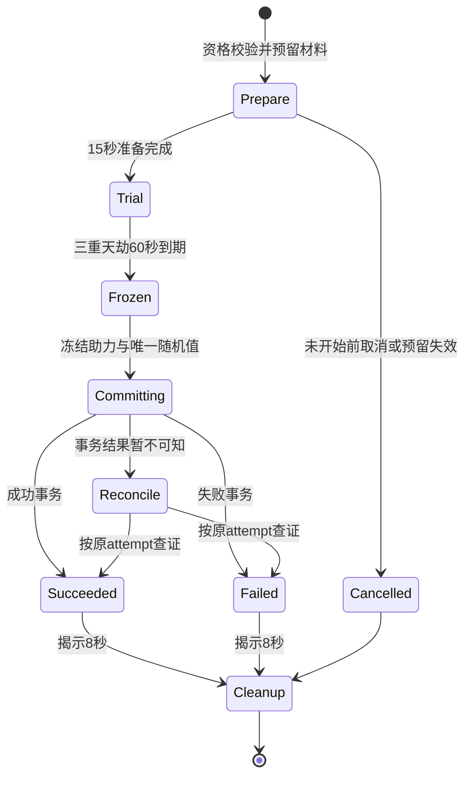

# 分类物品与天劫 AI交接完整版 v1.4

本轮规格与完整分类参数。CSV/JSON行数据在正文末；压缩包另有总索引、字段字典和Excel。使用时不要把分类表与总索引作为两套物品重复发放。正式开关保持关闭，未生成游戏代码或UI资产。


---

# 分类物品、突破材料与武灵经济 v1.4

日期2026-10-21。用途：供策划审阅和开发AI接入。交付独立Excel与CSV配置，不修改游戏运行代码、uasset、既有礼物或存档。用户本轮要求丰富材料、功法、装备、武灵货币与建设、道具、法宝及具体来源；后续追加的渡劫与观众助力见16。

## 1 本版范围与规则优先级

主播是修士，观众是剑灵，武灵是主播创建的组织。突破材料、功法书、四类装备、法宝及新道具都归主播；观众继续修为满足后自动突破，不被这批材料门槛拦住。公库材料归武灵，主播只能按公示建设用途支出，不可提回个人。

本版在v1.3上新增tables/items-v1.4，不原地覆盖旧表。启用扩展时以item_system.json、分类表和16的tribulation.json为准；旧tables/items.csv仅作兼容基线，不与新item_master.csv重复导入。旧07交易白名单继续只有免费草和铁，新增物品全部绑定禁售。尚未启用扩展的原型仍按v1.3运行，不能半套使用新核心又额外扣旧突破石。

变化清单：大境界新增核心及可选品质材料；旧小阶修为/材料/灵石成本不变；旧大境界材料费用移到核心炼制配方，最终突破不重复收取；新增专注定向产出预算；公共设施成本改为20/60/120三级；品质改为十份加法预算，替换旧当前境界1.00/1.05/1.10的原型候选。它们都是待试算的新配置，不自动迁移旧档。

## 2 分表与数据数量

| 独立表 | 内容与数量 |
|---|---|
| breakthrough_species.csv | 160种材料：十大突破各核心1、护道5、精华5、奇珍5 |
| breakthrough_material_items.csv | 640条物品：每种下/中/上/极品四个独立ID |
| breakthrough_stages.csv | 10次大境界的前后序号、材料上限、渡劫标记 |
| quality_grades.csv / quality_bands.csv | 四级材料权重、六档突破品质及直播适配预算 |
| method_items.csv | 14件功法原典与专属研习卷，对应现有七部功法 |
| equipment_items.csv | 主播16件装备，四个非武器槽、四档 |
| fabao_items.csv | 12件法宝，主播同时装备1件 |
| prop_items.csv | 20种新道具；既有回复丹等仍保留原ID与限额 |
| guild_currency.csv | 灵石、公共资材两种货币；个人贡献、武灵声望两项非货币记录 |
| guild_build_materials.csv / guild_buildings.csv | 4种公库材料、8设施×3级共24条建设配置 |
| acquisition_sources.csv / item_sources.csv | 51个渠道、747条物品与渠道关联 |
| recipes.csv / recipe_inputs.csv | 556条确定性配方、608条投入明细 |
| transaction_types.csv | 10类货币、材料、突破、建设与原型交易事务 |
| item_master.csv | 730项总索引，含24项既有兼容资产，不另发一份旧物品 |

CSV为UTF-8 BOM，程序字段为英文，Excel使用中文列名。Excel用于筛选审阅与示例计算，CSV/JSON作为AI实施的参数来源；修改后需同步导出并重新检查，不能让Excel和CSV各自成为不同真源。

730是类型目录数量，不是新手同时持有数量。保留现有200总槽、默认20解锁、每页40，不自动扩包或出售付费开格；货币与已登记权益不占普通物品槽，已装备物品按独立装备容器管理。满包奖励进入带原到期时间的待交付收据，不丢失、不强行突破槽位、不通过延期重新发货；材料页默认只列当前与下一突破，其他种类折叠。

## 3 突破材料与核心稳定供给

每次最多四类材料：核心必需1份，护道/精华/奇珍都可选。每类只能使用该stage允许的材料，类内可混合种类与品质，总量不得超过阶段上限；不因一种有五个名字就变成五个额外槽位。

| 突破 | 核心 | 护道上限 | 精华上限 | 奇珍上限 | 准备地点 |
|---|---|---:|---:|---:|---|
| 练气九→筑基 | 筑基丹 | 3 | 3 | 1 | 青云山·凝脉谷 |
| 筑基圆满→结晶 | 凝晶丹 | 2 | 4 | 1 | 玄铁岭·凝晶地窟 |
| 结晶三→金丹 | 结丹灵液 | 2 | 5 | 1 | 赤炎地·五行丹窟 |
| 金丹六→元婴 | 化婴丹 | 3 | 4 | 1 | 妖兽林·古修育婴府 |
| 元婴→化神 | 化神灵引 | 1 | 5 | 1 | 星陨海·观神古台 |
| 化神→元神 | 元神灵髓 | 2 | 6 | 1 | 星陨海·沉魂古战场 |
| 元神二→炼虚 | 虚空晶核 | 2 | 5 | 1 | 太虚境·定界裂隙 |
| 炼虚五→大乘 | 大乘道果 | 3 | 8 | 1 | 太虚境·问道天阙 |
| 大乘→飞升 | 飞升道印 | 3 | 10 | 1 | 太虚境·九天劫台 |
| 飞升→混元无极 | 混元道种 | 3 | 10 | 1 | 太虚境·混沌归一坛 |

进入对应突破前一大境界即可预备，不要求先突破后才能拿到本次核心。安全区提供公开炼丹配方，无需先建武灵炼丹阁；另一稳定途径是对应副本专注核心1完整轮得所选下品1份。终局鸿蒙本源也不采用全世界只有1至3份的硬垄断，改成身份绑定的长周期定向探索。高阶地点是原八区域内的章节预设，未实现章节不得在首版伪装开放。

核心炼制：该境界旧破境石成本×1，加原灵石成本，产下品核心1。例如下品筑基丹=20破境石+60灵石；下品化婴丹=80破境石+240灵石。核心经专注取得时无需再补交同等成本，属于明确新增的免费定向奖励。正式突破只消耗核心和所选辅材，原有修为阈值仍需满足；不得核心丹、破境石、灵石三次重复收同一费用。

## 4 四级材料与确定性评分

| 材料品质 | 核心评分 | 护道单件权重 | 精华单件权重 | 奇珍评分 |
|---|---:|---:|---:|---:|
| 下品 | 10 | 3 | 6 | 4 |
| 中品 | 18 | 6 | 14 | 9 |
| 上品 | 26 | 10 | 22 | 15 |
| 极品 | 35 | 15 | 30 | 20 |

Q=核心评分＋floor(护道投入总权重/该境界护道数量上限)＋floor(精华投入总权重/该境界精华数量上限)＋奇珍评分。分别先加总后取整，四类上限35/15/30/20，总上限100。数量上限属于公开规则，不是用当前投入数归一后让放1个等同放满。

例如极品化婴丹35，极品镇魂香3份45/3=15，极品千年魂髓4份120/4=30，极品先天元胎20，总Q100。只有任一合格核心时Q10/18/26/35，都可普通突破；不靠随机极品门槛卡住境界。

Q档沿用户参考：0–39凡、40–59良、60–74上、75–89极、90–97天、98–100完美。品质确定，不做3.9至4.1的二次随机。用户原参考示例“上品核心32分”“Q87可能4.1倍”与给定表冲突，本版统一上品核心26、Q87为极品。

独立游戏参考倍率2.5/3/3.5/4/4.5/5保留在表中，但不作为直播当前属性反复相乘；十次全5倍是9,765,625倍，会破坏既有内容与礼物量纲。本版直播品质预算为每个大境界0/0.2%/0.4%/0.6%/0.8%/1.0%，十个境界取各自最高Q快照后加法合计，最高10%。攻击/生命/防御按原境界基值乘这份品质因子；不影响修为速度、礼物原权益或标准化竞采。

公式为1+min(0.10,Σ((该境界band.live_snapshot_factor−1)/10))。band中1.00至1.10是归一前预算系数，不能直接把1.10给每个境界乘一遍。后来普通突破也不清空之前的品质积累，因此不会出现升境界后反而降属性。

当前大境界允许重炼品质：默认保留已消耗核心的评分，只提交新的完整可选材料组合；如要提高核心评分，可明确选择消耗1份更高品质同阶段核心。新Q必须高于本境界旧Q才提交，旧辅材不退款，新快照替换旧快照，不累计乘。重炼不再支付整笔修为、不再抽一次天劫、不产生新境界；后续境界也不受第一次普通突破锁死。

## 5 获取渠道、共享额度与新增预算

来源不是一句“Boss掉落”：source表包含区域、具体地点、解锁大境界、触发条件、共享额度、产出方式；item_sources关联到具体物品，配方再列每项耗材。所有新物品都有可达来源链，不依赖新增玩家市场。

每个完整十分钟世界历练只能选择一个专注：核心、护道、精华、奇珍或功法原典。每天前6个本人完整轮次可推进专注，按app/主播/profile/窗口统一计，不按副本和材料另送6份。途中切目标保留原已确认进度，一轮只推进开局冻结的一个目标；跨午夜轮次按结算自然日占一次额度，与开服活动相对日榜分区分。

核心每1轮、护道每1轮、精华每2轮、奇珍每6轮取得定向所选下品1份，功法原典每2轮1份；同池5种只能选一种，余数按渠道保留。首版无概率掉落，奇珍稀有来自时间成本与境界条件。完整6轮的额外预算上界是6份低阶核心或护道、3份精华、1份奇珍或3份原典，互斥选择，不能相加成每天全部获得。原80灵石/12石等基础奖励照旧，不将本额度再套竞采奖励发一遍。

材料品质提升固定2同种同品质→1下一品，最高极品；只消耗配方额外灵石，不存在炼制失败。1极品等价8下品：核心极限专注8轮80分钟，护道同理，精华16轮160分钟，奇珍48轮480分钟；每天6轮上限使单一极品奇珍至少8个活动日。它们是投入时间上界，不保证临近窗口加入者完成终局完美材料。奇珍从不作为突破必需品。

不同材料种类的权重相同，先用名称、区域和效果演出体现差异，避免五种护道其实只有一种正确答案。五行灵精保留五行标签，首版不额外引入属性倾向乘区；以后若增加倾向需用现有新增属性总预算，不另叠15%。

## 6 功法、装备、法宝与道具

功法原典解锁原有七路线：疾锋、星罗、玄罡、回响、合契、燃脉、百蚀；不增加第八套成长线。专属研习卷由2绑定残页+50灵石制作，每卷1定向进度，六级升级仍按1/2/3/4/6需求。原典重复可转2绑定残页。旧通用研习简仍兼容，但同一投入不能同时生成通用和专属两份。

装备仅主播法衣、道冠、云履、灵佩四槽，每槽一件；本命剑仍是唯一武器，没有新武器栏和观众防具。四档青云/玄罡/太清/无极按大境界0/3/6/9解锁；确定性制作，不随机词条、不强化爆装。法衣偏生命，道冠偏防御，云履偏移动，灵佩偏攻击。新装备与道具加法预算上限攻击20%、防御25%、生命25%、移速10%；旧付费权益不被这个新预算截断。

12法宝为引灵葫芦、镇山印、玄罡镜、听风铃、锁云绫、归元鼎、星河盘、离火幡、定界珠、镇魂钟、太虚尺、乾坤图。主播同时装备1件，表中有明确效果ID、数值、持续、冷却、具体限制。法宝不替代观众特殊剑，不作用渡劫成功率，不给统一竞采数值。满生命治疗等无有效目标不消耗技能冷却。

装备与法宝只在安全准备状态替换，事件开局冻结配置，战斗中不靠换装刷新效果。法宝冷却保存在主播/effect_key维度，卸下再装不能重置，同效果换另一法宝也共享原冷却。主动技能不在天劫中制造额外成功判定；天劫自身只用16的概率与三段演出。

20新道具包括清心散、温脉汤、凝神香、护心符、避寒珠、清瘴丸、定息丸、赤阳符、灵光灯、安魂露、破障钉、御风符、镇界香、涤魂茶、归真露、太清符、问道灯、飞仙笺、无极香、回影玉简。每物每日最多制作2，全新道具合计6；既有回复丹/护阵符保留旧限额。负面状态需后端有对应tag才允许使用，无对应状态明确无目标，不伪装已实现；治疗、屏障同类取最高/共享冷却，不无限叠护盾。没有加概率丹、购买助力人数或重抽渡劫道具。

## 7 武灵货币、建设与交易账本

灵石是主播个人货币，沿既有世界和回收供给，投入小阶突破、核心炼制、配方、装备法宝与原型交易；不会自动成为武灵公款。武灵资材是公共建设钱包，每正式成员完整轮1、成员每日6、武灵每日100，退出不可提现，不按送礼倍增。个人贡献和武灵声望都是记录，不能改名后兑换个人数值。

四种公库材料：灵纹木、青罡砖、云纹绢、阵纹砂。主播使用绑定草铁与灵石制作，结果直接进入所属武灵公库；总计每日最多5份。界面事先写清“个人投入→公共产物，不返还”，扣除与公库入账同事务。不得调用原本个人制作接口后再让客户端把owner_id改成武灵。

八设施为武灵大殿、炼丹阁、炼器坊、藏经阁、演武场、护山阵、灵圃、万灵碑，各3级。大殿基础0级创建时免费；三级资材20/60/120，每级再消耗两种公库材料各2/6/12。总升级成本按增量累计，不把第3级120误当包含前两级。作用是公共外观、组织记录或已有功能入口，所有基础炼制在安全区可用。护山阵不加属性，灵圃不额外离线产货，人数多不会永久滚倍率。

一个活跃成员每日6资材，4个有效日可到24，足够第一设施20资材；4个活跃成员一日可达24。小武灵能体验第一建设，不要求30天做满全部8×3级。配置替换旧“每次建设100”候选时必须整套启用，不能两边同时扣费。

货币与交易用transaction_types独立记账，记录来源、所有者、方向、数额、窗口、价格/规则版本、幂等键。新突破材料、书、装备、法宝、公库资源全部禁售，付费来源与衍生产物不能进入原草铁白名单。公库不分红，不建立抖币/现金/灵石兑换，不把贡献当交易币。

商店、交易、跨场经济和随机数值事件在抖音有明确限制，发布候选继续关闭，不能改叫门派兑换就开启；按具体提案判断，见[官方准入](https://partner.open-douyin.com/docs/resource/zh-CN/interaction/introduction/live-play/creation)和[FAQ](https://partner.open-douyin.com/docs/resource/zh-CN/interaction/introduction/zn/FAQ)，2026-10-21核对。本文是封闭原型扩展，不声称已获平台许可。

## 8 UI与AI实施交接

五项页面增量见ui-extension.csv：突破准备、渡劫现场、物品来源、武灵建设、装备法宝。先核对现有角色页、武灵面板和路由，能作为内部子页时沿用，不重复造顶层框架。预计新增4组原生.h/.cpp和5个WBP，全部是计划文件。素材先用现有物品图标与纸卡，按category/stage共用图标语义加动态文字/品质边框，不为640条材料画640张图；未完成美术使用明确占位，不更换现有礼物图标。

突破准备页显示各类数量、品质权重、实际Q、确定品质、直播本次品质加成、核心取得渠道、材料到期、渡劫概率构成、失败1500上限与退还规则。物品来源页按主来源/制作/升品展示具体地点与共享额度，点击来源只是导航，不自动购买或改选。

```text
请读取15、16与tables/items-v1.4。先从item_master导入总索引，分类表提供行为，sources与recipes是获取真源；不要把旧items.csv重复导入再发一份奖励。
保留主播/观众/武灵归属、唯一武器、观众零材料自动突破与既有礼物。新增640材料条目共享160种材料和4个品质，不需要640张独立图。
新增专注奖励每天全渠道共6轮，一轮只推进一种选择。核心可稳定取得，所有辅材可选。先实现原型后端与去重，再接UI；正式开关保持关闭。
新大境界只消费核心及辅材，不再次收核心配方已支付的破境石和灵石；小阶按旧规则。品质确定，按十境界加法预算最高10%，不照搬2.5至5倍连续相乘。
天劫按16独立状态机实现，每名不同有效观众助力+1个百分点，失败扣修与材料返还事务不能由UI执行。提交后的断线不重新抽取。
交付数据加载/引用验证、来源与配方事务、突破与预警清理全流程、增量UI资产和真实截图，覆盖acceptance.csv；本包参数校验不代表运行验证。
```

## 9 本轮验证边界

verify_item_system.py验证唯一ID、每阶段5种覆盖、品质边界、来源递归可达、配方引用、归属、货币与建设成本、概率和失败扣修算例。Excel另验证公式并导出预览。30条服务/UE/平台验收仍标记not_run；不把CSV和Excel成功生成当作游戏功能已上线。


## 10 十大突破全部材料名册

下表均是种类名称，每种另有四个品质。原始参考与新增名称共同构成本版候选，名称与数量真源仍为CSV。

| 阶段 | 核心 | 护道五种 | 精华五种 | 奇珍五种 |
|---|---|---|---|---|
| BR01 | 筑基丹 | 凝脉草、玉露芝、温经藤、青络参、守心兰 | 百年灵髓、晨曦露珠、青岚玉液、云泉石乳、霞光灵砂 | 天道筑基石、无尘道芽、紫府灵胚、太一凝露、九纹灵珀 |
| BR02 | 凝晶丹 | 固脉玉液、玉骨花、地心温髓、碧络石脂、归息灵膏 | 地脉晶髓、玄岩灵乳、碧晶砂髓、丹霞晶露、寒玉地精 | 无垢灵晶、太玄晶心、七窍地珀、玲珑灵胆、星纹晶胎 |
| BR03 | 结丹灵液 | 护脉丹、五蕴灵脂、金络叶、玄霜护心莲、太和真露 | 金灵精、木灵精、水灵精、火灵精、土灵精 | 天罡丹髓、九转丹心、混元金莲、五气朝元露、紫霄丹魄 |
| BR04 | 化婴丹 | 镇魂香、养婴芝、玄牝护灵液、凝神魂莲、太素安魂玉 | 千年魂髓、月魄灵乳、太阴魂露、紫府灵烟、婴华玉髓 | 先天元胎、九窍灵胎、太初婴魄、玄黄胎玉、造化婴莲 |
| BR05 | 化神灵引 | 定魂珠、澄心玉髓、玄明养神草、无相护魂香、青冥定识莲 | 神识结晶、星辉识露、太清神砂、月华神乳、玄光灵识髓 | 天魂玉、九霄神胎、观天灵瞳、万象神珀、太清道镜心 |
| BR06 | 元神灵髓 | 固神丹、不动魂玉、三花凝神露、玄极镇魄香、太乙守神芝 | 神魂精华、星魂晶髓、纯阳神露、归一魂乳、万念清光砂 | 太初魂晶、不灭神胎、三生魂莲、元始神珀、玄黄神心 |
| BR07 | 虚空晶核 | 定界石、镇空灵玉、固界神砂、太虚护体液、不动界藤 | 空间灵髓、虚潮凝露、界隙星砂、空明晶乳、太虚灵烟 | 虚空本源、无量界心、太初空莲、乾坤道胎、两仪界珀 |
| BR08 | 大乘道果 | 护道丹、太清镇身露、九华守道莲、玄黄定心石、无漏护神香 | 天地精粹、山海道髓、日月灵华、四象真露、八荒清气 | 道源之心、九霄道莲、太一大道芽、万法归元玉、天地玄黄胎 |
| BR09 | 飞升道印 | 渡劫丹、避劫雷玉、九霄护体露、无相镇心莲、太清涤魂香 | 九天仙髓、天河仙露、紫霄雷精、玄清仙气、太素天乳 | 天劫本源、九天仙胎、造化雷莲、太初仙珀、飞仙道心 |
| BR10 | 混元道种 | 无极灵液、太初护道莲、混元定神玉、鸿蒙守心香、玄黄归一露 | 混沌精粹、太初道髓、无量玄气、两仪源露、元始灵光 | 鸿蒙本源、无极道胎、混沌祖莲、太初源心、万道归一珀 |


---

# 天劫与观众助力 v1.4

日期2026-10-21。承接本轮用户追加想法：元婴往上突破出现天劫，基础失败概率50%，失败损失1500修为，观众发送助力使对应剑灵进入预警并增加成功概率1%。本案默认从“金丹六阶冲击元婴”开始，覆盖BR04至BR10共七次；触发边界可按first_transition配置调整。观众自己的自动突破不触发材料或天劫。

## 1 明确概率口径

成功率P=min(100%,50%+min(不同有效助力数,50)×1个百分点+min(此前连续失败数×10个百分点,50个百分点))。

| 本次不同助力数 | 无失败保底时成功率 |
|---:|---:|
| 0 | 50% |
| 1 | 51% |
| 10 | 60% |
| 25 | 75% |
| 49 | 99% |
| 50及以上 | 100% |

1%按增加1个百分点处理，不是把50%乘1.01变成50.5%。同一观众同次渡劫只贡献一次；“助力×100”不算100人，刷屏不叠加。第51人仍可进入助力表现、收到“助力已收到，概率已满”，不再提高封顶值。主播不能助力自己。

基础50%是首次尝试；为避免小房间长期随机卡住，本版增加公开失败保底：失败一次，下次+10个百分点，同一次大境界连续失败最多五次后，第六次即使无人助力也100%。成功后清零该转换的失败计数；改名、断线、换界面不清零，其他境界不继承。该保底为本版补充建议，界面必须提前展示，不暗中操纵随机。

礼物金额/次数、材料品质、法宝、道具、武灵等级都不进入成功率公式。护道材料仅缩短成功后稳定期；天地精华与奇珍提高确定Q。没有付费加概率、重抽或复活道具。

## 2 有效助力与截止

来源是当前房间官方身份对应的剑灵，可为正式成员或合法临时助战；无需送礼或入榜。首次在助力窗口发送“助力”成功后，记app/attempt_id/platform_user_id唯一事实，回执显示当前概率与本人状态。身份未就绪时明确未接入，不能在UE本地生成假用户。

助力窗口为三重天劫共60秒，使用服务端开始/截止UTC。准备15秒只说明规则，未开始的命令提示稍后，不积攒为下一次；截止后提示已结束。平台重试消息沿event_id去重，一位观众多个平台事件仍只记一次。资格在命令发生时校验；已计入后正常离开房间不扣回概率，不能制造最后一秒人数抖动。

服务端按收到的已验证事件时间判断，不接受客户端自填occurred_at。临时网络延迟没有客户端回填窗口；正式平台若有可信事件发生时间与迟到约束，需单独验证后版本化启用，不能让前端在看到结果后补助力。

## 3 全状态流程



启动校验：达到当前小阶修为要求、至少50%生命、脱离普通战斗15秒、安全区、当前只有一个突破事件、核心与所选材料未到期未托管、规则和模式许可。已有世界历练/竞采进行中不能同时开始天劫。校验通过后预留材料和成功所需修为，不立即消耗，后台仍显示可用与预留两栏。

天劫含肉身/神魂/心魔三段各20秒，用雷云、聚灵与剑阵表现；不是每一段再掷一次50%。免费助力全60秒可用，阶段切换不清空。它们是一个成功率事件，不擅自加入主播操作失误额外扣概率或隐藏死亡判定。

天劫期间算有效在线参与，基础修为照常按原速度和已获准权益结算，不增加一份天劫专属修为；不领取完整世界奖励、不推进材料专注、不与离线时间重叠。它不是83秒算成一个完整十分钟世界事件。

Trial开始后离开界面/掉线不能取消已经开始的风险。服务继续计时并按同attempt结算；回房查询原结果。Prepare阶段才允许无损取消；预留物到期或发生服务故障导致无法合法开始，取消预留并保持原到期，不凭空补造材料。进入Trial后材料预留有效性检查通过并冻结使用资格，到期边界不能让服务既扣修又没收未消费材料；具体规则见到期处理。

## 4 一次随机与成功事务

服务端冻结唯一助力集合和失败保底，生成且持久化一次均匀整数roll∈[0,9999]；P使用基点，基础5000、每人100、每次失败保底1000。roll<P为成功，50%对应恰5000个成功值，100%覆盖所有值。随机值不能由客户端提交，也不能在事务重试时重新抽。日志保留配置hash、助力事实摘要、概率、结果和唯一事务ID，不暴露平台身份给直播画面。

成功事务原子执行：扣本次成功修为成本、消耗核心与所选辅材、提升境界、写入确定品质快照、清除该突破失败计数、记唯一收据。大境界灵石/破境石不再收一次；核心配方的投入已经在取得核心时完成。随后再播成功演出，动画中断不会回滚已确认境界。

品质与成功独立：开始前显示Q和“成功时确定获得的品质”。例如Q87始终极品，本次成功概率仍由助力和保底决定；绝不因失败前投入奇珍而暗减成功率。

## 5 失败扣修与材料保留

失败损失=min(1500,本次结算前未花费修为)。预留不算已花费；失败先释放整笔成功修为预留，再只扣该损失，不扣整笔突破修为后再额外减1500。现有境界不变，已拥有品质、旧礼物和已解锁剑灵不丢失，不扣成负数、不降境界。

核心、护道、精华、奇珍都不消耗，原实例解除预留，不另外铸一份退款。若其原到期时间已过，只解除预留并按原期限归档失效，不生成新期限补件；启动前若剩余有效期不足准备+天劫+揭示共83秒，拒绝使用该材料并说明原因，避免正常试图结束时过期。服务异常超时跨原到期需要留待对账，不自动延长。

计数增加1，下一次公开保底+10个百分点；没有额外材料、灵石或道具罚款。再次突破要先把修为补回原阈值，并距离上次结算至少60秒。基准1修为/秒下，一次1500约25分钟；实际按有效成长速度计算，不保证实际25分钟。失败后仍能参与普通世界和修炼，不弹出购买补修按钮。

零助力且每次有足够1500可扣时，考虑保底的期望失败数0.7732、期望额外损失1159.8修为；最坏五次失败7500，然后第六次保证成功。没有保底时50%独立随机的连续失败没有有限上界，因此本版选择公开保底。这是概率算术，不是直播试播数据。

## 6 对应剑灵进入预警的生命周期

有效助力事实确认后，向对应剑灵发出带attempt_id的HelpAlertRequested，并取得本次预警租约。视觉目标是面向主播/劫云，进入现有ALERT预警悬停与护阵表现；计概率以服务端事实为准，不等待客户端动画播完。

不得直接改Transform让正在STRIKE/RETURNING的剑瞬移，也不能粗暴覆盖全局旧预警状态。若有在途动作，走现有安全结束/返回路径后进入本次预警，HUD仍立即显示助力已计入；事件切换前已禁止新普通战斗。既有礼物剑形、权益与UTC到期照常运行，不以“助力剑被占用”为由吞掉已确认礼物履约。

结束时按来源释放本次预警租约，然后重新评估现时状态：有其他有效警戒则维持ALERT，有有效目标按现有状态机处理，否则回IDLE。不能恢复一份已过期的开场旧状态，也不能为清理天劫把其他系统的预警全部清掉。

必须处理的释放路径：成功、失败、准备取消、服务拒绝、超时对账完成、切房、角色卸载、断线、本次剑灵实例销毁。离场玩家的助力事实仍保留，但客户端表现对象不悬挂；重连若Trial尚在可恢复剩余租约，已结束则不再补播一整段预警。旧场次回调按session_generation丢弃。

## 7 UI、提示与功能文件

准备页显示：“预计突破品质极品Q87；首次成功率50%；失败扣1500修为，材料保留，不掉境界；每名不同剑灵发送助力+1个百分点；连续失败保底见规则。”展示实际失败次数、保底增加和本次完整概率，不只写“有机会成功”。

现场显示三段剩余时间、已收到不同助力数、50%基础/助力/保底三项与最终概率、本人已助力状态。场上只保留轻量计数与短回执，50次剑灵反馈可合并动画但事实不能丢。结果页展示唯一收据、扣修或境界变化、材料保留状态和下一次保底；未确认时显示对账中，不提前播失败。

共享计划文件：Source/BoundlessImmortality/Frontend/UI/InkUiBreakthroughPanels.h/.cpp；Content/UI/Ink/Wuling/Widgets/WBP_InkBreakthroughPrepare.uasset及WBP_InkTribulation.uasset。业务需接现有成长/世界互斥/武灵成员/官方互动路由；具体Subsystem路径由实施者现查，不能按本文新增第二套境界存档。预警沿既有LiveWeaponSwarm路径增量接入，不重写飞行系统。

## 8 发布与验收

数据至少包括BreakthroughAttempt（主播/转换/规则hash/phase/start/deadline/reserved_qi/material_instance_ids/frozen_probability/roll/receipt）、TribulationAssist（attempt/user/event_id/verified_time，attempt+user唯一）、FailurePity（主播/转换/profile/window/count）、SwordAlertLease（attempt/actor/session_generation/expiry）。助力事务先写唯一事实，再增加计数；结果事务锁定attempt与成长快照，统一写扣修/消耗或退还/保底，不能由两套客户端分别处理。

本事件有随机数值结果和跨场成长，prototype_full隔离验证；正式物品扩展与天劫开关为false。仅因助力免费不意味着随机与存储自然获准；以提案能力为准，见15的来源。若提案不允许随机数值，保留三重演出和免费助力表现的确定性版本需另立配置，不暗改本50%规则。

验收见tables/items-v1.4/acceptance.csv：重复助力、助力截止、不同身份、51人封顶、50%/100%整数边界、连续失败保底、扣修不重复、失败材料不复制、断线不重抽、旧回调、全部预警释放路径、原礼物时长、主播/观众归属。配置脚本与Excel公式通过不代表这些UE/服务流程已验证。


# 行级配置附录


### tables/items-v1.4/acceptance.csv

```csv
case_id,area,expected,current_result
ITEM14-001,材料分类,每阶段核心1/其余各5种，四个品质均可通过确定渠道获得,not_run
ITEM14-002,品质边界,Q39/40/59/60/74/75/89/90/97/98/100映射正确，核心10/18/26/35，不显示32,not_run
ITEM14-003,混放计算,同类别不同材料和品质按数量求和后只floor一次，绝不逐件floor,not_run
ITEM14-004,核心单独,合格核心可启动，没有奇珍也能成功突破；护道非硬门槛,not_run
ITEM14-005,前置与亏损,修为未满/血量不足/战斗中不能启动；尚未入事务不扣料,not_run
ITEM14-006,成本不重复,核心炼制消耗旧石钱后，大境界成功不再扣同一组石钱,not_run
ITEM14-007,越阶材料,拒绝其他stage材料、超过槽位和超过数量上限、到期或托管材料,not_run
ITEM14-008,重炼当前品质,只替换该境界最高Q，不乘旧倍率；默认保留原核心评分，主动升级核心则只消耗新核心1份，不重新抽渡劫,not_run
ITEM14-009,归属,主播材料不向观众发；观众自动突破材料成本为零,not_run
ITEM14-010,材料来源,一轮只推进一个专注，改名换图和跨房不多领6轮额度,not_run
ITEM14-011,淬炼,2同种同品质合1下一品，材料来源和最早到期传递，最高品无上一级,not_run
ITEM14-012,装备,唯一武器保留，只可穿4非武器槽；法宝同时1件,not_run
ITEM14-013,属性上限,新装备道具加法上限有效，旧礼物不被截断，统一竞采不使用新增属性,not_run
ITEM14-014,公库,个人不能提款，制作投入和公库输出同事务，退出不返还已确认投入,not_run
ITEM14-015,建设并发,相同level两个请求只扣一次；不足钱料原状返回,not_run
ITEM14-016,寄售,全部新绑定物和公库资材拒售，原草铁白名单保持,not_run
ITEM14-017,渡劫概率,0/1/49/50个不同助力分别50/51/99/100%，重复评论不叠加,not_run
ITEM14-018,助力身份,主播自己/其他房间/失效身份不计，正式与临时真实剑灵可计,not_run
ITEM14-019,助力时限,以服务端截止计数，截止后与结果揭示期不再加概率,not_run
ITEM14-020,渡劫保底,0助力前5次失败后第6次100%；重连改名不能清零,not_run
ITEM14-021,失败扣修,"只扣min(1500,可用修为)，不扣整笔成功成本，不掉境界或扣成负数",not_run
ITEM14-022,失败材料,解锁原预留材料，不铸造退款副本，不刷新到期时间,not_run
ITEM14-023,重试,修为重新达到阈值且过60秒后才可再次开始；单主播仅1个活跃渡劫,not_run
ITEM14-024,概率权威,一次attempt只一份服务端roll，客户端不提交百分比和随机值,not_run
ITEM14-025,断线结算,截止与事务不中断；回房按attempt查询结果，不能重新抽取,not_run
ITEM14-026,剑灵生命周期,助力预警以attempt租约控制；成功失败取消房间切换断线都释放并重新评估状态,not_run
ITEM14-027,预警冲突,已有攻击/预警/礼物演出不被粗暴复位；已有礼物时长正常按UTC流逝,not_run
ITEM14-028,渡劫质量分离,材料决定确定品质；礼物法宝道具不会购买成功率,not_run
ITEM14-029,平台开关,发布候选的物品扩展/渡劫/新交易入口与服务直连保持关闭,not_run
ITEM14-030,来源保护,旧礼物权益/旧背包/旧境界数据未自动迁移；源CSV不会覆盖运行配置,not_run
```


### tables/items-v1.4/acquisition_sources.csv

```csv
source_id,name,channel_type,region,min_major,unlock_condition,quota_group,output_rule,profile,real_payment
CH_LEGACY,既有来源兼容,legacy,现有世界,0,沿用v1.3收据与权限,none,只引用原配置，不追加一份掉落,prototype_full,False
CH_CRAFT,确定性炼制台,craft,任意安全区,0,达到对应境界；无需武灵建筑,none,按recipes与recipe_inputs原子扣料；100%成功，不抽品质,prototype_full,False
CH_WORLD,世界历练基础供给,world,既有八区域,0,,none,原world_rewards.csv；每10分钟80灵石/12破境石等，未增加第二份基础供给,prototype_full,False
CH_BUILD,武灵建设工坊,guild_craft,武灵驻地,0,,none,主播支付绑定投入，结果直接进入本武灵公库；不产生个人贡献兑换额度,prototype_full,False
CH_BR01_C,凝脉谷·核心试炼,focused_world,青云山,0,进入本阶段前一大境界即可预备,FOCUS_WORLD_6,每轮只选一个专注目标；累计1个完整10分钟轮次，定向得所选下品1份；无随机掉率,prototype_full,False
CH_BR01_G,凝脉谷·护道采集,focused_world,青云山,0,进入本阶段前一大境界即可预备,FOCUS_WORLD_6,每轮只选一个专注目标；累计1个完整10分钟轮次，定向得所选下品1份；无随机掉率,prototype_full,False
CH_BR01_E,凝脉谷·灵脉淬取,focused_world,青云山,0,进入本阶段前一大境界即可预备,FOCUS_WORLD_6,每轮只选一个专注目标；累计2个完整10分钟轮次，定向得所选下品1份；无随机掉率,prototype_full,False
CH_BR01_T,凝脉谷·奇珍探寻,focused_world,青云山,0,进入本阶段前一大境界即可预备,FOCUS_WORLD_6,每轮只选一个专注目标；累计6个完整10分钟轮次，定向得所选下品1份；无随机掉率,prototype_full,False
CH_BR02_C,凝晶地窟·核心试炼,focused_world,玄铁岭,1,进入本阶段前一大境界即可预备,FOCUS_WORLD_6,每轮只选一个专注目标；累计1个完整10分钟轮次，定向得所选下品1份；无随机掉率,prototype_full,False
CH_BR02_G,凝晶地窟·护道采集,focused_world,玄铁岭,1,进入本阶段前一大境界即可预备,FOCUS_WORLD_6,每轮只选一个专注目标；累计1个完整10分钟轮次，定向得所选下品1份；无随机掉率,prototype_full,False
CH_BR02_E,凝晶地窟·灵脉淬取,focused_world,玄铁岭,1,进入本阶段前一大境界即可预备,FOCUS_WORLD_6,每轮只选一个专注目标；累计2个完整10分钟轮次，定向得所选下品1份；无随机掉率,prototype_full,False
CH_BR02_T,凝晶地窟·奇珍探寻,focused_world,玄铁岭,1,进入本阶段前一大境界即可预备,FOCUS_WORLD_6,每轮只选一个专注目标；累计6个完整10分钟轮次，定向得所选下品1份；无随机掉率,prototype_full,False
CH_BR03_C,五行丹窟·核心试炼,focused_world,赤炎地,2,进入本阶段前一大境界即可预备,FOCUS_WORLD_6,每轮只选一个专注目标；累计1个完整10分钟轮次，定向得所选下品1份；无随机掉率,prototype_full,False
CH_BR03_G,五行丹窟·护道采集,focused_world,赤炎地,2,进入本阶段前一大境界即可预备,FOCUS_WORLD_6,每轮只选一个专注目标；累计1个完整10分钟轮次，定向得所选下品1份；无随机掉率,prototype_full,False
CH_BR03_E,五行丹窟·灵脉淬取,focused_world,赤炎地,2,进入本阶段前一大境界即可预备,FOCUS_WORLD_6,每轮只选一个专注目标；累计2个完整10分钟轮次，定向得所选下品1份；无随机掉率,prototype_full,False
CH_BR03_T,五行丹窟·奇珍探寻,focused_world,赤炎地,2,进入本阶段前一大境界即可预备,FOCUS_WORLD_6,每轮只选一个专注目标；累计6个完整10分钟轮次，定向得所选下品1份；无随机掉率,prototype_full,False
CH_BR04_C,古修育婴府·核心试炼,focused_world,妖兽林,3,进入本阶段前一大境界即可预备,FOCUS_WORLD_6,每轮只选一个专注目标；累计1个完整10分钟轮次，定向得所选下品1份；无随机掉率,prototype_full,False
CH_BR04_G,古修育婴府·护道采集,focused_world,妖兽林,3,进入本阶段前一大境界即可预备,FOCUS_WORLD_6,每轮只选一个专注目标；累计1个完整10分钟轮次，定向得所选下品1份；无随机掉率,prototype_full,False
CH_BR04_E,古修育婴府·灵脉淬取,focused_world,妖兽林,3,进入本阶段前一大境界即可预备,FOCUS_WORLD_6,每轮只选一个专注目标；累计2个完整10分钟轮次，定向得所选下品1份；无随机掉率,prototype_full,False
CH_BR04_T,古修育婴府·奇珍探寻,focused_world,妖兽林,3,进入本阶段前一大境界即可预备,FOCUS_WORLD_6,每轮只选一个专注目标；累计6个完整10分钟轮次，定向得所选下品1份；无随机掉率,prototype_full,False
CH_BR05_C,观神古台·核心试炼,focused_world,星陨海,4,进入本阶段前一大境界即可预备,FOCUS_WORLD_6,每轮只选一个专注目标；累计1个完整10分钟轮次，定向得所选下品1份；无随机掉率,prototype_full,False
CH_BR05_G,观神古台·护道采集,focused_world,星陨海,4,进入本阶段前一大境界即可预备,FOCUS_WORLD_6,每轮只选一个专注目标；累计1个完整10分钟轮次，定向得所选下品1份；无随机掉率,prototype_full,False
CH_BR05_E,观神古台·灵脉淬取,focused_world,星陨海,4,进入本阶段前一大境界即可预备,FOCUS_WORLD_6,每轮只选一个专注目标；累计2个完整10分钟轮次，定向得所选下品1份；无随机掉率,prototype_full,False
CH_BR05_T,观神古台·奇珍探寻,focused_world,星陨海,4,进入本阶段前一大境界即可预备,FOCUS_WORLD_6,每轮只选一个专注目标；累计6个完整10分钟轮次，定向得所选下品1份；无随机掉率,prototype_full,False
CH_BR06_C,沉魂古战场·核心试炼,focused_world,星陨海,5,进入本阶段前一大境界即可预备,FOCUS_WORLD_6,每轮只选一个专注目标；累计1个完整10分钟轮次，定向得所选下品1份；无随机掉率,prototype_full,False
CH_BR06_G,沉魂古战场·护道采集,focused_world,星陨海,5,进入本阶段前一大境界即可预备,FOCUS_WORLD_6,每轮只选一个专注目标；累计1个完整10分钟轮次，定向得所选下品1份；无随机掉率,prototype_full,False
CH_BR06_E,沉魂古战场·灵脉淬取,focused_world,星陨海,5,进入本阶段前一大境界即可预备,FOCUS_WORLD_6,每轮只选一个专注目标；累计2个完整10分钟轮次，定向得所选下品1份；无随机掉率,prototype_full,False
CH_BR06_T,沉魂古战场·奇珍探寻,focused_world,星陨海,5,进入本阶段前一大境界即可预备,FOCUS_WORLD_6,每轮只选一个专注目标；累计6个完整10分钟轮次，定向得所选下品1份；无随机掉率,prototype_full,False
CH_BR07_C,定界裂隙·核心试炼,focused_world,太虚境,6,进入本阶段前一大境界即可预备,FOCUS_WORLD_6,每轮只选一个专注目标；累计1个完整10分钟轮次，定向得所选下品1份；无随机掉率,prototype_full,False
CH_BR07_G,定界裂隙·护道采集,focused_world,太虚境,6,进入本阶段前一大境界即可预备,FOCUS_WORLD_6,每轮只选一个专注目标；累计1个完整10分钟轮次，定向得所选下品1份；无随机掉率,prototype_full,False
CH_BR07_E,定界裂隙·灵脉淬取,focused_world,太虚境,6,进入本阶段前一大境界即可预备,FOCUS_WORLD_6,每轮只选一个专注目标；累计2个完整10分钟轮次，定向得所选下品1份；无随机掉率,prototype_full,False
CH_BR07_T,定界裂隙·奇珍探寻,focused_world,太虚境,6,进入本阶段前一大境界即可预备,FOCUS_WORLD_6,每轮只选一个专注目标；累计6个完整10分钟轮次，定向得所选下品1份；无随机掉率,prototype_full,False
CH_BR08_C,问道天阙·核心试炼,focused_world,太虚境,7,进入本阶段前一大境界即可预备,FOCUS_WORLD_6,每轮只选一个专注目标；累计1个完整10分钟轮次，定向得所选下品1份；无随机掉率,prototype_full,False
CH_BR08_G,问道天阙·护道采集,focused_world,太虚境,7,进入本阶段前一大境界即可预备,FOCUS_WORLD_6,每轮只选一个专注目标；累计1个完整10分钟轮次，定向得所选下品1份；无随机掉率,prototype_full,False
CH_BR08_E,问道天阙·灵脉淬取,focused_world,太虚境,7,进入本阶段前一大境界即可预备,FOCUS_WORLD_6,每轮只选一个专注目标；累计2个完整10分钟轮次，定向得所选下品1份；无随机掉率,prototype_full,False
CH_BR08_T,问道天阙·奇珍探寻,focused_world,太虚境,7,进入本阶段前一大境界即可预备,FOCUS_WORLD_6,每轮只选一个专注目标；累计6个完整10分钟轮次，定向得所选下品1份；无随机掉率,prototype_full,False
CH_BR09_C,九天劫台·核心试炼,focused_world,太虚境,8,进入本阶段前一大境界即可预备,FOCUS_WORLD_6,每轮只选一个专注目标；累计1个完整10分钟轮次，定向得所选下品1份；无随机掉率,prototype_full,False
CH_BR09_G,九天劫台·护道采集,focused_world,太虚境,8,进入本阶段前一大境界即可预备,FOCUS_WORLD_6,每轮只选一个专注目标；累计1个完整10分钟轮次，定向得所选下品1份；无随机掉率,prototype_full,False
CH_BR09_E,九天劫台·灵脉淬取,focused_world,太虚境,8,进入本阶段前一大境界即可预备,FOCUS_WORLD_6,每轮只选一个专注目标；累计2个完整10分钟轮次，定向得所选下品1份；无随机掉率,prototype_full,False
CH_BR09_T,九天劫台·奇珍探寻,focused_world,太虚境,8,进入本阶段前一大境界即可预备,FOCUS_WORLD_6,每轮只选一个专注目标；累计6个完整10分钟轮次，定向得所选下品1份；无随机掉率,prototype_full,False
CH_BR10_C,混沌归一坛·核心试炼,focused_world,太虚境,9,进入本阶段前一大境界即可预备,FOCUS_WORLD_6,每轮只选一个专注目标；累计1个完整10分钟轮次，定向得所选下品1份；无随机掉率,prototype_full,False
CH_BR10_G,混沌归一坛·护道采集,focused_world,太虚境,9,进入本阶段前一大境界即可预备,FOCUS_WORLD_6,每轮只选一个专注目标；累计1个完整10分钟轮次，定向得所选下品1份；无随机掉率,prototype_full,False
CH_BR10_E,混沌归一坛·灵脉淬取,focused_world,太虚境,9,进入本阶段前一大境界即可预备,FOCUS_WORLD_6,每轮只选一个专注目标；累计2个完整10分钟轮次，定向得所选下品1份；无随机掉率,prototype_full,False
CH_BR10_T,混沌归一坛·奇珍探寻,focused_world,太虚境,9,进入本阶段前一大境界即可预备,FOCUS_WORLD_6,每轮只选一个专注目标；累计6个完整10分钟轮次，定向得所选下品1份；无随机掉率,prototype_full,False
CH_METHOD_1,疾锋剑诀传承试炼,focused_world,青云山,0,首次解锁目标功法,FOCUS_WORLD_6,专注累计2个完整轮次，确定取得所选功法原典1份；与突破材料共享每日6轮额度,prototype_full,False
CH_METHOD_2,星罗法诀传承试炼,focused_world,星陨海,1,首次解锁目标功法,FOCUS_WORLD_6,专注累计2个完整轮次，确定取得所选功法原典1份；与突破材料共享每日6轮额度,prototype_full,False
CH_METHOD_3,玄罡体经传承试炼,focused_world,玄铁岭,0,首次解锁目标功法,FOCUS_WORLD_6,专注累计2个完整轮次，确定取得所选功法原典1份；与突破材料共享每日6轮额度,prototype_full,False
CH_METHOD_4,回响诀传承试炼,focused_world,星陨海,0,首次解锁目标功法,FOCUS_WORLD_6,专注累计2个完整轮次，确定取得所选功法原典1份；与突破材料共享每日6轮额度,prototype_full,False
CH_METHOD_5,合契经传承试炼,focused_world,妖兽林,1,首次解锁目标功法,FOCUS_WORLD_6,专注累计2个完整轮次，确定取得所选功法原典1份；与突破材料共享每日6轮额度,prototype_full,False
CH_METHOD_6,燃脉诀传承试炼,focused_world,赤炎地,1,首次解锁目标功法,FOCUS_WORLD_6,专注累计2个完整轮次，确定取得所选功法原典1份；与突破材料共享每日6轮额度,prototype_full,False
CH_METHOD_7,百蚀经传承试炼,focused_world,玄冰原,1,首次解锁目标功法,FOCUS_WORLD_6,专注累计2个完整轮次，确定取得所选功法原典1份；与突破材料共享每日6轮额度,prototype_full,False
```


### tables/items-v1.4/breakthrough_material_items.csv

```csv
item_id,species_id,name,stage_id,category,grade_id,quality_weight,trait,min_major,owner_type,binding,tradeable,source_id,alternative_source,use
MAT_BR01_C01_G1,MAT_BR01_C01,下品筑基丹,BR01,core,G1,10,资格,0,anchor,bound,False,CH_BR01_C,CH_CRAFT,主播大境界突破资格；整次只消耗1份
MAT_BR01_C01_G2,MAT_BR01_C01,中品筑基丹,BR01,core,G2,18,资格,0,anchor,bound,False,CH_CRAFT,CH_CRAFT,主播大境界突破资格；整次只消耗1份
MAT_BR01_C01_G3,MAT_BR01_C01,上品筑基丹,BR01,core,G3,26,资格,0,anchor,bound,False,CH_CRAFT,CH_CRAFT,主播大境界突破资格；整次只消耗1份
MAT_BR01_C01_G4,MAT_BR01_C01,极品筑基丹,BR01,core,G4,35,资格,0,anchor,bound,False,CH_CRAFT,CH_CRAFT,主播大境界突破资格；整次只消耗1份
MAT_BR01_G01_G1,MAT_BR01_G01,下品凝脉草,BR01,guard,G1,3,经脉,0,anchor,bound,False,CH_BR01_G,,提升护道评分与缩短突破后虚弱；不增加渡劫成功率
MAT_BR01_G01_G2,MAT_BR01_G01,中品凝脉草,BR01,guard,G2,6,经脉,0,anchor,bound,False,CH_CRAFT,,提升护道评分与缩短突破后虚弱；不增加渡劫成功率
MAT_BR01_G01_G3,MAT_BR01_G01,上品凝脉草,BR01,guard,G3,10,经脉,0,anchor,bound,False,CH_CRAFT,,提升护道评分与缩短突破后虚弱；不增加渡劫成功率
MAT_BR01_G01_G4,MAT_BR01_G01,极品凝脉草,BR01,guard,G4,15,经脉,0,anchor,bound,False,CH_CRAFT,,提升护道评分与缩短突破后虚弱；不增加渡劫成功率
MAT_BR01_G02_G1,MAT_BR01_G02,下品玉露芝,BR01,guard,G1,3,肉身,0,anchor,bound,False,CH_BR01_G,,提升护道评分与缩短突破后虚弱；不增加渡劫成功率
MAT_BR01_G02_G2,MAT_BR01_G02,中品玉露芝,BR01,guard,G2,6,肉身,0,anchor,bound,False,CH_CRAFT,,提升护道评分与缩短突破后虚弱；不增加渡劫成功率
MAT_BR01_G02_G3,MAT_BR01_G02,上品玉露芝,BR01,guard,G3,10,肉身,0,anchor,bound,False,CH_CRAFT,,提升护道评分与缩短突破后虚弱；不增加渡劫成功率
MAT_BR01_G02_G4,MAT_BR01_G02,极品玉露芝,BR01,guard,G4,15,肉身,0,anchor,bound,False,CH_CRAFT,,提升护道评分与缩短突破后虚弱；不增加渡劫成功率
MAT_BR01_G03_G1,MAT_BR01_G03,下品温经藤,BR01,guard,G1,3,神魂,0,anchor,bound,False,CH_BR01_G,,提升护道评分与缩短突破后虚弱；不增加渡劫成功率
MAT_BR01_G03_G2,MAT_BR01_G03,中品温经藤,BR01,guard,G2,6,神魂,0,anchor,bound,False,CH_CRAFT,,提升护道评分与缩短突破后虚弱；不增加渡劫成功率
MAT_BR01_G03_G3,MAT_BR01_G03,上品温经藤,BR01,guard,G3,10,神魂,0,anchor,bound,False,CH_CRAFT,,提升护道评分与缩短突破后虚弱；不增加渡劫成功率
MAT_BR01_G03_G4,MAT_BR01_G03,极品温经藤,BR01,guard,G4,15,神魂,0,anchor,bound,False,CH_CRAFT,,提升护道评分与缩短突破后虚弱；不增加渡劫成功率
MAT_BR01_G04_G1,MAT_BR01_G04,下品青络参,BR01,guard,G1,3,灵压,0,anchor,bound,False,CH_BR01_G,,提升护道评分与缩短突破后虚弱；不增加渡劫成功率
MAT_BR01_G04_G2,MAT_BR01_G04,中品青络参,BR01,guard,G2,6,灵压,0,anchor,bound,False,CH_CRAFT,,提升护道评分与缩短突破后虚弱；不增加渡劫成功率
MAT_BR01_G04_G3,MAT_BR01_G04,上品青络参,BR01,guard,G3,10,灵压,0,anchor,bound,False,CH_CRAFT,,提升护道评分与缩短突破后虚弱；不增加渡劫成功率
MAT_BR01_G04_G4,MAT_BR01_G04,极品青络参,BR01,guard,G4,15,灵压,0,anchor,bound,False,CH_CRAFT,,提升护道评分与缩短突破后虚弱；不增加渡劫成功率
MAT_BR01_G05_G1,MAT_BR01_G05,下品守心兰,BR01,guard,G1,3,心境,0,anchor,bound,False,CH_BR01_G,,提升护道评分与缩短突破后虚弱；不增加渡劫成功率
MAT_BR01_G05_G2,MAT_BR01_G05,中品守心兰,BR01,guard,G2,6,心境,0,anchor,bound,False,CH_CRAFT,,提升护道评分与缩短突破后虚弱；不增加渡劫成功率
MAT_BR01_G05_G3,MAT_BR01_G05,上品守心兰,BR01,guard,G3,10,心境,0,anchor,bound,False,CH_CRAFT,,提升护道评分与缩短突破后虚弱；不增加渡劫成功率
MAT_BR01_G05_G4,MAT_BR01_G05,极品守心兰,BR01,guard,G4,15,心境,0,anchor,bound,False,CH_CRAFT,,提升护道评分与缩短突破后虚弱；不增加渡劫成功率
MAT_BR01_E01_G1,MAT_BR01_E01,下品百年灵髓,BR01,essence,G1,6,凝练,0,anchor,bound,False,CH_BR01_E,,提高突破品质评分
MAT_BR01_E01_G2,MAT_BR01_E01,中品百年灵髓,BR01,essence,G2,14,凝练,0,anchor,bound,False,CH_CRAFT,,提高突破品质评分
MAT_BR01_E01_G3,MAT_BR01_E01,上品百年灵髓,BR01,essence,G3,22,凝练,0,anchor,bound,False,CH_CRAFT,,提高突破品质评分
MAT_BR01_E01_G4,MAT_BR01_E01,极品百年灵髓,BR01,essence,G4,30,凝练,0,anchor,bound,False,CH_CRAFT,,提高突破品质评分
MAT_BR01_E02_G1,MAT_BR01_E02,下品晨曦露珠,BR01,essence,G1,6,澄明,0,anchor,bound,False,CH_BR01_E,,提高突破品质评分
MAT_BR01_E02_G2,MAT_BR01_E02,中品晨曦露珠,BR01,essence,G2,14,澄明,0,anchor,bound,False,CH_CRAFT,,提高突破品质评分
MAT_BR01_E02_G3,MAT_BR01_E02,上品晨曦露珠,BR01,essence,G3,22,澄明,0,anchor,bound,False,CH_CRAFT,,提高突破品质评分
MAT_BR01_E02_G4,MAT_BR01_E02,极品晨曦露珠,BR01,essence,G4,30,澄明,0,anchor,bound,False,CH_CRAFT,,提高突破品质评分
MAT_BR01_E03_G1,MAT_BR01_E03,下品青岚玉液,BR01,essence,G1,6,温养,0,anchor,bound,False,CH_BR01_E,,提高突破品质评分
MAT_BR01_E03_G2,MAT_BR01_E03,中品青岚玉液,BR01,essence,G2,14,温养,0,anchor,bound,False,CH_CRAFT,,提高突破品质评分
MAT_BR01_E03_G3,MAT_BR01_E03,上品青岚玉液,BR01,essence,G3,22,温养,0,anchor,bound,False,CH_CRAFT,,提高突破品质评分
MAT_BR01_E03_G4,MAT_BR01_E03,极品青岚玉液,BR01,essence,G4,30,温养,0,anchor,bound,False,CH_CRAFT,,提高突破品质评分
MAT_BR01_E04_G1,MAT_BR01_E04,下品云泉石乳,BR01,essence,G1,6,贯通,0,anchor,bound,False,CH_BR01_E,,提高突破品质评分
MAT_BR01_E04_G2,MAT_BR01_E04,中品云泉石乳,BR01,essence,G2,14,贯通,0,anchor,bound,False,CH_CRAFT,,提高突破品质评分
MAT_BR01_E04_G3,MAT_BR01_E04,上品云泉石乳,BR01,essence,G3,22,贯通,0,anchor,bound,False,CH_CRAFT,,提高突破品质评分
MAT_BR01_E04_G4,MAT_BR01_E04,极品云泉石乳,BR01,essence,G4,30,贯通,0,anchor,bound,False,CH_CRAFT,,提高突破品质评分
MAT_BR01_E05_G1,MAT_BR01_E05,下品霞光灵砂,BR01,essence,G1,6,归一,0,anchor,bound,False,CH_BR01_E,,提高突破品质评分
MAT_BR01_E05_G2,MAT_BR01_E05,中品霞光灵砂,BR01,essence,G2,14,归一,0,anchor,bound,False,CH_CRAFT,,提高突破品质评分
MAT_BR01_E05_G3,MAT_BR01_E05,上品霞光灵砂,BR01,essence,G3,22,归一,0,anchor,bound,False,CH_CRAFT,,提高突破品质评分
MAT_BR01_E05_G4,MAT_BR01_E05,极品霞光灵砂,BR01,essence,G4,30,归一,0,anchor,bound,False,CH_CRAFT,,提高突破品质评分
MAT_BR01_T01_G1,MAT_BR01_T01,下品天道筑基石,BR01,treasure,G1,4,天地共鸣,0,anchor,bound,False,CH_BR01_T,,提高突破品质与确定性异象；非必需
MAT_BR01_T01_G2,MAT_BR01_T01,中品天道筑基石,BR01,treasure,G2,9,天地共鸣,0,anchor,bound,False,CH_CRAFT,,提高突破品质与确定性异象；非必需
MAT_BR01_T01_G3,MAT_BR01_T01,上品天道筑基石,BR01,treasure,G3,15,天地共鸣,0,anchor,bound,False,CH_CRAFT,,提高突破品质与确定性异象；非必需
MAT_BR01_T01_G4,MAT_BR01_T01,极品天道筑基石,BR01,treasure,G4,20,天地共鸣,0,anchor,bound,False,CH_CRAFT,,提高突破品质与确定性异象；非必需
MAT_BR01_T02_G1,MAT_BR01_T02,下品无尘道芽,BR01,treasure,G1,4,异象,0,anchor,bound,False,CH_BR01_T,,提高突破品质与确定性异象；非必需
MAT_BR01_T02_G2,MAT_BR01_T02,中品无尘道芽,BR01,treasure,G2,9,异象,0,anchor,bound,False,CH_CRAFT,,提高突破品质与确定性异象；非必需
MAT_BR01_T02_G3,MAT_BR01_T02,上品无尘道芽,BR01,treasure,G3,15,异象,0,anchor,bound,False,CH_CRAFT,,提高突破品质与确定性异象；非必需
MAT_BR01_T02_G4,MAT_BR01_T02,极品无尘道芽,BR01,treasure,G4,20,异象,0,anchor,bound,False,CH_CRAFT,,提高突破品质与确定性异象；非必需
MAT_BR01_T03_G1,MAT_BR01_T03,下品紫府灵胚,BR01,treasure,G1,4,道纹,0,anchor,bound,False,CH_BR01_T,,提高突破品质与确定性异象；非必需
MAT_BR01_T03_G2,MAT_BR01_T03,中品紫府灵胚,BR01,treasure,G2,9,道纹,0,anchor,bound,False,CH_CRAFT,,提高突破品质与确定性异象；非必需
MAT_BR01_T03_G3,MAT_BR01_T03,上品紫府灵胚,BR01,treasure,G3,15,道纹,0,anchor,bound,False,CH_CRAFT,,提高突破品质与确定性异象；非必需
MAT_BR01_T03_G4,MAT_BR01_T03,极品紫府灵胚,BR01,treasure,G4,20,道纹,0,anchor,bound,False,CH_CRAFT,,提高突破品质与确定性异象；非必需
MAT_BR01_T04_G1,MAT_BR01_T04,下品太一凝露,BR01,treasure,G1,4,灵光,0,anchor,bound,False,CH_BR01_T,,提高突破品质与确定性异象；非必需
MAT_BR01_T04_G2,MAT_BR01_T04,中品太一凝露,BR01,treasure,G2,9,灵光,0,anchor,bound,False,CH_CRAFT,,提高突破品质与确定性异象；非必需
MAT_BR01_T04_G3,MAT_BR01_T04,上品太一凝露,BR01,treasure,G3,15,灵光,0,anchor,bound,False,CH_CRAFT,,提高突破品质与确定性异象；非必需
MAT_BR01_T04_G4,MAT_BR01_T04,极品太一凝露,BR01,treasure,G4,20,灵光,0,anchor,bound,False,CH_CRAFT,,提高突破品质与确定性异象；非必需
MAT_BR01_T05_G1,MAT_BR01_T05,下品九纹灵珀,BR01,treasure,G1,4,根基,0,anchor,bound,False,CH_BR01_T,,提高突破品质与确定性异象；非必需
MAT_BR01_T05_G2,MAT_BR01_T05,中品九纹灵珀,BR01,treasure,G2,9,根基,0,anchor,bound,False,CH_CRAFT,,提高突破品质与确定性异象；非必需
MAT_BR01_T05_G3,MAT_BR01_T05,上品九纹灵珀,BR01,treasure,G3,15,根基,0,anchor,bound,False,CH_CRAFT,,提高突破品质与确定性异象；非必需
MAT_BR01_T05_G4,MAT_BR01_T05,极品九纹灵珀,BR01,treasure,G4,20,根基,0,anchor,bound,False,CH_CRAFT,,提高突破品质与确定性异象；非必需
MAT_BR02_C01_G1,MAT_BR02_C01,下品凝晶丹,BR02,core,G1,10,资格,1,anchor,bound,False,CH_BR02_C,CH_CRAFT,主播大境界突破资格；整次只消耗1份
MAT_BR02_C01_G2,MAT_BR02_C01,中品凝晶丹,BR02,core,G2,18,资格,1,anchor,bound,False,CH_CRAFT,CH_CRAFT,主播大境界突破资格；整次只消耗1份
MAT_BR02_C01_G3,MAT_BR02_C01,上品凝晶丹,BR02,core,G3,26,资格,1,anchor,bound,False,CH_CRAFT,CH_CRAFT,主播大境界突破资格；整次只消耗1份
MAT_BR02_C01_G4,MAT_BR02_C01,极品凝晶丹,BR02,core,G4,35,资格,1,anchor,bound,False,CH_CRAFT,CH_CRAFT,主播大境界突破资格；整次只消耗1份
MAT_BR02_G01_G1,MAT_BR02_G01,下品固脉玉液,BR02,guard,G1,3,经脉,1,anchor,bound,False,CH_BR02_G,,提升护道评分与缩短突破后虚弱；不增加渡劫成功率
MAT_BR02_G01_G2,MAT_BR02_G01,中品固脉玉液,BR02,guard,G2,6,经脉,1,anchor,bound,False,CH_CRAFT,,提升护道评分与缩短突破后虚弱；不增加渡劫成功率
MAT_BR02_G01_G3,MAT_BR02_G01,上品固脉玉液,BR02,guard,G3,10,经脉,1,anchor,bound,False,CH_CRAFT,,提升护道评分与缩短突破后虚弱；不增加渡劫成功率
MAT_BR02_G01_G4,MAT_BR02_G01,极品固脉玉液,BR02,guard,G4,15,经脉,1,anchor,bound,False,CH_CRAFT,,提升护道评分与缩短突破后虚弱；不增加渡劫成功率
MAT_BR02_G02_G1,MAT_BR02_G02,下品玉骨花,BR02,guard,G1,3,肉身,1,anchor,bound,False,CH_BR02_G,,提升护道评分与缩短突破后虚弱；不增加渡劫成功率
MAT_BR02_G02_G2,MAT_BR02_G02,中品玉骨花,BR02,guard,G2,6,肉身,1,anchor,bound,False,CH_CRAFT,,提升护道评分与缩短突破后虚弱；不增加渡劫成功率
MAT_BR02_G02_G3,MAT_BR02_G02,上品玉骨花,BR02,guard,G3,10,肉身,1,anchor,bound,False,CH_CRAFT,,提升护道评分与缩短突破后虚弱；不增加渡劫成功率
MAT_BR02_G02_G4,MAT_BR02_G02,极品玉骨花,BR02,guard,G4,15,肉身,1,anchor,bound,False,CH_CRAFT,,提升护道评分与缩短突破后虚弱；不增加渡劫成功率
MAT_BR02_G03_G1,MAT_BR02_G03,下品地心温髓,BR02,guard,G1,3,神魂,1,anchor,bound,False,CH_BR02_G,,提升护道评分与缩短突破后虚弱；不增加渡劫成功率
MAT_BR02_G03_G2,MAT_BR02_G03,中品地心温髓,BR02,guard,G2,6,神魂,1,anchor,bound,False,CH_CRAFT,,提升护道评分与缩短突破后虚弱；不增加渡劫成功率
MAT_BR02_G03_G3,MAT_BR02_G03,上品地心温髓,BR02,guard,G3,10,神魂,1,anchor,bound,False,CH_CRAFT,,提升护道评分与缩短突破后虚弱；不增加渡劫成功率
MAT_BR02_G03_G4,MAT_BR02_G03,极品地心温髓,BR02,guard,G4,15,神魂,1,anchor,bound,False,CH_CRAFT,,提升护道评分与缩短突破后虚弱；不增加渡劫成功率
MAT_BR02_G04_G1,MAT_BR02_G04,下品碧络石脂,BR02,guard,G1,3,灵压,1,anchor,bound,False,CH_BR02_G,,提升护道评分与缩短突破后虚弱；不增加渡劫成功率
MAT_BR02_G04_G2,MAT_BR02_G04,中品碧络石脂,BR02,guard,G2,6,灵压,1,anchor,bound,False,CH_CRAFT,,提升护道评分与缩短突破后虚弱；不增加渡劫成功率
MAT_BR02_G04_G3,MAT_BR02_G04,上品碧络石脂,BR02,guard,G3,10,灵压,1,anchor,bound,False,CH_CRAFT,,提升护道评分与缩短突破后虚弱；不增加渡劫成功率
MAT_BR02_G04_G4,MAT_BR02_G04,极品碧络石脂,BR02,guard,G4,15,灵压,1,anchor,bound,False,CH_CRAFT,,提升护道评分与缩短突破后虚弱；不增加渡劫成功率
MAT_BR02_G05_G1,MAT_BR02_G05,下品归息灵膏,BR02,guard,G1,3,心境,1,anchor,bound,False,CH_BR02_G,,提升护道评分与缩短突破后虚弱；不增加渡劫成功率
MAT_BR02_G05_G2,MAT_BR02_G05,中品归息灵膏,BR02,guard,G2,6,心境,1,anchor,bound,False,CH_CRAFT,,提升护道评分与缩短突破后虚弱；不增加渡劫成功率
MAT_BR02_G05_G3,MAT_BR02_G05,上品归息灵膏,BR02,guard,G3,10,心境,1,anchor,bound,False,CH_CRAFT,,提升护道评分与缩短突破后虚弱；不增加渡劫成功率
MAT_BR02_G05_G4,MAT_BR02_G05,极品归息灵膏,BR02,guard,G4,15,心境,1,anchor,bound,False,CH_CRAFT,,提升护道评分与缩短突破后虚弱；不增加渡劫成功率
MAT_BR02_E01_G1,MAT_BR02_E01,下品地脉晶髓,BR02,essence,G1,6,凝练,1,anchor,bound,False,CH_BR02_E,,提高突破品质评分
MAT_BR02_E01_G2,MAT_BR02_E01,中品地脉晶髓,BR02,essence,G2,14,凝练,1,anchor,bound,False,CH_CRAFT,,提高突破品质评分
MAT_BR02_E01_G3,MAT_BR02_E01,上品地脉晶髓,BR02,essence,G3,22,凝练,1,anchor,bound,False,CH_CRAFT,,提高突破品质评分
MAT_BR02_E01_G4,MAT_BR02_E01,极品地脉晶髓,BR02,essence,G4,30,凝练,1,anchor,bound,False,CH_CRAFT,,提高突破品质评分
MAT_BR02_E02_G1,MAT_BR02_E02,下品玄岩灵乳,BR02,essence,G1,6,澄明,1,anchor,bound,False,CH_BR02_E,,提高突破品质评分
MAT_BR02_E02_G2,MAT_BR02_E02,中品玄岩灵乳,BR02,essence,G2,14,澄明,1,anchor,bound,False,CH_CRAFT,,提高突破品质评分
MAT_BR02_E02_G3,MAT_BR02_E02,上品玄岩灵乳,BR02,essence,G3,22,澄明,1,anchor,bound,False,CH_CRAFT,,提高突破品质评分
MAT_BR02_E02_G4,MAT_BR02_E02,极品玄岩灵乳,BR02,essence,G4,30,澄明,1,anchor,bound,False,CH_CRAFT,,提高突破品质评分
MAT_BR02_E03_G1,MAT_BR02_E03,下品碧晶砂髓,BR02,essence,G1,6,温养,1,anchor,bound,False,CH_BR02_E,,提高突破品质评分
MAT_BR02_E03_G2,MAT_BR02_E03,中品碧晶砂髓,BR02,essence,G2,14,温养,1,anchor,bound,False,CH_CRAFT,,提高突破品质评分
MAT_BR02_E03_G3,MAT_BR02_E03,上品碧晶砂髓,BR02,essence,G3,22,温养,1,anchor,bound,False,CH_CRAFT,,提高突破品质评分
MAT_BR02_E03_G4,MAT_BR02_E03,极品碧晶砂髓,BR02,essence,G4,30,温养,1,anchor,bound,False,CH_CRAFT,,提高突破品质评分
MAT_BR02_E04_G1,MAT_BR02_E04,下品丹霞晶露,BR02,essence,G1,6,贯通,1,anchor,bound,False,CH_BR02_E,,提高突破品质评分
MAT_BR02_E04_G2,MAT_BR02_E04,中品丹霞晶露,BR02,essence,G2,14,贯通,1,anchor,bound,False,CH_CRAFT,,提高突破品质评分
MAT_BR02_E04_G3,MAT_BR02_E04,上品丹霞晶露,BR02,essence,G3,22,贯通,1,anchor,bound,False,CH_CRAFT,,提高突破品质评分
MAT_BR02_E04_G4,MAT_BR02_E04,极品丹霞晶露,BR02,essence,G4,30,贯通,1,anchor,bound,False,CH_CRAFT,,提高突破品质评分
MAT_BR02_E05_G1,MAT_BR02_E05,下品寒玉地精,BR02,essence,G1,6,归一,1,anchor,bound,False,CH_BR02_E,,提高突破品质评分
MAT_BR02_E05_G2,MAT_BR02_E05,中品寒玉地精,BR02,essence,G2,14,归一,1,anchor,bound,False,CH_CRAFT,,提高突破品质评分
MAT_BR02_E05_G3,MAT_BR02_E05,上品寒玉地精,BR02,essence,G3,22,归一,1,anchor,bound,False,CH_CRAFT,,提高突破品质评分
MAT_BR02_E05_G4,MAT_BR02_E05,极品寒玉地精,BR02,essence,G4,30,归一,1,anchor,bound,False,CH_CRAFT,,提高突破品质评分
MAT_BR02_T01_G1,MAT_BR02_T01,下品无垢灵晶,BR02,treasure,G1,4,天地共鸣,1,anchor,bound,False,CH_BR02_T,,提高突破品质与确定性异象；非必需
MAT_BR02_T01_G2,MAT_BR02_T01,中品无垢灵晶,BR02,treasure,G2,9,天地共鸣,1,anchor,bound,False,CH_CRAFT,,提高突破品质与确定性异象；非必需
MAT_BR02_T01_G3,MAT_BR02_T01,上品无垢灵晶,BR02,treasure,G3,15,天地共鸣,1,anchor,bound,False,CH_CRAFT,,提高突破品质与确定性异象；非必需
MAT_BR02_T01_G4,MAT_BR02_T01,极品无垢灵晶,BR02,treasure,G4,20,天地共鸣,1,anchor,bound,False,CH_CRAFT,,提高突破品质与确定性异象；非必需
MAT_BR02_T02_G1,MAT_BR02_T02,下品太玄晶心,BR02,treasure,G1,4,异象,1,anchor,bound,False,CH_BR02_T,,提高突破品质与确定性异象；非必需
MAT_BR02_T02_G2,MAT_BR02_T02,中品太玄晶心,BR02,treasure,G2,9,异象,1,anchor,bound,False,CH_CRAFT,,提高突破品质与确定性异象；非必需
MAT_BR02_T02_G3,MAT_BR02_T02,上品太玄晶心,BR02,treasure,G3,15,异象,1,anchor,bound,False,CH_CRAFT,,提高突破品质与确定性异象；非必需
MAT_BR02_T02_G4,MAT_BR02_T02,极品太玄晶心,BR02,treasure,G4,20,异象,1,anchor,bound,False,CH_CRAFT,,提高突破品质与确定性异象；非必需
MAT_BR02_T03_G1,MAT_BR02_T03,下品七窍地珀,BR02,treasure,G1,4,道纹,1,anchor,bound,False,CH_BR02_T,,提高突破品质与确定性异象；非必需
MAT_BR02_T03_G2,MAT_BR02_T03,中品七窍地珀,BR02,treasure,G2,9,道纹,1,anchor,bound,False,CH_CRAFT,,提高突破品质与确定性异象；非必需
MAT_BR02_T03_G3,MAT_BR02_T03,上品七窍地珀,BR02,treasure,G3,15,道纹,1,anchor,bound,False,CH_CRAFT,,提高突破品质与确定性异象；非必需
MAT_BR02_T03_G4,MAT_BR02_T03,极品七窍地珀,BR02,treasure,G4,20,道纹,1,anchor,bound,False,CH_CRAFT,,提高突破品质与确定性异象；非必需
MAT_BR02_T04_G1,MAT_BR02_T04,下品玲珑灵胆,BR02,treasure,G1,4,灵光,1,anchor,bound,False,CH_BR02_T,,提高突破品质与确定性异象；非必需
MAT_BR02_T04_G2,MAT_BR02_T04,中品玲珑灵胆,BR02,treasure,G2,9,灵光,1,anchor,bound,False,CH_CRAFT,,提高突破品质与确定性异象；非必需
MAT_BR02_T04_G3,MAT_BR02_T04,上品玲珑灵胆,BR02,treasure,G3,15,灵光,1,anchor,bound,False,CH_CRAFT,,提高突破品质与确定性异象；非必需
MAT_BR02_T04_G4,MAT_BR02_T04,极品玲珑灵胆,BR02,treasure,G4,20,灵光,1,anchor,bound,False,CH_CRAFT,,提高突破品质与确定性异象；非必需
MAT_BR02_T05_G1,MAT_BR02_T05,下品星纹晶胎,BR02,treasure,G1,4,根基,1,anchor,bound,False,CH_BR02_T,,提高突破品质与确定性异象；非必需
MAT_BR02_T05_G2,MAT_BR02_T05,中品星纹晶胎,BR02,treasure,G2,9,根基,1,anchor,bound,False,CH_CRAFT,,提高突破品质与确定性异象；非必需
MAT_BR02_T05_G3,MAT_BR02_T05,上品星纹晶胎,BR02,treasure,G3,15,根基,1,anchor,bound,False,CH_CRAFT,,提高突破品质与确定性异象；非必需
MAT_BR02_T05_G4,MAT_BR02_T05,极品星纹晶胎,BR02,treasure,G4,20,根基,1,anchor,bound,False,CH_CRAFT,,提高突破品质与确定性异象；非必需
MAT_BR03_C01_G1,MAT_BR03_C01,下品结丹灵液,BR03,core,G1,10,资格,2,anchor,bound,False,CH_BR03_C,CH_CRAFT,主播大境界突破资格；整次只消耗1份
MAT_BR03_C01_G2,MAT_BR03_C01,中品结丹灵液,BR03,core,G2,18,资格,2,anchor,bound,False,CH_CRAFT,CH_CRAFT,主播大境界突破资格；整次只消耗1份
MAT_BR03_C01_G3,MAT_BR03_C01,上品结丹灵液,BR03,core,G3,26,资格,2,anchor,bound,False,CH_CRAFT,CH_CRAFT,主播大境界突破资格；整次只消耗1份
MAT_BR03_C01_G4,MAT_BR03_C01,极品结丹灵液,BR03,core,G4,35,资格,2,anchor,bound,False,CH_CRAFT,CH_CRAFT,主播大境界突破资格；整次只消耗1份
MAT_BR03_G01_G1,MAT_BR03_G01,下品护脉丹,BR03,guard,G1,3,经脉,2,anchor,bound,False,CH_BR03_G,,提升护道评分与缩短突破后虚弱；不增加渡劫成功率
MAT_BR03_G01_G2,MAT_BR03_G01,中品护脉丹,BR03,guard,G2,6,经脉,2,anchor,bound,False,CH_CRAFT,,提升护道评分与缩短突破后虚弱；不增加渡劫成功率
MAT_BR03_G01_G3,MAT_BR03_G01,上品护脉丹,BR03,guard,G3,10,经脉,2,anchor,bound,False,CH_CRAFT,,提升护道评分与缩短突破后虚弱；不增加渡劫成功率
MAT_BR03_G01_G4,MAT_BR03_G01,极品护脉丹,BR03,guard,G4,15,经脉,2,anchor,bound,False,CH_CRAFT,,提升护道评分与缩短突破后虚弱；不增加渡劫成功率
MAT_BR03_G02_G1,MAT_BR03_G02,下品五蕴灵脂,BR03,guard,G1,3,肉身,2,anchor,bound,False,CH_BR03_G,,提升护道评分与缩短突破后虚弱；不增加渡劫成功率
MAT_BR03_G02_G2,MAT_BR03_G02,中品五蕴灵脂,BR03,guard,G2,6,肉身,2,anchor,bound,False,CH_CRAFT,,提升护道评分与缩短突破后虚弱；不增加渡劫成功率
MAT_BR03_G02_G3,MAT_BR03_G02,上品五蕴灵脂,BR03,guard,G3,10,肉身,2,anchor,bound,False,CH_CRAFT,,提升护道评分与缩短突破后虚弱；不增加渡劫成功率
MAT_BR03_G02_G4,MAT_BR03_G02,极品五蕴灵脂,BR03,guard,G4,15,肉身,2,anchor,bound,False,CH_CRAFT,,提升护道评分与缩短突破后虚弱；不增加渡劫成功率
MAT_BR03_G03_G1,MAT_BR03_G03,下品金络叶,BR03,guard,G1,3,神魂,2,anchor,bound,False,CH_BR03_G,,提升护道评分与缩短突破后虚弱；不增加渡劫成功率
MAT_BR03_G03_G2,MAT_BR03_G03,中品金络叶,BR03,guard,G2,6,神魂,2,anchor,bound,False,CH_CRAFT,,提升护道评分与缩短突破后虚弱；不增加渡劫成功率
MAT_BR03_G03_G3,MAT_BR03_G03,上品金络叶,BR03,guard,G3,10,神魂,2,anchor,bound,False,CH_CRAFT,,提升护道评分与缩短突破后虚弱；不增加渡劫成功率
MAT_BR03_G03_G4,MAT_BR03_G03,极品金络叶,BR03,guard,G4,15,神魂,2,anchor,bound,False,CH_CRAFT,,提升护道评分与缩短突破后虚弱；不增加渡劫成功率
MAT_BR03_G04_G1,MAT_BR03_G04,下品玄霜护心莲,BR03,guard,G1,3,灵压,2,anchor,bound,False,CH_BR03_G,,提升护道评分与缩短突破后虚弱；不增加渡劫成功率
MAT_BR03_G04_G2,MAT_BR03_G04,中品玄霜护心莲,BR03,guard,G2,6,灵压,2,anchor,bound,False,CH_CRAFT,,提升护道评分与缩短突破后虚弱；不增加渡劫成功率
MAT_BR03_G04_G3,MAT_BR03_G04,上品玄霜护心莲,BR03,guard,G3,10,灵压,2,anchor,bound,False,CH_CRAFT,,提升护道评分与缩短突破后虚弱；不增加渡劫成功率
MAT_BR03_G04_G4,MAT_BR03_G04,极品玄霜护心莲,BR03,guard,G4,15,灵压,2,anchor,bound,False,CH_CRAFT,,提升护道评分与缩短突破后虚弱；不增加渡劫成功率
MAT_BR03_G05_G1,MAT_BR03_G05,下品太和真露,BR03,guard,G1,3,心境,2,anchor,bound,False,CH_BR03_G,,提升护道评分与缩短突破后虚弱；不增加渡劫成功率
MAT_BR03_G05_G2,MAT_BR03_G05,中品太和真露,BR03,guard,G2,6,心境,2,anchor,bound,False,CH_CRAFT,,提升护道评分与缩短突破后虚弱；不增加渡劫成功率
MAT_BR03_G05_G3,MAT_BR03_G05,上品太和真露,BR03,guard,G3,10,心境,2,anchor,bound,False,CH_CRAFT,,提升护道评分与缩短突破后虚弱；不增加渡劫成功率
MAT_BR03_G05_G4,MAT_BR03_G05,极品太和真露,BR03,guard,G4,15,心境,2,anchor,bound,False,CH_CRAFT,,提升护道评分与缩短突破后虚弱；不增加渡劫成功率
MAT_BR03_E01_G1,MAT_BR03_E01,下品金灵精,BR03,essence,G1,6,凝练,2,anchor,bound,False,CH_BR03_E,,提高突破品质评分
MAT_BR03_E01_G2,MAT_BR03_E01,中品金灵精,BR03,essence,G2,14,凝练,2,anchor,bound,False,CH_CRAFT,,提高突破品质评分
MAT_BR03_E01_G3,MAT_BR03_E01,上品金灵精,BR03,essence,G3,22,凝练,2,anchor,bound,False,CH_CRAFT,,提高突破品质评分
MAT_BR03_E01_G4,MAT_BR03_E01,极品金灵精,BR03,essence,G4,30,凝练,2,anchor,bound,False,CH_CRAFT,,提高突破品质评分
MAT_BR03_E02_G1,MAT_BR03_E02,下品木灵精,BR03,essence,G1,6,澄明,2,anchor,bound,False,CH_BR03_E,,提高突破品质评分
MAT_BR03_E02_G2,MAT_BR03_E02,中品木灵精,BR03,essence,G2,14,澄明,2,anchor,bound,False,CH_CRAFT,,提高突破品质评分
MAT_BR03_E02_G3,MAT_BR03_E02,上品木灵精,BR03,essence,G3,22,澄明,2,anchor,bound,False,CH_CRAFT,,提高突破品质评分
MAT_BR03_E02_G4,MAT_BR03_E02,极品木灵精,BR03,essence,G4,30,澄明,2,anchor,bound,False,CH_CRAFT,,提高突破品质评分
MAT_BR03_E03_G1,MAT_BR03_E03,下品水灵精,BR03,essence,G1,6,温养,2,anchor,bound,False,CH_BR03_E,,提高突破品质评分
MAT_BR03_E03_G2,MAT_BR03_E03,中品水灵精,BR03,essence,G2,14,温养,2,anchor,bound,False,CH_CRAFT,,提高突破品质评分
MAT_BR03_E03_G3,MAT_BR03_E03,上品水灵精,BR03,essence,G3,22,温养,2,anchor,bound,False,CH_CRAFT,,提高突破品质评分
MAT_BR03_E03_G4,MAT_BR03_E03,极品水灵精,BR03,essence,G4,30,温养,2,anchor,bound,False,CH_CRAFT,,提高突破品质评分
MAT_BR03_E04_G1,MAT_BR03_E04,下品火灵精,BR03,essence,G1,6,贯通,2,anchor,bound,False,CH_BR03_E,,提高突破品质评分
MAT_BR03_E04_G2,MAT_BR03_E04,中品火灵精,BR03,essence,G2,14,贯通,2,anchor,bound,False,CH_CRAFT,,提高突破品质评分
MAT_BR03_E04_G3,MAT_BR03_E04,上品火灵精,BR03,essence,G3,22,贯通,2,anchor,bound,False,CH_CRAFT,,提高突破品质评分
MAT_BR03_E04_G4,MAT_BR03_E04,极品火灵精,BR03,essence,G4,30,贯通,2,anchor,bound,False,CH_CRAFT,,提高突破品质评分
MAT_BR03_E05_G1,MAT_BR03_E05,下品土灵精,BR03,essence,G1,6,归一,2,anchor,bound,False,CH_BR03_E,,提高突破品质评分
MAT_BR03_E05_G2,MAT_BR03_E05,中品土灵精,BR03,essence,G2,14,归一,2,anchor,bound,False,CH_CRAFT,,提高突破品质评分
MAT_BR03_E05_G3,MAT_BR03_E05,上品土灵精,BR03,essence,G3,22,归一,2,anchor,bound,False,CH_CRAFT,,提高突破品质评分
MAT_BR03_E05_G4,MAT_BR03_E05,极品土灵精,BR03,essence,G4,30,归一,2,anchor,bound,False,CH_CRAFT,,提高突破品质评分
MAT_BR03_T01_G1,MAT_BR03_T01,下品天罡丹髓,BR03,treasure,G1,4,天地共鸣,2,anchor,bound,False,CH_BR03_T,,提高突破品质与确定性异象；非必需
MAT_BR03_T01_G2,MAT_BR03_T01,中品天罡丹髓,BR03,treasure,G2,9,天地共鸣,2,anchor,bound,False,CH_CRAFT,,提高突破品质与确定性异象；非必需
MAT_BR03_T01_G3,MAT_BR03_T01,上品天罡丹髓,BR03,treasure,G3,15,天地共鸣,2,anchor,bound,False,CH_CRAFT,,提高突破品质与确定性异象；非必需
MAT_BR03_T01_G4,MAT_BR03_T01,极品天罡丹髓,BR03,treasure,G4,20,天地共鸣,2,anchor,bound,False,CH_CRAFT,,提高突破品质与确定性异象；非必需
MAT_BR03_T02_G1,MAT_BR03_T02,下品九转丹心,BR03,treasure,G1,4,异象,2,anchor,bound,False,CH_BR03_T,,提高突破品质与确定性异象；非必需
MAT_BR03_T02_G2,MAT_BR03_T02,中品九转丹心,BR03,treasure,G2,9,异象,2,anchor,bound,False,CH_CRAFT,,提高突破品质与确定性异象；非必需
MAT_BR03_T02_G3,MAT_BR03_T02,上品九转丹心,BR03,treasure,G3,15,异象,2,anchor,bound,False,CH_CRAFT,,提高突破品质与确定性异象；非必需
MAT_BR03_T02_G4,MAT_BR03_T02,极品九转丹心,BR03,treasure,G4,20,异象,2,anchor,bound,False,CH_CRAFT,,提高突破品质与确定性异象；非必需
MAT_BR03_T03_G1,MAT_BR03_T03,下品混元金莲,BR03,treasure,G1,4,道纹,2,anchor,bound,False,CH_BR03_T,,提高突破品质与确定性异象；非必需
MAT_BR03_T03_G2,MAT_BR03_T03,中品混元金莲,BR03,treasure,G2,9,道纹,2,anchor,bound,False,CH_CRAFT,,提高突破品质与确定性异象；非必需
MAT_BR03_T03_G3,MAT_BR03_T03,上品混元金莲,BR03,treasure,G3,15,道纹,2,anchor,bound,False,CH_CRAFT,,提高突破品质与确定性异象；非必需
MAT_BR03_T03_G4,MAT_BR03_T03,极品混元金莲,BR03,treasure,G4,20,道纹,2,anchor,bound,False,CH_CRAFT,,提高突破品质与确定性异象；非必需
MAT_BR03_T04_G1,MAT_BR03_T04,下品五气朝元露,BR03,treasure,G1,4,灵光,2,anchor,bound,False,CH_BR03_T,,提高突破品质与确定性异象；非必需
MAT_BR03_T04_G2,MAT_BR03_T04,中品五气朝元露,BR03,treasure,G2,9,灵光,2,anchor,bound,False,CH_CRAFT,,提高突破品质与确定性异象；非必需
MAT_BR03_T04_G3,MAT_BR03_T04,上品五气朝元露,BR03,treasure,G3,15,灵光,2,anchor,bound,False,CH_CRAFT,,提高突破品质与确定性异象；非必需
MAT_BR03_T04_G4,MAT_BR03_T04,极品五气朝元露,BR03,treasure,G4,20,灵光,2,anchor,bound,False,CH_CRAFT,,提高突破品质与确定性异象；非必需
MAT_BR03_T05_G1,MAT_BR03_T05,下品紫霄丹魄,BR03,treasure,G1,4,根基,2,anchor,bound,False,CH_BR03_T,,提高突破品质与确定性异象；非必需
MAT_BR03_T05_G2,MAT_BR03_T05,中品紫霄丹魄,BR03,treasure,G2,9,根基,2,anchor,bound,False,CH_CRAFT,,提高突破品质与确定性异象；非必需
MAT_BR03_T05_G3,MAT_BR03_T05,上品紫霄丹魄,BR03,treasure,G3,15,根基,2,anchor,bound,False,CH_CRAFT,,提高突破品质与确定性异象；非必需
MAT_BR03_T05_G4,MAT_BR03_T05,极品紫霄丹魄,BR03,treasure,G4,20,根基,2,anchor,bound,False,CH_CRAFT,,提高突破品质与确定性异象；非必需
MAT_BR04_C01_G1,MAT_BR04_C01,下品化婴丹,BR04,core,G1,10,资格,3,anchor,bound,False,CH_BR04_C,CH_CRAFT,主播大境界突破资格；整次只消耗1份
MAT_BR04_C01_G2,MAT_BR04_C01,中品化婴丹,BR04,core,G2,18,资格,3,anchor,bound,False,CH_CRAFT,CH_CRAFT,主播大境界突破资格；整次只消耗1份
MAT_BR04_C01_G3,MAT_BR04_C01,上品化婴丹,BR04,core,G3,26,资格,3,anchor,bound,False,CH_CRAFT,CH_CRAFT,主播大境界突破资格；整次只消耗1份
MAT_BR04_C01_G4,MAT_BR04_C01,极品化婴丹,BR04,core,G4,35,资格,3,anchor,bound,False,CH_CRAFT,CH_CRAFT,主播大境界突破资格；整次只消耗1份
MAT_BR04_G01_G1,MAT_BR04_G01,下品镇魂香,BR04,guard,G1,3,经脉,3,anchor,bound,False,CH_BR04_G,,提升护道评分与缩短突破后虚弱；不增加渡劫成功率
MAT_BR04_G01_G2,MAT_BR04_G01,中品镇魂香,BR04,guard,G2,6,经脉,3,anchor,bound,False,CH_CRAFT,,提升护道评分与缩短突破后虚弱；不增加渡劫成功率
MAT_BR04_G01_G3,MAT_BR04_G01,上品镇魂香,BR04,guard,G3,10,经脉,3,anchor,bound,False,CH_CRAFT,,提升护道评分与缩短突破后虚弱；不增加渡劫成功率
MAT_BR04_G01_G4,MAT_BR04_G01,极品镇魂香,BR04,guard,G4,15,经脉,3,anchor,bound,False,CH_CRAFT,,提升护道评分与缩短突破后虚弱；不增加渡劫成功率
MAT_BR04_G02_G1,MAT_BR04_G02,下品养婴芝,BR04,guard,G1,3,肉身,3,anchor,bound,False,CH_BR04_G,,提升护道评分与缩短突破后虚弱；不增加渡劫成功率
MAT_BR04_G02_G2,MAT_BR04_G02,中品养婴芝,BR04,guard,G2,6,肉身,3,anchor,bound,False,CH_CRAFT,,提升护道评分与缩短突破后虚弱；不增加渡劫成功率
MAT_BR04_G02_G3,MAT_BR04_G02,上品养婴芝,BR04,guard,G3,10,肉身,3,anchor,bound,False,CH_CRAFT,,提升护道评分与缩短突破后虚弱；不增加渡劫成功率
MAT_BR04_G02_G4,MAT_BR04_G02,极品养婴芝,BR04,guard,G4,15,肉身,3,anchor,bound,False,CH_CRAFT,,提升护道评分与缩短突破后虚弱；不增加渡劫成功率
MAT_BR04_G03_G1,MAT_BR04_G03,下品玄牝护灵液,BR04,guard,G1,3,神魂,3,anchor,bound,False,CH_BR04_G,,提升护道评分与缩短突破后虚弱；不增加渡劫成功率
MAT_BR04_G03_G2,MAT_BR04_G03,中品玄牝护灵液,BR04,guard,G2,6,神魂,3,anchor,bound,False,CH_CRAFT,,提升护道评分与缩短突破后虚弱；不增加渡劫成功率
MAT_BR04_G03_G3,MAT_BR04_G03,上品玄牝护灵液,BR04,guard,G3,10,神魂,3,anchor,bound,False,CH_CRAFT,,提升护道评分与缩短突破后虚弱；不增加渡劫成功率
MAT_BR04_G03_G4,MAT_BR04_G03,极品玄牝护灵液,BR04,guard,G4,15,神魂,3,anchor,bound,False,CH_CRAFT,,提升护道评分与缩短突破后虚弱；不增加渡劫成功率
MAT_BR04_G04_G1,MAT_BR04_G04,下品凝神魂莲,BR04,guard,G1,3,灵压,3,anchor,bound,False,CH_BR04_G,,提升护道评分与缩短突破后虚弱；不增加渡劫成功率
MAT_BR04_G04_G2,MAT_BR04_G04,中品凝神魂莲,BR04,guard,G2,6,灵压,3,anchor,bound,False,CH_CRAFT,,提升护道评分与缩短突破后虚弱；不增加渡劫成功率
MAT_BR04_G04_G3,MAT_BR04_G04,上品凝神魂莲,BR04,guard,G3,10,灵压,3,anchor,bound,False,CH_CRAFT,,提升护道评分与缩短突破后虚弱；不增加渡劫成功率
MAT_BR04_G04_G4,MAT_BR04_G04,极品凝神魂莲,BR04,guard,G4,15,灵压,3,anchor,bound,False,CH_CRAFT,,提升护道评分与缩短突破后虚弱；不增加渡劫成功率
MAT_BR04_G05_G1,MAT_BR04_G05,下品太素安魂玉,BR04,guard,G1,3,心境,3,anchor,bound,False,CH_BR04_G,,提升护道评分与缩短突破后虚弱；不增加渡劫成功率
MAT_BR04_G05_G2,MAT_BR04_G05,中品太素安魂玉,BR04,guard,G2,6,心境,3,anchor,bound,False,CH_CRAFT,,提升护道评分与缩短突破后虚弱；不增加渡劫成功率
MAT_BR04_G05_G3,MAT_BR04_G05,上品太素安魂玉,BR04,guard,G3,10,心境,3,anchor,bound,False,CH_CRAFT,,提升护道评分与缩短突破后虚弱；不增加渡劫成功率
MAT_BR04_G05_G4,MAT_BR04_G05,极品太素安魂玉,BR04,guard,G4,15,心境,3,anchor,bound,False,CH_CRAFT,,提升护道评分与缩短突破后虚弱；不增加渡劫成功率
MAT_BR04_E01_G1,MAT_BR04_E01,下品千年魂髓,BR04,essence,G1,6,凝练,3,anchor,bound,False,CH_BR04_E,,提高突破品质评分
MAT_BR04_E01_G2,MAT_BR04_E01,中品千年魂髓,BR04,essence,G2,14,凝练,3,anchor,bound,False,CH_CRAFT,,提高突破品质评分
MAT_BR04_E01_G3,MAT_BR04_E01,上品千年魂髓,BR04,essence,G3,22,凝练,3,anchor,bound,False,CH_CRAFT,,提高突破品质评分
MAT_BR04_E01_G4,MAT_BR04_E01,极品千年魂髓,BR04,essence,G4,30,凝练,3,anchor,bound,False,CH_CRAFT,,提高突破品质评分
MAT_BR04_E02_G1,MAT_BR04_E02,下品月魄灵乳,BR04,essence,G1,6,澄明,3,anchor,bound,False,CH_BR04_E,,提高突破品质评分
MAT_BR04_E02_G2,MAT_BR04_E02,中品月魄灵乳,BR04,essence,G2,14,澄明,3,anchor,bound,False,CH_CRAFT,,提高突破品质评分
MAT_BR04_E02_G3,MAT_BR04_E02,上品月魄灵乳,BR04,essence,G3,22,澄明,3,anchor,bound,False,CH_CRAFT,,提高突破品质评分
MAT_BR04_E02_G4,MAT_BR04_E02,极品月魄灵乳,BR04,essence,G4,30,澄明,3,anchor,bound,False,CH_CRAFT,,提高突破品质评分
MAT_BR04_E03_G1,MAT_BR04_E03,下品太阴魂露,BR04,essence,G1,6,温养,3,anchor,bound,False,CH_BR04_E,,提高突破品质评分
MAT_BR04_E03_G2,MAT_BR04_E03,中品太阴魂露,BR04,essence,G2,14,温养,3,anchor,bound,False,CH_CRAFT,,提高突破品质评分
MAT_BR04_E03_G3,MAT_BR04_E03,上品太阴魂露,BR04,essence,G3,22,温养,3,anchor,bound,False,CH_CRAFT,,提高突破品质评分
MAT_BR04_E03_G4,MAT_BR04_E03,极品太阴魂露,BR04,essence,G4,30,温养,3,anchor,bound,False,CH_CRAFT,,提高突破品质评分
MAT_BR04_E04_G1,MAT_BR04_E04,下品紫府灵烟,BR04,essence,G1,6,贯通,3,anchor,bound,False,CH_BR04_E,,提高突破品质评分
MAT_BR04_E04_G2,MAT_BR04_E04,中品紫府灵烟,BR04,essence,G2,14,贯通,3,anchor,bound,False,CH_CRAFT,,提高突破品质评分
MAT_BR04_E04_G3,MAT_BR04_E04,上品紫府灵烟,BR04,essence,G3,22,贯通,3,anchor,bound,False,CH_CRAFT,,提高突破品质评分
MAT_BR04_E04_G4,MAT_BR04_E04,极品紫府灵烟,BR04,essence,G4,30,贯通,3,anchor,bound,False,CH_CRAFT,,提高突破品质评分
MAT_BR04_E05_G1,MAT_BR04_E05,下品婴华玉髓,BR04,essence,G1,6,归一,3,anchor,bound,False,CH_BR04_E,,提高突破品质评分
MAT_BR04_E05_G2,MAT_BR04_E05,中品婴华玉髓,BR04,essence,G2,14,归一,3,anchor,bound,False,CH_CRAFT,,提高突破品质评分
MAT_BR04_E05_G3,MAT_BR04_E05,上品婴华玉髓,BR04,essence,G3,22,归一,3,anchor,bound,False,CH_CRAFT,,提高突破品质评分
MAT_BR04_E05_G4,MAT_BR04_E05,极品婴华玉髓,BR04,essence,G4,30,归一,3,anchor,bound,False,CH_CRAFT,,提高突破品质评分
MAT_BR04_T01_G1,MAT_BR04_T01,下品先天元胎,BR04,treasure,G1,4,天地共鸣,3,anchor,bound,False,CH_BR04_T,,提高突破品质与确定性异象；非必需
MAT_BR04_T01_G2,MAT_BR04_T01,中品先天元胎,BR04,treasure,G2,9,天地共鸣,3,anchor,bound,False,CH_CRAFT,,提高突破品质与确定性异象；非必需
MAT_BR04_T01_G3,MAT_BR04_T01,上品先天元胎,BR04,treasure,G3,15,天地共鸣,3,anchor,bound,False,CH_CRAFT,,提高突破品质与确定性异象；非必需
MAT_BR04_T01_G4,MAT_BR04_T01,极品先天元胎,BR04,treasure,G4,20,天地共鸣,3,anchor,bound,False,CH_CRAFT,,提高突破品质与确定性异象；非必需
MAT_BR04_T02_G1,MAT_BR04_T02,下品九窍灵胎,BR04,treasure,G1,4,异象,3,anchor,bound,False,CH_BR04_T,,提高突破品质与确定性异象；非必需
MAT_BR04_T02_G2,MAT_BR04_T02,中品九窍灵胎,BR04,treasure,G2,9,异象,3,anchor,bound,False,CH_CRAFT,,提高突破品质与确定性异象；非必需
MAT_BR04_T02_G3,MAT_BR04_T02,上品九窍灵胎,BR04,treasure,G3,15,异象,3,anchor,bound,False,CH_CRAFT,,提高突破品质与确定性异象；非必需
MAT_BR04_T02_G4,MAT_BR04_T02,极品九窍灵胎,BR04,treasure,G4,20,异象,3,anchor,bound,False,CH_CRAFT,,提高突破品质与确定性异象；非必需
MAT_BR04_T03_G1,MAT_BR04_T03,下品太初婴魄,BR04,treasure,G1,4,道纹,3,anchor,bound,False,CH_BR04_T,,提高突破品质与确定性异象；非必需
MAT_BR04_T03_G2,MAT_BR04_T03,中品太初婴魄,BR04,treasure,G2,9,道纹,3,anchor,bound,False,CH_CRAFT,,提高突破品质与确定性异象；非必需
MAT_BR04_T03_G3,MAT_BR04_T03,上品太初婴魄,BR04,treasure,G3,15,道纹,3,anchor,bound,False,CH_CRAFT,,提高突破品质与确定性异象；非必需
MAT_BR04_T03_G4,MAT_BR04_T03,极品太初婴魄,BR04,treasure,G4,20,道纹,3,anchor,bound,False,CH_CRAFT,,提高突破品质与确定性异象；非必需
MAT_BR04_T04_G1,MAT_BR04_T04,下品玄黄胎玉,BR04,treasure,G1,4,灵光,3,anchor,bound,False,CH_BR04_T,,提高突破品质与确定性异象；非必需
MAT_BR04_T04_G2,MAT_BR04_T04,中品玄黄胎玉,BR04,treasure,G2,9,灵光,3,anchor,bound,False,CH_CRAFT,,提高突破品质与确定性异象；非必需
MAT_BR04_T04_G3,MAT_BR04_T04,上品玄黄胎玉,BR04,treasure,G3,15,灵光,3,anchor,bound,False,CH_CRAFT,,提高突破品质与确定性异象；非必需
MAT_BR04_T04_G4,MAT_BR04_T04,极品玄黄胎玉,BR04,treasure,G4,20,灵光,3,anchor,bound,False,CH_CRAFT,,提高突破品质与确定性异象；非必需
MAT_BR04_T05_G1,MAT_BR04_T05,下品造化婴莲,BR04,treasure,G1,4,根基,3,anchor,bound,False,CH_BR04_T,,提高突破品质与确定性异象；非必需
MAT_BR04_T05_G2,MAT_BR04_T05,中品造化婴莲,BR04,treasure,G2,9,根基,3,anchor,bound,False,CH_CRAFT,,提高突破品质与确定性异象；非必需
MAT_BR04_T05_G3,MAT_BR04_T05,上品造化婴莲,BR04,treasure,G3,15,根基,3,anchor,bound,False,CH_CRAFT,,提高突破品质与确定性异象；非必需
MAT_BR04_T05_G4,MAT_BR04_T05,极品造化婴莲,BR04,treasure,G4,20,根基,3,anchor,bound,False,CH_CRAFT,,提高突破品质与确定性异象；非必需
MAT_BR05_C01_G1,MAT_BR05_C01,下品化神灵引,BR05,core,G1,10,资格,4,anchor,bound,False,CH_BR05_C,CH_CRAFT,主播大境界突破资格；整次只消耗1份
MAT_BR05_C01_G2,MAT_BR05_C01,中品化神灵引,BR05,core,G2,18,资格,4,anchor,bound,False,CH_CRAFT,CH_CRAFT,主播大境界突破资格；整次只消耗1份
MAT_BR05_C01_G3,MAT_BR05_C01,上品化神灵引,BR05,core,G3,26,资格,4,anchor,bound,False,CH_CRAFT,CH_CRAFT,主播大境界突破资格；整次只消耗1份
MAT_BR05_C01_G4,MAT_BR05_C01,极品化神灵引,BR05,core,G4,35,资格,4,anchor,bound,False,CH_CRAFT,CH_CRAFT,主播大境界突破资格；整次只消耗1份
MAT_BR05_G01_G1,MAT_BR05_G01,下品定魂珠,BR05,guard,G1,3,经脉,4,anchor,bound,False,CH_BR05_G,,提升护道评分与缩短突破后虚弱；不增加渡劫成功率
MAT_BR05_G01_G2,MAT_BR05_G01,中品定魂珠,BR05,guard,G2,6,经脉,4,anchor,bound,False,CH_CRAFT,,提升护道评分与缩短突破后虚弱；不增加渡劫成功率
MAT_BR05_G01_G3,MAT_BR05_G01,上品定魂珠,BR05,guard,G3,10,经脉,4,anchor,bound,False,CH_CRAFT,,提升护道评分与缩短突破后虚弱；不增加渡劫成功率
MAT_BR05_G01_G4,MAT_BR05_G01,极品定魂珠,BR05,guard,G4,15,经脉,4,anchor,bound,False,CH_CRAFT,,提升护道评分与缩短突破后虚弱；不增加渡劫成功率
MAT_BR05_G02_G1,MAT_BR05_G02,下品澄心玉髓,BR05,guard,G1,3,肉身,4,anchor,bound,False,CH_BR05_G,,提升护道评分与缩短突破后虚弱；不增加渡劫成功率
MAT_BR05_G02_G2,MAT_BR05_G02,中品澄心玉髓,BR05,guard,G2,6,肉身,4,anchor,bound,False,CH_CRAFT,,提升护道评分与缩短突破后虚弱；不增加渡劫成功率
MAT_BR05_G02_G3,MAT_BR05_G02,上品澄心玉髓,BR05,guard,G3,10,肉身,4,anchor,bound,False,CH_CRAFT,,提升护道评分与缩短突破后虚弱；不增加渡劫成功率
MAT_BR05_G02_G4,MAT_BR05_G02,极品澄心玉髓,BR05,guard,G4,15,肉身,4,anchor,bound,False,CH_CRAFT,,提升护道评分与缩短突破后虚弱；不增加渡劫成功率
MAT_BR05_G03_G1,MAT_BR05_G03,下品玄明养神草,BR05,guard,G1,3,神魂,4,anchor,bound,False,CH_BR05_G,,提升护道评分与缩短突破后虚弱；不增加渡劫成功率
MAT_BR05_G03_G2,MAT_BR05_G03,中品玄明养神草,BR05,guard,G2,6,神魂,4,anchor,bound,False,CH_CRAFT,,提升护道评分与缩短突破后虚弱；不增加渡劫成功率
MAT_BR05_G03_G3,MAT_BR05_G03,上品玄明养神草,BR05,guard,G3,10,神魂,4,anchor,bound,False,CH_CRAFT,,提升护道评分与缩短突破后虚弱；不增加渡劫成功率
MAT_BR05_G03_G4,MAT_BR05_G03,极品玄明养神草,BR05,guard,G4,15,神魂,4,anchor,bound,False,CH_CRAFT,,提升护道评分与缩短突破后虚弱；不增加渡劫成功率
MAT_BR05_G04_G1,MAT_BR05_G04,下品无相护魂香,BR05,guard,G1,3,灵压,4,anchor,bound,False,CH_BR05_G,,提升护道评分与缩短突破后虚弱；不增加渡劫成功率
MAT_BR05_G04_G2,MAT_BR05_G04,中品无相护魂香,BR05,guard,G2,6,灵压,4,anchor,bound,False,CH_CRAFT,,提升护道评分与缩短突破后虚弱；不增加渡劫成功率
MAT_BR05_G04_G3,MAT_BR05_G04,上品无相护魂香,BR05,guard,G3,10,灵压,4,anchor,bound,False,CH_CRAFT,,提升护道评分与缩短突破后虚弱；不增加渡劫成功率
MAT_BR05_G04_G4,MAT_BR05_G04,极品无相护魂香,BR05,guard,G4,15,灵压,4,anchor,bound,False,CH_CRAFT,,提升护道评分与缩短突破后虚弱；不增加渡劫成功率
MAT_BR05_G05_G1,MAT_BR05_G05,下品青冥定识莲,BR05,guard,G1,3,心境,4,anchor,bound,False,CH_BR05_G,,提升护道评分与缩短突破后虚弱；不增加渡劫成功率
MAT_BR05_G05_G2,MAT_BR05_G05,中品青冥定识莲,BR05,guard,G2,6,心境,4,anchor,bound,False,CH_CRAFT,,提升护道评分与缩短突破后虚弱；不增加渡劫成功率
MAT_BR05_G05_G3,MAT_BR05_G05,上品青冥定识莲,BR05,guard,G3,10,心境,4,anchor,bound,False,CH_CRAFT,,提升护道评分与缩短突破后虚弱；不增加渡劫成功率
MAT_BR05_G05_G4,MAT_BR05_G05,极品青冥定识莲,BR05,guard,G4,15,心境,4,anchor,bound,False,CH_CRAFT,,提升护道评分与缩短突破后虚弱；不增加渡劫成功率
MAT_BR05_E01_G1,MAT_BR05_E01,下品神识结晶,BR05,essence,G1,6,凝练,4,anchor,bound,False,CH_BR05_E,,提高突破品质评分
MAT_BR05_E01_G2,MAT_BR05_E01,中品神识结晶,BR05,essence,G2,14,凝练,4,anchor,bound,False,CH_CRAFT,,提高突破品质评分
MAT_BR05_E01_G3,MAT_BR05_E01,上品神识结晶,BR05,essence,G3,22,凝练,4,anchor,bound,False,CH_CRAFT,,提高突破品质评分
MAT_BR05_E01_G4,MAT_BR05_E01,极品神识结晶,BR05,essence,G4,30,凝练,4,anchor,bound,False,CH_CRAFT,,提高突破品质评分
MAT_BR05_E02_G1,MAT_BR05_E02,下品星辉识露,BR05,essence,G1,6,澄明,4,anchor,bound,False,CH_BR05_E,,提高突破品质评分
MAT_BR05_E02_G2,MAT_BR05_E02,中品星辉识露,BR05,essence,G2,14,澄明,4,anchor,bound,False,CH_CRAFT,,提高突破品质评分
MAT_BR05_E02_G3,MAT_BR05_E02,上品星辉识露,BR05,essence,G3,22,澄明,4,anchor,bound,False,CH_CRAFT,,提高突破品质评分
MAT_BR05_E02_G4,MAT_BR05_E02,极品星辉识露,BR05,essence,G4,30,澄明,4,anchor,bound,False,CH_CRAFT,,提高突破品质评分
MAT_BR05_E03_G1,MAT_BR05_E03,下品太清神砂,BR05,essence,G1,6,温养,4,anchor,bound,False,CH_BR05_E,,提高突破品质评分
MAT_BR05_E03_G2,MAT_BR05_E03,中品太清神砂,BR05,essence,G2,14,温养,4,anchor,bound,False,CH_CRAFT,,提高突破品质评分
MAT_BR05_E03_G3,MAT_BR05_E03,上品太清神砂,BR05,essence,G3,22,温养,4,anchor,bound,False,CH_CRAFT,,提高突破品质评分
MAT_BR05_E03_G4,MAT_BR05_E03,极品太清神砂,BR05,essence,G4,30,温养,4,anchor,bound,False,CH_CRAFT,,提高突破品质评分
MAT_BR05_E04_G1,MAT_BR05_E04,下品月华神乳,BR05,essence,G1,6,贯通,4,anchor,bound,False,CH_BR05_E,,提高突破品质评分
MAT_BR05_E04_G2,MAT_BR05_E04,中品月华神乳,BR05,essence,G2,14,贯通,4,anchor,bound,False,CH_CRAFT,,提高突破品质评分
MAT_BR05_E04_G3,MAT_BR05_E04,上品月华神乳,BR05,essence,G3,22,贯通,4,anchor,bound,False,CH_CRAFT,,提高突破品质评分
MAT_BR05_E04_G4,MAT_BR05_E04,极品月华神乳,BR05,essence,G4,30,贯通,4,anchor,bound,False,CH_CRAFT,,提高突破品质评分
MAT_BR05_E05_G1,MAT_BR05_E05,下品玄光灵识髓,BR05,essence,G1,6,归一,4,anchor,bound,False,CH_BR05_E,,提高突破品质评分
MAT_BR05_E05_G2,MAT_BR05_E05,中品玄光灵识髓,BR05,essence,G2,14,归一,4,anchor,bound,False,CH_CRAFT,,提高突破品质评分
MAT_BR05_E05_G3,MAT_BR05_E05,上品玄光灵识髓,BR05,essence,G3,22,归一,4,anchor,bound,False,CH_CRAFT,,提高突破品质评分
MAT_BR05_E05_G4,MAT_BR05_E05,极品玄光灵识髓,BR05,essence,G4,30,归一,4,anchor,bound,False,CH_CRAFT,,提高突破品质评分
MAT_BR05_T01_G1,MAT_BR05_T01,下品天魂玉,BR05,treasure,G1,4,天地共鸣,4,anchor,bound,False,CH_BR05_T,,提高突破品质与确定性异象；非必需
MAT_BR05_T01_G2,MAT_BR05_T01,中品天魂玉,BR05,treasure,G2,9,天地共鸣,4,anchor,bound,False,CH_CRAFT,,提高突破品质与确定性异象；非必需
MAT_BR05_T01_G3,MAT_BR05_T01,上品天魂玉,BR05,treasure,G3,15,天地共鸣,4,anchor,bound,False,CH_CRAFT,,提高突破品质与确定性异象；非必需
MAT_BR05_T01_G4,MAT_BR05_T01,极品天魂玉,BR05,treasure,G4,20,天地共鸣,4,anchor,bound,False,CH_CRAFT,,提高突破品质与确定性异象；非必需
MAT_BR05_T02_G1,MAT_BR05_T02,下品九霄神胎,BR05,treasure,G1,4,异象,4,anchor,bound,False,CH_BR05_T,,提高突破品质与确定性异象；非必需
MAT_BR05_T02_G2,MAT_BR05_T02,中品九霄神胎,BR05,treasure,G2,9,异象,4,anchor,bound,False,CH_CRAFT,,提高突破品质与确定性异象；非必需
MAT_BR05_T02_G3,MAT_BR05_T02,上品九霄神胎,BR05,treasure,G3,15,异象,4,anchor,bound,False,CH_CRAFT,,提高突破品质与确定性异象；非必需
MAT_BR05_T02_G4,MAT_BR05_T02,极品九霄神胎,BR05,treasure,G4,20,异象,4,anchor,bound,False,CH_CRAFT,,提高突破品质与确定性异象；非必需
MAT_BR05_T03_G1,MAT_BR05_T03,下品观天灵瞳,BR05,treasure,G1,4,道纹,4,anchor,bound,False,CH_BR05_T,,提高突破品质与确定性异象；非必需
MAT_BR05_T03_G2,MAT_BR05_T03,中品观天灵瞳,BR05,treasure,G2,9,道纹,4,anchor,bound,False,CH_CRAFT,,提高突破品质与确定性异象；非必需
MAT_BR05_T03_G3,MAT_BR05_T03,上品观天灵瞳,BR05,treasure,G3,15,道纹,4,anchor,bound,False,CH_CRAFT,,提高突破品质与确定性异象；非必需
MAT_BR05_T03_G4,MAT_BR05_T03,极品观天灵瞳,BR05,treasure,G4,20,道纹,4,anchor,bound,False,CH_CRAFT,,提高突破品质与确定性异象；非必需
MAT_BR05_T04_G1,MAT_BR05_T04,下品万象神珀,BR05,treasure,G1,4,灵光,4,anchor,bound,False,CH_BR05_T,,提高突破品质与确定性异象；非必需
MAT_BR05_T04_G2,MAT_BR05_T04,中品万象神珀,BR05,treasure,G2,9,灵光,4,anchor,bound,False,CH_CRAFT,,提高突破品质与确定性异象；非必需
MAT_BR05_T04_G3,MAT_BR05_T04,上品万象神珀,BR05,treasure,G3,15,灵光,4,anchor,bound,False,CH_CRAFT,,提高突破品质与确定性异象；非必需
MAT_BR05_T04_G4,MAT_BR05_T04,极品万象神珀,BR05,treasure,G4,20,灵光,4,anchor,bound,False,CH_CRAFT,,提高突破品质与确定性异象；非必需
MAT_BR05_T05_G1,MAT_BR05_T05,下品太清道镜心,BR05,treasure,G1,4,根基,4,anchor,bound,False,CH_BR05_T,,提高突破品质与确定性异象；非必需
MAT_BR05_T05_G2,MAT_BR05_T05,中品太清道镜心,BR05,treasure,G2,9,根基,4,anchor,bound,False,CH_CRAFT,,提高突破品质与确定性异象；非必需
MAT_BR05_T05_G3,MAT_BR05_T05,上品太清道镜心,BR05,treasure,G3,15,根基,4,anchor,bound,False,CH_CRAFT,,提高突破品质与确定性异象；非必需
MAT_BR05_T05_G4,MAT_BR05_T05,极品太清道镜心,BR05,treasure,G4,20,根基,4,anchor,bound,False,CH_CRAFT,,提高突破品质与确定性异象；非必需
MAT_BR06_C01_G1,MAT_BR06_C01,下品元神灵髓,BR06,core,G1,10,资格,5,anchor,bound,False,CH_BR06_C,CH_CRAFT,主播大境界突破资格；整次只消耗1份
MAT_BR06_C01_G2,MAT_BR06_C01,中品元神灵髓,BR06,core,G2,18,资格,5,anchor,bound,False,CH_CRAFT,CH_CRAFT,主播大境界突破资格；整次只消耗1份
MAT_BR06_C01_G3,MAT_BR06_C01,上品元神灵髓,BR06,core,G3,26,资格,5,anchor,bound,False,CH_CRAFT,CH_CRAFT,主播大境界突破资格；整次只消耗1份
MAT_BR06_C01_G4,MAT_BR06_C01,极品元神灵髓,BR06,core,G4,35,资格,5,anchor,bound,False,CH_CRAFT,CH_CRAFT,主播大境界突破资格；整次只消耗1份
MAT_BR06_G01_G1,MAT_BR06_G01,下品固神丹,BR06,guard,G1,3,经脉,5,anchor,bound,False,CH_BR06_G,,提升护道评分与缩短突破后虚弱；不增加渡劫成功率
MAT_BR06_G01_G2,MAT_BR06_G01,中品固神丹,BR06,guard,G2,6,经脉,5,anchor,bound,False,CH_CRAFT,,提升护道评分与缩短突破后虚弱；不增加渡劫成功率
MAT_BR06_G01_G3,MAT_BR06_G01,上品固神丹,BR06,guard,G3,10,经脉,5,anchor,bound,False,CH_CRAFT,,提升护道评分与缩短突破后虚弱；不增加渡劫成功率
MAT_BR06_G01_G4,MAT_BR06_G01,极品固神丹,BR06,guard,G4,15,经脉,5,anchor,bound,False,CH_CRAFT,,提升护道评分与缩短突破后虚弱；不增加渡劫成功率
MAT_BR06_G02_G1,MAT_BR06_G02,下品不动魂玉,BR06,guard,G1,3,肉身,5,anchor,bound,False,CH_BR06_G,,提升护道评分与缩短突破后虚弱；不增加渡劫成功率
MAT_BR06_G02_G2,MAT_BR06_G02,中品不动魂玉,BR06,guard,G2,6,肉身,5,anchor,bound,False,CH_CRAFT,,提升护道评分与缩短突破后虚弱；不增加渡劫成功率
MAT_BR06_G02_G3,MAT_BR06_G02,上品不动魂玉,BR06,guard,G3,10,肉身,5,anchor,bound,False,CH_CRAFT,,提升护道评分与缩短突破后虚弱；不增加渡劫成功率
MAT_BR06_G02_G4,MAT_BR06_G02,极品不动魂玉,BR06,guard,G4,15,肉身,5,anchor,bound,False,CH_CRAFT,,提升护道评分与缩短突破后虚弱；不增加渡劫成功率
MAT_BR06_G03_G1,MAT_BR06_G03,下品三花凝神露,BR06,guard,G1,3,神魂,5,anchor,bound,False,CH_BR06_G,,提升护道评分与缩短突破后虚弱；不增加渡劫成功率
MAT_BR06_G03_G2,MAT_BR06_G03,中品三花凝神露,BR06,guard,G2,6,神魂,5,anchor,bound,False,CH_CRAFT,,提升护道评分与缩短突破后虚弱；不增加渡劫成功率
MAT_BR06_G03_G3,MAT_BR06_G03,上品三花凝神露,BR06,guard,G3,10,神魂,5,anchor,bound,False,CH_CRAFT,,提升护道评分与缩短突破后虚弱；不增加渡劫成功率
MAT_BR06_G03_G4,MAT_BR06_G03,极品三花凝神露,BR06,guard,G4,15,神魂,5,anchor,bound,False,CH_CRAFT,,提升护道评分与缩短突破后虚弱；不增加渡劫成功率
MAT_BR06_G04_G1,MAT_BR06_G04,下品玄极镇魄香,BR06,guard,G1,3,灵压,5,anchor,bound,False,CH_BR06_G,,提升护道评分与缩短突破后虚弱；不增加渡劫成功率
MAT_BR06_G04_G2,MAT_BR06_G04,中品玄极镇魄香,BR06,guard,G2,6,灵压,5,anchor,bound,False,CH_CRAFT,,提升护道评分与缩短突破后虚弱；不增加渡劫成功率
MAT_BR06_G04_G3,MAT_BR06_G04,上品玄极镇魄香,BR06,guard,G3,10,灵压,5,anchor,bound,False,CH_CRAFT,,提升护道评分与缩短突破后虚弱；不增加渡劫成功率
MAT_BR06_G04_G4,MAT_BR06_G04,极品玄极镇魄香,BR06,guard,G4,15,灵压,5,anchor,bound,False,CH_CRAFT,,提升护道评分与缩短突破后虚弱；不增加渡劫成功率
MAT_BR06_G05_G1,MAT_BR06_G05,下品太乙守神芝,BR06,guard,G1,3,心境,5,anchor,bound,False,CH_BR06_G,,提升护道评分与缩短突破后虚弱；不增加渡劫成功率
MAT_BR06_G05_G2,MAT_BR06_G05,中品太乙守神芝,BR06,guard,G2,6,心境,5,anchor,bound,False,CH_CRAFT,,提升护道评分与缩短突破后虚弱；不增加渡劫成功率
MAT_BR06_G05_G3,MAT_BR06_G05,上品太乙守神芝,BR06,guard,G3,10,心境,5,anchor,bound,False,CH_CRAFT,,提升护道评分与缩短突破后虚弱；不增加渡劫成功率
MAT_BR06_G05_G4,MAT_BR06_G05,极品太乙守神芝,BR06,guard,G4,15,心境,5,anchor,bound,False,CH_CRAFT,,提升护道评分与缩短突破后虚弱；不增加渡劫成功率
MAT_BR06_E01_G1,MAT_BR06_E01,下品神魂精华,BR06,essence,G1,6,凝练,5,anchor,bound,False,CH_BR06_E,,提高突破品质评分
MAT_BR06_E01_G2,MAT_BR06_E01,中品神魂精华,BR06,essence,G2,14,凝练,5,anchor,bound,False,CH_CRAFT,,提高突破品质评分
MAT_BR06_E01_G3,MAT_BR06_E01,上品神魂精华,BR06,essence,G3,22,凝练,5,anchor,bound,False,CH_CRAFT,,提高突破品质评分
MAT_BR06_E01_G4,MAT_BR06_E01,极品神魂精华,BR06,essence,G4,30,凝练,5,anchor,bound,False,CH_CRAFT,,提高突破品质评分
MAT_BR06_E02_G1,MAT_BR06_E02,下品星魂晶髓,BR06,essence,G1,6,澄明,5,anchor,bound,False,CH_BR06_E,,提高突破品质评分
MAT_BR06_E02_G2,MAT_BR06_E02,中品星魂晶髓,BR06,essence,G2,14,澄明,5,anchor,bound,False,CH_CRAFT,,提高突破品质评分
MAT_BR06_E02_G3,MAT_BR06_E02,上品星魂晶髓,BR06,essence,G3,22,澄明,5,anchor,bound,False,CH_CRAFT,,提高突破品质评分
MAT_BR06_E02_G4,MAT_BR06_E02,极品星魂晶髓,BR06,essence,G4,30,澄明,5,anchor,bound,False,CH_CRAFT,,提高突破品质评分
MAT_BR06_E03_G1,MAT_BR06_E03,下品纯阳神露,BR06,essence,G1,6,温养,5,anchor,bound,False,CH_BR06_E,,提高突破品质评分
MAT_BR06_E03_G2,MAT_BR06_E03,中品纯阳神露,BR06,essence,G2,14,温养,5,anchor,bound,False,CH_CRAFT,,提高突破品质评分
MAT_BR06_E03_G3,MAT_BR06_E03,上品纯阳神露,BR06,essence,G3,22,温养,5,anchor,bound,False,CH_CRAFT,,提高突破品质评分
MAT_BR06_E03_G4,MAT_BR06_E03,极品纯阳神露,BR06,essence,G4,30,温养,5,anchor,bound,False,CH_CRAFT,,提高突破品质评分
MAT_BR06_E04_G1,MAT_BR06_E04,下品归一魂乳,BR06,essence,G1,6,贯通,5,anchor,bound,False,CH_BR06_E,,提高突破品质评分
MAT_BR06_E04_G2,MAT_BR06_E04,中品归一魂乳,BR06,essence,G2,14,贯通,5,anchor,bound,False,CH_CRAFT,,提高突破品质评分
MAT_BR06_E04_G3,MAT_BR06_E04,上品归一魂乳,BR06,essence,G3,22,贯通,5,anchor,bound,False,CH_CRAFT,,提高突破品质评分
MAT_BR06_E04_G4,MAT_BR06_E04,极品归一魂乳,BR06,essence,G4,30,贯通,5,anchor,bound,False,CH_CRAFT,,提高突破品质评分
MAT_BR06_E05_G1,MAT_BR06_E05,下品万念清光砂,BR06,essence,G1,6,归一,5,anchor,bound,False,CH_BR06_E,,提高突破品质评分
MAT_BR06_E05_G2,MAT_BR06_E05,中品万念清光砂,BR06,essence,G2,14,归一,5,anchor,bound,False,CH_CRAFT,,提高突破品质评分
MAT_BR06_E05_G3,MAT_BR06_E05,上品万念清光砂,BR06,essence,G3,22,归一,5,anchor,bound,False,CH_CRAFT,,提高突破品质评分
MAT_BR06_E05_G4,MAT_BR06_E05,极品万念清光砂,BR06,essence,G4,30,归一,5,anchor,bound,False,CH_CRAFT,,提高突破品质评分
MAT_BR06_T01_G1,MAT_BR06_T01,下品太初魂晶,BR06,treasure,G1,4,天地共鸣,5,anchor,bound,False,CH_BR06_T,,提高突破品质与确定性异象；非必需
MAT_BR06_T01_G2,MAT_BR06_T01,中品太初魂晶,BR06,treasure,G2,9,天地共鸣,5,anchor,bound,False,CH_CRAFT,,提高突破品质与确定性异象；非必需
MAT_BR06_T01_G3,MAT_BR06_T01,上品太初魂晶,BR06,treasure,G3,15,天地共鸣,5,anchor,bound,False,CH_CRAFT,,提高突破品质与确定性异象；非必需
MAT_BR06_T01_G4,MAT_BR06_T01,极品太初魂晶,BR06,treasure,G4,20,天地共鸣,5,anchor,bound,False,CH_CRAFT,,提高突破品质与确定性异象；非必需
MAT_BR06_T02_G1,MAT_BR06_T02,下品不灭神胎,BR06,treasure,G1,4,异象,5,anchor,bound,False,CH_BR06_T,,提高突破品质与确定性异象；非必需
MAT_BR06_T02_G2,MAT_BR06_T02,中品不灭神胎,BR06,treasure,G2,9,异象,5,anchor,bound,False,CH_CRAFT,,提高突破品质与确定性异象；非必需
MAT_BR06_T02_G3,MAT_BR06_T02,上品不灭神胎,BR06,treasure,G3,15,异象,5,anchor,bound,False,CH_CRAFT,,提高突破品质与确定性异象；非必需
MAT_BR06_T02_G4,MAT_BR06_T02,极品不灭神胎,BR06,treasure,G4,20,异象,5,anchor,bound,False,CH_CRAFT,,提高突破品质与确定性异象；非必需
MAT_BR06_T03_G1,MAT_BR06_T03,下品三生魂莲,BR06,treasure,G1,4,道纹,5,anchor,bound,False,CH_BR06_T,,提高突破品质与确定性异象；非必需
MAT_BR06_T03_G2,MAT_BR06_T03,中品三生魂莲,BR06,treasure,G2,9,道纹,5,anchor,bound,False,CH_CRAFT,,提高突破品质与确定性异象；非必需
MAT_BR06_T03_G3,MAT_BR06_T03,上品三生魂莲,BR06,treasure,G3,15,道纹,5,anchor,bound,False,CH_CRAFT,,提高突破品质与确定性异象；非必需
MAT_BR06_T03_G4,MAT_BR06_T03,极品三生魂莲,BR06,treasure,G4,20,道纹,5,anchor,bound,False,CH_CRAFT,,提高突破品质与确定性异象；非必需
MAT_BR06_T04_G1,MAT_BR06_T04,下品元始神珀,BR06,treasure,G1,4,灵光,5,anchor,bound,False,CH_BR06_T,,提高突破品质与确定性异象；非必需
MAT_BR06_T04_G2,MAT_BR06_T04,中品元始神珀,BR06,treasure,G2,9,灵光,5,anchor,bound,False,CH_CRAFT,,提高突破品质与确定性异象；非必需
MAT_BR06_T04_G3,MAT_BR06_T04,上品元始神珀,BR06,treasure,G3,15,灵光,5,anchor,bound,False,CH_CRAFT,,提高突破品质与确定性异象；非必需
MAT_BR06_T04_G4,MAT_BR06_T04,极品元始神珀,BR06,treasure,G4,20,灵光,5,anchor,bound,False,CH_CRAFT,,提高突破品质与确定性异象；非必需
MAT_BR06_T05_G1,MAT_BR06_T05,下品玄黄神心,BR06,treasure,G1,4,根基,5,anchor,bound,False,CH_BR06_T,,提高突破品质与确定性异象；非必需
MAT_BR06_T05_G2,MAT_BR06_T05,中品玄黄神心,BR06,treasure,G2,9,根基,5,anchor,bound,False,CH_CRAFT,,提高突破品质与确定性异象；非必需
MAT_BR06_T05_G3,MAT_BR06_T05,上品玄黄神心,BR06,treasure,G3,15,根基,5,anchor,bound,False,CH_CRAFT,,提高突破品质与确定性异象；非必需
MAT_BR06_T05_G4,MAT_BR06_T05,极品玄黄神心,BR06,treasure,G4,20,根基,5,anchor,bound,False,CH_CRAFT,,提高突破品质与确定性异象；非必需
MAT_BR07_C01_G1,MAT_BR07_C01,下品虚空晶核,BR07,core,G1,10,资格,6,anchor,bound,False,CH_BR07_C,CH_CRAFT,主播大境界突破资格；整次只消耗1份
MAT_BR07_C01_G2,MAT_BR07_C01,中品虚空晶核,BR07,core,G2,18,资格,6,anchor,bound,False,CH_CRAFT,CH_CRAFT,主播大境界突破资格；整次只消耗1份
MAT_BR07_C01_G3,MAT_BR07_C01,上品虚空晶核,BR07,core,G3,26,资格,6,anchor,bound,False,CH_CRAFT,CH_CRAFT,主播大境界突破资格；整次只消耗1份
MAT_BR07_C01_G4,MAT_BR07_C01,极品虚空晶核,BR07,core,G4,35,资格,6,anchor,bound,False,CH_CRAFT,CH_CRAFT,主播大境界突破资格；整次只消耗1份
MAT_BR07_G01_G1,MAT_BR07_G01,下品定界石,BR07,guard,G1,3,经脉,6,anchor,bound,False,CH_BR07_G,,提升护道评分与缩短突破后虚弱；不增加渡劫成功率
MAT_BR07_G01_G2,MAT_BR07_G01,中品定界石,BR07,guard,G2,6,经脉,6,anchor,bound,False,CH_CRAFT,,提升护道评分与缩短突破后虚弱；不增加渡劫成功率
MAT_BR07_G01_G3,MAT_BR07_G01,上品定界石,BR07,guard,G3,10,经脉,6,anchor,bound,False,CH_CRAFT,,提升护道评分与缩短突破后虚弱；不增加渡劫成功率
MAT_BR07_G01_G4,MAT_BR07_G01,极品定界石,BR07,guard,G4,15,经脉,6,anchor,bound,False,CH_CRAFT,,提升护道评分与缩短突破后虚弱；不增加渡劫成功率
MAT_BR07_G02_G1,MAT_BR07_G02,下品镇空灵玉,BR07,guard,G1,3,肉身,6,anchor,bound,False,CH_BR07_G,,提升护道评分与缩短突破后虚弱；不增加渡劫成功率
MAT_BR07_G02_G2,MAT_BR07_G02,中品镇空灵玉,BR07,guard,G2,6,肉身,6,anchor,bound,False,CH_CRAFT,,提升护道评分与缩短突破后虚弱；不增加渡劫成功率
MAT_BR07_G02_G3,MAT_BR07_G02,上品镇空灵玉,BR07,guard,G3,10,肉身,6,anchor,bound,False,CH_CRAFT,,提升护道评分与缩短突破后虚弱；不增加渡劫成功率
MAT_BR07_G02_G4,MAT_BR07_G02,极品镇空灵玉,BR07,guard,G4,15,肉身,6,anchor,bound,False,CH_CRAFT,,提升护道评分与缩短突破后虚弱；不增加渡劫成功率
MAT_BR07_G03_G1,MAT_BR07_G03,下品固界神砂,BR07,guard,G1,3,神魂,6,anchor,bound,False,CH_BR07_G,,提升护道评分与缩短突破后虚弱；不增加渡劫成功率
MAT_BR07_G03_G2,MAT_BR07_G03,中品固界神砂,BR07,guard,G2,6,神魂,6,anchor,bound,False,CH_CRAFT,,提升护道评分与缩短突破后虚弱；不增加渡劫成功率
MAT_BR07_G03_G3,MAT_BR07_G03,上品固界神砂,BR07,guard,G3,10,神魂,6,anchor,bound,False,CH_CRAFT,,提升护道评分与缩短突破后虚弱；不增加渡劫成功率
MAT_BR07_G03_G4,MAT_BR07_G03,极品固界神砂,BR07,guard,G4,15,神魂,6,anchor,bound,False,CH_CRAFT,,提升护道评分与缩短突破后虚弱；不增加渡劫成功率
MAT_BR07_G04_G1,MAT_BR07_G04,下品太虚护体液,BR07,guard,G1,3,灵压,6,anchor,bound,False,CH_BR07_G,,提升护道评分与缩短突破后虚弱；不增加渡劫成功率
MAT_BR07_G04_G2,MAT_BR07_G04,中品太虚护体液,BR07,guard,G2,6,灵压,6,anchor,bound,False,CH_CRAFT,,提升护道评分与缩短突破后虚弱；不增加渡劫成功率
MAT_BR07_G04_G3,MAT_BR07_G04,上品太虚护体液,BR07,guard,G3,10,灵压,6,anchor,bound,False,CH_CRAFT,,提升护道评分与缩短突破后虚弱；不增加渡劫成功率
MAT_BR07_G04_G4,MAT_BR07_G04,极品太虚护体液,BR07,guard,G4,15,灵压,6,anchor,bound,False,CH_CRAFT,,提升护道评分与缩短突破后虚弱；不增加渡劫成功率
MAT_BR07_G05_G1,MAT_BR07_G05,下品不动界藤,BR07,guard,G1,3,心境,6,anchor,bound,False,CH_BR07_G,,提升护道评分与缩短突破后虚弱；不增加渡劫成功率
MAT_BR07_G05_G2,MAT_BR07_G05,中品不动界藤,BR07,guard,G2,6,心境,6,anchor,bound,False,CH_CRAFT,,提升护道评分与缩短突破后虚弱；不增加渡劫成功率
MAT_BR07_G05_G3,MAT_BR07_G05,上品不动界藤,BR07,guard,G3,10,心境,6,anchor,bound,False,CH_CRAFT,,提升护道评分与缩短突破后虚弱；不增加渡劫成功率
MAT_BR07_G05_G4,MAT_BR07_G05,极品不动界藤,BR07,guard,G4,15,心境,6,anchor,bound,False,CH_CRAFT,,提升护道评分与缩短突破后虚弱；不增加渡劫成功率
MAT_BR07_E01_G1,MAT_BR07_E01,下品空间灵髓,BR07,essence,G1,6,凝练,6,anchor,bound,False,CH_BR07_E,,提高突破品质评分
MAT_BR07_E01_G2,MAT_BR07_E01,中品空间灵髓,BR07,essence,G2,14,凝练,6,anchor,bound,False,CH_CRAFT,,提高突破品质评分
MAT_BR07_E01_G3,MAT_BR07_E01,上品空间灵髓,BR07,essence,G3,22,凝练,6,anchor,bound,False,CH_CRAFT,,提高突破品质评分
MAT_BR07_E01_G4,MAT_BR07_E01,极品空间灵髓,BR07,essence,G4,30,凝练,6,anchor,bound,False,CH_CRAFT,,提高突破品质评分
MAT_BR07_E02_G1,MAT_BR07_E02,下品虚潮凝露,BR07,essence,G1,6,澄明,6,anchor,bound,False,CH_BR07_E,,提高突破品质评分
MAT_BR07_E02_G2,MAT_BR07_E02,中品虚潮凝露,BR07,essence,G2,14,澄明,6,anchor,bound,False,CH_CRAFT,,提高突破品质评分
MAT_BR07_E02_G3,MAT_BR07_E02,上品虚潮凝露,BR07,essence,G3,22,澄明,6,anchor,bound,False,CH_CRAFT,,提高突破品质评分
MAT_BR07_E02_G4,MAT_BR07_E02,极品虚潮凝露,BR07,essence,G4,30,澄明,6,anchor,bound,False,CH_CRAFT,,提高突破品质评分
MAT_BR07_E03_G1,MAT_BR07_E03,下品界隙星砂,BR07,essence,G1,6,温养,6,anchor,bound,False,CH_BR07_E,,提高突破品质评分
MAT_BR07_E03_G2,MAT_BR07_E03,中品界隙星砂,BR07,essence,G2,14,温养,6,anchor,bound,False,CH_CRAFT,,提高突破品质评分
MAT_BR07_E03_G3,MAT_BR07_E03,上品界隙星砂,BR07,essence,G3,22,温养,6,anchor,bound,False,CH_CRAFT,,提高突破品质评分
MAT_BR07_E03_G4,MAT_BR07_E03,极品界隙星砂,BR07,essence,G4,30,温养,6,anchor,bound,False,CH_CRAFT,,提高突破品质评分
MAT_BR07_E04_G1,MAT_BR07_E04,下品空明晶乳,BR07,essence,G1,6,贯通,6,anchor,bound,False,CH_BR07_E,,提高突破品质评分
MAT_BR07_E04_G2,MAT_BR07_E04,中品空明晶乳,BR07,essence,G2,14,贯通,6,anchor,bound,False,CH_CRAFT,,提高突破品质评分
MAT_BR07_E04_G3,MAT_BR07_E04,上品空明晶乳,BR07,essence,G3,22,贯通,6,anchor,bound,False,CH_CRAFT,,提高突破品质评分
MAT_BR07_E04_G4,MAT_BR07_E04,极品空明晶乳,BR07,essence,G4,30,贯通,6,anchor,bound,False,CH_CRAFT,,提高突破品质评分
MAT_BR07_E05_G1,MAT_BR07_E05,下品太虚灵烟,BR07,essence,G1,6,归一,6,anchor,bound,False,CH_BR07_E,,提高突破品质评分
MAT_BR07_E05_G2,MAT_BR07_E05,中品太虚灵烟,BR07,essence,G2,14,归一,6,anchor,bound,False,CH_CRAFT,,提高突破品质评分
MAT_BR07_E05_G3,MAT_BR07_E05,上品太虚灵烟,BR07,essence,G3,22,归一,6,anchor,bound,False,CH_CRAFT,,提高突破品质评分
MAT_BR07_E05_G4,MAT_BR07_E05,极品太虚灵烟,BR07,essence,G4,30,归一,6,anchor,bound,False,CH_CRAFT,,提高突破品质评分
MAT_BR07_T01_G1,MAT_BR07_T01,下品虚空本源,BR07,treasure,G1,4,天地共鸣,6,anchor,bound,False,CH_BR07_T,,提高突破品质与确定性异象；非必需
MAT_BR07_T01_G2,MAT_BR07_T01,中品虚空本源,BR07,treasure,G2,9,天地共鸣,6,anchor,bound,False,CH_CRAFT,,提高突破品质与确定性异象；非必需
MAT_BR07_T01_G3,MAT_BR07_T01,上品虚空本源,BR07,treasure,G3,15,天地共鸣,6,anchor,bound,False,CH_CRAFT,,提高突破品质与确定性异象；非必需
MAT_BR07_T01_G4,MAT_BR07_T01,极品虚空本源,BR07,treasure,G4,20,天地共鸣,6,anchor,bound,False,CH_CRAFT,,提高突破品质与确定性异象；非必需
MAT_BR07_T02_G1,MAT_BR07_T02,下品无量界心,BR07,treasure,G1,4,异象,6,anchor,bound,False,CH_BR07_T,,提高突破品质与确定性异象；非必需
MAT_BR07_T02_G2,MAT_BR07_T02,中品无量界心,BR07,treasure,G2,9,异象,6,anchor,bound,False,CH_CRAFT,,提高突破品质与确定性异象；非必需
MAT_BR07_T02_G3,MAT_BR07_T02,上品无量界心,BR07,treasure,G3,15,异象,6,anchor,bound,False,CH_CRAFT,,提高突破品质与确定性异象；非必需
MAT_BR07_T02_G4,MAT_BR07_T02,极品无量界心,BR07,treasure,G4,20,异象,6,anchor,bound,False,CH_CRAFT,,提高突破品质与确定性异象；非必需
MAT_BR07_T03_G1,MAT_BR07_T03,下品太初空莲,BR07,treasure,G1,4,道纹,6,anchor,bound,False,CH_BR07_T,,提高突破品质与确定性异象；非必需
MAT_BR07_T03_G2,MAT_BR07_T03,中品太初空莲,BR07,treasure,G2,9,道纹,6,anchor,bound,False,CH_CRAFT,,提高突破品质与确定性异象；非必需
MAT_BR07_T03_G3,MAT_BR07_T03,上品太初空莲,BR07,treasure,G3,15,道纹,6,anchor,bound,False,CH_CRAFT,,提高突破品质与确定性异象；非必需
MAT_BR07_T03_G4,MAT_BR07_T03,极品太初空莲,BR07,treasure,G4,20,道纹,6,anchor,bound,False,CH_CRAFT,,提高突破品质与确定性异象；非必需
MAT_BR07_T04_G1,MAT_BR07_T04,下品乾坤道胎,BR07,treasure,G1,4,灵光,6,anchor,bound,False,CH_BR07_T,,提高突破品质与确定性异象；非必需
MAT_BR07_T04_G2,MAT_BR07_T04,中品乾坤道胎,BR07,treasure,G2,9,灵光,6,anchor,bound,False,CH_CRAFT,,提高突破品质与确定性异象；非必需
MAT_BR07_T04_G3,MAT_BR07_T04,上品乾坤道胎,BR07,treasure,G3,15,灵光,6,anchor,bound,False,CH_CRAFT,,提高突破品质与确定性异象；非必需
MAT_BR07_T04_G4,MAT_BR07_T04,极品乾坤道胎,BR07,treasure,G4,20,灵光,6,anchor,bound,False,CH_CRAFT,,提高突破品质与确定性异象；非必需
MAT_BR07_T05_G1,MAT_BR07_T05,下品两仪界珀,BR07,treasure,G1,4,根基,6,anchor,bound,False,CH_BR07_T,,提高突破品质与确定性异象；非必需
MAT_BR07_T05_G2,MAT_BR07_T05,中品两仪界珀,BR07,treasure,G2,9,根基,6,anchor,bound,False,CH_CRAFT,,提高突破品质与确定性异象；非必需
MAT_BR07_T05_G3,MAT_BR07_T05,上品两仪界珀,BR07,treasure,G3,15,根基,6,anchor,bound,False,CH_CRAFT,,提高突破品质与确定性异象；非必需
MAT_BR07_T05_G4,MAT_BR07_T05,极品两仪界珀,BR07,treasure,G4,20,根基,6,anchor,bound,False,CH_CRAFT,,提高突破品质与确定性异象；非必需
MAT_BR08_C01_G1,MAT_BR08_C01,下品大乘道果,BR08,core,G1,10,资格,7,anchor,bound,False,CH_BR08_C,CH_CRAFT,主播大境界突破资格；整次只消耗1份
MAT_BR08_C01_G2,MAT_BR08_C01,中品大乘道果,BR08,core,G2,18,资格,7,anchor,bound,False,CH_CRAFT,CH_CRAFT,主播大境界突破资格；整次只消耗1份
MAT_BR08_C01_G3,MAT_BR08_C01,上品大乘道果,BR08,core,G3,26,资格,7,anchor,bound,False,CH_CRAFT,CH_CRAFT,主播大境界突破资格；整次只消耗1份
MAT_BR08_C01_G4,MAT_BR08_C01,极品大乘道果,BR08,core,G4,35,资格,7,anchor,bound,False,CH_CRAFT,CH_CRAFT,主播大境界突破资格；整次只消耗1份
MAT_BR08_G01_G1,MAT_BR08_G01,下品护道丹,BR08,guard,G1,3,经脉,7,anchor,bound,False,CH_BR08_G,,提升护道评分与缩短突破后虚弱；不增加渡劫成功率
MAT_BR08_G01_G2,MAT_BR08_G01,中品护道丹,BR08,guard,G2,6,经脉,7,anchor,bound,False,CH_CRAFT,,提升护道评分与缩短突破后虚弱；不增加渡劫成功率
MAT_BR08_G01_G3,MAT_BR08_G01,上品护道丹,BR08,guard,G3,10,经脉,7,anchor,bound,False,CH_CRAFT,,提升护道评分与缩短突破后虚弱；不增加渡劫成功率
MAT_BR08_G01_G4,MAT_BR08_G01,极品护道丹,BR08,guard,G4,15,经脉,7,anchor,bound,False,CH_CRAFT,,提升护道评分与缩短突破后虚弱；不增加渡劫成功率
MAT_BR08_G02_G1,MAT_BR08_G02,下品太清镇身露,BR08,guard,G1,3,肉身,7,anchor,bound,False,CH_BR08_G,,提升护道评分与缩短突破后虚弱；不增加渡劫成功率
MAT_BR08_G02_G2,MAT_BR08_G02,中品太清镇身露,BR08,guard,G2,6,肉身,7,anchor,bound,False,CH_CRAFT,,提升护道评分与缩短突破后虚弱；不增加渡劫成功率
MAT_BR08_G02_G3,MAT_BR08_G02,上品太清镇身露,BR08,guard,G3,10,肉身,7,anchor,bound,False,CH_CRAFT,,提升护道评分与缩短突破后虚弱；不增加渡劫成功率
MAT_BR08_G02_G4,MAT_BR08_G02,极品太清镇身露,BR08,guard,G4,15,肉身,7,anchor,bound,False,CH_CRAFT,,提升护道评分与缩短突破后虚弱；不增加渡劫成功率
MAT_BR08_G03_G1,MAT_BR08_G03,下品九华守道莲,BR08,guard,G1,3,神魂,7,anchor,bound,False,CH_BR08_G,,提升护道评分与缩短突破后虚弱；不增加渡劫成功率
MAT_BR08_G03_G2,MAT_BR08_G03,中品九华守道莲,BR08,guard,G2,6,神魂,7,anchor,bound,False,CH_CRAFT,,提升护道评分与缩短突破后虚弱；不增加渡劫成功率
MAT_BR08_G03_G3,MAT_BR08_G03,上品九华守道莲,BR08,guard,G3,10,神魂,7,anchor,bound,False,CH_CRAFT,,提升护道评分与缩短突破后虚弱；不增加渡劫成功率
MAT_BR08_G03_G4,MAT_BR08_G03,极品九华守道莲,BR08,guard,G4,15,神魂,7,anchor,bound,False,CH_CRAFT,,提升护道评分与缩短突破后虚弱；不增加渡劫成功率
MAT_BR08_G04_G1,MAT_BR08_G04,下品玄黄定心石,BR08,guard,G1,3,灵压,7,anchor,bound,False,CH_BR08_G,,提升护道评分与缩短突破后虚弱；不增加渡劫成功率
MAT_BR08_G04_G2,MAT_BR08_G04,中品玄黄定心石,BR08,guard,G2,6,灵压,7,anchor,bound,False,CH_CRAFT,,提升护道评分与缩短突破后虚弱；不增加渡劫成功率
MAT_BR08_G04_G3,MAT_BR08_G04,上品玄黄定心石,BR08,guard,G3,10,灵压,7,anchor,bound,False,CH_CRAFT,,提升护道评分与缩短突破后虚弱；不增加渡劫成功率
MAT_BR08_G04_G4,MAT_BR08_G04,极品玄黄定心石,BR08,guard,G4,15,灵压,7,anchor,bound,False,CH_CRAFT,,提升护道评分与缩短突破后虚弱；不增加渡劫成功率
MAT_BR08_G05_G1,MAT_BR08_G05,下品无漏护神香,BR08,guard,G1,3,心境,7,anchor,bound,False,CH_BR08_G,,提升护道评分与缩短突破后虚弱；不增加渡劫成功率
MAT_BR08_G05_G2,MAT_BR08_G05,中品无漏护神香,BR08,guard,G2,6,心境,7,anchor,bound,False,CH_CRAFT,,提升护道评分与缩短突破后虚弱；不增加渡劫成功率
MAT_BR08_G05_G3,MAT_BR08_G05,上品无漏护神香,BR08,guard,G3,10,心境,7,anchor,bound,False,CH_CRAFT,,提升护道评分与缩短突破后虚弱；不增加渡劫成功率
MAT_BR08_G05_G4,MAT_BR08_G05,极品无漏护神香,BR08,guard,G4,15,心境,7,anchor,bound,False,CH_CRAFT,,提升护道评分与缩短突破后虚弱；不增加渡劫成功率
MAT_BR08_E01_G1,MAT_BR08_E01,下品天地精粹,BR08,essence,G1,6,凝练,7,anchor,bound,False,CH_BR08_E,,提高突破品质评分
MAT_BR08_E01_G2,MAT_BR08_E01,中品天地精粹,BR08,essence,G2,14,凝练,7,anchor,bound,False,CH_CRAFT,,提高突破品质评分
MAT_BR08_E01_G3,MAT_BR08_E01,上品天地精粹,BR08,essence,G3,22,凝练,7,anchor,bound,False,CH_CRAFT,,提高突破品质评分
MAT_BR08_E01_G4,MAT_BR08_E01,极品天地精粹,BR08,essence,G4,30,凝练,7,anchor,bound,False,CH_CRAFT,,提高突破品质评分
MAT_BR08_E02_G1,MAT_BR08_E02,下品山海道髓,BR08,essence,G1,6,澄明,7,anchor,bound,False,CH_BR08_E,,提高突破品质评分
MAT_BR08_E02_G2,MAT_BR08_E02,中品山海道髓,BR08,essence,G2,14,澄明,7,anchor,bound,False,CH_CRAFT,,提高突破品质评分
MAT_BR08_E02_G3,MAT_BR08_E02,上品山海道髓,BR08,essence,G3,22,澄明,7,anchor,bound,False,CH_CRAFT,,提高突破品质评分
MAT_BR08_E02_G4,MAT_BR08_E02,极品山海道髓,BR08,essence,G4,30,澄明,7,anchor,bound,False,CH_CRAFT,,提高突破品质评分
MAT_BR08_E03_G1,MAT_BR08_E03,下品日月灵华,BR08,essence,G1,6,温养,7,anchor,bound,False,CH_BR08_E,,提高突破品质评分
MAT_BR08_E03_G2,MAT_BR08_E03,中品日月灵华,BR08,essence,G2,14,温养,7,anchor,bound,False,CH_CRAFT,,提高突破品质评分
MAT_BR08_E03_G3,MAT_BR08_E03,上品日月灵华,BR08,essence,G3,22,温养,7,anchor,bound,False,CH_CRAFT,,提高突破品质评分
MAT_BR08_E03_G4,MAT_BR08_E03,极品日月灵华,BR08,essence,G4,30,温养,7,anchor,bound,False,CH_CRAFT,,提高突破品质评分
MAT_BR08_E04_G1,MAT_BR08_E04,下品四象真露,BR08,essence,G1,6,贯通,7,anchor,bound,False,CH_BR08_E,,提高突破品质评分
MAT_BR08_E04_G2,MAT_BR08_E04,中品四象真露,BR08,essence,G2,14,贯通,7,anchor,bound,False,CH_CRAFT,,提高突破品质评分
MAT_BR08_E04_G3,MAT_BR08_E04,上品四象真露,BR08,essence,G3,22,贯通,7,anchor,bound,False,CH_CRAFT,,提高突破品质评分
MAT_BR08_E04_G4,MAT_BR08_E04,极品四象真露,BR08,essence,G4,30,贯通,7,anchor,bound,False,CH_CRAFT,,提高突破品质评分
MAT_BR08_E05_G1,MAT_BR08_E05,下品八荒清气,BR08,essence,G1,6,归一,7,anchor,bound,False,CH_BR08_E,,提高突破品质评分
MAT_BR08_E05_G2,MAT_BR08_E05,中品八荒清气,BR08,essence,G2,14,归一,7,anchor,bound,False,CH_CRAFT,,提高突破品质评分
MAT_BR08_E05_G3,MAT_BR08_E05,上品八荒清气,BR08,essence,G3,22,归一,7,anchor,bound,False,CH_CRAFT,,提高突破品质评分
MAT_BR08_E05_G4,MAT_BR08_E05,极品八荒清气,BR08,essence,G4,30,归一,7,anchor,bound,False,CH_CRAFT,,提高突破品质评分
MAT_BR08_T01_G1,MAT_BR08_T01,下品道源之心,BR08,treasure,G1,4,天地共鸣,7,anchor,bound,False,CH_BR08_T,,提高突破品质与确定性异象；非必需
MAT_BR08_T01_G2,MAT_BR08_T01,中品道源之心,BR08,treasure,G2,9,天地共鸣,7,anchor,bound,False,CH_CRAFT,,提高突破品质与确定性异象；非必需
MAT_BR08_T01_G3,MAT_BR08_T01,上品道源之心,BR08,treasure,G3,15,天地共鸣,7,anchor,bound,False,CH_CRAFT,,提高突破品质与确定性异象；非必需
MAT_BR08_T01_G4,MAT_BR08_T01,极品道源之心,BR08,treasure,G4,20,天地共鸣,7,anchor,bound,False,CH_CRAFT,,提高突破品质与确定性异象；非必需
MAT_BR08_T02_G1,MAT_BR08_T02,下品九霄道莲,BR08,treasure,G1,4,异象,7,anchor,bound,False,CH_BR08_T,,提高突破品质与确定性异象；非必需
MAT_BR08_T02_G2,MAT_BR08_T02,中品九霄道莲,BR08,treasure,G2,9,异象,7,anchor,bound,False,CH_CRAFT,,提高突破品质与确定性异象；非必需
MAT_BR08_T02_G3,MAT_BR08_T02,上品九霄道莲,BR08,treasure,G3,15,异象,7,anchor,bound,False,CH_CRAFT,,提高突破品质与确定性异象；非必需
MAT_BR08_T02_G4,MAT_BR08_T02,极品九霄道莲,BR08,treasure,G4,20,异象,7,anchor,bound,False,CH_CRAFT,,提高突破品质与确定性异象；非必需
MAT_BR08_T03_G1,MAT_BR08_T03,下品太一大道芽,BR08,treasure,G1,4,道纹,7,anchor,bound,False,CH_BR08_T,,提高突破品质与确定性异象；非必需
MAT_BR08_T03_G2,MAT_BR08_T03,中品太一大道芽,BR08,treasure,G2,9,道纹,7,anchor,bound,False,CH_CRAFT,,提高突破品质与确定性异象；非必需
MAT_BR08_T03_G3,MAT_BR08_T03,上品太一大道芽,BR08,treasure,G3,15,道纹,7,anchor,bound,False,CH_CRAFT,,提高突破品质与确定性异象；非必需
MAT_BR08_T03_G4,MAT_BR08_T03,极品太一大道芽,BR08,treasure,G4,20,道纹,7,anchor,bound,False,CH_CRAFT,,提高突破品质与确定性异象；非必需
MAT_BR08_T04_G1,MAT_BR08_T04,下品万法归元玉,BR08,treasure,G1,4,灵光,7,anchor,bound,False,CH_BR08_T,,提高突破品质与确定性异象；非必需
MAT_BR08_T04_G2,MAT_BR08_T04,中品万法归元玉,BR08,treasure,G2,9,灵光,7,anchor,bound,False,CH_CRAFT,,提高突破品质与确定性异象；非必需
MAT_BR08_T04_G3,MAT_BR08_T04,上品万法归元玉,BR08,treasure,G3,15,灵光,7,anchor,bound,False,CH_CRAFT,,提高突破品质与确定性异象；非必需
MAT_BR08_T04_G4,MAT_BR08_T04,极品万法归元玉,BR08,treasure,G4,20,灵光,7,anchor,bound,False,CH_CRAFT,,提高突破品质与确定性异象；非必需
MAT_BR08_T05_G1,MAT_BR08_T05,下品天地玄黄胎,BR08,treasure,G1,4,根基,7,anchor,bound,False,CH_BR08_T,,提高突破品质与确定性异象；非必需
MAT_BR08_T05_G2,MAT_BR08_T05,中品天地玄黄胎,BR08,treasure,G2,9,根基,7,anchor,bound,False,CH_CRAFT,,提高突破品质与确定性异象；非必需
MAT_BR08_T05_G3,MAT_BR08_T05,上品天地玄黄胎,BR08,treasure,G3,15,根基,7,anchor,bound,False,CH_CRAFT,,提高突破品质与确定性异象；非必需
MAT_BR08_T05_G4,MAT_BR08_T05,极品天地玄黄胎,BR08,treasure,G4,20,根基,7,anchor,bound,False,CH_CRAFT,,提高突破品质与确定性异象；非必需
MAT_BR09_C01_G1,MAT_BR09_C01,下品飞升道印,BR09,core,G1,10,资格,8,anchor,bound,False,CH_BR09_C,CH_CRAFT,主播大境界突破资格；整次只消耗1份
MAT_BR09_C01_G2,MAT_BR09_C01,中品飞升道印,BR09,core,G2,18,资格,8,anchor,bound,False,CH_CRAFT,CH_CRAFT,主播大境界突破资格；整次只消耗1份
MAT_BR09_C01_G3,MAT_BR09_C01,上品飞升道印,BR09,core,G3,26,资格,8,anchor,bound,False,CH_CRAFT,CH_CRAFT,主播大境界突破资格；整次只消耗1份
MAT_BR09_C01_G4,MAT_BR09_C01,极品飞升道印,BR09,core,G4,35,资格,8,anchor,bound,False,CH_CRAFT,CH_CRAFT,主播大境界突破资格；整次只消耗1份
MAT_BR09_G01_G1,MAT_BR09_G01,下品渡劫丹,BR09,guard,G1,3,经脉,8,anchor,bound,False,CH_BR09_G,,提升护道评分与缩短突破后虚弱；不增加渡劫成功率
MAT_BR09_G01_G2,MAT_BR09_G01,中品渡劫丹,BR09,guard,G2,6,经脉,8,anchor,bound,False,CH_CRAFT,,提升护道评分与缩短突破后虚弱；不增加渡劫成功率
MAT_BR09_G01_G3,MAT_BR09_G01,上品渡劫丹,BR09,guard,G3,10,经脉,8,anchor,bound,False,CH_CRAFT,,提升护道评分与缩短突破后虚弱；不增加渡劫成功率
MAT_BR09_G01_G4,MAT_BR09_G01,极品渡劫丹,BR09,guard,G4,15,经脉,8,anchor,bound,False,CH_CRAFT,,提升护道评分与缩短突破后虚弱；不增加渡劫成功率
MAT_BR09_G02_G1,MAT_BR09_G02,下品避劫雷玉,BR09,guard,G1,3,肉身,8,anchor,bound,False,CH_BR09_G,,提升护道评分与缩短突破后虚弱；不增加渡劫成功率
MAT_BR09_G02_G2,MAT_BR09_G02,中品避劫雷玉,BR09,guard,G2,6,肉身,8,anchor,bound,False,CH_CRAFT,,提升护道评分与缩短突破后虚弱；不增加渡劫成功率
MAT_BR09_G02_G3,MAT_BR09_G02,上品避劫雷玉,BR09,guard,G3,10,肉身,8,anchor,bound,False,CH_CRAFT,,提升护道评分与缩短突破后虚弱；不增加渡劫成功率
MAT_BR09_G02_G4,MAT_BR09_G02,极品避劫雷玉,BR09,guard,G4,15,肉身,8,anchor,bound,False,CH_CRAFT,,提升护道评分与缩短突破后虚弱；不增加渡劫成功率
MAT_BR09_G03_G1,MAT_BR09_G03,下品九霄护体露,BR09,guard,G1,3,神魂,8,anchor,bound,False,CH_BR09_G,,提升护道评分与缩短突破后虚弱；不增加渡劫成功率
MAT_BR09_G03_G2,MAT_BR09_G03,中品九霄护体露,BR09,guard,G2,6,神魂,8,anchor,bound,False,CH_CRAFT,,提升护道评分与缩短突破后虚弱；不增加渡劫成功率
MAT_BR09_G03_G3,MAT_BR09_G03,上品九霄护体露,BR09,guard,G3,10,神魂,8,anchor,bound,False,CH_CRAFT,,提升护道评分与缩短突破后虚弱；不增加渡劫成功率
MAT_BR09_G03_G4,MAT_BR09_G03,极品九霄护体露,BR09,guard,G4,15,神魂,8,anchor,bound,False,CH_CRAFT,,提升护道评分与缩短突破后虚弱；不增加渡劫成功率
MAT_BR09_G04_G1,MAT_BR09_G04,下品无相镇心莲,BR09,guard,G1,3,灵压,8,anchor,bound,False,CH_BR09_G,,提升护道评分与缩短突破后虚弱；不增加渡劫成功率
MAT_BR09_G04_G2,MAT_BR09_G04,中品无相镇心莲,BR09,guard,G2,6,灵压,8,anchor,bound,False,CH_CRAFT,,提升护道评分与缩短突破后虚弱；不增加渡劫成功率
MAT_BR09_G04_G3,MAT_BR09_G04,上品无相镇心莲,BR09,guard,G3,10,灵压,8,anchor,bound,False,CH_CRAFT,,提升护道评分与缩短突破后虚弱；不增加渡劫成功率
MAT_BR09_G04_G4,MAT_BR09_G04,极品无相镇心莲,BR09,guard,G4,15,灵压,8,anchor,bound,False,CH_CRAFT,,提升护道评分与缩短突破后虚弱；不增加渡劫成功率
MAT_BR09_G05_G1,MAT_BR09_G05,下品太清涤魂香,BR09,guard,G1,3,心境,8,anchor,bound,False,CH_BR09_G,,提升护道评分与缩短突破后虚弱；不增加渡劫成功率
MAT_BR09_G05_G2,MAT_BR09_G05,中品太清涤魂香,BR09,guard,G2,6,心境,8,anchor,bound,False,CH_CRAFT,,提升护道评分与缩短突破后虚弱；不增加渡劫成功率
MAT_BR09_G05_G3,MAT_BR09_G05,上品太清涤魂香,BR09,guard,G3,10,心境,8,anchor,bound,False,CH_CRAFT,,提升护道评分与缩短突破后虚弱；不增加渡劫成功率
MAT_BR09_G05_G4,MAT_BR09_G05,极品太清涤魂香,BR09,guard,G4,15,心境,8,anchor,bound,False,CH_CRAFT,,提升护道评分与缩短突破后虚弱；不增加渡劫成功率
MAT_BR09_E01_G1,MAT_BR09_E01,下品九天仙髓,BR09,essence,G1,6,凝练,8,anchor,bound,False,CH_BR09_E,,提高突破品质评分
MAT_BR09_E01_G2,MAT_BR09_E01,中品九天仙髓,BR09,essence,G2,14,凝练,8,anchor,bound,False,CH_CRAFT,,提高突破品质评分
MAT_BR09_E01_G3,MAT_BR09_E01,上品九天仙髓,BR09,essence,G3,22,凝练,8,anchor,bound,False,CH_CRAFT,,提高突破品质评分
MAT_BR09_E01_G4,MAT_BR09_E01,极品九天仙髓,BR09,essence,G4,30,凝练,8,anchor,bound,False,CH_CRAFT,,提高突破品质评分
MAT_BR09_E02_G1,MAT_BR09_E02,下品天河仙露,BR09,essence,G1,6,澄明,8,anchor,bound,False,CH_BR09_E,,提高突破品质评分
MAT_BR09_E02_G2,MAT_BR09_E02,中品天河仙露,BR09,essence,G2,14,澄明,8,anchor,bound,False,CH_CRAFT,,提高突破品质评分
MAT_BR09_E02_G3,MAT_BR09_E02,上品天河仙露,BR09,essence,G3,22,澄明,8,anchor,bound,False,CH_CRAFT,,提高突破品质评分
MAT_BR09_E02_G4,MAT_BR09_E02,极品天河仙露,BR09,essence,G4,30,澄明,8,anchor,bound,False,CH_CRAFT,,提高突破品质评分
MAT_BR09_E03_G1,MAT_BR09_E03,下品紫霄雷精,BR09,essence,G1,6,温养,8,anchor,bound,False,CH_BR09_E,,提高突破品质评分
MAT_BR09_E03_G2,MAT_BR09_E03,中品紫霄雷精,BR09,essence,G2,14,温养,8,anchor,bound,False,CH_CRAFT,,提高突破品质评分
MAT_BR09_E03_G3,MAT_BR09_E03,上品紫霄雷精,BR09,essence,G3,22,温养,8,anchor,bound,False,CH_CRAFT,,提高突破品质评分
MAT_BR09_E03_G4,MAT_BR09_E03,极品紫霄雷精,BR09,essence,G4,30,温养,8,anchor,bound,False,CH_CRAFT,,提高突破品质评分
MAT_BR09_E04_G1,MAT_BR09_E04,下品玄清仙气,BR09,essence,G1,6,贯通,8,anchor,bound,False,CH_BR09_E,,提高突破品质评分
MAT_BR09_E04_G2,MAT_BR09_E04,中品玄清仙气,BR09,essence,G2,14,贯通,8,anchor,bound,False,CH_CRAFT,,提高突破品质评分
MAT_BR09_E04_G3,MAT_BR09_E04,上品玄清仙气,BR09,essence,G3,22,贯通,8,anchor,bound,False,CH_CRAFT,,提高突破品质评分
MAT_BR09_E04_G4,MAT_BR09_E04,极品玄清仙气,BR09,essence,G4,30,贯通,8,anchor,bound,False,CH_CRAFT,,提高突破品质评分
MAT_BR09_E05_G1,MAT_BR09_E05,下品太素天乳,BR09,essence,G1,6,归一,8,anchor,bound,False,CH_BR09_E,,提高突破品质评分
MAT_BR09_E05_G2,MAT_BR09_E05,中品太素天乳,BR09,essence,G2,14,归一,8,anchor,bound,False,CH_CRAFT,,提高突破品质评分
MAT_BR09_E05_G3,MAT_BR09_E05,上品太素天乳,BR09,essence,G3,22,归一,8,anchor,bound,False,CH_CRAFT,,提高突破品质评分
MAT_BR09_E05_G4,MAT_BR09_E05,极品太素天乳,BR09,essence,G4,30,归一,8,anchor,bound,False,CH_CRAFT,,提高突破品质评分
MAT_BR09_T01_G1,MAT_BR09_T01,下品天劫本源,BR09,treasure,G1,4,天地共鸣,8,anchor,bound,False,CH_BR09_T,,提高突破品质与确定性异象；非必需
MAT_BR09_T01_G2,MAT_BR09_T01,中品天劫本源,BR09,treasure,G2,9,天地共鸣,8,anchor,bound,False,CH_CRAFT,,提高突破品质与确定性异象；非必需
MAT_BR09_T01_G3,MAT_BR09_T01,上品天劫本源,BR09,treasure,G3,15,天地共鸣,8,anchor,bound,False,CH_CRAFT,,提高突破品质与确定性异象；非必需
MAT_BR09_T01_G4,MAT_BR09_T01,极品天劫本源,BR09,treasure,G4,20,天地共鸣,8,anchor,bound,False,CH_CRAFT,,提高突破品质与确定性异象；非必需
MAT_BR09_T02_G1,MAT_BR09_T02,下品九天仙胎,BR09,treasure,G1,4,异象,8,anchor,bound,False,CH_BR09_T,,提高突破品质与确定性异象；非必需
MAT_BR09_T02_G2,MAT_BR09_T02,中品九天仙胎,BR09,treasure,G2,9,异象,8,anchor,bound,False,CH_CRAFT,,提高突破品质与确定性异象；非必需
MAT_BR09_T02_G3,MAT_BR09_T02,上品九天仙胎,BR09,treasure,G3,15,异象,8,anchor,bound,False,CH_CRAFT,,提高突破品质与确定性异象；非必需
MAT_BR09_T02_G4,MAT_BR09_T02,极品九天仙胎,BR09,treasure,G4,20,异象,8,anchor,bound,False,CH_CRAFT,,提高突破品质与确定性异象；非必需
MAT_BR09_T03_G1,MAT_BR09_T03,下品造化雷莲,BR09,treasure,G1,4,道纹,8,anchor,bound,False,CH_BR09_T,,提高突破品质与确定性异象；非必需
MAT_BR09_T03_G2,MAT_BR09_T03,中品造化雷莲,BR09,treasure,G2,9,道纹,8,anchor,bound,False,CH_CRAFT,,提高突破品质与确定性异象；非必需
MAT_BR09_T03_G3,MAT_BR09_T03,上品造化雷莲,BR09,treasure,G3,15,道纹,8,anchor,bound,False,CH_CRAFT,,提高突破品质与确定性异象；非必需
MAT_BR09_T03_G4,MAT_BR09_T03,极品造化雷莲,BR09,treasure,G4,20,道纹,8,anchor,bound,False,CH_CRAFT,,提高突破品质与确定性异象；非必需
MAT_BR09_T04_G1,MAT_BR09_T04,下品太初仙珀,BR09,treasure,G1,4,灵光,8,anchor,bound,False,CH_BR09_T,,提高突破品质与确定性异象；非必需
MAT_BR09_T04_G2,MAT_BR09_T04,中品太初仙珀,BR09,treasure,G2,9,灵光,8,anchor,bound,False,CH_CRAFT,,提高突破品质与确定性异象；非必需
MAT_BR09_T04_G3,MAT_BR09_T04,上品太初仙珀,BR09,treasure,G3,15,灵光,8,anchor,bound,False,CH_CRAFT,,提高突破品质与确定性异象；非必需
MAT_BR09_T04_G4,MAT_BR09_T04,极品太初仙珀,BR09,treasure,G4,20,灵光,8,anchor,bound,False,CH_CRAFT,,提高突破品质与确定性异象；非必需
MAT_BR09_T05_G1,MAT_BR09_T05,下品飞仙道心,BR09,treasure,G1,4,根基,8,anchor,bound,False,CH_BR09_T,,提高突破品质与确定性异象；非必需
MAT_BR09_T05_G2,MAT_BR09_T05,中品飞仙道心,BR09,treasure,G2,9,根基,8,anchor,bound,False,CH_CRAFT,,提高突破品质与确定性异象；非必需
MAT_BR09_T05_G3,MAT_BR09_T05,上品飞仙道心,BR09,treasure,G3,15,根基,8,anchor,bound,False,CH_CRAFT,,提高突破品质与确定性异象；非必需
MAT_BR09_T05_G4,MAT_BR09_T05,极品飞仙道心,BR09,treasure,G4,20,根基,8,anchor,bound,False,CH_CRAFT,,提高突破品质与确定性异象；非必需
MAT_BR10_C01_G1,MAT_BR10_C01,下品混元道种,BR10,core,G1,10,资格,9,anchor,bound,False,CH_BR10_C,CH_CRAFT,主播大境界突破资格；整次只消耗1份
MAT_BR10_C01_G2,MAT_BR10_C01,中品混元道种,BR10,core,G2,18,资格,9,anchor,bound,False,CH_CRAFT,CH_CRAFT,主播大境界突破资格；整次只消耗1份
MAT_BR10_C01_G3,MAT_BR10_C01,上品混元道种,BR10,core,G3,26,资格,9,anchor,bound,False,CH_CRAFT,CH_CRAFT,主播大境界突破资格；整次只消耗1份
MAT_BR10_C01_G4,MAT_BR10_C01,极品混元道种,BR10,core,G4,35,资格,9,anchor,bound,False,CH_CRAFT,CH_CRAFT,主播大境界突破资格；整次只消耗1份
MAT_BR10_G01_G1,MAT_BR10_G01,下品无极灵液,BR10,guard,G1,3,经脉,9,anchor,bound,False,CH_BR10_G,,提升护道评分与缩短突破后虚弱；不增加渡劫成功率
MAT_BR10_G01_G2,MAT_BR10_G01,中品无极灵液,BR10,guard,G2,6,经脉,9,anchor,bound,False,CH_CRAFT,,提升护道评分与缩短突破后虚弱；不增加渡劫成功率
MAT_BR10_G01_G3,MAT_BR10_G01,上品无极灵液,BR10,guard,G3,10,经脉,9,anchor,bound,False,CH_CRAFT,,提升护道评分与缩短突破后虚弱；不增加渡劫成功率
MAT_BR10_G01_G4,MAT_BR10_G01,极品无极灵液,BR10,guard,G4,15,经脉,9,anchor,bound,False,CH_CRAFT,,提升护道评分与缩短突破后虚弱；不增加渡劫成功率
MAT_BR10_G02_G1,MAT_BR10_G02,下品太初护道莲,BR10,guard,G1,3,肉身,9,anchor,bound,False,CH_BR10_G,,提升护道评分与缩短突破后虚弱；不增加渡劫成功率
MAT_BR10_G02_G2,MAT_BR10_G02,中品太初护道莲,BR10,guard,G2,6,肉身,9,anchor,bound,False,CH_CRAFT,,提升护道评分与缩短突破后虚弱；不增加渡劫成功率
MAT_BR10_G02_G3,MAT_BR10_G02,上品太初护道莲,BR10,guard,G3,10,肉身,9,anchor,bound,False,CH_CRAFT,,提升护道评分与缩短突破后虚弱；不增加渡劫成功率
MAT_BR10_G02_G4,MAT_BR10_G02,极品太初护道莲,BR10,guard,G4,15,肉身,9,anchor,bound,False,CH_CRAFT,,提升护道评分与缩短突破后虚弱；不增加渡劫成功率
MAT_BR10_G03_G1,MAT_BR10_G03,下品混元定神玉,BR10,guard,G1,3,神魂,9,anchor,bound,False,CH_BR10_G,,提升护道评分与缩短突破后虚弱；不增加渡劫成功率
MAT_BR10_G03_G2,MAT_BR10_G03,中品混元定神玉,BR10,guard,G2,6,神魂,9,anchor,bound,False,CH_CRAFT,,提升护道评分与缩短突破后虚弱；不增加渡劫成功率
MAT_BR10_G03_G3,MAT_BR10_G03,上品混元定神玉,BR10,guard,G3,10,神魂,9,anchor,bound,False,CH_CRAFT,,提升护道评分与缩短突破后虚弱；不增加渡劫成功率
MAT_BR10_G03_G4,MAT_BR10_G03,极品混元定神玉,BR10,guard,G4,15,神魂,9,anchor,bound,False,CH_CRAFT,,提升护道评分与缩短突破后虚弱；不增加渡劫成功率
MAT_BR10_G04_G1,MAT_BR10_G04,下品鸿蒙守心香,BR10,guard,G1,3,灵压,9,anchor,bound,False,CH_BR10_G,,提升护道评分与缩短突破后虚弱；不增加渡劫成功率
MAT_BR10_G04_G2,MAT_BR10_G04,中品鸿蒙守心香,BR10,guard,G2,6,灵压,9,anchor,bound,False,CH_CRAFT,,提升护道评分与缩短突破后虚弱；不增加渡劫成功率
MAT_BR10_G04_G3,MAT_BR10_G04,上品鸿蒙守心香,BR10,guard,G3,10,灵压,9,anchor,bound,False,CH_CRAFT,,提升护道评分与缩短突破后虚弱；不增加渡劫成功率
MAT_BR10_G04_G4,MAT_BR10_G04,极品鸿蒙守心香,BR10,guard,G4,15,灵压,9,anchor,bound,False,CH_CRAFT,,提升护道评分与缩短突破后虚弱；不增加渡劫成功率
MAT_BR10_G05_G1,MAT_BR10_G05,下品玄黄归一露,BR10,guard,G1,3,心境,9,anchor,bound,False,CH_BR10_G,,提升护道评分与缩短突破后虚弱；不增加渡劫成功率
MAT_BR10_G05_G2,MAT_BR10_G05,中品玄黄归一露,BR10,guard,G2,6,心境,9,anchor,bound,False,CH_CRAFT,,提升护道评分与缩短突破后虚弱；不增加渡劫成功率
MAT_BR10_G05_G3,MAT_BR10_G05,上品玄黄归一露,BR10,guard,G3,10,心境,9,anchor,bound,False,CH_CRAFT,,提升护道评分与缩短突破后虚弱；不增加渡劫成功率
MAT_BR10_G05_G4,MAT_BR10_G05,极品玄黄归一露,BR10,guard,G4,15,心境,9,anchor,bound,False,CH_CRAFT,,提升护道评分与缩短突破后虚弱；不增加渡劫成功率
MAT_BR10_E01_G1,MAT_BR10_E01,下品混沌精粹,BR10,essence,G1,6,凝练,9,anchor,bound,False,CH_BR10_E,,提高突破品质评分
MAT_BR10_E01_G2,MAT_BR10_E01,中品混沌精粹,BR10,essence,G2,14,凝练,9,anchor,bound,False,CH_CRAFT,,提高突破品质评分
MAT_BR10_E01_G3,MAT_BR10_E01,上品混沌精粹,BR10,essence,G3,22,凝练,9,anchor,bound,False,CH_CRAFT,,提高突破品质评分
MAT_BR10_E01_G4,MAT_BR10_E01,极品混沌精粹,BR10,essence,G4,30,凝练,9,anchor,bound,False,CH_CRAFT,,提高突破品质评分
MAT_BR10_E02_G1,MAT_BR10_E02,下品太初道髓,BR10,essence,G1,6,澄明,9,anchor,bound,False,CH_BR10_E,,提高突破品质评分
MAT_BR10_E02_G2,MAT_BR10_E02,中品太初道髓,BR10,essence,G2,14,澄明,9,anchor,bound,False,CH_CRAFT,,提高突破品质评分
MAT_BR10_E02_G3,MAT_BR10_E02,上品太初道髓,BR10,essence,G3,22,澄明,9,anchor,bound,False,CH_CRAFT,,提高突破品质评分
MAT_BR10_E02_G4,MAT_BR10_E02,极品太初道髓,BR10,essence,G4,30,澄明,9,anchor,bound,False,CH_CRAFT,,提高突破品质评分
MAT_BR10_E03_G1,MAT_BR10_E03,下品无量玄气,BR10,essence,G1,6,温养,9,anchor,bound,False,CH_BR10_E,,提高突破品质评分
MAT_BR10_E03_G2,MAT_BR10_E03,中品无量玄气,BR10,essence,G2,14,温养,9,anchor,bound,False,CH_CRAFT,,提高突破品质评分
MAT_BR10_E03_G3,MAT_BR10_E03,上品无量玄气,BR10,essence,G3,22,温养,9,anchor,bound,False,CH_CRAFT,,提高突破品质评分
MAT_BR10_E03_G4,MAT_BR10_E03,极品无量玄气,BR10,essence,G4,30,温养,9,anchor,bound,False,CH_CRAFT,,提高突破品质评分
MAT_BR10_E04_G1,MAT_BR10_E04,下品两仪源露,BR10,essence,G1,6,贯通,9,anchor,bound,False,CH_BR10_E,,提高突破品质评分
MAT_BR10_E04_G2,MAT_BR10_E04,中品两仪源露,BR10,essence,G2,14,贯通,9,anchor,bound,False,CH_CRAFT,,提高突破品质评分
MAT_BR10_E04_G3,MAT_BR10_E04,上品两仪源露,BR10,essence,G3,22,贯通,9,anchor,bound,False,CH_CRAFT,,提高突破品质评分
MAT_BR10_E04_G4,MAT_BR10_E04,极品两仪源露,BR10,essence,G4,30,贯通,9,anchor,bound,False,CH_CRAFT,,提高突破品质评分
MAT_BR10_E05_G1,MAT_BR10_E05,下品元始灵光,BR10,essence,G1,6,归一,9,anchor,bound,False,CH_BR10_E,,提高突破品质评分
MAT_BR10_E05_G2,MAT_BR10_E05,中品元始灵光,BR10,essence,G2,14,归一,9,anchor,bound,False,CH_CRAFT,,提高突破品质评分
MAT_BR10_E05_G3,MAT_BR10_E05,上品元始灵光,BR10,essence,G3,22,归一,9,anchor,bound,False,CH_CRAFT,,提高突破品质评分
MAT_BR10_E05_G4,MAT_BR10_E05,极品元始灵光,BR10,essence,G4,30,归一,9,anchor,bound,False,CH_CRAFT,,提高突破品质评分
MAT_BR10_T01_G1,MAT_BR10_T01,下品鸿蒙本源,BR10,treasure,G1,4,天地共鸣,9,anchor,bound,False,CH_BR10_T,,提高突破品质与确定性异象；非必需
MAT_BR10_T01_G2,MAT_BR10_T01,中品鸿蒙本源,BR10,treasure,G2,9,天地共鸣,9,anchor,bound,False,CH_CRAFT,,提高突破品质与确定性异象；非必需
MAT_BR10_T01_G3,MAT_BR10_T01,上品鸿蒙本源,BR10,treasure,G3,15,天地共鸣,9,anchor,bound,False,CH_CRAFT,,提高突破品质与确定性异象；非必需
MAT_BR10_T01_G4,MAT_BR10_T01,极品鸿蒙本源,BR10,treasure,G4,20,天地共鸣,9,anchor,bound,False,CH_CRAFT,,提高突破品质与确定性异象；非必需
MAT_BR10_T02_G1,MAT_BR10_T02,下品无极道胎,BR10,treasure,G1,4,异象,9,anchor,bound,False,CH_BR10_T,,提高突破品质与确定性异象；非必需
MAT_BR10_T02_G2,MAT_BR10_T02,中品无极道胎,BR10,treasure,G2,9,异象,9,anchor,bound,False,CH_CRAFT,,提高突破品质与确定性异象；非必需
MAT_BR10_T02_G3,MAT_BR10_T02,上品无极道胎,BR10,treasure,G3,15,异象,9,anchor,bound,False,CH_CRAFT,,提高突破品质与确定性异象；非必需
MAT_BR10_T02_G4,MAT_BR10_T02,极品无极道胎,BR10,treasure,G4,20,异象,9,anchor,bound,False,CH_CRAFT,,提高突破品质与确定性异象；非必需
MAT_BR10_T03_G1,MAT_BR10_T03,下品混沌祖莲,BR10,treasure,G1,4,道纹,9,anchor,bound,False,CH_BR10_T,,提高突破品质与确定性异象；非必需
MAT_BR10_T03_G2,MAT_BR10_T03,中品混沌祖莲,BR10,treasure,G2,9,道纹,9,anchor,bound,False,CH_CRAFT,,提高突破品质与确定性异象；非必需
MAT_BR10_T03_G3,MAT_BR10_T03,上品混沌祖莲,BR10,treasure,G3,15,道纹,9,anchor,bound,False,CH_CRAFT,,提高突破品质与确定性异象；非必需
MAT_BR10_T03_G4,MAT_BR10_T03,极品混沌祖莲,BR10,treasure,G4,20,道纹,9,anchor,bound,False,CH_CRAFT,,提高突破品质与确定性异象；非必需
MAT_BR10_T04_G1,MAT_BR10_T04,下品太初源心,BR10,treasure,G1,4,灵光,9,anchor,bound,False,CH_BR10_T,,提高突破品质与确定性异象；非必需
MAT_BR10_T04_G2,MAT_BR10_T04,中品太初源心,BR10,treasure,G2,9,灵光,9,anchor,bound,False,CH_CRAFT,,提高突破品质与确定性异象；非必需
MAT_BR10_T04_G3,MAT_BR10_T04,上品太初源心,BR10,treasure,G3,15,灵光,9,anchor,bound,False,CH_CRAFT,,提高突破品质与确定性异象；非必需
MAT_BR10_T04_G4,MAT_BR10_T04,极品太初源心,BR10,treasure,G4,20,灵光,9,anchor,bound,False,CH_CRAFT,,提高突破品质与确定性异象；非必需
MAT_BR10_T05_G1,MAT_BR10_T05,下品万道归一珀,BR10,treasure,G1,4,根基,9,anchor,bound,False,CH_BR10_T,,提高突破品质与确定性异象；非必需
MAT_BR10_T05_G2,MAT_BR10_T05,中品万道归一珀,BR10,treasure,G2,9,根基,9,anchor,bound,False,CH_CRAFT,,提高突破品质与确定性异象；非必需
MAT_BR10_T05_G3,MAT_BR10_T05,上品万道归一珀,BR10,treasure,G3,15,根基,9,anchor,bound,False,CH_CRAFT,,提高突破品质与确定性异象；非必需
MAT_BR10_T05_G4,MAT_BR10_T05,极品万道归一珀,BR10,treasure,G4,20,根基,9,anchor,bound,False,CH_CRAFT,,提高突破品质与确定性异象；非必需
```


### tables/items-v1.4/breakthrough_species.csv

```csv
species_id,name,stage_id,category,theme,region,subarea,base_source_id,base_cycle_rounds,baseline_required,grade_count
MAT_BR01_C01,筑基丹,BR01,core,资格,青云山,凝脉谷,CH_BR01_C,1,True,4
MAT_BR01_G01,凝脉草,BR01,guard,经脉,青云山,凝脉谷,CH_BR01_G,1,False,4
MAT_BR01_G02,玉露芝,BR01,guard,肉身,青云山,凝脉谷,CH_BR01_G,1,False,4
MAT_BR01_G03,温经藤,BR01,guard,神魂,青云山,凝脉谷,CH_BR01_G,1,False,4
MAT_BR01_G04,青络参,BR01,guard,灵压,青云山,凝脉谷,CH_BR01_G,1,False,4
MAT_BR01_G05,守心兰,BR01,guard,心境,青云山,凝脉谷,CH_BR01_G,1,False,4
MAT_BR01_E01,百年灵髓,BR01,essence,凝练,青云山,凝脉谷,CH_BR01_E,2,False,4
MAT_BR01_E02,晨曦露珠,BR01,essence,澄明,青云山,凝脉谷,CH_BR01_E,2,False,4
MAT_BR01_E03,青岚玉液,BR01,essence,温养,青云山,凝脉谷,CH_BR01_E,2,False,4
MAT_BR01_E04,云泉石乳,BR01,essence,贯通,青云山,凝脉谷,CH_BR01_E,2,False,4
MAT_BR01_E05,霞光灵砂,BR01,essence,归一,青云山,凝脉谷,CH_BR01_E,2,False,4
MAT_BR01_T01,天道筑基石,BR01,treasure,天地共鸣,青云山,凝脉谷,CH_BR01_T,6,False,4
MAT_BR01_T02,无尘道芽,BR01,treasure,异象,青云山,凝脉谷,CH_BR01_T,6,False,4
MAT_BR01_T03,紫府灵胚,BR01,treasure,道纹,青云山,凝脉谷,CH_BR01_T,6,False,4
MAT_BR01_T04,太一凝露,BR01,treasure,灵光,青云山,凝脉谷,CH_BR01_T,6,False,4
MAT_BR01_T05,九纹灵珀,BR01,treasure,根基,青云山,凝脉谷,CH_BR01_T,6,False,4
MAT_BR02_C01,凝晶丹,BR02,core,资格,玄铁岭,凝晶地窟,CH_BR02_C,1,True,4
MAT_BR02_G01,固脉玉液,BR02,guard,经脉,玄铁岭,凝晶地窟,CH_BR02_G,1,False,4
MAT_BR02_G02,玉骨花,BR02,guard,肉身,玄铁岭,凝晶地窟,CH_BR02_G,1,False,4
MAT_BR02_G03,地心温髓,BR02,guard,神魂,玄铁岭,凝晶地窟,CH_BR02_G,1,False,4
MAT_BR02_G04,碧络石脂,BR02,guard,灵压,玄铁岭,凝晶地窟,CH_BR02_G,1,False,4
MAT_BR02_G05,归息灵膏,BR02,guard,心境,玄铁岭,凝晶地窟,CH_BR02_G,1,False,4
MAT_BR02_E01,地脉晶髓,BR02,essence,凝练,玄铁岭,凝晶地窟,CH_BR02_E,2,False,4
MAT_BR02_E02,玄岩灵乳,BR02,essence,澄明,玄铁岭,凝晶地窟,CH_BR02_E,2,False,4
MAT_BR02_E03,碧晶砂髓,BR02,essence,温养,玄铁岭,凝晶地窟,CH_BR02_E,2,False,4
MAT_BR02_E04,丹霞晶露,BR02,essence,贯通,玄铁岭,凝晶地窟,CH_BR02_E,2,False,4
MAT_BR02_E05,寒玉地精,BR02,essence,归一,玄铁岭,凝晶地窟,CH_BR02_E,2,False,4
MAT_BR02_T01,无垢灵晶,BR02,treasure,天地共鸣,玄铁岭,凝晶地窟,CH_BR02_T,6,False,4
MAT_BR02_T02,太玄晶心,BR02,treasure,异象,玄铁岭,凝晶地窟,CH_BR02_T,6,False,4
MAT_BR02_T03,七窍地珀,BR02,treasure,道纹,玄铁岭,凝晶地窟,CH_BR02_T,6,False,4
MAT_BR02_T04,玲珑灵胆,BR02,treasure,灵光,玄铁岭,凝晶地窟,CH_BR02_T,6,False,4
MAT_BR02_T05,星纹晶胎,BR02,treasure,根基,玄铁岭,凝晶地窟,CH_BR02_T,6,False,4
MAT_BR03_C01,结丹灵液,BR03,core,资格,赤炎地,五行丹窟,CH_BR03_C,1,True,4
MAT_BR03_G01,护脉丹,BR03,guard,经脉,赤炎地,五行丹窟,CH_BR03_G,1,False,4
MAT_BR03_G02,五蕴灵脂,BR03,guard,肉身,赤炎地,五行丹窟,CH_BR03_G,1,False,4
MAT_BR03_G03,金络叶,BR03,guard,神魂,赤炎地,五行丹窟,CH_BR03_G,1,False,4
MAT_BR03_G04,玄霜护心莲,BR03,guard,灵压,赤炎地,五行丹窟,CH_BR03_G,1,False,4
MAT_BR03_G05,太和真露,BR03,guard,心境,赤炎地,五行丹窟,CH_BR03_G,1,False,4
MAT_BR03_E01,金灵精,BR03,essence,凝练,赤炎地,五行丹窟,CH_BR03_E,2,False,4
MAT_BR03_E02,木灵精,BR03,essence,澄明,赤炎地,五行丹窟,CH_BR03_E,2,False,4
MAT_BR03_E03,水灵精,BR03,essence,温养,赤炎地,五行丹窟,CH_BR03_E,2,False,4
MAT_BR03_E04,火灵精,BR03,essence,贯通,赤炎地,五行丹窟,CH_BR03_E,2,False,4
MAT_BR03_E05,土灵精,BR03,essence,归一,赤炎地,五行丹窟,CH_BR03_E,2,False,4
MAT_BR03_T01,天罡丹髓,BR03,treasure,天地共鸣,赤炎地,五行丹窟,CH_BR03_T,6,False,4
MAT_BR03_T02,九转丹心,BR03,treasure,异象,赤炎地,五行丹窟,CH_BR03_T,6,False,4
MAT_BR03_T03,混元金莲,BR03,treasure,道纹,赤炎地,五行丹窟,CH_BR03_T,6,False,4
MAT_BR03_T04,五气朝元露,BR03,treasure,灵光,赤炎地,五行丹窟,CH_BR03_T,6,False,4
MAT_BR03_T05,紫霄丹魄,BR03,treasure,根基,赤炎地,五行丹窟,CH_BR03_T,6,False,4
MAT_BR04_C01,化婴丹,BR04,core,资格,妖兽林,古修育婴府,CH_BR04_C,1,True,4
MAT_BR04_G01,镇魂香,BR04,guard,经脉,妖兽林,古修育婴府,CH_BR04_G,1,False,4
MAT_BR04_G02,养婴芝,BR04,guard,肉身,妖兽林,古修育婴府,CH_BR04_G,1,False,4
MAT_BR04_G03,玄牝护灵液,BR04,guard,神魂,妖兽林,古修育婴府,CH_BR04_G,1,False,4
MAT_BR04_G04,凝神魂莲,BR04,guard,灵压,妖兽林,古修育婴府,CH_BR04_G,1,False,4
MAT_BR04_G05,太素安魂玉,BR04,guard,心境,妖兽林,古修育婴府,CH_BR04_G,1,False,4
MAT_BR04_E01,千年魂髓,BR04,essence,凝练,妖兽林,古修育婴府,CH_BR04_E,2,False,4
MAT_BR04_E02,月魄灵乳,BR04,essence,澄明,妖兽林,古修育婴府,CH_BR04_E,2,False,4
MAT_BR04_E03,太阴魂露,BR04,essence,温养,妖兽林,古修育婴府,CH_BR04_E,2,False,4
MAT_BR04_E04,紫府灵烟,BR04,essence,贯通,妖兽林,古修育婴府,CH_BR04_E,2,False,4
MAT_BR04_E05,婴华玉髓,BR04,essence,归一,妖兽林,古修育婴府,CH_BR04_E,2,False,4
MAT_BR04_T01,先天元胎,BR04,treasure,天地共鸣,妖兽林,古修育婴府,CH_BR04_T,6,False,4
MAT_BR04_T02,九窍灵胎,BR04,treasure,异象,妖兽林,古修育婴府,CH_BR04_T,6,False,4
MAT_BR04_T03,太初婴魄,BR04,treasure,道纹,妖兽林,古修育婴府,CH_BR04_T,6,False,4
MAT_BR04_T04,玄黄胎玉,BR04,treasure,灵光,妖兽林,古修育婴府,CH_BR04_T,6,False,4
MAT_BR04_T05,造化婴莲,BR04,treasure,根基,妖兽林,古修育婴府,CH_BR04_T,6,False,4
MAT_BR05_C01,化神灵引,BR05,core,资格,星陨海,观神古台,CH_BR05_C,1,True,4
MAT_BR05_G01,定魂珠,BR05,guard,经脉,星陨海,观神古台,CH_BR05_G,1,False,4
MAT_BR05_G02,澄心玉髓,BR05,guard,肉身,星陨海,观神古台,CH_BR05_G,1,False,4
MAT_BR05_G03,玄明养神草,BR05,guard,神魂,星陨海,观神古台,CH_BR05_G,1,False,4
MAT_BR05_G04,无相护魂香,BR05,guard,灵压,星陨海,观神古台,CH_BR05_G,1,False,4
MAT_BR05_G05,青冥定识莲,BR05,guard,心境,星陨海,观神古台,CH_BR05_G,1,False,4
MAT_BR05_E01,神识结晶,BR05,essence,凝练,星陨海,观神古台,CH_BR05_E,2,False,4
MAT_BR05_E02,星辉识露,BR05,essence,澄明,星陨海,观神古台,CH_BR05_E,2,False,4
MAT_BR05_E03,太清神砂,BR05,essence,温养,星陨海,观神古台,CH_BR05_E,2,False,4
MAT_BR05_E04,月华神乳,BR05,essence,贯通,星陨海,观神古台,CH_BR05_E,2,False,4
MAT_BR05_E05,玄光灵识髓,BR05,essence,归一,星陨海,观神古台,CH_BR05_E,2,False,4
MAT_BR05_T01,天魂玉,BR05,treasure,天地共鸣,星陨海,观神古台,CH_BR05_T,6,False,4
MAT_BR05_T02,九霄神胎,BR05,treasure,异象,星陨海,观神古台,CH_BR05_T,6,False,4
MAT_BR05_T03,观天灵瞳,BR05,treasure,道纹,星陨海,观神古台,CH_BR05_T,6,False,4
MAT_BR05_T04,万象神珀,BR05,treasure,灵光,星陨海,观神古台,CH_BR05_T,6,False,4
MAT_BR05_T05,太清道镜心,BR05,treasure,根基,星陨海,观神古台,CH_BR05_T,6,False,4
MAT_BR06_C01,元神灵髓,BR06,core,资格,星陨海,沉魂古战场,CH_BR06_C,1,True,4
MAT_BR06_G01,固神丹,BR06,guard,经脉,星陨海,沉魂古战场,CH_BR06_G,1,False,4
MAT_BR06_G02,不动魂玉,BR06,guard,肉身,星陨海,沉魂古战场,CH_BR06_G,1,False,4
MAT_BR06_G03,三花凝神露,BR06,guard,神魂,星陨海,沉魂古战场,CH_BR06_G,1,False,4
MAT_BR06_G04,玄极镇魄香,BR06,guard,灵压,星陨海,沉魂古战场,CH_BR06_G,1,False,4
MAT_BR06_G05,太乙守神芝,BR06,guard,心境,星陨海,沉魂古战场,CH_BR06_G,1,False,4
MAT_BR06_E01,神魂精华,BR06,essence,凝练,星陨海,沉魂古战场,CH_BR06_E,2,False,4
MAT_BR06_E02,星魂晶髓,BR06,essence,澄明,星陨海,沉魂古战场,CH_BR06_E,2,False,4
MAT_BR06_E03,纯阳神露,BR06,essence,温养,星陨海,沉魂古战场,CH_BR06_E,2,False,4
MAT_BR06_E04,归一魂乳,BR06,essence,贯通,星陨海,沉魂古战场,CH_BR06_E,2,False,4
MAT_BR06_E05,万念清光砂,BR06,essence,归一,星陨海,沉魂古战场,CH_BR06_E,2,False,4
MAT_BR06_T01,太初魂晶,BR06,treasure,天地共鸣,星陨海,沉魂古战场,CH_BR06_T,6,False,4
MAT_BR06_T02,不灭神胎,BR06,treasure,异象,星陨海,沉魂古战场,CH_BR06_T,6,False,4
MAT_BR06_T03,三生魂莲,BR06,treasure,道纹,星陨海,沉魂古战场,CH_BR06_T,6,False,4
MAT_BR06_T04,元始神珀,BR06,treasure,灵光,星陨海,沉魂古战场,CH_BR06_T,6,False,4
MAT_BR06_T05,玄黄神心,BR06,treasure,根基,星陨海,沉魂古战场,CH_BR06_T,6,False,4
MAT_BR07_C01,虚空晶核,BR07,core,资格,太虚境,定界裂隙,CH_BR07_C,1,True,4
MAT_BR07_G01,定界石,BR07,guard,经脉,太虚境,定界裂隙,CH_BR07_G,1,False,4
MAT_BR07_G02,镇空灵玉,BR07,guard,肉身,太虚境,定界裂隙,CH_BR07_G,1,False,4
MAT_BR07_G03,固界神砂,BR07,guard,神魂,太虚境,定界裂隙,CH_BR07_G,1,False,4
MAT_BR07_G04,太虚护体液,BR07,guard,灵压,太虚境,定界裂隙,CH_BR07_G,1,False,4
MAT_BR07_G05,不动界藤,BR07,guard,心境,太虚境,定界裂隙,CH_BR07_G,1,False,4
MAT_BR07_E01,空间灵髓,BR07,essence,凝练,太虚境,定界裂隙,CH_BR07_E,2,False,4
MAT_BR07_E02,虚潮凝露,BR07,essence,澄明,太虚境,定界裂隙,CH_BR07_E,2,False,4
MAT_BR07_E03,界隙星砂,BR07,essence,温养,太虚境,定界裂隙,CH_BR07_E,2,False,4
MAT_BR07_E04,空明晶乳,BR07,essence,贯通,太虚境,定界裂隙,CH_BR07_E,2,False,4
MAT_BR07_E05,太虚灵烟,BR07,essence,归一,太虚境,定界裂隙,CH_BR07_E,2,False,4
MAT_BR07_T01,虚空本源,BR07,treasure,天地共鸣,太虚境,定界裂隙,CH_BR07_T,6,False,4
MAT_BR07_T02,无量界心,BR07,treasure,异象,太虚境,定界裂隙,CH_BR07_T,6,False,4
MAT_BR07_T03,太初空莲,BR07,treasure,道纹,太虚境,定界裂隙,CH_BR07_T,6,False,4
MAT_BR07_T04,乾坤道胎,BR07,treasure,灵光,太虚境,定界裂隙,CH_BR07_T,6,False,4
MAT_BR07_T05,两仪界珀,BR07,treasure,根基,太虚境,定界裂隙,CH_BR07_T,6,False,4
MAT_BR08_C01,大乘道果,BR08,core,资格,太虚境,问道天阙,CH_BR08_C,1,True,4
MAT_BR08_G01,护道丹,BR08,guard,经脉,太虚境,问道天阙,CH_BR08_G,1,False,4
MAT_BR08_G02,太清镇身露,BR08,guard,肉身,太虚境,问道天阙,CH_BR08_G,1,False,4
MAT_BR08_G03,九华守道莲,BR08,guard,神魂,太虚境,问道天阙,CH_BR08_G,1,False,4
MAT_BR08_G04,玄黄定心石,BR08,guard,灵压,太虚境,问道天阙,CH_BR08_G,1,False,4
MAT_BR08_G05,无漏护神香,BR08,guard,心境,太虚境,问道天阙,CH_BR08_G,1,False,4
MAT_BR08_E01,天地精粹,BR08,essence,凝练,太虚境,问道天阙,CH_BR08_E,2,False,4
MAT_BR08_E02,山海道髓,BR08,essence,澄明,太虚境,问道天阙,CH_BR08_E,2,False,4
MAT_BR08_E03,日月灵华,BR08,essence,温养,太虚境,问道天阙,CH_BR08_E,2,False,4
MAT_BR08_E04,四象真露,BR08,essence,贯通,太虚境,问道天阙,CH_BR08_E,2,False,4
MAT_BR08_E05,八荒清气,BR08,essence,归一,太虚境,问道天阙,CH_BR08_E,2,False,4
MAT_BR08_T01,道源之心,BR08,treasure,天地共鸣,太虚境,问道天阙,CH_BR08_T,6,False,4
MAT_BR08_T02,九霄道莲,BR08,treasure,异象,太虚境,问道天阙,CH_BR08_T,6,False,4
MAT_BR08_T03,太一大道芽,BR08,treasure,道纹,太虚境,问道天阙,CH_BR08_T,6,False,4
MAT_BR08_T04,万法归元玉,BR08,treasure,灵光,太虚境,问道天阙,CH_BR08_T,6,False,4
MAT_BR08_T05,天地玄黄胎,BR08,treasure,根基,太虚境,问道天阙,CH_BR08_T,6,False,4
MAT_BR09_C01,飞升道印,BR09,core,资格,太虚境,九天劫台,CH_BR09_C,1,True,4
MAT_BR09_G01,渡劫丹,BR09,guard,经脉,太虚境,九天劫台,CH_BR09_G,1,False,4
MAT_BR09_G02,避劫雷玉,BR09,guard,肉身,太虚境,九天劫台,CH_BR09_G,1,False,4
MAT_BR09_G03,九霄护体露,BR09,guard,神魂,太虚境,九天劫台,CH_BR09_G,1,False,4
MAT_BR09_G04,无相镇心莲,BR09,guard,灵压,太虚境,九天劫台,CH_BR09_G,1,False,4
MAT_BR09_G05,太清涤魂香,BR09,guard,心境,太虚境,九天劫台,CH_BR09_G,1,False,4
MAT_BR09_E01,九天仙髓,BR09,essence,凝练,太虚境,九天劫台,CH_BR09_E,2,False,4
MAT_BR09_E02,天河仙露,BR09,essence,澄明,太虚境,九天劫台,CH_BR09_E,2,False,4
MAT_BR09_E03,紫霄雷精,BR09,essence,温养,太虚境,九天劫台,CH_BR09_E,2,False,4
MAT_BR09_E04,玄清仙气,BR09,essence,贯通,太虚境,九天劫台,CH_BR09_E,2,False,4
MAT_BR09_E05,太素天乳,BR09,essence,归一,太虚境,九天劫台,CH_BR09_E,2,False,4
MAT_BR09_T01,天劫本源,BR09,treasure,天地共鸣,太虚境,九天劫台,CH_BR09_T,6,False,4
MAT_BR09_T02,九天仙胎,BR09,treasure,异象,太虚境,九天劫台,CH_BR09_T,6,False,4
MAT_BR09_T03,造化雷莲,BR09,treasure,道纹,太虚境,九天劫台,CH_BR09_T,6,False,4
MAT_BR09_T04,太初仙珀,BR09,treasure,灵光,太虚境,九天劫台,CH_BR09_T,6,False,4
MAT_BR09_T05,飞仙道心,BR09,treasure,根基,太虚境,九天劫台,CH_BR09_T,6,False,4
MAT_BR10_C01,混元道种,BR10,core,资格,太虚境,混沌归一坛,CH_BR10_C,1,True,4
MAT_BR10_G01,无极灵液,BR10,guard,经脉,太虚境,混沌归一坛,CH_BR10_G,1,False,4
MAT_BR10_G02,太初护道莲,BR10,guard,肉身,太虚境,混沌归一坛,CH_BR10_G,1,False,4
MAT_BR10_G03,混元定神玉,BR10,guard,神魂,太虚境,混沌归一坛,CH_BR10_G,1,False,4
MAT_BR10_G04,鸿蒙守心香,BR10,guard,灵压,太虚境,混沌归一坛,CH_BR10_G,1,False,4
MAT_BR10_G05,玄黄归一露,BR10,guard,心境,太虚境,混沌归一坛,CH_BR10_G,1,False,4
MAT_BR10_E01,混沌精粹,BR10,essence,凝练,太虚境,混沌归一坛,CH_BR10_E,2,False,4
MAT_BR10_E02,太初道髓,BR10,essence,澄明,太虚境,混沌归一坛,CH_BR10_E,2,False,4
MAT_BR10_E03,无量玄气,BR10,essence,温养,太虚境,混沌归一坛,CH_BR10_E,2,False,4
MAT_BR10_E04,两仪源露,BR10,essence,贯通,太虚境,混沌归一坛,CH_BR10_E,2,False,4
MAT_BR10_E05,元始灵光,BR10,essence,归一,太虚境,混沌归一坛,CH_BR10_E,2,False,4
MAT_BR10_T01,鸿蒙本源,BR10,treasure,天地共鸣,太虚境,混沌归一坛,CH_BR10_T,6,False,4
MAT_BR10_T02,无极道胎,BR10,treasure,异象,太虚境,混沌归一坛,CH_BR10_T,6,False,4
MAT_BR10_T03,混沌祖莲,BR10,treasure,道纹,太虚境,混沌归一坛,CH_BR10_T,6,False,4
MAT_BR10_T04,太初源心,BR10,treasure,灵光,太虚境,混沌归一坛,CH_BR10_T,6,False,4
MAT_BR10_T05,万道归一珀,BR10,treasure,根基,太虚境,混沌归一坛,CH_BR10_T,6,False,4
```


### tables/items-v1.4/breakthrough_stages.csv

```csv
stage_id,name,from_realm_index,to_realm_index,min_major,region,subarea,core_species,core_count,guard_required,guard_max_count,essence_max_count,treasure_max_count,guard_species_count,essence_species_count,treasure_species_count,old_major_break_material_cost,old_major_stone_cost,major_stone_at_commit,viewer_material_cost,tribulation
BR01,练气九阶→筑基初期,8,9,0,青云山,凝脉谷,MAT_BR01_C01,1,False,3,3,1,5,5,5,20,60,0,0,False
BR02,筑基大圆满→结晶一阶,12,13,1,玄铁岭,凝晶地窟,MAT_BR02_C01,1,False,2,4,1,5,5,5,40,120,0,0,False
BR03,结晶三阶→金丹一阶,15,16,2,赤炎地,五行丹窟,MAT_BR03_C01,1,False,2,5,1,5,5,5,60,180,0,0,False
BR04,金丹六阶→元婴,21,22,3,妖兽林,古修育婴府,MAT_BR04_C01,1,False,3,4,1,5,5,5,80,240,0,0,True
BR05,元婴→化神,22,23,4,星陨海,观神古台,MAT_BR05_C01,1,False,1,5,1,5,5,5,120,360,0,0,True
BR06,化神→元神一阶,23,24,5,星陨海,沉魂古战场,MAT_BR06_C01,1,False,2,6,1,5,5,5,120,360,0,0,True
BR07,元神二阶→炼虚一阶,25,26,6,太虚境,定界裂隙,MAT_BR07_C01,1,False,2,5,1,5,5,5,120,360,0,0,True
BR08,炼虚五阶→大乘,30,31,7,太虚境,问道天阙,MAT_BR08_C01,1,False,3,8,1,5,5,5,160,480,0,0,True
BR09,大乘→飞升,31,32,8,太虚境,九天劫台,MAT_BR09_C01,1,False,3,10,1,5,5,5,200,600,0,0,True
BR10,飞升→混元无极,32,33,9,太虚境,混沌归一坛,MAT_BR10_C01,1,False,3,10,1,5,5,5,200,600,0,0,True
```


### tables/items-v1.4/counts.json

```json
{
  "material_species": 160,
  "material_item_variants": 640,
  "method_items": 14,
  "equipment_items": 16,
  "fabao_items": 12,
  "new_prop_items": 20,
  "guild_materials": 4,
  "building_level_rows": 24,
  "master_items_including_legacy": 730,
  "acquisition_sources": 51,
  "source_edges": 747,
  "recipes": 556,
  "recipe_input_rows": 608,
  "pending_runtime_cases": 30
}
```


### tables/items-v1.4/equipment_items.csv

```csv
item_id,name,slot,tier,min_major,stat,additive_value,max_equipped_in_slot,random_affixes,enhancement_system,viewer_equippable,source_id
EQ_ROBE_T1,青云法衣,robe,1,0,health_add,0.03,1,False,False,False,CH_CRAFT
EQ_CROWN_T1,青云道冠,crown,1,0,defense_add,0.03,1,False,False,False,CH_CRAFT
EQ_BOOTS_T1,青云云履,boots,1,0,move_speed_add,0.02,1,False,False,False,CH_CRAFT
EQ_PENDANT_T1,青云灵佩,pendant,1,0,attack_add,0.02,1,False,False,False,CH_CRAFT
EQ_ROBE_T2,玄罡法衣,robe,2,3,health_add,0.05,1,False,False,False,CH_CRAFT
EQ_CROWN_T2,玄罡道冠,crown,2,3,defense_add,0.04,1,False,False,False,CH_CRAFT
EQ_BOOTS_T2,玄罡云履,boots,2,3,move_speed_add,0.03,1,False,False,False,CH_CRAFT
EQ_PENDANT_T2,玄罡灵佩,pendant,2,3,attack_add,0.03,1,False,False,False,CH_CRAFT
EQ_ROBE_T3,太清法衣,robe,3,6,health_add,0.08,1,False,False,False,CH_CRAFT
EQ_CROWN_T3,太清道冠,crown,3,6,defense_add,0.06,1,False,False,False,CH_CRAFT
EQ_BOOTS_T3,太清云履,boots,3,6,move_speed_add,0.04,1,False,False,False,CH_CRAFT
EQ_PENDANT_T3,太清灵佩,pendant,3,6,attack_add,0.05,1,False,False,False,CH_CRAFT
EQ_ROBE_T4,无极法衣,robe,4,9,health_add,0.12,1,False,False,False,CH_CRAFT
EQ_CROWN_T4,无极道冠,crown,4,9,defense_add,0.09,1,False,False,False,CH_CRAFT
EQ_BOOTS_T4,无极云履,boots,4,9,move_speed_add,0.05,1,False,False,False,CH_CRAFT
EQ_PENDANT_T4,无极灵佩,pendant,4,9,attack_add,0.08,1,False,False,False,CH_CRAFT
```


### tables/items-v1.4/fabao_items.csv

```csv
item_id,name,min_major,effect_key,magnitude,duration_seconds,cooldown_seconds,max_equipped,viewer_equippable,affects_tribulation_probability,allowed_in_normalized_race,source_id,description
FABAO_01,引灵葫芦,0,heal_max_hp,0.1,0,90,1,False,False,False,CH_CRAFT,恢复主播最大生命10%；满生命不消耗技能冷却
FABAO_02,镇山印,1,next_strike_add,0.3,8,60,1,False,False,False,CH_CRAFT,8秒内下一次本命剑命中增伤30%，最多一次
FABAO_03,玄罡镜,1,shield_max_hp,0.1,12,90,1,False,False,False,CH_CRAFT,10%最大生命护盾12秒；同类屏障取最高
FABAO_04,听风铃,2,cue_advance_seconds,1,10,60,1,False,False,False,CH_CRAFT,后续10秒机制提示提前1秒，不自动答题
FABAO_05,锁云绫,3,npc_slow,0.2,6,60,1,False,False,False,CH_CRAFT,普通世界目标减速20%持续6秒，霸主免控时明确无效
FABAO_06,归元鼎,4,heal_max_hp,0.12,0,90,1,False,False,False,CH_CRAFT,恢复主播最大生命12%，不复活
FABAO_07,星河盘,4,next_hits_add,0.1,12,60,1,False,False,False,CH_CRAFT,后续3次本命剑命中增伤10%，12秒到期
FABAO_08,离火幡,5,burn_attack_per_tick,0.1,5,60,1,False,False,False,CH_CRAFT,每秒0.1倍本命剑基础攻击，共5次，不触发额外触发链
FABAO_09,定界珠,6,hazard_damage_reduction,0.2,6,90,1,False,False,False,CH_CRAFT,世界环境伤害减免20%持续6秒，受总减伤60%上限
FABAO_10,镇魂钟,7,negative_duration_reduction,0.1,10,90,1,False,False,False,CH_CRAFT,10秒内新施加的可清除负面时长缩短10%
FABAO_11,太虚尺,8,next_hit_armor_ignore,0.1,8,60,1,False,False,False,CH_CRAFT,下一次本命剑攻击破甲10%，受破甲总上限60%
FABAO_12,乾坤图,9,public_route_preview,1,15,60,1,False,False,False,CH_CRAFT,显示已公开的两路线机制预览15秒，无隐藏掉率加成
```


### tables/items-v1.4/guild_build_materials.csv

```csv
item_id,name,owner_type,source_id,donation_origin,per_anchor_daily_output_cap,transferable_to_personal
GUILD_MAT_01,灵纹木,guild,CH_BUILD,主播绑定原料确定性制作,5,False
GUILD_MAT_02,青罡砖,guild,CH_BUILD,主播绑定原料确定性制作,5,False
GUILD_MAT_03,云纹绢,guild,CH_BUILD,主播绑定原料确定性制作,5,False
GUILD_MAT_04,阵纹砂,guild,CH_BUILD,主播绑定原料确定性制作,5,False
```


### tables/items-v1.4/guild_buildings.csv

```csv
building_id,name,level,prerequisite_level,supply_cost,material_1,material_1_count,material_2,material_2_count,owner_type,numeric_buff,benefit,source_id,unlock
BUILD_01,武灵大殿,1,0,20,GUILD_MAT_01,2,GUILD_MAT_02,2,guild,False,名称旗帜与组织总览；第1档外观,CH_BUILD,大殿0级免费已有；各设施不锁个人基础制作
BUILD_01,武灵大殿,2,1,60,GUILD_MAT_01,6,GUILD_MAT_02,6,guild,False,名称旗帜与组织总览；第2档外观,CH_BUILD,大殿0级免费已有；各设施不锁个人基础制作
BUILD_01,武灵大殿,3,2,120,GUILD_MAT_01,12,GUILD_MAT_02,12,guild,False,名称旗帜与组织总览；第3档外观,CH_BUILD,大殿0级免费已有；各设施不锁个人基础制作
BUILD_02,炼丹阁,1,0,20,GUILD_MAT_02,2,GUILD_MAT_03,2,guild,False,打开已有炼丹配方入口，安全区同样可用；第1档外观,CH_BUILD,大殿0级免费已有；各设施不锁个人基础制作
BUILD_02,炼丹阁,2,1,60,GUILD_MAT_02,6,GUILD_MAT_03,6,guild,False,打开已有炼丹配方入口，安全区同样可用；第2档外观,CH_BUILD,大殿0级免费已有；各设施不锁个人基础制作
BUILD_02,炼丹阁,3,2,120,GUILD_MAT_02,12,GUILD_MAT_03,12,guild,False,打开已有炼丹配方入口，安全区同样可用；第3档外观,CH_BUILD,大殿0级免费已有；各设施不锁个人基础制作
BUILD_03,炼器坊,1,0,20,GUILD_MAT_03,2,GUILD_MAT_04,2,guild,False,打开已有炼器入口，无制作速度和品质加成；第1档外观,CH_BUILD,大殿0级免费已有；各设施不锁个人基础制作
BUILD_03,炼器坊,2,1,60,GUILD_MAT_03,6,GUILD_MAT_04,6,guild,False,打开已有炼器入口，无制作速度和品质加成；第2档外观,CH_BUILD,大殿0级免费已有；各设施不锁个人基础制作
BUILD_03,炼器坊,3,2,120,GUILD_MAT_03,12,GUILD_MAT_04,12,guild,False,打开已有炼器入口，无制作速度和品质加成；第3档外观,CH_BUILD,大殿0级免费已有；各设施不锁个人基础制作
BUILD_04,藏经阁,1,0,20,GUILD_MAT_04,2,GUILD_MAT_01,2,guild,False,展示功法收藏与公开说明，不给额外研习进度；第1档外观,CH_BUILD,大殿0级免费已有；各设施不锁个人基础制作
BUILD_04,藏经阁,2,1,60,GUILD_MAT_04,6,GUILD_MAT_01,6,guild,False,展示功法收藏与公开说明，不给额外研习进度；第2档外观,CH_BUILD,大殿0级免费已有；各设施不锁个人基础制作
BUILD_04,藏经阁,3,2,120,GUILD_MAT_04,12,GUILD_MAT_01,12,guild,False,展示功法收藏与公开说明，不给额外研习进度；第3档外观,CH_BUILD,大殿0级免费已有；各设施不锁个人基础制作
BUILD_05,演武场,1,0,20,GUILD_MAT_01,2,GUILD_MAT_02,2,guild,False,使用统一属性演示构筑，不给训练经验；第1档外观,CH_BUILD,大殿0级免费已有；各设施不锁个人基础制作
BUILD_05,演武场,2,1,60,GUILD_MAT_01,6,GUILD_MAT_02,6,guild,False,使用统一属性演示构筑，不给训练经验；第2档外观,CH_BUILD,大殿0级免费已有；各设施不锁个人基础制作
BUILD_05,演武场,3,2,120,GUILD_MAT_01,12,GUILD_MAT_02,12,guild,False,使用统一属性演示构筑，不给训练经验；第3档外观,CH_BUILD,大殿0级免费已有；各设施不锁个人基础制作
BUILD_06,护山阵,1,0,20,GUILD_MAT_02,2,GUILD_MAT_03,2,guild,False,公共阵法外显，不产生战斗护盾；第1档外观,CH_BUILD,大殿0级免费已有；各设施不锁个人基础制作
BUILD_06,护山阵,2,1,60,GUILD_MAT_02,6,GUILD_MAT_03,6,guild,False,公共阵法外显，不产生战斗护盾；第2档外观,CH_BUILD,大殿0级免费已有；各设施不锁个人基础制作
BUILD_06,护山阵,3,2,120,GUILD_MAT_02,12,GUILD_MAT_03,12,guild,False,公共阵法外显，不产生战斗护盾；第3档外观,CH_BUILD,大殿0级免费已有；各设施不锁个人基础制作
BUILD_07,灵圃,1,0,20,GUILD_MAT_03,2,GUILD_MAT_04,2,guild,False,静态药圃外观，不离线生产材料；第1档外观,CH_BUILD,大殿0级免费已有；各设施不锁个人基础制作
BUILD_07,灵圃,2,1,60,GUILD_MAT_03,6,GUILD_MAT_04,6,guild,False,静态药圃外观，不离线生产材料；第2档外观,CH_BUILD,大殿0级免费已有；各设施不锁个人基础制作
BUILD_07,灵圃,3,2,120,GUILD_MAT_03,12,GUILD_MAT_04,12,guild,False,静态药圃外观，不离线生产材料；第3档外观,CH_BUILD,大殿0级免费已有；各设施不锁个人基础制作
BUILD_08,万灵碑,1,0,20,GUILD_MAT_04,2,GUILD_MAT_01,2,guild,False,展示允许的成员荣誉，不兑换属性；第1档外观,CH_BUILD,大殿0级免费已有；各设施不锁个人基础制作
BUILD_08,万灵碑,2,1,60,GUILD_MAT_04,6,GUILD_MAT_01,6,guild,False,展示允许的成员荣誉，不兑换属性；第2档外观,CH_BUILD,大殿0级免费已有；各设施不锁个人基础制作
BUILD_08,万灵碑,3,2,120,GUILD_MAT_04,12,GUILD_MAT_01,12,guild,False,展示允许的成员荣誉，不兑换属性；第3档外观,CH_BUILD,大殿0级免费已有；各设施不锁个人基础制作
```


### tables/items-v1.4/guild_currency.csv

```csv
asset_id,name,owner_type,is_currency,mint_source,spend,personal_transfer,guild_transfer,gift_minted,exchange_ratio,daily_cap
CUR_STONE,灵石,anchor,True,世界每完整轮80；原NPC回收每日≤50,既有小阶突破/炼制/装备/法宝/道具/原型市场,False,False,False,无现金抖币兑换,按既有各来源限额，不额外新铸币
CUR_SUPPLY,武灵资材,guild,True,正式成员完整事件每人1，每人每日6，武灵每日100,只用于公共建设外观和入口,False,False,False,不能兑换灵石、个人修为或材料,100/武灵/自然日
STAT_CONTRIB,个人贡献,viewer,False,有效免费响应，沿原贡献上限,只记录荣誉，不付价兑换数值,False,False,False,不可兑换,沿v1.3：120；开服贡献独立记账
STAT_REPUTATION,武灵声望,guild,False,共同事件，沿原每日60上限,组织记录，不扣除兑换战斗权利,False,False,False,不可兑换,60/武灵/自然日
```


### tables/items-v1.4/item_sources.csv

```csv
item_id,source_id,quantity,required_full_rounds,method,note
STAT_QI,CH_LEGACY,0,0,baseline_reference,有效修炼
CUR_STONE,CH_LEGACY,0,0,baseline_reference,世界及矿权及原型市场
STAT_CONTRIB,CH_LEGACY,0,0,baseline_reference,有效事件
STAT_REPUTATION,CH_LEGACY,0,0,baseline_reference,集体事件
CUR_SUPPLY,CH_LEGACY,0,0,baseline_reference,正式成员有效事件
MAT_BREAK,CH_LEGACY,0,0,baseline_reference,世界历练
MAT_CORE,CH_LEGACY,0,0,baseline_reference,每日六轮完整事件
MAT_HERB_B,CH_LEGACY,0,0,baseline_reference,世界及药园
MAT_HERB_T,CH_LEGACY,0,0,baseline_reference,世界免费固定份额
MAT_IRON_B,CH_LEGACY,0,0,baseline_reference,世界及铁脉
MAT_IRON_T,CH_LEGACY,0,0,baseline_reference,世界免费固定份额
MAT_PAGE,CH_LEGACY,0,0,baseline_reference,世界及遗址
ITEM_HEAL,CH_LEGACY,0,0,baseline_reference,原型配方
ITEM_SHIELD,CH_LEGACY,0,0,baseline_reference,原型配方
ITEM_STUDY,CH_LEGACY,0,0,baseline_reference,原型配方
ITEM_QUALITY,CH_LEGACY,0,0,baseline_reference,原型配方
COS_BADGE,CH_LEGACY,0,0,baseline_reference,原型贡献解锁
COS_PATTERN,CH_LEGACY,0,0,baseline_reference,原型贡献解锁
COS_QINGYUN_FEIYAN,CH_LEGACY,0,0,baseline_reference,开服免费任务全部完成
ENT_SOUL,CH_LEGACY,0,0,baseline_reference,官方礼物收据
ENT_JET,CH_LEGACY,0,0,baseline_reference,官方礼物收据
ENT_DIVINE,CH_LEGACY,0,0,baseline_reference,官方礼物收据
ENT_STAR,CH_LEGACY,0,0,baseline_reference,官方礼物收据
ENT_GOD,CH_LEGACY,0,0,baseline_reference,官方礼物收据
MAT_BR01_C01_G1,CH_BR01_C,1,1,fixed_selected_reward,专注次数跨材料共享每日6轮；达到周期可选本池一种，不能每种各领一次
MAT_BR01_C01_G2,CH_CRAFT,1,0,recipe,R_MAT_BR01_C01_G2
MAT_BR01_C01_G3,CH_CRAFT,1,0,recipe,R_MAT_BR01_C01_G3
MAT_BR01_C01_G4,CH_CRAFT,1,0,recipe,R_MAT_BR01_C01_G4
MAT_BR01_C01_G1,CH_CRAFT,1,0,recipe,R_CORE_BR01
MAT_BR01_G01_G1,CH_BR01_G,1,1,fixed_selected_reward,专注次数跨材料共享每日6轮；达到周期可选本池一种，不能每种各领一次
MAT_BR01_G01_G2,CH_CRAFT,1,0,recipe,R_MAT_BR01_G01_G2
MAT_BR01_G01_G3,CH_CRAFT,1,0,recipe,R_MAT_BR01_G01_G3
MAT_BR01_G01_G4,CH_CRAFT,1,0,recipe,R_MAT_BR01_G01_G4
MAT_BR01_G02_G1,CH_BR01_G,1,1,fixed_selected_reward,专注次数跨材料共享每日6轮；达到周期可选本池一种，不能每种各领一次
MAT_BR01_G02_G2,CH_CRAFT,1,0,recipe,R_MAT_BR01_G02_G2
MAT_BR01_G02_G3,CH_CRAFT,1,0,recipe,R_MAT_BR01_G02_G3
MAT_BR01_G02_G4,CH_CRAFT,1,0,recipe,R_MAT_BR01_G02_G4
MAT_BR01_G03_G1,CH_BR01_G,1,1,fixed_selected_reward,专注次数跨材料共享每日6轮；达到周期可选本池一种，不能每种各领一次
MAT_BR01_G03_G2,CH_CRAFT,1,0,recipe,R_MAT_BR01_G03_G2
MAT_BR01_G03_G3,CH_CRAFT,1,0,recipe,R_MAT_BR01_G03_G3
MAT_BR01_G03_G4,CH_CRAFT,1,0,recipe,R_MAT_BR01_G03_G4
MAT_BR01_G04_G1,CH_BR01_G,1,1,fixed_selected_reward,专注次数跨材料共享每日6轮；达到周期可选本池一种，不能每种各领一次
MAT_BR01_G04_G2,CH_CRAFT,1,0,recipe,R_MAT_BR01_G04_G2
MAT_BR01_G04_G3,CH_CRAFT,1,0,recipe,R_MAT_BR01_G04_G3
MAT_BR01_G04_G4,CH_CRAFT,1,0,recipe,R_MAT_BR01_G04_G4
MAT_BR01_G05_G1,CH_BR01_G,1,1,fixed_selected_reward,专注次数跨材料共享每日6轮；达到周期可选本池一种，不能每种各领一次
MAT_BR01_G05_G2,CH_CRAFT,1,0,recipe,R_MAT_BR01_G05_G2
MAT_BR01_G05_G3,CH_CRAFT,1,0,recipe,R_MAT_BR01_G05_G3
MAT_BR01_G05_G4,CH_CRAFT,1,0,recipe,R_MAT_BR01_G05_G4
MAT_BR01_E01_G1,CH_BR01_E,1,2,fixed_selected_reward,专注次数跨材料共享每日6轮；达到周期可选本池一种，不能每种各领一次
MAT_BR01_E01_G2,CH_CRAFT,1,0,recipe,R_MAT_BR01_E01_G2
MAT_BR01_E01_G3,CH_CRAFT,1,0,recipe,R_MAT_BR01_E01_G3
MAT_BR01_E01_G4,CH_CRAFT,1,0,recipe,R_MAT_BR01_E01_G4
MAT_BR01_E02_G1,CH_BR01_E,1,2,fixed_selected_reward,专注次数跨材料共享每日6轮；达到周期可选本池一种，不能每种各领一次
MAT_BR01_E02_G2,CH_CRAFT,1,0,recipe,R_MAT_BR01_E02_G2
MAT_BR01_E02_G3,CH_CRAFT,1,0,recipe,R_MAT_BR01_E02_G3
MAT_BR01_E02_G4,CH_CRAFT,1,0,recipe,R_MAT_BR01_E02_G4
MAT_BR01_E03_G1,CH_BR01_E,1,2,fixed_selected_reward,专注次数跨材料共享每日6轮；达到周期可选本池一种，不能每种各领一次
MAT_BR01_E03_G2,CH_CRAFT,1,0,recipe,R_MAT_BR01_E03_G2
MAT_BR01_E03_G3,CH_CRAFT,1,0,recipe,R_MAT_BR01_E03_G3
MAT_BR01_E03_G4,CH_CRAFT,1,0,recipe,R_MAT_BR01_E03_G4
MAT_BR01_E04_G1,CH_BR01_E,1,2,fixed_selected_reward,专注次数跨材料共享每日6轮；达到周期可选本池一种，不能每种各领一次
MAT_BR01_E04_G2,CH_CRAFT,1,0,recipe,R_MAT_BR01_E04_G2
MAT_BR01_E04_G3,CH_CRAFT,1,0,recipe,R_MAT_BR01_E04_G3
MAT_BR01_E04_G4,CH_CRAFT,1,0,recipe,R_MAT_BR01_E04_G4
MAT_BR01_E05_G1,CH_BR01_E,1,2,fixed_selected_reward,专注次数跨材料共享每日6轮；达到周期可选本池一种，不能每种各领一次
MAT_BR01_E05_G2,CH_CRAFT,1,0,recipe,R_MAT_BR01_E05_G2
MAT_BR01_E05_G3,CH_CRAFT,1,0,recipe,R_MAT_BR01_E05_G3
MAT_BR01_E05_G4,CH_CRAFT,1,0,recipe,R_MAT_BR01_E05_G4
MAT_BR01_T01_G1,CH_BR01_T,1,6,fixed_selected_reward,专注次数跨材料共享每日6轮；达到周期可选本池一种，不能每种各领一次
MAT_BR01_T01_G2,CH_CRAFT,1,0,recipe,R_MAT_BR01_T01_G2
MAT_BR01_T01_G3,CH_CRAFT,1,0,recipe,R_MAT_BR01_T01_G3
MAT_BR01_T01_G4,CH_CRAFT,1,0,recipe,R_MAT_BR01_T01_G4
MAT_BR01_T02_G1,CH_BR01_T,1,6,fixed_selected_reward,专注次数跨材料共享每日6轮；达到周期可选本池一种，不能每种各领一次
MAT_BR01_T02_G2,CH_CRAFT,1,0,recipe,R_MAT_BR01_T02_G2
MAT_BR01_T02_G3,CH_CRAFT,1,0,recipe,R_MAT_BR01_T02_G3
MAT_BR01_T02_G4,CH_CRAFT,1,0,recipe,R_MAT_BR01_T02_G4
MAT_BR01_T03_G1,CH_BR01_T,1,6,fixed_selected_reward,专注次数跨材料共享每日6轮；达到周期可选本池一种，不能每种各领一次
MAT_BR01_T03_G2,CH_CRAFT,1,0,recipe,R_MAT_BR01_T03_G2
MAT_BR01_T03_G3,CH_CRAFT,1,0,recipe,R_MAT_BR01_T03_G3
MAT_BR01_T03_G4,CH_CRAFT,1,0,recipe,R_MAT_BR01_T03_G4
MAT_BR01_T04_G1,CH_BR01_T,1,6,fixed_selected_reward,专注次数跨材料共享每日6轮；达到周期可选本池一种，不能每种各领一次
MAT_BR01_T04_G2,CH_CRAFT,1,0,recipe,R_MAT_BR01_T04_G2
MAT_BR01_T04_G3,CH_CRAFT,1,0,recipe,R_MAT_BR01_T04_G3
MAT_BR01_T04_G4,CH_CRAFT,1,0,recipe,R_MAT_BR01_T04_G4
MAT_BR01_T05_G1,CH_BR01_T,1,6,fixed_selected_reward,专注次数跨材料共享每日6轮；达到周期可选本池一种，不能每种各领一次
MAT_BR01_T05_G2,CH_CRAFT,1,0,recipe,R_MAT_BR01_T05_G2
MAT_BR01_T05_G3,CH_CRAFT,1,0,recipe,R_MAT_BR01_T05_G3
MAT_BR01_T05_G4,CH_CRAFT,1,0,recipe,R_MAT_BR01_T05_G4
MAT_BR02_C01_G1,CH_BR02_C,1,1,fixed_selected_reward,专注次数跨材料共享每日6轮；达到周期可选本池一种，不能每种各领一次
MAT_BR02_C01_G2,CH_CRAFT,1,0,recipe,R_MAT_BR02_C01_G2
MAT_BR02_C01_G3,CH_CRAFT,1,0,recipe,R_MAT_BR02_C01_G3
MAT_BR02_C01_G4,CH_CRAFT,1,0,recipe,R_MAT_BR02_C01_G4
MAT_BR02_C01_G1,CH_CRAFT,1,0,recipe,R_CORE_BR02
MAT_BR02_G01_G1,CH_BR02_G,1,1,fixed_selected_reward,专注次数跨材料共享每日6轮；达到周期可选本池一种，不能每种各领一次
MAT_BR02_G01_G2,CH_CRAFT,1,0,recipe,R_MAT_BR02_G01_G2
MAT_BR02_G01_G3,CH_CRAFT,1,0,recipe,R_MAT_BR02_G01_G3
MAT_BR02_G01_G4,CH_CRAFT,1,0,recipe,R_MAT_BR02_G01_G4
MAT_BR02_G02_G1,CH_BR02_G,1,1,fixed_selected_reward,专注次数跨材料共享每日6轮；达到周期可选本池一种，不能每种各领一次
MAT_BR02_G02_G2,CH_CRAFT,1,0,recipe,R_MAT_BR02_G02_G2
MAT_BR02_G02_G3,CH_CRAFT,1,0,recipe,R_MAT_BR02_G02_G3
MAT_BR02_G02_G4,CH_CRAFT,1,0,recipe,R_MAT_BR02_G02_G4
MAT_BR02_G03_G1,CH_BR02_G,1,1,fixed_selected_reward,专注次数跨材料共享每日6轮；达到周期可选本池一种，不能每种各领一次
MAT_BR02_G03_G2,CH_CRAFT,1,0,recipe,R_MAT_BR02_G03_G2
MAT_BR02_G03_G3,CH_CRAFT,1,0,recipe,R_MAT_BR02_G03_G3
MAT_BR02_G03_G4,CH_CRAFT,1,0,recipe,R_MAT_BR02_G03_G4
MAT_BR02_G04_G1,CH_BR02_G,1,1,fixed_selected_reward,专注次数跨材料共享每日6轮；达到周期可选本池一种，不能每种各领一次
MAT_BR02_G04_G2,CH_CRAFT,1,0,recipe,R_MAT_BR02_G04_G2
MAT_BR02_G04_G3,CH_CRAFT,1,0,recipe,R_MAT_BR02_G04_G3
MAT_BR02_G04_G4,CH_CRAFT,1,0,recipe,R_MAT_BR02_G04_G4
MAT_BR02_G05_G1,CH_BR02_G,1,1,fixed_selected_reward,专注次数跨材料共享每日6轮；达到周期可选本池一种，不能每种各领一次
MAT_BR02_G05_G2,CH_CRAFT,1,0,recipe,R_MAT_BR02_G05_G2
MAT_BR02_G05_G3,CH_CRAFT,1,0,recipe,R_MAT_BR02_G05_G3
MAT_BR02_G05_G4,CH_CRAFT,1,0,recipe,R_MAT_BR02_G05_G4
MAT_BR02_E01_G1,CH_BR02_E,1,2,fixed_selected_reward,专注次数跨材料共享每日6轮；达到周期可选本池一种，不能每种各领一次
MAT_BR02_E01_G2,CH_CRAFT,1,0,recipe,R_MAT_BR02_E01_G2
MAT_BR02_E01_G3,CH_CRAFT,1,0,recipe,R_MAT_BR02_E01_G3
MAT_BR02_E01_G4,CH_CRAFT,1,0,recipe,R_MAT_BR02_E01_G4
MAT_BR02_E02_G1,CH_BR02_E,1,2,fixed_selected_reward,专注次数跨材料共享每日6轮；达到周期可选本池一种，不能每种各领一次
MAT_BR02_E02_G2,CH_CRAFT,1,0,recipe,R_MAT_BR02_E02_G2
MAT_BR02_E02_G3,CH_CRAFT,1,0,recipe,R_MAT_BR02_E02_G3
MAT_BR02_E02_G4,CH_CRAFT,1,0,recipe,R_MAT_BR02_E02_G4
MAT_BR02_E03_G1,CH_BR02_E,1,2,fixed_selected_reward,专注次数跨材料共享每日6轮；达到周期可选本池一种，不能每种各领一次
MAT_BR02_E03_G2,CH_CRAFT,1,0,recipe,R_MAT_BR02_E03_G2
MAT_BR02_E03_G3,CH_CRAFT,1,0,recipe,R_MAT_BR02_E03_G3
MAT_BR02_E03_G4,CH_CRAFT,1,0,recipe,R_MAT_BR02_E03_G4
MAT_BR02_E04_G1,CH_BR02_E,1,2,fixed_selected_reward,专注次数跨材料共享每日6轮；达到周期可选本池一种，不能每种各领一次
MAT_BR02_E04_G2,CH_CRAFT,1,0,recipe,R_MAT_BR02_E04_G2
MAT_BR02_E04_G3,CH_CRAFT,1,0,recipe,R_MAT_BR02_E04_G3
MAT_BR02_E04_G4,CH_CRAFT,1,0,recipe,R_MAT_BR02_E04_G4
MAT_BR02_E05_G1,CH_BR02_E,1,2,fixed_selected_reward,专注次数跨材料共享每日6轮；达到周期可选本池一种，不能每种各领一次
MAT_BR02_E05_G2,CH_CRAFT,1,0,recipe,R_MAT_BR02_E05_G2
MAT_BR02_E05_G3,CH_CRAFT,1,0,recipe,R_MAT_BR02_E05_G3
MAT_BR02_E05_G4,CH_CRAFT,1,0,recipe,R_MAT_BR02_E05_G4
MAT_BR02_T01_G1,CH_BR02_T,1,6,fixed_selected_reward,专注次数跨材料共享每日6轮；达到周期可选本池一种，不能每种各领一次
MAT_BR02_T01_G2,CH_CRAFT,1,0,recipe,R_MAT_BR02_T01_G2
MAT_BR02_T01_G3,CH_CRAFT,1,0,recipe,R_MAT_BR02_T01_G3
MAT_BR02_T01_G4,CH_CRAFT,1,0,recipe,R_MAT_BR02_T01_G4
MAT_BR02_T02_G1,CH_BR02_T,1,6,fixed_selected_reward,专注次数跨材料共享每日6轮；达到周期可选本池一种，不能每种各领一次
MAT_BR02_T02_G2,CH_CRAFT,1,0,recipe,R_MAT_BR02_T02_G2
MAT_BR02_T02_G3,CH_CRAFT,1,0,recipe,R_MAT_BR02_T02_G3
MAT_BR02_T02_G4,CH_CRAFT,1,0,recipe,R_MAT_BR02_T02_G4
MAT_BR02_T03_G1,CH_BR02_T,1,6,fixed_selected_reward,专注次数跨材料共享每日6轮；达到周期可选本池一种，不能每种各领一次
MAT_BR02_T03_G2,CH_CRAFT,1,0,recipe,R_MAT_BR02_T03_G2
MAT_BR02_T03_G3,CH_CRAFT,1,0,recipe,R_MAT_BR02_T03_G3
MAT_BR02_T03_G4,CH_CRAFT,1,0,recipe,R_MAT_BR02_T03_G4
MAT_BR02_T04_G1,CH_BR02_T,1,6,fixed_selected_reward,专注次数跨材料共享每日6轮；达到周期可选本池一种，不能每种各领一次
MAT_BR02_T04_G2,CH_CRAFT,1,0,recipe,R_MAT_BR02_T04_G2
MAT_BR02_T04_G3,CH_CRAFT,1,0,recipe,R_MAT_BR02_T04_G3
MAT_BR02_T04_G4,CH_CRAFT,1,0,recipe,R_MAT_BR02_T04_G4
MAT_BR02_T05_G1,CH_BR02_T,1,6,fixed_selected_reward,专注次数跨材料共享每日6轮；达到周期可选本池一种，不能每种各领一次
MAT_BR02_T05_G2,CH_CRAFT,1,0,recipe,R_MAT_BR02_T05_G2
MAT_BR02_T05_G3,CH_CRAFT,1,0,recipe,R_MAT_BR02_T05_G3
MAT_BR02_T05_G4,CH_CRAFT,1,0,recipe,R_MAT_BR02_T05_G4
MAT_BR03_C01_G1,CH_BR03_C,1,1,fixed_selected_reward,专注次数跨材料共享每日6轮；达到周期可选本池一种，不能每种各领一次
MAT_BR03_C01_G2,CH_CRAFT,1,0,recipe,R_MAT_BR03_C01_G2
MAT_BR03_C01_G3,CH_CRAFT,1,0,recipe,R_MAT_BR03_C01_G3
MAT_BR03_C01_G4,CH_CRAFT,1,0,recipe,R_MAT_BR03_C01_G4
MAT_BR03_C01_G1,CH_CRAFT,1,0,recipe,R_CORE_BR03
MAT_BR03_G01_G1,CH_BR03_G,1,1,fixed_selected_reward,专注次数跨材料共享每日6轮；达到周期可选本池一种，不能每种各领一次
MAT_BR03_G01_G2,CH_CRAFT,1,0,recipe,R_MAT_BR03_G01_G2
MAT_BR03_G01_G3,CH_CRAFT,1,0,recipe,R_MAT_BR03_G01_G3
MAT_BR03_G01_G4,CH_CRAFT,1,0,recipe,R_MAT_BR03_G01_G4
MAT_BR03_G02_G1,CH_BR03_G,1,1,fixed_selected_reward,专注次数跨材料共享每日6轮；达到周期可选本池一种，不能每种各领一次
MAT_BR03_G02_G2,CH_CRAFT,1,0,recipe,R_MAT_BR03_G02_G2
MAT_BR03_G02_G3,CH_CRAFT,1,0,recipe,R_MAT_BR03_G02_G3
MAT_BR03_G02_G4,CH_CRAFT,1,0,recipe,R_MAT_BR03_G02_G4
MAT_BR03_G03_G1,CH_BR03_G,1,1,fixed_selected_reward,专注次数跨材料共享每日6轮；达到周期可选本池一种，不能每种各领一次
MAT_BR03_G03_G2,CH_CRAFT,1,0,recipe,R_MAT_BR03_G03_G2
MAT_BR03_G03_G3,CH_CRAFT,1,0,recipe,R_MAT_BR03_G03_G3
MAT_BR03_G03_G4,CH_CRAFT,1,0,recipe,R_MAT_BR03_G03_G4
MAT_BR03_G04_G1,CH_BR03_G,1,1,fixed_selected_reward,专注次数跨材料共享每日6轮；达到周期可选本池一种，不能每种各领一次
MAT_BR03_G04_G2,CH_CRAFT,1,0,recipe,R_MAT_BR03_G04_G2
MAT_BR03_G04_G3,CH_CRAFT,1,0,recipe,R_MAT_BR03_G04_G3
MAT_BR03_G04_G4,CH_CRAFT,1,0,recipe,R_MAT_BR03_G04_G4
MAT_BR03_G05_G1,CH_BR03_G,1,1,fixed_selected_reward,专注次数跨材料共享每日6轮；达到周期可选本池一种，不能每种各领一次
MAT_BR03_G05_G2,CH_CRAFT,1,0,recipe,R_MAT_BR03_G05_G2
MAT_BR03_G05_G3,CH_CRAFT,1,0,recipe,R_MAT_BR03_G05_G3
MAT_BR03_G05_G4,CH_CRAFT,1,0,recipe,R_MAT_BR03_G05_G4
MAT_BR03_E01_G1,CH_BR03_E,1,2,fixed_selected_reward,专注次数跨材料共享每日6轮；达到周期可选本池一种，不能每种各领一次
MAT_BR03_E01_G2,CH_CRAFT,1,0,recipe,R_MAT_BR03_E01_G2
MAT_BR03_E01_G3,CH_CRAFT,1,0,recipe,R_MAT_BR03_E01_G3
MAT_BR03_E01_G4,CH_CRAFT,1,0,recipe,R_MAT_BR03_E01_G4
MAT_BR03_E02_G1,CH_BR03_E,1,2,fixed_selected_reward,专注次数跨材料共享每日6轮；达到周期可选本池一种，不能每种各领一次
MAT_BR03_E02_G2,CH_CRAFT,1,0,recipe,R_MAT_BR03_E02_G2
MAT_BR03_E02_G3,CH_CRAFT,1,0,recipe,R_MAT_BR03_E02_G3
MAT_BR03_E02_G4,CH_CRAFT,1,0,recipe,R_MAT_BR03_E02_G4
MAT_BR03_E03_G1,CH_BR03_E,1,2,fixed_selected_reward,专注次数跨材料共享每日6轮；达到周期可选本池一种，不能每种各领一次
MAT_BR03_E03_G2,CH_CRAFT,1,0,recipe,R_MAT_BR03_E03_G2
MAT_BR03_E03_G3,CH_CRAFT,1,0,recipe,R_MAT_BR03_E03_G3
MAT_BR03_E03_G4,CH_CRAFT,1,0,recipe,R_MAT_BR03_E03_G4
MAT_BR03_E04_G1,CH_BR03_E,1,2,fixed_selected_reward,专注次数跨材料共享每日6轮；达到周期可选本池一种，不能每种各领一次
MAT_BR03_E04_G2,CH_CRAFT,1,0,recipe,R_MAT_BR03_E04_G2
MAT_BR03_E04_G3,CH_CRAFT,1,0,recipe,R_MAT_BR03_E04_G3
MAT_BR03_E04_G4,CH_CRAFT,1,0,recipe,R_MAT_BR03_E04_G4
MAT_BR03_E05_G1,CH_BR03_E,1,2,fixed_selected_reward,专注次数跨材料共享每日6轮；达到周期可选本池一种，不能每种各领一次
MAT_BR03_E05_G2,CH_CRAFT,1,0,recipe,R_MAT_BR03_E05_G2
MAT_BR03_E05_G3,CH_CRAFT,1,0,recipe,R_MAT_BR03_E05_G3
MAT_BR03_E05_G4,CH_CRAFT,1,0,recipe,R_MAT_BR03_E05_G4
MAT_BR03_T01_G1,CH_BR03_T,1,6,fixed_selected_reward,专注次数跨材料共享每日6轮；达到周期可选本池一种，不能每种各领一次
MAT_BR03_T01_G2,CH_CRAFT,1,0,recipe,R_MAT_BR03_T01_G2
MAT_BR03_T01_G3,CH_CRAFT,1,0,recipe,R_MAT_BR03_T01_G3
MAT_BR03_T01_G4,CH_CRAFT,1,0,recipe,R_MAT_BR03_T01_G4
MAT_BR03_T02_G1,CH_BR03_T,1,6,fixed_selected_reward,专注次数跨材料共享每日6轮；达到周期可选本池一种，不能每种各领一次
MAT_BR03_T02_G2,CH_CRAFT,1,0,recipe,R_MAT_BR03_T02_G2
MAT_BR03_T02_G3,CH_CRAFT,1,0,recipe,R_MAT_BR03_T02_G3
MAT_BR03_T02_G4,CH_CRAFT,1,0,recipe,R_MAT_BR03_T02_G4
MAT_BR03_T03_G1,CH_BR03_T,1,6,fixed_selected_reward,专注次数跨材料共享每日6轮；达到周期可选本池一种，不能每种各领一次
MAT_BR03_T03_G2,CH_CRAFT,1,0,recipe,R_MAT_BR03_T03_G2
MAT_BR03_T03_G3,CH_CRAFT,1,0,recipe,R_MAT_BR03_T03_G3
MAT_BR03_T03_G4,CH_CRAFT,1,0,recipe,R_MAT_BR03_T03_G4
MAT_BR03_T04_G1,CH_BR03_T,1,6,fixed_selected_reward,专注次数跨材料共享每日6轮；达到周期可选本池一种，不能每种各领一次
MAT_BR03_T04_G2,CH_CRAFT,1,0,recipe,R_MAT_BR03_T04_G2
MAT_BR03_T04_G3,CH_CRAFT,1,0,recipe,R_MAT_BR03_T04_G3
MAT_BR03_T04_G4,CH_CRAFT,1,0,recipe,R_MAT_BR03_T04_G4
MAT_BR03_T05_G1,CH_BR03_T,1,6,fixed_selected_reward,专注次数跨材料共享每日6轮；达到周期可选本池一种，不能每种各领一次
MAT_BR03_T05_G2,CH_CRAFT,1,0,recipe,R_MAT_BR03_T05_G2
MAT_BR03_T05_G3,CH_CRAFT,1,0,recipe,R_MAT_BR03_T05_G3
MAT_BR03_T05_G4,CH_CRAFT,1,0,recipe,R_MAT_BR03_T05_G4
MAT_BR04_C01_G1,CH_BR04_C,1,1,fixed_selected_reward,专注次数跨材料共享每日6轮；达到周期可选本池一种，不能每种各领一次
MAT_BR04_C01_G2,CH_CRAFT,1,0,recipe,R_MAT_BR04_C01_G2
MAT_BR04_C01_G3,CH_CRAFT,1,0,recipe,R_MAT_BR04_C01_G3
MAT_BR04_C01_G4,CH_CRAFT,1,0,recipe,R_MAT_BR04_C01_G4
MAT_BR04_C01_G1,CH_CRAFT,1,0,recipe,R_CORE_BR04
MAT_BR04_G01_G1,CH_BR04_G,1,1,fixed_selected_reward,专注次数跨材料共享每日6轮；达到周期可选本池一种，不能每种各领一次
MAT_BR04_G01_G2,CH_CRAFT,1,0,recipe,R_MAT_BR04_G01_G2
MAT_BR04_G01_G3,CH_CRAFT,1,0,recipe,R_MAT_BR04_G01_G3
MAT_BR04_G01_G4,CH_CRAFT,1,0,recipe,R_MAT_BR04_G01_G4
MAT_BR04_G02_G1,CH_BR04_G,1,1,fixed_selected_reward,专注次数跨材料共享每日6轮；达到周期可选本池一种，不能每种各领一次
MAT_BR04_G02_G2,CH_CRAFT,1,0,recipe,R_MAT_BR04_G02_G2
MAT_BR04_G02_G3,CH_CRAFT,1,0,recipe,R_MAT_BR04_G02_G3
MAT_BR04_G02_G4,CH_CRAFT,1,0,recipe,R_MAT_BR04_G02_G4
MAT_BR04_G03_G1,CH_BR04_G,1,1,fixed_selected_reward,专注次数跨材料共享每日6轮；达到周期可选本池一种，不能每种各领一次
MAT_BR04_G03_G2,CH_CRAFT,1,0,recipe,R_MAT_BR04_G03_G2
MAT_BR04_G03_G3,CH_CRAFT,1,0,recipe,R_MAT_BR04_G03_G3
MAT_BR04_G03_G4,CH_CRAFT,1,0,recipe,R_MAT_BR04_G03_G4
MAT_BR04_G04_G1,CH_BR04_G,1,1,fixed_selected_reward,专注次数跨材料共享每日6轮；达到周期可选本池一种，不能每种各领一次
MAT_BR04_G04_G2,CH_CRAFT,1,0,recipe,R_MAT_BR04_G04_G2
MAT_BR04_G04_G3,CH_CRAFT,1,0,recipe,R_MAT_BR04_G04_G3
MAT_BR04_G04_G4,CH_CRAFT,1,0,recipe,R_MAT_BR04_G04_G4
MAT_BR04_G05_G1,CH_BR04_G,1,1,fixed_selected_reward,专注次数跨材料共享每日6轮；达到周期可选本池一种，不能每种各领一次
MAT_BR04_G05_G2,CH_CRAFT,1,0,recipe,R_MAT_BR04_G05_G2
MAT_BR04_G05_G3,CH_CRAFT,1,0,recipe,R_MAT_BR04_G05_G3
MAT_BR04_G05_G4,CH_CRAFT,1,0,recipe,R_MAT_BR04_G05_G4
MAT_BR04_E01_G1,CH_BR04_E,1,2,fixed_selected_reward,专注次数跨材料共享每日6轮；达到周期可选本池一种，不能每种各领一次
MAT_BR04_E01_G2,CH_CRAFT,1,0,recipe,R_MAT_BR04_E01_G2
MAT_BR04_E01_G3,CH_CRAFT,1,0,recipe,R_MAT_BR04_E01_G3
MAT_BR04_E01_G4,CH_CRAFT,1,0,recipe,R_MAT_BR04_E01_G4
MAT_BR04_E02_G1,CH_BR04_E,1,2,fixed_selected_reward,专注次数跨材料共享每日6轮；达到周期可选本池一种，不能每种各领一次
MAT_BR04_E02_G2,CH_CRAFT,1,0,recipe,R_MAT_BR04_E02_G2
MAT_BR04_E02_G3,CH_CRAFT,1,0,recipe,R_MAT_BR04_E02_G3
MAT_BR04_E02_G4,CH_CRAFT,1,0,recipe,R_MAT_BR04_E02_G4
MAT_BR04_E03_G1,CH_BR04_E,1,2,fixed_selected_reward,专注次数跨材料共享每日6轮；达到周期可选本池一种，不能每种各领一次
MAT_BR04_E03_G2,CH_CRAFT,1,0,recipe,R_MAT_BR04_E03_G2
MAT_BR04_E03_G3,CH_CRAFT,1,0,recipe,R_MAT_BR04_E03_G3
MAT_BR04_E03_G4,CH_CRAFT,1,0,recipe,R_MAT_BR04_E03_G4
MAT_BR04_E04_G1,CH_BR04_E,1,2,fixed_selected_reward,专注次数跨材料共享每日6轮；达到周期可选本池一种，不能每种各领一次
MAT_BR04_E04_G2,CH_CRAFT,1,0,recipe,R_MAT_BR04_E04_G2
MAT_BR04_E04_G3,CH_CRAFT,1,0,recipe,R_MAT_BR04_E04_G3
MAT_BR04_E04_G4,CH_CRAFT,1,0,recipe,R_MAT_BR04_E04_G4
MAT_BR04_E05_G1,CH_BR04_E,1,2,fixed_selected_reward,专注次数跨材料共享每日6轮；达到周期可选本池一种，不能每种各领一次
MAT_BR04_E05_G2,CH_CRAFT,1,0,recipe,R_MAT_BR04_E05_G2
MAT_BR04_E05_G3,CH_CRAFT,1,0,recipe,R_MAT_BR04_E05_G3
MAT_BR04_E05_G4,CH_CRAFT,1,0,recipe,R_MAT_BR04_E05_G4
MAT_BR04_T01_G1,CH_BR04_T,1,6,fixed_selected_reward,专注次数跨材料共享每日6轮；达到周期可选本池一种，不能每种各领一次
MAT_BR04_T01_G2,CH_CRAFT,1,0,recipe,R_MAT_BR04_T01_G2
MAT_BR04_T01_G3,CH_CRAFT,1,0,recipe,R_MAT_BR04_T01_G3
MAT_BR04_T01_G4,CH_CRAFT,1,0,recipe,R_MAT_BR04_T01_G4
MAT_BR04_T02_G1,CH_BR04_T,1,6,fixed_selected_reward,专注次数跨材料共享每日6轮；达到周期可选本池一种，不能每种各领一次
MAT_BR04_T02_G2,CH_CRAFT,1,0,recipe,R_MAT_BR04_T02_G2
MAT_BR04_T02_G3,CH_CRAFT,1,0,recipe,R_MAT_BR04_T02_G3
MAT_BR04_T02_G4,CH_CRAFT,1,0,recipe,R_MAT_BR04_T02_G4
MAT_BR04_T03_G1,CH_BR04_T,1,6,fixed_selected_reward,专注次数跨材料共享每日6轮；达到周期可选本池一种，不能每种各领一次
MAT_BR04_T03_G2,CH_CRAFT,1,0,recipe,R_MAT_BR04_T03_G2
MAT_BR04_T03_G3,CH_CRAFT,1,0,recipe,R_MAT_BR04_T03_G3
MAT_BR04_T03_G4,CH_CRAFT,1,0,recipe,R_MAT_BR04_T03_G4
MAT_BR04_T04_G1,CH_BR04_T,1,6,fixed_selected_reward,专注次数跨材料共享每日6轮；达到周期可选本池一种，不能每种各领一次
MAT_BR04_T04_G2,CH_CRAFT,1,0,recipe,R_MAT_BR04_T04_G2
MAT_BR04_T04_G3,CH_CRAFT,1,0,recipe,R_MAT_BR04_T04_G3
MAT_BR04_T04_G4,CH_CRAFT,1,0,recipe,R_MAT_BR04_T04_G4
MAT_BR04_T05_G1,CH_BR04_T,1,6,fixed_selected_reward,专注次数跨材料共享每日6轮；达到周期可选本池一种，不能每种各领一次
MAT_BR04_T05_G2,CH_CRAFT,1,0,recipe,R_MAT_BR04_T05_G2
MAT_BR04_T05_G3,CH_CRAFT,1,0,recipe,R_MAT_BR04_T05_G3
MAT_BR04_T05_G4,CH_CRAFT,1,0,recipe,R_MAT_BR04_T05_G4
MAT_BR05_C01_G1,CH_BR05_C,1,1,fixed_selected_reward,专注次数跨材料共享每日6轮；达到周期可选本池一种，不能每种各领一次
MAT_BR05_C01_G2,CH_CRAFT,1,0,recipe,R_MAT_BR05_C01_G2
MAT_BR05_C01_G3,CH_CRAFT,1,0,recipe,R_MAT_BR05_C01_G3
MAT_BR05_C01_G4,CH_CRAFT,1,0,recipe,R_MAT_BR05_C01_G4
MAT_BR05_C01_G1,CH_CRAFT,1,0,recipe,R_CORE_BR05
MAT_BR05_G01_G1,CH_BR05_G,1,1,fixed_selected_reward,专注次数跨材料共享每日6轮；达到周期可选本池一种，不能每种各领一次
MAT_BR05_G01_G2,CH_CRAFT,1,0,recipe,R_MAT_BR05_G01_G2
MAT_BR05_G01_G3,CH_CRAFT,1,0,recipe,R_MAT_BR05_G01_G3
MAT_BR05_G01_G4,CH_CRAFT,1,0,recipe,R_MAT_BR05_G01_G4
MAT_BR05_G02_G1,CH_BR05_G,1,1,fixed_selected_reward,专注次数跨材料共享每日6轮；达到周期可选本池一种，不能每种各领一次
MAT_BR05_G02_G2,CH_CRAFT,1,0,recipe,R_MAT_BR05_G02_G2
MAT_BR05_G02_G3,CH_CRAFT,1,0,recipe,R_MAT_BR05_G02_G3
MAT_BR05_G02_G4,CH_CRAFT,1,0,recipe,R_MAT_BR05_G02_G4
MAT_BR05_G03_G1,CH_BR05_G,1,1,fixed_selected_reward,专注次数跨材料共享每日6轮；达到周期可选本池一种，不能每种各领一次
MAT_BR05_G03_G2,CH_CRAFT,1,0,recipe,R_MAT_BR05_G03_G2
MAT_BR05_G03_G3,CH_CRAFT,1,0,recipe,R_MAT_BR05_G03_G3
MAT_BR05_G03_G4,CH_CRAFT,1,0,recipe,R_MAT_BR05_G03_G4
MAT_BR05_G04_G1,CH_BR05_G,1,1,fixed_selected_reward,专注次数跨材料共享每日6轮；达到周期可选本池一种，不能每种各领一次
MAT_BR05_G04_G2,CH_CRAFT,1,0,recipe,R_MAT_BR05_G04_G2
MAT_BR05_G04_G3,CH_CRAFT,1,0,recipe,R_MAT_BR05_G04_G3
MAT_BR05_G04_G4,CH_CRAFT,1,0,recipe,R_MAT_BR05_G04_G4
MAT_BR05_G05_G1,CH_BR05_G,1,1,fixed_selected_reward,专注次数跨材料共享每日6轮；达到周期可选本池一种，不能每种各领一次
MAT_BR05_G05_G2,CH_CRAFT,1,0,recipe,R_MAT_BR05_G05_G2
MAT_BR05_G05_G3,CH_CRAFT,1,0,recipe,R_MAT_BR05_G05_G3
MAT_BR05_G05_G4,CH_CRAFT,1,0,recipe,R_MAT_BR05_G05_G4
MAT_BR05_E01_G1,CH_BR05_E,1,2,fixed_selected_reward,专注次数跨材料共享每日6轮；达到周期可选本池一种，不能每种各领一次
MAT_BR05_E01_G2,CH_CRAFT,1,0,recipe,R_MAT_BR05_E01_G2
MAT_BR05_E01_G3,CH_CRAFT,1,0,recipe,R_MAT_BR05_E01_G3
MAT_BR05_E01_G4,CH_CRAFT,1,0,recipe,R_MAT_BR05_E01_G4
MAT_BR05_E02_G1,CH_BR05_E,1,2,fixed_selected_reward,专注次数跨材料共享每日6轮；达到周期可选本池一种，不能每种各领一次
MAT_BR05_E02_G2,CH_CRAFT,1,0,recipe,R_MAT_BR05_E02_G2
MAT_BR05_E02_G3,CH_CRAFT,1,0,recipe,R_MAT_BR05_E02_G3
MAT_BR05_E02_G4,CH_CRAFT,1,0,recipe,R_MAT_BR05_E02_G4
MAT_BR05_E03_G1,CH_BR05_E,1,2,fixed_selected_reward,专注次数跨材料共享每日6轮；达到周期可选本池一种，不能每种各领一次
MAT_BR05_E03_G2,CH_CRAFT,1,0,recipe,R_MAT_BR05_E03_G2
MAT_BR05_E03_G3,CH_CRAFT,1,0,recipe,R_MAT_BR05_E03_G3
MAT_BR05_E03_G4,CH_CRAFT,1,0,recipe,R_MAT_BR05_E03_G4
MAT_BR05_E04_G1,CH_BR05_E,1,2,fixed_selected_reward,专注次数跨材料共享每日6轮；达到周期可选本池一种，不能每种各领一次
MAT_BR05_E04_G2,CH_CRAFT,1,0,recipe,R_MAT_BR05_E04_G2
MAT_BR05_E04_G3,CH_CRAFT,1,0,recipe,R_MAT_BR05_E04_G3
MAT_BR05_E04_G4,CH_CRAFT,1,0,recipe,R_MAT_BR05_E04_G4
MAT_BR05_E05_G1,CH_BR05_E,1,2,fixed_selected_reward,专注次数跨材料共享每日6轮；达到周期可选本池一种，不能每种各领一次
MAT_BR05_E05_G2,CH_CRAFT,1,0,recipe,R_MAT_BR05_E05_G2
MAT_BR05_E05_G3,CH_CRAFT,1,0,recipe,R_MAT_BR05_E05_G3
MAT_BR05_E05_G4,CH_CRAFT,1,0,recipe,R_MAT_BR05_E05_G4
MAT_BR05_T01_G1,CH_BR05_T,1,6,fixed_selected_reward,专注次数跨材料共享每日6轮；达到周期可选本池一种，不能每种各领一次
MAT_BR05_T01_G2,CH_CRAFT,1,0,recipe,R_MAT_BR05_T01_G2
MAT_BR05_T01_G3,CH_CRAFT,1,0,recipe,R_MAT_BR05_T01_G3
MAT_BR05_T01_G4,CH_CRAFT,1,0,recipe,R_MAT_BR05_T01_G4
MAT_BR05_T02_G1,CH_BR05_T,1,6,fixed_selected_reward,专注次数跨材料共享每日6轮；达到周期可选本池一种，不能每种各领一次
MAT_BR05_T02_G2,CH_CRAFT,1,0,recipe,R_MAT_BR05_T02_G2
MAT_BR05_T02_G3,CH_CRAFT,1,0,recipe,R_MAT_BR05_T02_G3
MAT_BR05_T02_G4,CH_CRAFT,1,0,recipe,R_MAT_BR05_T02_G4
MAT_BR05_T03_G1,CH_BR05_T,1,6,fixed_selected_reward,专注次数跨材料共享每日6轮；达到周期可选本池一种，不能每种各领一次
MAT_BR05_T03_G2,CH_CRAFT,1,0,recipe,R_MAT_BR05_T03_G2
MAT_BR05_T03_G3,CH_CRAFT,1,0,recipe,R_MAT_BR05_T03_G3
MAT_BR05_T03_G4,CH_CRAFT,1,0,recipe,R_MAT_BR05_T03_G4
MAT_BR05_T04_G1,CH_BR05_T,1,6,fixed_selected_reward,专注次数跨材料共享每日6轮；达到周期可选本池一种，不能每种各领一次
MAT_BR05_T04_G2,CH_CRAFT,1,0,recipe,R_MAT_BR05_T04_G2
MAT_BR05_T04_G3,CH_CRAFT,1,0,recipe,R_MAT_BR05_T04_G3
MAT_BR05_T04_G4,CH_CRAFT,1,0,recipe,R_MAT_BR05_T04_G4
MAT_BR05_T05_G1,CH_BR05_T,1,6,fixed_selected_reward,专注次数跨材料共享每日6轮；达到周期可选本池一种，不能每种各领一次
MAT_BR05_T05_G2,CH_CRAFT,1,0,recipe,R_MAT_BR05_T05_G2
MAT_BR05_T05_G3,CH_CRAFT,1,0,recipe,R_MAT_BR05_T05_G3
MAT_BR05_T05_G4,CH_CRAFT,1,0,recipe,R_MAT_BR05_T05_G4
MAT_BR06_C01_G1,CH_BR06_C,1,1,fixed_selected_reward,专注次数跨材料共享每日6轮；达到周期可选本池一种，不能每种各领一次
MAT_BR06_C01_G2,CH_CRAFT,1,0,recipe,R_MAT_BR06_C01_G2
MAT_BR06_C01_G3,CH_CRAFT,1,0,recipe,R_MAT_BR06_C01_G3
MAT_BR06_C01_G4,CH_CRAFT,1,0,recipe,R_MAT_BR06_C01_G4
MAT_BR06_C01_G1,CH_CRAFT,1,0,recipe,R_CORE_BR06
MAT_BR06_G01_G1,CH_BR06_G,1,1,fixed_selected_reward,专注次数跨材料共享每日6轮；达到周期可选本池一种，不能每种各领一次
MAT_BR06_G01_G2,CH_CRAFT,1,0,recipe,R_MAT_BR06_G01_G2
MAT_BR06_G01_G3,CH_CRAFT,1,0,recipe,R_MAT_BR06_G01_G3
MAT_BR06_G01_G4,CH_CRAFT,1,0,recipe,R_MAT_BR06_G01_G4
MAT_BR06_G02_G1,CH_BR06_G,1,1,fixed_selected_reward,专注次数跨材料共享每日6轮；达到周期可选本池一种，不能每种各领一次
MAT_BR06_G02_G2,CH_CRAFT,1,0,recipe,R_MAT_BR06_G02_G2
MAT_BR06_G02_G3,CH_CRAFT,1,0,recipe,R_MAT_BR06_G02_G3
MAT_BR06_G02_G4,CH_CRAFT,1,0,recipe,R_MAT_BR06_G02_G4
MAT_BR06_G03_G1,CH_BR06_G,1,1,fixed_selected_reward,专注次数跨材料共享每日6轮；达到周期可选本池一种，不能每种各领一次
MAT_BR06_G03_G2,CH_CRAFT,1,0,recipe,R_MAT_BR06_G03_G2
MAT_BR06_G03_G3,CH_CRAFT,1,0,recipe,R_MAT_BR06_G03_G3
MAT_BR06_G03_G4,CH_CRAFT,1,0,recipe,R_MAT_BR06_G03_G4
MAT_BR06_G04_G1,CH_BR06_G,1,1,fixed_selected_reward,专注次数跨材料共享每日6轮；达到周期可选本池一种，不能每种各领一次
MAT_BR06_G04_G2,CH_CRAFT,1,0,recipe,R_MAT_BR06_G04_G2
MAT_BR06_G04_G3,CH_CRAFT,1,0,recipe,R_MAT_BR06_G04_G3
MAT_BR06_G04_G4,CH_CRAFT,1,0,recipe,R_MAT_BR06_G04_G4
MAT_BR06_G05_G1,CH_BR06_G,1,1,fixed_selected_reward,专注次数跨材料共享每日6轮；达到周期可选本池一种，不能每种各领一次
MAT_BR06_G05_G2,CH_CRAFT,1,0,recipe,R_MAT_BR06_G05_G2
MAT_BR06_G05_G3,CH_CRAFT,1,0,recipe,R_MAT_BR06_G05_G3
MAT_BR06_G05_G4,CH_CRAFT,1,0,recipe,R_MAT_BR06_G05_G4
MAT_BR06_E01_G1,CH_BR06_E,1,2,fixed_selected_reward,专注次数跨材料共享每日6轮；达到周期可选本池一种，不能每种各领一次
MAT_BR06_E01_G2,CH_CRAFT,1,0,recipe,R_MAT_BR06_E01_G2
MAT_BR06_E01_G3,CH_CRAFT,1,0,recipe,R_MAT_BR06_E01_G3
MAT_BR06_E01_G4,CH_CRAFT,1,0,recipe,R_MAT_BR06_E01_G4
MAT_BR06_E02_G1,CH_BR06_E,1,2,fixed_selected_reward,专注次数跨材料共享每日6轮；达到周期可选本池一种，不能每种各领一次
MAT_BR06_E02_G2,CH_CRAFT,1,0,recipe,R_MAT_BR06_E02_G2
MAT_BR06_E02_G3,CH_CRAFT,1,0,recipe,R_MAT_BR06_E02_G3
MAT_BR06_E02_G4,CH_CRAFT,1,0,recipe,R_MAT_BR06_E02_G4
MAT_BR06_E03_G1,CH_BR06_E,1,2,fixed_selected_reward,专注次数跨材料共享每日6轮；达到周期可选本池一种，不能每种各领一次
MAT_BR06_E03_G2,CH_CRAFT,1,0,recipe,R_MAT_BR06_E03_G2
MAT_BR06_E03_G3,CH_CRAFT,1,0,recipe,R_MAT_BR06_E03_G3
MAT_BR06_E03_G4,CH_CRAFT,1,0,recipe,R_MAT_BR06_E03_G4
MAT_BR06_E04_G1,CH_BR06_E,1,2,fixed_selected_reward,专注次数跨材料共享每日6轮；达到周期可选本池一种，不能每种各领一次
MAT_BR06_E04_G2,CH_CRAFT,1,0,recipe,R_MAT_BR06_E04_G2
MAT_BR06_E04_G3,CH_CRAFT,1,0,recipe,R_MAT_BR06_E04_G3
MAT_BR06_E04_G4,CH_CRAFT,1,0,recipe,R_MAT_BR06_E04_G4
MAT_BR06_E05_G1,CH_BR06_E,1,2,fixed_selected_reward,专注次数跨材料共享每日6轮；达到周期可选本池一种，不能每种各领一次
MAT_BR06_E05_G2,CH_CRAFT,1,0,recipe,R_MAT_BR06_E05_G2
MAT_BR06_E05_G3,CH_CRAFT,1,0,recipe,R_MAT_BR06_E05_G3
MAT_BR06_E05_G4,CH_CRAFT,1,0,recipe,R_MAT_BR06_E05_G4
MAT_BR06_T01_G1,CH_BR06_T,1,6,fixed_selected_reward,专注次数跨材料共享每日6轮；达到周期可选本池一种，不能每种各领一次
MAT_BR06_T01_G2,CH_CRAFT,1,0,recipe,R_MAT_BR06_T01_G2
MAT_BR06_T01_G3,CH_CRAFT,1,0,recipe,R_MAT_BR06_T01_G3
MAT_BR06_T01_G4,CH_CRAFT,1,0,recipe,R_MAT_BR06_T01_G4
MAT_BR06_T02_G1,CH_BR06_T,1,6,fixed_selected_reward,专注次数跨材料共享每日6轮；达到周期可选本池一种，不能每种各领一次
MAT_BR06_T02_G2,CH_CRAFT,1,0,recipe,R_MAT_BR06_T02_G2
MAT_BR06_T02_G3,CH_CRAFT,1,0,recipe,R_MAT_BR06_T02_G3
MAT_BR06_T02_G4,CH_CRAFT,1,0,recipe,R_MAT_BR06_T02_G4
MAT_BR06_T03_G1,CH_BR06_T,1,6,fixed_selected_reward,专注次数跨材料共享每日6轮；达到周期可选本池一种，不能每种各领一次
MAT_BR06_T03_G2,CH_CRAFT,1,0,recipe,R_MAT_BR06_T03_G2
MAT_BR06_T03_G3,CH_CRAFT,1,0,recipe,R_MAT_BR06_T03_G3
MAT_BR06_T03_G4,CH_CRAFT,1,0,recipe,R_MAT_BR06_T03_G4
MAT_BR06_T04_G1,CH_BR06_T,1,6,fixed_selected_reward,专注次数跨材料共享每日6轮；达到周期可选本池一种，不能每种各领一次
MAT_BR06_T04_G2,CH_CRAFT,1,0,recipe,R_MAT_BR06_T04_G2
MAT_BR06_T04_G3,CH_CRAFT,1,0,recipe,R_MAT_BR06_T04_G3
MAT_BR06_T04_G4,CH_CRAFT,1,0,recipe,R_MAT_BR06_T04_G4
MAT_BR06_T05_G1,CH_BR06_T,1,6,fixed_selected_reward,专注次数跨材料共享每日6轮；达到周期可选本池一种，不能每种各领一次
MAT_BR06_T05_G2,CH_CRAFT,1,0,recipe,R_MAT_BR06_T05_G2
MAT_BR06_T05_G3,CH_CRAFT,1,0,recipe,R_MAT_BR06_T05_G3
MAT_BR06_T05_G4,CH_CRAFT,1,0,recipe,R_MAT_BR06_T05_G4
MAT_BR07_C01_G1,CH_BR07_C,1,1,fixed_selected_reward,专注次数跨材料共享每日6轮；达到周期可选本池一种，不能每种各领一次
MAT_BR07_C01_G2,CH_CRAFT,1,0,recipe,R_MAT_BR07_C01_G2
MAT_BR07_C01_G3,CH_CRAFT,1,0,recipe,R_MAT_BR07_C01_G3
MAT_BR07_C01_G4,CH_CRAFT,1,0,recipe,R_MAT_BR07_C01_G4
MAT_BR07_C01_G1,CH_CRAFT,1,0,recipe,R_CORE_BR07
MAT_BR07_G01_G1,CH_BR07_G,1,1,fixed_selected_reward,专注次数跨材料共享每日6轮；达到周期可选本池一种，不能每种各领一次
MAT_BR07_G01_G2,CH_CRAFT,1,0,recipe,R_MAT_BR07_G01_G2
MAT_BR07_G01_G3,CH_CRAFT,1,0,recipe,R_MAT_BR07_G01_G3
MAT_BR07_G01_G4,CH_CRAFT,1,0,recipe,R_MAT_BR07_G01_G4
MAT_BR07_G02_G1,CH_BR07_G,1,1,fixed_selected_reward,专注次数跨材料共享每日6轮；达到周期可选本池一种，不能每种各领一次
MAT_BR07_G02_G2,CH_CRAFT,1,0,recipe,R_MAT_BR07_G02_G2
MAT_BR07_G02_G3,CH_CRAFT,1,0,recipe,R_MAT_BR07_G02_G3
MAT_BR07_G02_G4,CH_CRAFT,1,0,recipe,R_MAT_BR07_G02_G4
MAT_BR07_G03_G1,CH_BR07_G,1,1,fixed_selected_reward,专注次数跨材料共享每日6轮；达到周期可选本池一种，不能每种各领一次
MAT_BR07_G03_G2,CH_CRAFT,1,0,recipe,R_MAT_BR07_G03_G2
MAT_BR07_G03_G3,CH_CRAFT,1,0,recipe,R_MAT_BR07_G03_G3
MAT_BR07_G03_G4,CH_CRAFT,1,0,recipe,R_MAT_BR07_G03_G4
MAT_BR07_G04_G1,CH_BR07_G,1,1,fixed_selected_reward,专注次数跨材料共享每日6轮；达到周期可选本池一种，不能每种各领一次
MAT_BR07_G04_G2,CH_CRAFT,1,0,recipe,R_MAT_BR07_G04_G2
MAT_BR07_G04_G3,CH_CRAFT,1,0,recipe,R_MAT_BR07_G04_G3
MAT_BR07_G04_G4,CH_CRAFT,1,0,recipe,R_MAT_BR07_G04_G4
MAT_BR07_G05_G1,CH_BR07_G,1,1,fixed_selected_reward,专注次数跨材料共享每日6轮；达到周期可选本池一种，不能每种各领一次
MAT_BR07_G05_G2,CH_CRAFT,1,0,recipe,R_MAT_BR07_G05_G2
MAT_BR07_G05_G3,CH_CRAFT,1,0,recipe,R_MAT_BR07_G05_G3
MAT_BR07_G05_G4,CH_CRAFT,1,0,recipe,R_MAT_BR07_G05_G4
MAT_BR07_E01_G1,CH_BR07_E,1,2,fixed_selected_reward,专注次数跨材料共享每日6轮；达到周期可选本池一种，不能每种各领一次
MAT_BR07_E01_G2,CH_CRAFT,1,0,recipe,R_MAT_BR07_E01_G2
MAT_BR07_E01_G3,CH_CRAFT,1,0,recipe,R_MAT_BR07_E01_G3
MAT_BR07_E01_G4,CH_CRAFT,1,0,recipe,R_MAT_BR07_E01_G4
MAT_BR07_E02_G1,CH_BR07_E,1,2,fixed_selected_reward,专注次数跨材料共享每日6轮；达到周期可选本池一种，不能每种各领一次
MAT_BR07_E02_G2,CH_CRAFT,1,0,recipe,R_MAT_BR07_E02_G2
MAT_BR07_E02_G3,CH_CRAFT,1,0,recipe,R_MAT_BR07_E02_G3
MAT_BR07_E02_G4,CH_CRAFT,1,0,recipe,R_MAT_BR07_E02_G4
MAT_BR07_E03_G1,CH_BR07_E,1,2,fixed_selected_reward,专注次数跨材料共享每日6轮；达到周期可选本池一种，不能每种各领一次
MAT_BR07_E03_G2,CH_CRAFT,1,0,recipe,R_MAT_BR07_E03_G2
MAT_BR07_E03_G3,CH_CRAFT,1,0,recipe,R_MAT_BR07_E03_G3
MAT_BR07_E03_G4,CH_CRAFT,1,0,recipe,R_MAT_BR07_E03_G4
MAT_BR07_E04_G1,CH_BR07_E,1,2,fixed_selected_reward,专注次数跨材料共享每日6轮；达到周期可选本池一种，不能每种各领一次
MAT_BR07_E04_G2,CH_CRAFT,1,0,recipe,R_MAT_BR07_E04_G2
MAT_BR07_E04_G3,CH_CRAFT,1,0,recipe,R_MAT_BR07_E04_G3
MAT_BR07_E04_G4,CH_CRAFT,1,0,recipe,R_MAT_BR07_E04_G4
MAT_BR07_E05_G1,CH_BR07_E,1,2,fixed_selected_reward,专注次数跨材料共享每日6轮；达到周期可选本池一种，不能每种各领一次
MAT_BR07_E05_G2,CH_CRAFT,1,0,recipe,R_MAT_BR07_E05_G2
MAT_BR07_E05_G3,CH_CRAFT,1,0,recipe,R_MAT_BR07_E05_G3
MAT_BR07_E05_G4,CH_CRAFT,1,0,recipe,R_MAT_BR07_E05_G4
MAT_BR07_T01_G1,CH_BR07_T,1,6,fixed_selected_reward,专注次数跨材料共享每日6轮；达到周期可选本池一种，不能每种各领一次
MAT_BR07_T01_G2,CH_CRAFT,1,0,recipe,R_MAT_BR07_T01_G2
MAT_BR07_T01_G3,CH_CRAFT,1,0,recipe,R_MAT_BR07_T01_G3
MAT_BR07_T01_G4,CH_CRAFT,1,0,recipe,R_MAT_BR07_T01_G4
MAT_BR07_T02_G1,CH_BR07_T,1,6,fixed_selected_reward,专注次数跨材料共享每日6轮；达到周期可选本池一种，不能每种各领一次
MAT_BR07_T02_G2,CH_CRAFT,1,0,recipe,R_MAT_BR07_T02_G2
MAT_BR07_T02_G3,CH_CRAFT,1,0,recipe,R_MAT_BR07_T02_G3
MAT_BR07_T02_G4,CH_CRAFT,1,0,recipe,R_MAT_BR07_T02_G4
MAT_BR07_T03_G1,CH_BR07_T,1,6,fixed_selected_reward,专注次数跨材料共享每日6轮；达到周期可选本池一种，不能每种各领一次
MAT_BR07_T03_G2,CH_CRAFT,1,0,recipe,R_MAT_BR07_T03_G2
MAT_BR07_T03_G3,CH_CRAFT,1,0,recipe,R_MAT_BR07_T03_G3
MAT_BR07_T03_G4,CH_CRAFT,1,0,recipe,R_MAT_BR07_T03_G4
MAT_BR07_T04_G1,CH_BR07_T,1,6,fixed_selected_reward,专注次数跨材料共享每日6轮；达到周期可选本池一种，不能每种各领一次
MAT_BR07_T04_G2,CH_CRAFT,1,0,recipe,R_MAT_BR07_T04_G2
MAT_BR07_T04_G3,CH_CRAFT,1,0,recipe,R_MAT_BR07_T04_G3
MAT_BR07_T04_G4,CH_CRAFT,1,0,recipe,R_MAT_BR07_T04_G4
MAT_BR07_T05_G1,CH_BR07_T,1,6,fixed_selected_reward,专注次数跨材料共享每日6轮；达到周期可选本池一种，不能每种各领一次
MAT_BR07_T05_G2,CH_CRAFT,1,0,recipe,R_MAT_BR07_T05_G2
MAT_BR07_T05_G3,CH_CRAFT,1,0,recipe,R_MAT_BR07_T05_G3
MAT_BR07_T05_G4,CH_CRAFT,1,0,recipe,R_MAT_BR07_T05_G4
MAT_BR08_C01_G1,CH_BR08_C,1,1,fixed_selected_reward,专注次数跨材料共享每日6轮；达到周期可选本池一种，不能每种各领一次
MAT_BR08_C01_G2,CH_CRAFT,1,0,recipe,R_MAT_BR08_C01_G2
MAT_BR08_C01_G3,CH_CRAFT,1,0,recipe,R_MAT_BR08_C01_G3
MAT_BR08_C01_G4,CH_CRAFT,1,0,recipe,R_MAT_BR08_C01_G4
MAT_BR08_C01_G1,CH_CRAFT,1,0,recipe,R_CORE_BR08
MAT_BR08_G01_G1,CH_BR08_G,1,1,fixed_selected_reward,专注次数跨材料共享每日6轮；达到周期可选本池一种，不能每种各领一次
MAT_BR08_G01_G2,CH_CRAFT,1,0,recipe,R_MAT_BR08_G01_G2
MAT_BR08_G01_G3,CH_CRAFT,1,0,recipe,R_MAT_BR08_G01_G3
MAT_BR08_G01_G4,CH_CRAFT,1,0,recipe,R_MAT_BR08_G01_G4
MAT_BR08_G02_G1,CH_BR08_G,1,1,fixed_selected_reward,专注次数跨材料共享每日6轮；达到周期可选本池一种，不能每种各领一次
MAT_BR08_G02_G2,CH_CRAFT,1,0,recipe,R_MAT_BR08_G02_G2
MAT_BR08_G02_G3,CH_CRAFT,1,0,recipe,R_MAT_BR08_G02_G3
MAT_BR08_G02_G4,CH_CRAFT,1,0,recipe,R_MAT_BR08_G02_G4
MAT_BR08_G03_G1,CH_BR08_G,1,1,fixed_selected_reward,专注次数跨材料共享每日6轮；达到周期可选本池一种，不能每种各领一次
MAT_BR08_G03_G2,CH_CRAFT,1,0,recipe,R_MAT_BR08_G03_G2
MAT_BR08_G03_G3,CH_CRAFT,1,0,recipe,R_MAT_BR08_G03_G3
MAT_BR08_G03_G4,CH_CRAFT,1,0,recipe,R_MAT_BR08_G03_G4
MAT_BR08_G04_G1,CH_BR08_G,1,1,fixed_selected_reward,专注次数跨材料共享每日6轮；达到周期可选本池一种，不能每种各领一次
MAT_BR08_G04_G2,CH_CRAFT,1,0,recipe,R_MAT_BR08_G04_G2
MAT_BR08_G04_G3,CH_CRAFT,1,0,recipe,R_MAT_BR08_G04_G3
MAT_BR08_G04_G4,CH_CRAFT,1,0,recipe,R_MAT_BR08_G04_G4
MAT_BR08_G05_G1,CH_BR08_G,1,1,fixed_selected_reward,专注次数跨材料共享每日6轮；达到周期可选本池一种，不能每种各领一次
MAT_BR08_G05_G2,CH_CRAFT,1,0,recipe,R_MAT_BR08_G05_G2
MAT_BR08_G05_G3,CH_CRAFT,1,0,recipe,R_MAT_BR08_G05_G3
MAT_BR08_G05_G4,CH_CRAFT,1,0,recipe,R_MAT_BR08_G05_G4
MAT_BR08_E01_G1,CH_BR08_E,1,2,fixed_selected_reward,专注次数跨材料共享每日6轮；达到周期可选本池一种，不能每种各领一次
MAT_BR08_E01_G2,CH_CRAFT,1,0,recipe,R_MAT_BR08_E01_G2
MAT_BR08_E01_G3,CH_CRAFT,1,0,recipe,R_MAT_BR08_E01_G3
MAT_BR08_E01_G4,CH_CRAFT,1,0,recipe,R_MAT_BR08_E01_G4
MAT_BR08_E02_G1,CH_BR08_E,1,2,fixed_selected_reward,专注次数跨材料共享每日6轮；达到周期可选本池一种，不能每种各领一次
MAT_BR08_E02_G2,CH_CRAFT,1,0,recipe,R_MAT_BR08_E02_G2
MAT_BR08_E02_G3,CH_CRAFT,1,0,recipe,R_MAT_BR08_E02_G3
MAT_BR08_E02_G4,CH_CRAFT,1,0,recipe,R_MAT_BR08_E02_G4
MAT_BR08_E03_G1,CH_BR08_E,1,2,fixed_selected_reward,专注次数跨材料共享每日6轮；达到周期可选本池一种，不能每种各领一次
MAT_BR08_E03_G2,CH_CRAFT,1,0,recipe,R_MAT_BR08_E03_G2
MAT_BR08_E03_G3,CH_CRAFT,1,0,recipe,R_MAT_BR08_E03_G3
MAT_BR08_E03_G4,CH_CRAFT,1,0,recipe,R_MAT_BR08_E03_G4
MAT_BR08_E04_G1,CH_BR08_E,1,2,fixed_selected_reward,专注次数跨材料共享每日6轮；达到周期可选本池一种，不能每种各领一次
MAT_BR08_E04_G2,CH_CRAFT,1,0,recipe,R_MAT_BR08_E04_G2
MAT_BR08_E04_G3,CH_CRAFT,1,0,recipe,R_MAT_BR08_E04_G3
MAT_BR08_E04_G4,CH_CRAFT,1,0,recipe,R_MAT_BR08_E04_G4
MAT_BR08_E05_G1,CH_BR08_E,1,2,fixed_selected_reward,专注次数跨材料共享每日6轮；达到周期可选本池一种，不能每种各领一次
MAT_BR08_E05_G2,CH_CRAFT,1,0,recipe,R_MAT_BR08_E05_G2
MAT_BR08_E05_G3,CH_CRAFT,1,0,recipe,R_MAT_BR08_E05_G3
MAT_BR08_E05_G4,CH_CRAFT,1,0,recipe,R_MAT_BR08_E05_G4
MAT_BR08_T01_G1,CH_BR08_T,1,6,fixed_selected_reward,专注次数跨材料共享每日6轮；达到周期可选本池一种，不能每种各领一次
MAT_BR08_T01_G2,CH_CRAFT,1,0,recipe,R_MAT_BR08_T01_G2
MAT_BR08_T01_G3,CH_CRAFT,1,0,recipe,R_MAT_BR08_T01_G3
MAT_BR08_T01_G4,CH_CRAFT,1,0,recipe,R_MAT_BR08_T01_G4
MAT_BR08_T02_G1,CH_BR08_T,1,6,fixed_selected_reward,专注次数跨材料共享每日6轮；达到周期可选本池一种，不能每种各领一次
MAT_BR08_T02_G2,CH_CRAFT,1,0,recipe,R_MAT_BR08_T02_G2
MAT_BR08_T02_G3,CH_CRAFT,1,0,recipe,R_MAT_BR08_T02_G3
MAT_BR08_T02_G4,CH_CRAFT,1,0,recipe,R_MAT_BR08_T02_G4
MAT_BR08_T03_G1,CH_BR08_T,1,6,fixed_selected_reward,专注次数跨材料共享每日6轮；达到周期可选本池一种，不能每种各领一次
MAT_BR08_T03_G2,CH_CRAFT,1,0,recipe,R_MAT_BR08_T03_G2
MAT_BR08_T03_G3,CH_CRAFT,1,0,recipe,R_MAT_BR08_T03_G3
MAT_BR08_T03_G4,CH_CRAFT,1,0,recipe,R_MAT_BR08_T03_G4
MAT_BR08_T04_G1,CH_BR08_T,1,6,fixed_selected_reward,专注次数跨材料共享每日6轮；达到周期可选本池一种，不能每种各领一次
MAT_BR08_T04_G2,CH_CRAFT,1,0,recipe,R_MAT_BR08_T04_G2
MAT_BR08_T04_G3,CH_CRAFT,1,0,recipe,R_MAT_BR08_T04_G3
MAT_BR08_T04_G4,CH_CRAFT,1,0,recipe,R_MAT_BR08_T04_G4
MAT_BR08_T05_G1,CH_BR08_T,1,6,fixed_selected_reward,专注次数跨材料共享每日6轮；达到周期可选本池一种，不能每种各领一次
MAT_BR08_T05_G2,CH_CRAFT,1,0,recipe,R_MAT_BR08_T05_G2
MAT_BR08_T05_G3,CH_CRAFT,1,0,recipe,R_MAT_BR08_T05_G3
MAT_BR08_T05_G4,CH_CRAFT,1,0,recipe,R_MAT_BR08_T05_G4
MAT_BR09_C01_G1,CH_BR09_C,1,1,fixed_selected_reward,专注次数跨材料共享每日6轮；达到周期可选本池一种，不能每种各领一次
MAT_BR09_C01_G2,CH_CRAFT,1,0,recipe,R_MAT_BR09_C01_G2
MAT_BR09_C01_G3,CH_CRAFT,1,0,recipe,R_MAT_BR09_C01_G3
MAT_BR09_C01_G4,CH_CRAFT,1,0,recipe,R_MAT_BR09_C01_G4
MAT_BR09_C01_G1,CH_CRAFT,1,0,recipe,R_CORE_BR09
MAT_BR09_G01_G1,CH_BR09_G,1,1,fixed_selected_reward,专注次数跨材料共享每日6轮；达到周期可选本池一种，不能每种各领一次
MAT_BR09_G01_G2,CH_CRAFT,1,0,recipe,R_MAT_BR09_G01_G2
MAT_BR09_G01_G3,CH_CRAFT,1,0,recipe,R_MAT_BR09_G01_G3
MAT_BR09_G01_G4,CH_CRAFT,1,0,recipe,R_MAT_BR09_G01_G4
MAT_BR09_G02_G1,CH_BR09_G,1,1,fixed_selected_reward,专注次数跨材料共享每日6轮；达到周期可选本池一种，不能每种各领一次
MAT_BR09_G02_G2,CH_CRAFT,1,0,recipe,R_MAT_BR09_G02_G2
MAT_BR09_G02_G3,CH_CRAFT,1,0,recipe,R_MAT_BR09_G02_G3
MAT_BR09_G02_G4,CH_CRAFT,1,0,recipe,R_MAT_BR09_G02_G4
MAT_BR09_G03_G1,CH_BR09_G,1,1,fixed_selected_reward,专注次数跨材料共享每日6轮；达到周期可选本池一种，不能每种各领一次
MAT_BR09_G03_G2,CH_CRAFT,1,0,recipe,R_MAT_BR09_G03_G2
MAT_BR09_G03_G3,CH_CRAFT,1,0,recipe,R_MAT_BR09_G03_G3
MAT_BR09_G03_G4,CH_CRAFT,1,0,recipe,R_MAT_BR09_G03_G4
MAT_BR09_G04_G1,CH_BR09_G,1,1,fixed_selected_reward,专注次数跨材料共享每日6轮；达到周期可选本池一种，不能每种各领一次
MAT_BR09_G04_G2,CH_CRAFT,1,0,recipe,R_MAT_BR09_G04_G2
MAT_BR09_G04_G3,CH_CRAFT,1,0,recipe,R_MAT_BR09_G04_G3
MAT_BR09_G04_G4,CH_CRAFT,1,0,recipe,R_MAT_BR09_G04_G4
MAT_BR09_G05_G1,CH_BR09_G,1,1,fixed_selected_reward,专注次数跨材料共享每日6轮；达到周期可选本池一种，不能每种各领一次
MAT_BR09_G05_G2,CH_CRAFT,1,0,recipe,R_MAT_BR09_G05_G2
MAT_BR09_G05_G3,CH_CRAFT,1,0,recipe,R_MAT_BR09_G05_G3
MAT_BR09_G05_G4,CH_CRAFT,1,0,recipe,R_MAT_BR09_G05_G4
MAT_BR09_E01_G1,CH_BR09_E,1,2,fixed_selected_reward,专注次数跨材料共享每日6轮；达到周期可选本池一种，不能每种各领一次
MAT_BR09_E01_G2,CH_CRAFT,1,0,recipe,R_MAT_BR09_E01_G2
MAT_BR09_E01_G3,CH_CRAFT,1,0,recipe,R_MAT_BR09_E01_G3
MAT_BR09_E01_G4,CH_CRAFT,1,0,recipe,R_MAT_BR09_E01_G4
MAT_BR09_E02_G1,CH_BR09_E,1,2,fixed_selected_reward,专注次数跨材料共享每日6轮；达到周期可选本池一种，不能每种各领一次
MAT_BR09_E02_G2,CH_CRAFT,1,0,recipe,R_MAT_BR09_E02_G2
MAT_BR09_E02_G3,CH_CRAFT,1,0,recipe,R_MAT_BR09_E02_G3
MAT_BR09_E02_G4,CH_CRAFT,1,0,recipe,R_MAT_BR09_E02_G4
MAT_BR09_E03_G1,CH_BR09_E,1,2,fixed_selected_reward,专注次数跨材料共享每日6轮；达到周期可选本池一种，不能每种各领一次
MAT_BR09_E03_G2,CH_CRAFT,1,0,recipe,R_MAT_BR09_E03_G2
MAT_BR09_E03_G3,CH_CRAFT,1,0,recipe,R_MAT_BR09_E03_G3
MAT_BR09_E03_G4,CH_CRAFT,1,0,recipe,R_MAT_BR09_E03_G4
MAT_BR09_E04_G1,CH_BR09_E,1,2,fixed_selected_reward,专注次数跨材料共享每日6轮；达到周期可选本池一种，不能每种各领一次
MAT_BR09_E04_G2,CH_CRAFT,1,0,recipe,R_MAT_BR09_E04_G2
MAT_BR09_E04_G3,CH_CRAFT,1,0,recipe,R_MAT_BR09_E04_G3
MAT_BR09_E04_G4,CH_CRAFT,1,0,recipe,R_MAT_BR09_E04_G4
MAT_BR09_E05_G1,CH_BR09_E,1,2,fixed_selected_reward,专注次数跨材料共享每日6轮；达到周期可选本池一种，不能每种各领一次
MAT_BR09_E05_G2,CH_CRAFT,1,0,recipe,R_MAT_BR09_E05_G2
MAT_BR09_E05_G3,CH_CRAFT,1,0,recipe,R_MAT_BR09_E05_G3
MAT_BR09_E05_G4,CH_CRAFT,1,0,recipe,R_MAT_BR09_E05_G4
MAT_BR09_T01_G1,CH_BR09_T,1,6,fixed_selected_reward,专注次数跨材料共享每日6轮；达到周期可选本池一种，不能每种各领一次
MAT_BR09_T01_G2,CH_CRAFT,1,0,recipe,R_MAT_BR09_T01_G2
MAT_BR09_T01_G3,CH_CRAFT,1,0,recipe,R_MAT_BR09_T01_G3
MAT_BR09_T01_G4,CH_CRAFT,1,0,recipe,R_MAT_BR09_T01_G4
MAT_BR09_T02_G1,CH_BR09_T,1,6,fixed_selected_reward,专注次数跨材料共享每日6轮；达到周期可选本池一种，不能每种各领一次
MAT_BR09_T02_G2,CH_CRAFT,1,0,recipe,R_MAT_BR09_T02_G2
MAT_BR09_T02_G3,CH_CRAFT,1,0,recipe,R_MAT_BR09_T02_G3
MAT_BR09_T02_G4,CH_CRAFT,1,0,recipe,R_MAT_BR09_T02_G4
MAT_BR09_T03_G1,CH_BR09_T,1,6,fixed_selected_reward,专注次数跨材料共享每日6轮；达到周期可选本池一种，不能每种各领一次
MAT_BR09_T03_G2,CH_CRAFT,1,0,recipe,R_MAT_BR09_T03_G2
MAT_BR09_T03_G3,CH_CRAFT,1,0,recipe,R_MAT_BR09_T03_G3
MAT_BR09_T03_G4,CH_CRAFT,1,0,recipe,R_MAT_BR09_T03_G4
MAT_BR09_T04_G1,CH_BR09_T,1,6,fixed_selected_reward,专注次数跨材料共享每日6轮；达到周期可选本池一种，不能每种各领一次
MAT_BR09_T04_G2,CH_CRAFT,1,0,recipe,R_MAT_BR09_T04_G2
MAT_BR09_T04_G3,CH_CRAFT,1,0,recipe,R_MAT_BR09_T04_G3
MAT_BR09_T04_G4,CH_CRAFT,1,0,recipe,R_MAT_BR09_T04_G4
MAT_BR09_T05_G1,CH_BR09_T,1,6,fixed_selected_reward,专注次数跨材料共享每日6轮；达到周期可选本池一种，不能每种各领一次
MAT_BR09_T05_G2,CH_CRAFT,1,0,recipe,R_MAT_BR09_T05_G2
MAT_BR09_T05_G3,CH_CRAFT,1,0,recipe,R_MAT_BR09_T05_G3
MAT_BR09_T05_G4,CH_CRAFT,1,0,recipe,R_MAT_BR09_T05_G4
MAT_BR10_C01_G1,CH_BR10_C,1,1,fixed_selected_reward,专注次数跨材料共享每日6轮；达到周期可选本池一种，不能每种各领一次
MAT_BR10_C01_G2,CH_CRAFT,1,0,recipe,R_MAT_BR10_C01_G2
MAT_BR10_C01_G3,CH_CRAFT,1,0,recipe,R_MAT_BR10_C01_G3
MAT_BR10_C01_G4,CH_CRAFT,1,0,recipe,R_MAT_BR10_C01_G4
MAT_BR10_C01_G1,CH_CRAFT,1,0,recipe,R_CORE_BR10
MAT_BR10_G01_G1,CH_BR10_G,1,1,fixed_selected_reward,专注次数跨材料共享每日6轮；达到周期可选本池一种，不能每种各领一次
MAT_BR10_G01_G2,CH_CRAFT,1,0,recipe,R_MAT_BR10_G01_G2
MAT_BR10_G01_G3,CH_CRAFT,1,0,recipe,R_MAT_BR10_G01_G3
MAT_BR10_G01_G4,CH_CRAFT,1,0,recipe,R_MAT_BR10_G01_G4
MAT_BR10_G02_G1,CH_BR10_G,1,1,fixed_selected_reward,专注次数跨材料共享每日6轮；达到周期可选本池一种，不能每种各领一次
MAT_BR10_G02_G2,CH_CRAFT,1,0,recipe,R_MAT_BR10_G02_G2
MAT_BR10_G02_G3,CH_CRAFT,1,0,recipe,R_MAT_BR10_G02_G3
MAT_BR10_G02_G4,CH_CRAFT,1,0,recipe,R_MAT_BR10_G02_G4
MAT_BR10_G03_G1,CH_BR10_G,1,1,fixed_selected_reward,专注次数跨材料共享每日6轮；达到周期可选本池一种，不能每种各领一次
MAT_BR10_G03_G2,CH_CRAFT,1,0,recipe,R_MAT_BR10_G03_G2
MAT_BR10_G03_G3,CH_CRAFT,1,0,recipe,R_MAT_BR10_G03_G3
MAT_BR10_G03_G4,CH_CRAFT,1,0,recipe,R_MAT_BR10_G03_G4
MAT_BR10_G04_G1,CH_BR10_G,1,1,fixed_selected_reward,专注次数跨材料共享每日6轮；达到周期可选本池一种，不能每种各领一次
MAT_BR10_G04_G2,CH_CRAFT,1,0,recipe,R_MAT_BR10_G04_G2
MAT_BR10_G04_G3,CH_CRAFT,1,0,recipe,R_MAT_BR10_G04_G3
MAT_BR10_G04_G4,CH_CRAFT,1,0,recipe,R_MAT_BR10_G04_G4
MAT_BR10_G05_G1,CH_BR10_G,1,1,fixed_selected_reward,专注次数跨材料共享每日6轮；达到周期可选本池一种，不能每种各领一次
MAT_BR10_G05_G2,CH_CRAFT,1,0,recipe,R_MAT_BR10_G05_G2
MAT_BR10_G05_G3,CH_CRAFT,1,0,recipe,R_MAT_BR10_G05_G3
MAT_BR10_G05_G4,CH_CRAFT,1,0,recipe,R_MAT_BR10_G05_G4
MAT_BR10_E01_G1,CH_BR10_E,1,2,fixed_selected_reward,专注次数跨材料共享每日6轮；达到周期可选本池一种，不能每种各领一次
MAT_BR10_E01_G2,CH_CRAFT,1,0,recipe,R_MAT_BR10_E01_G2
MAT_BR10_E01_G3,CH_CRAFT,1,0,recipe,R_MAT_BR10_E01_G3
MAT_BR10_E01_G4,CH_CRAFT,1,0,recipe,R_MAT_BR10_E01_G4
MAT_BR10_E02_G1,CH_BR10_E,1,2,fixed_selected_reward,专注次数跨材料共享每日6轮；达到周期可选本池一种，不能每种各领一次
MAT_BR10_E02_G2,CH_CRAFT,1,0,recipe,R_MAT_BR10_E02_G2
MAT_BR10_E02_G3,CH_CRAFT,1,0,recipe,R_MAT_BR10_E02_G3
MAT_BR10_E02_G4,CH_CRAFT,1,0,recipe,R_MAT_BR10_E02_G4
MAT_BR10_E03_G1,CH_BR10_E,1,2,fixed_selected_reward,专注次数跨材料共享每日6轮；达到周期可选本池一种，不能每种各领一次
MAT_BR10_E03_G2,CH_CRAFT,1,0,recipe,R_MAT_BR10_E03_G2
MAT_BR10_E03_G3,CH_CRAFT,1,0,recipe,R_MAT_BR10_E03_G3
MAT_BR10_E03_G4,CH_CRAFT,1,0,recipe,R_MAT_BR10_E03_G4
MAT_BR10_E04_G1,CH_BR10_E,1,2,fixed_selected_reward,专注次数跨材料共享每日6轮；达到周期可选本池一种，不能每种各领一次
MAT_BR10_E04_G2,CH_CRAFT,1,0,recipe,R_MAT_BR10_E04_G2
MAT_BR10_E04_G3,CH_CRAFT,1,0,recipe,R_MAT_BR10_E04_G3
MAT_BR10_E04_G4,CH_CRAFT,1,0,recipe,R_MAT_BR10_E04_G4
MAT_BR10_E05_G1,CH_BR10_E,1,2,fixed_selected_reward,专注次数跨材料共享每日6轮；达到周期可选本池一种，不能每种各领一次
MAT_BR10_E05_G2,CH_CRAFT,1,0,recipe,R_MAT_BR10_E05_G2
MAT_BR10_E05_G3,CH_CRAFT,1,0,recipe,R_MAT_BR10_E05_G3
MAT_BR10_E05_G4,CH_CRAFT,1,0,recipe,R_MAT_BR10_E05_G4
MAT_BR10_T01_G1,CH_BR10_T,1,6,fixed_selected_reward,专注次数跨材料共享每日6轮；达到周期可选本池一种，不能每种各领一次
MAT_BR10_T01_G2,CH_CRAFT,1,0,recipe,R_MAT_BR10_T01_G2
MAT_BR10_T01_G3,CH_CRAFT,1,0,recipe,R_MAT_BR10_T01_G3
MAT_BR10_T01_G4,CH_CRAFT,1,0,recipe,R_MAT_BR10_T01_G4
MAT_BR10_T02_G1,CH_BR10_T,1,6,fixed_selected_reward,专注次数跨材料共享每日6轮；达到周期可选本池一种，不能每种各领一次
MAT_BR10_T02_G2,CH_CRAFT,1,0,recipe,R_MAT_BR10_T02_G2
MAT_BR10_T02_G3,CH_CRAFT,1,0,recipe,R_MAT_BR10_T02_G3
MAT_BR10_T02_G4,CH_CRAFT,1,0,recipe,R_MAT_BR10_T02_G4
MAT_BR10_T03_G1,CH_BR10_T,1,6,fixed_selected_reward,专注次数跨材料共享每日6轮；达到周期可选本池一种，不能每种各领一次
MAT_BR10_T03_G2,CH_CRAFT,1,0,recipe,R_MAT_BR10_T03_G2
MAT_BR10_T03_G3,CH_CRAFT,1,0,recipe,R_MAT_BR10_T03_G3
MAT_BR10_T03_G4,CH_CRAFT,1,0,recipe,R_MAT_BR10_T03_G4
MAT_BR10_T04_G1,CH_BR10_T,1,6,fixed_selected_reward,专注次数跨材料共享每日6轮；达到周期可选本池一种，不能每种各领一次
MAT_BR10_T04_G2,CH_CRAFT,1,0,recipe,R_MAT_BR10_T04_G2
MAT_BR10_T04_G3,CH_CRAFT,1,0,recipe,R_MAT_BR10_T04_G3
MAT_BR10_T04_G4,CH_CRAFT,1,0,recipe,R_MAT_BR10_T04_G4
MAT_BR10_T05_G1,CH_BR10_T,1,6,fixed_selected_reward,专注次数跨材料共享每日6轮；达到周期可选本池一种，不能每种各领一次
MAT_BR10_T05_G2,CH_CRAFT,1,0,recipe,R_MAT_BR10_T05_G2
MAT_BR10_T05_G3,CH_CRAFT,1,0,recipe,R_MAT_BR10_T05_G3
MAT_BR10_T05_G4,CH_CRAFT,1,0,recipe,R_MAT_BR10_T05_G4
BOOK_METHOD_EDGE_BOOK,CH_METHOD_1,1,2,fixed_selected_reward,
MAT_PAGE,CH_CRAFT,2,0,recipe,R_DUP_METHOD_EDGE
BOOK_METHOD_EDGE_STUDY,CH_CRAFT,1,0,recipe,R_STUDY_METHOD_EDGE
BOOK_METHOD_STAR_BOOK,CH_METHOD_2,1,2,fixed_selected_reward,
MAT_PAGE,CH_CRAFT,2,0,recipe,R_DUP_METHOD_STAR
BOOK_METHOD_STAR_STUDY,CH_CRAFT,1,0,recipe,R_STUDY_METHOD_STAR
BOOK_METHOD_GUARD_BOOK,CH_METHOD_3,1,2,fixed_selected_reward,
MAT_PAGE,CH_CRAFT,2,0,recipe,R_DUP_METHOD_GUARD
BOOK_METHOD_GUARD_STUDY,CH_CRAFT,1,0,recipe,R_STUDY_METHOD_GUARD
BOOK_METHOD_ECHO_BOOK,CH_METHOD_4,1,2,fixed_selected_reward,
MAT_PAGE,CH_CRAFT,2,0,recipe,R_DUP_METHOD_ECHO
BOOK_METHOD_ECHO_STUDY,CH_CRAFT,1,0,recipe,R_STUDY_METHOD_ECHO
BOOK_METHOD_PACT_BOOK,CH_METHOD_5,1,2,fixed_selected_reward,
MAT_PAGE,CH_CRAFT,2,0,recipe,R_DUP_METHOD_PACT
BOOK_METHOD_PACT_STUDY,CH_CRAFT,1,0,recipe,R_STUDY_METHOD_PACT
BOOK_METHOD_SURGE_BOOK,CH_METHOD_6,1,2,fixed_selected_reward,
MAT_PAGE,CH_CRAFT,2,0,recipe,R_DUP_METHOD_SURGE
BOOK_METHOD_SURGE_STUDY,CH_CRAFT,1,0,recipe,R_STUDY_METHOD_SURGE
BOOK_METHOD_ETHER_BOOK,CH_METHOD_7,1,2,fixed_selected_reward,
MAT_PAGE,CH_CRAFT,2,0,recipe,R_DUP_METHOD_ETHER
BOOK_METHOD_ETHER_STUDY,CH_CRAFT,1,0,recipe,R_STUDY_METHOD_ETHER
EQ_ROBE_T1,CH_CRAFT,1,0,recipe,R_EQ_ROBE_T1
EQ_CROWN_T1,CH_CRAFT,1,0,recipe,R_EQ_CROWN_T1
EQ_BOOTS_T1,CH_CRAFT,1,0,recipe,R_EQ_BOOTS_T1
EQ_PENDANT_T1,CH_CRAFT,1,0,recipe,R_EQ_PENDANT_T1
EQ_ROBE_T2,CH_CRAFT,1,0,recipe,R_EQ_ROBE_T2
EQ_CROWN_T2,CH_CRAFT,1,0,recipe,R_EQ_CROWN_T2
EQ_BOOTS_T2,CH_CRAFT,1,0,recipe,R_EQ_BOOTS_T2
EQ_PENDANT_T2,CH_CRAFT,1,0,recipe,R_EQ_PENDANT_T2
EQ_ROBE_T3,CH_CRAFT,1,0,recipe,R_EQ_ROBE_T3
EQ_CROWN_T3,CH_CRAFT,1,0,recipe,R_EQ_CROWN_T3
EQ_BOOTS_T3,CH_CRAFT,1,0,recipe,R_EQ_BOOTS_T3
EQ_PENDANT_T3,CH_CRAFT,1,0,recipe,R_EQ_PENDANT_T3
EQ_ROBE_T4,CH_CRAFT,1,0,recipe,R_EQ_ROBE_T4
EQ_CROWN_T4,CH_CRAFT,1,0,recipe,R_EQ_CROWN_T4
EQ_BOOTS_T4,CH_CRAFT,1,0,recipe,R_EQ_BOOTS_T4
EQ_PENDANT_T4,CH_CRAFT,1,0,recipe,R_EQ_PENDANT_T4
FABAO_01,CH_CRAFT,1,0,recipe,R_FABAO_01
FABAO_02,CH_CRAFT,1,0,recipe,R_FABAO_02
FABAO_03,CH_CRAFT,1,0,recipe,R_FABAO_03
FABAO_04,CH_CRAFT,1,0,recipe,R_FABAO_04
FABAO_05,CH_CRAFT,1,0,recipe,R_FABAO_05
FABAO_06,CH_CRAFT,1,0,recipe,R_FABAO_06
FABAO_07,CH_CRAFT,1,0,recipe,R_FABAO_07
FABAO_08,CH_CRAFT,1,0,recipe,R_FABAO_08
FABAO_09,CH_CRAFT,1,0,recipe,R_FABAO_09
FABAO_10,CH_CRAFT,1,0,recipe,R_FABAO_10
FABAO_11,CH_CRAFT,1,0,recipe,R_FABAO_11
FABAO_12,CH_CRAFT,1,0,recipe,R_FABAO_12
PROP_01,CH_CRAFT,1,0,recipe,R_PROP_01
PROP_02,CH_CRAFT,1,0,recipe,R_PROP_02
PROP_03,CH_CRAFT,1,0,recipe,R_PROP_03
PROP_04,CH_CRAFT,1,0,recipe,R_PROP_04
PROP_05,CH_CRAFT,1,0,recipe,R_PROP_05
PROP_06,CH_CRAFT,1,0,recipe,R_PROP_06
PROP_07,CH_CRAFT,1,0,recipe,R_PROP_07
PROP_08,CH_CRAFT,1,0,recipe,R_PROP_08
PROP_09,CH_CRAFT,1,0,recipe,R_PROP_09
PROP_10,CH_CRAFT,1,0,recipe,R_PROP_10
PROP_11,CH_CRAFT,1,0,recipe,R_PROP_11
PROP_12,CH_CRAFT,1,0,recipe,R_PROP_12
PROP_13,CH_CRAFT,1,0,recipe,R_PROP_13
PROP_14,CH_CRAFT,1,0,recipe,R_PROP_14
PROP_15,CH_CRAFT,1,0,recipe,R_PROP_15
PROP_16,CH_CRAFT,1,0,recipe,R_PROP_16
PROP_17,CH_CRAFT,1,0,recipe,R_PROP_17
PROP_18,CH_CRAFT,1,0,recipe,R_PROP_18
PROP_19,CH_CRAFT,1,0,recipe,R_PROP_19
PROP_20,CH_CRAFT,1,0,recipe,R_PROP_20
GUILD_MAT_01,CH_BUILD,1,0,recipe,R_GUILD_MAT_01
GUILD_MAT_02,CH_BUILD,1,0,recipe,R_GUILD_MAT_02
GUILD_MAT_03,CH_BUILD,1,0,recipe,R_GUILD_MAT_03
GUILD_MAT_04,CH_BUILD,1,0,recipe,R_GUILD_MAT_04
```


### tables/items-v1.4/item_system.json

```json
{
  "schema_version": 1,
  "design_version": "wuling-items-v1.4",
  "status": "design_only",
  "canonical_tables_directory": "tables/items-v1.4",
  "default_profile": "prototype_full",
  "profiles": {
    "prototype_full": {
      "item_extension": true,
      "real_payment": false,
      "player_trade_new_items": false,
      "tribulation": true
    },
    "douyin_release_candidate": {
      "item_extension": false,
      "real_payment": false,
      "player_trade_new_items": false,
      "tribulation": false
    }
  },
  "ownership": {
    "breakthrough_materials": "anchor",
    "method_items": "anchor",
    "equipment": "anchor",
    "fabao": "anchor",
    "props": "anchor",
    "build_materials": "guild",
    "viewer_break_materials": false
  },
  "breakthrough": {
    "max_category_slots": 4,
    "core_count": 1,
    "all_guard_optional": true,
    "quality_core": "core_item.grade.core_score",
    "quality_guard": "floor(sum(grade.guard_weight * quantity) / stage.guard_max_count)",
    "quality_essence": "floor(sum(grade.essence_weight * quantity) / stage.essence_max_count)",
    "quality_treasure": "sum(grade.treasure_score * quantity)",
    "quality_total": "core + guard + essence + treasure",
    "q_cap": 100,
    "random_quality": false,
    "quality_mode": "bounded_additive_major_snapshots",
    "quality_major_budget_divisor": 10,
    "quality_total_bonus_cap": 0.1,
    "quality_stat_rule": "1+min(0.10,sum((band.live_snapshot_factor-1)/10 for highest snapshot of each completed major))",
    "raw_indie_multiplier_enabled": false,
    "cumulative_quality_multiply": false,
    "current_major_quality_rework": true,
    "rework_probability_roll": false,
    "rework_requires_core": false,
    "rework_upgrade_core_consumes_one": true,
    "rework_only_higher_q": true,
    "rework_replaces_full_optional_set": true,
    "highest_quality_state_reset_on_new_major": false,
    "old_gift_migration": "legacy_preserve",
    "major_cost_mode": "core_consumed_once_no_extra_old_major_mat_or_stone",
    "minor_cost_mode": "legacy_v1.3_unchanged",
    "readiness": {
      "full_qi_required": true,
      "min_health_ratio": 0.5,
      "safe_seconds_since_combat": 15,
      "weakness_seconds_at_no_guard": 60,
      "weakness_defense_penalty": 0.05,
      "weakness_duration_rule": "60-floor(60*guard_score/15)",
      "affects_probability": false
    }
  },
  "focus_sources": {
    "full_round_seconds": 600,
    "eligible_rounds_per_anchor_day": 6,
    "one_focus_per_round": true,
    "core_cycle": 1,
    "guard_cycle": 1,
    "essence_cycle": 2,
    "treasure_cycle": 6,
    "selected_species_not_random": true,
    "counter_scope": "app/anchor/realm_lane/profile/window",
    "progress_shared_with_method_focus": true,
    "optional_additive_budget": true,
    "no_race_bonus_double_grant": true
  },
  "refining": {
    "input_count": 2,
    "output_count": 1,
    "max_grade": 4,
    "success_rate": 1,
    "no_reverse_refund": true
  },
  "equipment": {
    "anchor_slots": [
      "robe",
      "crown",
      "boots",
      "pendant"
    ],
    "additional_weapon_slot": false,
    "viewer_equipment": false,
    "change_only_safe_preparation": true,
    "freeze_loadout_on_event_start": true
  },
  "fabao": {
    "anchor_max_equipped": 1,
    "viewer_equipment": false,
    "affects_tribulation_probability": false,
    "cooldown_survives_unequip": true,
    "cooldown_scope": "anchor/effect_key/profile/window"
  },
  "new_property_caps": {
    "attack_add": 0.2,
    "defense_add": 0.25,
    "health_add": 0.25,
    "move_speed_add": 0.1,
    "excludes_legacy_paid_entitlements": true,
    "normalized_race_uses_equipment": false
  },
  "guild": {
    "supply_member_day_cap": 6,
    "supply_guild_day_cap": 100,
    "personal_numeric_exchange": false,
    "currency_donation": false,
    "public_material_craft_daily_cap": 5,
    "build_level_supply": [
      20,
      60,
      120
    ],
    "replaces_v1_1_flat_supply_cost_100": true,
    "numeric_build_buffs": false
  },
  "props": {
    "all_new_props_daily_craft_cap": 6,
    "per_item_daily_craft_cap": 2,
    "old_prop_caps_unchanged": true
  },
  "trade": {
    "new_item_whitelist": [],
    "legacy_whitelist": [
      "MAT_HERB_T",
      "MAT_IRON_T"
    ],
    "guild_personal_transfer": false
  },
  "expiry": {
    "window_days_prototype": 30,
    "derived_item_earliest_input": true,
    "gifts_preserved": true
  }
}
```


### tables/items-v1.4/method_items.csv

```csv
item_id,name,method_id,item_type,route,min_major,max_method_level,study_units,main_mechanic,support_mechanic,stacking,source_id
BOOK_METHOD_EDGE_BOOK,疾锋剑诀原典,METHOD_EDGE,book,剑修,0,6,0,每5次命中强化至1.8倍,完整蓄力后下一击增伤10%,同功法主辅不重复叠加；既有规则优先,CH_METHOD_1
BOOK_METHOD_EDGE_STUDY,疾锋剑诀研习卷,METHOD_EDGE,study,剑修,0,6,1,每5次命中强化至1.8倍,完整蓄力后下一击增伤10%,同功法主辅不重复叠加；既有规则优先,CH_CRAFT
BOOK_METHOD_STAR_BOOK,星罗法诀原典,METHOD_STAR,book,法修,1,6,0,每20秒法域6秒增伤20%,范围目标额外伤害5%,同功法主辅不重复叠加；既有规则优先,CH_METHOD_2
BOOK_METHOD_STAR_STUDY,星罗法诀研习卷,METHOD_STAR,study,法修,1,6,1,每20秒法域6秒增伤20%,范围目标额外伤害5%,同功法主辅不重复叠加；既有规则优先,CH_CRAFT
BOOK_METHOD_GUARD_BOOK,玄罡体经原典,METHOD_GUARD,book,护体,0,6,0,每30秒护体6秒减伤20%,低生命防御提高10%,同功法主辅不重复叠加；既有规则优先,CH_METHOD_3
BOOK_METHOD_GUARD_STUDY,玄罡体经研习卷,METHOD_GUARD,study,护体,0,6,1,每30秒护体6秒减伤20%,低生命防御提高10%,同功法主辅不重复叠加；既有规则优先,CH_CRAFT
BOOK_METHOD_ECHO_BOOK,回响诀原典,METHOD_ECHO,book,魂修,0,6,0,每4次命中追加0.5倍延迟伤害,每20秒下一击追加0.1倍延迟伤害,同功法主辅不重复叠加；既有规则优先,CH_METHOD_4
BOOK_METHOD_ECHO_STUDY,回响诀研习卷,METHOD_ECHO,study,魂修,0,6,1,每4次命中追加0.5倍延迟伤害,每20秒下一击追加0.1倍延迟伤害,同功法主辅不重复叠加；既有规则优先,CH_CRAFT
BOOK_METHOD_PACT_BOOK,合契经原典,METHOD_PACT,book,协契,1,6,0,20秒标记成员增伤15%,每20秒标记首击增伤5%,同功法主辅不重复叠加；既有规则优先,CH_METHOD_5
BOOK_METHOD_PACT_STUDY,合契经研习卷,METHOD_PACT,study,协契,1,6,1,20秒标记成员增伤15%,每20秒标记首击增伤5%,同功法主辅不重复叠加；既有规则优先,CH_CRAFT
BOOK_METHOD_SURGE_BOOK,燃脉诀原典,METHOD_SURGE,book,燃息,1,6,0,10%当前生命换25%伤害6秒间隔30秒,低生命本命剑增伤10%,同功法主辅不重复叠加；既有规则优先,CH_METHOD_6
BOOK_METHOD_SURGE_STUDY,燃脉诀研习卷,METHOD_SURGE,study,燃息,1,6,1,10%当前生命换25%伤害6秒间隔30秒,低生命本命剑增伤10%,同功法主辅不重复叠加；既有规则优先,CH_CRAFT
BOOK_METHOD_ETHER_BOOK,百蚀经原典,METHOD_ETHER,book,蚀灵,1,6,0,每秒0.05倍最多5层持续5秒,每20秒首次命中加1层,同功法主辅不重复叠加；既有规则优先,CH_METHOD_7
BOOK_METHOD_ETHER_STUDY,百蚀经研习卷,METHOD_ETHER,study,蚀灵,1,6,1,每秒0.05倍最多5层持续5秒,每20秒首次命中加1层,同功法主辅不重复叠加；既有规则优先,CH_CRAFT
```


### tables/items-v1.4/prop_items.csv

```csv
item_id,name,min_major,effect_key,magnitude,duration_seconds,cooldown_seconds,daily_craft_limit,shared_cooldown,affects_tribulation_probability,source_id,description
PROP_01,清心散,0,cleanse_confusion,1,0,60,2,PROP_60,False,CH_CRAFT,清除1层可驱散心惑；无目标不消耗
PROP_02,温脉汤,0,post_break_weakness_reduce_seconds,10,0,60,2,PROP_60,False,CH_CRAFT,缩短当前突破后虚弱10秒；无虚弱不消耗
PROP_03,凝神香,1,meditation_visual,1,300,300,2,PROP_60,False,CH_CRAFT,静修香雾300秒，无修为或属性加成
PROP_04,护心符,1,shield_max_hp,0.05,10,90,2,PROP_60,False,CH_CRAFT,5%生命屏障10秒；与护阵符同类取最高
PROP_05,避寒珠,2,cold_duration_reduce,0.2,60,120,2,PROP_60,False,CH_CRAFT,60秒内新寒滞持续时间减少20%
PROP_06,清瘴丸,2,cleanse_poison,1,0,60,2,PROP_60,False,CH_CRAFT,移除1层可清除瘴毒，不免疫后续伤害
PROP_07,定息丸,3,post_break_weakness_reduce_seconds,20,0,60,2,PROP_60,False,CH_CRAFT,缩短当前突破后虚弱20秒，不增加渡劫成功率
PROP_08,赤阳符,3,cold_cleanse,1,0,60,2,PROP_60,False,CH_CRAFT,解除一次可驱散寒滞，不驱散Boss锁定
PROP_09,灵光灯,4,world_cue_visual,1,120,120,2,PROP_60,False,CH_CRAFT,强化已公开机制提示120秒，不自动响应
PROP_10,安魂露,4,cleanse_fear,1,0,60,2,PROP_60,False,CH_CRAFT,清除1层可驱散魂惧
PROP_11,破障钉,5,normal_obstacle_hit_add,0.1,8,60,2,PROP_60,False,CH_CRAFT,下一次普通障碍命中增伤10%，不直接完成计分任务
PROP_12,御风符,5,move_speed_add,0.05,10,60,2,PROP_60,False,CH_CRAFT,主播移动速度+5%持续10秒，受新增装备总上限
PROP_13,镇界香,6,rift_cue_visual,1,120,120,2,PROP_60,False,CH_CRAFT,强化裂隙预告120秒，不免除关卡条件
PROP_14,涤魂茶,6,cleanse_confusion,2,0,60,2,PROP_60,False,CH_CRAFT,清除最多2层可驱散心惑
PROP_15,归真露,7,heal_max_hp,0.15,0,90,2,HEAL_90,False,CH_CRAFT,恢复主播最大生命15%，与治疗道具共享冷却
PROP_16,太清符,7,shield_max_hp,0.08,10,90,2,PROP_60,False,CH_CRAFT,8%生命屏障10秒，同类取最高
PROP_17,问道灯,8,break_ceremony_visual,1,120,120,2,PROP_60,False,CH_CRAFT,渡劫演出灯影120秒，无成功率加成
PROP_18,飞仙笺,8,ceremony_message,1,30,60,2,PROP_60,False,CH_CRAFT,展示一条经审核祝语30秒，不广播私密ID
PROP_19,无极香,9,break_ceremony_visual,1,180,180,2,PROP_60,False,CH_CRAFT,混元突破香雾180秒，无成功率加成
PROP_20,回影玉简,0,local_replay_marker,1,0,30,2,PROP_60,False,CH_CRAFT,标记一条本机已发生突破演出记录，不存他人平台身份
```


### tables/items-v1.4/quality_bands.csv

```csv
band_id,name,q_min,q_max,source_indie_multiplier,live_snapshot_factor
QB1,凡品,0,39,2.5,1.0
QB2,良品,40,59,3.0,1.02
QB3,上品,60,74,3.5,1.04
QB4,极品,75,89,4.0,1.06
QB5,天品,90,97,4.5,1.08
QB6,完美,98,100,5.0,1.1
```


### tables/items-v1.4/quality_grades.csv

```csv
grade_id,name,core_score,guard_weight,essence_weight,treasure_score
G1,下品,10,3,6,4
G2,中品,18,6,14,9
G3,上品,26,10,22,15
G4,极品,35,15,30,20
```


### tables/items-v1.4/recipe_inputs.csv

```csv
recipe_id,item_id,count
R_MAT_BR01_C01_G2,MAT_BR01_C01_G1,2
R_MAT_BR01_C01_G3,MAT_BR01_C01_G2,2
R_MAT_BR01_C01_G4,MAT_BR01_C01_G3,2
R_CORE_BR01,MAT_BREAK,20
R_MAT_BR01_G01_G2,MAT_BR01_G01_G1,2
R_MAT_BR01_G01_G3,MAT_BR01_G01_G2,2
R_MAT_BR01_G01_G4,MAT_BR01_G01_G3,2
R_MAT_BR01_G02_G2,MAT_BR01_G02_G1,2
R_MAT_BR01_G02_G3,MAT_BR01_G02_G2,2
R_MAT_BR01_G02_G4,MAT_BR01_G02_G3,2
R_MAT_BR01_G03_G2,MAT_BR01_G03_G1,2
R_MAT_BR01_G03_G3,MAT_BR01_G03_G2,2
R_MAT_BR01_G03_G4,MAT_BR01_G03_G3,2
R_MAT_BR01_G04_G2,MAT_BR01_G04_G1,2
R_MAT_BR01_G04_G3,MAT_BR01_G04_G2,2
R_MAT_BR01_G04_G4,MAT_BR01_G04_G3,2
R_MAT_BR01_G05_G2,MAT_BR01_G05_G1,2
R_MAT_BR01_G05_G3,MAT_BR01_G05_G2,2
R_MAT_BR01_G05_G4,MAT_BR01_G05_G3,2
R_MAT_BR01_E01_G2,MAT_BR01_E01_G1,2
R_MAT_BR01_E01_G3,MAT_BR01_E01_G2,2
R_MAT_BR01_E01_G4,MAT_BR01_E01_G3,2
R_MAT_BR01_E02_G2,MAT_BR01_E02_G1,2
R_MAT_BR01_E02_G3,MAT_BR01_E02_G2,2
R_MAT_BR01_E02_G4,MAT_BR01_E02_G3,2
R_MAT_BR01_E03_G2,MAT_BR01_E03_G1,2
R_MAT_BR01_E03_G3,MAT_BR01_E03_G2,2
R_MAT_BR01_E03_G4,MAT_BR01_E03_G3,2
R_MAT_BR01_E04_G2,MAT_BR01_E04_G1,2
R_MAT_BR01_E04_G3,MAT_BR01_E04_G2,2
R_MAT_BR01_E04_G4,MAT_BR01_E04_G3,2
R_MAT_BR01_E05_G2,MAT_BR01_E05_G1,2
R_MAT_BR01_E05_G3,MAT_BR01_E05_G2,2
R_MAT_BR01_E05_G4,MAT_BR01_E05_G3,2
R_MAT_BR01_T01_G2,MAT_BR01_T01_G1,2
R_MAT_BR01_T01_G3,MAT_BR01_T01_G2,2
R_MAT_BR01_T01_G4,MAT_BR01_T01_G3,2
R_MAT_BR01_T02_G2,MAT_BR01_T02_G1,2
R_MAT_BR01_T02_G3,MAT_BR01_T02_G2,2
R_MAT_BR01_T02_G4,MAT_BR01_T02_G3,2
R_MAT_BR01_T03_G2,MAT_BR01_T03_G1,2
R_MAT_BR01_T03_G3,MAT_BR01_T03_G2,2
R_MAT_BR01_T03_G4,MAT_BR01_T03_G3,2
R_MAT_BR01_T04_G2,MAT_BR01_T04_G1,2
R_MAT_BR01_T04_G3,MAT_BR01_T04_G2,2
R_MAT_BR01_T04_G4,MAT_BR01_T04_G3,2
R_MAT_BR01_T05_G2,MAT_BR01_T05_G1,2
R_MAT_BR01_T05_G3,MAT_BR01_T05_G2,2
R_MAT_BR01_T05_G4,MAT_BR01_T05_G3,2
R_MAT_BR02_C01_G2,MAT_BR02_C01_G1,2
R_MAT_BR02_C01_G3,MAT_BR02_C01_G2,2
R_MAT_BR02_C01_G4,MAT_BR02_C01_G3,2
R_CORE_BR02,MAT_BREAK,40
R_MAT_BR02_G01_G2,MAT_BR02_G01_G1,2
R_MAT_BR02_G01_G3,MAT_BR02_G01_G2,2
R_MAT_BR02_G01_G4,MAT_BR02_G01_G3,2
R_MAT_BR02_G02_G2,MAT_BR02_G02_G1,2
R_MAT_BR02_G02_G3,MAT_BR02_G02_G2,2
R_MAT_BR02_G02_G4,MAT_BR02_G02_G3,2
R_MAT_BR02_G03_G2,MAT_BR02_G03_G1,2
R_MAT_BR02_G03_G3,MAT_BR02_G03_G2,2
R_MAT_BR02_G03_G4,MAT_BR02_G03_G3,2
R_MAT_BR02_G04_G2,MAT_BR02_G04_G1,2
R_MAT_BR02_G04_G3,MAT_BR02_G04_G2,2
R_MAT_BR02_G04_G4,MAT_BR02_G04_G3,2
R_MAT_BR02_G05_G2,MAT_BR02_G05_G1,2
R_MAT_BR02_G05_G3,MAT_BR02_G05_G2,2
R_MAT_BR02_G05_G4,MAT_BR02_G05_G3,2
R_MAT_BR02_E01_G2,MAT_BR02_E01_G1,2
R_MAT_BR02_E01_G3,MAT_BR02_E01_G2,2
R_MAT_BR02_E01_G4,MAT_BR02_E01_G3,2
R_MAT_BR02_E02_G2,MAT_BR02_E02_G1,2
R_MAT_BR02_E02_G3,MAT_BR02_E02_G2,2
R_MAT_BR02_E02_G4,MAT_BR02_E02_G3,2
R_MAT_BR02_E03_G2,MAT_BR02_E03_G1,2
R_MAT_BR02_E03_G3,MAT_BR02_E03_G2,2
R_MAT_BR02_E03_G4,MAT_BR02_E03_G3,2
R_MAT_BR02_E04_G2,MAT_BR02_E04_G1,2
R_MAT_BR02_E04_G3,MAT_BR02_E04_G2,2
R_MAT_BR02_E04_G4,MAT_BR02_E04_G3,2
R_MAT_BR02_E05_G2,MAT_BR02_E05_G1,2
R_MAT_BR02_E05_G3,MAT_BR02_E05_G2,2
R_MAT_BR02_E05_G4,MAT_BR02_E05_G3,2
R_MAT_BR02_T01_G2,MAT_BR02_T01_G1,2
R_MAT_BR02_T01_G3,MAT_BR02_T01_G2,2
R_MAT_BR02_T01_G4,MAT_BR02_T01_G3,2
R_MAT_BR02_T02_G2,MAT_BR02_T02_G1,2
R_MAT_BR02_T02_G3,MAT_BR02_T02_G2,2
R_MAT_BR02_T02_G4,MAT_BR02_T02_G3,2
R_MAT_BR02_T03_G2,MAT_BR02_T03_G1,2
R_MAT_BR02_T03_G3,MAT_BR02_T03_G2,2
R_MAT_BR02_T03_G4,MAT_BR02_T03_G3,2
R_MAT_BR02_T04_G2,MAT_BR02_T04_G1,2
R_MAT_BR02_T04_G3,MAT_BR02_T04_G2,2
R_MAT_BR02_T04_G4,MAT_BR02_T04_G3,2
R_MAT_BR02_T05_G2,MAT_BR02_T05_G1,2
R_MAT_BR02_T05_G3,MAT_BR02_T05_G2,2
R_MAT_BR02_T05_G4,MAT_BR02_T05_G3,2
R_MAT_BR03_C01_G2,MAT_BR03_C01_G1,2
R_MAT_BR03_C01_G3,MAT_BR03_C01_G2,2
R_MAT_BR03_C01_G4,MAT_BR03_C01_G3,2
R_CORE_BR03,MAT_BREAK,60
R_MAT_BR03_G01_G2,MAT_BR03_G01_G1,2
R_MAT_BR03_G01_G3,MAT_BR03_G01_G2,2
R_MAT_BR03_G01_G4,MAT_BR03_G01_G3,2
R_MAT_BR03_G02_G2,MAT_BR03_G02_G1,2
R_MAT_BR03_G02_G3,MAT_BR03_G02_G2,2
R_MAT_BR03_G02_G4,MAT_BR03_G02_G3,2
R_MAT_BR03_G03_G2,MAT_BR03_G03_G1,2
R_MAT_BR03_G03_G3,MAT_BR03_G03_G2,2
R_MAT_BR03_G03_G4,MAT_BR03_G03_G3,2
R_MAT_BR03_G04_G2,MAT_BR03_G04_G1,2
R_MAT_BR03_G04_G3,MAT_BR03_G04_G2,2
R_MAT_BR03_G04_G4,MAT_BR03_G04_G3,2
R_MAT_BR03_G05_G2,MAT_BR03_G05_G1,2
R_MAT_BR03_G05_G3,MAT_BR03_G05_G2,2
R_MAT_BR03_G05_G4,MAT_BR03_G05_G3,2
R_MAT_BR03_E01_G2,MAT_BR03_E01_G1,2
R_MAT_BR03_E01_G3,MAT_BR03_E01_G2,2
R_MAT_BR03_E01_G4,MAT_BR03_E01_G3,2
R_MAT_BR03_E02_G2,MAT_BR03_E02_G1,2
R_MAT_BR03_E02_G3,MAT_BR03_E02_G2,2
R_MAT_BR03_E02_G4,MAT_BR03_E02_G3,2
R_MAT_BR03_E03_G2,MAT_BR03_E03_G1,2
R_MAT_BR03_E03_G3,MAT_BR03_E03_G2,2
R_MAT_BR03_E03_G4,MAT_BR03_E03_G3,2
R_MAT_BR03_E04_G2,MAT_BR03_E04_G1,2
R_MAT_BR03_E04_G3,MAT_BR03_E04_G2,2
R_MAT_BR03_E04_G4,MAT_BR03_E04_G3,2
R_MAT_BR03_E05_G2,MAT_BR03_E05_G1,2
R_MAT_BR03_E05_G3,MAT_BR03_E05_G2,2
R_MAT_BR03_E05_G4,MAT_BR03_E05_G3,2
R_MAT_BR03_T01_G2,MAT_BR03_T01_G1,2
R_MAT_BR03_T01_G3,MAT_BR03_T01_G2,2
R_MAT_BR03_T01_G4,MAT_BR03_T01_G3,2
R_MAT_BR03_T02_G2,MAT_BR03_T02_G1,2
R_MAT_BR03_T02_G3,MAT_BR03_T02_G2,2
R_MAT_BR03_T02_G4,MAT_BR03_T02_G3,2
R_MAT_BR03_T03_G2,MAT_BR03_T03_G1,2
R_MAT_BR03_T03_G3,MAT_BR03_T03_G2,2
R_MAT_BR03_T03_G4,MAT_BR03_T03_G3,2
R_MAT_BR03_T04_G2,MAT_BR03_T04_G1,2
R_MAT_BR03_T04_G3,MAT_BR03_T04_G2,2
R_MAT_BR03_T04_G4,MAT_BR03_T04_G3,2
R_MAT_BR03_T05_G2,MAT_BR03_T05_G1,2
R_MAT_BR03_T05_G3,MAT_BR03_T05_G2,2
R_MAT_BR03_T05_G4,MAT_BR03_T05_G3,2
R_MAT_BR04_C01_G2,MAT_BR04_C01_G1,2
R_MAT_BR04_C01_G3,MAT_BR04_C01_G2,2
R_MAT_BR04_C01_G4,MAT_BR04_C01_G3,2
R_CORE_BR04,MAT_BREAK,80
R_MAT_BR04_G01_G2,MAT_BR04_G01_G1,2
R_MAT_BR04_G01_G3,MAT_BR04_G01_G2,2
R_MAT_BR04_G01_G4,MAT_BR04_G01_G3,2
R_MAT_BR04_G02_G2,MAT_BR04_G02_G1,2
R_MAT_BR04_G02_G3,MAT_BR04_G02_G2,2
R_MAT_BR04_G02_G4,MAT_BR04_G02_G3,2
R_MAT_BR04_G03_G2,MAT_BR04_G03_G1,2
R_MAT_BR04_G03_G3,MAT_BR04_G03_G2,2
R_MAT_BR04_G03_G4,MAT_BR04_G03_G3,2
R_MAT_BR04_G04_G2,MAT_BR04_G04_G1,2
R_MAT_BR04_G04_G3,MAT_BR04_G04_G2,2
R_MAT_BR04_G04_G4,MAT_BR04_G04_G3,2
R_MAT_BR04_G05_G2,MAT_BR04_G05_G1,2
R_MAT_BR04_G05_G3,MAT_BR04_G05_G2,2
R_MAT_BR04_G05_G4,MAT_BR04_G05_G3,2
R_MAT_BR04_E01_G2,MAT_BR04_E01_G1,2
R_MAT_BR04_E01_G3,MAT_BR04_E01_G2,2
R_MAT_BR04_E01_G4,MAT_BR04_E01_G3,2
R_MAT_BR04_E02_G2,MAT_BR04_E02_G1,2
R_MAT_BR04_E02_G3,MAT_BR04_E02_G2,2
R_MAT_BR04_E02_G4,MAT_BR04_E02_G3,2
R_MAT_BR04_E03_G2,MAT_BR04_E03_G1,2
R_MAT_BR04_E03_G3,MAT_BR04_E03_G2,2
R_MAT_BR04_E03_G4,MAT_BR04_E03_G3,2
R_MAT_BR04_E04_G2,MAT_BR04_E04_G1,2
R_MAT_BR04_E04_G3,MAT_BR04_E04_G2,2
R_MAT_BR04_E04_G4,MAT_BR04_E04_G3,2
R_MAT_BR04_E05_G2,MAT_BR04_E05_G1,2
R_MAT_BR04_E05_G3,MAT_BR04_E05_G2,2
R_MAT_BR04_E05_G4,MAT_BR04_E05_G3,2
R_MAT_BR04_T01_G2,MAT_BR04_T01_G1,2
R_MAT_BR04_T01_G3,MAT_BR04_T01_G2,2
R_MAT_BR04_T01_G4,MAT_BR04_T01_G3,2
R_MAT_BR04_T02_G2,MAT_BR04_T02_G1,2
R_MAT_BR04_T02_G3,MAT_BR04_T02_G2,2
R_MAT_BR04_T02_G4,MAT_BR04_T02_G3,2
R_MAT_BR04_T03_G2,MAT_BR04_T03_G1,2
R_MAT_BR04_T03_G3,MAT_BR04_T03_G2,2
R_MAT_BR04_T03_G4,MAT_BR04_T03_G3,2
R_MAT_BR04_T04_G2,MAT_BR04_T04_G1,2
R_MAT_BR04_T04_G3,MAT_BR04_T04_G2,2
R_MAT_BR04_T04_G4,MAT_BR04_T04_G3,2
R_MAT_BR04_T05_G2,MAT_BR04_T05_G1,2
R_MAT_BR04_T05_G3,MAT_BR04_T05_G2,2
R_MAT_BR04_T05_G4,MAT_BR04_T05_G3,2
R_MAT_BR05_C01_G2,MAT_BR05_C01_G1,2
R_MAT_BR05_C01_G3,MAT_BR05_C01_G2,2
R_MAT_BR05_C01_G4,MAT_BR05_C01_G3,2
R_CORE_BR05,MAT_BREAK,120
R_MAT_BR05_G01_G2,MAT_BR05_G01_G1,2
R_MAT_BR05_G01_G3,MAT_BR05_G01_G2,2
R_MAT_BR05_G01_G4,MAT_BR05_G01_G3,2
R_MAT_BR05_G02_G2,MAT_BR05_G02_G1,2
R_MAT_BR05_G02_G3,MAT_BR05_G02_G2,2
R_MAT_BR05_G02_G4,MAT_BR05_G02_G3,2
R_MAT_BR05_G03_G2,MAT_BR05_G03_G1,2
R_MAT_BR05_G03_G3,MAT_BR05_G03_G2,2
R_MAT_BR05_G03_G4,MAT_BR05_G03_G3,2
R_MAT_BR05_G04_G2,MAT_BR05_G04_G1,2
R_MAT_BR05_G04_G3,MAT_BR05_G04_G2,2
R_MAT_BR05_G04_G4,MAT_BR05_G04_G3,2
R_MAT_BR05_G05_G2,MAT_BR05_G05_G1,2
R_MAT_BR05_G05_G3,MAT_BR05_G05_G2,2
R_MAT_BR05_G05_G4,MAT_BR05_G05_G3,2
R_MAT_BR05_E01_G2,MAT_BR05_E01_G1,2
R_MAT_BR05_E01_G3,MAT_BR05_E01_G2,2
R_MAT_BR05_E01_G4,MAT_BR05_E01_G3,2
R_MAT_BR05_E02_G2,MAT_BR05_E02_G1,2
R_MAT_BR05_E02_G3,MAT_BR05_E02_G2,2
R_MAT_BR05_E02_G4,MAT_BR05_E02_G3,2
R_MAT_BR05_E03_G2,MAT_BR05_E03_G1,2
R_MAT_BR05_E03_G3,MAT_BR05_E03_G2,2
R_MAT_BR05_E03_G4,MAT_BR05_E03_G3,2
R_MAT_BR05_E04_G2,MAT_BR05_E04_G1,2
R_MAT_BR05_E04_G3,MAT_BR05_E04_G2,2
R_MAT_BR05_E04_G4,MAT_BR05_E04_G3,2
R_MAT_BR05_E05_G2,MAT_BR05_E05_G1,2
R_MAT_BR05_E05_G3,MAT_BR05_E05_G2,2
R_MAT_BR05_E05_G4,MAT_BR05_E05_G3,2
R_MAT_BR05_T01_G2,MAT_BR05_T01_G1,2
R_MAT_BR05_T01_G3,MAT_BR05_T01_G2,2
R_MAT_BR05_T01_G4,MAT_BR05_T01_G3,2
R_MAT_BR05_T02_G2,MAT_BR05_T02_G1,2
R_MAT_BR05_T02_G3,MAT_BR05_T02_G2,2
R_MAT_BR05_T02_G4,MAT_BR05_T02_G3,2
R_MAT_BR05_T03_G2,MAT_BR05_T03_G1,2
R_MAT_BR05_T03_G3,MAT_BR05_T03_G2,2
R_MAT_BR05_T03_G4,MAT_BR05_T03_G3,2
R_MAT_BR05_T04_G2,MAT_BR05_T04_G1,2
R_MAT_BR05_T04_G3,MAT_BR05_T04_G2,2
R_MAT_BR05_T04_G4,MAT_BR05_T04_G3,2
R_MAT_BR05_T05_G2,MAT_BR05_T05_G1,2
R_MAT_BR05_T05_G3,MAT_BR05_T05_G2,2
R_MAT_BR05_T05_G4,MAT_BR05_T05_G3,2
R_MAT_BR06_C01_G2,MAT_BR06_C01_G1,2
R_MAT_BR06_C01_G3,MAT_BR06_C01_G2,2
R_MAT_BR06_C01_G4,MAT_BR06_C01_G3,2
R_CORE_BR06,MAT_BREAK,120
R_MAT_BR06_G01_G2,MAT_BR06_G01_G1,2
R_MAT_BR06_G01_G3,MAT_BR06_G01_G2,2
R_MAT_BR06_G01_G4,MAT_BR06_G01_G3,2
R_MAT_BR06_G02_G2,MAT_BR06_G02_G1,2
R_MAT_BR06_G02_G3,MAT_BR06_G02_G2,2
R_MAT_BR06_G02_G4,MAT_BR06_G02_G3,2
R_MAT_BR06_G03_G2,MAT_BR06_G03_G1,2
R_MAT_BR06_G03_G3,MAT_BR06_G03_G2,2
R_MAT_BR06_G03_G4,MAT_BR06_G03_G3,2
R_MAT_BR06_G04_G2,MAT_BR06_G04_G1,2
R_MAT_BR06_G04_G3,MAT_BR06_G04_G2,2
R_MAT_BR06_G04_G4,MAT_BR06_G04_G3,2
R_MAT_BR06_G05_G2,MAT_BR06_G05_G1,2
R_MAT_BR06_G05_G3,MAT_BR06_G05_G2,2
R_MAT_BR06_G05_G4,MAT_BR06_G05_G3,2
R_MAT_BR06_E01_G2,MAT_BR06_E01_G1,2
R_MAT_BR06_E01_G3,MAT_BR06_E01_G2,2
R_MAT_BR06_E01_G4,MAT_BR06_E01_G3,2
R_MAT_BR06_E02_G2,MAT_BR06_E02_G1,2
R_MAT_BR06_E02_G3,MAT_BR06_E02_G2,2
R_MAT_BR06_E02_G4,MAT_BR06_E02_G3,2
R_MAT_BR06_E03_G2,MAT_BR06_E03_G1,2
R_MAT_BR06_E03_G3,MAT_BR06_E03_G2,2
R_MAT_BR06_E03_G4,MAT_BR06_E03_G3,2
R_MAT_BR06_E04_G2,MAT_BR06_E04_G1,2
R_MAT_BR06_E04_G3,MAT_BR06_E04_G2,2
R_MAT_BR06_E04_G4,MAT_BR06_E04_G3,2
R_MAT_BR06_E05_G2,MAT_BR06_E05_G1,2
R_MAT_BR06_E05_G3,MAT_BR06_E05_G2,2
R_MAT_BR06_E05_G4,MAT_BR06_E05_G3,2
R_MAT_BR06_T01_G2,MAT_BR06_T01_G1,2
R_MAT_BR06_T01_G3,MAT_BR06_T01_G2,2
R_MAT_BR06_T01_G4,MAT_BR06_T01_G3,2
R_MAT_BR06_T02_G2,MAT_BR06_T02_G1,2
R_MAT_BR06_T02_G3,MAT_BR06_T02_G2,2
R_MAT_BR06_T02_G4,MAT_BR06_T02_G3,2
R_MAT_BR06_T03_G2,MAT_BR06_T03_G1,2
R_MAT_BR06_T03_G3,MAT_BR06_T03_G2,2
R_MAT_BR06_T03_G4,MAT_BR06_T03_G3,2
R_MAT_BR06_T04_G2,MAT_BR06_T04_G1,2
R_MAT_BR06_T04_G3,MAT_BR06_T04_G2,2
R_MAT_BR06_T04_G4,MAT_BR06_T04_G3,2
R_MAT_BR06_T05_G2,MAT_BR06_T05_G1,2
R_MAT_BR06_T05_G3,MAT_BR06_T05_G2,2
R_MAT_BR06_T05_G4,MAT_BR06_T05_G3,2
R_MAT_BR07_C01_G2,MAT_BR07_C01_G1,2
R_MAT_BR07_C01_G3,MAT_BR07_C01_G2,2
R_MAT_BR07_C01_G4,MAT_BR07_C01_G3,2
R_CORE_BR07,MAT_BREAK,120
R_MAT_BR07_G01_G2,MAT_BR07_G01_G1,2
R_MAT_BR07_G01_G3,MAT_BR07_G01_G2,2
R_MAT_BR07_G01_G4,MAT_BR07_G01_G3,2
R_MAT_BR07_G02_G2,MAT_BR07_G02_G1,2
R_MAT_BR07_G02_G3,MAT_BR07_G02_G2,2
R_MAT_BR07_G02_G4,MAT_BR07_G02_G3,2
R_MAT_BR07_G03_G2,MAT_BR07_G03_G1,2
R_MAT_BR07_G03_G3,MAT_BR07_G03_G2,2
R_MAT_BR07_G03_G4,MAT_BR07_G03_G3,2
R_MAT_BR07_G04_G2,MAT_BR07_G04_G1,2
R_MAT_BR07_G04_G3,MAT_BR07_G04_G2,2
R_MAT_BR07_G04_G4,MAT_BR07_G04_G3,2
R_MAT_BR07_G05_G2,MAT_BR07_G05_G1,2
R_MAT_BR07_G05_G3,MAT_BR07_G05_G2,2
R_MAT_BR07_G05_G4,MAT_BR07_G05_G3,2
R_MAT_BR07_E01_G2,MAT_BR07_E01_G1,2
R_MAT_BR07_E01_G3,MAT_BR07_E01_G2,2
R_MAT_BR07_E01_G4,MAT_BR07_E01_G3,2
R_MAT_BR07_E02_G2,MAT_BR07_E02_G1,2
R_MAT_BR07_E02_G3,MAT_BR07_E02_G2,2
R_MAT_BR07_E02_G4,MAT_BR07_E02_G3,2
R_MAT_BR07_E03_G2,MAT_BR07_E03_G1,2
R_MAT_BR07_E03_G3,MAT_BR07_E03_G2,2
R_MAT_BR07_E03_G4,MAT_BR07_E03_G3,2
R_MAT_BR07_E04_G2,MAT_BR07_E04_G1,2
R_MAT_BR07_E04_G3,MAT_BR07_E04_G2,2
R_MAT_BR07_E04_G4,MAT_BR07_E04_G3,2
R_MAT_BR07_E05_G2,MAT_BR07_E05_G1,2
R_MAT_BR07_E05_G3,MAT_BR07_E05_G2,2
R_MAT_BR07_E05_G4,MAT_BR07_E05_G3,2
R_MAT_BR07_T01_G2,MAT_BR07_T01_G1,2
R_MAT_BR07_T01_G3,MAT_BR07_T01_G2,2
R_MAT_BR07_T01_G4,MAT_BR07_T01_G3,2
R_MAT_BR07_T02_G2,MAT_BR07_T02_G1,2
R_MAT_BR07_T02_G3,MAT_BR07_T02_G2,2
R_MAT_BR07_T02_G4,MAT_BR07_T02_G3,2
R_MAT_BR07_T03_G2,MAT_BR07_T03_G1,2
R_MAT_BR07_T03_G3,MAT_BR07_T03_G2,2
R_MAT_BR07_T03_G4,MAT_BR07_T03_G3,2
R_MAT_BR07_T04_G2,MAT_BR07_T04_G1,2
R_MAT_BR07_T04_G3,MAT_BR07_T04_G2,2
R_MAT_BR07_T04_G4,MAT_BR07_T04_G3,2
R_MAT_BR07_T05_G2,MAT_BR07_T05_G1,2
R_MAT_BR07_T05_G3,MAT_BR07_T05_G2,2
R_MAT_BR07_T05_G4,MAT_BR07_T05_G3,2
R_MAT_BR08_C01_G2,MAT_BR08_C01_G1,2
R_MAT_BR08_C01_G3,MAT_BR08_C01_G2,2
R_MAT_BR08_C01_G4,MAT_BR08_C01_G3,2
R_CORE_BR08,MAT_BREAK,160
R_MAT_BR08_G01_G2,MAT_BR08_G01_G1,2
R_MAT_BR08_G01_G3,MAT_BR08_G01_G2,2
R_MAT_BR08_G01_G4,MAT_BR08_G01_G3,2
R_MAT_BR08_G02_G2,MAT_BR08_G02_G1,2
R_MAT_BR08_G02_G3,MAT_BR08_G02_G2,2
R_MAT_BR08_G02_G4,MAT_BR08_G02_G3,2
R_MAT_BR08_G03_G2,MAT_BR08_G03_G1,2
R_MAT_BR08_G03_G3,MAT_BR08_G03_G2,2
R_MAT_BR08_G03_G4,MAT_BR08_G03_G3,2
R_MAT_BR08_G04_G2,MAT_BR08_G04_G1,2
R_MAT_BR08_G04_G3,MAT_BR08_G04_G2,2
R_MAT_BR08_G04_G4,MAT_BR08_G04_G3,2
R_MAT_BR08_G05_G2,MAT_BR08_G05_G1,2
R_MAT_BR08_G05_G3,MAT_BR08_G05_G2,2
R_MAT_BR08_G05_G4,MAT_BR08_G05_G3,2
R_MAT_BR08_E01_G2,MAT_BR08_E01_G1,2
R_MAT_BR08_E01_G3,MAT_BR08_E01_G2,2
R_MAT_BR08_E01_G4,MAT_BR08_E01_G3,2
R_MAT_BR08_E02_G2,MAT_BR08_E02_G1,2
R_MAT_BR08_E02_G3,MAT_BR08_E02_G2,2
R_MAT_BR08_E02_G4,MAT_BR08_E02_G3,2
R_MAT_BR08_E03_G2,MAT_BR08_E03_G1,2
R_MAT_BR08_E03_G3,MAT_BR08_E03_G2,2
R_MAT_BR08_E03_G4,MAT_BR08_E03_G3,2
R_MAT_BR08_E04_G2,MAT_BR08_E04_G1,2
R_MAT_BR08_E04_G3,MAT_BR08_E04_G2,2
R_MAT_BR08_E04_G4,MAT_BR08_E04_G3,2
R_MAT_BR08_E05_G2,MAT_BR08_E05_G1,2
R_MAT_BR08_E05_G3,MAT_BR08_E05_G2,2
R_MAT_BR08_E05_G4,MAT_BR08_E05_G3,2
R_MAT_BR08_T01_G2,MAT_BR08_T01_G1,2
R_MAT_BR08_T01_G3,MAT_BR08_T01_G2,2
R_MAT_BR08_T01_G4,MAT_BR08_T01_G3,2
R_MAT_BR08_T02_G2,MAT_BR08_T02_G1,2
R_MAT_BR08_T02_G3,MAT_BR08_T02_G2,2
R_MAT_BR08_T02_G4,MAT_BR08_T02_G3,2
R_MAT_BR08_T03_G2,MAT_BR08_T03_G1,2
R_MAT_BR08_T03_G3,MAT_BR08_T03_G2,2
R_MAT_BR08_T03_G4,MAT_BR08_T03_G3,2
R_MAT_BR08_T04_G2,MAT_BR08_T04_G1,2
R_MAT_BR08_T04_G3,MAT_BR08_T04_G2,2
R_MAT_BR08_T04_G4,MAT_BR08_T04_G3,2
R_MAT_BR08_T05_G2,MAT_BR08_T05_G1,2
R_MAT_BR08_T05_G3,MAT_BR08_T05_G2,2
R_MAT_BR08_T05_G4,MAT_BR08_T05_G3,2
R_MAT_BR09_C01_G2,MAT_BR09_C01_G1,2
R_MAT_BR09_C01_G3,MAT_BR09_C01_G2,2
R_MAT_BR09_C01_G4,MAT_BR09_C01_G3,2
R_CORE_BR09,MAT_BREAK,200
R_MAT_BR09_G01_G2,MAT_BR09_G01_G1,2
R_MAT_BR09_G01_G3,MAT_BR09_G01_G2,2
R_MAT_BR09_G01_G4,MAT_BR09_G01_G3,2
R_MAT_BR09_G02_G2,MAT_BR09_G02_G1,2
R_MAT_BR09_G02_G3,MAT_BR09_G02_G2,2
R_MAT_BR09_G02_G4,MAT_BR09_G02_G3,2
R_MAT_BR09_G03_G2,MAT_BR09_G03_G1,2
R_MAT_BR09_G03_G3,MAT_BR09_G03_G2,2
R_MAT_BR09_G03_G4,MAT_BR09_G03_G3,2
R_MAT_BR09_G04_G2,MAT_BR09_G04_G1,2
R_MAT_BR09_G04_G3,MAT_BR09_G04_G2,2
R_MAT_BR09_G04_G4,MAT_BR09_G04_G3,2
R_MAT_BR09_G05_G2,MAT_BR09_G05_G1,2
R_MAT_BR09_G05_G3,MAT_BR09_G05_G2,2
R_MAT_BR09_G05_G4,MAT_BR09_G05_G3,2
R_MAT_BR09_E01_G2,MAT_BR09_E01_G1,2
R_MAT_BR09_E01_G3,MAT_BR09_E01_G2,2
R_MAT_BR09_E01_G4,MAT_BR09_E01_G3,2
R_MAT_BR09_E02_G2,MAT_BR09_E02_G1,2
R_MAT_BR09_E02_G3,MAT_BR09_E02_G2,2
R_MAT_BR09_E02_G4,MAT_BR09_E02_G3,2
R_MAT_BR09_E03_G2,MAT_BR09_E03_G1,2
R_MAT_BR09_E03_G3,MAT_BR09_E03_G2,2
R_MAT_BR09_E03_G4,MAT_BR09_E03_G3,2
R_MAT_BR09_E04_G2,MAT_BR09_E04_G1,2
R_MAT_BR09_E04_G3,MAT_BR09_E04_G2,2
R_MAT_BR09_E04_G4,MAT_BR09_E04_G3,2
R_MAT_BR09_E05_G2,MAT_BR09_E05_G1,2
R_MAT_BR09_E05_G3,MAT_BR09_E05_G2,2
R_MAT_BR09_E05_G4,MAT_BR09_E05_G3,2
R_MAT_BR09_T01_G2,MAT_BR09_T01_G1,2
R_MAT_BR09_T01_G3,MAT_BR09_T01_G2,2
R_MAT_BR09_T01_G4,MAT_BR09_T01_G3,2
R_MAT_BR09_T02_G2,MAT_BR09_T02_G1,2
R_MAT_BR09_T02_G3,MAT_BR09_T02_G2,2
R_MAT_BR09_T02_G4,MAT_BR09_T02_G3,2
R_MAT_BR09_T03_G2,MAT_BR09_T03_G1,2
R_MAT_BR09_T03_G3,MAT_BR09_T03_G2,2
R_MAT_BR09_T03_G4,MAT_BR09_T03_G3,2
R_MAT_BR09_T04_G2,MAT_BR09_T04_G1,2
R_MAT_BR09_T04_G3,MAT_BR09_T04_G2,2
R_MAT_BR09_T04_G4,MAT_BR09_T04_G3,2
R_MAT_BR09_T05_G2,MAT_BR09_T05_G1,2
R_MAT_BR09_T05_G3,MAT_BR09_T05_G2,2
R_MAT_BR09_T05_G4,MAT_BR09_T05_G3,2
R_MAT_BR10_C01_G2,MAT_BR10_C01_G1,2
R_MAT_BR10_C01_G3,MAT_BR10_C01_G2,2
R_MAT_BR10_C01_G4,MAT_BR10_C01_G3,2
R_CORE_BR10,MAT_BREAK,200
R_MAT_BR10_G01_G2,MAT_BR10_G01_G1,2
R_MAT_BR10_G01_G3,MAT_BR10_G01_G2,2
R_MAT_BR10_G01_G4,MAT_BR10_G01_G3,2
R_MAT_BR10_G02_G2,MAT_BR10_G02_G1,2
R_MAT_BR10_G02_G3,MAT_BR10_G02_G2,2
R_MAT_BR10_G02_G4,MAT_BR10_G02_G3,2
R_MAT_BR10_G03_G2,MAT_BR10_G03_G1,2
R_MAT_BR10_G03_G3,MAT_BR10_G03_G2,2
R_MAT_BR10_G03_G4,MAT_BR10_G03_G3,2
R_MAT_BR10_G04_G2,MAT_BR10_G04_G1,2
R_MAT_BR10_G04_G3,MAT_BR10_G04_G2,2
R_MAT_BR10_G04_G4,MAT_BR10_G04_G3,2
R_MAT_BR10_G05_G2,MAT_BR10_G05_G1,2
R_MAT_BR10_G05_G3,MAT_BR10_G05_G2,2
R_MAT_BR10_G05_G4,MAT_BR10_G05_G3,2
R_MAT_BR10_E01_G2,MAT_BR10_E01_G1,2
R_MAT_BR10_E01_G3,MAT_BR10_E01_G2,2
R_MAT_BR10_E01_G4,MAT_BR10_E01_G3,2
R_MAT_BR10_E02_G2,MAT_BR10_E02_G1,2
R_MAT_BR10_E02_G3,MAT_BR10_E02_G2,2
R_MAT_BR10_E02_G4,MAT_BR10_E02_G3,2
R_MAT_BR10_E03_G2,MAT_BR10_E03_G1,2
R_MAT_BR10_E03_G3,MAT_BR10_E03_G2,2
R_MAT_BR10_E03_G4,MAT_BR10_E03_G3,2
R_MAT_BR10_E04_G2,MAT_BR10_E04_G1,2
R_MAT_BR10_E04_G3,MAT_BR10_E04_G2,2
R_MAT_BR10_E04_G4,MAT_BR10_E04_G3,2
R_MAT_BR10_E05_G2,MAT_BR10_E05_G1,2
R_MAT_BR10_E05_G3,MAT_BR10_E05_G2,2
R_MAT_BR10_E05_G4,MAT_BR10_E05_G3,2
R_MAT_BR10_T01_G2,MAT_BR10_T01_G1,2
R_MAT_BR10_T01_G3,MAT_BR10_T01_G2,2
R_MAT_BR10_T01_G4,MAT_BR10_T01_G3,2
R_MAT_BR10_T02_G2,MAT_BR10_T02_G1,2
R_MAT_BR10_T02_G3,MAT_BR10_T02_G2,2
R_MAT_BR10_T02_G4,MAT_BR10_T02_G3,2
R_MAT_BR10_T03_G2,MAT_BR10_T03_G1,2
R_MAT_BR10_T03_G3,MAT_BR10_T03_G2,2
R_MAT_BR10_T03_G4,MAT_BR10_T03_G3,2
R_MAT_BR10_T04_G2,MAT_BR10_T04_G1,2
R_MAT_BR10_T04_G3,MAT_BR10_T04_G2,2
R_MAT_BR10_T04_G4,MAT_BR10_T04_G3,2
R_MAT_BR10_T05_G2,MAT_BR10_T05_G1,2
R_MAT_BR10_T05_G3,MAT_BR10_T05_G2,2
R_MAT_BR10_T05_G4,MAT_BR10_T05_G3,2
R_DUP_METHOD_EDGE,BOOK_METHOD_EDGE_BOOK,1
R_STUDY_METHOD_EDGE,MAT_PAGE,2
R_DUP_METHOD_STAR,BOOK_METHOD_STAR_BOOK,1
R_STUDY_METHOD_STAR,MAT_PAGE,2
R_DUP_METHOD_GUARD,BOOK_METHOD_GUARD_BOOK,1
R_STUDY_METHOD_GUARD,MAT_PAGE,2
R_DUP_METHOD_ECHO,BOOK_METHOD_ECHO_BOOK,1
R_STUDY_METHOD_ECHO,MAT_PAGE,2
R_DUP_METHOD_PACT,BOOK_METHOD_PACT_BOOK,1
R_STUDY_METHOD_PACT,MAT_PAGE,2
R_DUP_METHOD_SURGE,BOOK_METHOD_SURGE_BOOK,1
R_STUDY_METHOD_SURGE,MAT_PAGE,2
R_DUP_METHOD_ETHER,BOOK_METHOD_ETHER_BOOK,1
R_STUDY_METHOD_ETHER,MAT_PAGE,2
R_EQ_ROBE_T1,MAT_IRON_B,4
R_EQ_ROBE_T1,MAT_HERB_B,2
R_EQ_CROWN_T1,MAT_IRON_B,4
R_EQ_CROWN_T1,MAT_HERB_B,2
R_EQ_BOOTS_T1,MAT_IRON_B,4
R_EQ_BOOTS_T1,MAT_HERB_B,2
R_EQ_PENDANT_T1,MAT_IRON_B,4
R_EQ_PENDANT_T1,MAT_HERB_B,2
R_EQ_ROBE_T2,MAT_IRON_B,8
R_EQ_ROBE_T2,MAT_HERB_B,4
R_EQ_CROWN_T2,MAT_IRON_B,8
R_EQ_CROWN_T2,MAT_HERB_B,4
R_EQ_BOOTS_T2,MAT_IRON_B,8
R_EQ_BOOTS_T2,MAT_HERB_B,4
R_EQ_PENDANT_T2,MAT_IRON_B,8
R_EQ_PENDANT_T2,MAT_HERB_B,4
R_EQ_ROBE_T3,MAT_IRON_B,12
R_EQ_ROBE_T3,MAT_HERB_B,6
R_EQ_CROWN_T3,MAT_IRON_B,12
R_EQ_CROWN_T3,MAT_HERB_B,6
R_EQ_BOOTS_T3,MAT_IRON_B,12
R_EQ_BOOTS_T3,MAT_HERB_B,6
R_EQ_PENDANT_T3,MAT_IRON_B,12
R_EQ_PENDANT_T3,MAT_HERB_B,6
R_EQ_ROBE_T4,MAT_IRON_B,16
R_EQ_ROBE_T4,MAT_HERB_B,8
R_EQ_CROWN_T4,MAT_IRON_B,16
R_EQ_CROWN_T4,MAT_HERB_B,8
R_EQ_BOOTS_T4,MAT_IRON_B,16
R_EQ_BOOTS_T4,MAT_HERB_B,8
R_EQ_PENDANT_T4,MAT_IRON_B,16
R_EQ_PENDANT_T4,MAT_HERB_B,8
R_FABAO_01,MAT_IRON_B,5
R_FABAO_01,MAT_PAGE,2
R_FABAO_01,MAT_HERB_B,2
R_FABAO_02,MAT_IRON_B,6
R_FABAO_02,MAT_PAGE,2
R_FABAO_02,MAT_HERB_B,3
R_FABAO_03,MAT_IRON_B,7
R_FABAO_03,MAT_PAGE,3
R_FABAO_03,MAT_HERB_B,3
R_FABAO_04,MAT_IRON_B,8
R_FABAO_04,MAT_PAGE,3
R_FABAO_04,MAT_HERB_B,4
R_FABAO_05,MAT_IRON_B,9
R_FABAO_05,MAT_PAGE,3
R_FABAO_05,MAT_HERB_B,4
R_FABAO_06,MAT_IRON_B,10
R_FABAO_06,MAT_PAGE,4
R_FABAO_06,MAT_HERB_B,5
R_FABAO_07,MAT_IRON_B,11
R_FABAO_07,MAT_PAGE,4
R_FABAO_07,MAT_HERB_B,5
R_FABAO_08,MAT_IRON_B,12
R_FABAO_08,MAT_PAGE,4
R_FABAO_08,MAT_HERB_B,6
R_FABAO_09,MAT_IRON_B,13
R_FABAO_09,MAT_PAGE,5
R_FABAO_09,MAT_HERB_B,6
R_FABAO_10,MAT_IRON_B,14
R_FABAO_10,MAT_PAGE,5
R_FABAO_10,MAT_HERB_B,7
R_FABAO_11,MAT_IRON_B,15
R_FABAO_11,MAT_PAGE,5
R_FABAO_11,MAT_HERB_B,7
R_FABAO_12,MAT_IRON_B,16
R_FABAO_12,MAT_PAGE,6
R_FABAO_12,MAT_HERB_B,8
R_PROP_01,MAT_HERB_B,2
R_PROP_02,MAT_HERB_B,2
R_PROP_03,MAT_HERB_B,1
R_PROP_04,MAT_IRON_B,2
R_PROP_05,MAT_HERB_B,1
R_PROP_05,MAT_IRON_B,1
R_PROP_06,MAT_HERB_B,3
R_PROP_07,MAT_HERB_B,3
R_PROP_08,MAT_HERB_B,1
R_PROP_08,MAT_IRON_B,2
R_PROP_09,MAT_IRON_B,2
R_PROP_10,MAT_HERB_B,3
R_PROP_11,MAT_IRON_B,3
R_PROP_12,MAT_HERB_B,1
R_PROP_12,MAT_IRON_B,2
R_PROP_13,MAT_HERB_B,2
R_PROP_13,MAT_IRON_B,1
R_PROP_14,MAT_HERB_B,4
R_PROP_15,MAT_HERB_B,4
R_PROP_15,MAT_IRON_B,1
R_PROP_16,MAT_HERB_B,1
R_PROP_16,MAT_IRON_B,4
R_PROP_17,MAT_HERB_B,2
R_PROP_17,MAT_IRON_B,2
R_PROP_18,MAT_HERB_B,1
R_PROP_18,MAT_IRON_B,1
R_PROP_19,MAT_HERB_B,3
R_PROP_19,MAT_IRON_B,1
R_PROP_20,MAT_IRON_B,1
R_GUILD_MAT_01,MAT_HERB_B,3
R_GUILD_MAT_01,MAT_IRON_B,1
R_GUILD_MAT_02,MAT_HERB_B,1
R_GUILD_MAT_02,MAT_IRON_B,3
R_GUILD_MAT_03,MAT_HERB_B,4
R_GUILD_MAT_04,MAT_HERB_B,1
R_GUILD_MAT_04,MAT_IRON_B,2
```


### tables/items-v1.4/recipes.csv

```csv
recipe_id,name,output_item,output_count,output_owner,stone_cost,min_major,recipe_type,limit_group,success_rate,expiry_policy,paid_input_allowed
R_MAT_BR01_C01_G2,淬炼中品筑基丹,MAT_BR01_C01_G2,1,anchor,20,0,refine,no_extra_limit,1,earliest_input_and_window,False
R_MAT_BR01_C01_G3,淬炼上品筑基丹,MAT_BR01_C01_G3,1,anchor,30,0,refine,no_extra_limit,1,earliest_input_and_window,False
R_MAT_BR01_C01_G4,淬炼极品筑基丹,MAT_BR01_C01_G4,1,anchor,40,0,refine,no_extra_limit,1,earliest_input_and_window,False
R_CORE_BR01,炼制下品筑基丹,MAT_BR01_C01_G1,1,anchor,60,0,core_alchemy,no_extra_limit,1,earliest_input_and_window,False
R_MAT_BR01_G01_G2,淬炼中品凝脉草,MAT_BR01_G01_G2,1,anchor,20,0,refine,no_extra_limit,1,earliest_input_and_window,False
R_MAT_BR01_G01_G3,淬炼上品凝脉草,MAT_BR01_G01_G3,1,anchor,30,0,refine,no_extra_limit,1,earliest_input_and_window,False
R_MAT_BR01_G01_G4,淬炼极品凝脉草,MAT_BR01_G01_G4,1,anchor,40,0,refine,no_extra_limit,1,earliest_input_and_window,False
R_MAT_BR01_G02_G2,淬炼中品玉露芝,MAT_BR01_G02_G2,1,anchor,20,0,refine,no_extra_limit,1,earliest_input_and_window,False
R_MAT_BR01_G02_G3,淬炼上品玉露芝,MAT_BR01_G02_G3,1,anchor,30,0,refine,no_extra_limit,1,earliest_input_and_window,False
R_MAT_BR01_G02_G4,淬炼极品玉露芝,MAT_BR01_G02_G4,1,anchor,40,0,refine,no_extra_limit,1,earliest_input_and_window,False
R_MAT_BR01_G03_G2,淬炼中品温经藤,MAT_BR01_G03_G2,1,anchor,20,0,refine,no_extra_limit,1,earliest_input_and_window,False
R_MAT_BR01_G03_G3,淬炼上品温经藤,MAT_BR01_G03_G3,1,anchor,30,0,refine,no_extra_limit,1,earliest_input_and_window,False
R_MAT_BR01_G03_G4,淬炼极品温经藤,MAT_BR01_G03_G4,1,anchor,40,0,refine,no_extra_limit,1,earliest_input_and_window,False
R_MAT_BR01_G04_G2,淬炼中品青络参,MAT_BR01_G04_G2,1,anchor,20,0,refine,no_extra_limit,1,earliest_input_and_window,False
R_MAT_BR01_G04_G3,淬炼上品青络参,MAT_BR01_G04_G3,1,anchor,30,0,refine,no_extra_limit,1,earliest_input_and_window,False
R_MAT_BR01_G04_G4,淬炼极品青络参,MAT_BR01_G04_G4,1,anchor,40,0,refine,no_extra_limit,1,earliest_input_and_window,False
R_MAT_BR01_G05_G2,淬炼中品守心兰,MAT_BR01_G05_G2,1,anchor,20,0,refine,no_extra_limit,1,earliest_input_and_window,False
R_MAT_BR01_G05_G3,淬炼上品守心兰,MAT_BR01_G05_G3,1,anchor,30,0,refine,no_extra_limit,1,earliest_input_and_window,False
R_MAT_BR01_G05_G4,淬炼极品守心兰,MAT_BR01_G05_G4,1,anchor,40,0,refine,no_extra_limit,1,earliest_input_and_window,False
R_MAT_BR01_E01_G2,淬炼中品百年灵髓,MAT_BR01_E01_G2,1,anchor,20,0,refine,no_extra_limit,1,earliest_input_and_window,False
R_MAT_BR01_E01_G3,淬炼上品百年灵髓,MAT_BR01_E01_G3,1,anchor,30,0,refine,no_extra_limit,1,earliest_input_and_window,False
R_MAT_BR01_E01_G4,淬炼极品百年灵髓,MAT_BR01_E01_G4,1,anchor,40,0,refine,no_extra_limit,1,earliest_input_and_window,False
R_MAT_BR01_E02_G2,淬炼中品晨曦露珠,MAT_BR01_E02_G2,1,anchor,20,0,refine,no_extra_limit,1,earliest_input_and_window,False
R_MAT_BR01_E02_G3,淬炼上品晨曦露珠,MAT_BR01_E02_G3,1,anchor,30,0,refine,no_extra_limit,1,earliest_input_and_window,False
R_MAT_BR01_E02_G4,淬炼极品晨曦露珠,MAT_BR01_E02_G4,1,anchor,40,0,refine,no_extra_limit,1,earliest_input_and_window,False
R_MAT_BR01_E03_G2,淬炼中品青岚玉液,MAT_BR01_E03_G2,1,anchor,20,0,refine,no_extra_limit,1,earliest_input_and_window,False
R_MAT_BR01_E03_G3,淬炼上品青岚玉液,MAT_BR01_E03_G3,1,anchor,30,0,refine,no_extra_limit,1,earliest_input_and_window,False
R_MAT_BR01_E03_G4,淬炼极品青岚玉液,MAT_BR01_E03_G4,1,anchor,40,0,refine,no_extra_limit,1,earliest_input_and_window,False
R_MAT_BR01_E04_G2,淬炼中品云泉石乳,MAT_BR01_E04_G2,1,anchor,20,0,refine,no_extra_limit,1,earliest_input_and_window,False
R_MAT_BR01_E04_G3,淬炼上品云泉石乳,MAT_BR01_E04_G3,1,anchor,30,0,refine,no_extra_limit,1,earliest_input_and_window,False
R_MAT_BR01_E04_G4,淬炼极品云泉石乳,MAT_BR01_E04_G4,1,anchor,40,0,refine,no_extra_limit,1,earliest_input_and_window,False
R_MAT_BR01_E05_G2,淬炼中品霞光灵砂,MAT_BR01_E05_G2,1,anchor,20,0,refine,no_extra_limit,1,earliest_input_and_window,False
R_MAT_BR01_E05_G3,淬炼上品霞光灵砂,MAT_BR01_E05_G3,1,anchor,30,0,refine,no_extra_limit,1,earliest_input_and_window,False
R_MAT_BR01_E05_G4,淬炼极品霞光灵砂,MAT_BR01_E05_G4,1,anchor,40,0,refine,no_extra_limit,1,earliest_input_and_window,False
R_MAT_BR01_T01_G2,淬炼中品天道筑基石,MAT_BR01_T01_G2,1,anchor,20,0,refine,no_extra_limit,1,earliest_input_and_window,False
R_MAT_BR01_T01_G3,淬炼上品天道筑基石,MAT_BR01_T01_G3,1,anchor,30,0,refine,no_extra_limit,1,earliest_input_and_window,False
R_MAT_BR01_T01_G4,淬炼极品天道筑基石,MAT_BR01_T01_G4,1,anchor,40,0,refine,no_extra_limit,1,earliest_input_and_window,False
R_MAT_BR01_T02_G2,淬炼中品无尘道芽,MAT_BR01_T02_G2,1,anchor,20,0,refine,no_extra_limit,1,earliest_input_and_window,False
R_MAT_BR01_T02_G3,淬炼上品无尘道芽,MAT_BR01_T02_G3,1,anchor,30,0,refine,no_extra_limit,1,earliest_input_and_window,False
R_MAT_BR01_T02_G4,淬炼极品无尘道芽,MAT_BR01_T02_G4,1,anchor,40,0,refine,no_extra_limit,1,earliest_input_and_window,False
R_MAT_BR01_T03_G2,淬炼中品紫府灵胚,MAT_BR01_T03_G2,1,anchor,20,0,refine,no_extra_limit,1,earliest_input_and_window,False
R_MAT_BR01_T03_G3,淬炼上品紫府灵胚,MAT_BR01_T03_G3,1,anchor,30,0,refine,no_extra_limit,1,earliest_input_and_window,False
R_MAT_BR01_T03_G4,淬炼极品紫府灵胚,MAT_BR01_T03_G4,1,anchor,40,0,refine,no_extra_limit,1,earliest_input_and_window,False
R_MAT_BR01_T04_G2,淬炼中品太一凝露,MAT_BR01_T04_G2,1,anchor,20,0,refine,no_extra_limit,1,earliest_input_and_window,False
R_MAT_BR01_T04_G3,淬炼上品太一凝露,MAT_BR01_T04_G3,1,anchor,30,0,refine,no_extra_limit,1,earliest_input_and_window,False
R_MAT_BR01_T04_G4,淬炼极品太一凝露,MAT_BR01_T04_G4,1,anchor,40,0,refine,no_extra_limit,1,earliest_input_and_window,False
R_MAT_BR01_T05_G2,淬炼中品九纹灵珀,MAT_BR01_T05_G2,1,anchor,20,0,refine,no_extra_limit,1,earliest_input_and_window,False
R_MAT_BR01_T05_G3,淬炼上品九纹灵珀,MAT_BR01_T05_G3,1,anchor,30,0,refine,no_extra_limit,1,earliest_input_and_window,False
R_MAT_BR01_T05_G4,淬炼极品九纹灵珀,MAT_BR01_T05_G4,1,anchor,40,0,refine,no_extra_limit,1,earliest_input_and_window,False
R_MAT_BR02_C01_G2,淬炼中品凝晶丹,MAT_BR02_C01_G2,1,anchor,40,1,refine,no_extra_limit,1,earliest_input_and_window,False
R_MAT_BR02_C01_G3,淬炼上品凝晶丹,MAT_BR02_C01_G3,1,anchor,60,1,refine,no_extra_limit,1,earliest_input_and_window,False
R_MAT_BR02_C01_G4,淬炼极品凝晶丹,MAT_BR02_C01_G4,1,anchor,80,1,refine,no_extra_limit,1,earliest_input_and_window,False
R_CORE_BR02,炼制下品凝晶丹,MAT_BR02_C01_G1,1,anchor,120,1,core_alchemy,no_extra_limit,1,earliest_input_and_window,False
R_MAT_BR02_G01_G2,淬炼中品固脉玉液,MAT_BR02_G01_G2,1,anchor,40,1,refine,no_extra_limit,1,earliest_input_and_window,False
R_MAT_BR02_G01_G3,淬炼上品固脉玉液,MAT_BR02_G01_G3,1,anchor,60,1,refine,no_extra_limit,1,earliest_input_and_window,False
R_MAT_BR02_G01_G4,淬炼极品固脉玉液,MAT_BR02_G01_G4,1,anchor,80,1,refine,no_extra_limit,1,earliest_input_and_window,False
R_MAT_BR02_G02_G2,淬炼中品玉骨花,MAT_BR02_G02_G2,1,anchor,40,1,refine,no_extra_limit,1,earliest_input_and_window,False
R_MAT_BR02_G02_G3,淬炼上品玉骨花,MAT_BR02_G02_G3,1,anchor,60,1,refine,no_extra_limit,1,earliest_input_and_window,False
R_MAT_BR02_G02_G4,淬炼极品玉骨花,MAT_BR02_G02_G4,1,anchor,80,1,refine,no_extra_limit,1,earliest_input_and_window,False
R_MAT_BR02_G03_G2,淬炼中品地心温髓,MAT_BR02_G03_G2,1,anchor,40,1,refine,no_extra_limit,1,earliest_input_and_window,False
R_MAT_BR02_G03_G3,淬炼上品地心温髓,MAT_BR02_G03_G3,1,anchor,60,1,refine,no_extra_limit,1,earliest_input_and_window,False
R_MAT_BR02_G03_G4,淬炼极品地心温髓,MAT_BR02_G03_G4,1,anchor,80,1,refine,no_extra_limit,1,earliest_input_and_window,False
R_MAT_BR02_G04_G2,淬炼中品碧络石脂,MAT_BR02_G04_G2,1,anchor,40,1,refine,no_extra_limit,1,earliest_input_and_window,False
R_MAT_BR02_G04_G3,淬炼上品碧络石脂,MAT_BR02_G04_G3,1,anchor,60,1,refine,no_extra_limit,1,earliest_input_and_window,False
R_MAT_BR02_G04_G4,淬炼极品碧络石脂,MAT_BR02_G04_G4,1,anchor,80,1,refine,no_extra_limit,1,earliest_input_and_window,False
R_MAT_BR02_G05_G2,淬炼中品归息灵膏,MAT_BR02_G05_G2,1,anchor,40,1,refine,no_extra_limit,1,earliest_input_and_window,False
R_MAT_BR02_G05_G3,淬炼上品归息灵膏,MAT_BR02_G05_G3,1,anchor,60,1,refine,no_extra_limit,1,earliest_input_and_window,False
R_MAT_BR02_G05_G4,淬炼极品归息灵膏,MAT_BR02_G05_G4,1,anchor,80,1,refine,no_extra_limit,1,earliest_input_and_window,False
R_MAT_BR02_E01_G2,淬炼中品地脉晶髓,MAT_BR02_E01_G2,1,anchor,40,1,refine,no_extra_limit,1,earliest_input_and_window,False
R_MAT_BR02_E01_G3,淬炼上品地脉晶髓,MAT_BR02_E01_G3,1,anchor,60,1,refine,no_extra_limit,1,earliest_input_and_window,False
R_MAT_BR02_E01_G4,淬炼极品地脉晶髓,MAT_BR02_E01_G4,1,anchor,80,1,refine,no_extra_limit,1,earliest_input_and_window,False
R_MAT_BR02_E02_G2,淬炼中品玄岩灵乳,MAT_BR02_E02_G2,1,anchor,40,1,refine,no_extra_limit,1,earliest_input_and_window,False
R_MAT_BR02_E02_G3,淬炼上品玄岩灵乳,MAT_BR02_E02_G3,1,anchor,60,1,refine,no_extra_limit,1,earliest_input_and_window,False
R_MAT_BR02_E02_G4,淬炼极品玄岩灵乳,MAT_BR02_E02_G4,1,anchor,80,1,refine,no_extra_limit,1,earliest_input_and_window,False
R_MAT_BR02_E03_G2,淬炼中品碧晶砂髓,MAT_BR02_E03_G2,1,anchor,40,1,refine,no_extra_limit,1,earliest_input_and_window,False
R_MAT_BR02_E03_G3,淬炼上品碧晶砂髓,MAT_BR02_E03_G3,1,anchor,60,1,refine,no_extra_limit,1,earliest_input_and_window,False
R_MAT_BR02_E03_G4,淬炼极品碧晶砂髓,MAT_BR02_E03_G4,1,anchor,80,1,refine,no_extra_limit,1,earliest_input_and_window,False
R_MAT_BR02_E04_G2,淬炼中品丹霞晶露,MAT_BR02_E04_G2,1,anchor,40,1,refine,no_extra_limit,1,earliest_input_and_window,False
R_MAT_BR02_E04_G3,淬炼上品丹霞晶露,MAT_BR02_E04_G3,1,anchor,60,1,refine,no_extra_limit,1,earliest_input_and_window,False
R_MAT_BR02_E04_G4,淬炼极品丹霞晶露,MAT_BR02_E04_G4,1,anchor,80,1,refine,no_extra_limit,1,earliest_input_and_window,False
R_MAT_BR02_E05_G2,淬炼中品寒玉地精,MAT_BR02_E05_G2,1,anchor,40,1,refine,no_extra_limit,1,earliest_input_and_window,False
R_MAT_BR02_E05_G3,淬炼上品寒玉地精,MAT_BR02_E05_G3,1,anchor,60,1,refine,no_extra_limit,1,earliest_input_and_window,False
R_MAT_BR02_E05_G4,淬炼极品寒玉地精,MAT_BR02_E05_G4,1,anchor,80,1,refine,no_extra_limit,1,earliest_input_and_window,False
R_MAT_BR02_T01_G2,淬炼中品无垢灵晶,MAT_BR02_T01_G2,1,anchor,40,1,refine,no_extra_limit,1,earliest_input_and_window,False
R_MAT_BR02_T01_G3,淬炼上品无垢灵晶,MAT_BR02_T01_G3,1,anchor,60,1,refine,no_extra_limit,1,earliest_input_and_window,False
R_MAT_BR02_T01_G4,淬炼极品无垢灵晶,MAT_BR02_T01_G4,1,anchor,80,1,refine,no_extra_limit,1,earliest_input_and_window,False
R_MAT_BR02_T02_G2,淬炼中品太玄晶心,MAT_BR02_T02_G2,1,anchor,40,1,refine,no_extra_limit,1,earliest_input_and_window,False
R_MAT_BR02_T02_G3,淬炼上品太玄晶心,MAT_BR02_T02_G3,1,anchor,60,1,refine,no_extra_limit,1,earliest_input_and_window,False
R_MAT_BR02_T02_G4,淬炼极品太玄晶心,MAT_BR02_T02_G4,1,anchor,80,1,refine,no_extra_limit,1,earliest_input_and_window,False
R_MAT_BR02_T03_G2,淬炼中品七窍地珀,MAT_BR02_T03_G2,1,anchor,40,1,refine,no_extra_limit,1,earliest_input_and_window,False
R_MAT_BR02_T03_G3,淬炼上品七窍地珀,MAT_BR02_T03_G3,1,anchor,60,1,refine,no_extra_limit,1,earliest_input_and_window,False
R_MAT_BR02_T03_G4,淬炼极品七窍地珀,MAT_BR02_T03_G4,1,anchor,80,1,refine,no_extra_limit,1,earliest_input_and_window,False
R_MAT_BR02_T04_G2,淬炼中品玲珑灵胆,MAT_BR02_T04_G2,1,anchor,40,1,refine,no_extra_limit,1,earliest_input_and_window,False
R_MAT_BR02_T04_G3,淬炼上品玲珑灵胆,MAT_BR02_T04_G3,1,anchor,60,1,refine,no_extra_limit,1,earliest_input_and_window,False
R_MAT_BR02_T04_G4,淬炼极品玲珑灵胆,MAT_BR02_T04_G4,1,anchor,80,1,refine,no_extra_limit,1,earliest_input_and_window,False
R_MAT_BR02_T05_G2,淬炼中品星纹晶胎,MAT_BR02_T05_G2,1,anchor,40,1,refine,no_extra_limit,1,earliest_input_and_window,False
R_MAT_BR02_T05_G3,淬炼上品星纹晶胎,MAT_BR02_T05_G3,1,anchor,60,1,refine,no_extra_limit,1,earliest_input_and_window,False
R_MAT_BR02_T05_G4,淬炼极品星纹晶胎,MAT_BR02_T05_G4,1,anchor,80,1,refine,no_extra_limit,1,earliest_input_and_window,False
R_MAT_BR03_C01_G2,淬炼中品结丹灵液,MAT_BR03_C01_G2,1,anchor,60,2,refine,no_extra_limit,1,earliest_input_and_window,False
R_MAT_BR03_C01_G3,淬炼上品结丹灵液,MAT_BR03_C01_G3,1,anchor,90,2,refine,no_extra_limit,1,earliest_input_and_window,False
R_MAT_BR03_C01_G4,淬炼极品结丹灵液,MAT_BR03_C01_G4,1,anchor,120,2,refine,no_extra_limit,1,earliest_input_and_window,False
R_CORE_BR03,炼制下品结丹灵液,MAT_BR03_C01_G1,1,anchor,180,2,core_alchemy,no_extra_limit,1,earliest_input_and_window,False
R_MAT_BR03_G01_G2,淬炼中品护脉丹,MAT_BR03_G01_G2,1,anchor,60,2,refine,no_extra_limit,1,earliest_input_and_window,False
R_MAT_BR03_G01_G3,淬炼上品护脉丹,MAT_BR03_G01_G3,1,anchor,90,2,refine,no_extra_limit,1,earliest_input_and_window,False
R_MAT_BR03_G01_G4,淬炼极品护脉丹,MAT_BR03_G01_G4,1,anchor,120,2,refine,no_extra_limit,1,earliest_input_and_window,False
R_MAT_BR03_G02_G2,淬炼中品五蕴灵脂,MAT_BR03_G02_G2,1,anchor,60,2,refine,no_extra_limit,1,earliest_input_and_window,False
R_MAT_BR03_G02_G3,淬炼上品五蕴灵脂,MAT_BR03_G02_G3,1,anchor,90,2,refine,no_extra_limit,1,earliest_input_and_window,False
R_MAT_BR03_G02_G4,淬炼极品五蕴灵脂,MAT_BR03_G02_G4,1,anchor,120,2,refine,no_extra_limit,1,earliest_input_and_window,False
R_MAT_BR03_G03_G2,淬炼中品金络叶,MAT_BR03_G03_G2,1,anchor,60,2,refine,no_extra_limit,1,earliest_input_and_window,False
R_MAT_BR03_G03_G3,淬炼上品金络叶,MAT_BR03_G03_G3,1,anchor,90,2,refine,no_extra_limit,1,earliest_input_and_window,False
R_MAT_BR03_G03_G4,淬炼极品金络叶,MAT_BR03_G03_G4,1,anchor,120,2,refine,no_extra_limit,1,earliest_input_and_window,False
R_MAT_BR03_G04_G2,淬炼中品玄霜护心莲,MAT_BR03_G04_G2,1,anchor,60,2,refine,no_extra_limit,1,earliest_input_and_window,False
R_MAT_BR03_G04_G3,淬炼上品玄霜护心莲,MAT_BR03_G04_G3,1,anchor,90,2,refine,no_extra_limit,1,earliest_input_and_window,False
R_MAT_BR03_G04_G4,淬炼极品玄霜护心莲,MAT_BR03_G04_G4,1,anchor,120,2,refine,no_extra_limit,1,earliest_input_and_window,False
R_MAT_BR03_G05_G2,淬炼中品太和真露,MAT_BR03_G05_G2,1,anchor,60,2,refine,no_extra_limit,1,earliest_input_and_window,False
R_MAT_BR03_G05_G3,淬炼上品太和真露,MAT_BR03_G05_G3,1,anchor,90,2,refine,no_extra_limit,1,earliest_input_and_window,False
R_MAT_BR03_G05_G4,淬炼极品太和真露,MAT_BR03_G05_G4,1,anchor,120,2,refine,no_extra_limit,1,earliest_input_and_window,False
R_MAT_BR03_E01_G2,淬炼中品金灵精,MAT_BR03_E01_G2,1,anchor,60,2,refine,no_extra_limit,1,earliest_input_and_window,False
R_MAT_BR03_E01_G3,淬炼上品金灵精,MAT_BR03_E01_G3,1,anchor,90,2,refine,no_extra_limit,1,earliest_input_and_window,False
R_MAT_BR03_E01_G4,淬炼极品金灵精,MAT_BR03_E01_G4,1,anchor,120,2,refine,no_extra_limit,1,earliest_input_and_window,False
R_MAT_BR03_E02_G2,淬炼中品木灵精,MAT_BR03_E02_G2,1,anchor,60,2,refine,no_extra_limit,1,earliest_input_and_window,False
R_MAT_BR03_E02_G3,淬炼上品木灵精,MAT_BR03_E02_G3,1,anchor,90,2,refine,no_extra_limit,1,earliest_input_and_window,False
R_MAT_BR03_E02_G4,淬炼极品木灵精,MAT_BR03_E02_G4,1,anchor,120,2,refine,no_extra_limit,1,earliest_input_and_window,False
R_MAT_BR03_E03_G2,淬炼中品水灵精,MAT_BR03_E03_G2,1,anchor,60,2,refine,no_extra_limit,1,earliest_input_and_window,False
R_MAT_BR03_E03_G3,淬炼上品水灵精,MAT_BR03_E03_G3,1,anchor,90,2,refine,no_extra_limit,1,earliest_input_and_window,False
R_MAT_BR03_E03_G4,淬炼极品水灵精,MAT_BR03_E03_G4,1,anchor,120,2,refine,no_extra_limit,1,earliest_input_and_window,False
R_MAT_BR03_E04_G2,淬炼中品火灵精,MAT_BR03_E04_G2,1,anchor,60,2,refine,no_extra_limit,1,earliest_input_and_window,False
R_MAT_BR03_E04_G3,淬炼上品火灵精,MAT_BR03_E04_G3,1,anchor,90,2,refine,no_extra_limit,1,earliest_input_and_window,False
R_MAT_BR03_E04_G4,淬炼极品火灵精,MAT_BR03_E04_G4,1,anchor,120,2,refine,no_extra_limit,1,earliest_input_and_window,False
R_MAT_BR03_E05_G2,淬炼中品土灵精,MAT_BR03_E05_G2,1,anchor,60,2,refine,no_extra_limit,1,earliest_input_and_window,False
R_MAT_BR03_E05_G3,淬炼上品土灵精,MAT_BR03_E05_G3,1,anchor,90,2,refine,no_extra_limit,1,earliest_input_and_window,False
R_MAT_BR03_E05_G4,淬炼极品土灵精,MAT_BR03_E05_G4,1,anchor,120,2,refine,no_extra_limit,1,earliest_input_and_window,False
R_MAT_BR03_T01_G2,淬炼中品天罡丹髓,MAT_BR03_T01_G2,1,anchor,60,2,refine,no_extra_limit,1,earliest_input_and_window,False
R_MAT_BR03_T01_G3,淬炼上品天罡丹髓,MAT_BR03_T01_G3,1,anchor,90,2,refine,no_extra_limit,1,earliest_input_and_window,False
R_MAT_BR03_T01_G4,淬炼极品天罡丹髓,MAT_BR03_T01_G4,1,anchor,120,2,refine,no_extra_limit,1,earliest_input_and_window,False
R_MAT_BR03_T02_G2,淬炼中品九转丹心,MAT_BR03_T02_G2,1,anchor,60,2,refine,no_extra_limit,1,earliest_input_and_window,False
R_MAT_BR03_T02_G3,淬炼上品九转丹心,MAT_BR03_T02_G3,1,anchor,90,2,refine,no_extra_limit,1,earliest_input_and_window,False
R_MAT_BR03_T02_G4,淬炼极品九转丹心,MAT_BR03_T02_G4,1,anchor,120,2,refine,no_extra_limit,1,earliest_input_and_window,False
R_MAT_BR03_T03_G2,淬炼中品混元金莲,MAT_BR03_T03_G2,1,anchor,60,2,refine,no_extra_limit,1,earliest_input_and_window,False
R_MAT_BR03_T03_G3,淬炼上品混元金莲,MAT_BR03_T03_G3,1,anchor,90,2,refine,no_extra_limit,1,earliest_input_and_window,False
R_MAT_BR03_T03_G4,淬炼极品混元金莲,MAT_BR03_T03_G4,1,anchor,120,2,refine,no_extra_limit,1,earliest_input_and_window,False
R_MAT_BR03_T04_G2,淬炼中品五气朝元露,MAT_BR03_T04_G2,1,anchor,60,2,refine,no_extra_limit,1,earliest_input_and_window,False
R_MAT_BR03_T04_G3,淬炼上品五气朝元露,MAT_BR03_T04_G3,1,anchor,90,2,refine,no_extra_limit,1,earliest_input_and_window,False
R_MAT_BR03_T04_G4,淬炼极品五气朝元露,MAT_BR03_T04_G4,1,anchor,120,2,refine,no_extra_limit,1,earliest_input_and_window,False
R_MAT_BR03_T05_G2,淬炼中品紫霄丹魄,MAT_BR03_T05_G2,1,anchor,60,2,refine,no_extra_limit,1,earliest_input_and_window,False
R_MAT_BR03_T05_G3,淬炼上品紫霄丹魄,MAT_BR03_T05_G3,1,anchor,90,2,refine,no_extra_limit,1,earliest_input_and_window,False
R_MAT_BR03_T05_G4,淬炼极品紫霄丹魄,MAT_BR03_T05_G4,1,anchor,120,2,refine,no_extra_limit,1,earliest_input_and_window,False
R_MAT_BR04_C01_G2,淬炼中品化婴丹,MAT_BR04_C01_G2,1,anchor,80,3,refine,no_extra_limit,1,earliest_input_and_window,False
R_MAT_BR04_C01_G3,淬炼上品化婴丹,MAT_BR04_C01_G3,1,anchor,120,3,refine,no_extra_limit,1,earliest_input_and_window,False
R_MAT_BR04_C01_G4,淬炼极品化婴丹,MAT_BR04_C01_G4,1,anchor,160,3,refine,no_extra_limit,1,earliest_input_and_window,False
R_CORE_BR04,炼制下品化婴丹,MAT_BR04_C01_G1,1,anchor,240,3,core_alchemy,no_extra_limit,1,earliest_input_and_window,False
R_MAT_BR04_G01_G2,淬炼中品镇魂香,MAT_BR04_G01_G2,1,anchor,80,3,refine,no_extra_limit,1,earliest_input_and_window,False
R_MAT_BR04_G01_G3,淬炼上品镇魂香,MAT_BR04_G01_G3,1,anchor,120,3,refine,no_extra_limit,1,earliest_input_and_window,False
R_MAT_BR04_G01_G4,淬炼极品镇魂香,MAT_BR04_G01_G4,1,anchor,160,3,refine,no_extra_limit,1,earliest_input_and_window,False
R_MAT_BR04_G02_G2,淬炼中品养婴芝,MAT_BR04_G02_G2,1,anchor,80,3,refine,no_extra_limit,1,earliest_input_and_window,False
R_MAT_BR04_G02_G3,淬炼上品养婴芝,MAT_BR04_G02_G3,1,anchor,120,3,refine,no_extra_limit,1,earliest_input_and_window,False
R_MAT_BR04_G02_G4,淬炼极品养婴芝,MAT_BR04_G02_G4,1,anchor,160,3,refine,no_extra_limit,1,earliest_input_and_window,False
R_MAT_BR04_G03_G2,淬炼中品玄牝护灵液,MAT_BR04_G03_G2,1,anchor,80,3,refine,no_extra_limit,1,earliest_input_and_window,False
R_MAT_BR04_G03_G3,淬炼上品玄牝护灵液,MAT_BR04_G03_G3,1,anchor,120,3,refine,no_extra_limit,1,earliest_input_and_window,False
R_MAT_BR04_G03_G4,淬炼极品玄牝护灵液,MAT_BR04_G03_G4,1,anchor,160,3,refine,no_extra_limit,1,earliest_input_and_window,False
R_MAT_BR04_G04_G2,淬炼中品凝神魂莲,MAT_BR04_G04_G2,1,anchor,80,3,refine,no_extra_limit,1,earliest_input_and_window,False
R_MAT_BR04_G04_G3,淬炼上品凝神魂莲,MAT_BR04_G04_G3,1,anchor,120,3,refine,no_extra_limit,1,earliest_input_and_window,False
R_MAT_BR04_G04_G4,淬炼极品凝神魂莲,MAT_BR04_G04_G4,1,anchor,160,3,refine,no_extra_limit,1,earliest_input_and_window,False
R_MAT_BR04_G05_G2,淬炼中品太素安魂玉,MAT_BR04_G05_G2,1,anchor,80,3,refine,no_extra_limit,1,earliest_input_and_window,False
R_MAT_BR04_G05_G3,淬炼上品太素安魂玉,MAT_BR04_G05_G3,1,anchor,120,3,refine,no_extra_limit,1,earliest_input_and_window,False
R_MAT_BR04_G05_G4,淬炼极品太素安魂玉,MAT_BR04_G05_G4,1,anchor,160,3,refine,no_extra_limit,1,earliest_input_and_window,False
R_MAT_BR04_E01_G2,淬炼中品千年魂髓,MAT_BR04_E01_G2,1,anchor,80,3,refine,no_extra_limit,1,earliest_input_and_window,False
R_MAT_BR04_E01_G3,淬炼上品千年魂髓,MAT_BR04_E01_G3,1,anchor,120,3,refine,no_extra_limit,1,earliest_input_and_window,False
R_MAT_BR04_E01_G4,淬炼极品千年魂髓,MAT_BR04_E01_G4,1,anchor,160,3,refine,no_extra_limit,1,earliest_input_and_window,False
R_MAT_BR04_E02_G2,淬炼中品月魄灵乳,MAT_BR04_E02_G2,1,anchor,80,3,refine,no_extra_limit,1,earliest_input_and_window,False
R_MAT_BR04_E02_G3,淬炼上品月魄灵乳,MAT_BR04_E02_G3,1,anchor,120,3,refine,no_extra_limit,1,earliest_input_and_window,False
R_MAT_BR04_E02_G4,淬炼极品月魄灵乳,MAT_BR04_E02_G4,1,anchor,160,3,refine,no_extra_limit,1,earliest_input_and_window,False
R_MAT_BR04_E03_G2,淬炼中品太阴魂露,MAT_BR04_E03_G2,1,anchor,80,3,refine,no_extra_limit,1,earliest_input_and_window,False
R_MAT_BR04_E03_G3,淬炼上品太阴魂露,MAT_BR04_E03_G3,1,anchor,120,3,refine,no_extra_limit,1,earliest_input_and_window,False
R_MAT_BR04_E03_G4,淬炼极品太阴魂露,MAT_BR04_E03_G4,1,anchor,160,3,refine,no_extra_limit,1,earliest_input_and_window,False
R_MAT_BR04_E04_G2,淬炼中品紫府灵烟,MAT_BR04_E04_G2,1,anchor,80,3,refine,no_extra_limit,1,earliest_input_and_window,False
R_MAT_BR04_E04_G3,淬炼上品紫府灵烟,MAT_BR04_E04_G3,1,anchor,120,3,refine,no_extra_limit,1,earliest_input_and_window,False
R_MAT_BR04_E04_G4,淬炼极品紫府灵烟,MAT_BR04_E04_G4,1,anchor,160,3,refine,no_extra_limit,1,earliest_input_and_window,False
R_MAT_BR04_E05_G2,淬炼中品婴华玉髓,MAT_BR04_E05_G2,1,anchor,80,3,refine,no_extra_limit,1,earliest_input_and_window,False
R_MAT_BR04_E05_G3,淬炼上品婴华玉髓,MAT_BR04_E05_G3,1,anchor,120,3,refine,no_extra_limit,1,earliest_input_and_window,False
R_MAT_BR04_E05_G4,淬炼极品婴华玉髓,MAT_BR04_E05_G4,1,anchor,160,3,refine,no_extra_limit,1,earliest_input_and_window,False
R_MAT_BR04_T01_G2,淬炼中品先天元胎,MAT_BR04_T01_G2,1,anchor,80,3,refine,no_extra_limit,1,earliest_input_and_window,False
R_MAT_BR04_T01_G3,淬炼上品先天元胎,MAT_BR04_T01_G3,1,anchor,120,3,refine,no_extra_limit,1,earliest_input_and_window,False
R_MAT_BR04_T01_G4,淬炼极品先天元胎,MAT_BR04_T01_G4,1,anchor,160,3,refine,no_extra_limit,1,earliest_input_and_window,False
R_MAT_BR04_T02_G2,淬炼中品九窍灵胎,MAT_BR04_T02_G2,1,anchor,80,3,refine,no_extra_limit,1,earliest_input_and_window,False
R_MAT_BR04_T02_G3,淬炼上品九窍灵胎,MAT_BR04_T02_G3,1,anchor,120,3,refine,no_extra_limit,1,earliest_input_and_window,False
R_MAT_BR04_T02_G4,淬炼极品九窍灵胎,MAT_BR04_T02_G4,1,anchor,160,3,refine,no_extra_limit,1,earliest_input_and_window,False
R_MAT_BR04_T03_G2,淬炼中品太初婴魄,MAT_BR04_T03_G2,1,anchor,80,3,refine,no_extra_limit,1,earliest_input_and_window,False
R_MAT_BR04_T03_G3,淬炼上品太初婴魄,MAT_BR04_T03_G3,1,anchor,120,3,refine,no_extra_limit,1,earliest_input_and_window,False
R_MAT_BR04_T03_G4,淬炼极品太初婴魄,MAT_BR04_T03_G4,1,anchor,160,3,refine,no_extra_limit,1,earliest_input_and_window,False
R_MAT_BR04_T04_G2,淬炼中品玄黄胎玉,MAT_BR04_T04_G2,1,anchor,80,3,refine,no_extra_limit,1,earliest_input_and_window,False
R_MAT_BR04_T04_G3,淬炼上品玄黄胎玉,MAT_BR04_T04_G3,1,anchor,120,3,refine,no_extra_limit,1,earliest_input_and_window,False
R_MAT_BR04_T04_G4,淬炼极品玄黄胎玉,MAT_BR04_T04_G4,1,anchor,160,3,refine,no_extra_limit,1,earliest_input_and_window,False
R_MAT_BR04_T05_G2,淬炼中品造化婴莲,MAT_BR04_T05_G2,1,anchor,80,3,refine,no_extra_limit,1,earliest_input_and_window,False
R_MAT_BR04_T05_G3,淬炼上品造化婴莲,MAT_BR04_T05_G3,1,anchor,120,3,refine,no_extra_limit,1,earliest_input_and_window,False
R_MAT_BR04_T05_G4,淬炼极品造化婴莲,MAT_BR04_T05_G4,1,anchor,160,3,refine,no_extra_limit,1,earliest_input_and_window,False
R_MAT_BR05_C01_G2,淬炼中品化神灵引,MAT_BR05_C01_G2,1,anchor,100,4,refine,no_extra_limit,1,earliest_input_and_window,False
R_MAT_BR05_C01_G3,淬炼上品化神灵引,MAT_BR05_C01_G3,1,anchor,150,4,refine,no_extra_limit,1,earliest_input_and_window,False
R_MAT_BR05_C01_G4,淬炼极品化神灵引,MAT_BR05_C01_G4,1,anchor,200,4,refine,no_extra_limit,1,earliest_input_and_window,False
R_CORE_BR05,炼制下品化神灵引,MAT_BR05_C01_G1,1,anchor,360,4,core_alchemy,no_extra_limit,1,earliest_input_and_window,False
R_MAT_BR05_G01_G2,淬炼中品定魂珠,MAT_BR05_G01_G2,1,anchor,100,4,refine,no_extra_limit,1,earliest_input_and_window,False
R_MAT_BR05_G01_G3,淬炼上品定魂珠,MAT_BR05_G01_G3,1,anchor,150,4,refine,no_extra_limit,1,earliest_input_and_window,False
R_MAT_BR05_G01_G4,淬炼极品定魂珠,MAT_BR05_G01_G4,1,anchor,200,4,refine,no_extra_limit,1,earliest_input_and_window,False
R_MAT_BR05_G02_G2,淬炼中品澄心玉髓,MAT_BR05_G02_G2,1,anchor,100,4,refine,no_extra_limit,1,earliest_input_and_window,False
R_MAT_BR05_G02_G3,淬炼上品澄心玉髓,MAT_BR05_G02_G3,1,anchor,150,4,refine,no_extra_limit,1,earliest_input_and_window,False
R_MAT_BR05_G02_G4,淬炼极品澄心玉髓,MAT_BR05_G02_G4,1,anchor,200,4,refine,no_extra_limit,1,earliest_input_and_window,False
R_MAT_BR05_G03_G2,淬炼中品玄明养神草,MAT_BR05_G03_G2,1,anchor,100,4,refine,no_extra_limit,1,earliest_input_and_window,False
R_MAT_BR05_G03_G3,淬炼上品玄明养神草,MAT_BR05_G03_G3,1,anchor,150,4,refine,no_extra_limit,1,earliest_input_and_window,False
R_MAT_BR05_G03_G4,淬炼极品玄明养神草,MAT_BR05_G03_G4,1,anchor,200,4,refine,no_extra_limit,1,earliest_input_and_window,False
R_MAT_BR05_G04_G2,淬炼中品无相护魂香,MAT_BR05_G04_G2,1,anchor,100,4,refine,no_extra_limit,1,earliest_input_and_window,False
R_MAT_BR05_G04_G3,淬炼上品无相护魂香,MAT_BR05_G04_G3,1,anchor,150,4,refine,no_extra_limit,1,earliest_input_and_window,False
R_MAT_BR05_G04_G4,淬炼极品无相护魂香,MAT_BR05_G04_G4,1,anchor,200,4,refine,no_extra_limit,1,earliest_input_and_window,False
R_MAT_BR05_G05_G2,淬炼中品青冥定识莲,MAT_BR05_G05_G2,1,anchor,100,4,refine,no_extra_limit,1,earliest_input_and_window,False
R_MAT_BR05_G05_G3,淬炼上品青冥定识莲,MAT_BR05_G05_G3,1,anchor,150,4,refine,no_extra_limit,1,earliest_input_and_window,False
R_MAT_BR05_G05_G4,淬炼极品青冥定识莲,MAT_BR05_G05_G4,1,anchor,200,4,refine,no_extra_limit,1,earliest_input_and_window,False
R_MAT_BR05_E01_G2,淬炼中品神识结晶,MAT_BR05_E01_G2,1,anchor,100,4,refine,no_extra_limit,1,earliest_input_and_window,False
R_MAT_BR05_E01_G3,淬炼上品神识结晶,MAT_BR05_E01_G3,1,anchor,150,4,refine,no_extra_limit,1,earliest_input_and_window,False
R_MAT_BR05_E01_G4,淬炼极品神识结晶,MAT_BR05_E01_G4,1,anchor,200,4,refine,no_extra_limit,1,earliest_input_and_window,False
R_MAT_BR05_E02_G2,淬炼中品星辉识露,MAT_BR05_E02_G2,1,anchor,100,4,refine,no_extra_limit,1,earliest_input_and_window,False
R_MAT_BR05_E02_G3,淬炼上品星辉识露,MAT_BR05_E02_G3,1,anchor,150,4,refine,no_extra_limit,1,earliest_input_and_window,False
R_MAT_BR05_E02_G4,淬炼极品星辉识露,MAT_BR05_E02_G4,1,anchor,200,4,refine,no_extra_limit,1,earliest_input_and_window,False
R_MAT_BR05_E03_G2,淬炼中品太清神砂,MAT_BR05_E03_G2,1,anchor,100,4,refine,no_extra_limit,1,earliest_input_and_window,False
R_MAT_BR05_E03_G3,淬炼上品太清神砂,MAT_BR05_E03_G3,1,anchor,150,4,refine,no_extra_limit,1,earliest_input_and_window,False
R_MAT_BR05_E03_G4,淬炼极品太清神砂,MAT_BR05_E03_G4,1,anchor,200,4,refine,no_extra_limit,1,earliest_input_and_window,False
R_MAT_BR05_E04_G2,淬炼中品月华神乳,MAT_BR05_E04_G2,1,anchor,100,4,refine,no_extra_limit,1,earliest_input_and_window,False
R_MAT_BR05_E04_G3,淬炼上品月华神乳,MAT_BR05_E04_G3,1,anchor,150,4,refine,no_extra_limit,1,earliest_input_and_window,False
R_MAT_BR05_E04_G4,淬炼极品月华神乳,MAT_BR05_E04_G4,1,anchor,200,4,refine,no_extra_limit,1,earliest_input_and_window,False
R_MAT_BR05_E05_G2,淬炼中品玄光灵识髓,MAT_BR05_E05_G2,1,anchor,100,4,refine,no_extra_limit,1,earliest_input_and_window,False
R_MAT_BR05_E05_G3,淬炼上品玄光灵识髓,MAT_BR05_E05_G3,1,anchor,150,4,refine,no_extra_limit,1,earliest_input_and_window,False
R_MAT_BR05_E05_G4,淬炼极品玄光灵识髓,MAT_BR05_E05_G4,1,anchor,200,4,refine,no_extra_limit,1,earliest_input_and_window,False
R_MAT_BR05_T01_G2,淬炼中品天魂玉,MAT_BR05_T01_G2,1,anchor,100,4,refine,no_extra_limit,1,earliest_input_and_window,False
R_MAT_BR05_T01_G3,淬炼上品天魂玉,MAT_BR05_T01_G3,1,anchor,150,4,refine,no_extra_limit,1,earliest_input_and_window,False
R_MAT_BR05_T01_G4,淬炼极品天魂玉,MAT_BR05_T01_G4,1,anchor,200,4,refine,no_extra_limit,1,earliest_input_and_window,False
R_MAT_BR05_T02_G2,淬炼中品九霄神胎,MAT_BR05_T02_G2,1,anchor,100,4,refine,no_extra_limit,1,earliest_input_and_window,False
R_MAT_BR05_T02_G3,淬炼上品九霄神胎,MAT_BR05_T02_G3,1,anchor,150,4,refine,no_extra_limit,1,earliest_input_and_window,False
R_MAT_BR05_T02_G4,淬炼极品九霄神胎,MAT_BR05_T02_G4,1,anchor,200,4,refine,no_extra_limit,1,earliest_input_and_window,False
R_MAT_BR05_T03_G2,淬炼中品观天灵瞳,MAT_BR05_T03_G2,1,anchor,100,4,refine,no_extra_limit,1,earliest_input_and_window,False
R_MAT_BR05_T03_G3,淬炼上品观天灵瞳,MAT_BR05_T03_G3,1,anchor,150,4,refine,no_extra_limit,1,earliest_input_and_window,False
R_MAT_BR05_T03_G4,淬炼极品观天灵瞳,MAT_BR05_T03_G4,1,anchor,200,4,refine,no_extra_limit,1,earliest_input_and_window,False
R_MAT_BR05_T04_G2,淬炼中品万象神珀,MAT_BR05_T04_G2,1,anchor,100,4,refine,no_extra_limit,1,earliest_input_and_window,False
R_MAT_BR05_T04_G3,淬炼上品万象神珀,MAT_BR05_T04_G3,1,anchor,150,4,refine,no_extra_limit,1,earliest_input_and_window,False
R_MAT_BR05_T04_G4,淬炼极品万象神珀,MAT_BR05_T04_G4,1,anchor,200,4,refine,no_extra_limit,1,earliest_input_and_window,False
R_MAT_BR05_T05_G2,淬炼中品太清道镜心,MAT_BR05_T05_G2,1,anchor,100,4,refine,no_extra_limit,1,earliest_input_and_window,False
R_MAT_BR05_T05_G3,淬炼上品太清道镜心,MAT_BR05_T05_G3,1,anchor,150,4,refine,no_extra_limit,1,earliest_input_and_window,False
R_MAT_BR05_T05_G4,淬炼极品太清道镜心,MAT_BR05_T05_G4,1,anchor,200,4,refine,no_extra_limit,1,earliest_input_and_window,False
R_MAT_BR06_C01_G2,淬炼中品元神灵髓,MAT_BR06_C01_G2,1,anchor,120,5,refine,no_extra_limit,1,earliest_input_and_window,False
R_MAT_BR06_C01_G3,淬炼上品元神灵髓,MAT_BR06_C01_G3,1,anchor,180,5,refine,no_extra_limit,1,earliest_input_and_window,False
R_MAT_BR06_C01_G4,淬炼极品元神灵髓,MAT_BR06_C01_G4,1,anchor,240,5,refine,no_extra_limit,1,earliest_input_and_window,False
R_CORE_BR06,炼制下品元神灵髓,MAT_BR06_C01_G1,1,anchor,360,5,core_alchemy,no_extra_limit,1,earliest_input_and_window,False
R_MAT_BR06_G01_G2,淬炼中品固神丹,MAT_BR06_G01_G2,1,anchor,120,5,refine,no_extra_limit,1,earliest_input_and_window,False
R_MAT_BR06_G01_G3,淬炼上品固神丹,MAT_BR06_G01_G3,1,anchor,180,5,refine,no_extra_limit,1,earliest_input_and_window,False
R_MAT_BR06_G01_G4,淬炼极品固神丹,MAT_BR06_G01_G4,1,anchor,240,5,refine,no_extra_limit,1,earliest_input_and_window,False
R_MAT_BR06_G02_G2,淬炼中品不动魂玉,MAT_BR06_G02_G2,1,anchor,120,5,refine,no_extra_limit,1,earliest_input_and_window,False
R_MAT_BR06_G02_G3,淬炼上品不动魂玉,MAT_BR06_G02_G3,1,anchor,180,5,refine,no_extra_limit,1,earliest_input_and_window,False
R_MAT_BR06_G02_G4,淬炼极品不动魂玉,MAT_BR06_G02_G4,1,anchor,240,5,refine,no_extra_limit,1,earliest_input_and_window,False
R_MAT_BR06_G03_G2,淬炼中品三花凝神露,MAT_BR06_G03_G2,1,anchor,120,5,refine,no_extra_limit,1,earliest_input_and_window,False
R_MAT_BR06_G03_G3,淬炼上品三花凝神露,MAT_BR06_G03_G3,1,anchor,180,5,refine,no_extra_limit,1,earliest_input_and_window,False
R_MAT_BR06_G03_G4,淬炼极品三花凝神露,MAT_BR06_G03_G4,1,anchor,240,5,refine,no_extra_limit,1,earliest_input_and_window,False
R_MAT_BR06_G04_G2,淬炼中品玄极镇魄香,MAT_BR06_G04_G2,1,anchor,120,5,refine,no_extra_limit,1,earliest_input_and_window,False
R_MAT_BR06_G04_G3,淬炼上品玄极镇魄香,MAT_BR06_G04_G3,1,anchor,180,5,refine,no_extra_limit,1,earliest_input_and_window,False
R_MAT_BR06_G04_G4,淬炼极品玄极镇魄香,MAT_BR06_G04_G4,1,anchor,240,5,refine,no_extra_limit,1,earliest_input_and_window,False
R_MAT_BR06_G05_G2,淬炼中品太乙守神芝,MAT_BR06_G05_G2,1,anchor,120,5,refine,no_extra_limit,1,earliest_input_and_window,False
R_MAT_BR06_G05_G3,淬炼上品太乙守神芝,MAT_BR06_G05_G3,1,anchor,180,5,refine,no_extra_limit,1,earliest_input_and_window,False
R_MAT_BR06_G05_G4,淬炼极品太乙守神芝,MAT_BR06_G05_G4,1,anchor,240,5,refine,no_extra_limit,1,earliest_input_and_window,False
R_MAT_BR06_E01_G2,淬炼中品神魂精华,MAT_BR06_E01_G2,1,anchor,120,5,refine,no_extra_limit,1,earliest_input_and_window,False
R_MAT_BR06_E01_G3,淬炼上品神魂精华,MAT_BR06_E01_G3,1,anchor,180,5,refine,no_extra_limit,1,earliest_input_and_window,False
R_MAT_BR06_E01_G4,淬炼极品神魂精华,MAT_BR06_E01_G4,1,anchor,240,5,refine,no_extra_limit,1,earliest_input_and_window,False
R_MAT_BR06_E02_G2,淬炼中品星魂晶髓,MAT_BR06_E02_G2,1,anchor,120,5,refine,no_extra_limit,1,earliest_input_and_window,False
R_MAT_BR06_E02_G3,淬炼上品星魂晶髓,MAT_BR06_E02_G3,1,anchor,180,5,refine,no_extra_limit,1,earliest_input_and_window,False
R_MAT_BR06_E02_G4,淬炼极品星魂晶髓,MAT_BR06_E02_G4,1,anchor,240,5,refine,no_extra_limit,1,earliest_input_and_window,False
R_MAT_BR06_E03_G2,淬炼中品纯阳神露,MAT_BR06_E03_G2,1,anchor,120,5,refine,no_extra_limit,1,earliest_input_and_window,False
R_MAT_BR06_E03_G3,淬炼上品纯阳神露,MAT_BR06_E03_G3,1,anchor,180,5,refine,no_extra_limit,1,earliest_input_and_window,False
R_MAT_BR06_E03_G4,淬炼极品纯阳神露,MAT_BR06_E03_G4,1,anchor,240,5,refine,no_extra_limit,1,earliest_input_and_window,False
R_MAT_BR06_E04_G2,淬炼中品归一魂乳,MAT_BR06_E04_G2,1,anchor,120,5,refine,no_extra_limit,1,earliest_input_and_window,False
R_MAT_BR06_E04_G3,淬炼上品归一魂乳,MAT_BR06_E04_G3,1,anchor,180,5,refine,no_extra_limit,1,earliest_input_and_window,False
R_MAT_BR06_E04_G4,淬炼极品归一魂乳,MAT_BR06_E04_G4,1,anchor,240,5,refine,no_extra_limit,1,earliest_input_and_window,False
R_MAT_BR06_E05_G2,淬炼中品万念清光砂,MAT_BR06_E05_G2,1,anchor,120,5,refine,no_extra_limit,1,earliest_input_and_window,False
R_MAT_BR06_E05_G3,淬炼上品万念清光砂,MAT_BR06_E05_G3,1,anchor,180,5,refine,no_extra_limit,1,earliest_input_and_window,False
R_MAT_BR06_E05_G4,淬炼极品万念清光砂,MAT_BR06_E05_G4,1,anchor,240,5,refine,no_extra_limit,1,earliest_input_and_window,False
R_MAT_BR06_T01_G2,淬炼中品太初魂晶,MAT_BR06_T01_G2,1,anchor,120,5,refine,no_extra_limit,1,earliest_input_and_window,False
R_MAT_BR06_T01_G3,淬炼上品太初魂晶,MAT_BR06_T01_G3,1,anchor,180,5,refine,no_extra_limit,1,earliest_input_and_window,False
R_MAT_BR06_T01_G4,淬炼极品太初魂晶,MAT_BR06_T01_G4,1,anchor,240,5,refine,no_extra_limit,1,earliest_input_and_window,False
R_MAT_BR06_T02_G2,淬炼中品不灭神胎,MAT_BR06_T02_G2,1,anchor,120,5,refine,no_extra_limit,1,earliest_input_and_window,False
R_MAT_BR06_T02_G3,淬炼上品不灭神胎,MAT_BR06_T02_G3,1,anchor,180,5,refine,no_extra_limit,1,earliest_input_and_window,False
R_MAT_BR06_T02_G4,淬炼极品不灭神胎,MAT_BR06_T02_G4,1,anchor,240,5,refine,no_extra_limit,1,earliest_input_and_window,False
R_MAT_BR06_T03_G2,淬炼中品三生魂莲,MAT_BR06_T03_G2,1,anchor,120,5,refine,no_extra_limit,1,earliest_input_and_window,False
R_MAT_BR06_T03_G3,淬炼上品三生魂莲,MAT_BR06_T03_G3,1,anchor,180,5,refine,no_extra_limit,1,earliest_input_and_window,False
R_MAT_BR06_T03_G4,淬炼极品三生魂莲,MAT_BR06_T03_G4,1,anchor,240,5,refine,no_extra_limit,1,earliest_input_and_window,False
R_MAT_BR06_T04_G2,淬炼中品元始神珀,MAT_BR06_T04_G2,1,anchor,120,5,refine,no_extra_limit,1,earliest_input_and_window,False
R_MAT_BR06_T04_G3,淬炼上品元始神珀,MAT_BR06_T04_G3,1,anchor,180,5,refine,no_extra_limit,1,earliest_input_and_window,False
R_MAT_BR06_T04_G4,淬炼极品元始神珀,MAT_BR06_T04_G4,1,anchor,240,5,refine,no_extra_limit,1,earliest_input_and_window,False
R_MAT_BR06_T05_G2,淬炼中品玄黄神心,MAT_BR06_T05_G2,1,anchor,120,5,refine,no_extra_limit,1,earliest_input_and_window,False
R_MAT_BR06_T05_G3,淬炼上品玄黄神心,MAT_BR06_T05_G3,1,anchor,180,5,refine,no_extra_limit,1,earliest_input_and_window,False
R_MAT_BR06_T05_G4,淬炼极品玄黄神心,MAT_BR06_T05_G4,1,anchor,240,5,refine,no_extra_limit,1,earliest_input_and_window,False
R_MAT_BR07_C01_G2,淬炼中品虚空晶核,MAT_BR07_C01_G2,1,anchor,140,6,refine,no_extra_limit,1,earliest_input_and_window,False
R_MAT_BR07_C01_G3,淬炼上品虚空晶核,MAT_BR07_C01_G3,1,anchor,210,6,refine,no_extra_limit,1,earliest_input_and_window,False
R_MAT_BR07_C01_G4,淬炼极品虚空晶核,MAT_BR07_C01_G4,1,anchor,280,6,refine,no_extra_limit,1,earliest_input_and_window,False
R_CORE_BR07,炼制下品虚空晶核,MAT_BR07_C01_G1,1,anchor,360,6,core_alchemy,no_extra_limit,1,earliest_input_and_window,False
R_MAT_BR07_G01_G2,淬炼中品定界石,MAT_BR07_G01_G2,1,anchor,140,6,refine,no_extra_limit,1,earliest_input_and_window,False
R_MAT_BR07_G01_G3,淬炼上品定界石,MAT_BR07_G01_G3,1,anchor,210,6,refine,no_extra_limit,1,earliest_input_and_window,False
R_MAT_BR07_G01_G4,淬炼极品定界石,MAT_BR07_G01_G4,1,anchor,280,6,refine,no_extra_limit,1,earliest_input_and_window,False
R_MAT_BR07_G02_G2,淬炼中品镇空灵玉,MAT_BR07_G02_G2,1,anchor,140,6,refine,no_extra_limit,1,earliest_input_and_window,False
R_MAT_BR07_G02_G3,淬炼上品镇空灵玉,MAT_BR07_G02_G3,1,anchor,210,6,refine,no_extra_limit,1,earliest_input_and_window,False
R_MAT_BR07_G02_G4,淬炼极品镇空灵玉,MAT_BR07_G02_G4,1,anchor,280,6,refine,no_extra_limit,1,earliest_input_and_window,False
R_MAT_BR07_G03_G2,淬炼中品固界神砂,MAT_BR07_G03_G2,1,anchor,140,6,refine,no_extra_limit,1,earliest_input_and_window,False
R_MAT_BR07_G03_G3,淬炼上品固界神砂,MAT_BR07_G03_G3,1,anchor,210,6,refine,no_extra_limit,1,earliest_input_and_window,False
R_MAT_BR07_G03_G4,淬炼极品固界神砂,MAT_BR07_G03_G4,1,anchor,280,6,refine,no_extra_limit,1,earliest_input_and_window,False
R_MAT_BR07_G04_G2,淬炼中品太虚护体液,MAT_BR07_G04_G2,1,anchor,140,6,refine,no_extra_limit,1,earliest_input_and_window,False
R_MAT_BR07_G04_G3,淬炼上品太虚护体液,MAT_BR07_G04_G3,1,anchor,210,6,refine,no_extra_limit,1,earliest_input_and_window,False
R_MAT_BR07_G04_G4,淬炼极品太虚护体液,MAT_BR07_G04_G4,1,anchor,280,6,refine,no_extra_limit,1,earliest_input_and_window,False
R_MAT_BR07_G05_G2,淬炼中品不动界藤,MAT_BR07_G05_G2,1,anchor,140,6,refine,no_extra_limit,1,earliest_input_and_window,False
R_MAT_BR07_G05_G3,淬炼上品不动界藤,MAT_BR07_G05_G3,1,anchor,210,6,refine,no_extra_limit,1,earliest_input_and_window,False
R_MAT_BR07_G05_G4,淬炼极品不动界藤,MAT_BR07_G05_G4,1,anchor,280,6,refine,no_extra_limit,1,earliest_input_and_window,False
R_MAT_BR07_E01_G2,淬炼中品空间灵髓,MAT_BR07_E01_G2,1,anchor,140,6,refine,no_extra_limit,1,earliest_input_and_window,False
R_MAT_BR07_E01_G3,淬炼上品空间灵髓,MAT_BR07_E01_G3,1,anchor,210,6,refine,no_extra_limit,1,earliest_input_and_window,False
R_MAT_BR07_E01_G4,淬炼极品空间灵髓,MAT_BR07_E01_G4,1,anchor,280,6,refine,no_extra_limit,1,earliest_input_and_window,False
R_MAT_BR07_E02_G2,淬炼中品虚潮凝露,MAT_BR07_E02_G2,1,anchor,140,6,refine,no_extra_limit,1,earliest_input_and_window,False
R_MAT_BR07_E02_G3,淬炼上品虚潮凝露,MAT_BR07_E02_G3,1,anchor,210,6,refine,no_extra_limit,1,earliest_input_and_window,False
R_MAT_BR07_E02_G4,淬炼极品虚潮凝露,MAT_BR07_E02_G4,1,anchor,280,6,refine,no_extra_limit,1,earliest_input_and_window,False
R_MAT_BR07_E03_G2,淬炼中品界隙星砂,MAT_BR07_E03_G2,1,anchor,140,6,refine,no_extra_limit,1,earliest_input_and_window,False
R_MAT_BR07_E03_G3,淬炼上品界隙星砂,MAT_BR07_E03_G3,1,anchor,210,6,refine,no_extra_limit,1,earliest_input_and_window,False
R_MAT_BR07_E03_G4,淬炼极品界隙星砂,MAT_BR07_E03_G4,1,anchor,280,6,refine,no_extra_limit,1,earliest_input_and_window,False
R_MAT_BR07_E04_G2,淬炼中品空明晶乳,MAT_BR07_E04_G2,1,anchor,140,6,refine,no_extra_limit,1,earliest_input_and_window,False
R_MAT_BR07_E04_G3,淬炼上品空明晶乳,MAT_BR07_E04_G3,1,anchor,210,6,refine,no_extra_limit,1,earliest_input_and_window,False
R_MAT_BR07_E04_G4,淬炼极品空明晶乳,MAT_BR07_E04_G4,1,anchor,280,6,refine,no_extra_limit,1,earliest_input_and_window,False
R_MAT_BR07_E05_G2,淬炼中品太虚灵烟,MAT_BR07_E05_G2,1,anchor,140,6,refine,no_extra_limit,1,earliest_input_and_window,False
R_MAT_BR07_E05_G3,淬炼上品太虚灵烟,MAT_BR07_E05_G3,1,anchor,210,6,refine,no_extra_limit,1,earliest_input_and_window,False
R_MAT_BR07_E05_G4,淬炼极品太虚灵烟,MAT_BR07_E05_G4,1,anchor,280,6,refine,no_extra_limit,1,earliest_input_and_window,False
R_MAT_BR07_T01_G2,淬炼中品虚空本源,MAT_BR07_T01_G2,1,anchor,140,6,refine,no_extra_limit,1,earliest_input_and_window,False
R_MAT_BR07_T01_G3,淬炼上品虚空本源,MAT_BR07_T01_G3,1,anchor,210,6,refine,no_extra_limit,1,earliest_input_and_window,False
R_MAT_BR07_T01_G4,淬炼极品虚空本源,MAT_BR07_T01_G4,1,anchor,280,6,refine,no_extra_limit,1,earliest_input_and_window,False
R_MAT_BR07_T02_G2,淬炼中品无量界心,MAT_BR07_T02_G2,1,anchor,140,6,refine,no_extra_limit,1,earliest_input_and_window,False
R_MAT_BR07_T02_G3,淬炼上品无量界心,MAT_BR07_T02_G3,1,anchor,210,6,refine,no_extra_limit,1,earliest_input_and_window,False
R_MAT_BR07_T02_G4,淬炼极品无量界心,MAT_BR07_T02_G4,1,anchor,280,6,refine,no_extra_limit,1,earliest_input_and_window,False
R_MAT_BR07_T03_G2,淬炼中品太初空莲,MAT_BR07_T03_G2,1,anchor,140,6,refine,no_extra_limit,1,earliest_input_and_window,False
R_MAT_BR07_T03_G3,淬炼上品太初空莲,MAT_BR07_T03_G3,1,anchor,210,6,refine,no_extra_limit,1,earliest_input_and_window,False
R_MAT_BR07_T03_G4,淬炼极品太初空莲,MAT_BR07_T03_G4,1,anchor,280,6,refine,no_extra_limit,1,earliest_input_and_window,False
R_MAT_BR07_T04_G2,淬炼中品乾坤道胎,MAT_BR07_T04_G2,1,anchor,140,6,refine,no_extra_limit,1,earliest_input_and_window,False
R_MAT_BR07_T04_G3,淬炼上品乾坤道胎,MAT_BR07_T04_G3,1,anchor,210,6,refine,no_extra_limit,1,earliest_input_and_window,False
R_MAT_BR07_T04_G4,淬炼极品乾坤道胎,MAT_BR07_T04_G4,1,anchor,280,6,refine,no_extra_limit,1,earliest_input_and_window,False
R_MAT_BR07_T05_G2,淬炼中品两仪界珀,MAT_BR07_T05_G2,1,anchor,140,6,refine,no_extra_limit,1,earliest_input_and_window,False
R_MAT_BR07_T05_G3,淬炼上品两仪界珀,MAT_BR07_T05_G3,1,anchor,210,6,refine,no_extra_limit,1,earliest_input_and_window,False
R_MAT_BR07_T05_G4,淬炼极品两仪界珀,MAT_BR07_T05_G4,1,anchor,280,6,refine,no_extra_limit,1,earliest_input_and_window,False
R_MAT_BR08_C01_G2,淬炼中品大乘道果,MAT_BR08_C01_G2,1,anchor,160,7,refine,no_extra_limit,1,earliest_input_and_window,False
R_MAT_BR08_C01_G3,淬炼上品大乘道果,MAT_BR08_C01_G3,1,anchor,240,7,refine,no_extra_limit,1,earliest_input_and_window,False
R_MAT_BR08_C01_G4,淬炼极品大乘道果,MAT_BR08_C01_G4,1,anchor,320,7,refine,no_extra_limit,1,earliest_input_and_window,False
R_CORE_BR08,炼制下品大乘道果,MAT_BR08_C01_G1,1,anchor,480,7,core_alchemy,no_extra_limit,1,earliest_input_and_window,False
R_MAT_BR08_G01_G2,淬炼中品护道丹,MAT_BR08_G01_G2,1,anchor,160,7,refine,no_extra_limit,1,earliest_input_and_window,False
R_MAT_BR08_G01_G3,淬炼上品护道丹,MAT_BR08_G01_G3,1,anchor,240,7,refine,no_extra_limit,1,earliest_input_and_window,False
R_MAT_BR08_G01_G4,淬炼极品护道丹,MAT_BR08_G01_G4,1,anchor,320,7,refine,no_extra_limit,1,earliest_input_and_window,False
R_MAT_BR08_G02_G2,淬炼中品太清镇身露,MAT_BR08_G02_G2,1,anchor,160,7,refine,no_extra_limit,1,earliest_input_and_window,False
R_MAT_BR08_G02_G3,淬炼上品太清镇身露,MAT_BR08_G02_G3,1,anchor,240,7,refine,no_extra_limit,1,earliest_input_and_window,False
R_MAT_BR08_G02_G4,淬炼极品太清镇身露,MAT_BR08_G02_G4,1,anchor,320,7,refine,no_extra_limit,1,earliest_input_and_window,False
R_MAT_BR08_G03_G2,淬炼中品九华守道莲,MAT_BR08_G03_G2,1,anchor,160,7,refine,no_extra_limit,1,earliest_input_and_window,False
R_MAT_BR08_G03_G3,淬炼上品九华守道莲,MAT_BR08_G03_G3,1,anchor,240,7,refine,no_extra_limit,1,earliest_input_and_window,False
R_MAT_BR08_G03_G4,淬炼极品九华守道莲,MAT_BR08_G03_G4,1,anchor,320,7,refine,no_extra_limit,1,earliest_input_and_window,False
R_MAT_BR08_G04_G2,淬炼中品玄黄定心石,MAT_BR08_G04_G2,1,anchor,160,7,refine,no_extra_limit,1,earliest_input_and_window,False
R_MAT_BR08_G04_G3,淬炼上品玄黄定心石,MAT_BR08_G04_G3,1,anchor,240,7,refine,no_extra_limit,1,earliest_input_and_window,False
R_MAT_BR08_G04_G4,淬炼极品玄黄定心石,MAT_BR08_G04_G4,1,anchor,320,7,refine,no_extra_limit,1,earliest_input_and_window,False
R_MAT_BR08_G05_G2,淬炼中品无漏护神香,MAT_BR08_G05_G2,1,anchor,160,7,refine,no_extra_limit,1,earliest_input_and_window,False
R_MAT_BR08_G05_G3,淬炼上品无漏护神香,MAT_BR08_G05_G3,1,anchor,240,7,refine,no_extra_limit,1,earliest_input_and_window,False
R_MAT_BR08_G05_G4,淬炼极品无漏护神香,MAT_BR08_G05_G4,1,anchor,320,7,refine,no_extra_limit,1,earliest_input_and_window,False
R_MAT_BR08_E01_G2,淬炼中品天地精粹,MAT_BR08_E01_G2,1,anchor,160,7,refine,no_extra_limit,1,earliest_input_and_window,False
R_MAT_BR08_E01_G3,淬炼上品天地精粹,MAT_BR08_E01_G3,1,anchor,240,7,refine,no_extra_limit,1,earliest_input_and_window,False
R_MAT_BR08_E01_G4,淬炼极品天地精粹,MAT_BR08_E01_G4,1,anchor,320,7,refine,no_extra_limit,1,earliest_input_and_window,False
R_MAT_BR08_E02_G2,淬炼中品山海道髓,MAT_BR08_E02_G2,1,anchor,160,7,refine,no_extra_limit,1,earliest_input_and_window,False
R_MAT_BR08_E02_G3,淬炼上品山海道髓,MAT_BR08_E02_G3,1,anchor,240,7,refine,no_extra_limit,1,earliest_input_and_window,False
R_MAT_BR08_E02_G4,淬炼极品山海道髓,MAT_BR08_E02_G4,1,anchor,320,7,refine,no_extra_limit,1,earliest_input_and_window,False
R_MAT_BR08_E03_G2,淬炼中品日月灵华,MAT_BR08_E03_G2,1,anchor,160,7,refine,no_extra_limit,1,earliest_input_and_window,False
R_MAT_BR08_E03_G3,淬炼上品日月灵华,MAT_BR08_E03_G3,1,anchor,240,7,refine,no_extra_limit,1,earliest_input_and_window,False
R_MAT_BR08_E03_G4,淬炼极品日月灵华,MAT_BR08_E03_G4,1,anchor,320,7,refine,no_extra_limit,1,earliest_input_and_window,False
R_MAT_BR08_E04_G2,淬炼中品四象真露,MAT_BR08_E04_G2,1,anchor,160,7,refine,no_extra_limit,1,earliest_input_and_window,False
R_MAT_BR08_E04_G3,淬炼上品四象真露,MAT_BR08_E04_G3,1,anchor,240,7,refine,no_extra_limit,1,earliest_input_and_window,False
R_MAT_BR08_E04_G4,淬炼极品四象真露,MAT_BR08_E04_G4,1,anchor,320,7,refine,no_extra_limit,1,earliest_input_and_window,False
R_MAT_BR08_E05_G2,淬炼中品八荒清气,MAT_BR08_E05_G2,1,anchor,160,7,refine,no_extra_limit,1,earliest_input_and_window,False
R_MAT_BR08_E05_G3,淬炼上品八荒清气,MAT_BR08_E05_G3,1,anchor,240,7,refine,no_extra_limit,1,earliest_input_and_window,False
R_MAT_BR08_E05_G4,淬炼极品八荒清气,MAT_BR08_E05_G4,1,anchor,320,7,refine,no_extra_limit,1,earliest_input_and_window,False
R_MAT_BR08_T01_G2,淬炼中品道源之心,MAT_BR08_T01_G2,1,anchor,160,7,refine,no_extra_limit,1,earliest_input_and_window,False
R_MAT_BR08_T01_G3,淬炼上品道源之心,MAT_BR08_T01_G3,1,anchor,240,7,refine,no_extra_limit,1,earliest_input_and_window,False
R_MAT_BR08_T01_G4,淬炼极品道源之心,MAT_BR08_T01_G4,1,anchor,320,7,refine,no_extra_limit,1,earliest_input_and_window,False
R_MAT_BR08_T02_G2,淬炼中品九霄道莲,MAT_BR08_T02_G2,1,anchor,160,7,refine,no_extra_limit,1,earliest_input_and_window,False
R_MAT_BR08_T02_G3,淬炼上品九霄道莲,MAT_BR08_T02_G3,1,anchor,240,7,refine,no_extra_limit,1,earliest_input_and_window,False
R_MAT_BR08_T02_G4,淬炼极品九霄道莲,MAT_BR08_T02_G4,1,anchor,320,7,refine,no_extra_limit,1,earliest_input_and_window,False
R_MAT_BR08_T03_G2,淬炼中品太一大道芽,MAT_BR08_T03_G2,1,anchor,160,7,refine,no_extra_limit,1,earliest_input_and_window,False
R_MAT_BR08_T03_G3,淬炼上品太一大道芽,MAT_BR08_T03_G3,1,anchor,240,7,refine,no_extra_limit,1,earliest_input_and_window,False
R_MAT_BR08_T03_G4,淬炼极品太一大道芽,MAT_BR08_T03_G4,1,anchor,320,7,refine,no_extra_limit,1,earliest_input_and_window,False
R_MAT_BR08_T04_G2,淬炼中品万法归元玉,MAT_BR08_T04_G2,1,anchor,160,7,refine,no_extra_limit,1,earliest_input_and_window,False
R_MAT_BR08_T04_G3,淬炼上品万法归元玉,MAT_BR08_T04_G3,1,anchor,240,7,refine,no_extra_limit,1,earliest_input_and_window,False
R_MAT_BR08_T04_G4,淬炼极品万法归元玉,MAT_BR08_T04_G4,1,anchor,320,7,refine,no_extra_limit,1,earliest_input_and_window,False
R_MAT_BR08_T05_G2,淬炼中品天地玄黄胎,MAT_BR08_T05_G2,1,anchor,160,7,refine,no_extra_limit,1,earliest_input_and_window,False
R_MAT_BR08_T05_G3,淬炼上品天地玄黄胎,MAT_BR08_T05_G3,1,anchor,240,7,refine,no_extra_limit,1,earliest_input_and_window,False
R_MAT_BR08_T05_G4,淬炼极品天地玄黄胎,MAT_BR08_T05_G4,1,anchor,320,7,refine,no_extra_limit,1,earliest_input_and_window,False
R_MAT_BR09_C01_G2,淬炼中品飞升道印,MAT_BR09_C01_G2,1,anchor,180,8,refine,no_extra_limit,1,earliest_input_and_window,False
R_MAT_BR09_C01_G3,淬炼上品飞升道印,MAT_BR09_C01_G3,1,anchor,270,8,refine,no_extra_limit,1,earliest_input_and_window,False
R_MAT_BR09_C01_G4,淬炼极品飞升道印,MAT_BR09_C01_G4,1,anchor,360,8,refine,no_extra_limit,1,earliest_input_and_window,False
R_CORE_BR09,炼制下品飞升道印,MAT_BR09_C01_G1,1,anchor,600,8,core_alchemy,no_extra_limit,1,earliest_input_and_window,False
R_MAT_BR09_G01_G2,淬炼中品渡劫丹,MAT_BR09_G01_G2,1,anchor,180,8,refine,no_extra_limit,1,earliest_input_and_window,False
R_MAT_BR09_G01_G3,淬炼上品渡劫丹,MAT_BR09_G01_G3,1,anchor,270,8,refine,no_extra_limit,1,earliest_input_and_window,False
R_MAT_BR09_G01_G4,淬炼极品渡劫丹,MAT_BR09_G01_G4,1,anchor,360,8,refine,no_extra_limit,1,earliest_input_and_window,False
R_MAT_BR09_G02_G2,淬炼中品避劫雷玉,MAT_BR09_G02_G2,1,anchor,180,8,refine,no_extra_limit,1,earliest_input_and_window,False
R_MAT_BR09_G02_G3,淬炼上品避劫雷玉,MAT_BR09_G02_G3,1,anchor,270,8,refine,no_extra_limit,1,earliest_input_and_window,False
R_MAT_BR09_G02_G4,淬炼极品避劫雷玉,MAT_BR09_G02_G4,1,anchor,360,8,refine,no_extra_limit,1,earliest_input_and_window,False
R_MAT_BR09_G03_G2,淬炼中品九霄护体露,MAT_BR09_G03_G2,1,anchor,180,8,refine,no_extra_limit,1,earliest_input_and_window,False
R_MAT_BR09_G03_G3,淬炼上品九霄护体露,MAT_BR09_G03_G3,1,anchor,270,8,refine,no_extra_limit,1,earliest_input_and_window,False
R_MAT_BR09_G03_G4,淬炼极品九霄护体露,MAT_BR09_G03_G4,1,anchor,360,8,refine,no_extra_limit,1,earliest_input_and_window,False
R_MAT_BR09_G04_G2,淬炼中品无相镇心莲,MAT_BR09_G04_G2,1,anchor,180,8,refine,no_extra_limit,1,earliest_input_and_window,False
R_MAT_BR09_G04_G3,淬炼上品无相镇心莲,MAT_BR09_G04_G3,1,anchor,270,8,refine,no_extra_limit,1,earliest_input_and_window,False
R_MAT_BR09_G04_G4,淬炼极品无相镇心莲,MAT_BR09_G04_G4,1,anchor,360,8,refine,no_extra_limit,1,earliest_input_and_window,False
R_MAT_BR09_G05_G2,淬炼中品太清涤魂香,MAT_BR09_G05_G2,1,anchor,180,8,refine,no_extra_limit,1,earliest_input_and_window,False
R_MAT_BR09_G05_G3,淬炼上品太清涤魂香,MAT_BR09_G05_G3,1,anchor,270,8,refine,no_extra_limit,1,earliest_input_and_window,False
R_MAT_BR09_G05_G4,淬炼极品太清涤魂香,MAT_BR09_G05_G4,1,anchor,360,8,refine,no_extra_limit,1,earliest_input_and_window,False
R_MAT_BR09_E01_G2,淬炼中品九天仙髓,MAT_BR09_E01_G2,1,anchor,180,8,refine,no_extra_limit,1,earliest_input_and_window,False
R_MAT_BR09_E01_G3,淬炼上品九天仙髓,MAT_BR09_E01_G3,1,anchor,270,8,refine,no_extra_limit,1,earliest_input_and_window,False
R_MAT_BR09_E01_G4,淬炼极品九天仙髓,MAT_BR09_E01_G4,1,anchor,360,8,refine,no_extra_limit,1,earliest_input_and_window,False
R_MAT_BR09_E02_G2,淬炼中品天河仙露,MAT_BR09_E02_G2,1,anchor,180,8,refine,no_extra_limit,1,earliest_input_and_window,False
R_MAT_BR09_E02_G3,淬炼上品天河仙露,MAT_BR09_E02_G3,1,anchor,270,8,refine,no_extra_limit,1,earliest_input_and_window,False
R_MAT_BR09_E02_G4,淬炼极品天河仙露,MAT_BR09_E02_G4,1,anchor,360,8,refine,no_extra_limit,1,earliest_input_and_window,False
R_MAT_BR09_E03_G2,淬炼中品紫霄雷精,MAT_BR09_E03_G2,1,anchor,180,8,refine,no_extra_limit,1,earliest_input_and_window,False
R_MAT_BR09_E03_G3,淬炼上品紫霄雷精,MAT_BR09_E03_G3,1,anchor,270,8,refine,no_extra_limit,1,earliest_input_and_window,False
R_MAT_BR09_E03_G4,淬炼极品紫霄雷精,MAT_BR09_E03_G4,1,anchor,360,8,refine,no_extra_limit,1,earliest_input_and_window,False
R_MAT_BR09_E04_G2,淬炼中品玄清仙气,MAT_BR09_E04_G2,1,anchor,180,8,refine,no_extra_limit,1,earliest_input_and_window,False
R_MAT_BR09_E04_G3,淬炼上品玄清仙气,MAT_BR09_E04_G3,1,anchor,270,8,refine,no_extra_limit,1,earliest_input_and_window,False
R_MAT_BR09_E04_G4,淬炼极品玄清仙气,MAT_BR09_E04_G4,1,anchor,360,8,refine,no_extra_limit,1,earliest_input_and_window,False
R_MAT_BR09_E05_G2,淬炼中品太素天乳,MAT_BR09_E05_G2,1,anchor,180,8,refine,no_extra_limit,1,earliest_input_and_window,False
R_MAT_BR09_E05_G3,淬炼上品太素天乳,MAT_BR09_E05_G3,1,anchor,270,8,refine,no_extra_limit,1,earliest_input_and_window,False
R_MAT_BR09_E05_G4,淬炼极品太素天乳,MAT_BR09_E05_G4,1,anchor,360,8,refine,no_extra_limit,1,earliest_input_and_window,False
R_MAT_BR09_T01_G2,淬炼中品天劫本源,MAT_BR09_T01_G2,1,anchor,180,8,refine,no_extra_limit,1,earliest_input_and_window,False
R_MAT_BR09_T01_G3,淬炼上品天劫本源,MAT_BR09_T01_G3,1,anchor,270,8,refine,no_extra_limit,1,earliest_input_and_window,False
R_MAT_BR09_T01_G4,淬炼极品天劫本源,MAT_BR09_T01_G4,1,anchor,360,8,refine,no_extra_limit,1,earliest_input_and_window,False
R_MAT_BR09_T02_G2,淬炼中品九天仙胎,MAT_BR09_T02_G2,1,anchor,180,8,refine,no_extra_limit,1,earliest_input_and_window,False
R_MAT_BR09_T02_G3,淬炼上品九天仙胎,MAT_BR09_T02_G3,1,anchor,270,8,refine,no_extra_limit,1,earliest_input_and_window,False
R_MAT_BR09_T02_G4,淬炼极品九天仙胎,MAT_BR09_T02_G4,1,anchor,360,8,refine,no_extra_limit,1,earliest_input_and_window,False
R_MAT_BR09_T03_G2,淬炼中品造化雷莲,MAT_BR09_T03_G2,1,anchor,180,8,refine,no_extra_limit,1,earliest_input_and_window,False
R_MAT_BR09_T03_G3,淬炼上品造化雷莲,MAT_BR09_T03_G3,1,anchor,270,8,refine,no_extra_limit,1,earliest_input_and_window,False
R_MAT_BR09_T03_G4,淬炼极品造化雷莲,MAT_BR09_T03_G4,1,anchor,360,8,refine,no_extra_limit,1,earliest_input_and_window,False
R_MAT_BR09_T04_G2,淬炼中品太初仙珀,MAT_BR09_T04_G2,1,anchor,180,8,refine,no_extra_limit,1,earliest_input_and_window,False
R_MAT_BR09_T04_G3,淬炼上品太初仙珀,MAT_BR09_T04_G3,1,anchor,270,8,refine,no_extra_limit,1,earliest_input_and_window,False
R_MAT_BR09_T04_G4,淬炼极品太初仙珀,MAT_BR09_T04_G4,1,anchor,360,8,refine,no_extra_limit,1,earliest_input_and_window,False
R_MAT_BR09_T05_G2,淬炼中品飞仙道心,MAT_BR09_T05_G2,1,anchor,180,8,refine,no_extra_limit,1,earliest_input_and_window,False
R_MAT_BR09_T05_G3,淬炼上品飞仙道心,MAT_BR09_T05_G3,1,anchor,270,8,refine,no_extra_limit,1,earliest_input_and_window,False
R_MAT_BR09_T05_G4,淬炼极品飞仙道心,MAT_BR09_T05_G4,1,anchor,360,8,refine,no_extra_limit,1,earliest_input_and_window,False
R_MAT_BR10_C01_G2,淬炼中品混元道种,MAT_BR10_C01_G2,1,anchor,200,9,refine,no_extra_limit,1,earliest_input_and_window,False
R_MAT_BR10_C01_G3,淬炼上品混元道种,MAT_BR10_C01_G3,1,anchor,300,9,refine,no_extra_limit,1,earliest_input_and_window,False
R_MAT_BR10_C01_G4,淬炼极品混元道种,MAT_BR10_C01_G4,1,anchor,400,9,refine,no_extra_limit,1,earliest_input_and_window,False
R_CORE_BR10,炼制下品混元道种,MAT_BR10_C01_G1,1,anchor,600,9,core_alchemy,no_extra_limit,1,earliest_input_and_window,False
R_MAT_BR10_G01_G2,淬炼中品无极灵液,MAT_BR10_G01_G2,1,anchor,200,9,refine,no_extra_limit,1,earliest_input_and_window,False
R_MAT_BR10_G01_G3,淬炼上品无极灵液,MAT_BR10_G01_G3,1,anchor,300,9,refine,no_extra_limit,1,earliest_input_and_window,False
R_MAT_BR10_G01_G4,淬炼极品无极灵液,MAT_BR10_G01_G4,1,anchor,400,9,refine,no_extra_limit,1,earliest_input_and_window,False
R_MAT_BR10_G02_G2,淬炼中品太初护道莲,MAT_BR10_G02_G2,1,anchor,200,9,refine,no_extra_limit,1,earliest_input_and_window,False
R_MAT_BR10_G02_G3,淬炼上品太初护道莲,MAT_BR10_G02_G3,1,anchor,300,9,refine,no_extra_limit,1,earliest_input_and_window,False
R_MAT_BR10_G02_G4,淬炼极品太初护道莲,MAT_BR10_G02_G4,1,anchor,400,9,refine,no_extra_limit,1,earliest_input_and_window,False
R_MAT_BR10_G03_G2,淬炼中品混元定神玉,MAT_BR10_G03_G2,1,anchor,200,9,refine,no_extra_limit,1,earliest_input_and_window,False
R_MAT_BR10_G03_G3,淬炼上品混元定神玉,MAT_BR10_G03_G3,1,anchor,300,9,refine,no_extra_limit,1,earliest_input_and_window,False
R_MAT_BR10_G03_G4,淬炼极品混元定神玉,MAT_BR10_G03_G4,1,anchor,400,9,refine,no_extra_limit,1,earliest_input_and_window,False
R_MAT_BR10_G04_G2,淬炼中品鸿蒙守心香,MAT_BR10_G04_G2,1,anchor,200,9,refine,no_extra_limit,1,earliest_input_and_window,False
R_MAT_BR10_G04_G3,淬炼上品鸿蒙守心香,MAT_BR10_G04_G3,1,anchor,300,9,refine,no_extra_limit,1,earliest_input_and_window,False
R_MAT_BR10_G04_G4,淬炼极品鸿蒙守心香,MAT_BR10_G04_G4,1,anchor,400,9,refine,no_extra_limit,1,earliest_input_and_window,False
R_MAT_BR10_G05_G2,淬炼中品玄黄归一露,MAT_BR10_G05_G2,1,anchor,200,9,refine,no_extra_limit,1,earliest_input_and_window,False
R_MAT_BR10_G05_G3,淬炼上品玄黄归一露,MAT_BR10_G05_G3,1,anchor,300,9,refine,no_extra_limit,1,earliest_input_and_window,False
R_MAT_BR10_G05_G4,淬炼极品玄黄归一露,MAT_BR10_G05_G4,1,anchor,400,9,refine,no_extra_limit,1,earliest_input_and_window,False
R_MAT_BR10_E01_G2,淬炼中品混沌精粹,MAT_BR10_E01_G2,1,anchor,200,9,refine,no_extra_limit,1,earliest_input_and_window,False
R_MAT_BR10_E01_G3,淬炼上品混沌精粹,MAT_BR10_E01_G3,1,anchor,300,9,refine,no_extra_limit,1,earliest_input_and_window,False
R_MAT_BR10_E01_G4,淬炼极品混沌精粹,MAT_BR10_E01_G4,1,anchor,400,9,refine,no_extra_limit,1,earliest_input_and_window,False
R_MAT_BR10_E02_G2,淬炼中品太初道髓,MAT_BR10_E02_G2,1,anchor,200,9,refine,no_extra_limit,1,earliest_input_and_window,False
R_MAT_BR10_E02_G3,淬炼上品太初道髓,MAT_BR10_E02_G3,1,anchor,300,9,refine,no_extra_limit,1,earliest_input_and_window,False
R_MAT_BR10_E02_G4,淬炼极品太初道髓,MAT_BR10_E02_G4,1,anchor,400,9,refine,no_extra_limit,1,earliest_input_and_window,False
R_MAT_BR10_E03_G2,淬炼中品无量玄气,MAT_BR10_E03_G2,1,anchor,200,9,refine,no_extra_limit,1,earliest_input_and_window,False
R_MAT_BR10_E03_G3,淬炼上品无量玄气,MAT_BR10_E03_G3,1,anchor,300,9,refine,no_extra_limit,1,earliest_input_and_window,False
R_MAT_BR10_E03_G4,淬炼极品无量玄气,MAT_BR10_E03_G4,1,anchor,400,9,refine,no_extra_limit,1,earliest_input_and_window,False
R_MAT_BR10_E04_G2,淬炼中品两仪源露,MAT_BR10_E04_G2,1,anchor,200,9,refine,no_extra_limit,1,earliest_input_and_window,False
R_MAT_BR10_E04_G3,淬炼上品两仪源露,MAT_BR10_E04_G3,1,anchor,300,9,refine,no_extra_limit,1,earliest_input_and_window,False
R_MAT_BR10_E04_G4,淬炼极品两仪源露,MAT_BR10_E04_G4,1,anchor,400,9,refine,no_extra_limit,1,earliest_input_and_window,False
R_MAT_BR10_E05_G2,淬炼中品元始灵光,MAT_BR10_E05_G2,1,anchor,200,9,refine,no_extra_limit,1,earliest_input_and_window,False
R_MAT_BR10_E05_G3,淬炼上品元始灵光,MAT_BR10_E05_G3,1,anchor,300,9,refine,no_extra_limit,1,earliest_input_and_window,False
R_MAT_BR10_E05_G4,淬炼极品元始灵光,MAT_BR10_E05_G4,1,anchor,400,9,refine,no_extra_limit,1,earliest_input_and_window,False
R_MAT_BR10_T01_G2,淬炼中品鸿蒙本源,MAT_BR10_T01_G2,1,anchor,200,9,refine,no_extra_limit,1,earliest_input_and_window,False
R_MAT_BR10_T01_G3,淬炼上品鸿蒙本源,MAT_BR10_T01_G3,1,anchor,300,9,refine,no_extra_limit,1,earliest_input_and_window,False
R_MAT_BR10_T01_G4,淬炼极品鸿蒙本源,MAT_BR10_T01_G4,1,anchor,400,9,refine,no_extra_limit,1,earliest_input_and_window,False
R_MAT_BR10_T02_G2,淬炼中品无极道胎,MAT_BR10_T02_G2,1,anchor,200,9,refine,no_extra_limit,1,earliest_input_and_window,False
R_MAT_BR10_T02_G3,淬炼上品无极道胎,MAT_BR10_T02_G3,1,anchor,300,9,refine,no_extra_limit,1,earliest_input_and_window,False
R_MAT_BR10_T02_G4,淬炼极品无极道胎,MAT_BR10_T02_G4,1,anchor,400,9,refine,no_extra_limit,1,earliest_input_and_window,False
R_MAT_BR10_T03_G2,淬炼中品混沌祖莲,MAT_BR10_T03_G2,1,anchor,200,9,refine,no_extra_limit,1,earliest_input_and_window,False
R_MAT_BR10_T03_G3,淬炼上品混沌祖莲,MAT_BR10_T03_G3,1,anchor,300,9,refine,no_extra_limit,1,earliest_input_and_window,False
R_MAT_BR10_T03_G4,淬炼极品混沌祖莲,MAT_BR10_T03_G4,1,anchor,400,9,refine,no_extra_limit,1,earliest_input_and_window,False
R_MAT_BR10_T04_G2,淬炼中品太初源心,MAT_BR10_T04_G2,1,anchor,200,9,refine,no_extra_limit,1,earliest_input_and_window,False
R_MAT_BR10_T04_G3,淬炼上品太初源心,MAT_BR10_T04_G3,1,anchor,300,9,refine,no_extra_limit,1,earliest_input_and_window,False
R_MAT_BR10_T04_G4,淬炼极品太初源心,MAT_BR10_T04_G4,1,anchor,400,9,refine,no_extra_limit,1,earliest_input_and_window,False
R_MAT_BR10_T05_G2,淬炼中品万道归一珀,MAT_BR10_T05_G2,1,anchor,200,9,refine,no_extra_limit,1,earliest_input_and_window,False
R_MAT_BR10_T05_G3,淬炼上品万道归一珀,MAT_BR10_T05_G3,1,anchor,300,9,refine,no_extra_limit,1,earliest_input_and_window,False
R_MAT_BR10_T05_G4,淬炼极品万道归一珀,MAT_BR10_T05_G4,1,anchor,400,9,refine,no_extra_limit,1,earliest_input_and_window,False
R_DUP_METHOD_EDGE,重复原典转残页,MAT_PAGE,2,anchor,0,0,duplicate_salvage,no_extra_limit,1,earliest_input_and_window,False
R_STUDY_METHOD_EDGE,制作疾锋剑诀研习卷,BOOK_METHOD_EDGE_STUDY,1,anchor,50,0,craft,no_extra_limit,1,earliest_input_and_window,False
R_DUP_METHOD_STAR,重复原典转残页,MAT_PAGE,2,anchor,0,1,duplicate_salvage,no_extra_limit,1,earliest_input_and_window,False
R_STUDY_METHOD_STAR,制作星罗法诀研习卷,BOOK_METHOD_STAR_STUDY,1,anchor,50,1,craft,no_extra_limit,1,earliest_input_and_window,False
R_DUP_METHOD_GUARD,重复原典转残页,MAT_PAGE,2,anchor,0,0,duplicate_salvage,no_extra_limit,1,earliest_input_and_window,False
R_STUDY_METHOD_GUARD,制作玄罡体经研习卷,BOOK_METHOD_GUARD_STUDY,1,anchor,50,0,craft,no_extra_limit,1,earliest_input_and_window,False
R_DUP_METHOD_ECHO,重复原典转残页,MAT_PAGE,2,anchor,0,0,duplicate_salvage,no_extra_limit,1,earliest_input_and_window,False
R_STUDY_METHOD_ECHO,制作回响诀研习卷,BOOK_METHOD_ECHO_STUDY,1,anchor,50,0,craft,no_extra_limit,1,earliest_input_and_window,False
R_DUP_METHOD_PACT,重复原典转残页,MAT_PAGE,2,anchor,0,1,duplicate_salvage,no_extra_limit,1,earliest_input_and_window,False
R_STUDY_METHOD_PACT,制作合契经研习卷,BOOK_METHOD_PACT_STUDY,1,anchor,50,1,craft,no_extra_limit,1,earliest_input_and_window,False
R_DUP_METHOD_SURGE,重复原典转残页,MAT_PAGE,2,anchor,0,1,duplicate_salvage,no_extra_limit,1,earliest_input_and_window,False
R_STUDY_METHOD_SURGE,制作燃脉诀研习卷,BOOK_METHOD_SURGE_STUDY,1,anchor,50,1,craft,no_extra_limit,1,earliest_input_and_window,False
R_DUP_METHOD_ETHER,重复原典转残页,MAT_PAGE,2,anchor,0,1,duplicate_salvage,no_extra_limit,1,earliest_input_and_window,False
R_STUDY_METHOD_ETHER,制作百蚀经研习卷,BOOK_METHOD_ETHER_STUDY,1,anchor,50,1,craft,no_extra_limit,1,earliest_input_and_window,False
R_EQ_ROBE_T1,锻制青云法衣,EQ_ROBE_T1,1,anchor,40,0,craft,no_extra_limit,1,earliest_input_and_window,False
R_EQ_CROWN_T1,锻制青云道冠,EQ_CROWN_T1,1,anchor,40,0,craft,no_extra_limit,1,earliest_input_and_window,False
R_EQ_BOOTS_T1,锻制青云云履,EQ_BOOTS_T1,1,anchor,40,0,craft,no_extra_limit,1,earliest_input_and_window,False
R_EQ_PENDANT_T1,锻制青云灵佩,EQ_PENDANT_T1,1,anchor,40,0,craft,no_extra_limit,1,earliest_input_and_window,False
R_EQ_ROBE_T2,锻制玄罡法衣,EQ_ROBE_T2,1,anchor,80,3,craft,no_extra_limit,1,earliest_input_and_window,False
R_EQ_CROWN_T2,锻制玄罡道冠,EQ_CROWN_T2,1,anchor,80,3,craft,no_extra_limit,1,earliest_input_and_window,False
R_EQ_BOOTS_T2,锻制玄罡云履,EQ_BOOTS_T2,1,anchor,80,3,craft,no_extra_limit,1,earliest_input_and_window,False
R_EQ_PENDANT_T2,锻制玄罡灵佩,EQ_PENDANT_T2,1,anchor,80,3,craft,no_extra_limit,1,earliest_input_and_window,False
R_EQ_ROBE_T3,锻制太清法衣,EQ_ROBE_T3,1,anchor,120,6,craft,no_extra_limit,1,earliest_input_and_window,False
R_EQ_CROWN_T3,锻制太清道冠,EQ_CROWN_T3,1,anchor,120,6,craft,no_extra_limit,1,earliest_input_and_window,False
R_EQ_BOOTS_T3,锻制太清云履,EQ_BOOTS_T3,1,anchor,120,6,craft,no_extra_limit,1,earliest_input_and_window,False
R_EQ_PENDANT_T3,锻制太清灵佩,EQ_PENDANT_T3,1,anchor,120,6,craft,no_extra_limit,1,earliest_input_and_window,False
R_EQ_ROBE_T4,锻制无极法衣,EQ_ROBE_T4,1,anchor,160,9,craft,no_extra_limit,1,earliest_input_and_window,False
R_EQ_CROWN_T4,锻制无极道冠,EQ_CROWN_T4,1,anchor,160,9,craft,no_extra_limit,1,earliest_input_and_window,False
R_EQ_BOOTS_T4,锻制无极云履,EQ_BOOTS_T4,1,anchor,160,9,craft,no_extra_limit,1,earliest_input_and_window,False
R_EQ_PENDANT_T4,锻制无极灵佩,EQ_PENDANT_T4,1,anchor,160,9,craft,no_extra_limit,1,earliest_input_and_window,False
R_FABAO_01,炼制引灵葫芦,FABAO_01,1,anchor,80,0,craft,no_extra_limit,1,earliest_input_and_window,False
R_FABAO_02,炼制镇山印,FABAO_02,1,anchor,100,1,craft,no_extra_limit,1,earliest_input_and_window,False
R_FABAO_03,炼制玄罡镜,FABAO_03,1,anchor,120,1,craft,no_extra_limit,1,earliest_input_and_window,False
R_FABAO_04,炼制听风铃,FABAO_04,1,anchor,140,2,craft,no_extra_limit,1,earliest_input_and_window,False
R_FABAO_05,炼制锁云绫,FABAO_05,1,anchor,160,3,craft,no_extra_limit,1,earliest_input_and_window,False
R_FABAO_06,炼制归元鼎,FABAO_06,1,anchor,180,4,craft,no_extra_limit,1,earliest_input_and_window,False
R_FABAO_07,炼制星河盘,FABAO_07,1,anchor,200,4,craft,no_extra_limit,1,earliest_input_and_window,False
R_FABAO_08,炼制离火幡,FABAO_08,1,anchor,220,5,craft,no_extra_limit,1,earliest_input_and_window,False
R_FABAO_09,炼制定界珠,FABAO_09,1,anchor,240,6,craft,no_extra_limit,1,earliest_input_and_window,False
R_FABAO_10,炼制镇魂钟,FABAO_10,1,anchor,260,7,craft,no_extra_limit,1,earliest_input_and_window,False
R_FABAO_11,炼制太虚尺,FABAO_11,1,anchor,280,8,craft,no_extra_limit,1,earliest_input_and_window,False
R_FABAO_12,炼制乾坤图,FABAO_12,1,anchor,300,9,craft,no_extra_limit,1,earliest_input_and_window,False
R_PROP_01,制作清心散,PROP_01,1,anchor,20,0,craft,PROP_ALL_6_PER_DAY_AND_ITEM_2,1,earliest_input_and_window,False
R_PROP_02,制作温脉汤,PROP_02,1,anchor,25,0,craft,PROP_ALL_6_PER_DAY_AND_ITEM_2,1,earliest_input_and_window,False
R_PROP_03,制作凝神香,PROP_03,1,anchor,10,1,craft,PROP_ALL_6_PER_DAY_AND_ITEM_2,1,earliest_input_and_window,False
R_PROP_04,制作护心符,PROP_04,1,anchor,25,1,craft,PROP_ALL_6_PER_DAY_AND_ITEM_2,1,earliest_input_and_window,False
R_PROP_05,制作避寒珠,PROP_05,1,anchor,30,2,craft,PROP_ALL_6_PER_DAY_AND_ITEM_2,1,earliest_input_and_window,False
R_PROP_06,制作清瘴丸,PROP_06,1,anchor,30,2,craft,PROP_ALL_6_PER_DAY_AND_ITEM_2,1,earliest_input_and_window,False
R_PROP_07,制作定息丸,PROP_07,1,anchor,40,3,craft,PROP_ALL_6_PER_DAY_AND_ITEM_2,1,earliest_input_and_window,False
R_PROP_08,制作赤阳符,PROP_08,1,anchor,35,3,craft,PROP_ALL_6_PER_DAY_AND_ITEM_2,1,earliest_input_and_window,False
R_PROP_09,制作灵光灯,PROP_09,1,anchor,30,4,craft,PROP_ALL_6_PER_DAY_AND_ITEM_2,1,earliest_input_and_window,False
R_PROP_10,制作安魂露,PROP_10,1,anchor,40,4,craft,PROP_ALL_6_PER_DAY_AND_ITEM_2,1,earliest_input_and_window,False
R_PROP_11,制作破障钉,PROP_11,1,anchor,45,5,craft,PROP_ALL_6_PER_DAY_AND_ITEM_2,1,earliest_input_and_window,False
R_PROP_12,制作御风符,PROP_12,1,anchor,40,5,craft,PROP_ALL_6_PER_DAY_AND_ITEM_2,1,earliest_input_and_window,False
R_PROP_13,制作镇界香,PROP_13,1,anchor,45,6,craft,PROP_ALL_6_PER_DAY_AND_ITEM_2,1,earliest_input_and_window,False
R_PROP_14,制作涤魂茶,PROP_14,1,anchor,50,6,craft,PROP_ALL_6_PER_DAY_AND_ITEM_2,1,earliest_input_and_window,False
R_PROP_15,制作归真露,PROP_15,1,anchor,60,7,craft,PROP_ALL_6_PER_DAY_AND_ITEM_2,1,earliest_input_and_window,False
R_PROP_16,制作太清符,PROP_16,1,anchor,60,7,craft,PROP_ALL_6_PER_DAY_AND_ITEM_2,1,earliest_input_and_window,False
R_PROP_17,制作问道灯,PROP_17,1,anchor,50,8,craft,PROP_ALL_6_PER_DAY_AND_ITEM_2,1,earliest_input_and_window,False
R_PROP_18,制作飞仙笺,PROP_18,1,anchor,20,8,craft,PROP_ALL_6_PER_DAY_AND_ITEM_2,1,earliest_input_and_window,False
R_PROP_19,制作无极香,PROP_19,1,anchor,55,9,craft,PROP_ALL_6_PER_DAY_AND_ITEM_2,1,earliest_input_and_window,False
R_PROP_20,制作回影玉简,PROP_20,1,anchor,10,0,craft,PROP_ALL_6_PER_DAY_AND_ITEM_2,1,earliest_input_and_window,False
R_GUILD_MAT_01,公库制作灵纹木,GUILD_MAT_01,1,guild,10,0,guild_craft,GUILD_MAT_TOTAL_5_PER_ANCHOR_DAY,1,earliest_input_and_window,False
R_GUILD_MAT_02,公库制作青罡砖,GUILD_MAT_02,1,guild,10,0,guild_craft,GUILD_MAT_TOTAL_5_PER_ANCHOR_DAY,1,earliest_input_and_window,False
R_GUILD_MAT_03,公库制作云纹绢,GUILD_MAT_03,1,guild,10,0,guild_craft,GUILD_MAT_TOTAL_5_PER_ANCHOR_DAY,1,earliest_input_and_window,False
R_GUILD_MAT_04,公库制作阵纹砂,GUILD_MAT_04,1,guild,15,0,guild_craft,GUILD_MAT_TOTAL_5_PER_ANCHOR_DAY,1,earliest_input_and_window,False
```


### tables/items-v1.4/transaction_types.csv

```csv
transaction_type,idempotency_key,name,direction,amount_rule,rule
TX_WORLD,world_instance/stage,世界阶段奖励,系统→主播,按world_rewards.csv,按同一原始收据只发一次
TX_FOCUS,round/anchor/focus_slot,专注定向材料,系统→主播,完整轮每日最多6；只能推进一个选择,达到周期才发所选下品1份，余数保留
TX_RECIPE,request_id,确定性炼制,主播投入→消耗；产物→声明所有者,按recipes/recipe_inputs,扣料与输出同事务，2合1不形成回环铸币
TX_BREAK_SUCCESS,break_attempt_id,主播突破成功,材料与修为→消耗,核心1+所选辅材；修为沿原50%阈值,核心炼制已支付的石/钱不能再扣一遍
TX_BREAK_FAILURE,break_attempt_id,渡劫失败,主播修为→销毁,"min(1500,未花费修为)",不掉境界；材料解锁退还；原料不复制
TX_GUILD_SUPPLY,round/user/guild,公共资材,系统→武灵,1/正式成员完整轮；6/人/日；100/武灵/日,不产生可提款个人分红
TX_GUILD_CRAFT,request_id,公库制作,主播绑定投入→消耗；公库产物→入账,四类公库材料总共5份/主播/日,产物直接公库；退出不退回个人
TX_BUILD,guild/building/target_level,设施建设,武灵资材与公库材料→消耗,20/60/120与两类材料2/6/12,相同目标级并发只成功一次
TX_MARKET,order_id/version,原型寄售,买家→卖家及销毁,只允许原MAT_HERB_T/MAT_IRON_T；沿原税5%,新增所有材料/书/装备/法宝禁售
TX_EXPIRE,instance_id/expiry,到期处理,资产→销毁,最早输入到期传递,退款与退货不延长到期；旧礼物不进入新清理器
```


### tables/items-v1.4/tribulation.json

```json
{
  "version": "TRIBULATION_V1",
  "status": "design_only",
  "default_enabled_profile": "prototype_full",
  "first_transition": "BR04",
  "start_to_realm_index": 22,
  "base_success_basis_points": 5000,
  "helper_command": "助力",
  "helper_bonus_basis_points": 100,
  "max_probability_helpers": 50,
  "unique_helper_key": "app/attempt_id/platform_user_id",
  "helper_can_be_formal_or_temporary": true,
  "anchor_can_help_self": false,
  "gift_affects_probability": false,
  "material_affects_probability": false,
  "pity_bonus_per_failure_basis_points": 1000,
  "pity_max_basis_points": 5000,
  "max_success_basis_points": 10000,
  "max_attempts_without_help": 6,
  "failure_qi_loss": 1500,
  "loss_rule": "min(1500,unspent_qi)",
  "lose_realm": false,
  "consume_materials_on_failure": false,
  "consume_breakthrough_qi_on_failure": false,
  "additional_failure_stone_cost": 0,
  "qi_cost_on_success": "legacy_next_step_delta_times_anchor_ratio",
  "reservation_phase_seconds": 15,
  "help_trial_seconds": 60,
  "trial_stages_seconds": [
    20,
    20,
    20
  ],
  "reveal_seconds": 8,
  "material_min_remaining_seconds": 83,
  "online_base_qi_during_trial": true,
  "trial_grants_world_rewards": false,
  "retry_min_interval_seconds": 60,
  "retry_requires_full_qi_again": true,
  "failure_counter_key": "app/anchor/transition/profile/window",
  "disconnect_resets_pity": false,
  "pity_reset_on_success": true,
  "pity_affects_other_transitions": false,
  "random_draw": "server_uniform_integer_0_to_9999_once_per_attempt",
  "success_rule": "roll < min(10000,5000+100*unique_helpers+1000*previous_failures)",
  "commit_atomic": true,
  "client_cannot_submit_roll_or_helpers": true,
  "sword_help_visual": "reuse_alert_lease_scoped_to_attempt",
  "restore_policy": "release_lease_then_recompute_current_gameplay_state",
  "preserve_gift_receipts_and_expiry": true,
  "trial_stages_have_no_extra_hidden_success_rolls": true,
  "roll_before_or_after_quality": "quality_deterministic_unchanged_by_roll",
  "release_candidate_enabled": false
}
```


### tables/items-v1.4/ui-extension.csv

```csv
route,title,data,source_header,source_cpp,native_class,widget_asset,status
BreakthroughPrepare,突破准备,四类材料槽/数量/替换/评分来源/确定品质/材料获取跳转,Source/BoundlessImmortality/Frontend/UI/InkUiBreakthroughPanels.h,Source/BoundlessImmortality/Frontend/UI/InkUiBreakthroughPanels.cpp,UInkBreakthroughPreparePanel,Content/UI/Ink/Wuling/Widgets/WBP_InkBreakthroughPrepare.uasset,planned_only
Tribulation,渡劫现场,三重天劫/唯一助力数/50%基础+助力+保底/倒计时/结果,Source/BoundlessImmortality/Frontend/UI/InkUiBreakthroughPanels.h,Source/BoundlessImmortality/Frontend/UI/InkUiBreakthroughPanels.cpp,UInkTribulationPanel,Content/UI/Ink/Wuling/Widgets/WBP_InkTribulation.uasset,planned_only
ItemSources,物品来源,材料分型与品质/具体区域副本/专注进度/配方与共享额度,Source/BoundlessImmortality/Frontend/UI/InkUiItemSourcePanel.h,Source/BoundlessImmortality/Frontend/UI/InkUiItemSourcePanel.cpp,UInkItemSourcePanel,Content/UI/Ink/Wuling/Widgets/WBP_InkItemSources.uasset,planned_only
GuildConstruction,武灵建设,公库余额/材料/级别/成本/原子提交/外显预览,Source/BoundlessImmortality/Frontend/UI/InkUiGuildBuildPanel.h,Source/BoundlessImmortality/Frontend/UI/InkUiGuildBuildPanel.cpp,UInkGuildBuildPanel,Content/UI/Ink/Wuling/Widgets/WBP_InkGuildConstruction.uasset,planned_only
EquipmentFabao,装备法宝,主播四个非武器槽/一个法宝槽/属性上限/归属,Source/BoundlessImmortality/Frontend/UI/InkUiEquipmentPanel.h,Source/BoundlessImmortality/Frontend/UI/InkUiEquipmentPanel.cpp,UInkEquipmentPanel,Content/UI/Ink/Wuling/Widgets/WBP_InkEquipmentFabao.uasset,planned_only
```
