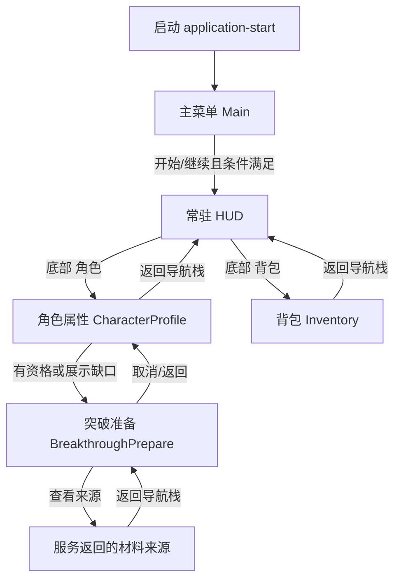

# 页面规格：玩家核心分组

共同规则：逻辑布局720×1280，根 SafeZone 后再留24；横屏1280×720按内容重排，不拉伸竖稿。页头、滚动中区、固定底部CTA分离。动态值来自ViewModel；装饰不接收点击；触控热区≥88×88。使用项目批准水墨规范：宣纸、墨绿、少量旧金、马善政标题与霞鹜文楷正文。安全区、字体、交互均沿公共契约。

## 路由闭环



## 页面布局和交互状态

| 页面 | 顶部与主体 | 固定区 | 数据/交互边界 | 横屏重排 |
|---|---|---|---|---|
| 主菜单 `main` | 保留现有题字、人物、场景；开始/继续主序；次级存档、设置、退出路径 | 底部主按钮区 | FrontendVm；空存档禁用继续并说明；退出确认；无新增登录/选服 | 标题左、菜单右；人物/背景不改 |
| HUD `home` | 左上身份状态；右上活动/签到/仙途；中央场景保护区；右侧排行入口 | 五项角色/背包/修炼/排行/菜单底栏 | AnchorVm/WorldVm/LeaseVm；仅真实值；使用已批准v2和组件包 | 保留左上/右上锚点、底中导航；尺寸位置适配 |
| 角色 `character` | 保留功法行、丹田、六侧装备槽、下方配装与评级属性原结构 | 保留原允许的固定操作 | AnchorVm.attributes / MethodVm.equipped / EquipmentVm.slots；突破入口只读 availability；不造总战力 | 原面板适配宽屏，不重绘 |
| 背包 `inventory` | 保留分类/搜索、分页网格、物品详情与原模型 | 保留原操作及理由 | InventoryVm.capacity/items/filters/page/selection；出售/分解等原确认逻辑；突破只读消费服务实例 | 保留原几何/框架，详情沿用原规则 |
| 突破 `breakthrough` | 页头当前境界→目标；可滚动区：品质与Q/成长、核心材料、可开放的护道/精华/奇珍、准备度、独立天劫信息 | 固定消耗摘要与“准备突破”；禁用时说明理由 | BreakthroughVm + InventoryVm；Q/品质/成长/天劫均由权威快照提供，客户端不推算；确认前成本摘要 | 左材料列表，右品质/成长与来源详情；固定确认区 |

### 突破视觉区域标注

候选 PNG 在逻辑阅读顺序中包含：页头境界路径；品质卡片；四类材料行；准备度卡；独立天劫卡；固定成本和主按钮。图中灰色横线为后期动态字段占位，圆形空位是装饰/质量徽记位置，不代表真实头像或角色。顶部远山仅为页眉装饰。图中出现的“准备突破”仅是候选静态标签，生产文案仍由字体资产排版。


### 状态矩阵

| 状态 | 突破页表现 | 可执行操作 |
|---|---|---|
| loading | 结构骨架与“正在读取突破条件” | 返回；不提交 |
| ready | 权威值、材料持有/需求和准备度完整 | 查看来源；条件齐全才允许准备 |
| missing-core | 核心材料缺口用文字及朱砂提示 | 来源可用时进入；主CTA禁用 |
| locked/category-hidden | 早期未开放材料类别不渲染；其他锁定写原因 | 返回/查看已开放来源 |
| config-error | 缺失Q/品质/成长任一必需配置则显式说明 | 返回；CTA禁用 |
| pending | 提交中锁主CTA，保留字段和返回 | 不重复提交 |
| disconnected | 保留最后快照并标记数据可能过期 | 返回/重连刷新；不提交 |
| expired | 预留过期说明，释放/刷新由服务确认 | 重新读取后再提交 |
| error | 展示服务原因，不清空选材 | 重试/返回 |

## 字段关系与刷新

```text
角色页 BreakthroughVm.availability ──仅资格/缺口摘要──> 突破页
背包 InventoryVm.items + capacity ──可用实例/数量──> 突破材料槽
突破服务快照 ──q_normalized, quality_band, growth_min, growth_max──> 品质卡
突破服务快照 ──tribulation_chance（独立）──> 天劫卡
准备/确认回执 ──权威状态和实际材料变化──> 刷新 InventoryVm + BreakthroughVm
```

UI 不用材料槽本地求和，不作乐观扣除，不持有第二份境界/库存存档。来源链接只有在 `sources[]` 存在可路由项时可点击；无来源时显示“暂无可用来源”并禁用。取消和返回仍服从共享导航栈。

## 天劫现场候选

新增 `tribulation-live-v1.png`，只作候选。入口为突破服务确认进入渡劫后；页面读取 `TribulationVm.stages[]`, `assistances[]`, `chance`, `outcome`。显示阶段、服务端截止/剩余时长、不同有效助力人数、观众本人助力状态、服务端概率拆分及对账状态。不得客户端将重复观众消息累加、不得截止后补报助力。准备/天劫/冻结/提交/对账/成功/失败/清理按服务阶段映射；恢复连接时只恢复仍有效租约，不重播已结束阶段。成功/失败内容互斥，结果和收据只在权威回执后显示。助力按钮只在资格有效且窗口开启时启用；准备、冻结、提交、断线及结局态禁用并说明原因。
