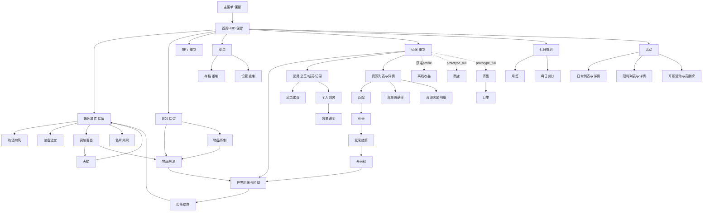

# 屏幕地图与重制清单
所有表内页面已做具体规格；仅首页进入本轮视觉生成。角色外观、装备、功法等子页重制时不能覆盖已保留的角色属性主面板。组件与功能确认层为页面内局部状态，不重复增设顶层路由。

| ID | 页面 | 处理 | 入口 | Gate | 数据 |
|---|---|---|---|---|---|
| main | 主菜单 | 保留 | application-start | base | FrontendVm |
| home | 常驻HUD | 保留 | main | base | AnchorVm, WorldVm, LeaseVm |
| character | 角色 | 保留 | home | base | AnchorVm, MethodVm, EquipmentVm |
| inventory | 物品 | 保留 | home | economic_inventory | InventoryVm |
| leaderboard | 排行 | 重制 | home | base | LeaderboardVm |
| saves | 存档 | 重制 | home | base | SaveVm |
| settings | 设置 | 重制 | home | base | SettingsVm |
| wuling | 武灵总览成员建设记录 | 重制 | journey | base | GuildVm, WorldVm |
| sword-spirit | 我的剑灵 | 重制 | journey | base | SwordVm, GiftEffectVm |
| gift-rules | 礼物效果说明 | 重制 | sword-spirit | base | GiftEffectVm |
| methods | 功法构筑 | 重制 | journey | base | MethodVm |
| race-lobby | 竞采匹配 | 重制 | resource-detail | cross_host_race | RaceVm, GuildVm |
| race-live | 竞采现场 | 重制 | race-lobby | cross_host_race | RaceVm |
| race-result | 竞采结算 | 重制 | race-live | cross_host_race | RaceVm, RewardVm |
| lease | 当前开采权 | 重制 | race-result | cross_host_race | LeaseVm |
| world-result | 历练结算 | 重制 | world | base | RewardVm |
| offline | 离线收益 | 重制 | home | offline_cultivation | RewardVm |
| shop | 原型商店 | 重制 | home | npc_shop | EconomyVm, InventoryVm |
| market | 原型寄售 | 重制 | home | player_trade | EconomyVm, InventoryVm |
| orders | 我的订单 | 重制 | market | player_trade | EconomyVm |
| world | 世界历练 | 重制 | journey | base | WorldVm, AnchorVm |
| region | 区域详情 | 重制 | world | base | WorldVm |
| resources | 资源争夺 | 重制 | journey | cross_host_race | LeaseVm, RaceVm |
| resource-detail | 资源详情 | 重制 | resources | cross_host_race | LeaseVm, RaceVm |
| sign-in | 签到组及日签到 | 重制 | home | cross_session_numeric | ActivityVm |
| monthly-sign-in | 月签到 | 重制 | sign-in | cross_session_numeric | ActivityVm |
| daily-verse | 每日剑诀 | 重制 | sign-in | base | ActivityVm |
| activities | 活动组 | 重制 | home | base | ActivityVm, LaunchVm |
| daily-activities | 日常活动 | 重制 | activities | base | ActivityVm |
| timed-activities | 限时活动 | 重制 | activities | base | ActivityVm |
| daily-detail | 日常详情 | 重制 | daily-activities | base | ActivityVm, RewardVm |
| timed-detail | 限时详情 | 重制 | timed-activities | base | ActivityVm, RewardVm |
| launch | 青云初启开服活动 | 重制 | activities | launch_activity | LaunchVm, RewardVm |
| launch-rank | 开服玩法贡献榜 | 重制 | launch | launch_activity | LaunchVm |
| breakthrough | 突破准备 | 重制 | character | item_extension | BreakthroughVm, InventoryVm |
| tribulation | 天劫助力 | 重制 | breakthrough | item_extension | TribulationVm |
| item-sources | 物品来源 | 重制 | inventory | item_extension | ItemSourceVm |
| guild-build | 武灵建设 | 重制 | wuling | item_extension | GuildBuildVm |
| equipment | 装备与法宝 | 重制 | character | item_extension | EquipmentVm, InventoryVm |
| journey | 仙途菜单 | 重制 | home | base | WorldVm, GuildVm |
| craft | 物品炼制 | 重制 | inventory | item_extension | RecipeVm, InventoryVm |
| appearance | 名片外观 | 重制 | character | base | AppearanceVm, GiftEffectVm |
| resource-rank | 资源贡献榜 | 重制 | resources | cross_host_race | RaceVm |
| resource-rewards | 资源奖励明细 | 重制 | resource-detail | cross_host_race | LeaseVm, RewardVm |

## 保留与新增的边界
本轮把主菜单和HUD同时列为保留，避免“主页面”歧义造成覆盖。地图中的方法、装备、突破等连接是子页接线要求，不授权修改角色现有布局。
旧表没有仙途页，已根据当前源码补journey以及craft、appearance、resource-rank、resource-rewards，共44屏。所有当前路由别名与合并/排除理由见evidence/route-audit.json；仙途是Extensions，旧Expedition/ExpeditionDetail与Draw均退出正式业务导航，保留开发资产不删除。CharacterFate因当前规则未开放而禁用；CharacterEquipment/Skills/Artifacts分别并入装备或功法视图，不重复造功能。旧route Character与当前CharacterProfile映射须集成时核查。材料与天劫五页以15/16和ui-extension.csv为准，旧突破弹窗只作为兼容入口。
